<!-- source: DeepWiki mcp.deepwiki.com · repo skorch-dev/skorch · page 2.3 Training Lifecycle · fetched 2026-10-21 -->

# Training Lifecycle

Relevant source files

The following files were used as context for generating this wiki page:

- [docs/user/FAQ.rst](docs/user/FAQ.rst)
- [docs/user/callbacks.rst](docs/user/callbacks.rst)
- [docs/user/dataset.rst](docs/user/dataset.rst)
- [docs/user/neuralnet.rst](docs/user/neuralnet.rst)
- [skorch/net.py](skorch/net.py)
- [skorch/tests/test_net.py](skorch/tests/test_net.py)

## Purpose and Scope

This document describes the complete training lifecycle in skorch, from initialization through training completion. It covers:

- The initialization phase and lazy component creation
- The structure of the training loop (epochs, batches, validation)
- Callback invocation points throughout the lifecycle
- The training step process (forward pass, loss computation, backpropagation, optimization)
- State management and history tracking

For information about specific neural network types (classifier, regressor), see [Neural Network Types](#2.2). For details on callback implementation, see [Callback Basics](#3.1). For dataset handling and splitting, see [Dataset Handling](#2.4).

---

## Overview of the Training Lifecycle

The skorch training lifecycle consists of two main phases: **initialization** and **training**. Components are initialized lazily (only when needed), and the training loop iterates through epochs and batches while invoking callbacks at specific hook points.

### Lifecycle Phases Diagram

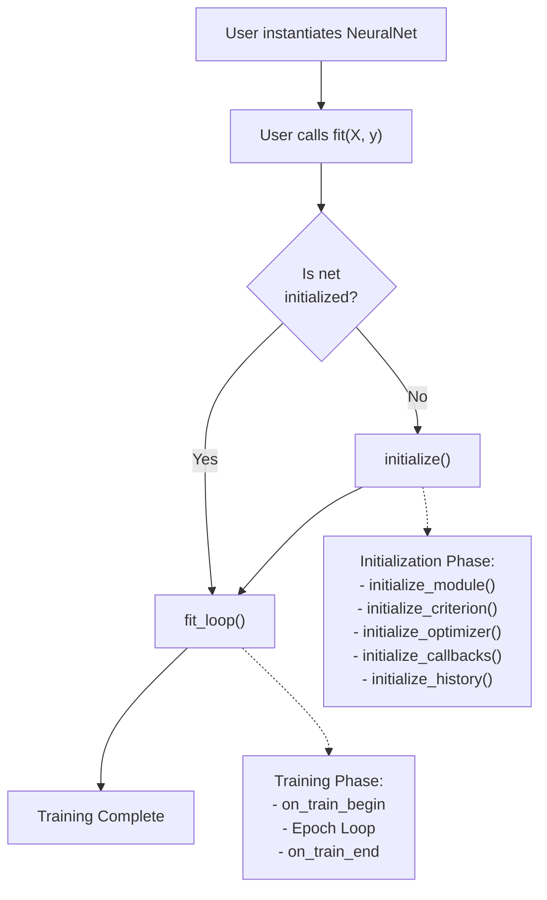

**Sources:** [skorch/net.py:931-945](), [skorch/net.py:1032-1049](), [docs/user/neuralnet.rst:42-57]()

---

## Initialization Phase

### Lazy Initialization

When you instantiate a `NeuralNet`, components are **not** immediately initialized. Arguments are stored as-is, allowing the instance to be cloned and ensuring sklearn compatibility. Initialization occurs only when `fit()` or `initialize()` is called.

**Key characteristics:**
- Uninitialized attributes: `module`, `criterion`, `optimizer`, `callbacks`, `train_split`, `dataset`
- Initialized attributes (with trailing underscore): `module_`, `criterion_`, `optimizer_`, `callbacks_`, `history_`
- The `initialized_` boolean flag tracks initialization state

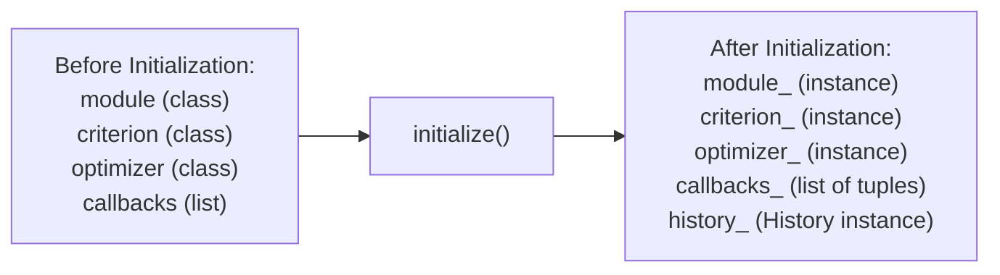

**Sources:** [skorch/net.py:327-378](), [skorch/net.py:931-945](), [docs/user/neuralnet.rst:42-61]()

### Initialization Method Sequence

The `initialize()` method calls several component-specific initialization methods in sequence:

| Order | Method | Purpose | Key Actions |
|-------|--------|---------|-------------|
| 1 | `_initialize_virtual_params()` | Set up virtual parameter handling | Registers patterns for optimizer param groups |
| 2 | `_initialize_callbacks()` | Initialize all callbacks | Creates `callbacks_` list with unique names |
| 3 | `_initialize_module()` | Initialize PyTorch module | Instantiates `module_`, moves to device, compiles if requested |
| 4 | `_initialize_criterion()` | Initialize loss criterion | Instantiates `criterion_`, moves to device, compiles if requested |
| 5 | `_initialize_optimizer()` | Initialize optimizer | Instantiates `optimizer_` with learnable parameters |
| 6 | `_initialize_history()` | Initialize history tracker | Creates or clears `history_` |

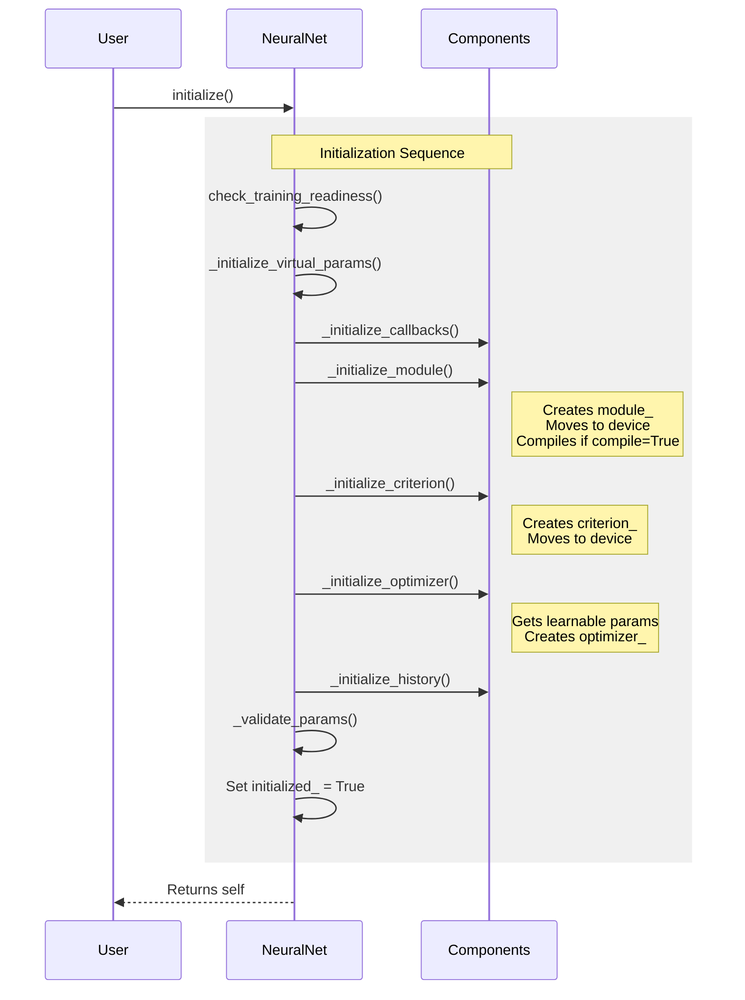

**Sources:** [skorch/net.py:931-945](), [skorch/net.py:711-758](), [skorch/net.py:760-791](), [skorch/net.py:899-923]()

### Re-initialization Behavior

Components may be re-initialized during training under specific conditions:

**When `warm_start=False` (default):**
- Each `fit()` call triggers full re-initialization
- Training starts from scratch
- Module weights are reset

**When `warm_start=True`:**
- `fit()` continues from the current state
- No re-initialization occurs
- Training continues where it left off

**Using `partial_fit()`:**
- Always continues from current state, regardless of `warm_start`
- Does not re-initialize if already initialized

**Sources:** [skorch/net.py:200-203](), [docs/user/neuralnet.rst:282-292](), [docs/user/FAQ.rst:24-34]()

---

## The fit() Method and Variants

### Method Relationships

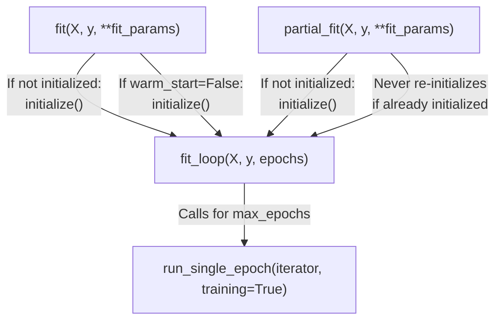

**Sources:** [skorch/net.py:1032-1049](), [skorch/net.py:1051-1083](), [skorch/net.py:1240-1271]()

### fit() Method Flow

The `fit()` method performs these steps:

1. **Check initialization:** If not initialized or `warm_start=False`, call `initialize()`
2. **Prepare data:** Create datasets from `X` and `y`
3. **Apply train/valid split:** Use `train_split` to create `dataset_train` and `dataset_valid`
4. **Call fit_loop:** Execute training for `max_epochs` epochs
5. **Return self:** Enable method chaining

**Sources:** [skorch/net.py:1032-1049]()

---

## Training Loop Structure

### Epoch and Batch Structure

The training loop has a hierarchical structure with distinct phases at train, epoch, and batch levels:

```mermaid
graph TB
    subgraph "Training Level"
        on_train_begin["on_train_begin<br/>(net, X, y)"]
        epoch_loop["Epoch Loop<br/>(1 to max_epochs)"]
        on_train_end["on_train_end<br/>(net, X, y)"]
    end
    
    subgraph "Epoch Level"
        on_epoch_begin["on_epoch_begin<br/>(net, dataset_train, dataset_valid)"]
        train_batches["Training Batches"]
        valid_step["Validation Step<br/>(if dataset_valid exists)"]
        on_epoch_end["on_epoch_end<br/>(net, dataset_train, dataset_valid)"]
    end
    
    subgraph "Batch Level"
        on_batch_begin["on_batch_begin<br/>(net, batch, training)"]
        forward_pass["Forward Pass"]
        loss_calc["Loss Calculation"]
        backward_pass["Backward Pass"]
        on_grad_computed["on_grad_computed<br/>(net, named_parameters, batch)"]
        optimizer_step["Optimizer Step"]
        on_batch_end["on_batch_end<br/>(net, batch, training, loss, y_pred)"]
    end
    
    on_train_begin --> epoch_loop
    epoch_loop --> on_train_end
    
    on_epoch_begin --> train_batches
    train_batches --> valid_step
    valid_step --> on_epoch_end
    
    on_batch_begin --> forward_pass
    forward_pass --> loss_calc
    loss_calc --> backward_pass
    backward_pass --> on_grad_computed
    on_grad_computed --> optimizer_step
    optimizer_step --> on_batch_end
```

**Sources:** [skorch/net.py:1240-1271](), [skorch/net.py:1293-1329](), [skorch/net.py:1404-1462]()

### Detailed Training Loop Sequence

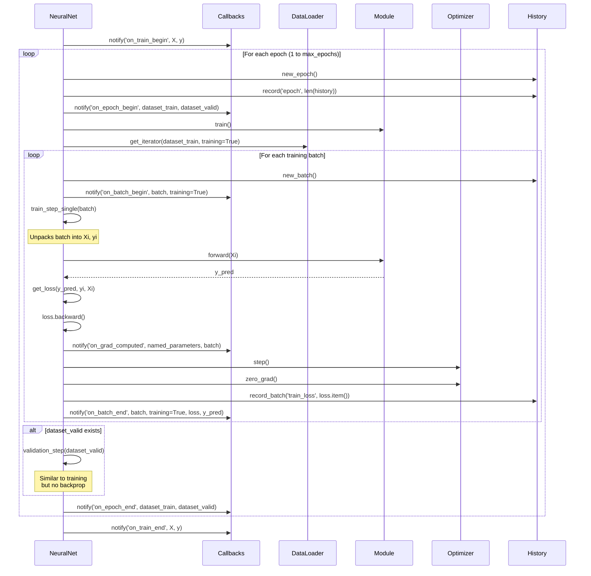

**Sources:** [skorch/net.py:1240-1271](), [skorch/net.py:1293-1329](), [skorch/net.py:1404-1462](), [skorch/net.py:1464-1510]()

---

## Callback Hook Points

### Hook Point Reference Table

| Hook | When Called | Arguments | Typical Use Cases |
|------|-------------|-----------|-------------------|
| `on_train_begin` | Once at training start | `net`, `X`, `y` | Load checkpoints, initialize logging |
| `on_train_end` | Once at training end | `net`, `X`, `y` | Save final model, load best weights |
| `on_epoch_begin` | Start of each epoch | `net`, `dataset_train`, `dataset_valid` | Learning rate scheduling, parameter freezing |
| `on_epoch_end` | End of each epoch | `net`, `dataset_train`, `dataset_valid` | Checkpointing, early stopping checks, metric logging |
| `on_batch_begin` | Before each batch | `net`, `batch`, `training` | Batch-level monitoring |
| `on_batch_end` | After each batch | `net`, `batch`, `training`, `loss`, `y_pred` | Batch scoring, logging |
| `on_grad_computed` | After backward, before optimizer step | `net`, `named_parameters`, `batch`, `training` | Gradient clipping, gradient analysis |

**Sources:** [skorch/net.py:405-448](), [docs/user/callbacks.rst:36-90]()

### Callback Notification Mechanism

The `notify()` method is the central mechanism for invoking callbacks:

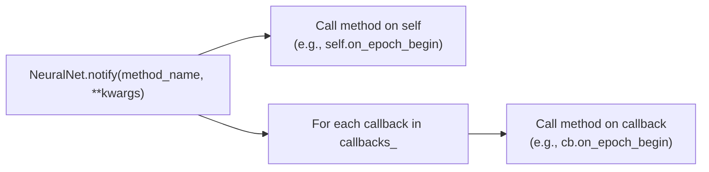

**Sources:** [skorch/net.py:405-420]()

---

## Training Step Details

### Single Training Step (train_step_single)

The `train_step_single()` method handles one batch of training data:

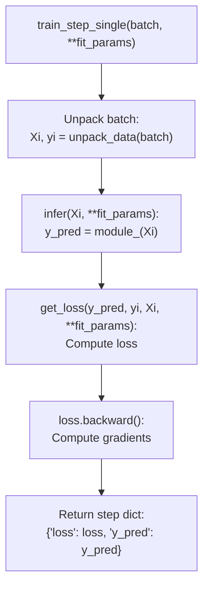

**Process details:**
1. **Unpack batch:** Splits batch into `Xi` (input) and `yi` (target) using `unpack_data()`
2. **Forward pass:** Calls `infer()` which sets module to train mode and calls `module_.forward()`
3. **Loss computation:** Calls `get_loss()` to compute the loss value
4. **Backward pass:** Calls `loss.backward()` to compute gradients
5. **Return step info:** Returns dict with loss and predictions for history recording

**Sources:** [skorch/net.py:1404-1462](), [skorch/net.py:1358-1402]()

### Training Step Integration (train_step)

The `train_step()` method wraps `train_step_single()` with callback notifications and optimization:

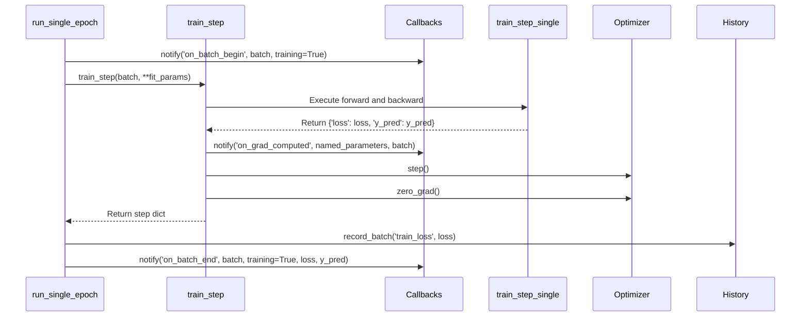

**Sources:** [skorch/net.py:1464-1510](), [skorch/net.py:1293-1329]()

### Validation Step

The validation step is similar to training but without backpropagation:

**Key differences from training:**
- Module set to eval mode via `module_.eval()`
- No gradient computation (wrapped in `torch.no_grad()`)
- No optimizer step
- Uses `iterator_valid` instead of `iterator_train`
- Callbacks receive `training=False`

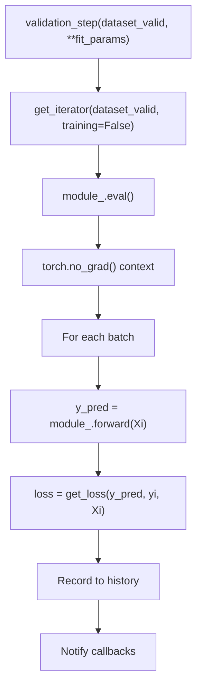

**Sources:** [skorch/net.py:1512-1556]()

---

## Data Flow During Training

### From Input to Module

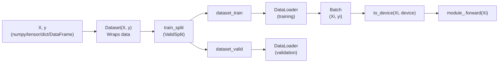

**Sources:** [skorch/net.py:1085-1152](), [skorch/net.py:1154-1177](), [skorch/dataset.py:1-100]()

### Data Transformations

1. **Input data** → **Dataset wrapper:** Converts various input types to unified interface
2. **Dataset** → **Train/Valid split:** Uses `train_split` (typically `ValidSplit`) to create subsets
3. **Subsets** → **DataLoader:** Wraps in PyTorch `DataLoader` for batching and shuffling
4. **DataLoader** → **Batches:** Yields batches during iteration
5. **Batches** → **Device transfer:** Moves tensors to specified device (CPU/CUDA/MPS)
6. **Device tensors** → **Module:** Passed to `forward()` method

**Sources:** [skorch/net.py:1154-1238](), [docs/user/dataset.rst:61-89]()

---

## State Management and History

### History Object Structure

The `history_` attribute (an instance of `History`) tracks all training metrics:

**Hierarchical structure:**
- **Epoch level:** Stores aggregated metrics for each epoch
- **Batch level:** Stores metrics for each batch within epochs

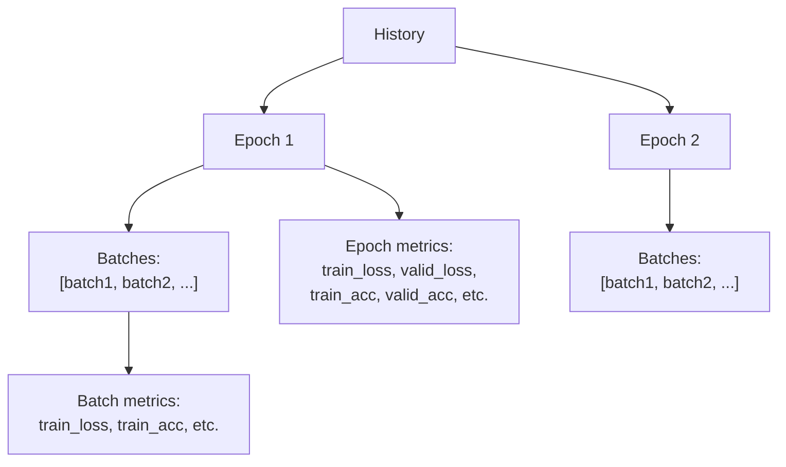

**Common history operations:**
- `history.new_epoch()`: Start tracking a new epoch
- `history.new_batch()`: Start tracking a new batch
- `history.record(key, value)`: Record a metric at current level
- `history.record_batch(key, value)`: Record a batch-level metric
- `history[-1, 'train_loss']`: Access metrics using indexing

**Sources:** [skorch/history.py:1-300](), [skorch/net.py:431-442](), [docs/user/neuralnet.rst:59-60]()

### What Gets Recorded

**Automatically recorded:**
- `epoch`: Epoch number
- `train_loss`: Average training loss per epoch (via `PassthroughScoring`)
- `valid_loss`: Validation loss per epoch (via `PassthroughScoring`)
- `dur`: Epoch duration (via `EpochTimer`)
- Batch-level losses in `history[-1, 'batches', :, 'train_loss']`

**Optional (via callbacks):**
- Custom metrics from `EpochScoring` or `BatchScoring`
- Learning rates from `LRScheduler`
- Best scores from scoring callbacks (e.g., `train_loss_best`)

**Sources:** [skorch/net.py:389-403](), [skorch/callbacks/scoring.py:1-300](), [skorch/callbacks/training.py:1-200]()

---

## Error Handling and Interruption

### KeyboardInterrupt Handling

skorch gracefully handles `KeyboardInterrupt` (Ctrl+C), allowing training to stop cleanly:

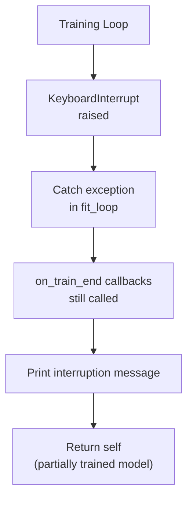

**Behavior:**
- Training stops at the current batch
- `on_train_end` callbacks are invoked
- The net is returned in its current state
- History reflects completed epochs/batches

**Sources:** [skorch/net.py:1240-1271](), [docs/user/neuralnet.rst:350-357]()

### Training Readiness Check

Before initialization, `check_training_readiness()` verifies the net can be trained:

**Checks performed:**
- Net has not been trimmed for prediction (via `trim_for_prediction()`)
- Raises `SkorchTrainingImpossibleError` if training is not possible

**Sources:** [skorch/net.py:947-955]()

---

## Special Cases and Considerations

### Multiple Optimizers

Users can define multiple optimizers by overriding `initialize_optimizer()`:

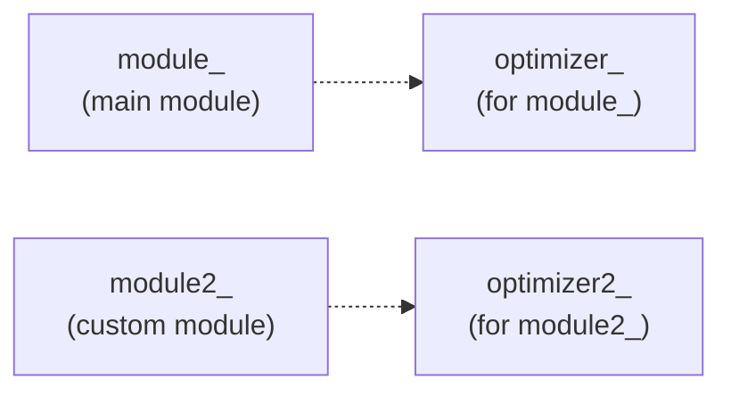

**Implementation approach:**
1. Override `initialize_optimizer()`
2. Call parent method to initialize `optimizer_`
3. Initialize additional optimizers (e.g., `optimizer2_`)
4. Override `train_step()` to call multiple optimizer steps

**Sources:** [skorch/net.py:844-870]()

### Gradient Accumulation Pattern

While not built-in, gradient accumulation can be implemented by overriding `train_step()`:

**Key modifications:**
1. Normalize loss by accumulation steps in `get_loss()`
2. Only call `optimizer_.step()` every N batches in `train_step()`
3. Track batch count to determine when to optimize

**Sources:** [docs/user/FAQ.rst:289-330]()

### Compiled Modules

When `compile=True`, modules are wrapped with `torch.compile()`:

**Compilation occurs:**
- During `_initialize_module()` for `module_`
- During `_initialize_criterion()` for `criterion_`
- After moving to device

**Parameters passed to torch.compile:**
- Use `compile__<param>` notation to pass arguments
- Example: `compile__dynamic=True` → `torch.compile(module, dynamic=True)`

**Sources:** [skorch/net.py:793-842](), [skorch/net.py:219-227]()

---

## Code Entity Reference

### Key Methods in Training Lifecycle

| Method | Location | Purpose |
|--------|----------|---------|
| `initialize()` | [skorch/net.py:931-945]() | Main initialization entry point |
| `fit()` | [skorch/net.py:1032-1049]() | Public API for training |
| `partial_fit()` | [skorch/net.py:1051-1083]() | Continue training without re-init |
| `fit_loop()` | [skorch/net.py:1240-1271]() | Execute epoch loop |
| `run_single_epoch()` | [skorch/net.py:1293-1329]() | Execute one epoch |
| `train_step()` | [skorch/net.py:1464-1510]() | Execute training step with optimization |
| `train_step_single()` | [skorch/net.py:1404-1462]() | Forward and backward for one batch |
| `validation_step()` | [skorch/net.py:1512-1556]() | Validation loop |
| `get_loss()` | [skorch/net.py:1331-1356]() | Compute loss from predictions |
| `notify()` | [skorch/net.py:405-420]() | Invoke callbacks |

### Key Attributes

| Attribute | Type | Purpose |
|-----------|------|---------|
| `initialized_` | bool | Tracks initialization state |
| `module_` | torch.nn.Module | Initialized PyTorch module |
| `criterion_` | callable | Initialized loss function |
| `optimizer_` | torch.optim.Optimizer | Initialized optimizer |
| `callbacks_` | list of tuples | Initialized callbacks with names |
| `history_` | History | Training metrics tracker |

**Sources:** [skorch/net.py:270-312](), [skorch/net.py:1-56]()

---

