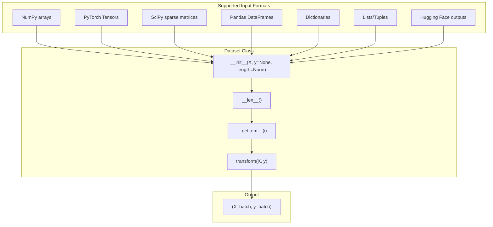
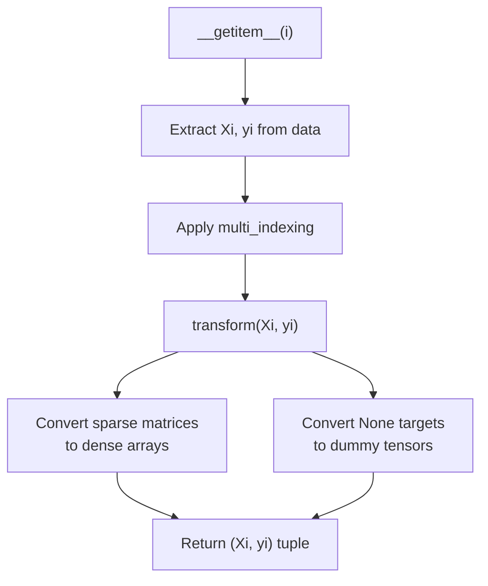
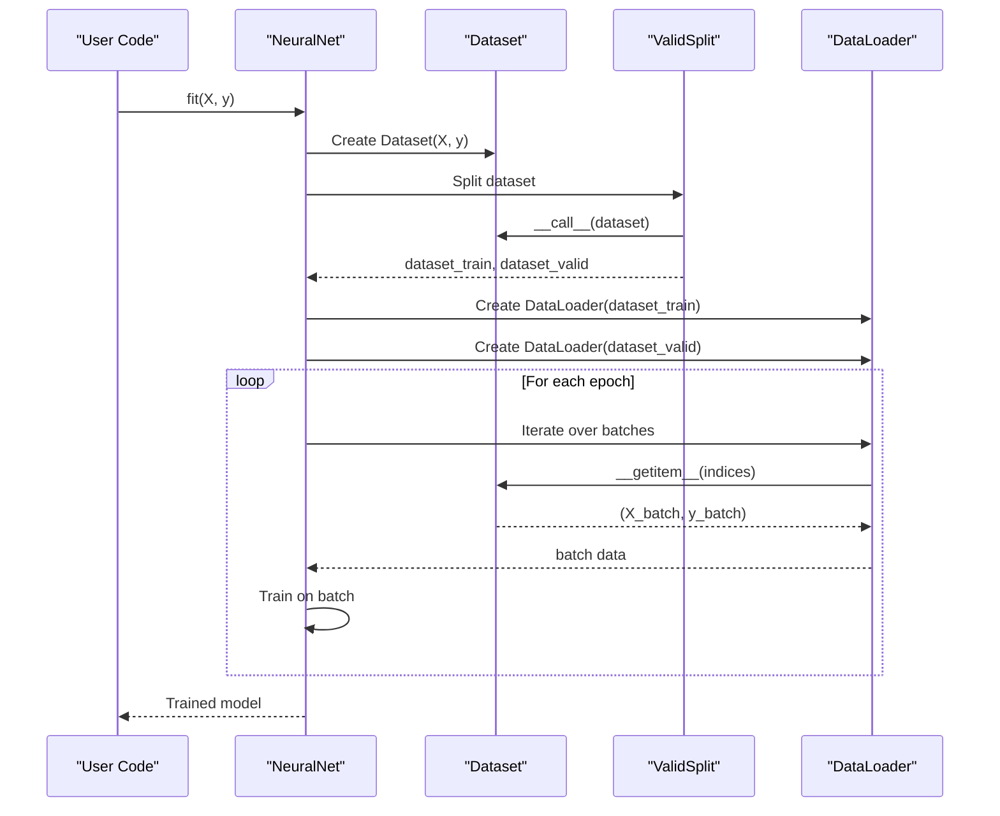

<!-- source: DeepWiki mcp.deepwiki.com · repo skorch-dev/skorch · page 2.4 Dataset Handling · fetched 2026-10-21 -->

# Dataset Handling

<details>
<summary>Relevant source files</summary>

The following files were used as context for generating this wiki page:

- [docs/user/FAQ.rst](docs/user/FAQ.rst)
- [docs/user/callbacks.rst](docs/user/callbacks.rst)
- [docs/user/dataset.rst](docs/user/dataset.rst)
- [docs/user/neuralnet.rst](docs/user/neuralnet.rst)
- [skorch/dataset.py](skorch/dataset.py)
- [skorch/tests/test_dataset.py](skorch/tests/test_dataset.py)

</details>


This page documents how skorch handles datasets, covering the core dataset classes and train/validation splitting mechanisms. Skorch provides flexible data handling capabilities that work seamlessly with various input formats while maintaining compatibility with both PyTorch's and scikit-learn's data processing conventions.

The primary components covered in this document are the `Dataset` class for data representation and the `ValidSplit` class for creating train/validation splits. For information about tracking training metrics, see [History and Training Tracking](#2.4).

## Dataset Class Overview

The `Dataset` class is a general-purpose wrapper around various data types that implements PyTorch's `torch.utils.data.Dataset` interface. This class standardizes data access patterns regardless of the underlying data format.



Sources: [skorch/dataset.py:107-203]()

The `Dataset` class has these key features:

- **Consistent Interface**: Always returns a tuple of (X, y) regardless of input format
- **Flexible Data Types**: Works with NumPy arrays, PyTorch tensors, sparse matrices, Pandas DataFrames, dictionaries, lists, and even Hugging Face tokenizer outputs
- **Automatic Conversion**: Transforms inputs to PyTorch tensors for model consumption
- **None Handling**: Properly handles cases where targets (y) are not provided

### Dataset Initialization

When creating a `Dataset` instance, you provide:

1. `X`: The input features in any supported format
2. `y`: The target values (optional)
3. `length`: Optional explicit length specification

The dataset automatically checks data consistency and determines appropriate indexing methods for each data type.

```python
# Examples of creating Dataset instances
from skorch.dataset import Dataset

# With NumPy arrays
X_numpy = np.random.rand(100, 10)
y_numpy = np.random.randint(0, 2, size=100)
dataset = Dataset(X_numpy, y_numpy)

# With dictionary input
X_dict = {'feature1': np.random.rand(100, 5), 'feature2': np.random.rand(100, 5)}
dataset = Dataset(X_dict, y_numpy)

# Without targets (for inference)
dataset = Dataset(X_numpy)
```

Sources: [skorch/dataset.py:141-164]()

### Data Retrieval and Transformation

The `Dataset` class provides two key methods for data access:

1. `__getitem__(i)`: Retrieves the i-th sample and applies transformations
2. `transform(X, y)`: Converts data to PyTorch tensors and handles special cases



Sources: [skorch/dataset.py:169-202]()

## ValidSplit Class

The `ValidSplit` class implements train/validation splitting functionality, providing an interface similar to scikit-learn's cross-validation utilities but adapted for neural network training.

```mermaid
graph TD
    subgraph "Input"
        dataset["Dataset instance"]
        y["Optional target values"]
        groups["Optional grouping variable"]
    end

    subgraph "ValidSplit Configuration"
        cv["cv: int, float, or splitter"]
        stratified["stratified: bool"]
        random_state["random_state: int or None"]
    end

    subgraph "Split Types"
        kfold["K-Fold (when cv is integer)"]
        percentage["Percentage split \n(when cv is float)"]
        custom["Custom CV splitter \n(sklearn compatible)"]
    end

    subgraph "Output"
        train["dataset_train: PyTorch Dataset"]
        valid["dataset_valid: PyTorch Dataset"]
    end

    dataset --> call["__call__(dataset, y, groups)"]
    y --> call
    groups --> call
    
    cv --> check["check_cv(y)"]
    stratified --> check
    random_state --> check
    
    check --> kfold
    check --> percentage
    check --> custom
    
    kfold --> split["Get train/valid indices"]
    percentage --> split
    custom --> split
    
    split --> create["Create PyTorch Subset"]
    create --> train
    create --> valid
    
    call --> check
    check --> split
```

Sources: [skorch/dataset.py:205-333]()

### Key Features of ValidSplit

The `ValidSplit` class offers several ways to split your data:

1. **K-Fold Cross-Validation**: When `cv` is an integer (e.g., `cv=5`), it uses the first fold of a K-fold split
2. **Percentage Split**: When `cv` is a float (e.g., `cv=0.2`), it performs a percentage-based split (similar to `train_test_split`)
3. **Custom Splitters**: Accepts any scikit-learn compatible cross-validation generator
4. **Stratification**: Maintains class distribution across train and validation sets when `stratified=True`
5. **Reproducibility**: Ensures consistent splits with the `random_state` parameter

```python
# Examples of using ValidSplit
from skorch.dataset import Dataset, ValidSplit

# Basic k-fold split (uses first fold of a 5-fold split)
valid_split = ValidSplit(cv=5)

# Percentage-based split (80% train, 20% validation)
valid_split = ValidSplit(cv=0.2)

# Stratified split that preserves class distribution
valid_split = ValidSplit(cv=5, stratified=True)

# Reproducible split with fixed random state
valid_split = ValidSplit(cv=0.2, random_state=42)

# Applying the split to a dataset
dataset_train, dataset_valid = valid_split(dataset, y=y)
```

Sources: [skorch/dataset.py:244-266](), [skorch/dataset.py:301-329]()

### Internal Workflow

When calling a `ValidSplit` instance with a dataset, the following process happens:

1. Determine the appropriate cross-validation strategy based on parameters
2. For stratified splits, ensure appropriate target values are provided
3. Generate train and validation indices using the CV strategy
4. Create PyTorch `Subset` instances for both training and validation data
5. Return both subsets for use in training

The split operation always returns only the first fold, unlike scikit-learn's cross-validation that would iterate through all folds.

## Integration with NeuralNet

The dataset handling components integrate with skorch's neural network classes through the training process:



Sources: [skorch/dataset.py:107-203](), [skorch/dataset.py:205-333]()

## Handling Special Data Types

Skorch's dataset handling has specific accommodations for various data types:

### Sparse Matrices

Sparse matrices are automatically converted to dense arrays during the transform step, as PyTorch doesn't directly support sparse matrix inputs.

Sources: [skorch/dataset.py:189-193]()

### Dictionary Inputs

Dictionary inputs (common in models with multiple feature sets) are processed by applying transformations to each value in the dictionary.

Sources: [skorch/dataset.py:37-56]()

### Hugging Face Integration

There's special handling for Hugging Face tokenizer outputs, which are detected by checking for the presence of an 'input_ids' key in dictionary-like inputs.

Sources: [skorch/dataset.py:72-77]()

### Pandas DataFrames

Pandas DataFrames are converted to dictionaries of values for individual handling and transformation.

Sources: [skorch/dataset.py:197-198]()

## Practical Considerations

When using skorch's dataset handling, keep these points in mind:

1. **Consistent Lengths**: All components of X and y must have the same length, or an error will be raised
2. **Dataset Transformation**: Override the `transform` method to customize data preprocessing
3. **Stratification Requirements**: Stratified splits require explicit y values in a format compatible with stratification
4. **Reproducible Splits**: Set `random_state` when using percentage-based splits for reproducibility
5. **Memory Efficiency**: For large datasets, `ValidSplit` uses scikit-learn's indices to create subsets, avoiding data duplication

## Error Messages

The dataset module provides helpful error messages for common issues:

- Non-skorch datasets that return incorrect number of values
- Datasets with inconsistent lengths
- Attempting to use stratified CV without appropriate target values
- Using random_state with non-random CV strategies

Sources: [skorch/dataset.py:23-34](), [skorch/dataset.py:258-263]()

## Common Use Cases

Here are typical ways to use these classes in practice:

### Basic Training with Validation Split

```python
from skorch import NeuralNetClassifier
from skorch.dataset import ValidSplit

net = NeuralNetClassifier(
    module=MyModule,
    train_split=ValidSplit(cv=0.2),
    # other parameters...
)

# This will automatically:
# 1. Create a Dataset from X and y
# 2. Split it using ValidSplit
# 3. Train using the resulting training set
# 4. Validate using the validation set
net.fit(X, y)
```

### Custom Dataset Transformation

```python
from skorch.dataset import Dataset
import torch

class MyDataset(Dataset):
    def transform(self, X, y):
        # Apply custom normalization
        X = (X - self.mean) / self.std
        # Convert to PyTorch tensors
        X = torch.tensor(X, dtype=torch.float32)
        y = torch.tensor(y, dtype=torch.long) if y is not None else y
        return X, y
```

### Working with Dictionary Inputs

```python
# For models that take multiple inputs
X = {
    'text': text_features,
    'numerical': numerical_features,
    'categorical': categorical_features
}

# ValidSplit works with dictionary inputs too
train_split = ValidSplit(cv=0.2)
dataset = Dataset(X, y)
dataset_train, dataset_valid = train_split(dataset)
```

---

