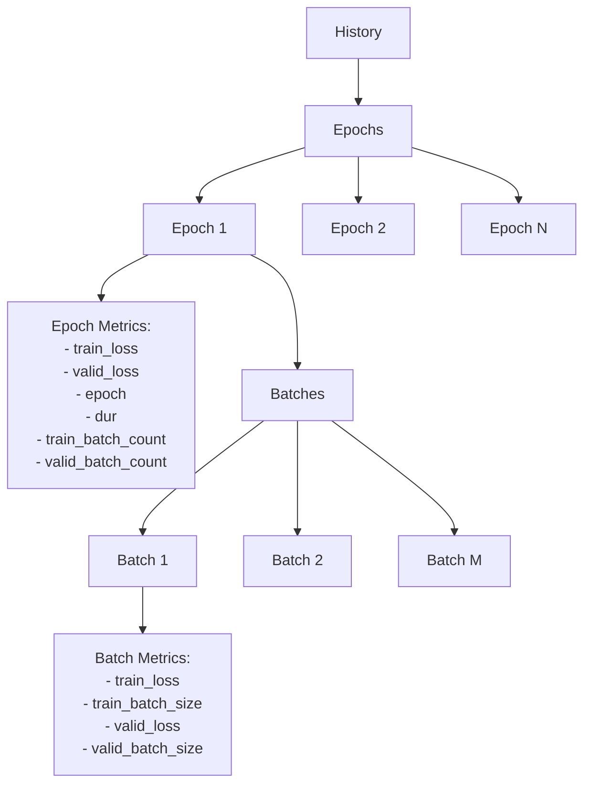
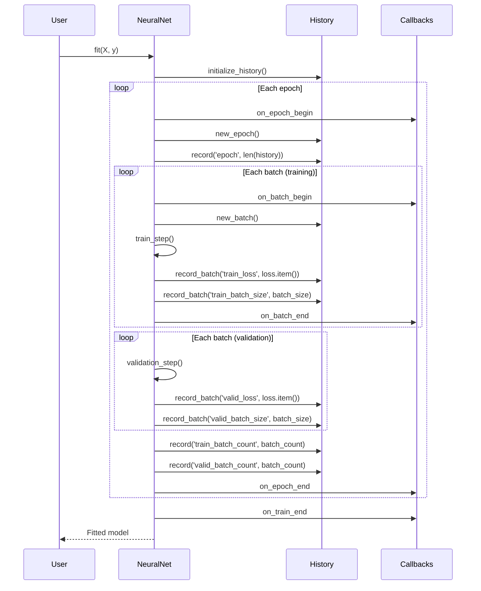
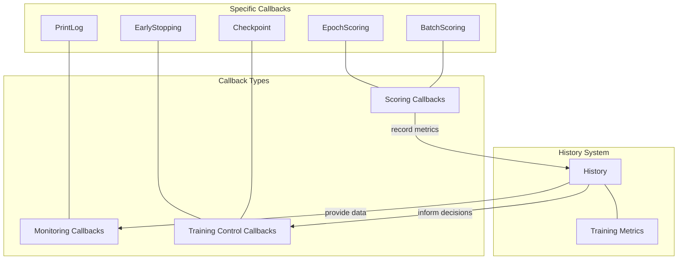

<!-- source: DeepWiki mcp.deepwiki.com · repo skorch-dev/skorch · page 2.5 History and Training Tracking · fetched 2026-10-21 -->

# History and Training Tracking

<details>
<summary>Relevant source files</summary>

The following files were used as context for generating this wiki page:

- [skorch/callbacks/scoring.py](skorch/callbacks/scoring.py)
- [skorch/net.py](skorch/net.py)
- [skorch/tests/callbacks/test_scoring.py](skorch/tests/callbacks/test_scoring.py)
- [skorch/tests/test_net.py](skorch/tests/test_net.py)

</details>


This page explains skorch's system for tracking training progress and metrics. The `History` class provides a structured way to record, access, and analyze metrics during neural network training, such as losses, validation scores, and timings. This tracking is crucial for diagnosing model performance issues and making hyperparameter optimization decisions.

For information about callbacks that can enhance history tracking with custom metrics, see [Callback System](#3).

## History Data Structure

The `History` class provides a hierarchical organization of training metrics, storing data at both epoch and batch levels. This data structure allows for comprehensive tracking of model performance throughout the training process.



Sources: [skorch/net.py:35](), [skorch/net.py:677-683]()

## History in Training Workflow

The following diagram illustrates how the `History` class is integrated into the training process. The history is updated at specific points during training to record metrics at both epoch and batch levels.



Sources: [skorch/net.py:429-431](), [skorch/net.py:438-439](), [skorch/net.py:1231-1267](), [skorch/net.py:1308-1314]()

## Default Recorded Metrics

By default, skorch's `History` tracks the following metrics:

| Level | Metric | Description |
|-------|--------|-------------|
| Epoch | `epoch` | Current epoch number |
| Epoch | `train_loss` | Average training loss for the epoch |
| Epoch | `valid_loss` | Average validation loss for the epoch (if validation data provided) |
| Epoch | `dur` | Duration of the epoch in seconds (added by `EpochTimer` callback) |
| Epoch | `train_batch_count` | Number of training batches processed |
| Epoch | `valid_batch_count` | Number of validation batches processed |
| Batch | `train_loss` | Loss for individual training batches |
| Batch | `train_batch_size` | Size of individual training batches |
| Batch | `valid_loss` | Loss for individual validation batches |
| Batch | `valid_batch_size` | Size of individual validation batches |

Additional metrics can be added by callbacks, such as accuracy scores from `EpochScoring` or learning rates from `LRScheduler`.

Sources: [skorch/net.py:1259-1262](), [skorch/net.py:1266]()

## Accessing History Data

The `History` class provides a flexible indexing interface to access recorded metrics. The examples below demonstrate common access patterns:

```python
# Access last epoch's metrics (as dict)
last_epoch_metrics = net.history[-1]

# Access training loss from last epoch
last_train_loss = net.history[-1, 'train_loss']

# Access all training losses across epochs (as numpy array)
all_train_losses = net.history[:, 'train_loss']

# Access training losses for batches in last epoch
batch_losses = net.history[-1, 'batches', :, 'train_loss']

# Check history length (number of epochs)
num_epochs = len(net.history)
```

Sources: [skorch/net.py:379-384]()

## History and Callbacks Integration

The `History` class works closely with skorch's callback system. Callbacks can record metrics, monitor progress, and make decisions based on history data.



Sources: [skorch/net.py:388-398](), [skorch/net.py:403-418](), [skorch/net.py:1229-1267]()

## Adding Custom Metrics

You can extend the default metrics tracked in the history by creating custom callbacks that record additional metrics:

```python
from skorch.callbacks import Callback

class CustomMetricCallback(Callback):
    def on_epoch_end(self, net, **kwargs):
        # Calculate your custom metric
        custom_value = calculate_something(net)
        # Record it in the history
        net.history.record('custom_metric', custom_value)

# Add to your net
net = NeuralNetClassifier(
    module=MyModule,
    callbacks=[CustomMetricCallback()]
)
```

For batch-level metrics, you can use `on_batch_end` and `record_batch()` instead.

Sources: [skorch/net.py:441-442]()

## Persisting and Loading History

History data can be saved and loaded, which is useful for resuming training, external analysis, or comparison between runs.

### Saving History

```python
# Save only history
net.save_params(f_history='history.json')

# Save history along with model parameters
net.save_params(
    f_params='model.pt',
    f_optimizer='optimizer.pt',
    f_history='history.json'
)
```

### Loading History

```python
# Load history into a new or existing net
net.load_params(f_history='history.json')

# Load complete training state
net.load_params(
    f_params='model.pt',
    f_optimizer='optimizer.pt',
    f_history='history.json'
)
```

Sources: [skorch/net.py:2458-2596]()

## Practical Example

Here's a complete example showing how to use history for tracking and visualizing metrics:

```python
import numpy as np
import matplotlib.pyplot as plt
from skorch import NeuralNetClassifier
from skorch.callbacks import EpochScoring
import torch

# Define a simple model
class MyModule(torch.nn.Module):
    def __init__(self):
        super().__init__()
        self.linear = torch.nn.Linear(20, 2)
        
    def forward(self, X):
        return torch.softmax(self.linear(X), dim=1)

# Create a neural network with custom metrics
net = NeuralNetClassifier(
    MyModule,
    max_epochs=20,
    callbacks=[
        EpochScoring('f1', name='f1_score', lower_is_better=False)
    ]
)

# Create dummy data
X = np.random.rand(1000, 20).astype(np.float32)
y = np.random.randint(0, 2, size=1000)

# Train the model
net.fit(X, y)

# Plot training metrics
plt.figure(figsize=(12, 6))

plt.subplot(1, 2, 1)
plt.plot(net.history[:, 'train_loss'], label='Train Loss')
plt.plot(net.history[:, 'valid_loss'], label='Valid Loss')
plt.xlabel('Epoch')
plt.ylabel('Loss')
plt.legend()

plt.subplot(1, 2, 2)
plt.plot(net.history[:, 'f1_score'], label='F1 Score')
plt.xlabel('Epoch')
plt.ylabel('F1 Score')
plt.legend()

plt.tight_layout()
plt.show()
```

## History Implementation Details

The `History` class is imported and initialized in the `NeuralNet` class. The history is updated at specific points during training:

1. **Initialization**: The history is initialized in `initialize_history()` method
2. **Epoch Start**: A new epoch is created and the epoch number is recorded
3. **Batch Start**: A new batch entry is created for each batch
4. **Batch End**: Batch-level metrics like loss and batch size are recorded
5. **Epoch End**: Epoch-level metrics are recorded and callbacks may add additional metrics

The history can be accessed through both `net.history` property and `net.history_` attribute. The property is just a convenience access method for the attribute.

Sources: [skorch/net.py:677-683](), [skorch/net.py:926-927](), [skorch/net.py:429-431](), [skorch/net.py:438-439](), [skorch/net.py:1259-1266]()

## Summary

The History and Training Tracking system in skorch provides:

- A hierarchical structure for organizing training metrics at epoch and batch levels
- Default tracking of essential metrics like losses and batch statistics
- Flexible indexing for easy access to recorded data
- Integration with callbacks for extended functionality
- Persistence through saving and loading
- A foundation for visualization and analysis of training progress

This system is a critical component of skorch that enables monitoring, debugging, and optimizing neural network training.

---

