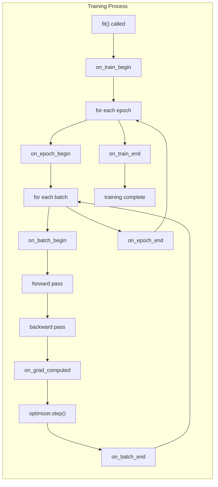
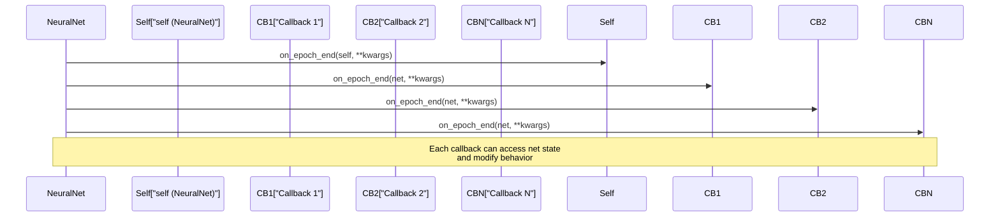
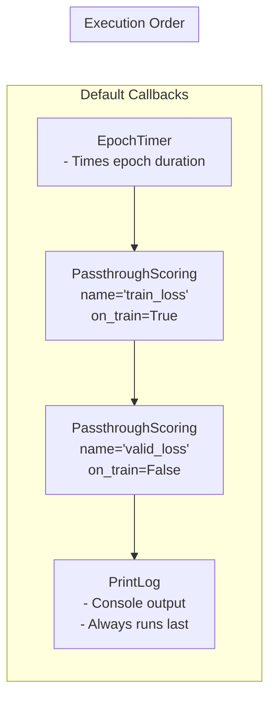
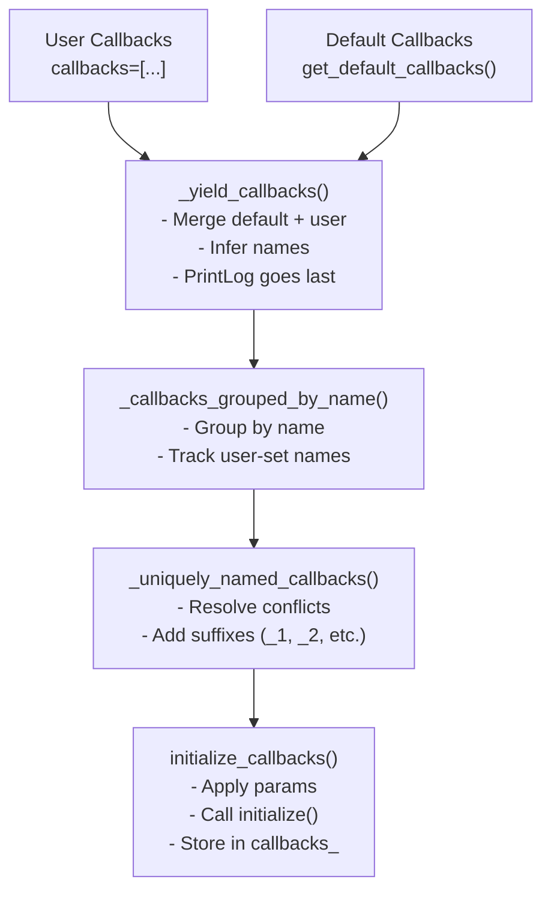
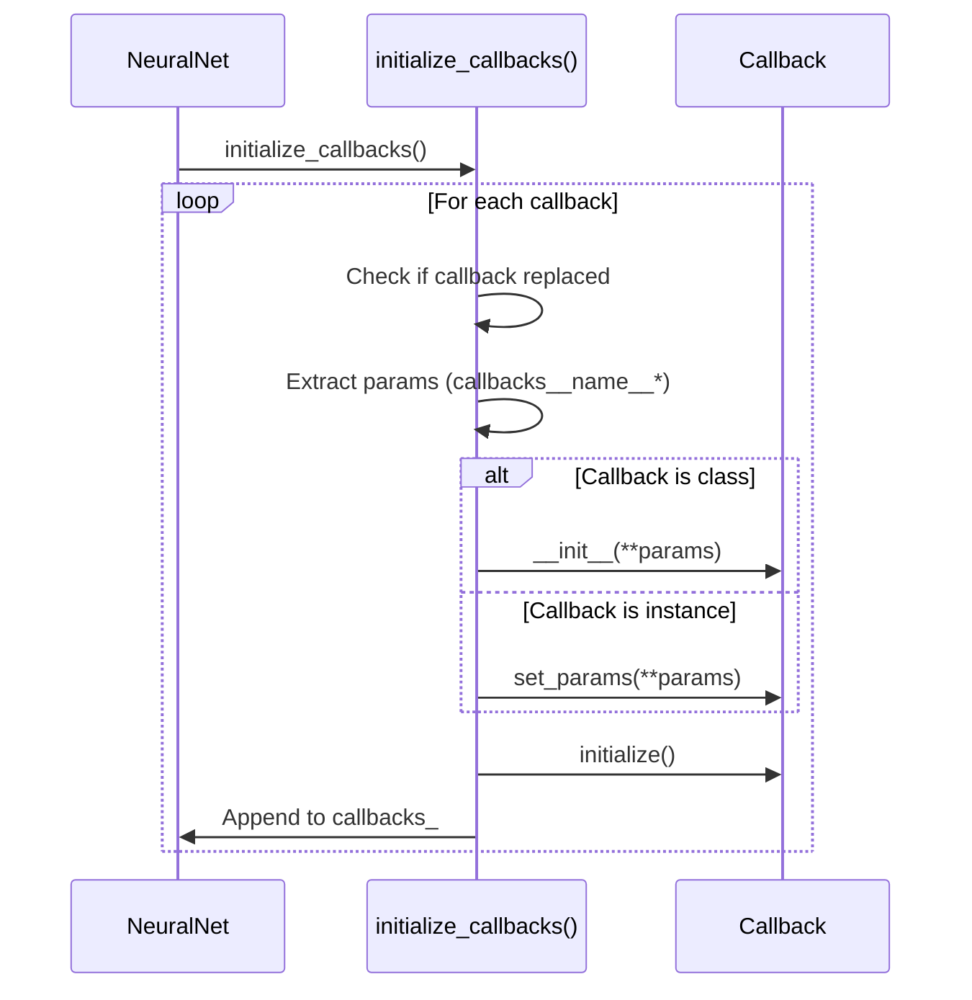
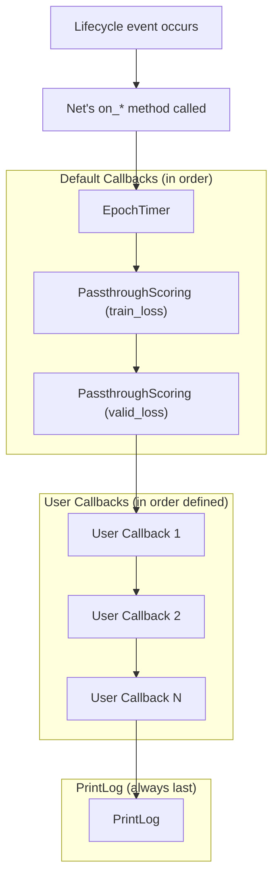
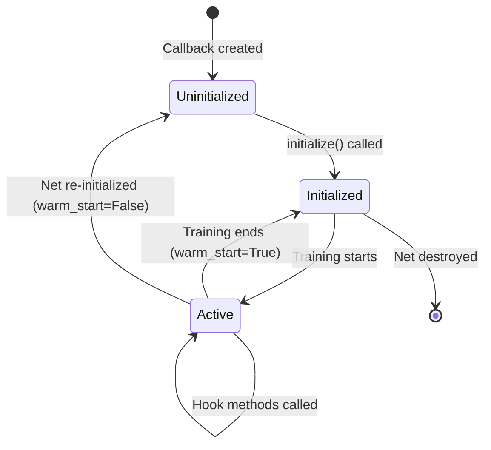
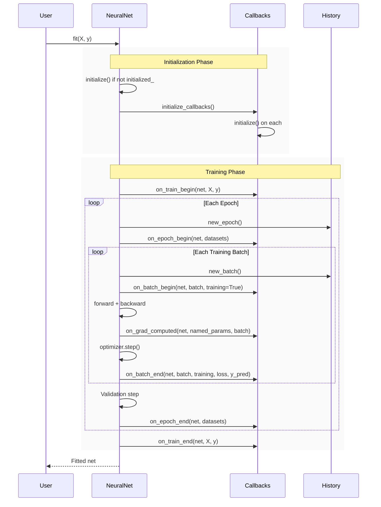

<!-- source: DeepWiki mcp.deepwiki.com · repo skorch-dev/skorch · page 3 Callback System · fetched 2026-10-21 -->

# Callback System

<details>
<summary>Relevant source files</summary>

The following files were used as context for generating this wiki page:

- [docs/user/FAQ.rst](docs/user/FAQ.rst)
- [docs/user/callbacks.rst](docs/user/callbacks.rst)
- [docs/user/dataset.rst](docs/user/dataset.rst)
- [docs/user/neuralnet.rst](docs/user/neuralnet.rst)
- [skorch/net.py](skorch/net.py)
- [skorch/tests/test_net.py](skorch/tests/test_net.py)

</details>


## Purpose and Scope

The Callback System is the primary extension mechanism in skorch, providing a flexible way to customize training behavior without subclassing `NeuralNet`. Callbacks can observe and modify the training process at specific lifecycle points, enabling features like checkpointing, early stopping, learning rate scheduling, metric tracking, and parameter manipulation.

This page covers the callback architecture and integration with `NeuralNet`. For details on:
- Writing custom callbacks and lifecycle hooks, see [Callback Basics](#3.1)
- Checkpointing and early stopping, see [Training Control Callbacks](#3.2)
- Computing and recording metrics, see [Scoring Callbacks](#3.3)
- Dynamic learning rate adjustment, see [Learning Rate Schedulers](#3.4)
- Weight freezing and initialization, see [Parameter Manipulation Callbacks](#3.5)

For information on other extension systems, see [Dataset Handling](#2.4) for data processing and [Integration Helpers](#5.2) for sklearn compatibility.

## System Architecture

The callback system consists of a base `Callback` class and specialized callback categories that integrate with the `NeuralNet` training lifecycle.

### Callback Categories and Class Hierarchy

```mermaid
graph TB
    subgraph "Base Infrastructure"
        Callback["Callback<br/>(skorch.callbacks.Callback)"]
    end
    
    subgraph "Training Control"
        Checkpoint["Checkpoint<br/>- Model persistence<br/>- Best model tracking<br/>- safetensors support"]
        EarlyStopping["EarlyStopping<br/>- Patience mechanism<br/>- Metric monitoring<br/>- Best model loading"]
        LoadInitState["LoadInitState<br/>- Resume training<br/>- History restoration"]
        TrainEndCheckpoint["TrainEndCheckpoint<br/>- Save on completion"]
    end
    
    subgraph "Scoring"
        ScoringBase["ScoringBase<br/>- Best score tracking<br/>- sklearn metric support"]
        BatchScoring["BatchScoring<br/>- Batch-level metrics"]
        EpochScoring["EpochScoring<br/>- Epoch-level metrics<br/>- Caching support"]
        PassthroughScoring["PassthroughScoring<br/>- Aggregate batch scores"]
    end
    
    subgraph "Learning Rate Management"
        LRScheduler["LRScheduler<br/>- PyTorch scheduler wrapper<br/>- Step every epoch/batch<br/>- Metric monitoring"]
        WarmRestartLR["WarmRestartLR<br/>- SGDR policy<br/>- Cosine annealing"]
    end
    
    subgraph "Parameter Manipulation"
        ParamMapper["ParamMapper<br/>- Pattern matching<br/>- Function application<br/>- Scheduling"]
        Freezer["Freezer<br/>- Freeze parameters"]
        Unfreezer["Unfreezer<br/>- Unfreeze parameters"]
        Initializer["Initializer<br/>- Weight initialization"]
    end
    
    Callback --> Checkpoint
    Callback --> EarlyStopping
    Callback --> LoadInitState
    Callback --> TrainEndCheckpoint
    Callback --> ScoringBase
    Callback --> ParamMapper
    Callback --> LRScheduler
    
    ScoringBase --> BatchScoring
    ScoringBase --> EpochScoring
    ScoringBase --> PassthroughScoring
    LRScheduler --> WarmRestartLR
    ParamMapper --> Freezer
    ParamMapper --> Unfreezer
    ParamMapper --> Initializer
```



Sources: Based on high-level architecture diagrams and callback system architecture from context.

## Integration with NeuralNet

### Callback Lifecycle Hook Points

`NeuralNet` invokes callbacks at eight distinct points during training. Each hook receives the net instance and relevant context data.



| Hook | Signature | Invocation Frequency | Common Uses |
|------|-----------|---------------------|-------------|
| `on_train_begin` | `(net, X, y)` | Once per fit call | Load checkpoints, initialize tracking |
| `on_epoch_begin` | `(net, dataset_train, dataset_valid)` | Once per epoch | Apply parameter schedules, record epoch start |
| `on_batch_begin` | `(net, batch, training)` | Once per batch | Pre-batch logging, dynamic scheduling |
| `on_grad_computed` | `(net, named_parameters, batch, training)` | Once per training batch | Gradient clipping, gradient inspection |
| `on_batch_end` | `(net, batch, training, loss, y_pred)` | Once per batch | Batch scoring, batch logging |
| `on_epoch_end` | `(net, dataset_train, dataset_valid)` | Once per epoch | Epoch scoring, checkpointing, early stopping |
| `on_train_end` | `(net, X, y)` | Once per fit call | Final checkpoint, load best model |

Sources: [skorch/net.py:405-448]()

### Callback Notification Mechanism

The `NeuralNet.notify` method dispatches lifecycle events to all registered callbacks:



The notify implementation [skorch/net.py:405-420]() first calls the hook method on the net itself, then iterates through all registered callbacks in `callbacks_`, calling the same method on each.

Sources: [skorch/net.py:405-420]()

## Default Callbacks

Every `NeuralNet` instance starts with a set of default callbacks that provide essential functionality:



The default callbacks are defined in the `_default_callbacks` property [skorch/net.py:389-403](). User-provided callbacks are executed after default callbacks, except `PrintLog` which always runs last [docs/user/neuralnet.rst:274-280]().

Sources: [skorch/net.py:389-403](), [docs/user/neuralnet.rst:274-280]()

## Callback Registration and Initialization

### Registration Flow

Callbacks can be registered in three ways:
1. As a list of callback instances
2. As a list of `(name, callback)` tuples
3. As a list mixing both formats



Sources: [skorch/net.py:450-569]()

### Callback Naming and Uniqueness

When callbacks are registered without explicit names, names are inferred from class names. If conflicts occur, skorch appends count suffixes:

| Input | Resulting Name |
|-------|----------------|
| `MyCallback()` | `MyCallback` |
| `MyCallback()`, `MyCallback()` | `MyCallback_1`, `MyCallback_2` |
| `('my_cb', MyCallback())` | `my_cb` (user-defined, must be unique) |

User-defined names that conflict raise a `ValueError` [skorch/net.py:508-511]().

Sources: [skorch/net.py:500-522]()

### Initialization Process

The `initialize_callbacks` method [skorch/net.py:524-569]():

1. Iterates through uniquely named callbacks
2. Checks if callback itself was replaced via `set_params` (e.g., `callbacks__my_cb=None`)
3. Extracts parameters for the callback using `get_params_for('callbacks__<name>')`
4. Instantiates callback if it's a class, or updates params if already instantiated
5. Calls `callback.initialize()` on each callback
6. Stores initialized callbacks in the `callbacks_` attribute



Sources: [skorch/net.py:524-569]()

## Callback Parameter Management

### Double-Underscore Notation

Callbacks support parameter setting through sklearn's double-underscore notation:

```python
net = NeuralNet(
    module=MyModule,
    callbacks=[
        ('checkpoint', Checkpoint(monitor='valid_acc_best')),
        ('early_stop', EarlyStopping(patience=5)),
    ],
)

# Set callback parameters
net.set_params(
    callbacks__checkpoint__monitor='valid_loss_best',
    callbacks__early_stop__patience=10,
)
```

This enables:
- Dynamic parameter adjustment during training
- Grid search over callback parameters with `GridSearchCV`
- Programmatic callback configuration

Sources: [docs/user/neuralnet.rst:265-270]()

### Callback Deactivation

Callbacks can be temporarily deactivated by setting them to `None`:

```python
# Deactivate a callback
net.set_params(callbacks__my_callback=None)

# Disable ALL callbacks (including defaults)
net = NeuralNet(module=MyModule, callbacks="disable")
```

When `callbacks="disable"`, the `initialize_callbacks` method sets `callbacks_` to an empty list [skorch/net.py:717-724]().

Sources: [docs/user/callbacks.rst:114-140](), [skorch/net.py:717-724]()

## Accessing Net State from Callbacks

Callbacks receive the `net` instance as their first argument in all hook methods, providing access to:

| Attribute | Description | Example Access |
|-----------|-------------|----------------|
| `module_` | Initialized PyTorch module | `net.module_.parameters()` |
| `optimizer_` | Initialized optimizer | `net.optimizer_.param_groups` |
| `criterion_` | Initialized criterion | `net.criterion_` |
| `history` | Training history object | `net.history[-1, 'train_loss']` |
| `callbacks_` | List of initialized callbacks | `net.callbacks_` |
| Device | Current device | `net.device` |
| Training state | Various flags | `net.initialized_`, `net.verbose` |

Callbacks commonly use `net.history` to:
- Read past metric values
- Write new metrics (e.g., `net.history.record('my_metric', value)`)
- Check for improvements (e.g., `net.history[-1, 'valid_loss_best']`)

Sources: [docs/user/callbacks.rst:7-11]()

## Callback Execution Order



Key ordering rules:
1. `NeuralNet`'s own hook method executes first
2. Default callbacks execute in their defined order
3. User callbacks execute in the order they were registered
4. `PrintLog` callbacks always execute last (moved to end during `_yield_callbacks`)

This ensures that metrics are computed before being printed, and that user callbacks can depend on default callback functionality.

Sources: [skorch/net.py:450-490](), [docs/user/neuralnet.rst:274-280]()

## Special Callback Behaviors

### PrintLog Prioritization

The `_yield_callbacks` method [skorch/net.py:450-490]() collects `PrintLog` callbacks separately and yields them last, regardless of their original position in the callback list. This ensures that all metrics are computed before printing.

### Callback Dependencies

Some callbacks have implicit dependencies:

| Callback | Depends On | Reason |
|----------|------------|--------|
| `EarlyStopping` | Scoring callbacks | Monitors metric improvements |
| `Checkpoint` | Scoring callbacks (optional) | Can monitor metrics for saving condition |
| `LoadInitState` | None (but affects others) | Restores state before other callbacks run |
| `PrintLog` | All callbacks | Displays metrics computed by other callbacks |

User-defined callback order must respect these dependencies when metrics or state from one callback are used by another.

Sources: [docs/user/callbacks.rst:274-280]()

## Callback State Management

### The `initialize()` Method

Callbacks implement an `initialize()` method [docs/user/callbacks.rst:41-45]() that is called during `NeuralNet.initialize_callbacks()`. This method should:
- Reset stateful attributes when the net is re-initialized
- Prepare any resources needed during training
- Not assume the net is fully initialized (optimizer may not exist yet)

Example pattern:
```python
class MyCallback(Callback):
    def initialize(self):
        # Reset state that should be cleared on re-initialization
        self.epoch_count_ = 0
        self.best_score_ = None
        return self
```

### Callback Lifecycle



With `warm_start=False` (default), callbacks are re-initialized on each `fit()` call. With `warm_start=True`, callbacks maintain state across multiple `fit()` calls.

Sources: [docs/user/callbacks.rst:41-45](), [skorch/net.py:524-569]()

## Common Callback Patterns

### Monitoring and Logging

Callbacks frequently access `net.history` to track metrics over time:

```python
# Pattern: Check if current epoch has best score
current_score = net.history[-1, 'valid_acc']
best_score = net.history[-1, 'valid_acc_best']
if best_score:
    # This epoch achieved a new best score
    pass
```

### Conditional Execution

Callbacks can skip execution based on conditions:

```python
class MyCallback(Callback):
    def on_epoch_end(self, net, **kwargs):
        # Only run every 5 epochs
        if len(net.history) % 5 != 0:
            return
        # ... callback logic ...
```

### Cross-Callback Communication

Callbacks can access other callbacks via `net.callbacks_`:

```python
class MyCallback(Callback):
    def on_train_begin(self, net, **kwargs):
        # Find another callback by name
        for name, cb in net.callbacks_:
            if name == 'my_other_callback':
                # Access or modify the other callback
                cb.some_attribute = value
```

Sources: [docs/user/callbacks.rst:7-11]()

## Integration with Training Loop

The complete training loop with callback integration:



Key integration points:
1. Callbacks are initialized before training starts
2. Each lifecycle event triggers `notify()` which dispatches to all callbacks
3. Callbacks can record to `History` during hooks
4. Training can be interrupted by callbacks (e.g., `EarlyStopping` raising `KeyboardInterrupt`)

Sources: [skorch/net.py:405-448](), High-level architecture diagram 4 from context.

## Memory and Performance Considerations

### Callback Overhead

Each callback adds overhead at each lifecycle point. The `notify` method [skorch/net.py:405-420]() iterates through all callbacks, so having many callbacks can impact performance, especially for frequent hooks like `on_batch_begin` and `on_batch_end`.

### History Storage

Callbacks that record metrics to `History` consume memory proportional to the number of epochs and metrics. For long training runs with many metrics, this can become significant.

### Caching in Scoring Callbacks

The `use_caching` parameter [skorch/net.py:229-241]() globally controls whether scoring callbacks cache inference results. Setting `use_caching=False` reduces memory consumption but increases computation time by repeating forward passes.

Sources: [skorch/net.py:229-241]()

## Summary

The Callback System provides:

| Feature | Implementation | Location |
|---------|----------------|----------|
| Base class | `Callback` with hook methods | `skorch.callbacks.Callback` |
| Registration | List of callbacks or (name, callback) tuples | `NeuralNet.__init__(callbacks=...)` |
| Initialization | `initialize_callbacks()` during net initialization | [skorch/net.py:524-569]() |
| Dispatching | `notify(method_name, **kwargs)` at lifecycle points | [skorch/net.py:405-420]() |
| Naming | Automatic inference or user-defined | [skorch/net.py:450-522]() |
| Parameters | Double-underscore notation | `callbacks__<name>__<param>` |
| Deactivation | Set to `None` or `callbacks="disable"` | [docs/user/callbacks.rst:114-140]() |
| Default set | `EpochTimer`, `PassthroughScoring` (x2), `PrintLog` | [skorch/net.py:389-403]() |

The callback system enables extensive customization of training behavior while maintaining a clean separation between core training logic and extensions.

Sources: [skorch/net.py:57-569](), [docs/user/callbacks.rst:1-296]()

---

