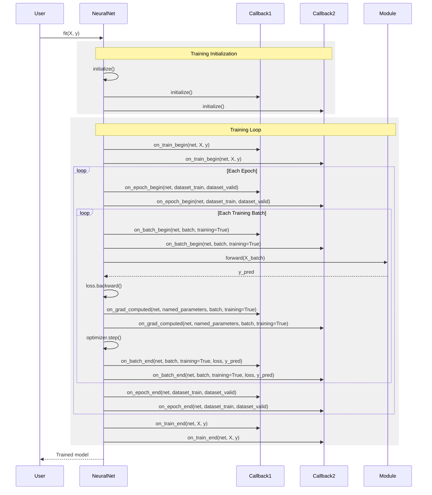
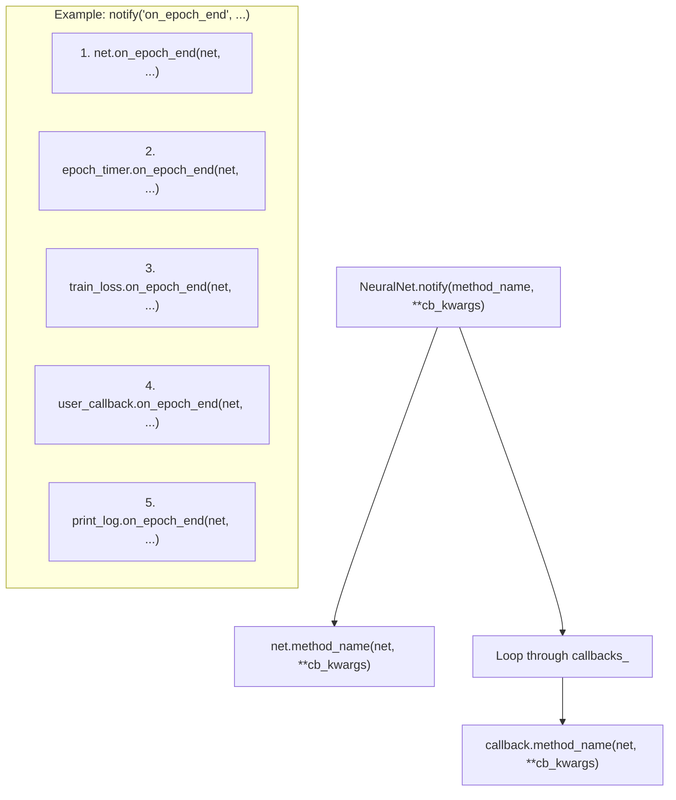
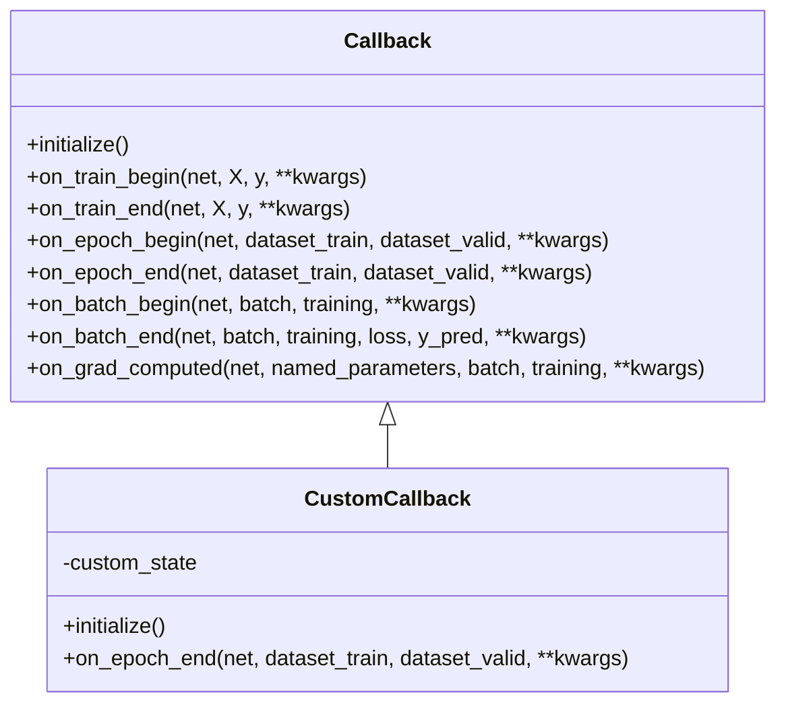
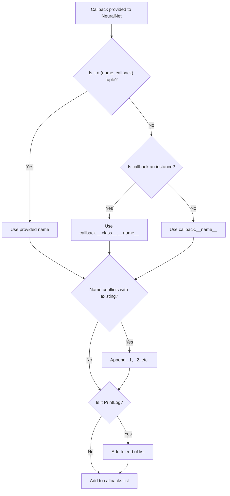
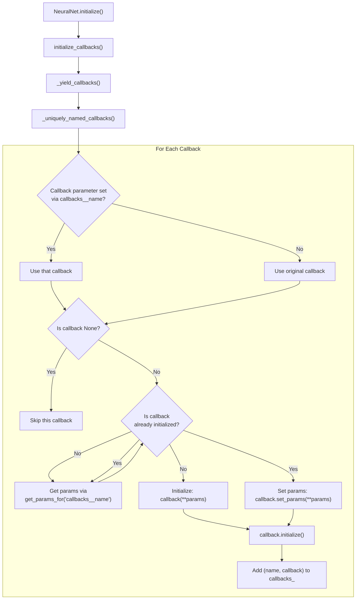
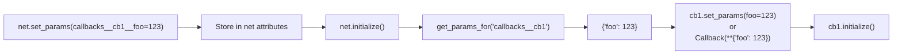
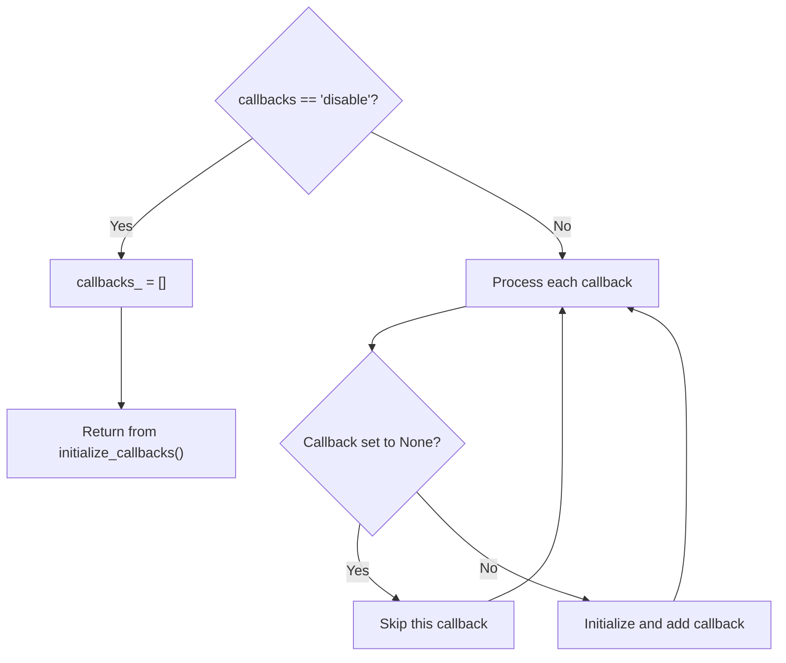
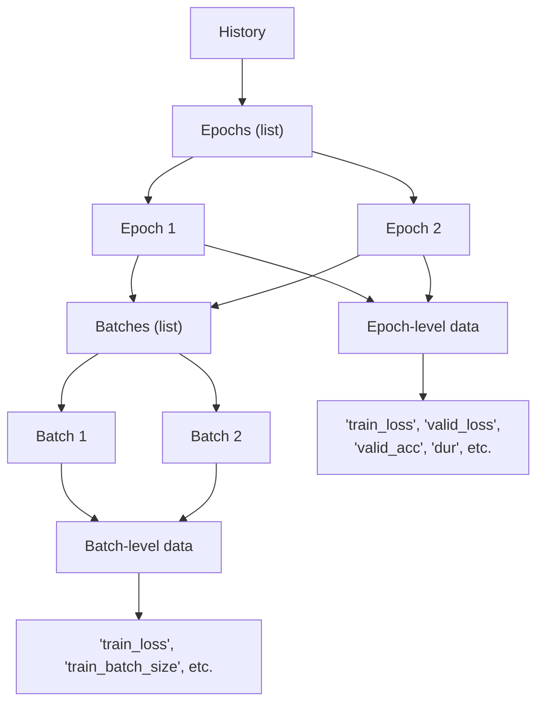

<!-- source: DeepWiki mcp.deepwiki.com · repo skorch-dev/skorch · page 3.1 Callback Basics · fetched 2026-10-21 -->

# Callback Basics

<details>
<summary>Relevant source files</summary>

The following files were used as context for generating this wiki page:

- [docs/user/FAQ.rst](docs/user/FAQ.rst)
- [docs/user/callbacks.rst](docs/user/callbacks.rst)
- [docs/user/dataset.rst](docs/user/dataset.rst)
- [docs/user/neuralnet.rst](docs/user/neuralnet.rst)
- [skorch/net.py](skorch/net.py)
- [skorch/tests/test_net.py](skorch/tests/test_net.py)

</details>


## Purpose and Scope

This page documents the fundamental callback system in skorch, including the `Callback` base class, lifecycle hook methods, and how to create and use custom callbacks. Callbacks provide a flexible mechanism to customize training behavior without subclassing `NeuralNet`.

For specific callback implementations, see:
- [Training Control Callbacks](#3.2) - Checkpoint, EarlyStopping, LoadInitState
- [Scoring Callbacks](#3.3) - BatchScoring, EpochScoring, PassthroughScoring  
- [Learning Rate Schedulers](#3.4) - LRScheduler, WarmRestartLR
- [Parameter Manipulation Callbacks](#3.5) - ParamMapper, Freezer, Unfreezer, Initializer

---

## The Callback Base Class

The `Callback` class serves as the base class for all callback implementations in skorch. It defines the interface that callbacks use to hook into the training process.

**Key Characteristics:**

| Aspect | Description |
|--------|-------------|
| **Location** | `skorch.callbacks.Callback` (base class) |
| **Purpose** | Define hook methods invoked at specific training stages |
| **Inheritance** | All callbacks must inherit from this class |
| **Hook Methods** | 8 lifecycle methods that can be overridden |
| **State Management** | Callbacks can maintain state across training |

**Hook Method Interface:**

All callback hook methods follow this signature pattern:
- First argument: `net` (the `NeuralNet` instance)
- Additional arguments: context-specific data (e.g., batch data, datasets)
- Must include `**kwargs` for forward compatibility

Sources: [docs/user/callbacks.rst:16-33](), [skorch/net.py:405-448]()

---

## Callback Lifecycle Hooks

Callbacks can override eight lifecycle methods to execute code at specific points during training. The `NeuralNet` class invokes these methods through its `notify` mechanism.

### Hook Method Overview

| Method | When Called | Key Parameters | Typical Use Cases |
|--------|-------------|----------------|-------------------|
| `initialize()` | Before training begins (once per fit) | None | Reset callback state, allocate resources |
| `on_train_begin(net, X, y)` | Start of training | Full dataset | Load checkpoints, initialize tracking |
| `on_epoch_begin(net, dataset_train, dataset_valid)` | Start of each epoch | Train/valid datasets | Apply parameter changes, epoch setup |
| `on_batch_begin(net, batch, training)` | Before processing each batch | Batch data, training flag | Pre-batch modifications |
| `on_grad_computed(net, named_parameters, batch, training)` | After gradients computed, before optimizer step | Parameters with gradients | Gradient clipping, gradient inspection |
| `on_batch_end(net, batch, training, loss, y_pred)` | After processing each batch | Batch data, loss, predictions | Batch-level metrics, logging |
| `on_epoch_end(net, dataset_train, dataset_valid)` | End of each epoch | Train/valid datasets | Epoch-level metrics, checkpointing |
| `on_train_end(net, X, y)` | End of training | Full dataset | Final cleanup, load best model |

### Callback Invocation Flow



**Callback Invocation Order:**

1. Default callbacks are invoked first (in their defined order)
2. User-defined callbacks are invoked second (in the order provided)
3. `PrintLog` callbacks are always invoked last
4. Within each batch/epoch, callbacks are invoked in the same order

Sources: [skorch/net.py:405-448](), [docs/user/callbacks.rst:36-90](), [Diagram 4 from overview]()

---

## Callback Integration in NeuralNet

The `NeuralNet` class orchestrates callback execution through several key mechanisms:

### The notify Method

The `notify` method is the central dispatcher for callback invocations:



The `notify` implementation at [skorch/net.py:405-420]():
- First calls the corresponding method on `NeuralNet` itself
- Then iterates through `self.callbacks_` and calls the method on each callback
- Passes the `NeuralNet` instance and relevant keyword arguments to each callback

### Callback Storage Structure

Callbacks are stored in `NeuralNet` as:

| Attribute | Type | Purpose | Populated When |
|-----------|------|---------|----------------|
| `callbacks` | list or None | User-provided callbacks | `__init__` |
| `callbacks_` | list of tuples | Initialized (name, callback) pairs | `initialize_callbacks()` |

### Default Callbacks

Every `NeuralNet` instance starts with default callbacks defined in `_default_callbacks` property at [skorch/net.py:389-400]():

1. `('epoch_timer', EpochTimer())` - Tracks epoch duration
2. `('train_loss', PassthroughScoring(name='train_loss', on_train=True))` - Aggregates training loss
3. `('valid_loss', PassthroughScoring(name='valid_loss'))` - Aggregates validation loss
4. `('print_log', PrintLog())` - Prints training progress

Sources: [skorch/net.py:405-420](), [skorch/net.py:389-400](), [skorch/net.py:524-569]()

---

## Creating Custom Callbacks

To create a custom callback, inherit from `Callback` and override one or more lifecycle hook methods.

### Basic Custom Callback Structure



### Implementation Guidelines

**Rule 1: Always include `**kwargs` in method signatures**
- Ensures forward compatibility when new arguments are added
- Example: `def on_epoch_end(self, net, **kwargs):`

**Rule 2: Use `initialize()` for state reset**
- Called when `NeuralNet.initialize()` is invoked
- Reset any state that should be fresh for each fit
- Allocate resources that depend on initialization

**Rule 3: Access training state through `net.history`**
- Current epoch: `len(net.history)`
- Previous epoch data: `net.history[-1]`
- Specific metrics: `net.history[-1, 'train_loss']`

**Rule 4: Use proper parameter extraction**
- For getting callback parameters: implement `get_params()` and `set_params()`
- Usually inherited from base `Callback` class automatically

### Example: Input Shape Setter Callback

From [docs/user/FAQ.rst:352-354](), a callback that dynamically sets module input size:

```python
class InputShapeSetter(skorch.callbacks.Callback):
    def on_train_begin(self, net, X, y):
        net.set_params(module__input_dim=X.shape[1])
```

This callback:
- Overrides `on_train_begin` (called once at training start)
- Accesses `X` to determine input dimension
- Uses `net.set_params()` to update module configuration
- Triggers module re-initialization before training begins

Sources: [docs/user/callbacks.rst:16-33](), [docs/user/FAQ.rst:337-367]()

---

## Adding Callbacks to NeuralNet

There are multiple ways to provide callbacks when creating a `NeuralNet` instance.

### Method 1: Pass List of Callback Instances

```python
net = NeuralNet(
    module=MyModule,
    callbacks=[
        MyCallback1(...),
        MyCallback2(...),
    ],
)
```

**Characteristics:**
- Callback names are inferred from class names
- Results in names: `"MyCallback1"`, `"MyCallback2"`
- Names may be suffixed with `_1`, `_2`, etc. if conflicts occur

### Method 2: Pass List of (name, callback) Tuples

```python
net = NeuralNet(
    module=MyModule,
    callbacks=[
        ('cb1', MyCallback1(...)),
        ('cb2', MyCallback2(...)),
    ],
)
```

**Characteristics:**
- Explicit control over callback names
- Enables parameter setting via `callbacks__cb1__param=value`
- Recommended when you need to reference callbacks later

### Method 3: Mix Named and Unnamed Callbacks

```python
net = NeuralNet(
    module=MyModule,
    callbacks=[
        ('my_checkpoint', Checkpoint(...)),
        EarlyStopping(...),  # Name will be 'EarlyStopping'
    ],
)
```

### Callback Name Resolution



The `_yield_callbacks` method at [skorch/net.py:450-489]() handles this logic:
- Processes both default and user callbacks
- Handles both named and unnamed callbacks
- Handles both initialized and uninitialized callbacks
- Ensures `PrintLog` callbacks are always processed last

Sources: [docs/user/callbacks.rst:217-281](), [skorch/net.py:450-489](), [skorch/net.py:500-522]()

---

## Callback Initialization

Callbacks are initialized during `NeuralNet.initialize()` through the `initialize_callbacks()` method.

### Initialization Process



**Key Steps** at [skorch/net.py:524-569]():

1. **Combine callbacks**: Default callbacks + user callbacks
2. **Resolve names**: Make callback names unique
3. **Check for parameter overrides**: Look for `callbacks__<name>` parameters
4. **Handle None callbacks**: Skip if callback is set to `None`
5. **Initialize or update**: 
   - If uninitialized (class): instantiate with parameters
   - If initialized (instance): call `set_params()` with parameters
6. **Call initialize()**: Invoke each callback's `initialize()` method
7. **Store result**: Save as `(name, callback)` tuple in `callbacks_`

### Duplicate Name Handling

The `_uniquely_named_callbacks` method at [skorch/net.py:500-522]() ensures unique names:

- User-defined names cannot have conflicts (raises `ValueError`)
- Auto-generated names are made unique by appending `_1`, `_2`, etc.
- Example: Two unnamed `EpochScoring` callbacks → `EpochScoring_1`, `EpochScoring_2`

Sources: [skorch/net.py:524-569](), [skorch/net.py:500-522](), [docs/user/callbacks.rst:243-281]()

---

## Setting Callback Parameters

Callback parameters can be set using the double-underscore notation, similar to sklearn's parameter passing convention.

### Parameter Syntax

| Pattern | Example | Description |
|---------|---------|-------------|
| `callbacks__<name>__<param>` | `callbacks__checkpoint__monitor='valid_acc_best'` | Set parameter on named callback |
| `callbacks__<name>` | `callbacks__my_callback=None` | Replace or deactivate callback |

### Setting Parameters at Initialization

```python
net = NeuralNet(
    module=MyModule,
    callbacks=[
        ('checkpoint', Checkpoint()),
        ('early_stop', EarlyStopping()),
    ],
    # Set parameters on callbacks
    callbacks__checkpoint__monitor='valid_acc_best',
    callbacks__checkpoint__f_params='best_model.pt',
    callbacks__early_stop__patience=5,
)
```

### Setting Parameters After Initialization

```python
net = NeuralNet(
    module=MyModule,
    callbacks=[('scoring', EpochScoring('accuracy'))],
)

# Update callback parameters
net.set_params(
    callbacks__scoring__name='my_accuracy',
    callbacks__scoring__lower_is_better=False,
)
```

**Effect of `set_params` on callbacks:**
- If callback parameter changes: callback is re-initialized
- Uses `get_params_for('callbacks__<name>')` to extract parameters
- Applies parameters during next `initialize()` call

### Parameter Extraction Flow



Sources: [docs/user/callbacks.rst:92-106](), [skorch/net.py:545-565]()

---

## Deactivating Callbacks

Callbacks can be temporarily or permanently deactivated by setting them to `None`.

### Deactivating User Callbacks

```python
net = NeuralNet(
    module=MyModule,
    callbacks=[
        ('my_callback', MyCallback()),
        ('checkpoint', Checkpoint()),
    ],
)

# Deactivate 'my_callback'
net.set_params(callbacks__my_callback=None)
```

### Deactivating Default Callbacks

Default callbacks can also be deactivated:

```python
net = NeuralNet(
    module=MyModule,
    callbacks__print_log=None,  # Disable training output
    callbacks__epoch_timer=None,  # Disable epoch timing
)
```

### Disabling All Callbacks

To completely disable all callbacks, including defaults:

```python
net = NeuralNet(
    module=MyModule,
    callbacks='disable',
)
```

**Effect:** 
- `callbacks_` is set to empty list `[]`
- No callbacks are invoked during training
- Useful for minimal overhead or custom training loops

### Callback Deactivation Flow



At [skorch/net.py:717-724](), when `callbacks="disable"`:
- `callbacks_` is immediately set to empty list
- `initialize_callbacks()` returns early
- No further callback processing occurs

Sources: [docs/user/callbacks.rst:114-139](), [skorch/net.py:717-724](), [skorch/net.py:554-558]()

---

## Callback-History Interaction

Most callbacks interact with the `History` object to read or write training metrics. The `History` provides a hierarchical structure for storing training data.

### History Structure



### Common History Operations in Callbacks

| Operation | Code | When Used |
|-----------|------|-----------|
| Start new epoch | `net.history.new_epoch()` | `on_epoch_begin` in NeuralNet |
| Record epoch metric | `net.history.record('metric_name', value)` | `on_epoch_end` |
| Start new batch | `net.history.new_batch()` | `on_batch_begin` in NeuralNet |
| Record batch metric | `net.history.record_batch('metric_name', value)` | `on_batch_end` |
| Get current epoch number | `len(net.history)` | Any callback method |
| Get last epoch data | `net.history[-1]` | `on_epoch_end`, `on_train_end` |
| Get specific metric | `net.history[-1, 'train_loss']` | Checkpoint, EarlyStopping |

### Callback Types by History Usage

**Readers** (consume history data):
- `Checkpoint` - reads metrics to determine when to save
- `EarlyStopping` - reads validation loss to stop training
- `PrintLog` - reads all metrics to display them

**Writers** (produce history data):
- `EpochScoring` - writes epoch-level scores
- `BatchScoring` - writes batch-level scores  
- `PassthroughScoring` - writes aggregated scores
- `EpochTimer` - writes epoch duration

**Both** (read and write):
- Custom callbacks often both read existing metrics and write new ones

Sources: [skorch/net.py:431-442](), For more on History, see [History and Training Tracking](#2.5)

---

