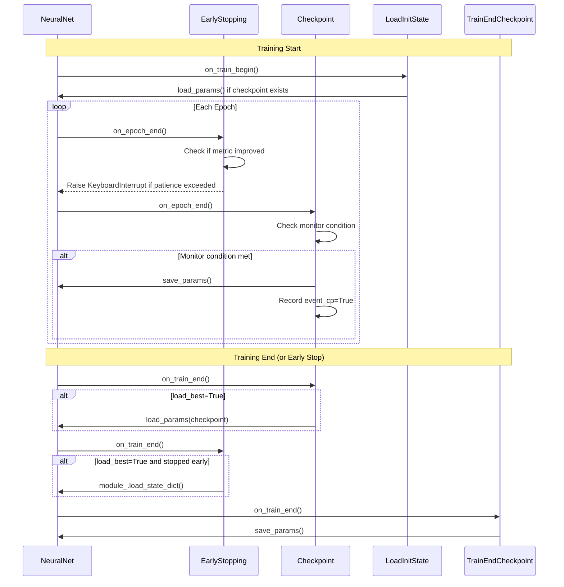
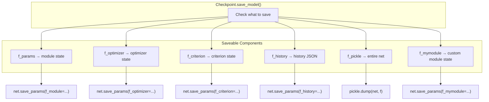
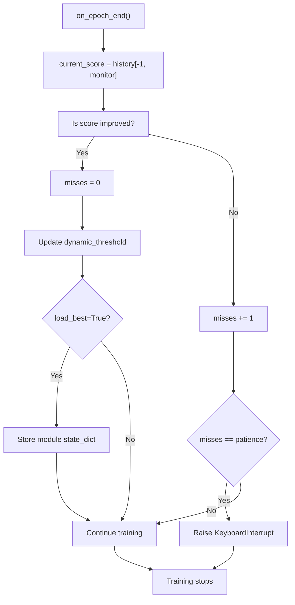
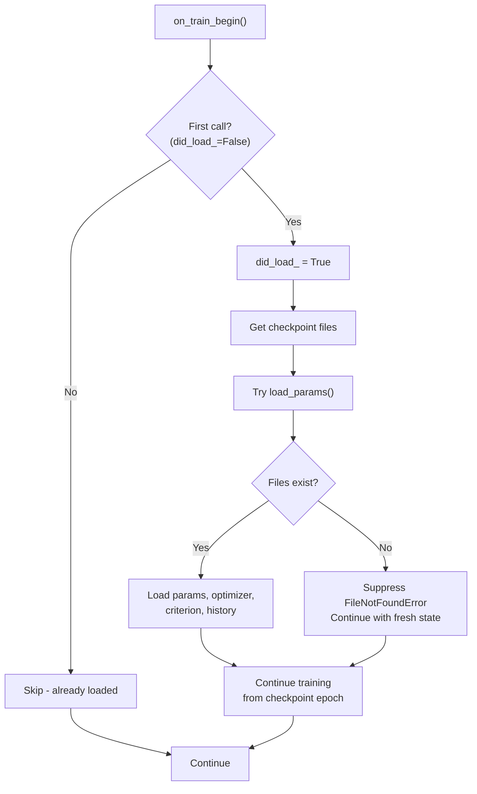
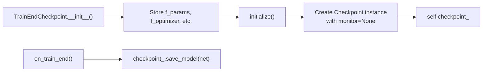
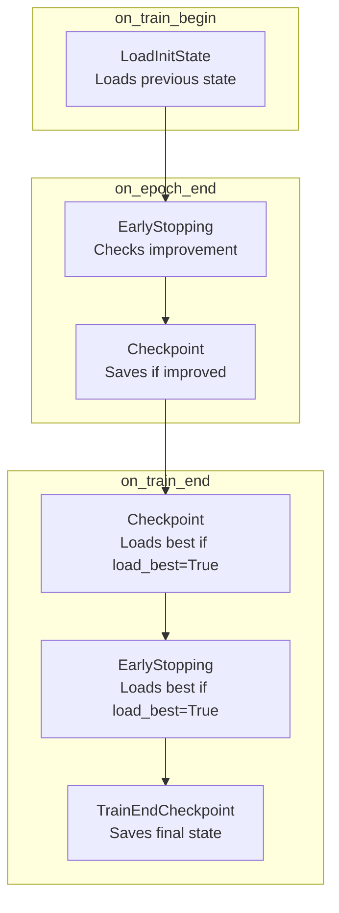

<!-- source: DeepWiki mcp.deepwiki.com · repo skorch-dev/skorch · page 3.2 Training Control Callbacks · fetched 2026-10-21 -->

# Training Control Callbacks

<details>
<summary>Relevant source files</summary>

The following files were used as context for generating this wiki page:

- [CHANGES.md](CHANGES.md)
- [docs/user/save_load.rst](docs/user/save_load.rst)
- [skorch/callbacks/__init__.py](skorch/callbacks/__init__.py)
- [skorch/callbacks/training.py](skorch/callbacks/training.py)
- [skorch/tests/callbacks/test_training.py](skorch/tests/callbacks/test_training.py)

</details>


## Purpose and Scope

This page documents the callbacks in skorch that control the training flow by managing checkpointing, early stopping, and state restoration. These callbacks allow you to save models during training, stop training based on metrics, and resume from saved checkpoints.

The callbacks covered here are:
- `Checkpoint` - saves model state when metrics improve
- `EarlyStopping` - stops training when metrics plateau
- `LoadInitState` - restores state from checkpoints at training start
- `TrainEndCheckpoint` - saves model state at training end

For information about the callback base class and lifecycle hooks, see [3.1](#3.1). For parameter manipulation callbacks like `Freezer` and `Initializer`, see [3.5](#3.5).

Sources: [skorch/callbacks/training.py:1-24](), [docs/user/save_load.rst:1-381]()

## Overview

Training control callbacks integrate into the `NeuralNet` training lifecycle at specific event hooks to monitor metrics, persist state, and control execution flow. They enable patterns like:
- Saving the best model based on validation metrics
- Stopping training when performance plateaus
- Resuming training from saved checkpoints
- Creating final snapshots at training completion

### Callback Lifecycle Integration



Sources: [skorch/callbacks/training.py:27-831](), [CHANGES.md:115-138]()

## Checkpoint Callback

The `Checkpoint` callback saves model state during training when a monitored metric improves. By default, it monitors `valid_loss_best` and saves parameters, optimizer state, criterion state, and history.

### Key Parameters

| Parameter | Type | Default | Description |
|-----------|------|---------|-------------|
| `monitor` | str, callable, None | `'valid_loss_best'` | Metric to monitor or function that determines when to checkpoint |
| `f_params` | str, file-like, None | `'params.pt'` | Path to save model parameters |
| `f_optimizer` | str, file-like, None | `'optimizer.pt'` | Path to save optimizer state |
| `f_criterion` | str, file-like, None | `'criterion.pt'` | Path to save criterion state |
| `f_history` | str, file-like, None | `'history.json'` | Path to save training history |
| `f_pickle` | str, file-like, None | `None` | Path to pickle entire model |
| `fn_prefix` | str | `''` | Prefix for all filenames |
| `dirname` | str | `''` | Directory for saved files |
| `event_name` | str, None | `'event_cp'` | History column name for checkpoint events |
| `load_best` | bool | `False` | Load best checkpoint at training end |
| `use_safetensors` | bool | `False` | Use safetensors library instead of pickle |

Sources: [skorch/callbacks/training.py:27-156]()

### Monitor Strategies

The `monitor` parameter supports three strategies:

1. **String Monitor** - Monitors a specific history key:
```python
# Monitor validation loss (default)
Checkpoint(monitor='valid_loss_best')

# Monitor custom metric
Checkpoint(monitor='valid_accuracy_best')
```

2. **Callable Monitor** - Custom function determines when to save:
```python
# Save when both train and valid loss are best
def both_best(net):
    return all(net.history[-1, ('train_loss_best', 'valid_loss_best')])

Checkpoint(monitor=both_best)
```

3. **None Monitor** - Save at every epoch:
```python
Checkpoint(monitor=None)
```

Sources: [skorch/callbacks/training.py:74-87](), [skorch/callbacks/training.py:219-231]()

### Filename Formatting

String filenames support format specifiers to create dynamic names:

```python
Checkpoint(
    f_params='params_epoch_{last_epoch[epoch]}.pt',
    f_optimizer='opt_epoch_{last_epoch[epoch]}.pt',
)
# Creates: params_epoch_5.pt, opt_epoch_5.pt, etc.
```

Available format variables:
- `{net}` - the NeuralNet instance
- `{last_epoch[epoch]}` - epoch number of last checkpoint
- `{last_batch}` - last batch information

Sources: [skorch/callbacks/training.py:88-99](), [skorch/callbacks/training.py:312-323]()

### Saving Components



Sources: [skorch/callbacks/training.py:245-279]()

### Custom Module Checkpointing

Custom modules added to the net can be checkpointed by passing `f_<modulename>`:

```python
# Net with custom module
class MyNet(NeuralNetRegressor):
    def __init__(self, *args, mymodule=MyModule, **kwargs):
        self.mymodule = mymodule
        super().__init__(*args, **kwargs)
    
    def initialize_module(self, *args, **kwargs):
        super().initialize_module(*args, **kwargs)
        params = self.get_params_for('mymodule')
        self.mymodule_ = self.mymodule(**params)
        return self

# Checkpoint custom module
cp = Checkpoint(
    f_params='params.pt',
    f_mymodule='mymodule.pt',  # Custom module parameter
)
```

Sources: [skorch/callbacks/training.py:53-56](), [skorch/tests/callbacks/test_training.py:423-460]()

### Automatic Best Model Loading

When `load_best=True`, the best checkpoint is automatically loaded at training end:

```python
cp = Checkpoint(monitor='valid_loss_best', load_best=True)
net = NeuralNetClassifier(module, callbacks=[cp])
net.fit(X, y)
# net now contains parameters from best epoch, not final epoch
```

This is useful with early stopping to ensure the best model is available for prediction, even if early stopping occurred several epochs after the best result.

Sources: [skorch/callbacks/training.py:142-148](), [skorch/callbacks/training.py:206-210]()

## EarlyStopping Callback

The `EarlyStopping` callback monitors a metric and stops training when it fails to improve for a specified number of epochs (patience). It can optionally restore weights from the best epoch.

### Key Parameters

| Parameter | Type | Default | Description |
|-----------|------|---------|-------------|
| `monitor` | str | `'valid_loss'` | History key to monitor |
| `patience` | int | `5` | Number of epochs to wait for improvement |
| `threshold` | float | `1e-4` | Minimum change to count as improvement |
| `threshold_mode` | str | `'rel'` | Whether threshold is relative (`'rel'`) or absolute (`'abs'`) |
| `lower_is_better` | bool | `True` | Whether lower metric values are better |
| `load_best` | bool | `False` | Restore module weights from best epoch |
| `sink` | callable | `print` | Where to send stopping messages |

Sources: [skorch/callbacks/training.py:350-391]()

### Stopping Logic



Sources: [skorch/callbacks/training.py:428-443]()

### Threshold Modes

The callback supports two threshold modes:

**Relative Threshold** (`threshold_mode='rel'`):
- Improvement must exceed `threshold * current_best`
- Default mode
- Useful when metric scales vary

**Absolute Threshold** (`threshold_mode='abs'`):
- Improvement must exceed fixed `threshold` value
- Useful for metrics with known scales

```python
# Relative: requires 0.1% improvement
EarlyStopping(threshold=1e-3, threshold_mode='rel')

# Absolute: requires 0.01 improvement
EarlyStopping(threshold=0.01, threshold_mode='abs')
```

Sources: [skorch/callbacks/training.py:371-377](), [skorch/callbacks/training.py:460-471]()

### Weight Restoration

When `load_best=True`, the callback stores module weights at each improvement and restores them at training end if the best epoch differs from the final epoch:

```python
early_stop = EarlyStopping(
    patience=3,
    monitor='valid_acc',
    lower_is_better=False,
    load_best=True,  # Restore best weights
)
net = NeuralNetClassifier(module, callbacks=[early_stop])
net.fit(X, y)
# net.module_ contains weights from best epoch
```

Note: Only module weights are restored, not optimizer state. Use `Checkpoint` with `load_best=True` to restore the complete state.

Sources: [skorch/callbacks/training.py:384-390](), [skorch/callbacks/training.py:445-454]()

## LoadInitState Callback

The `LoadInitState` callback loads model parameters, optimizer state, and history from a checkpoint at the beginning of training. This enables resuming interrupted training or continuing from a previous experiment.

### Key Parameters

| Parameter | Type | Default | Description |
|-----------|------|---------|-------------|
| `checkpoint` | Checkpoint or TrainEndCheckpoint | Required | Checkpoint instance to load from |
| `use_safetensors` | bool | `False` | Whether to use safetensors for loading |

Sources: [skorch/callbacks/training.py:649-684]()

### Loading Behavior



Sources: [skorch/callbacks/training.py:686-705]()

### Usage Pattern

The typical pattern combines `Checkpoint` (or `TrainEndCheckpoint`) with `LoadInitState`:

```python
# First run
cp = Checkpoint(monitor='valid_loss_best', dirname='exp1')
load_state = LoadInitState(cp)
net = NeuralNetClassifier(module, callbacks=[cp, load_state])
net.fit(X, y)  # Trains normally, saves checkpoint

# Second run (resume from checkpoint)
cp = Checkpoint(monitor='valid_loss_best', dirname='exp1')
load_state = LoadInitState(cp)
net = NeuralNetClassifier(module, callbacks=[cp, load_state])
net.fit(X, y)  # Loads checkpoint, continues from saved epoch
```

Sources: [skorch/callbacks/training.py:649-705](), [docs/user/save_load.rst:240-274]()

### TrainEndCheckpoint Support

`LoadInitState` detects when the checkpoint is a `TrainEndCheckpoint` and accesses its internal `checkpoint_` attribute:

```python
train_end_cp = TrainEndCheckpoint(dirname='exp1')
load_state = LoadInitState(train_end_cp)  # Loads from train_end_cp.checkpoint_
net = NeuralNetClassifier(module, callbacks=[train_end_cp, load_state])
```

Sources: [skorch/callbacks/training.py:695-704](), [skorch/tests/callbacks/test_training.py:1287-1309]()

## TrainEndCheckpoint Callback

The `TrainEndCheckpoint` callback saves model state at the end of training, regardless of metrics. It's useful for creating final snapshots or enabling training continuation.

### Key Parameters

| Parameter | Type | Default | Description |
|-----------|------|---------|-------------|
| `f_params` | str, file-like, None | `'params.pt'` | Path to save model parameters |
| `f_optimizer` | str, file-like, None | `'optimizer.pt'` | Path to save optimizer state |
| `f_criterion` | str, file-like, None | `'criterion.pt'` | Path to save criterion state |
| `f_history` | str, file-like, None | `'history.json'` | Path to save training history |
| `f_pickle` | str, file-like, None | `None` | Path to pickle entire model |
| `fn_prefix` | str | `'train_end_'` | Prefix for all filenames |
| `dirname` | str | `''` | Directory for saved files |
| `use_safetensors` | bool | `False` | Use safetensors library |
| `sink` | callable | `noop` | Where to send messages |

Sources: [skorch/callbacks/training.py:707-784]()

### Implementation Details

`TrainEndCheckpoint` internally creates a `Checkpoint` instance with `monitor=None` and triggers saving at `on_train_end()`:



Sources: [skorch/callbacks/training.py:814-831]()

### Continuation Pattern

Combining `TrainEndCheckpoint` and `LoadInitState` enables multi-session training:

```python
# Session 1
train_end_cp = TrainEndCheckpoint(dirname='exp1')
load_state = LoadInitState(train_end_cp)
net = NeuralNetClassifier(module, callbacks=[train_end_cp, load_state])
net.fit(X, y, epochs=10)  # Trains 10 epochs, saves at end

# Session 2 (later)
train_end_cp = TrainEndCheckpoint(dirname='exp1')
load_state = LoadInitState(train_end_cp)
net = NeuralNetClassifier(module, callbacks=[train_end_cp, load_state])
net.fit(X, y, epochs=10)  # Loads state, trains 10 more epochs (11-20)
```

Sources: [docs/user/save_load.rst:276-311]()

## Working with Multiple Callbacks

Training control callbacks are designed to work together to implement sophisticated training strategies.

### Checkpoint + EarlyStopping

Combine to stop early and restore the best model:

```python
cp = Checkpoint(
    monitor='valid_loss_best',
    load_best=True,  # Load best at training end
    dirname='checkpoints',
)
early_stop = EarlyStopping(
    monitor='valid_loss',
    patience=5,
)
net = NeuralNetClassifier(
    module,
    callbacks=[cp, early_stop],
)
net.fit(X, y)
# Training stops when patience exceeded
# Best checkpoint is automatically loaded
```

Note: When using both `Checkpoint` and `EarlyStopping` with `load_best=True`, the `Checkpoint` restoration happens after `EarlyStopping`, so the checkpoint takes precedence.

Sources: [skorch/callbacks/training.py:39-42](), [docs/user/save_load.rst:234-274]()

### Multiple Experiments

Use `dirname` and `fn_prefix` to organize multiple experiments:

```python
# Experiment 1: Default hyperparameters
cp1 = Checkpoint(dirname='exp1', fn_prefix='baseline_')
load1 = LoadInitState(cp1)
net1 = NeuralNetClassifier(module, callbacks=[cp1, load1])
net1.fit(X, y)

# Experiment 2: Different hyperparameters
cp2 = Checkpoint(dirname='exp2', fn_prefix='lr_0.01_')
load2 = LoadInitState(cp2)
net2 = NeuralNetClassifier(module, lr=0.01, callbacks=[cp2, load2])
net2.fit(X, y)
```

Sources: [docs/user/save_load.rst:313-346]()

### Callback Execution Order



The order matters:
1. `LoadInitState` runs first to restore state
2. During epochs, `EarlyStopping` checks before `Checkpoint` saves
3. At training end, `Checkpoint` loads before `EarlyStopping` (checkpoint takes precedence)

Sources: [skorch/callbacks/training.py:206-210](), [skorch/callbacks/training.py:445-454](), [skorch/callbacks/training.py:827-830]()

## Safetensors Support

All training control callbacks support the `safetensors` library as an alternative to pickle for saving model parameters. Safetensors provides security and performance benefits but has limitations.

### Enabling Safetensors

Pass `use_safetensors=True` to any checkpoint callback:

```python
cp = Checkpoint(
    monitor='valid_loss_best',
    f_params='model.safetensors',
    f_optimizer=None,  # Cannot save optimizer with safetensors
    use_safetensors=True,
)
```

### Limitations

Safetensors can only serialize PyTorch tensors, not arbitrary Python objects:

| Component | Supported | Notes |
|-----------|-----------|-------|
| Module parameters | ✓ | Full support |
| Criterion state | ✓ | If criterion is a PyTorch module |
| Optimizer state | ✗ | Contains non-tensor data, use `f_optimizer=None` |
| History | ✓ | Uses JSON, not affected |
| Custom modules | ✓ | If they only contain tensors |

Sources: [skorch/callbacks/training.py:149-155](), [CHANGES.md:56-59](), [docs/user/save_load.rst:119-162]()

### Validation

Attempting to save the optimizer with safetensors raises a `ValueError`:

```python
# This raises ValueError
cp = Checkpoint(
    f_optimizer='optimizer.pt',
    use_safetensors=True,  # Error: cannot save optimizer
)
```

The validation occurs at callback initialization to fail fast:

Sources: [skorch/callbacks/training.py:195-199](), [skorch/tests/callbacks/test_training.py:77-84]()

### LoadInitState Configuration

When loading from safetensors checkpoints, `LoadInitState` must also use safetensors:

```python
cp = Checkpoint(
    f_params='model.safetensors',
    f_optimizer=None,
    use_safetensors=True,
)
load_state = LoadInitState(cp, use_safetensors=True)  # Must match
net = NeuralNetClassifier(module, callbacks=[cp, load_state])
```

Sources: [skorch/callbacks/training.py:675-680](), [docs/user/save_load.rst:364-373]()

## History Recording

Training control callbacks record events in the history to track their actions.

### Event Columns

| Callback | Column | Values | Description |
|----------|--------|--------|-------------|
| `Checkpoint` | `event_cp` (default) | `bool` | True when checkpoint created |
| `EarlyStopping` | N/A | N/A | Stops training via exception |
| `TrainEndCheckpoint` | N/A | N/A | No history recording |

The `Checkpoint` event column can be customized:

```python
cp = Checkpoint(event_name='my_checkpoint_event')
# Creates history column: 'my_checkpoint_event'

cp = Checkpoint(event_name=None)
# Disables history recording
```

Sources: [skorch/callbacks/training.py:58-60](), [skorch/callbacks/training.py:232-234]()

### Accessing Checkpoint History

Use the history to find when checkpoints occurred:

```python
net.fit(X, y)

# Get epochs where checkpoints were created
checkpoint_epochs = [
    epoch for epoch, cp in enumerate(net.history[:, 'event_cp'], 1)
    if cp
]

# Get last checkpoint index
last_cp_idx = net.history[:, 'event_cp'][::-1].index(True)
```

Sources: [skorch/tests/callbacks/test_training.py:86-97](), [skorch/tests/callbacks/test_training.py:254-258]()

---

