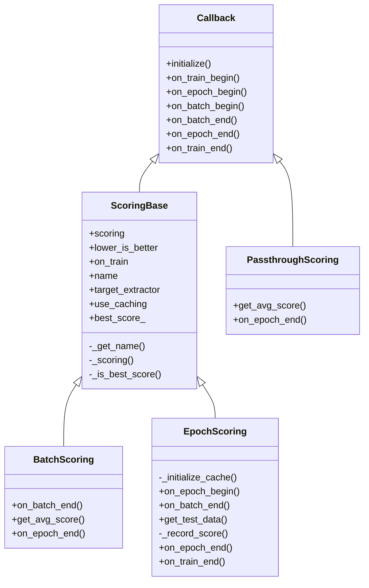
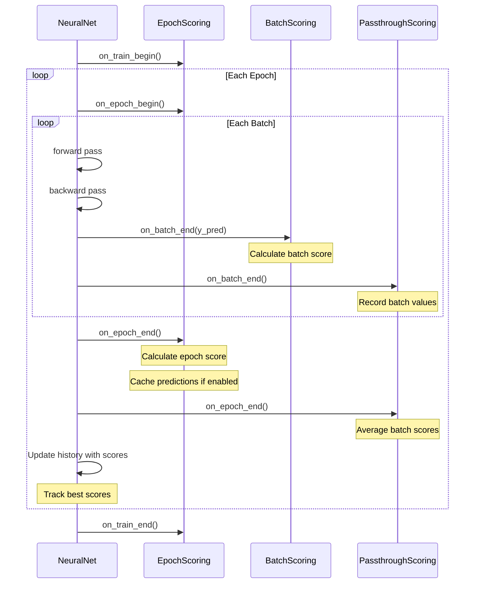
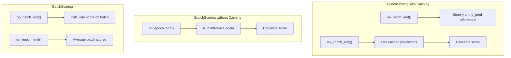

<!-- source: DeepWiki mcp.deepwiki.com · repo skorch-dev/skorch · page 3.3 Scoring Callbacks · fetched 2026-10-21 -->

# Scoring Callbacks

<details>
<summary>Relevant source files</summary>

The following files were used as context for generating this wiki page:

- [docs/user/FAQ.rst](docs/user/FAQ.rst)
- [docs/user/callbacks.rst](docs/user/callbacks.rst)
- [docs/user/dataset.rst](docs/user/dataset.rst)
- [docs/user/neuralnet.rst](docs/user/neuralnet.rst)
- [skorch/callbacks/scoring.py](skorch/callbacks/scoring.py)
- [skorch/tests/callbacks/test_scoring.py](skorch/tests/callbacks/test_scoring.py)

</details>


This page documents the scoring callback system in skorch, which provides a flexible way to evaluate model performance during training using various metrics. Scoring callbacks integrate with scikit-learn's scoring functions while maintaining compatibility with PyTorch models. For information about other callback types like training control callbacks or logging callbacks, see [Training Callbacks](#3.3) and [Logging Callbacks](#3.4).

## Overview

Scoring callbacks in skorch serve several key purposes:

- Track model performance metrics during training
- Calculate scores on either training or validation data
- Record scores in the training history for later analysis
- Keep track of the best score achieved so far
- Enable early stopping and model selection based on performance metrics

## Callback Types

Skorch provides three main types of scoring callbacks, each with a specific approach to calculating performance metrics:



Sources: [skorch/callbacks/scoring.py:12-22](), [skorch/callbacks/scoring.py:80-154](), [skorch/callbacks/scoring.py:156-252](), [skorch/callbacks/scoring.py:254-460](), [skorch/callbacks/scoring.py:462-534]()

### 1. BatchScoring

`BatchScoring` calculates scores for each batch during training or validation and then computes a weighted average of those scores at the end of each epoch. This approach gives immediate feedback on model performance but may not be appropriate for all metrics.

Key characteristics:
- Calculates metrics on individual batches
- Averages batch scores at the end of each epoch (weighted by batch size)
- Updates quickly but may be less accurate for some metrics (e.g., ROC AUC)

Sources: [skorch/callbacks/scoring.py:156-252]()

### 2. EpochScoring

`EpochScoring` makes predictions on the entire dataset at the end of each epoch to calculate metrics. This approach is more accurate for metrics that need to be calculated on the entire dataset but requires an additional inference step.

Key characteristics:
- Calculates metrics on the entire dataset once per epoch
- More appropriate for metrics like ROC AUC, precision-recall, etc.
- Can use caching to avoid redundant computations
- Supports arbitrary datasets as input (with caching enabled)

Sources: [skorch/callbacks/scoring.py:254-460]()

### 3. PassthroughScoring

`PassthroughScoring` doesn't calculate new scores but instead takes existing batch-level scores and creates weighted averages at the epoch level. This callback is useful when scores are already being calculated at the batch level for other purposes.

Key characteristics:
- Doesn't perform any new metric calculations
- Takes existing batch-level scores and computes epoch-level averages
- Lighter weight than other scoring callbacks

Sources: [skorch/callbacks/scoring.py:462-534]()

## Training Flow and Scoring Execution

The following diagram shows when each scoring callback is executed during the training process:



Sources: [skorch/callbacks/scoring.py:208-252](), [skorch/callbacks/scoring.py:332-459](), [skorch/callbacks/scoring.py:519-534]()

## Common Parameters

All scoring callbacks share several common parameters that control their behavior:

| Parameter | Description | Default | Used In |
|-----------|-------------|---------|---------|
| `scoring` | Metric to use (string, callable, or None) | None | ScoringBase |
| `lower_is_better` | Whether lower scores are better | True | ScoringBase, PassthroughScoring |
| `on_train` | Calculate on training data instead of validation | False | ScoringBase, PassthroughScoring |
| `name` | Name of the score in history | Auto-detected | ScoringBase, PassthroughScoring |
| `target_extractor` | Function to extract targets | to_numpy | ScoringBase |
| `use_caching` | Cache predictions to avoid redundant computations | True | ScoringBase |

Sources: [skorch/callbacks/scoring.py:84-99](), [skorch/callbacks/scoring.py:487-495]()

### Specifying Scoring Metrics

The `scoring` parameter supports several formats:

1. **None**: Uses the model's own `score` method
2. **String**: Uses a scikit-learn scoring name (e.g., "accuracy", "f1", "neg_mean_squared_error")
3. **Callable**: Uses a custom function with signature `(model, X, y) -> score`
4. **scikit-learn Scorer**: Uses a scorer created by `sklearn.metrics.make_scorer`

Sources: [skorch/callbacks/scoring.py:60-77](), [skorch/callbacks/scoring.py:178-196](), [skorch/callbacks/scoring.py:292-320]()

## Caching Mechanism

The scoring callbacks use a caching system to avoid redundant computations. This is particularly important for `EpochScoring`, which needs to make predictions on the entire dataset.



The caching system is implemented using the `_cache_net_forward_iter` context manager which temporarily modifies the neural network's `forward_iter` method to return cached predictions.

Sources: [skorch/callbacks/scoring.py:25-57](), [skorch/callbacks/scoring.py:323-360](), [skorch/callbacks/scoring.py:953-1042]()

### Controlling Caching Globally

The neural network can control the caching behavior globally by setting the `use_caching` parameter to 'auto', True, or False:

- **'auto'** (default): Each callback uses its own caching setting
- **True**: Force all callbacks to use caching
- **False**: Force all callbacks to not use caching

This global control can be useful for debugging or performance optimization.

Sources: [skorch/callbacks/scoring.py:340-344](), [skorch/callbacks/scoring.py:441-443](), [skorch/callbacks/scoring.py:949-1042]()

## Best Score Tracking

All scoring callbacks can track whether the current score is the best score achieved so far. This is controlled by the `lower_is_better` parameter:

- **True**: Lower scores are better (e.g., loss, error rate)
- **False**: Higher scores are better (e.g., accuracy, F1-score)
- **None**: Don't track best scores

When a new best score is found, the callback records a boolean flag in the history with the name `{score_name}_best`.

Sources: [skorch/callbacks/scoring.py:148-153](), [skorch/callbacks/scoring.py:426-432](), [skorch/callbacks/scoring.py:527-534]()

## Usage Examples

Here are some common ways to use scoring callbacks:

### Tracking Accuracy During Training

```python
from skorch import NeuralNetClassifier
from skorch.callbacks import EpochScoring

net = NeuralNetClassifier(
    module=MyModule,
    callbacks=[
        EpochScoring('accuracy', name='valid_acc'),
        EpochScoring('accuracy', on_train=True, name='train_acc'),
    ],
    max_epochs=10,
)
```

### Using Custom Scoring Functions

```python
from skorch import NeuralNetClassifier
from skorch.callbacks import EpochScoring

def my_custom_score(net, X, y):
    y_pred = net.predict(X)
    # Custom score calculation
    return some_calculation(y, y_pred)

net = NeuralNetClassifier(
    module=MyModule,
    callbacks=[
        EpochScoring(my_custom_score, name='my_metric'),
    ],
    max_epochs=10,
)
```

### Computing Multiple Metrics

```python
from skorch import NeuralNetClassifier
from skorch.callbacks import EpochScoring

net = NeuralNetClassifier(
    module=MyModule,
    callbacks=[
        EpochScoring('accuracy'),
        EpochScoring('f1', name='f1_score'),
        EpochScoring('roc_auc', name='auc'),
    ],
    max_epochs=10,
)
```

## Integration with Other Callbacks

Scoring callbacks work well in combination with other callbacks like `EarlyStopping` and `Checkpoint`:

```python
from skorch import NeuralNetClassifier
from skorch.callbacks import EpochScoring, EarlyStopping, Checkpoint

net = NeuralNetClassifier(
    module=MyModule,
    callbacks=[
        EpochScoring('accuracy', name='valid_acc'),
        EarlyStopping(monitor='valid_acc', patience=5, lower_is_better=False),
        Checkpoint(monitor='valid_acc', lower_is_better=False),
    ],
    max_epochs=100,
)
```

## Common Pitfalls

1. **Using BatchScoring for inappropriate metrics**: Some metrics like ROC AUC are not meaningful on individual batches. Use `EpochScoring` for these.

2. **Performance impact**: Using multiple scoring callbacks, especially `EpochScoring` without caching, can significantly slow down training. Consider which metrics you really need.

3. **Missing target data**: When the validation dataset doesn't provide target values (`y=None`), make sure your scoring function can handle this case.

Sources: [skorch/callbacks/scoring.py:169-173](), [skorch/callbacks/scoring.py:327-363](), [skorch/callbacks/scoring.py:399-401]()

## Technical Details

### Target Extraction

By default, targets are converted to NumPy arrays using `to_numpy`, but you can provide a custom `target_extractor` function. This is useful for custom preprocessing of targets before scoring.

Sources: [skorch/callbacks/scoring.py:98](), [skorch/callbacks/scoring.py:396-417]()

### Name Auto-Detection

If `name` is not provided, the callback attempts to infer a name from the scoring function:
- For string scorers: the string itself
- For callables: the function name
- For sklearn scorers: the name of the underlying function

Sources: [skorch/callbacks/scoring.py:101-121]()

### Subclassing for Custom Behavior

You can subclass `EpochScoring` to implement custom behavior, such as computing multiple metrics in a single callback or implementing complex scoring logic.

Sources: [skorch/tests/callbacks/test_scoring.py:510-548]()

This documentation provides a comprehensive overview of skorch's scoring callbacks, detailing their functionality, parameters, and usage. The scoring callbacks are a key component of the skorch framework, enabling effective model evaluation and selection during training.

---

