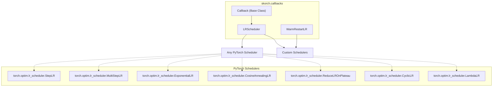
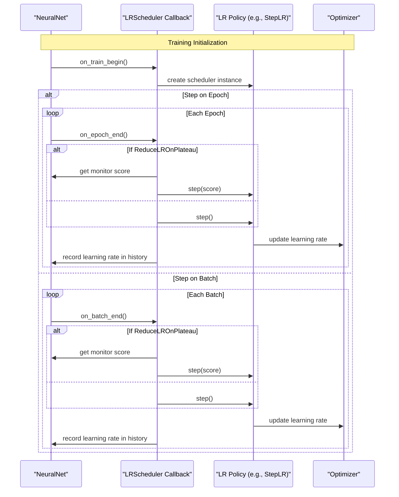
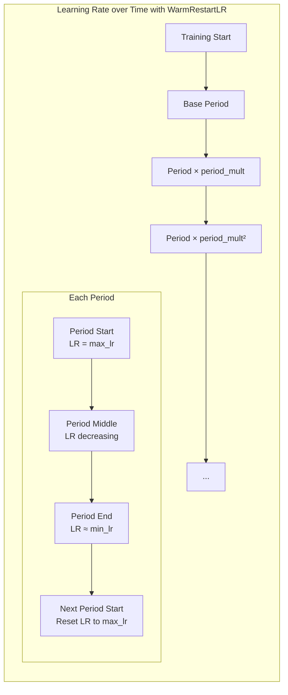
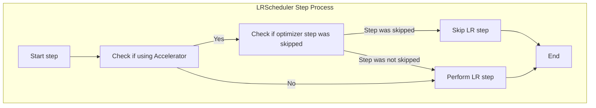

<!-- source: DeepWiki mcp.deepwiki.com · repo skorch-dev/skorch · page 3.4 Learning Rate Schedulers · fetched 2026-10-21 -->

# Learning Rate Schedulers

<details>
<summary>Relevant source files</summary>

The following files were used as context for generating this wiki page:

- [CHANGES.md](CHANGES.md)
- [skorch/__init__.py](skorch/__init__.py)
- [skorch/callbacks/lr_scheduler.py](skorch/callbacks/lr_scheduler.py)
- [skorch/tests/callbacks/test_lr_scheduler.py](skorch/tests/callbacks/test_lr_scheduler.py)
- [skorch/tests/net_cuda.pkl](skorch/tests/net_cuda.pkl)

</details>


This page documents the learning rate scheduler components in skorch, which allow for dynamic adjustment of learning rates during model training. Learning rate schedulers are implemented as callbacks and provide an interface for both PyTorch's built-in schedulers as well as custom scheduling policies.

For information on other types of callbacks in skorch, see [Callback System](#3).

## Overview

Learning rate schedulers are an essential technique for improving neural network training by dynamically adjusting the learning rate parameter during the optimization process. skorch implements learning rate scheduling through its callback system, providing a flexible and extensible way to incorporate various learning rate adjustment strategies into your training workflow.



Sources: [skorch/callbacks/lr_scheduler.py:1-333]()

## Core Components

### LRScheduler Callback

The `LRScheduler` is a callback that integrates learning rate scheduling into the skorch training process. It wraps both PyTorch's native schedulers and custom schedulers, applying learning rate adjustments at specified intervals (epochs or batches).



Sources: [skorch/callbacks/lr_scheduler.py:36-261]()

#### Key Parameters

The `LRScheduler` callback offers several configuration options:

| Parameter | Description | Default |
|-----------|-------------|---------|
| `policy` | Learning rate policy name or scheduler class | `'WarmRestartLR'` |
| `monitor` | Value from history to monitor or callable function | `'train_loss'` |
| `event_name` | Name of event to record in history (set to `None` to disable) | `'event_lr'` |
| `step_every` | When to apply scheduler step (`'epoch'` or `'batch'`) | `'epoch'` |
| `kwargs` | Additional arguments passed to the scheduler | `{}` |

Sources: [skorch/callbacks/lr_scheduler.py:36-76]()

### Learning Rate Policies

skorch supports both PyTorch's built-in scheduling policies and custom policies. The built-in policies include:

1. **StepLR**: Decays the learning rate by a factor every specified number of steps
2. **MultiStepLR**: Decays the learning rate at specified milestones
3. **ExponentialLR**: Applies exponential decay to the learning rate
4. **CosineAnnealingLR**: Adjusts learning rate according to a cosine function
5. **ReduceLROnPlateau**: Reduces learning rate when a metric has stopped improving
6. **CyclicLR**: Cycles the learning rate between two boundaries
7. **LambdaLR**: Sets the learning rate based on a function

Additionally, skorch provides a custom policy:

8. **WarmRestartLR**: Implements Stochastic Gradient Descent with Warm Restarts (SGDR)

Sources: [skorch/callbacks/lr_scheduler.py:10-18](), [skorch/callbacks/lr_scheduler.py:263-333]()

### WarmRestartLR

`WarmRestartLR` is a custom learning rate scheduler that implements Stochastic Gradient Descent with Warm Restarts (SGDR). It periodically resets the learning rate to a high value and then decreases it according to a cosine schedule, which can help the model escape local minima.



Key parameters for `WarmRestartLR`:

| Parameter | Description | Default |
|-----------|-------------|---------|
| `min_lr` | Minimum learning rate | `1e-6` |
| `max_lr` | Maximum learning rate | `0.05` |
| `base_period` | Initial restart period | `10` |
| `period_mult` | Multiplier to increase period after each restart | `2` |

Sources: [skorch/callbacks/lr_scheduler.py:263-333]()

## Usage Examples

### Basic Usage

To use a learning rate scheduler with a skorch neural network:

```python
from skorch import NeuralNetClassifier
from skorch.callbacks import LRScheduler
from torch.optim.lr_scheduler import StepLR

net = NeuralNetClassifier(
    ...,
    callbacks=[
        ('lr_scheduler', LRScheduler(StepLR, step_size=10, gamma=0.1))
    ]
)
```

### ReduceLROnPlateau with Validation Loss Monitoring

For adaptive learning rate reduction based on validation loss:

```python
from torch.optim.lr_scheduler import ReduceLROnPlateau

net = NeuralNetClassifier(
    ...,
    callbacks=[
        ('lr_scheduler', LRScheduler(
            ReduceLROnPlateau,
            monitor='valid_loss',
            patience=5,
            factor=0.1,
            verbose=True
        ))
    ]
)
```

### WarmRestartLR Example

For using the custom warm restart scheduler:

```python
from skorch.callbacks import LRScheduler

net = NeuralNetClassifier(
    ...,
    callbacks=[
        ('lr_scheduler', LRScheduler(
            'WarmRestartLR',
            min_lr=1e-5,
            max_lr=0.1,
            base_period=20,
            period_mult=2
        ))
    ]
)
```

### Batch-level Learning Rate Adjustments

For more frequent learning rate updates:

```python
from torch.optim.lr_scheduler import CyclicLR

net = NeuralNetClassifier(
    ...,
    callbacks=[
        ('lr_scheduler', LRScheduler(
            CyclicLR,
            base_lr=1e-3,
            max_lr=6e-3,
            step_size_up=4,
            step_every='batch'
        ))
    ]
)
```

Sources: [skorch/tests/callbacks/test_lr_scheduler.py:78-105](), [skorch/tests/callbacks/test_lr_scheduler.py:232-272]()

## Visualizing Learning Rate Schedules

The `LRScheduler` callback provides a `simulate` method that allows previewing how a scheduler will adjust the learning rate over time. This is useful for understanding the behavior of different schedulers before actual training.

```python
from skorch.callbacks import LRScheduler
from torch.optim.lr_scheduler import StepLR

# Create a scheduler
scheduler = LRScheduler(StepLR, step_size=30, gamma=0.1)

# Simulate learning rate changes over 100 epochs
learning_rates = scheduler.simulate(steps=100, initial_lr=0.1)

# Plot the results
import matplotlib.pyplot as plt
plt.plot(learning_rates)
plt.xlabel('Epochs')
plt.ylabel('Learning Rate')
plt.title('Learning Rate Schedule')
plt.show()
```

Sources: [skorch/callbacks/lr_scheduler.py:78-119](), [skorch/tests/callbacks/test_lr_scheduler.py:24-76]()

## Learning Rate Tracking

When a learning rate scheduler is used, the current learning rate can be recorded in the training history for later analysis. By default, learning rates are stored under the key `'event_lr'` in the history:

```python
# After training
learning_rates = net.history[:, 'event_lr']
```

For batch-level schedulers, learning rates are recorded at the batch level:

```python
# Access batch-level learning rates
batch_learning_rates = net.history[-1, 'batches', :, 'event_lr']
```

Sources: [skorch/callbacks/lr_scheduler.py:177-199](), [skorch/tests/callbacks/test_lr_scheduler.py:232-272]()

## Integration with Other Callbacks

Learning rate schedulers often work in tandem with other callbacks. For example:

1. **EarlyStopping**: Can be used alongside `ReduceLROnPlateau` to first reduce the learning rate when performance plateaus, and eventually stop training if no further improvement is seen.

2. **Checkpoint**: Can save the model after learning rate adjustments to keep the best-performing model.

3. **Scoring**: When using `ReduceLROnPlateau`, a scoring callback with the same monitor name must be placed before the `LRScheduler` in the callbacks list.

```python
from skorch.callbacks import EarlyStopping, Checkpoint, LRScheduler

net = NeuralNetClassifier(
    ...,
    callbacks=[
        ('valid_acc', Accuracy('valid')),  # Scoring callback
        ('lr_scheduler', LRScheduler(
            ReduceLROnPlateau, 
            monitor='valid_acc',  # Matches the name of the scoring callback
            patience=5
        )),
        ('early', EarlyStopping(patience=15)),
        ('checkpoint', Checkpoint(monitor='valid_acc_best'))
    ]
)
```

Sources: [skorch/callbacks/lr_scheduler.py:207-218](), [skorch/callbacks/lr_scheduler.py:230-241]()

## Technical Implementation Details

### Mechanism for Learning Rate Adjustment

The learning rate adjustment is implemented through the PyTorch optimizer's parameter groups. The `LRScheduler` callback integrates with the PyTorch scheduler API and applies changes to the optimizer's learning rates at the appropriate times during training.

### Accelerator Integration

The `LRScheduler` callback is designed to work with mixed-precision training through the Hugging Face Accelerate library. It respects the special requirements when optimizer steps are skipped in mixed-precision training:



Sources: [skorch/callbacks/lr_scheduler.py:152-175]()

## Common Issues and Troubleshooting

### ReduceLROnPlateau Monitor Not Found

When using `ReduceLROnPlateau` with a custom monitor, ensure that a scoring callback with the matching name is placed before the `LRScheduler` callback. Otherwise, you'll get a `ValueError` with a message like:

```
'monitor_name' was not found in history. A Scoring callback with name='monitor_name' should be placed before the LRScheduler callback
```

Sources: [skorch/callbacks/lr_scheduler.py:207-218](), [skorch/callbacks/lr_scheduler.py:230-241](), [skorch/tests/callbacks/test_lr_scheduler.py:341-356]()

### Learning Rate Records Not Available for PyTorch < 1.4

The feature to record learning rates in history (`event_lr`) works only for PyTorch version 1.4 or above, as it requires the `get_last_lr()` method of the scheduler which was introduced in that version.

Sources: [skorch/callbacks/lr_scheduler.py:53-55](), [skorch/callbacks/lr_scheduler.py:186-194]()

## Summary

The learning rate scheduler system in skorch provides a flexible and powerful way to integrate dynamic learning rate adjustments into your neural network training. Through the callback interface, it supports both PyTorch's built-in schedulers and custom policies like `WarmRestartLR`. The system allows for epoch-level or batch-level adjustments, monitoring of metrics for adaptive scheduling, and visualization of learning rate trajectories through simulation.

---

