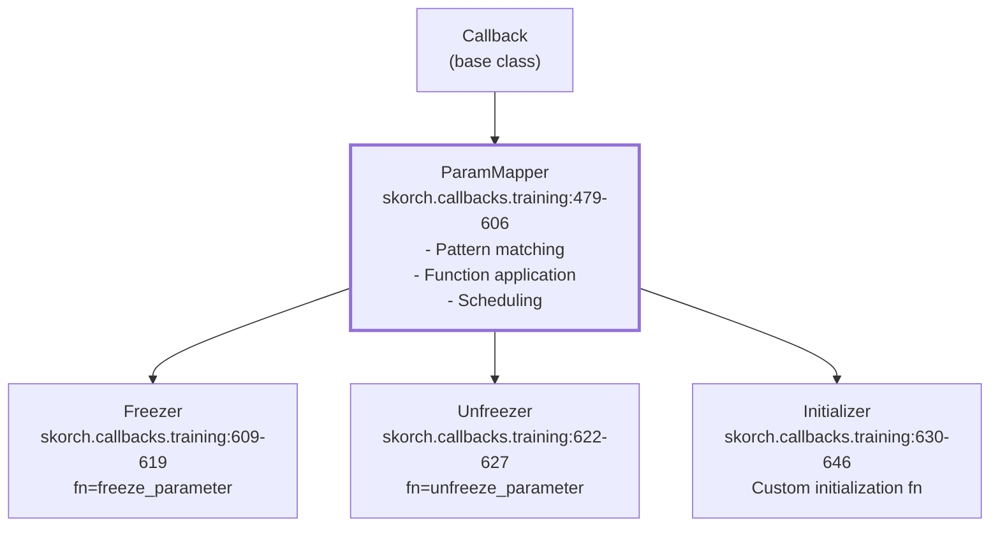
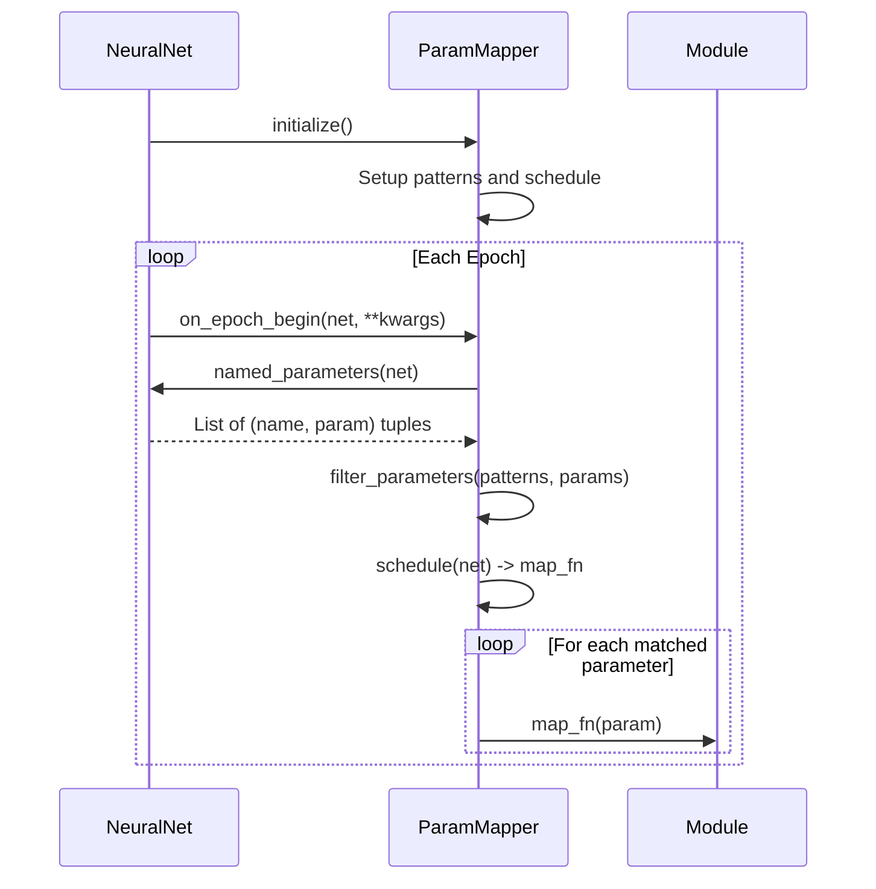
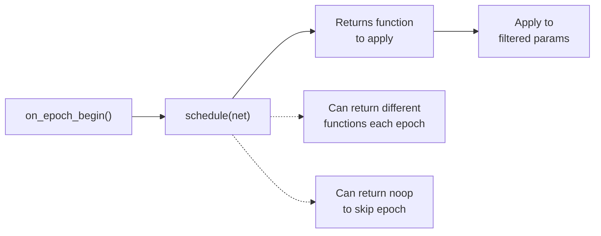
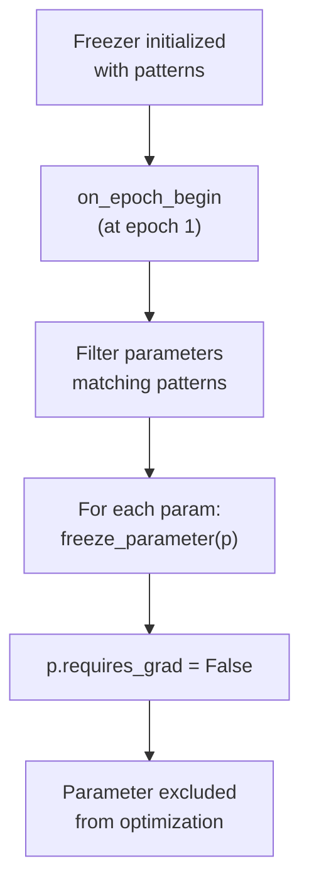
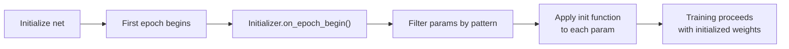
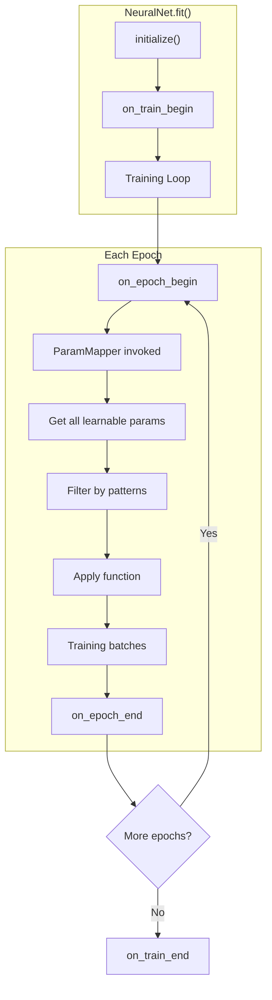
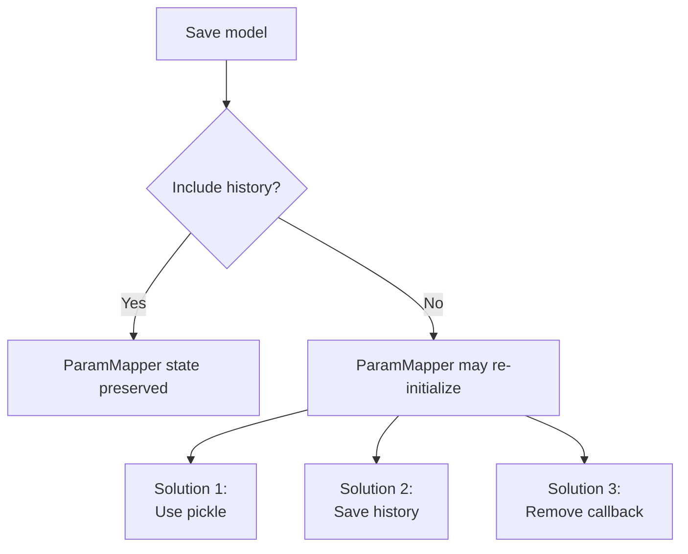

<!-- source: DeepWiki mcp.deepwiki.com · repo skorch-dev/skorch · page 3.5 Parameter Manipulation Callbacks · fetched 2026-10-21 -->

# Parameter Manipulation Callbacks

<details>
<summary>Relevant source files</summary>

The following files were used as context for generating this wiki page:

- [docs/user/FAQ.rst](docs/user/FAQ.rst)
- [docs/user/callbacks.rst](docs/user/callbacks.rst)
- [docs/user/dataset.rst](docs/user/dataset.rst)
- [docs/user/neuralnet.rst](docs/user/neuralnet.rst)
- [docs/user/save_load.rst](docs/user/save_load.rst)
- [skorch/callbacks/__init__.py](skorch/callbacks/__init__.py)
- [skorch/callbacks/training.py](skorch/callbacks/training.py)
- [skorch/tests/callbacks/test_training.py](skorch/tests/callbacks/test_training.py)

</details>


This page documents callbacks that manipulate model parameters during training. These callbacks allow you to apply functions to specific parameters filtered by pattern matching, enabling operations like weight initialization, freezing/unfreezing layers, and custom parameter transformations.

For information about other callback types, see [Callback Basics](#3.1), [Training Control Callbacks](#3.2), [Scoring Callbacks](#3.3), and [Learning Rate Schedulers](#3.4).

## Overview

Parameter manipulation callbacks in skorch provide a flexible mechanism to modify module parameters during the training lifecycle. The core component is `ParamMapper`, which serves as the base class for specialized callbacks like `Freezer`, `Unfreezer`, and `Initializer`. These callbacks operate at the beginning of each epoch (by default at `on_epoch_begin`) and use pattern matching to select which parameters to modify.

**Architecture Diagram: Parameter Manipulation Callback Hierarchy**



Sources: [skorch/callbacks/training.py:479-646](), [skorch/callbacks/__init__.py:17-42]()

## ParamMapper Base Class

`ParamMapper` is the foundational class for all parameter manipulation callbacks. It provides a general-purpose mechanism to apply arbitrary functions to filtered parameters.

### Core Components

| Component | Type | Description |
|-----------|------|-------------|
| `patterns` | str, callable, or list | Pattern(s) to match parameter names (UNIX globbing) |
| `fn` | function | Function to apply to each matched parameter |
| `at` | int or callable | Determines when the function is applied |
| `schedule` | callable or None | Dynamically returns the function to apply each epoch |

**Execution Flow Diagram**



Sources: [skorch/callbacks/training.py:479-606]()

### Pattern Matching

`ParamMapper` supports three types of patterns for selecting parameters:

1. **String patterns**: UNIX globbing patterns (e.g., `'linear*.weight'`)
2. **Callable patterns**: Functions that receive parameter names and return truthy values
3. **Lists**: Multiple patterns to match different parameter groups

**Pattern Matching Implementation**

The pattern matching logic is implemented in [skorch/callbacks/training.py:582-589]():

- Patterns are converted to callables if they are strings (using `fnmatch`)
- Each pattern is tested against each parameter name
- The Cartesian product of patterns and parameters is evaluated
- Matched parameters are yielded for function application

Sources: [skorch/callbacks/training.py:582-589](), [skorch/callbacks/training.py:526-537]()

### Timing Control

The `at` parameter controls when the function is applied to parameters:

| `at` Type | Behavior | Example |
|-----------|----------|---------|
| `int` | Apply at specific epoch number | `at=1` (first epoch) |
| `callable` | Apply when callable returns `True` | `at=lambda net: net.history[-1, 'train_loss'] < 0.1` |

The implementation converts integer values to epoch-checking functions during initialization [skorch/callbacks/training.py:570-575]().

Sources: [skorch/callbacks/training.py:557-577]()

### Dynamic Scheduling

The `schedule` parameter enables periodic or conditional parameter manipulation:

**Scheduling Function Diagram**



Example use case: Periodically freeze and unfreeze layers [skorch/callbacks/training.py:514-522]().

Sources: [skorch/callbacks/training.py:548-554](), [skorch/callbacks/training.py:591-594]()

## Freezer Callback

`Freezer` is a specialized `ParamMapper` that prevents gradient computation for matched parameters by setting `requires_grad=False`.

### Implementation Details

| Attribute | Default Value | Description |
|-----------|---------------|-------------|
| `fn` | `freeze_parameter` | Function from `skorch.utils` |
| `at` | `1` | Freezes at first epoch by default |

The `freeze_parameter` utility function is imported from [skorch/callbacks/training.py:18]() and applied via the `ParamMapper` mechanism.

**Freezing Execution**



### Usage Example

From [skorch/callbacks/training.py:609-619](), a typical usage pattern:

```python
# Freeze embedding layers at the start of training
freezer = Freezer('embedding*.weight', at=1)
net = NeuralNet(MyModule, callbacks=[('freezer', freezer)])
```

Sources: [skorch/callbacks/training.py:609-619](), [skorch/utils:freeze_parameter]()

## Unfreezer Callback

`Unfreezer` is the inverse operation of `Freezer`, enabling gradient computation by setting `requires_grad=True`.

### Implementation Details

| Attribute | Default Value | Description |
|-----------|---------------|-------------|
| `fn` | `unfreeze_parameter` | Function from `skorch.utils` |
| `at` | `1` | Unfreezes at first epoch by default |

This callback is commonly used for progressive unfreezing strategies in transfer learning [skorch/callbacks/training.py:622-627]().

Sources: [skorch/callbacks/training.py:622-627](), [skorch/utils:unfreeze_parameter]()

## Initializer Callback

`Initializer` applies custom initialization functions to parameters at the beginning of training (or at a specified point).

### Key Characteristics

- Default timing: `at=1` (first epoch) [skorch/callbacks/training.py:644-645]()
- Function must accept a parameter tensor as input
- Commonly used with PyTorch initialization functions from `torch.nn.init`

**Initialization Pattern**



### Usage Example

From the documentation [skorch/callbacks/training.py:633-642]():

```python
from functools import partial
import torch.nn.init

init_fn = partial(torch.nn.init.uniform_, a=-1e-3, b=1e-3)
initializer = Initializer('dense*.weight', fn=init_fn)
net = NeuralNet(MyModule, callbacks=[initializer])
```

Sources: [skorch/callbacks/training.py:630-646](), [docs/user/callbacks.rst:633-642]()

## Common Use Cases

### 1. Layer-wise Freezing for Transfer Learning

Freeze early layers while training later layers:

```python
freezer = Freezer(['conv1.*', 'conv2.*'], at=1)
net = NeuralNet(PretrainedModule, callbacks=[freezer])
```

### 2. Progressive Unfreezing

Unfreeze layers after certain conditions are met:

```python
# Unfreeze when train loss reaches threshold
unfreeze_condition = lambda net: net.history[-1, 'train_loss'] < 0.1
unfreezer = Unfreezer('conv1.*', at=unfreeze_condition)
```

### 3. Periodic Freezing/Unfreezing

Alternate between frozen and unfrozen states:

```python
def alternating_schedule(net):
    if len(net.history) % 2 == 0:
        return freeze_parameter
    else:
        return unfreeze_parameter

param_mapper = ParamMapper('embedding*.weight', schedule=alternating_schedule)
```

Sources: [skorch/callbacks/training.py:514-522](), [docs/user/callbacks.rst:500-522]()

### 4. Custom Weight Initialization

Initialize specific layers with custom strategies:

```python
# Initialize with Xavier uniform
init_fn = partial(torch.nn.init.xavier_uniform_, gain=1.0)
initializer = Initializer('linear*.weight', fn=init_fn, at=1)
```

Sources: [skorch/callbacks/training.py:630-646]()

## Integration with Training Lifecycle

**Parameter Manipulation Callback Integration**



### Callback Timing

Parameter manipulation callbacks are invoked at `on_epoch_begin` [skorch/callbacks/training.py:599-605](), which occurs:

1. After `on_train_begin` (once per fit call)
2. Before any training batches are processed
3. At the start of each epoch

This timing ensures that parameters are in the correct state before gradient computation begins.

Sources: [skorch/callbacks/training.py:599-605](), [skorch/net:NeuralNet training lifecycle]()

## Important Considerations

### State Persistence Warning

From [skorch/callbacks/training.py:488-496]():

When saving and loading models, `ParamMapper` callbacks may re-initialize parts of the model if the history is not saved. To avoid this:

1. Use pickle to save the entire model
2. Save and load the history along with parameters
3. Remove parameter mapper callbacks before continuing training

**State Management Diagram**



Sources: [skorch/callbacks/training.py:488-496]()

### Pattern Matching Best Practices

| Practice | Recommendation | Reason |
|----------|----------------|--------|
| Pattern specificity | Use specific patterns like `'linear0.weight'` | Avoids unintended matches |
| Multiple patterns | Use lists: `['linear0.*', 'linear1.bias']` | Better than complex glob patterns |
| Callable patterns | Use for complex logic | More flexible than glob patterns |
| Testing patterns | Use `net.get_all_learnable_params()` | Verify matched parameters |

Sources: [skorch/callbacks/training.py:526-537](), [skorch/callbacks/training.py:579-580]()

## API Reference Summary

### ParamMapper

**Class**: `skorch.callbacks.ParamMapper`

**Methods**:
- `initialize()`: Sets up patterns and schedule [skorch/callbacks/training.py:563-577]()
- `named_parameters(net)`: Returns all learnable parameters [skorch/callbacks/training.py:579-580]()
- `filter_parameters(patterns, params)`: Filters parameters by patterns [skorch/callbacks/training.py:582-589]()
- `on_epoch_begin(net, **kwargs)`: Applies function to matched parameters [skorch/callbacks/training.py:599-605]()

### Freezer

**Class**: `skorch.callbacks.Freezer`

**Inherits from**: `ParamMapper`

**Default behavior**: Freezes matched parameters at epoch 1 [skorch/callbacks/training.py:616-618]()

### Unfreezer

**Class**: `skorch.callbacks.Unfreezer`

**Inherits from**: `ParamMapper`

**Default behavior**: Unfreezes matched parameters at epoch 1 [skorch/callbacks/training.py:625-626]()

### Initializer

**Class**: `skorch.callbacks.Initializer`

**Inherits from**: `ParamMapper`

**Default behavior**: Applies initialization function at epoch 1 [skorch/callbacks/training.py:644-645]()

Sources: [skorch/callbacks/training.py:479-646](), [skorch/callbacks/__init__.py:17-42]()

---

