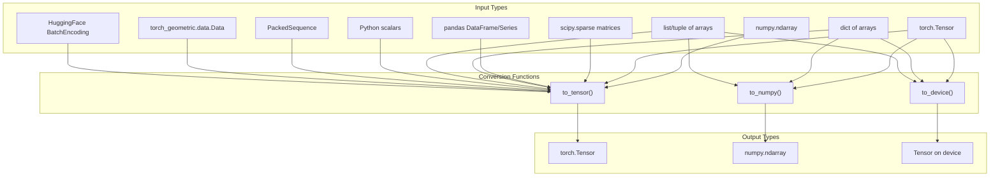
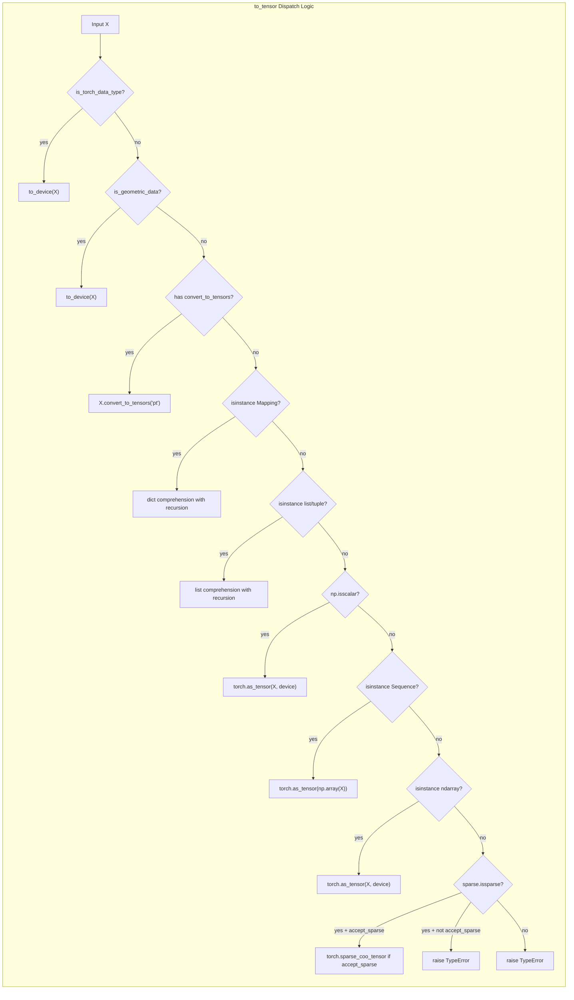
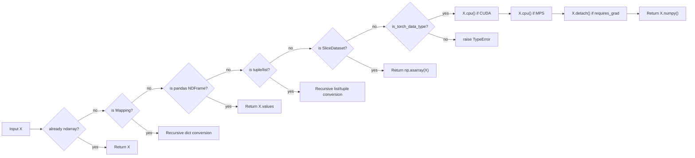
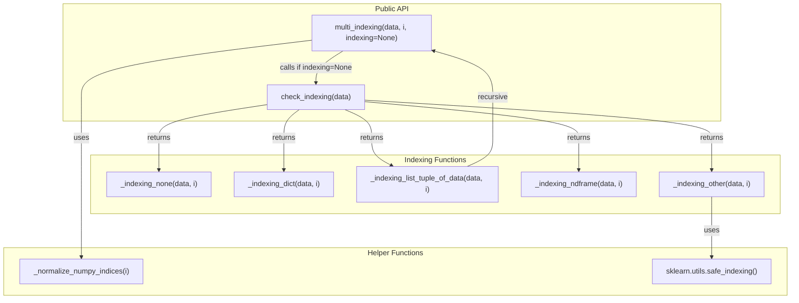
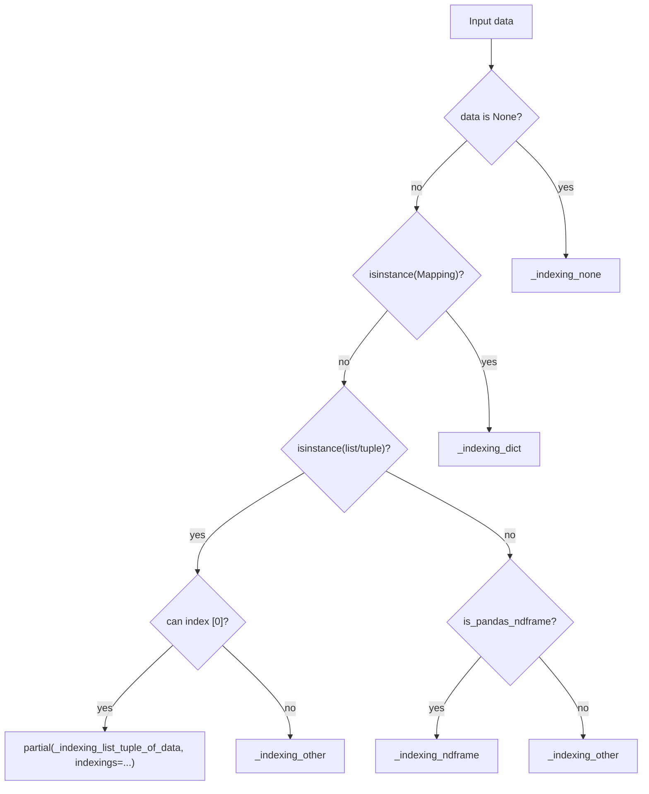
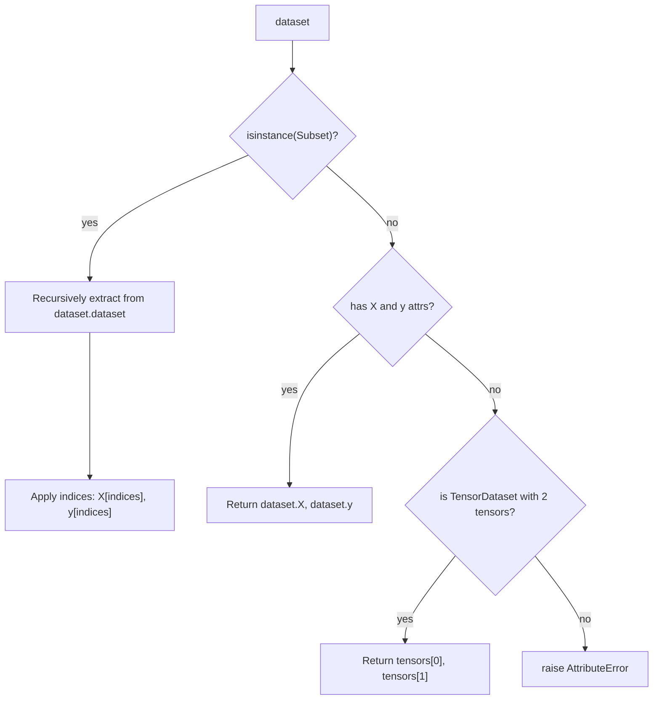
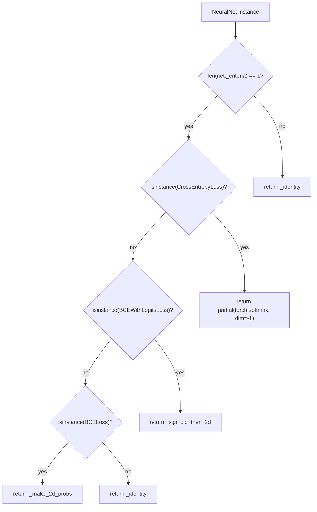

<!-- source: DeepWiki mcp.deepwiki.com · repo skorch-dev/skorch · page 4 Data Utilities · fetched 2026-10-21 -->

# Data Utilities

<details>
<summary>Relevant source files</summary>

The following files were used as context for generating this wiki page:

- [skorch/dataset.py](skorch/dataset.py)
- [skorch/tests/test_dataset.py](skorch/tests/test_dataset.py)
- [skorch/tests/test_utils.py](skorch/tests/test_utils.py)
- [skorch/utils.py](skorch/utils.py)

</details>


## Purpose and Scope

This page documents the utility functions in `skorch/utils.py` that provide foundational data manipulation capabilities used throughout skorch. These utilities handle:

- **Data type conversion** between numpy arrays, PyTorch tensors, and various container types
- **Device management** for moving data between CPU, CUDA, and MPS devices
- **Indexing operations** that work uniformly across multiple data structures
- **Model output processing** for prediction nonlinearities

These utilities form the foundation layer (see Diagram 6 in the high-level architecture) that supports all higher-level skorch components. For dataset-specific functionality like train/validation splitting, see [Dataset Handling](#2.4). For scikit-learn integration helpers like `SliceDict` and `SliceDataset`, see [Integration Helpers](#5.2).

---

## Data Type Conversion Functions

The conversion functions enable seamless interoperability between PyTorch tensors and other data formats commonly used in machine learning workflows.

### Supported Data Types



**Sources:** [skorch/utils.py:64-120](), [skorch/utils.py:127-164](), [skorch/utils.py:167-203]()

### to_tensor

Converts input data to PyTorch tensors with device placement.

| Parameter | Type | Description |
|-----------|------|-------------|
| `X` | various | Input data (numpy array, tensor, sparse matrix, dict, list, etc.) |
| `device` | str/torch.device | Target device ('cpu', 'cuda', 'mps') |
| `accept_sparse` | bool | Whether to accept scipy sparse matrices (converts to COO tensor) |

**Behavior by Input Type:**



**Sources:** [skorch/utils.py:64-120]()

**Example Usage:**
```python
# Convert numpy array to tensor on CUDA
X_tensor = to_tensor(np.array([1, 2, 3]), device='cuda')

# Convert dict of arrays recursively
X_dict = {'a': np.array([1, 2]), 'b': np.array([3, 4])}
X_tensors = to_tensor(X_dict, device='cpu')
# Returns: {'a': tensor([1, 2]), 'b': tensor([3, 4])}
```

**Sources:** [skorch/tests/test_utils.py:15-138]()

### to_numpy

Converts PyTorch tensors to numpy arrays, handling GPU/MPS tensors and gradients automatically.

**Conversion Steps:**



**Sources:** [skorch/utils.py:127-164]()

**Key Features:**
- Automatically moves tensors from CUDA/MPS to CPU
- Detaches tensors that require gradients
- Recursively handles nested structures (dicts, lists, tuples)
- Handles pandas DataFrames by extracting `.values`
- Handles `SliceDataset` objects by converting to numpy array

**Sources:** [skorch/tests/test_utils.py:140-211]()

### to_device

Moves tensors, modules, or nested structures to a specified device.

**Dispatch Logic:**

| Input Type | Action |
|------------|--------|
| `device=None` | Return input unchanged |
| `Mapping` | Recursively move all values, preserving mapping type |
| `tuple/list` (not PackedSequence) | Recursively move all elements |
| `PackedSequence` | Move to device (special handling) |
| `torch.distributions.Distribution` | Return unchanged (no device API) |
| Any other with `.to()` method | Call `.to(device)` |

**Sources:** [skorch/utils.py:167-203]()

**Example Usage:**
```python
# Move single tensor
X_cuda = to_device(X_cpu, device='cuda')

# Move dict of tensors
X_dict = {'a': tensor1, 'b': tensor2}
X_cuda = to_device(X_dict, device='cuda')  
# Both tensors moved to CUDA

# Move module
model_cuda = to_device(model, device='cuda')
```

**Sources:** [skorch/tests/test_utils.py:213-379]()

---

## Indexing and Data Access

The indexing utilities provide uniform slicing and indexing operations across diverse data types.

### Architecture Overview



**Sources:** [skorch/utils.py:230-373]()

### multi_indexing

Performs indexing on multiple data structures uniformly.

**Supported Structures:**

| Data Type | Indexing Method | Example |
|-----------|----------------|---------|
| numpy arrays | Direct indexing | `arr[i]` |
| torch tensors | Direct indexing | `tensor[i]` |
| pandas DataFrames | `.iloc[i]` | `df.iloc[i]` |
| dicts | Index each value | `{k: v[i] for k, v in data.items()}` |
| lists/tuples | Index each element | `[x[i] for x in data]` |
| nested structures | Recursive indexing | Applied recursively |

**Function Signature:**
```python
def multi_indexing(data, i, indexing=None):
    """
    Parameters
    ----------
    data : various
        Data structure to index
    i : int, slice, or array-like
        Index or slice to apply
    indexing : callable or None
        Pre-determined indexing function (optional optimization)
    """
```

**Sources:** [skorch/utils.py:317-373]()

**Examples:**

```python
# Index numpy array
multi_indexing(np.array([1, 2, 3, 4]), slice(0, 2))
# Returns: array([1, 2])

# Index dict of arrays
data = {'a': np.array([1, 2, 3]), 'b': np.array([4, 5, 6])}
multi_indexing(data, slice(0, 2))
# Returns: {'a': array([1, 2]), 'b': array([4, 5])}

# Index nested list
data = [[1, 2, 3], np.array([4, 5, 6]), {'x': [7, 8, 9]}]
multi_indexing(data, 0)
# Returns: [1, 4, {'x': 7}]
```

**Sources:** [skorch/tests/test_utils.py:528-761]()

### check_indexing

Determines the appropriate indexing function for a data structure upfront, enabling efficient repeated indexing.

**Decision Tree:**



**Sources:** [skorch/utils.py:269-303]()

**Usage Pattern:**
```python
# Determine indexing once
indexing_fn = check_indexing(data)

# Use repeatedly in a loop
for i in indices:
    batch = indexing_fn(data, i)  # Fast, no type checking
```

This optimization is used internally by `Dataset` to avoid repeated type checking for each batch:
```python
# In Dataset.__init__:
self.X_indexing = check_indexing(X)
self.y_indexing = check_indexing(y)

# In Dataset.__getitem__:
Xi = multi_indexing(X, i, self.X_indexing)  # Uses pre-determined function
yi = multi_indexing(y, i, self.y_indexing)
```

**Sources:** [skorch/dataset.py:150-152](), [skorch/dataset.py:200-201]()

### data_from_dataset

Extracts X and y from a dataset, handling `Subset` wrappers recursively.

**Extraction Logic:**



**Sources:** [skorch/utils.py:424-465]()

**Example:**
```python
from skorch.dataset import Dataset
from torch.utils.data import Subset

# Create nested subset
ds = Dataset(X, y)
subset1 = Subset(ds, [0, 1, 2])
subset2 = Subset(subset1, [1, 2])  # Nested!

# Extract X and y
X_extracted, y_extracted = data_from_dataset(subset2)
# Returns X[[1, 2]] and y[[1, 2]] (indices applied recursively)
```

**Sources:** [skorch/tests/test_utils.py:431-525]()

---

## Model Output Processing

Utilities for transforming model outputs into prediction formats expected by scikit-learn.

### _infer_predict_nonlinearity

Automatically determines the appropriate output transformation based on the loss function.

**Inference Rules:**

| Criterion | Output Transformation | Purpose |
|-----------|----------------------|---------|
| `CrossEntropyLoss` | `softmax(dim=-1)` | Convert logits to probabilities |
| `BCEWithLogitsLoss` | `sigmoid` → 2D probs | Convert logits to binary probs |
| `BCELoss` | Make 2D | Already probabilities, just reshape |
| Other / Multiple criteria | Identity (no change) | Return raw outputs |

**Sources:** [skorch/utils.py:647-676]()

**Implementation Flow:**



**Sources:** [skorch/utils.py:647-676]()

**Usage in Prediction:**

This function is called by `NeuralNetClassifier.predict_proba()` to automatically apply the correct transformation:

```python
# In NeuralNetClassifier.initialize()
nonlin = _infer_predict_nonlinearity(self)
self._predict_nonlinearity = nonlin

# In predict_proba()
y_proba = self._predict_nonlinearity(y_pred)
```

This allows users to get correct probability outputs without manually specifying transformations.

**Sources:** [skorch/tests/test_utils.py:844-909]()

### Helper Functions

**_sigmoid_then_2d:**
Transforms 1D logits to 2D probabilities for binary classification:
```python
def _sigmoid_then_2d(x):
    prob = torch.sigmoid(x)  # Apply sigmoid
    return torch.stack((1 - prob, prob), 1)  # Make 2D
```

**Sources:** [skorch/utils.py:616-638]()

**_make_2d_probs:**
Converts 1D probabilities to 2D (for BCE loss where sigmoid is already applied):
```python
def _make_2d_probs(prob):
    return torch.stack((1 - prob, prob), 1)
```

**Sources:** [skorch/utils.py:604-613]()

---

## Additional Utilities

### Parameter and Dataset Utilities

**params_for:**
Extracts parameters belonging to a specific module prefix:
```python
kwargs = {'encoder__lr': 0.1, 'encoder__momentum': 0.9, 'decoder__lr': 0.2}
encoder_params = params_for('encoder', kwargs)
# Returns: {'lr': 0.1, 'momentum': 0.9}
```

**Sources:** [skorch/utils.py:401-416]()

**is_skorch_dataset:**
Checks if a dataset is a `skorch.dataset.Dataset`, even when wrapped in `Subset`:
```python
from skorch.dataset import Dataset
from torch.utils.data import Subset

ds = Dataset(X, y)
subset = Subset(ds, [0, 1, 2])

is_skorch_dataset(subset)  # Returns True (checks recursively)
```

**Sources:** [skorch/utils.py:468-475](), [skorch/tests/test_utils.py:785-820]()

### Type Checking Utilities

| Function | Purpose | Example |
|----------|---------|---------|
| `is_torch_data_type(x)` | Check if x is tensor or PackedSequence | `is_torch_data_type(torch.zeros(3))` |
| `is_dataset(x)` | Check if x is torch Dataset | `is_dataset(Dataset(X, y))` |
| `is_geometric_data_type(x)` | Check if x is torch_geometric Data | For graph neural networks |
| `is_pandas_ndframe(x)` | Check if x has `.iloc` (DataFrame/Series) | `is_pandas_ndframe(pd.DataFrame())` |

**Sources:** [skorch/utils.py:49-56](), [skorch/utils.py:217-219]()

### Device Management

**get_map_location:**
Determines the appropriate device for loading saved model weights, with fallback logic:
```python
# User requests CUDA but none available
map_location = get_map_location('cuda', fallback_device='cpu')
# Returns torch.device('cpu') and issues DeviceWarning
```

**Sources:** [skorch/utils.py:557-575]()

**get_dim:**
Returns the number of dimensions for tensors or arrays:
```python
get_dim(torch.zeros(2, 3, 4))  # Returns 3
get_dim(np.zeros((5, 6)))      # Returns 2
```

**Sources:** [skorch/utils.py:206-214]()

### Parameter Freezing

**freeze_parameter / unfreeze_parameter:**
Convenience functions for gradient control:
```python
freeze_parameter(param)    # Sets param.requires_grad = False
unfreeze_parameter(param)  # Sets param.requires_grad = True
```

Used by `Freezer` and `Unfreezer` callbacks.

**Sources:** [skorch/utils.py:543-554]()

### Miscellaneous

**flatten:**
Generator that recursively flattens nested structures:
```python
nested = [[1, 2], {'a': 3}, [4, [5, 6]]]
list(flatten(nested))  # Returns [1, 2, 3, 4, 5, 6]
```

**Sources:** [skorch/utils.py:222-227]()

**duplicate_items:**
Finds duplicate items across multiple collections:
```python
duplicate_items([1, 2], [2, 3], [3, 4])  # Returns {2, 3}
```

**Sources:** [skorch/utils.py:376-398]()

**TeeGenerator:**
Allows multiple iterations over a generator:
```python
def gen():
    yield from [1, 2, 3]

tee_gen = TeeGenerator(gen())
list(tee_gen)  # [1, 2, 3]
list(tee_gen)  # [1, 2, 3] again!
```

**Sources:** [skorch/utils.py:704-715](), [skorch/tests/test_utils.py:823-841]()

**check_is_fitted:**
Checks whether a net is initialized, raising `NotInitializedError` if not:
```python
check_is_fitted(net, attributes=['module_'])
# Raises NotInitializedError if net.module_ doesn't exist
```

**Sources:** [skorch/utils.py:578-596]()

---

## Usage Patterns

### Converting Data for Training

```python
from skorch.utils import to_tensor

# Convert mixed data types to tensors
X_train = to_tensor(X_train_numpy, device='cuda')
X_dict = to_tensor({'feat1': X1, 'feat2': X2}, device='cuda')

# Handle sparse matrices
X_sparse = scipy.sparse.csr_matrix(...)
X_tensor = to_tensor(X_sparse, device='cuda', accept_sparse=True)
```

### Efficient Batch Indexing

```python
from skorch.utils import check_indexing, multi_indexing

# Determine indexing method once
indexing_fn = check_indexing(X)

# Use in batch loop (no repeated type checking)
for batch_idx in batch_indices:
    X_batch = multi_indexing(X, batch_idx, indexing_fn)
    # ... process batch
```

### Working with Nested Datasets

```python
from skorch.utils import data_from_dataset
from torch.utils.data import Subset

# Extract data from nested Subset
dataset = Dataset(X, y)
train_subset = Subset(dataset, train_indices)
validation_subset = Subset(train_subset, val_indices)

X_val, y_val = data_from_dataset(validation_subset)
# Handles nested indices automatically
```

---

## Function Reference Table

| Function | Input | Output | Primary Use Case |
|----------|-------|--------|------------------|
| `to_tensor` | numpy/list/dict → | torch.Tensor | Convert data to tensors |
| `to_numpy` | torch.Tensor → | numpy.ndarray | Convert tensors to numpy |
| `to_device` | tensor/module + device → | moved tensor/module | Device management |
| `multi_indexing` | data + indices → | indexed data | Uniform slicing |
| `check_indexing` | data → | indexing function | Optimize repeated indexing |
| `data_from_dataset` | Dataset/Subset → | (X, y) tuple | Extract raw data |
| `_infer_predict_nonlinearity` | NeuralNet → | transform function | Auto-select output transform |
| `params_for` | prefix + kwargs → | filtered kwargs | Extract module params |
| `is_skorch_dataset` | dataset → | bool | Type checking |
| `get_map_location` | device string → | torch.device | Safe device loading |
| `freeze_parameter` | parameter → | None (modifies) | Gradient control |
| `flatten` | nested structure → | flat generator | Flatten collections |
| `duplicate_items` | *collections → | set of duplicates | Find duplicates |

**Sources:** [skorch/utils.py:1-819]()

---

