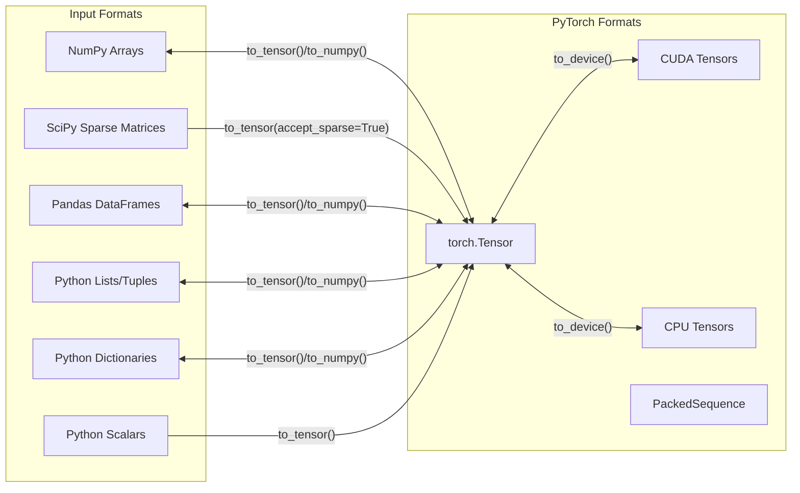
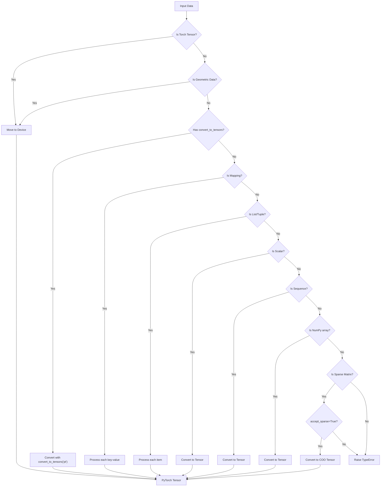
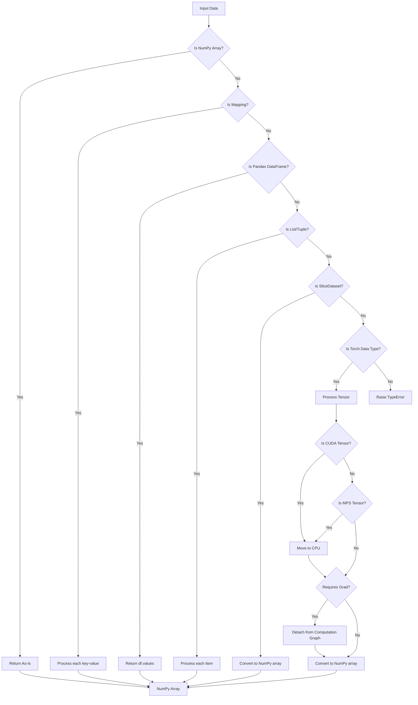
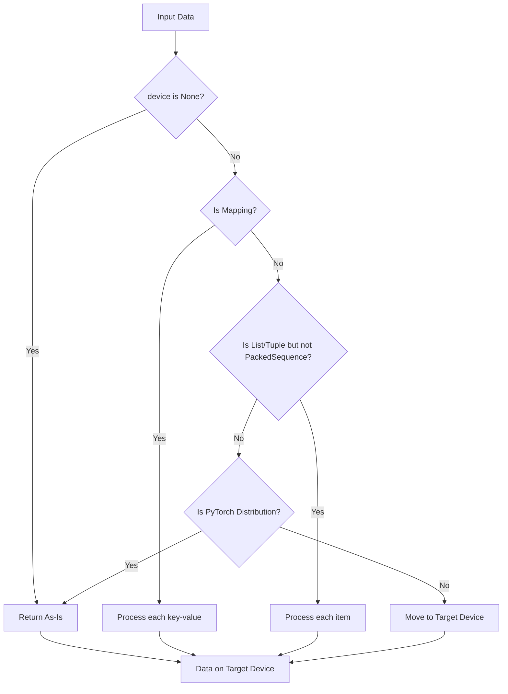
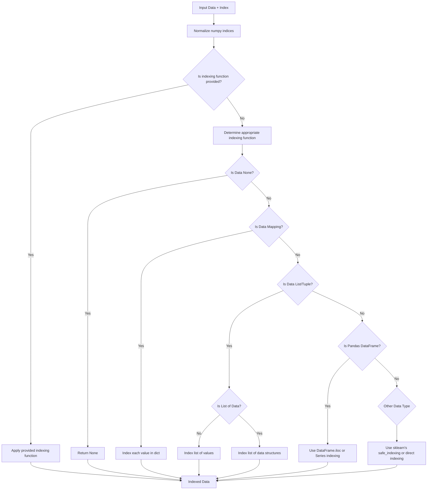
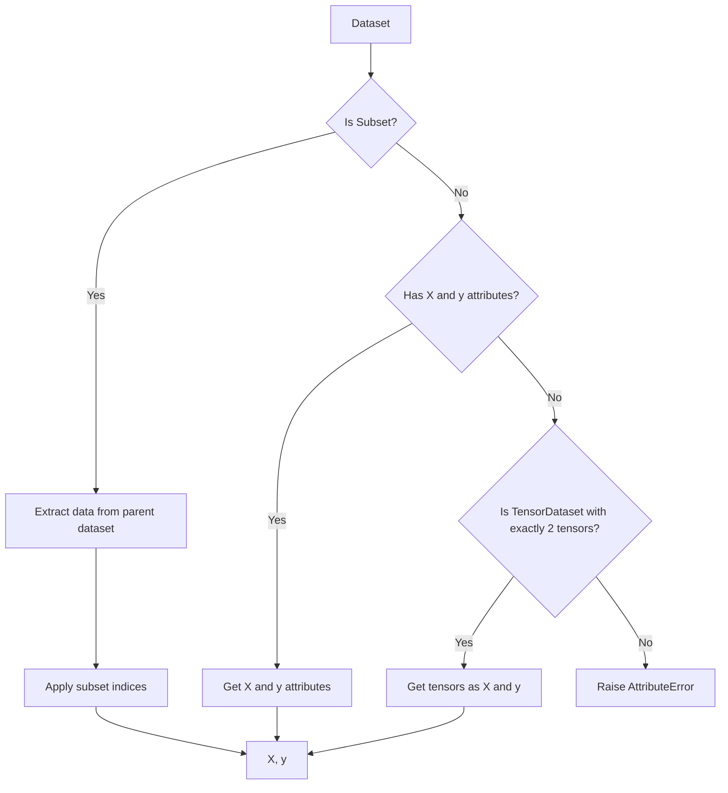

<!-- source: DeepWiki mcp.deepwiki.com · repo skorch-dev/skorch · page 4.1 Data Conversion Functions · fetched 2026-10-21 -->

# Data Conversion

Relevant source files

The following files were used as context for generating this wiki page:

- [skorch/tests/test_utils.py](skorch/tests/test_utils.py)
- [skorch/utils.py](skorch/utils.py)

This page documents the data conversion utilities provided by skorch for transforming between different data formats and moving data between devices. These utilities form a crucial bridge between scikit-learn's NumPy-based ecosystem and PyTorch's tensor-based operations.

The utilities covered here focus on data type conversion and don't include data loading or dataset manipulation, which are covered in [Dataset Handling](#2.3).

## Overview of Data Conversion Flow

Data in skorch frequently needs to be converted between different formats as it moves through the system. The primary conversion functions handle transformations between NumPy arrays, PyTorch tensors, and other formats.

### Data Type Conversion Flow

Sources: [skorch/utils.py:64-119](), [skorch/utils.py:127-164](), [skorch/utils.py:167-203]()

## Key Conversion Functions

### to_tensor

The `to_tensor` function converts various input data types to PyTorch tensors and optionally moves them to a specified device.

The `to_tensor` function supports the following input types:
- PyTorch tensors (returns as-is but moved to specified device)
- PyTorch geometric data types (if torch_geometric is installed)
- Hugging Face BatchEncoding objects (uses their convert_to_tensors method)
- Mappings (like dictionaries, processes each value recursively)
- Lists/tuples (processes each item recursively)
- Python scalars
- Sequences (converts to numpy array then to tensor)
- NumPy arrays
- SciPy sparse matrices (only if accept_sparse=True)

Sources: [skorch/utils.py:64-119](), [skorch/tests/test_utils.py:15-138]()

### to_numpy

The `to_numpy` function converts PyTorch tensors back to NumPy arrays. This is essential for interfacing with scikit-learn metrics and other NumPy-based functions.

The `to_numpy` function handles:
- NumPy arrays (returns as-is)
- Mappings (processes each value recursively)
- Pandas DataFrames (returns the underlying values)
- Lists/tuples (processes each item recursively)
- SliceDataset objects (converts to NumPy array)
- PyTorch tensors, with special handling for:
  - CUDA tensors (moves to CPU first)
  - MPS tensors (moves to CPU first)
  - Tensors with gradients (detaches from computation graph)

Sources: [skorch/utils.py:127-164](), [skorch/tests/test_utils.py:140-211]()

### to_device

The `to_device` function moves PyTorch tensors to a specific device (CPU or GPU/CUDA).

The `to_device` function handles:
- PyTorch tensors and modules
- Mappings (like dictionaries)
- Lists and tuples (except PackedSequence objects)
- PyTorch Distribution objects (left unchanged)

The function is a no-op if the device parameter is None.

Sources: [skorch/utils.py:167-203](), [skorch/tests/test_utils.py:213-378]()

## Data Indexing Utilities

skorch provides utilities for consistent indexing across different data structures. This is particularly useful for batch processing during training.

### multi_indexing

The `multi_indexing` function applies an index or slice to various data structures in a consistent way.

The `multi_indexing` function is versatile and can handle:
- NumPy arrays
- PyTorch tensors
- Pandas DataFrames and Series
- Dictionaries of the above
- Lists/tuples of the above
- SciPy sparse matrices

It can also handle boolean and integer NumPy array indices, making it compatible with complex selection operations.

Sources: [skorch/utils.py:317-373](), [skorch/utils.py:377-316](), [skorch/tests/test_utils.py:528-783]()

### data_from_dataset

The `data_from_dataset` function extracts the underlying X and y data from a skorch dataset or a subset of it.

This function is particularly useful for accessing the data inside nested datasets, such as when dealing with validation splits or cross-validation.

Sources: [skorch/utils.py:424-465](), [skorch/tests/test_utils.py:431-526]()

## Common Use Cases

The data conversion utilities in skorch are used extensively throughout the framework. Here are some common use cases:

1. **Converting input data during fit/predict**: 
   - NumPy arrays from scikit-learn are converted to PyTorch tensors
   - Data is moved to the appropriate device (CPU/GPU)

2. **Processing model outputs**:
   - Model predictions in tensor form are converted back to NumPy arrays
   - This allows integration with scikit-learn metrics and visualization tools

3. **Batch processing**:
   - During training, `multi_indexing` is used to extract batches from datasets
   - Ensures consistent behavior across different data structures

4. **Dataset access**:
   - `data_from_dataset` extracts underlying data for preprocessing or visualization
   - Works with both direct datasets and subsets (like validation splits)

5. **Device management**:
   - `to_device` moves tensors between CPU and GPU as needed
   - Handles nested data structures automatically

These utilities enable skorch to act as an effective bridge between scikit-learn's NumPy-based ecosystem and PyTorch's tensor-based deep learning capabilities.

Sources: [skorch/utils.py:64-203]()

## Type Handling Edge Cases

When working with skorch's data conversion utilities, be aware of these important edge cases:

1. **Sparse matrices**:
   - By default, sparse matrices raise an error in `to_tensor` 
   - Set `accept_sparse=True` to convert them to COO tensors

2. **Complex data structures**:
   - Nested dictionaries, lists, and tuples are processed recursively
   - The original structure is preserved, with each element converted appropriately

3. **Gradient tensors**:
   - `to_numpy` automatically detaches tensors that require gradients
   - This prevents unintended gradient computation during evaluation or prediction

4. **CUDA/MPS tensors**:
   - Automatically moved to CPU before conversion to NumPy (which can't handle GPU tensors)
   - Preserves the underlying data without requiring manual device management

5. **Special PyTorch objects**:
   - PackedSequence objects are handled specially by all conversion functions
   - Distribution objects are not moved by `to_device` to preserve their behavior

Understanding these edge cases helps avoid common pitfalls when working with skorch's data conversion utilities.

Sources: [skorch/utils.py:64-203](), [skorch/tests/test_utils.py:15-378]()

---

