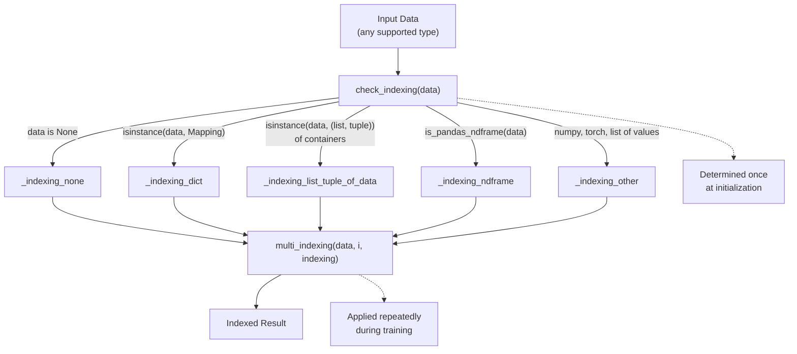
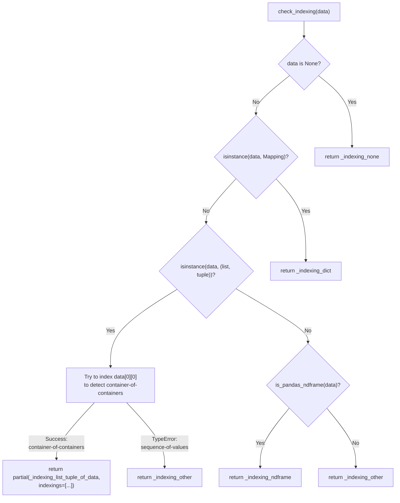
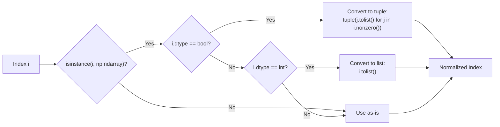
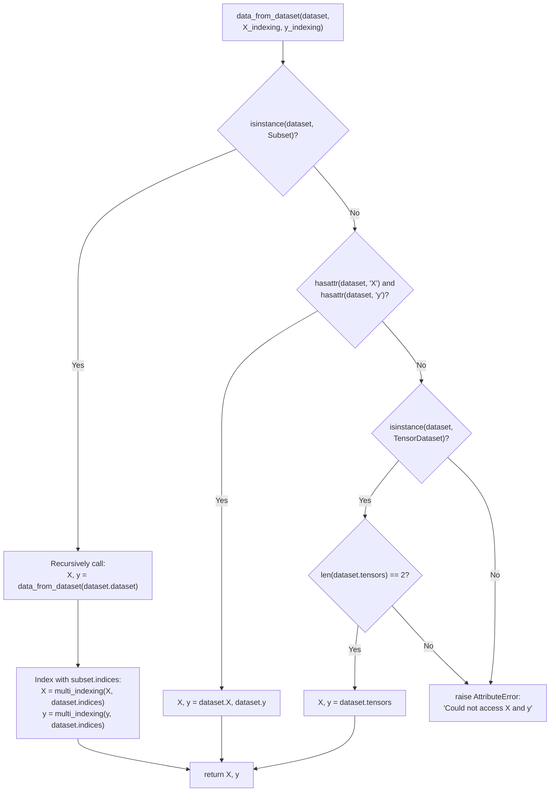
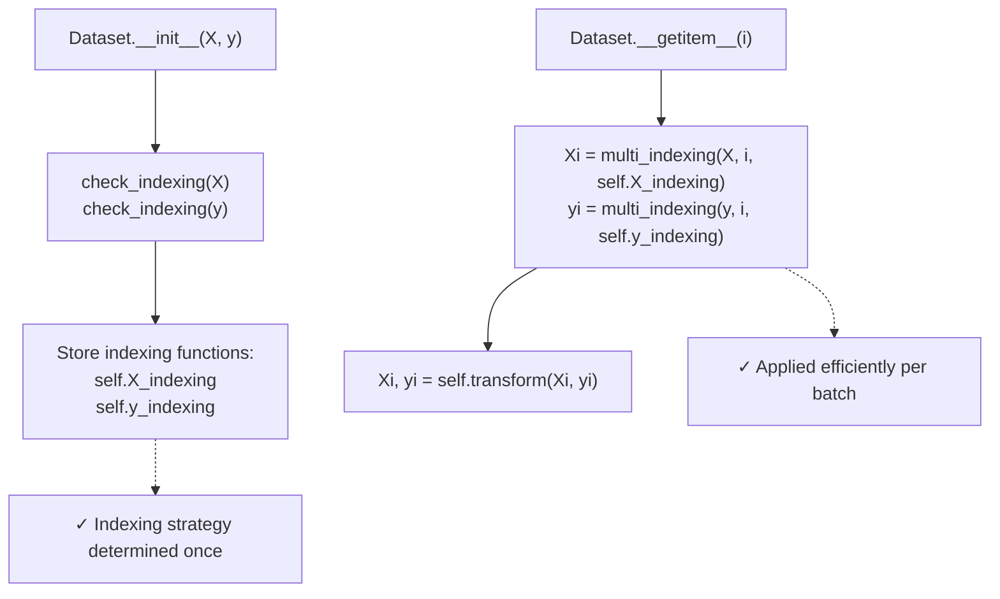
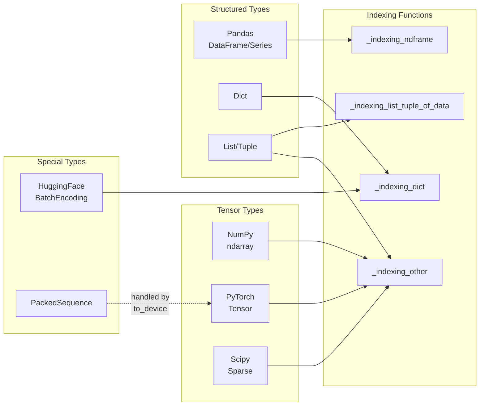

<!-- source: DeepWiki mcp.deepwiki.com · repo skorch-dev/skorch · page 4.2 Indexing and Data Access · fetched 2026-10-21 -->

# Indexing and Data Access

<details>
<summary>Relevant source files</summary>

The following files were used as context for generating this wiki page:

- [skorch/dataset.py](skorch/dataset.py)
- [skorch/tests/test_dataset.py](skorch/tests/test_dataset.py)
- [skorch/tests/test_utils.py](skorch/tests/test_utils.py)
- [skorch/utils.py](skorch/utils.py)

</details>


## Purpose and Scope

This page documents the indexing and data access utilities that enable skorch to work uniformly with diverse data types. These utilities provide a consistent interface for slicing and accessing data from numpy arrays, PyTorch tensors, pandas DataFrames, dictionaries, lists, and sparse matrices.

For information about data conversion between types (e.g., `to_tensor`, `to_numpy`), see [Data Conversion Functions](#4.1). For information about how the `Dataset` class uses these utilities, see [Dataset Handling](#2.4).

## Overview

Skorch needs to handle data in many different formats to maintain compatibility with both PyTorch and scikit-learn ecosystems. The core challenge is that different data structures have different indexing behaviors:

- NumPy arrays and PyTorch tensors support integer and slice indexing
- Pandas DataFrames require `.iloc[]` for positional indexing
- Dictionaries need to index each value separately
- Lists and tuples may contain indexable elements or be primitive sequences
- Sparse matrices have special requirements

The solution is a two-part system:

1. **`check_indexing`**: Inspects data upfront and returns an appropriate indexing function
2. **`multi_indexing`**: Applies indexing operations uniformly across all supported types

This approach allows skorch to determine the indexing strategy once during dataset initialization, then apply it efficiently during training.

**Sources:** [skorch/utils.py:269-373]()

## Indexing Strategy Architecture



**Sources:** [skorch/utils.py:269-303](), [skorch/utils.py:317-373]()

## Supported Data Types

The indexing system supports the following data types and structures:

| Data Type | Example | Indexing Handler | Notes |
|-----------|---------|------------------|-------|
| `None` | `None` | `_indexing_none` | Always returns `None` |
| NumPy array | `np.array([1, 2, 3])` | `_indexing_other` | Direct indexing via `data[i]` or `safe_indexing` |
| PyTorch tensor | `torch.tensor([1, 2, 3])` | `_indexing_other` | Direct indexing via `data[i]` |
| Pandas DataFrame | `pd.DataFrame({'a': [1, 2]})` | `_indexing_ndframe` | Uses `.iloc[i]` for positional indexing |
| Pandas Series | `pd.Series([1, 2, 3])` | `_indexing_ndframe` | Uses `.iloc[i]` for positional indexing |
| Dictionary | `{'x': arr1, 'y': arr2}` | `_indexing_dict` | Indexes each value: `{k: v[i] for k, v in data.items()}` |
| List/tuple of containers | `[arr1, arr2]` | `_indexing_list_tuple_of_data` | Recursively indexes each element |
| List/tuple of values | `[1, 2, 3]` | `_indexing_other` | Direct indexing via `data[i]` |
| Sparse matrix (scipy) | `sparse.csr_matrix(...)` | `_indexing_other` | Direct indexing via `data[i]` |

**Sources:** [skorch/utils.py:231-303](), [skorch/tests/test_utils.py:528-783]()

## check_indexing Function

The `check_indexing` function examines input data and returns the appropriate indexing function. This inspection happens once, typically during `Dataset` initialization, allowing efficient batch indexing during training.



The function stores indexing functions for nested structures to avoid repeated type checking:

```python
# From skorch/dataset.py:150-151
self.X_indexing = check_indexing(X)
self.y_indexing = check_indexing(y)
```

**Sources:** [skorch/utils.py:269-303](), [skorch/dataset.py:150-151]()

## multi_indexing Function

The `multi_indexing` function applies an index to data, either using a pre-determined indexing function or by determining it on the fly.

### Function Signature

```python
def multi_indexing(data, i, indexing=None):
    """
    Parameters
    ----------
    data : supported data type
        Data to be indexed
    
    i : int, slice, or array-like
        The index to apply
    
    indexing : callable or None
        Pre-determined indexing function. If None, 
        check_indexing is called to determine it.
    
    Returns
    -------
    Indexed data in the same structure as input
    """
```

### Index Normalization

Before indexing, NumPy arrays used as indices are normalized:



This normalization ensures that NumPy boolean and integer arrays work correctly with PyTorch tensors.

**Sources:** [skorch/utils.py:306-314](), [skorch/utils.py:317-373]()

## Indexing Function Implementations

### Dictionary Indexing

```python
# From skorch/utils.py:235-236
def _indexing_dict(data, i):
    return {k: v[i] for k, v in data.items()}
```

Applies the index to each value in the dictionary, preserving keys.

### List/Tuple Indexing

```python
# From skorch/utils.py:239-251
def _indexing_list_tuple_of_data(data, i, indexings=None):
    if not indexings:
        return [multi_indexing(x, i) for x in data]
    return [multi_indexing(x, i, indexing)
            for x, indexing in zip(data, indexings)]
```

Recursively indexes each element in the list or tuple. If `indexings` are provided (from `check_indexing`), uses them for efficiency.

### Pandas NDFrame Indexing

```python
# From skorch/utils.py:254-259
def _indexing_ndframe(data, i):
    if hasattr(data, 'iloc'):
        return data.iloc[i]
    return _indexing_dict(data, i)
```

Uses `.iloc[]` for pandas DataFrames/Series. Falls back to dictionary indexing if the data was converted to a dict (which happens during `Dataset` creation for pandas inputs).

### Other Types

```python
# From skorch/utils.py:262-266
def _indexing_other(data, i):
    if isinstance(i, (int, np.integer, slice, tuple)):
        return data[i]
    return safe_indexing(data, i)
```

For simple types (numpy arrays, torch tensors, lists), uses direct indexing. For complex indices, delegates to sklearn's `safe_indexing`.

**Sources:** [skorch/utils.py:231-266]()

## data_from_dataset Function

The `data_from_dataset` function extracts X and y from skorch `Dataset` or PyTorch `Subset` objects, even when nested.



### Usage in ValidSplit

The `data_from_dataset` function is particularly useful when working with train/validation splits:

```python
# From test_dataset.py, checking stratification
dataset_train, dataset_valid = valid_split(cv, stratified=True)(data, y)
y_train = data_from_dataset(dataset_train)[1]
y_valid = data_from_dataset(dataset_valid)[1]
```

### Handling Nested Subsets

The function recursively unwraps `Subset` objects:

```python
# Example: Subset of a Subset
dataset = Dataset(X, y)
subset1 = Subset(dataset, [1, 2, 3])
subset2 = Subset(subset1, [0, 2])

X_final, y_final = data_from_dataset(subset2)
# X_final contains data at indices [1, 3] from original X
```

**Sources:** [skorch/utils.py:424-465](), [skorch/tests/test_utils.py:431-526]()

## Special Handling Cases

### Pandas DataFrames

Pandas DataFrames are converted to dictionaries during `Dataset` initialization to ensure consistent behavior:

```python
# From skorch/dataset.py:197-198
if self.X_is_ndframe:
    X = {k: X[k].values.reshape(-1, 1) for k in X}
```

This conversion:
- Makes each column independently indexable
- Converts Series values to 2D arrays for consistency
- Preserves column names as dictionary keys

**Sources:** [skorch/dataset.py:195-202]()

### Sparse Matrices

Sparse matrices (scipy CSR format) require special handling in the `Dataset.transform` method:

```python
# From skorch/dataset.py:191-192
if sparse.issparse(X):
    X = X.toarray().squeeze(0)
```

Since PyTorch cannot directly handle sparse scipy matrices, they are converted to dense arrays. The `squeeze(0)` removes the batch dimension that CSR matrices add.

**Sources:** [skorch/dataset.py:191-192](), [skorch/tests/test_dataset.py:506-514]()

### HuggingFace Tokenizers

Special handling for HuggingFace `BatchEncoding` objects in length detection:

```python
# From skorch/dataset.py:73-76
if isinstance(data, Mapping) and (data.get('input_ids') is not None):
    # Special casing Huggingface BatchEncodings
    return len(data['input_ids'])
```

This prevents incorrectly determining length from the sequence dimension instead of the batch dimension.

**Sources:** [skorch/dataset.py:72-77](), [skorch/tests/test_dataset.py:69-75]()

## Integration with Dataset Class

The `Dataset` class uses these indexing utilities in its initialization and `__getitem__` method:



### Performance Optimization

By pre-computing indexing functions during initialization, `Dataset` avoids repeated type checking during training:

| Approach | Type Checking Frequency | Typical Overhead per Epoch |
|----------|------------------------|----------------------------|
| **Without check_indexing** | Every batch access | Significant (10-20% slower) |
| **With check_indexing** | Once at initialization | Negligible |

**Sources:** [skorch/dataset.py:150-151](), [skorch/dataset.py:195-202]()

## Usage Examples

### Basic Array Indexing

```python
# NumPy array
X = np.array([[1, 2], [3, 4], [5, 6]])
result = multi_indexing(X, np.s_[:2])
# Result: array([[1, 2], [3, 4]])

# PyTorch tensor
X = torch.tensor([[1, 2], [3, 4], [5, 6]])
result = multi_indexing(X, 1)
# Result: tensor([3, 4])
```

### Dictionary Indexing

```python
# Dictionary of arrays
X = {'features': np.array([1, 2, 3, 4]), 
     'metadata': np.array([10, 20, 30, 40])}
result = multi_indexing(X, np.s_[1:3])
# Result: {'features': array([2, 3]), 'metadata': array([20, 30])}
```

### Mixed Data Types

```python
# List containing different types
data = [
    np.array([1, 2, 3]),
    torch.tensor([4, 5, 6]),
    {'a': np.array([7, 8, 9])}
]
result = multi_indexing(data, 0)
# Result: [1, tensor(4), {'a': 7}]
```

### Pre-computed Indexing

```python
# Determine indexing function once
X = {'x1': np.zeros((100, 10)), 'x2': np.ones((100, 5))}
indexing_fn = check_indexing(X)

# Apply efficiently in a loop
for i in batch_indices:
    Xi = multi_indexing(X, i, indexing=indexing_fn)
    # Process Xi...
```

**Sources:** [skorch/tests/test_utils.py:534-783]()

## Error Handling

### Type Conversion Errors

When `multi_indexing` encounters unsupported types, it delegates to sklearn's `safe_indexing`, which may raise appropriate errors:

```python
# Float indices are not supported
X = np.zeros(10)
i = np.arange(3, 0.5)  # Float array
multi_indexing(X, i)
# Raises: IndexError or ValueError (sklearn version dependent)
```

### Inconsistent Lengths

The `get_len` function validates that all components have consistent lengths:

```python
data = [np.zeros(5), np.zeros(4)]  # Inconsistent lengths
get_len(data)
# Raises: ValueError: "Dataset does not have consistent lengths."
```

**Sources:** [skorch/tests/test_utils.py:731-745](), [skorch/tests/test_dataset.py:55-67]()

## Type Support Matrix



**Sources:** [skorch/utils.py:231-303](), [skorch/utils.py:49-60]()

---

