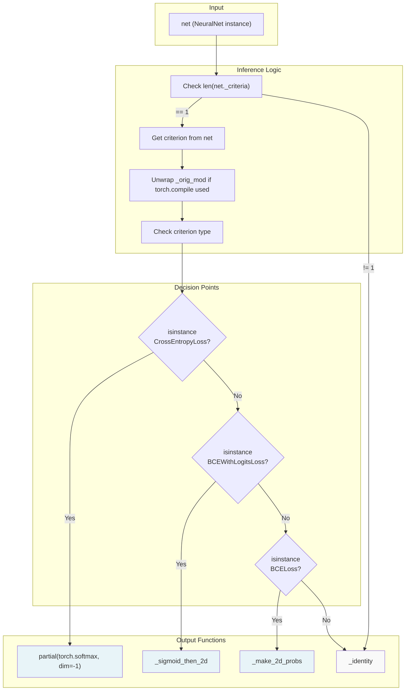
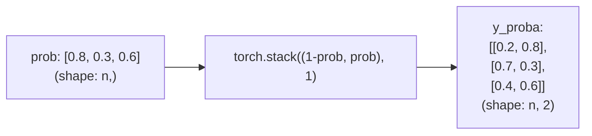
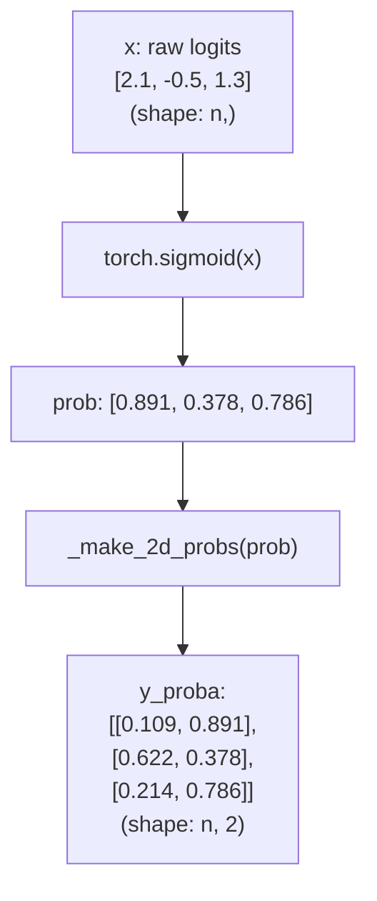
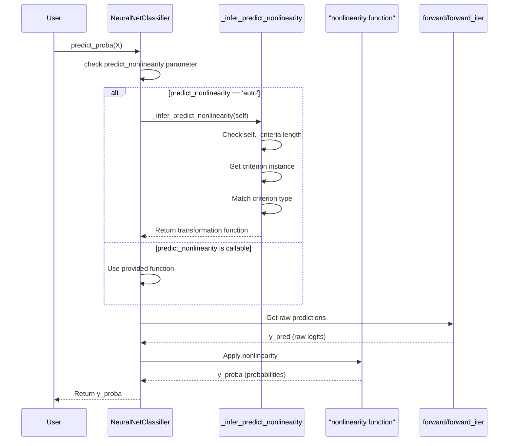
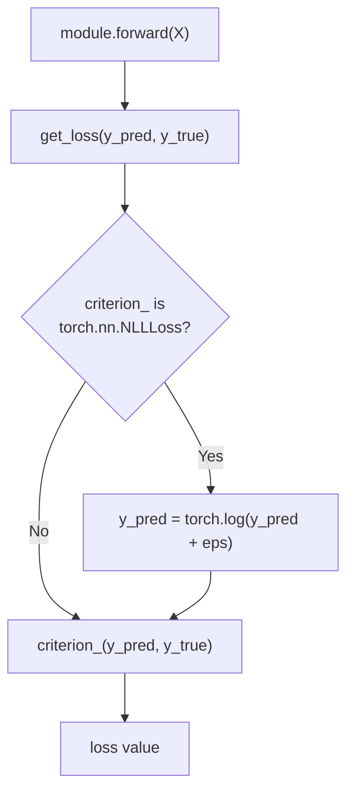

<!-- source: DeepWiki mcp.deepwiki.com · repo skorch-dev/skorch · page 4.3 Model Output Processing · fetched 2026-10-21 -->

# Model Output Processing

<details>
<summary>Relevant source files</summary>

The following files were used as context for generating this wiki page:

- [skorch/classifier.py](skorch/classifier.py)
- [skorch/tests/test_classifier.py](skorch/tests/test_classifier.py)
- [skorch/tests/test_regressor.py](skorch/tests/test_regressor.py)
- [skorch/tests/test_utils.py](skorch/tests/test_utils.py)
- [skorch/utils.py](skorch/utils.py)

</details>


## Purpose and Scope

This document covers utilities for processing neural network model outputs, specifically for converting raw model outputs (logits, unnormalized scores) into formats suitable for prediction and probability estimation in classification tasks. These utilities handle the automatic inference and application of appropriate nonlinearities (softmax, sigmoid, etc.) based on the loss function being used.

For information about converting data types and managing device placement, see [Data Conversion Functions](#4.1). For general data indexing and access patterns, see [Indexing and Data Access](#4.2).

**Sources:** [skorch/utils.py:599-701]()

---

## Overview

Model output processing in skorch addresses a key challenge: different loss functions expect different input formats during training, but users typically want normalized probabilities during prediction. The system automatically infers and applies the correct transformation based on the criterion used.

### Key Challenges Addressed

| Challenge | Solution |
|-----------|----------|
| CrossEntropyLoss expects raw logits but users want probabilities | Automatically apply softmax during prediction |
| BCEWithLogitsLoss expects raw logits but users want probabilities | Automatically apply sigmoid during prediction |
| BCELoss expects probabilities, no transformation needed | Return probabilities as-is |
| Binary classification requires 2D probability arrays for sklearn | Convert 1D probabilities to 2D format |

**Sources:** [skorch/utils.py:647-676](), [skorch/classifier.py:170-235]()

---

## Nonlinearity Inference System

The `_infer_predict_nonlinearity` function is the central component that determines which transformation to apply to model outputs during prediction.



**Sources:** [skorch/utils.py:647-676]()

---

## Core Transformation Functions

### _identity

The identity function returns input unchanged. Used when no transformation is needed (e.g., for regression or when custom loss functions are used).

```python
# skorch/utils.py:599-601
def _identity(x):
    """Return input as is, the identity operation"""
    return x
```

**Usage:** When `_infer_predict_nonlinearity` cannot determine the appropriate transformation or when no transformation is required.

**Sources:** [skorch/utils.py:599-601]()

---

### _make_2d_probs

Converts 1-dimensional probability vectors into 2-dimensional arrays required by scikit-learn conventions for binary classification.



**Function signature and behavior:**
- **Input:** 1D torch tensor of probabilities (shape: `(n,)`)
- **Output:** 2D torch tensor with complementary probabilities (shape: `(n, 2)`)
- **Purpose:** sklearn expects probabilities for both classes even in binary classification

**Sources:** [skorch/utils.py:604-613]()

---

### _sigmoid_then_2d

Applies sigmoid activation to raw logits and then converts to 2D probability format for binary classification.



**Function signature and behavior:**
- **Input:** 1D torch tensor of raw logits (shape: `(n,)`)
- **Process:** Apply sigmoid → Create complementary probabilities → Stack into 2D
- **Output:** 2D torch tensor with valid probabilities summing to 1.0 along axis 1
- **Use case:** BCEWithLogitsLoss criterion in binary classification

**Sources:** [skorch/utils.py:616-638]()

---

## Criterion-to-Transformation Mapping

The following table shows how different PyTorch loss functions map to output transformations:

| Criterion | Training Input Expected | Prediction Transformation | Result Format |
|-----------|------------------------|---------------------------|---------------|
| `torch.nn.NLLLoss` | Log-probabilities | `_identity` | Raw output (caller handles log) |
| `torch.nn.CrossEntropyLoss` | Raw logits | `partial(torch.softmax, dim=-1)` | Probabilities (multiclass) |
| `torch.nn.BCEWithLogitsLoss` | Raw logits | `_sigmoid_then_2d` | 2D probabilities (binary) |
| `torch.nn.BCELoss` | Probabilities | `_make_2d_probs` | 2D probabilities (binary) |
| Custom/Unknown | Varies | `_identity` | Raw output |
| Multiple criteria | Multiple | `_identity` | Raw output (ambiguous) |

**Key insight:** The transformation is inferred once at prediction time and applied consistently across all predictions.

**Sources:** [skorch/utils.py:647-676]()

---

## Integration with Classifier Classes

### NeuralNetClassifier Integration

The `NeuralNetClassifier` uses `_infer_predict_nonlinearity` in its `predict_proba` method to automatically apply the correct transformation.



**Sources:** [skorch/classifier.py:170-203](), [skorch/net.py]() (predict_proba implementation)

---

### NeuralNetBinaryClassifier Integration

Binary classifier has additional considerations for threshold-based prediction and ensuring output dimensionality.

```mermaid
graph TB
    subgraph "predict_proba"
        PredictProba["predict_proba(X)"]
        InferNonlin["_infer_predict_nonlinearity"]
        ForwardIter["forward_iter(X)"]
        ApplyNonlin["Apply nonlinearity"]
        CheckShape["Check output shape"]
        Reshape["Reshape if needed"]
        Output2D["2D probability array"]
    end
    
    subgraph "predict"
        PredictMethod["predict(X)"]
        CallProba["Call predict_proba(X)"]
        GetProb["Get proba[:, 1]"]
        CompareThresh["prob > threshold"]
        ToUint8["Cast to uint8"]
        OutputPred["Binary predictions"]
    end
    
    PredictProba --> InferNonlin
    InferNonlin --> ForwardIter
    ForwardIter --> ApplyNonlin
    ApplyNonlin --> CheckShape
    CheckShape --> Reshape
    Reshape --> Output2D
    
    PredictMethod --> CallProba
    CallProba --> GetProb
    GetProb --> CompareThresh
    CompareThresh --> ToUint8
    ToUint8 --> OutputPred
    
    style Output2D fill:#e8f4f8
    style OutputPred fill:#e8f4f8
```



**Key differences for binary classifier:**
1. Module output must be 1D or (n, 1) shaped - validated in `infer` method
2. Output is reshaped to 1D before applying nonlinearity
3. `predict` applies threshold to probability column 1 for final predictions
4. Default threshold is 0.5, configurable via `threshold` parameter

**Sources:** [skorch/classifier.py:266-386]()

---

## Special Handling for NLLLoss

`NeuralNetClassifier` has special handling for `NLLLoss` during training, which affects how outputs are processed.



**Important:** During training with `NLLLoss`, the module should output probabilities (not log-probabilities). The `get_loss` method automatically applies log. However, during prediction, no transformation is applied by default (returns raw output), so users typically need to ensure their module outputs valid probabilities or use a different criterion.

**Sources:** [skorch/classifier.py:147-153]()

---

## Code Entity Reference

### Primary Functions

| Function | Location | Purpose |
|----------|----------|---------|
| `_infer_predict_nonlinearity` | [skorch/utils.py:647-676]() | Infers appropriate transformation based on criterion |
| `_identity` | [skorch/utils.py:599-601]() | Identity transformation (no-op) |
| `_make_2d_probs` | [skorch/utils.py:604-613]() | Converts 1D probabilities to 2D format |
| `_sigmoid_then_2d` | [skorch/utils.py:616-638]() | Applies sigmoid and converts to 2D |

### Integration Points

| Class | Method | Usage |
|-------|--------|-------|
| `NeuralNetClassifier` | `predict_proba` | Calls `_infer_predict_nonlinearity` when `predict_nonlinearity='auto'` |
| `NeuralNetClassifier` | `predict` | Uses `predict_proba` then takes argmax |
| `NeuralNetBinaryClassifier` | `predict_proba` | Inherits behavior, ensures 2D output |
| `NeuralNetBinaryClassifier` | `predict` | Applies threshold to probability column |
| `NeuralNetBinaryClassifier` | `infer` | Validates and reshapes module output to 1D |

**Sources:** [skorch/classifier.py:57-386](), [skorch/utils.py:599-676]()

---

## Testing and Validation

The test suite validates correct behavior for different criterion types:

### Test Coverage

| Test File | Test Cases | What It Validates |
|-----------|------------|-------------------|
| [skorch/tests/test_utils.py:844-910]() | `TestInferPredictNonlinearity` | Correct transformation inference for each criterion type |
| [skorch/tests/test_classifier.py:61-69]() | `test_predict_and_predict_proba` | Probabilities sum to 1, predict uses argmax of proba |
| [skorch/tests/test_classifier.py:316-340]() | `test_predict_predict_proba` (binary) | Different thresholds, avoid double-sigmoid |
| [skorch/tests/test_classifier.py:363-393]() | Custom loss handling | Custom nonlinearity functions work correctly |
| [skorch/tests/test_classifier.py:447-477]() | BCELoss integration | Correct probability handling with BCELoss |

**Key test insight:** Tests explicitly check that sigmoid is not applied twice (lines 329-334 in test_classifier.py), which would constrain probabilities to `[expit(-1), expit(1)]` range instead of `[0, 1]`.

**Sources:** [skorch/tests/test_utils.py:844-910](), [skorch/tests/test_classifier.py:61-477]()

---

## Advanced Usage: Custom Nonlinearities

Users can override the automatic inference by providing a custom `predict_nonlinearity` callable when initializing a classifier:

```python
# Example: Custom nonlinearity function
def custom_nonlinearity(x):
    """Custom transformation for model outputs"""
    return torch.stack((1 - x, x), 1)

net = NeuralNetBinaryClassifier(
    module,
    criterion=torch.nn.MSELoss,
    predict_nonlinearity=custom_nonlinearity,  # Override automatic inference
)
```

When `predict_nonlinearity` is set to a callable:
- Automatic inference is bypassed
- The provided function is applied to all model outputs during prediction
- The function must return the correct format (2D for binary/multiclass classification)

**Sources:** [skorch/tests/test_classifier.py:363-381]()

---

## Common Pitfalls and Solutions

### Issue: Double Sigmoid Application

**Problem:** Manually applying sigmoid in module output when using `BCEWithLogitsLoss`

```python
# INCORRECT - sigmoid applied twice
class MyModule(nn.Module):
    def forward(self, x):
        x = self.linear(x)
        return torch.sigmoid(x)  # Don't do this with BCEWithLogitsLoss!

net = NeuralNetBinaryClassifier(
    MyModule(),
    criterion=torch.nn.BCEWithLogitsLoss,  # Expects raw logits
)
```

**Solution:** Return raw logits from module or use `BCELoss` instead

```python
# CORRECT - return raw logits
class MyModule(nn.Module):
    def forward(self, x):
        return self.linear(x)  # Return logits

# OR use BCELoss if module outputs probabilities
net = NeuralNetBinaryClassifier(
    MyModuleWithSigmoid(),
    criterion=torch.nn.BCELoss,  # Expects probabilities
)
```

**Sources:** [skorch/tests/test_classifier.py:329-334]()

---

### Issue: Multiple Criteria Ambiguity

**Problem:** When a model has multiple criteria registered, automatic inference returns identity function

```python
net = NeuralNet(
    module,
    criterion=torch.nn.CrossEntropyLoss,
    # ... additional criteria added via custom initialization
)
# len(net._criteria) > 1, so _infer_predict_nonlinearity returns _identity
```

**Solution:** Explicitly provide `predict_nonlinearity` parameter

```python
net = NeuralNetClassifier(
    module,
    criterion=torch.nn.CrossEntropyLoss,
    predict_nonlinearity=partial(torch.softmax, dim=-1),
)
```

**Sources:** [skorch/utils.py:659-661]()

---

## Performance Considerations

1. **Inference overhead:** The nonlinearity function is inferred once (when first accessed) and cached via the `predict_nonlinearity` parameter mechanism
2. **Transformation cost:** Applied element-wise to predictions, dominated by forward pass cost
3. **Memory:** Converting 1D to 2D doubles memory for probability arrays in binary classification

**Sources:** [skorch/classifier.py:170-203]()

---

