<!-- source: DeepWiki mcp.deepwiki.com · repo skorch-dev/skorch · page 5 Scikit-learn Integration · fetched 2026-10-21 -->

# Scikit-learn Integration

<details>
<summary>Relevant source files</summary>

The following files were used as context for generating this wiki page:

- [.github/workflows/testing.yml](.github/workflows/testing.yml)
- [README.rst](README.rst)
- [docs/user/FAQ.rst](docs/user/FAQ.rst)
- [docs/user/callbacks.rst](docs/user/callbacks.rst)
- [docs/user/dataset.rst](docs/user/dataset.rst)
- [docs/user/installation.rst](docs/user/installation.rst)
- [docs/user/neuralnet.rst](docs/user/neuralnet.rst)
- [skorch/helper.py](skorch/helper.py)
- [skorch/tests/test_helper.py](skorch/tests/test_helper.py)

</details>


## Purpose and Scope

This document explains how skorch integrates with scikit-learn's ecosystem, enabling PyTorch neural networks to be used seamlessly with sklearn's tools for hyperparameter tuning, pipelines, and cross-validation. For details on individual integration components, see:
- API compatibility methods: [5.1](#5.1)
- Helper classes for data compatibility: [5.2](#5.2)
- Practical examples with sklearn tools: [5.3](#5.3)
- Parameter naming conventions: [5.4](#5.4)

## Integration Architecture

The following diagram shows how skorch bridges PyTorch and scikit-learn through three integration layers:

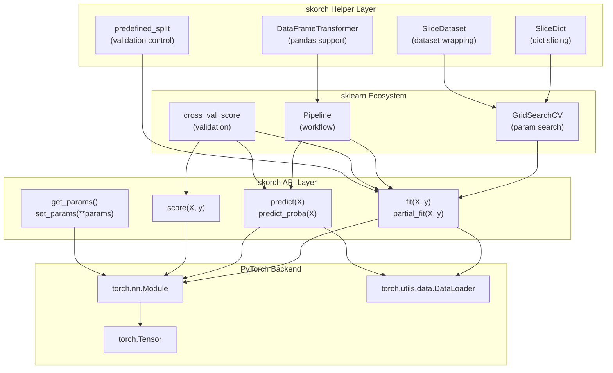

Sources: [README.rst:83-114](), [docs/user/FAQ.rst:58-83](), [skorch/helper.py:1-535]()

## Core Integration Mechanisms

### sklearn Estimator API Implementation

The `NeuralNet` base class implements sklearn's estimator interface, providing compatibility with all sklearn tools:

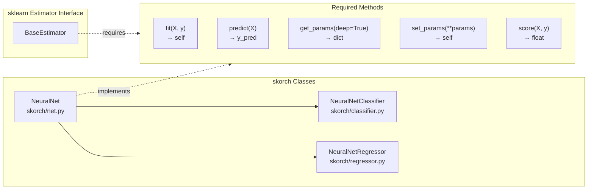

| Method | Purpose | Returns | Notes |
|--------|---------|---------|-------|
| `fit(X, y)` | Train model from scratch | `self` | Initializes if needed, trains for `max_epochs` |
| `partial_fit(X, y)` | Continue training | `self` | Does not re-initialize, useful for incremental learning |
| `predict(X)` | Generate predictions | `numpy.ndarray` | For classifiers, returns class labels |
| `predict_proba(X)` | Generate probabilities | `numpy.ndarray` | Available for classifiers |
| `score(X, y)` | Evaluate model | `float` | Accuracy for classifiers, R² for regressors |
| `get_params(deep=True)` | Get all parameters | `dict` | Includes nested parameters |
| `set_params(**params)` | Set parameters | `self` | Supports double-underscore notation |

Sources: [docs/user/neuralnet.rst:1-421](), [README.rst:72-114]()

### Behavioral Alignment with sklearn

skorch provides specific parameters and behaviors to ensure compatibility with sklearn workflows:

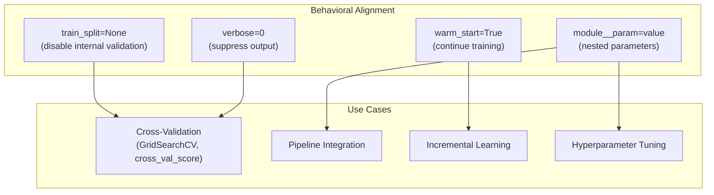

Key behavioral features:

| Feature | Parameter | Purpose | Example |
|---------|-----------|---------|---------|
| Disable internal validation | `train_split=None` | Let sklearn handle splitting | Used with `GridSearchCV` |
| Continue training | `warm_start=True` | Don't re-initialize on `fit()` | Multiple `fit()` calls |
| Suppress output | `verbose=0` | Quiet training | Grid search with many fits |
| Nested parameters | `module__<param>` | Access sub-component params | `module__num_units=10` |

Sources: [README.rst:104-114](), [docs/user/neuralnet.rst:282-293](), [docs/user/FAQ.rst:24-35]()

## Data Compatibility Helpers

skorch provides helper classes to bridge data format gaps between sklearn and PyTorch:

### SliceDict - Dictionary Slicing Support

The `SliceDict` class enables dictionaries to work with sklearn tools that expect array-like slicing:

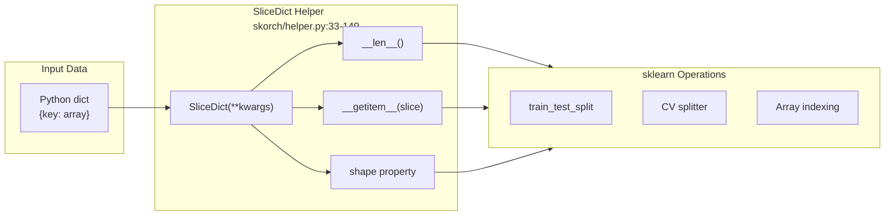

Key characteristics:
- Wraps a dictionary of arrays with equal first dimension
- Supports slicing across all values simultaneously
- Cannot be indexed by single integers (use `[i:i+1]` instead)
- Preserves dictionary keys during slicing
- Compatible with numpy arrays and torch tensors as values

Sources: [skorch/helper.py:33-149](), [docs/user/FAQ.rst:58-68]()

### SliceDataset - PyTorch Dataset Wrapping

The `SliceDataset` class wraps PyTorch datasets for sklearn compatibility:

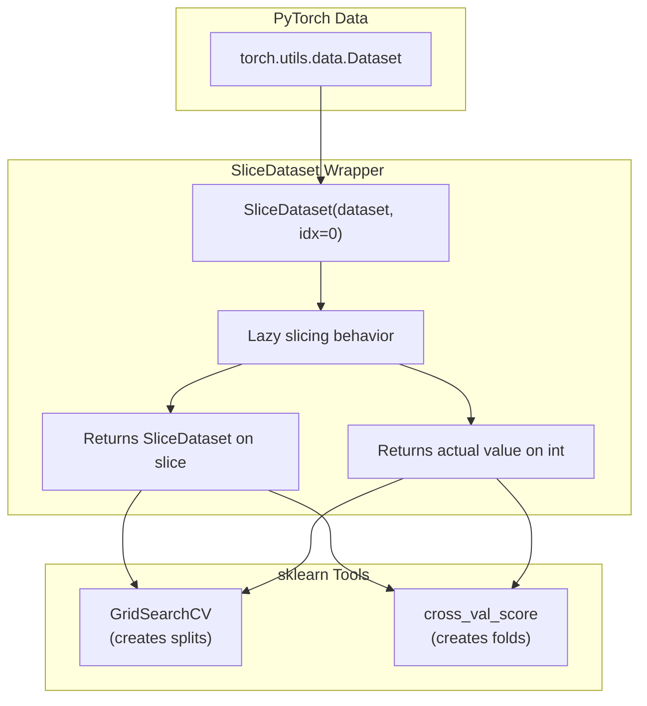

Important behavior:
- Returns `SliceDataset` when sliced (not actual data)
- Only loads data when indexed by integer
- Prevents loading entire dataset into memory during splitting
- Supports `idx` parameter to select X or y from dataset tuples
- Can apply transformations via `transform()` method

Sources: [skorch/helper.py:153-269](), [docs/user/FAQ.rst:70-83]()

### DataFrameTransformer - Pandas Integration

The `DataFrameTransformer` converts pandas DataFrames to dictionary format suitable for skorch:

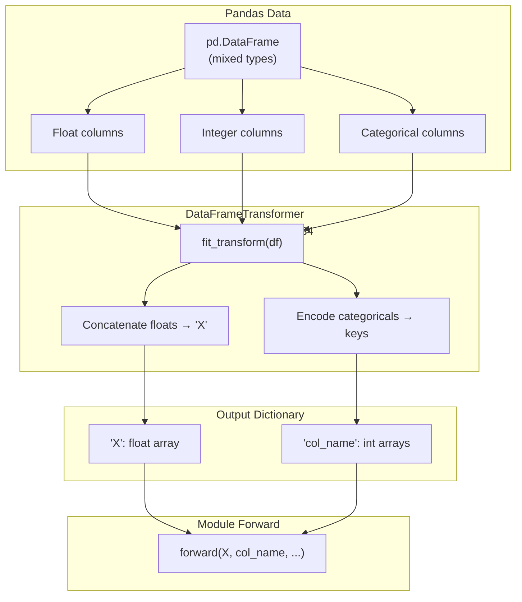

Configuration options:

| Parameter | Default | Purpose |
|-----------|---------|---------|
| `treat_int_as_categorical` | `False` | Treat integers like categorical |
| `float_dtype` | `np.float32` | Cast float arrays to this dtype |
| `int_dtype` | `np.int64` | Cast categorical encodings to this dtype |

The transformer's `describe_signature()` method helps design module signatures by analyzing the required input dimensions.

Sources: [skorch/helper.py:288-534](), [skorch/tests/test_helper.py:557-782]()

### predefined_split - Custom Validation Sets

The `predefined_split()` function allows using pre-defined validation datasets:

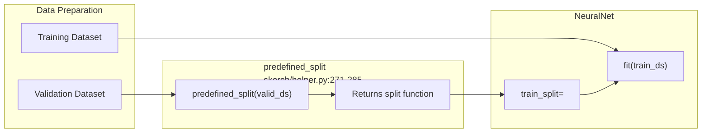

This is particularly useful when:
- Data is already split (e.g., via `train_test_split`)
- Validation set has specific requirements
- Using predefined fold assignments

Sources: [skorch/helper.py:271-285](), [docs/user/FAQ.rst:135-173]()

## Integration with sklearn Tools

### GridSearchCV Integration

The following diagram shows the complete flow when using skorch with `GridSearchCV`:

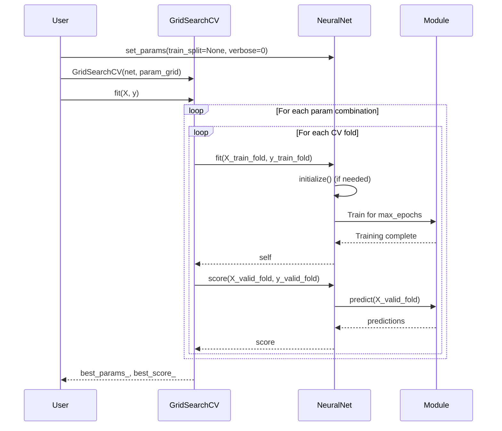

Example configuration for grid search:

```python
# From README.rst:98-114
net.set_params(train_split=False, verbose=0)  # Critical settings
params = {
    'lr': [0.01, 0.02],
    'max_epochs': [10, 20],
    'module__num_units': [10, 20],  # Double-underscore for nested params
}
gs = GridSearchCV(net, params, refit=False, cv=3, scoring='accuracy')
```

Key considerations:
- Set `train_split=None` or `train_split=False` to disable internal validation
- Set `verbose=0` to suppress output during many fits
- Use `refit=False` if you only want to find best params without final training
- Use double-underscore notation for module parameters

Sources: [README.rst:98-114](), [docs/user/FAQ.rst:58-68](), [skorch/tests/test_helper.py:164-178]()

### Pipeline Integration

skorch networks work seamlessly in sklearn pipelines:

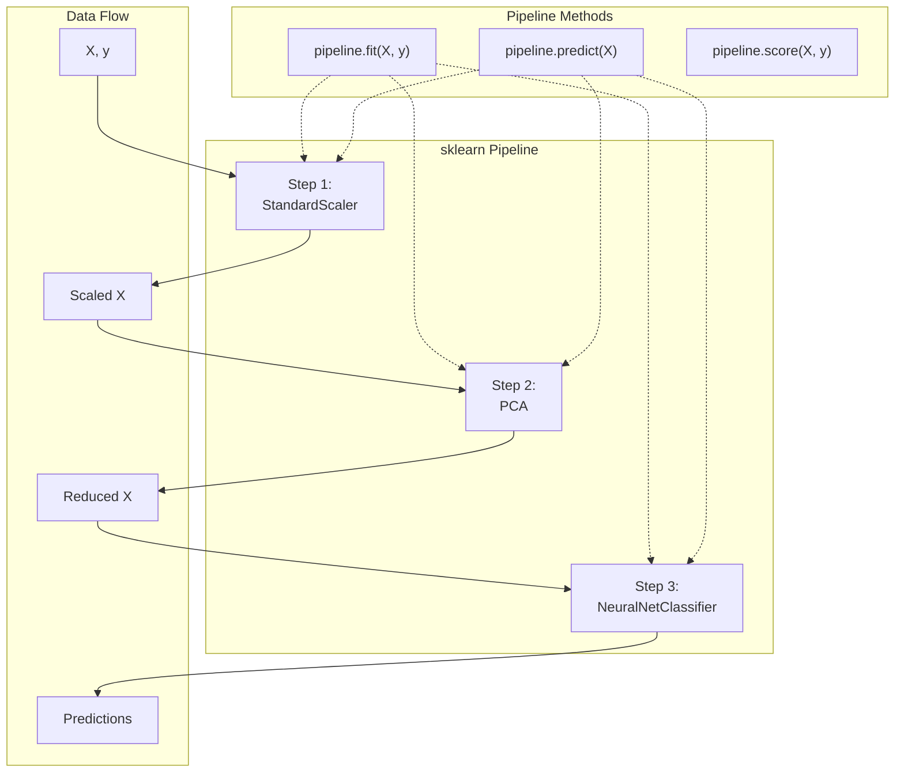

Example with `DataFrameTransformer`:

```python
# From README.rst:87-96 and skorch/tests/test_helper.py:733-748
pipe = Pipeline([
    ('scale', StandardScaler()),
    ('net', net),
])
pipe.fit(X, y)
y_proba = pipe.predict_proba(X)
```

With DataFrame transformation:

```python
# From skorch/tests/test_helper.py:733-748
pipe = Pipeline([
    ('transform', DataFrameTransformer()),
    ('net', net),
])
pipe.fit(df, y)  # df is a pandas DataFrame
```

Sources: [README.rst:87-96](), [skorch/tests/test_helper.py:733-748]()

### Cross-Validation Integration

Using skorch with sklearn's cross-validation functions:

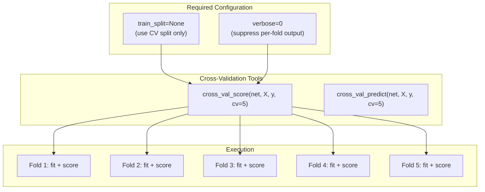

Example usage:

```python
# From docs/user/dataset.rst:49-58
net = NeuralNetClassifier(
    module=MyModule,
    train_split=None,  # Critical: use CV split only
)

from sklearn.model_selection import cross_val_predict
y_pred = cross_val_predict(net, X, y, cv=5)
```

Sources: [docs/user/dataset.rst:49-58](), [docs/user/FAQ.rst:70-83]()

## Parameter Passing and Configuration

### Double-Underscore Notation

skorch uses sklearn's double-underscore (`__`) notation to access nested parameters:

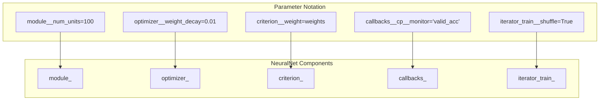

Common parameter patterns:

| Pattern | Component | Example | Purpose |
|---------|-----------|---------|---------|
| `module__*` | PyTorch module | `module__num_units=10` | Configure module architecture |
| `optimizer__*` | Optimizer | `optimizer__weight_decay=0.01` | Configure optimization |
| `criterion__*` | Loss function | `criterion__reduction='sum'` | Configure loss computation |
| `callbacks__<name>__*` | Specific callback | `callbacks__cp__monitor='valid_loss'` | Configure callback behavior |
| `iterator_train__*` | Training DataLoader | `iterator_train__shuffle=True` | Configure data loading |
| `iterator_valid__*` | Validation DataLoader | `iterator_valid__batch_size=256` | Configure validation batching |

Sources: [docs/user/neuralnet.rst:69-90](), [docs/user/neuralnet.rst:503-526](), [docs/user/FAQ.rst:8-21]()

### Virtual Parameters

Some parameters in skorch are "virtual" shortcuts that map to underlying component parameters:

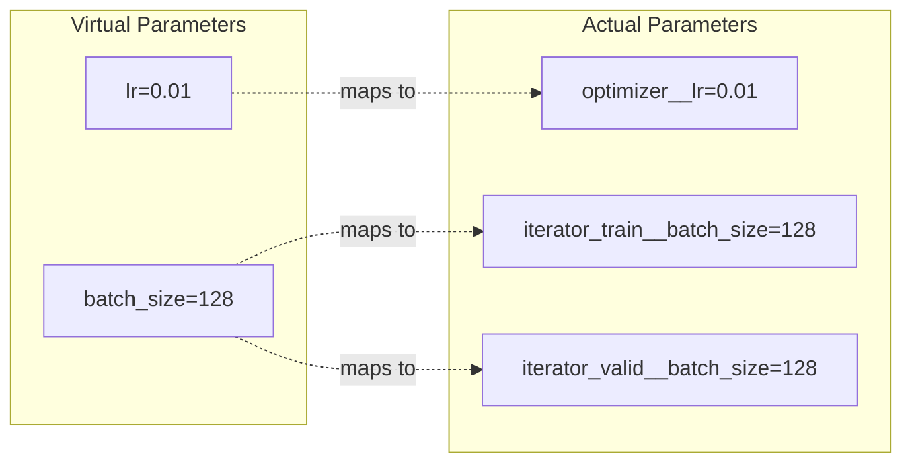

Virtual parameter mapping:

| Virtual | Maps To | Notes |
|---------|---------|-------|
| `lr` | `optimizer__lr` | If both set, `optimizer__lr` takes precedence |
| `batch_size` | `iterator_train__batch_size`, `iterator_valid__batch_size` | Sets both iterators at once |

This provides convenience while maintaining full control through explicit parameters.

Sources: [docs/user/neuralnet.rst:158-194]()

### Parameter Access Methods

The following methods enable parameter introspection and modification:

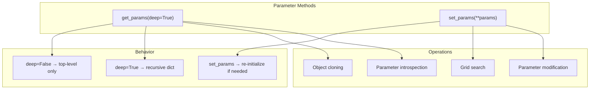

Key behaviors:
- `get_params(deep=True)` returns all parameters including nested ones
- `set_params()` returns `self` for method chaining
- Setting parameters may trigger re-initialization
- Used internally by sklearn's `clone()` function

Sources: [docs/user/neuralnet.rst:63-67](), [docs/user/callbacks.rst:92-106]()

## Complete Integration Example

The following example demonstrates multiple integration features working together:

```python
# From README.rst:44-114 and test files

import numpy as np
from sklearn.datasets import make_classification
from sklearn.model_selection import GridSearchCV
from sklearn.pipeline import Pipeline
from sklearn.preprocessing import StandardScaler
from torch import nn
from skorch import NeuralNetClassifier
from skorch.helper import SliceDict

# Prepare data as dictionary
X, y = make_classification(1000, 20, n_informative=10, random_state=0)
X = SliceDict(X=X.astype(np.float32))  # Wrap for sklearn compatibility

# Define module
class MyModule(nn.Module):
    def __init__(self, num_units=10):
        super().__init__()
        self.dense0 = nn.Linear(20, num_units)
        self.output = nn.Linear(num_units, 2)
    
    def forward(self, X):  # Matches SliceDict key
        X = nn.functional.relu(self.dense0(X))
        return nn.functional.softmax(self.output(X), dim=-1)

# Create pipeline
net = NeuralNetClassifier(
    MyModule,
    max_epochs=10,
    lr=0.1,
    iterator_train__shuffle=True,  # Double-underscore for nested param
)

pipe = Pipeline([
    ('scale', StandardScaler()),
    ('net', net),
])

# Grid search with cross-validation
pipe.set_params(net__train_split=None, net__verbose=0)  # Configure for CV
params = {
    'net__lr': [0.01, 0.1],
    'net__module__num_units': [10, 20],
}
gs = GridSearchCV(pipe, params, cv=3, scoring='accuracy')
gs.fit(X, y)

print(f"Best score: {gs.best_score_:.3f}")
print(f"Best params: {gs.best_params_}")
```

This example shows:
1. Using `SliceDict` for dictionary data compatibility
2. Double-underscore notation for nested parameters
3. Integration with `Pipeline`
4. Integration with `GridSearchCV`
5. Proper configuration for cross-validation

Sources: [README.rst:44-114](), [skorch/tests/test_helper.py:164-178]()

## Common Integration Patterns

### Pattern: Disable Internal Validation for CV

When using sklearn cross-validation tools, disable skorch's internal train/validation split:

```python
net = NeuralNetClassifier(
    module=MyModule,
    train_split=None,  # or train_split=False
    verbose=0,
)
```

### Pattern: Dictionary Input with GridSearchCV

When using dictionary inputs, wrap with `SliceDict`:

```python
from skorch.helper import SliceDict

X_dict = {'input': X_array}
X_sliceable = SliceDict(**X_dict)
gs.fit(X_sliceable, y)
```

### Pattern: Dataset Input with GridSearchCV

When using PyTorch datasets, wrap with `SliceDataset`:

```python
from skorch.helper import SliceDataset

ds = MyPyTorchDataset(...)
ds_sliceable = SliceDataset(ds, idx=0)  # idx=0 for X, idx=1 for y
gs.fit(ds_sliceable, y)
```

### Pattern: Pre-defined Validation Split

When you have a specific validation set:

```python
from skorch.helper import predefined_split
from skorch.dataset import Dataset

valid_ds = Dataset(X_valid, y_valid)
net = NeuralNetClassifier(
    module=MyModule,
    train_split=predefined_split(valid_ds),
)
net.fit(X_train, y_train)
```

### Pattern: DataFrames in Pipeline

When working with pandas DataFrames:

```python
from skorch.helper import DataFrameTransformer

pipe = Pipeline([
    ('transform', DataFrameTransformer()),
    ('net', net),
])
pipe.fit(df, y)
```

Sources: [docs/user/FAQ.rst:58-173](), [skorch/helper.py:271-285]()

---

