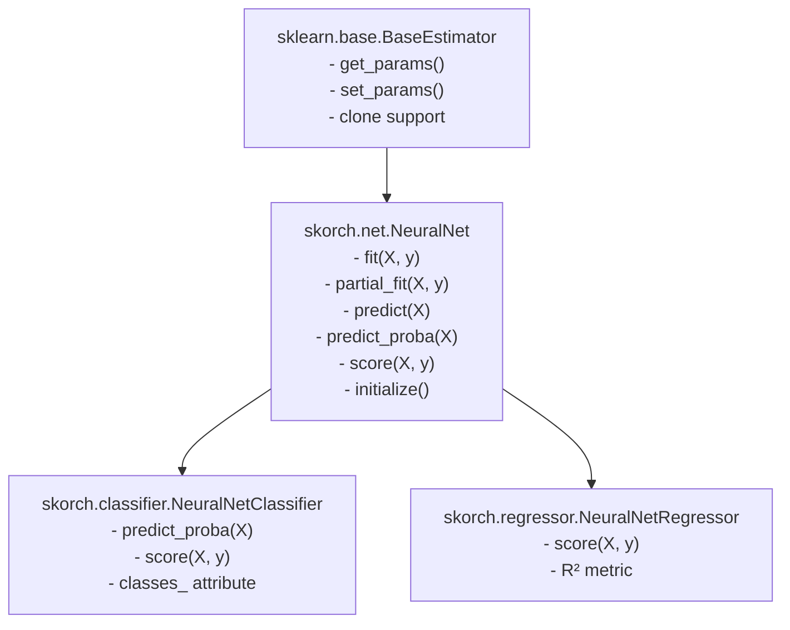
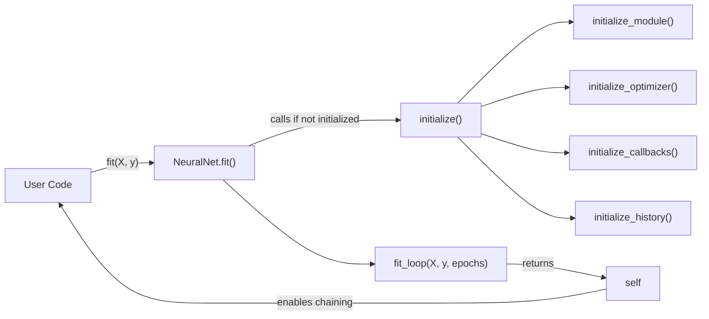
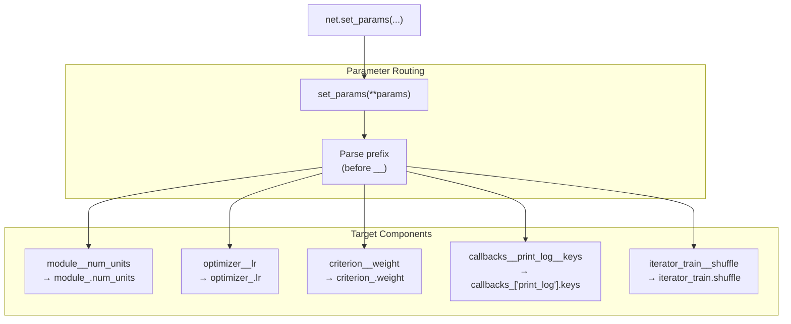
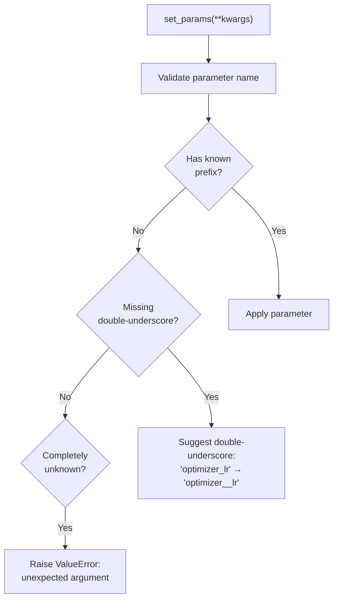
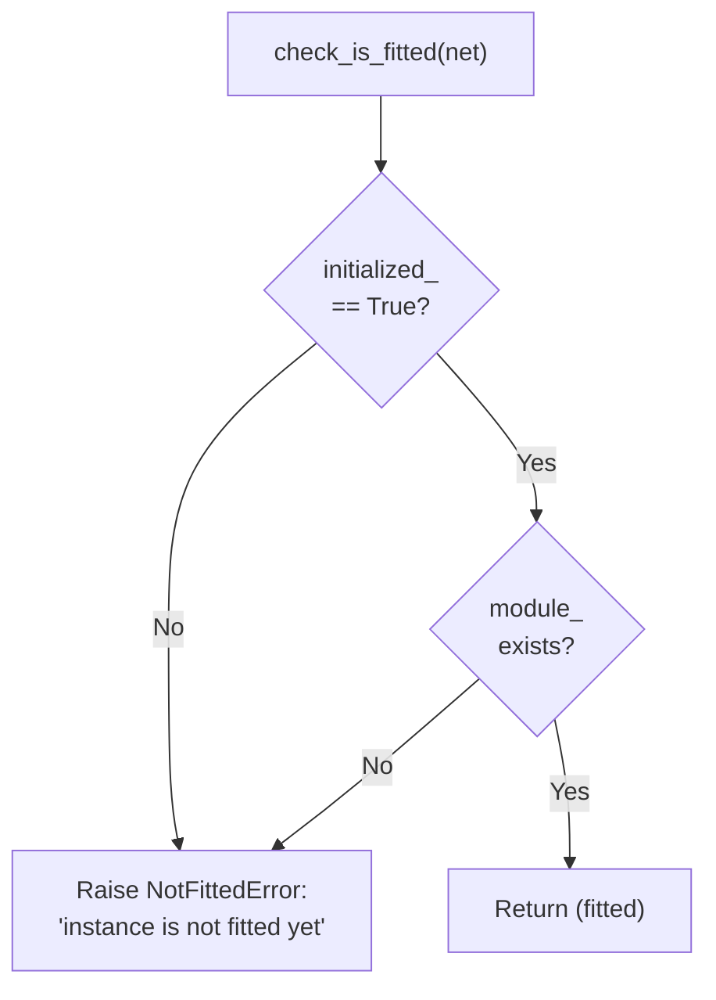
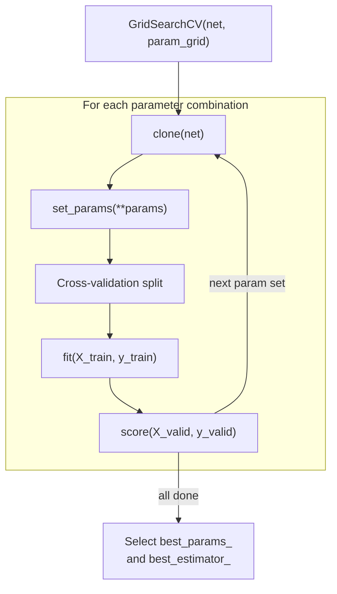

<!-- source: DeepWiki mcp.deepwiki.com · repo skorch-dev/skorch · page 5.1 API Compatibility · fetched 2026-10-21 -->

# API Compatibility

<details>
<summary>Relevant source files</summary>

The following files were used as context for generating this wiki page:

- [.github/workflows/testing.yml](.github/workflows/testing.yml)
- [README.rst](README.rst)
- [docs/user/FAQ.rst](docs/user/FAQ.rst)
- [docs/user/callbacks.rst](docs/user/callbacks.rst)
- [docs/user/dataset.rst](docs/user/dataset.rst)
- [docs/user/installation.rst](docs/user/installation.rst)
- [docs/user/neuralnet.rst](docs/user/neuralnet.rst)
- [skorch/net.py](skorch/net.py)
- [skorch/tests/test_net.py](skorch/tests/test_net.py)

</details>


## Purpose and Scope

This document explains how skorch implements the scikit-learn estimator API, enabling PyTorch neural networks to be used seamlessly with sklearn's ecosystem. It covers the core methods, parameter conventions, and compatibility requirements that make skorch models drop-in replacements for sklearn estimators.

For information about specific integration helpers like `SliceDict` and `DataFrameTransformer`, see [Integration Helpers](#5.2). For practical examples of using skorch with sklearn tools, see [Using with sklearn Tools](#5.3). For details on parameter passing conventions, see [Parameter Passing Conventions](#5.4).

## sklearn BaseEstimator Inheritance

skorch's `NeuralNet` class inherits from sklearn's `BaseEstimator`, which establishes the foundation for API compatibility. This inheritance provides automatic implementations of `get_params` and `set_params`, as well as support for cloning.



**Inheritance Structure**

Sources: [skorch/net.py:21-57](), [skorch/net.py:57]()

## Core API Methods

### fit(X, y) Method

The `fit` method follows sklearn conventions for training models. It accepts input data `X` and target `y`, performs training for `max_epochs` epochs, and returns `self` for method chaining.



**fit Method Flow**

Key characteristics:
- **Cold start by default**: Unless `warm_start=True`, each `fit` call re-initializes the model
- **Returns self**: Enables method chaining like sklearn estimators
- **Lazy initialization**: Components are only initialized when `fit` is called
- **Supports keyboard interrupts**: Training can be stopped gracefully with Ctrl+C

Sources: [skorch/net.py:324-360](), [skorch/net.py:931-945](), [docs/user/neuralnet.rst:324-358]()

### partial_fit(X, y, epochs) Method

The `partial_fit` method allows incremental training, continuing from the current state regardless of the `warm_start` setting. This is useful for online learning or when data doesn't fit in memory.

| Feature | `fit(X, y)` | `partial_fit(X, y)` |
|---------|------------|---------------------|
| Re-initializes model | Yes (unless `warm_start=True`) | No |
| Continues training | Only with `warm_start=True` | Always |
| Use case | Full training from scratch | Incremental/online learning |
| Epochs parameter | Uses `max_epochs` | Uses explicit `epochs` parameter |

Sources: [skorch/net.py:1077-1135](), [docs/user/FAQ.rst:24-34]()

### predict(X) and predict_proba(X) Methods

These methods perform inference on input data and return numpy arrays, following sklearn's convention.

**predict_proba(X)**:
- Returns the output of `module_.forward()` cast to numpy arrays
- For multi-output modules (returning tuples), only the first output is used
- Applies `predict_nonlinearity` transformation if configured

**predict(X)**:
- In `NeuralNetClassifier`: Returns class labels via argmax over `predict_proba`
- In `NeuralNetRegressor`: Returns continuous predictions
- In base `NeuralNet`: Not implemented (raise `NotImplementedError`)

Sources: [skorch/net.py:1440-1476](), [docs/user/neuralnet.rst:359-387]()

### score(X, y) Method

The `score` method provides a default metric for model evaluation, following sklearn conventions:

- **NeuralNetClassifier**: Returns mean accuracy
- **NeuralNetRegressor**: Returns R² coefficient of determination
- **Base NeuralNet**: Not implemented

This method enables skorch models to work with sklearn's model selection tools like `GridSearchCV` and `cross_val_score`.

Sources: [skorch/classifier.py:338-352](), [skorch/regressor.py:79-95](), [docs/user/neuralnet.rst:389-395]()

## Parameter Management

### Double-Underscore Notation

skorch uses sklearn's double-underscore notation to set parameters on nested components. This enables setting parameters on the module, optimizer, criterion, callbacks, and other components without direct access.



**Parameter Routing via Double-Underscore**

**Supported Prefixes**:
- `module__*`: Parameters passed to module initialization
- `optimizer__*`: Parameters passed to optimizer initialization
- `criterion__*`: Parameters passed to criterion initialization
- `callbacks__<name>__*`: Parameters passed to specific callback
- `iterator_train__*`: Parameters passed to training DataLoader
- `iterator_valid__*`: Parameters passed to validation DataLoader
- `dataset__*`: Parameters passed to Dataset wrapper

Sources: [skorch/net.py:69-89](), [skorch/net.py:314](), [docs/user/neuralnet.rst:503-526]()

### get_params(deep=True) and set_params(**params)

These methods are inherited from `BaseEstimator` but with skorch-specific behavior for handling prefixed parameters.

**get_params**:
- Returns all parameters as a flat dictionary
- Includes nested parameters with double-underscore keys
- Supports `deep=True` to traverse nested components

**set_params**:
- Accepts double-underscore notation for nested parameters
- Triggers re-initialization of components when their parameters change
- Validates parameter names against known prefixes
- Raises helpful error messages for typos (e.g., suggests `optimizer__lr` instead of `optimizerlr`)

Sources: [skorch/net.py:1639-1709](), [skorch/tests/test_net.py:198-229]()

## Parameter Validation and Error Handling

skorch provides helpful error messages when parameters are mistyped or incorrectly specified.



**Parameter Validation Flow**

Example error messages:
- Missing double-underscore: `"Got an unexpected argument iterator_train_shuffle, did you mean iterator_train__shuffle?"`
- Unknown parameter: `"__init__() got unexpected argument(s) foobar. Either you made a typo, or you added new arguments in a subclass..."`

Sources: [skorch/net.py:957-1066](), [skorch/tests/test_net.py:176-246]()

## Cloning Support

skorch models can be cloned using sklearn's `clone` function, which is essential for cross-validation and grid search. Cloning creates a new instance with the same parameters but without fitted state.

**Cloning Behavior**:
- All initialization parameters are preserved
- Fitted attributes (ending with `_`) are **not** copied
- The cloned instance is uninitialized
- Works correctly with callbacks and custom components

**Implementation Requirements**:
- All constructor parameters must be stored as instance attributes with the same name
- No mutable default arguments in `__init__`
- All parameters must be gettable via `get_params`

Sources: [skorch/net.py:327-378](), [skorch/tests/test_net.py:25]()

## Fitted State Detection

skorch implements fitted state detection following sklearn conventions, allowing tools like `check_is_fitted` to work correctly.



**Fitted State Detection Logic**

**Key Attributes**:
- `initialized_`: Boolean indicating whether `initialize()` has been called
- `module_`: The instantiated PyTorch module (only exists after initialization)
- Other component attributes: `optimizer_`, `criterion_`, `callbacks_`, `history_`

**NotFittedError**:
When calling methods like `predict` on an unfitted model, skorch raises sklearn's `NotFittedError` with a clear message.

Sources: [skorch/net.py:377-378](), [skorch/net.py:1377-1391](), [skorch/tests/test_net.py:310-335]()

## warm_start and Incremental Training

The `warm_start` parameter controls whether each `fit` call continues training or starts fresh.

| `warm_start` | Behavior | Use Case |
|--------------|----------|----------|
| `False` (default) | Each `fit` re-initializes the model | Standard sklearn behavior, ensures reproducibility |
| `True` | Each `fit` continues from current state | Incremental training, hyperparameter tuning mid-training |

**warm_start=False**:
```python
net = NeuralNetClassifier(module, max_epochs=10)
net.fit(X, y)  # Trains for 10 epochs
net.fit(X, y)  # Trains for another 10 epochs (from scratch)
```

**warm_start=True**:
```python
net = NeuralNetClassifier(module, max_epochs=10, warm_start=True)
net.fit(X, y)  # Trains for 10 epochs
net.fit(X, y)  # Continues for another 10 epochs (total 20)
```

**partial_fit Alternative**:
The `partial_fit` method provides warm start behavior without setting the flag:
```python
net = NeuralNetClassifier(module, max_epochs=10)
net.partial_fit(X, y, epochs=5)  # Trains for 5 epochs
net.partial_fit(X, y, epochs=5)  # Continues for 5 more epochs
```

Sources: [skorch/net.py:200-203](), [skorch/net.py:342](), [docs/user/neuralnet.rst:282-292](), [docs/user/FAQ.rst:24-34]()

## Integration with sklearn Tools

### Pipeline Compatibility

skorch models work seamlessly in sklearn pipelines as transformers or final estimators.

```python
from sklearn.pipeline import Pipeline
from sklearn.preprocessing import StandardScaler

pipe = Pipeline([
    ('scale', StandardScaler()),
    ('net', NeuralNetClassifier(MyModule, max_epochs=10, lr=0.1))
])

pipe.fit(X, y)
y_pred = pipe.predict_proba(X)
```

**Key Requirements**:
- `fit(X, y)` returns `self`
- Input/output types are compatible (numpy arrays, pandas DataFrames)
- Parameters can be set via double-underscore notation: `pipe.set_params(net__lr=0.05)`

Sources: [README.rst:83-96](), [skorch/tests/test_net.py:87-92]()

### GridSearchCV Compatibility

skorch models can be used with sklearn's hyperparameter search tools.



**GridSearchCV Integration Flow**

**Best Practices for GridSearchCV**:
- Set `train_split=None` to disable internal validation (sklearn handles CV)
- Set `verbose=0` to reduce output clutter
- Use double-underscore notation for nested parameters
- Search both sklearn preprocessing and skorch parameters

Example:
```python
from sklearn.model_selection import GridSearchCV

net = NeuralNetClassifier(
    MyModule,
    max_epochs=20,
    lr=0.1,
    train_split=None,  # Let GridSearchCV handle CV
    verbose=0,         # Reduce output
)

params = {
    'lr': [0.01, 0.02],
    'max_epochs': [10, 20],
    'module__num_units': [10, 20],
}

gs = GridSearchCV(net, params, cv=3, scoring='accuracy')
gs.fit(X, y)
```

Sources: [README.rst:98-114](), [skorch/tests/test_net.py:28-29]()

### cross_val_score Compatibility

skorch models work with sklearn's `cross_val_score` and related functions.

**Key Consideration**: 
When using cross-validation functions, remember to set `train_split=None` to prevent double splitting:

```python
from sklearn.model_selection import cross_val_score

net = NeuralNetClassifier(
    MyModule,
    max_epochs=10,
    train_split=None,  # Important: let sklearn handle splitting
)

scores = cross_val_score(net, X, y, cv=5, scoring='accuracy')
```

**Why train_split=None?**:
- sklearn's CV functions already split data into train/validation
- Keeping skorch's internal split would create nested splits
- This wastes data and can lead to confusing results

Sources: [docs/user/neuralnet.rst:196-214](), [docs/user/FAQ.rst:175-218]()

## Compatibility Matrix

The following table summarizes which sklearn tools work with skorch and any special considerations:

| sklearn Tool | Compatible | Requirements | Notes |
|-------------|------------|--------------|-------|
| `Pipeline` | ✓ | None | Works as intermediate transformer or final estimator |
| `GridSearchCV` | ✓ | Set `train_split=None`, `verbose=0` | Supports nested parameter search |
| `RandomizedSearchCV` | ✓ | Set `train_split=None`, `verbose=0` | Same as GridSearchCV |
| `cross_val_score` | ✓ | Set `train_split=None` | Prevents double splitting |
| `cross_val_predict` | ✓ | Set `train_split=None` | For out-of-fold predictions |
| `clone` | ✓ | Follow parameter conventions | Clones uninitialized instance |
| `StratifiedKFold` | ✓ | `NeuralNetClassifier` only | Requires discrete targets |
| `train_test_split` | ✓ | Use with `predefined_split` | See Integration Helpers |

Sources: [README.rst:83-114](), [docs/user/FAQ.rst:58-83]()

## Special Attributes for sklearn Compatibility

### classes_ Attribute

`NeuralNetClassifier` automatically sets a `classes_` attribute after fitting, containing the unique class labels. This is required by many sklearn tools for classification tasks.

```python
net = NeuralNetClassifier(MyModule)
net.fit(X, y)
print(net.classes_)  # array([0, 1, 2, ...])
```

Sources: [skorch/classifier.py:195-202]()

### _estimator_type Attribute

Both `NeuralNetClassifier` and `NeuralNetRegressor` set `_estimator_type` to `'classifier'` or `'regressor'` respectively. This allows sklearn to recognize them as the correct type of estimator.

Sources: [skorch/classifier.py:83](), [skorch/regressor.py:48]()

## Virtual Parameters

skorch supports "virtual parameters" that don't correspond to actual constructor arguments but can be set via `set_params`. These are typically handled by special setter functions.

**Example: Learning Rate**:
The parameter `lr` is a convenience shortcut for `optimizer__lr`. When you set `lr`, it's actually routed to the optimizer:

```python
net = NeuralNetClassifier(MyModule, lr=0.01)
# Equivalent to:
net = NeuralNetClassifier(MyModule, optimizer__lr=0.01)
```

**Implementation**:
Virtual parameters are registered using the `_register_virtual_param` method and handled by custom setter functions during initialization.

Sources: [skorch/net.py:633-650](), [skorch/net.py:912-923]()

## Deviations from sklearn Conventions

While skorch strives for sklearn compatibility, there are some intentional deviations:

1. **Lazy Initialization**: sklearn estimators typically initialize in `__init__`, but skorch delays initialization until `fit` is called. This allows for more flexible module configuration.

2. **History Attribute**: The `history` attribute (without underscore) is a special case that is not set by the user but is accessible as a regular attribute for convenience.

3. **Callbacks Parameter**: The `callbacks` parameter can be set to `"disable"` (a string) to disable all callbacks, which is not a typical sklearn pattern.

4. **Device Parameter**: The `device` parameter controls compute device (CPU/GPU), which has no sklearn equivalent.

5. **Return Value of fit**: While `fit` returns `self` like sklearn, the object may have been partially trained if interrupted with KeyboardInterrupt.

Sources: [skorch/net.py:44-58](), [skorch/net.py:327-387](), [docs/user/neuralnet.rst:42-60]()

---

