<!-- source: DeepWiki mcp.deepwiki.com · repo skorch-dev/skorch · page 5.2 Integration Helpers · fetched 2026-10-21 -->

# Integration Helpers

<details>
<summary>Relevant source files</summary>

The following files were used as context for generating this wiki page:

- [docs/user/FAQ.rst](docs/user/FAQ.rst)
- [docs/user/callbacks.rst](docs/user/callbacks.rst)
- [docs/user/dataset.rst](docs/user/dataset.rst)
- [docs/user/neuralnet.rst](docs/user/neuralnet.rst)
- [skorch/helper.py](skorch/helper.py)
- [skorch/tests/test_helper.py](skorch/tests/test_helper.py)

</details>


## Purpose and Scope

Integration Helpers are specialized classes and functions in skorch that bridge the gap between scikit-learn's data handling expectations and PyTorch's native data structures. This page documents the four primary helper utilities: `SliceDict`, `SliceDataset`, `DataFrameTransformer`, and `predefined_split`. These helpers enable seamless use of skorch models with scikit-learn tools like `GridSearchCV`, `Pipeline`, and cross-validation functions.

For information about how skorch implements the sklearn estimator API (fit, predict, score), see [API Compatibility](#5.1). For practical examples using these helpers with sklearn tools, see [Using with sklearn Tools](#5.3).

---

## Overview: The Compatibility Problem

scikit-learn expects data to be sliceable arrays (supporting indexing operations like `X[0:10]`), while PyTorch uses dictionaries, custom Dataset objects, and DataFrames that don't naturally support sklearn's slicing operations. The integration helpers solve this mismatch.

### Integration Helper Architecture

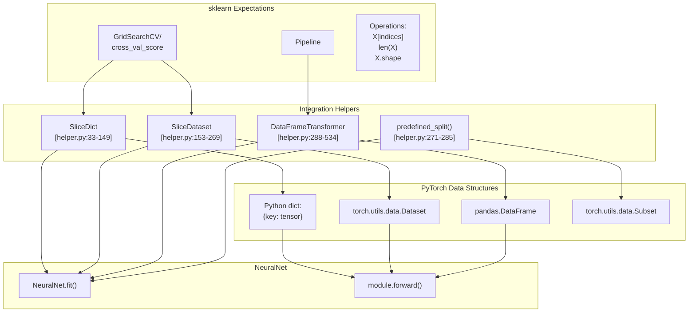

**Sources:** [skorch/helper.py:1-30](), [docs/user/FAQ.rst:58-83]()

---

## SliceDict: Dictionary Slicing

### Purpose

`SliceDict` is a dictionary subclass that enables sklearn to slice dictionary data structures. When using dictionaries as input to accommodate multiple features or inputs (common in PyTorch), sklearn's cross-validation and grid search tools fail because standard Python dicts don't support array-like slicing operations.

### Class Structure

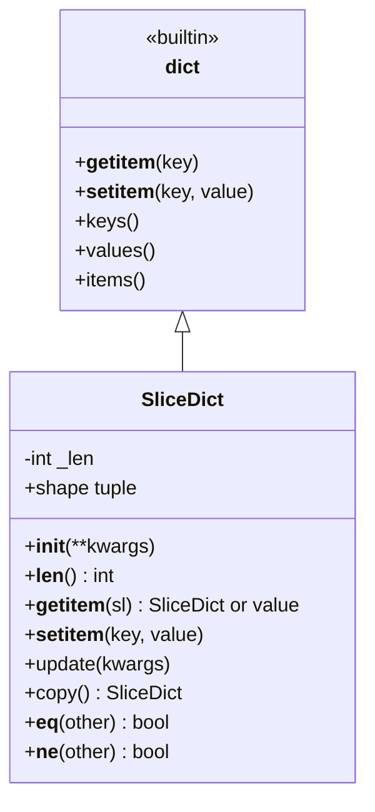

**Sources:** [skorch/helper.py:33-149]()

### Key Features

| Feature | Description | Implementation |
|---------|-------------|----------------|
| Slice Support | Enables `X[0:10]` operations | [helper.py:73-81]() |
| Length Tracking | Maintains consistent length across all values | [helper.py:55-66, 70-71]() |
| Shape Property | Provides `.shape` attribute expected by sklearn | [helper.py:106-108]() |
| Type Preservation | Returns `SliceDict` when sliced (not plain dict) | [helper.py:81]() |
| Validation | Ensures all values have same first dimension | [helper.py:56-61]() |

### Usage Pattern

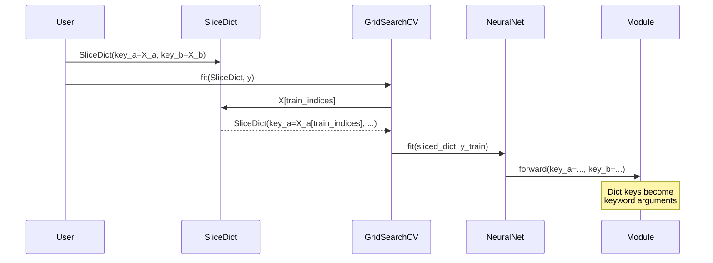

**Sources:** [skorch/helper.py:46-52](), [docs/user/FAQ.rst:58-68]()

### Important Constraints

1. **No Integer Indexing**: `SliceDict[3]` raises `ValueError` because integer indexing reduces array dimensions, breaking length consistency [helper.py:74-78]()
2. **String Keys Only**: Setting items requires string keys [helper.py:83-86]()
3. **Consistent Shape[0]**: All values must have the same first dimension [helper.py:87-94]()
4. **Supported Value Types**: Values must be numpy arrays or torch tensors with `.shape[0]` attribute [helper.py:56]()

### Implementation Details

**Initialization with validation:**
```
[skorch/helper.py:55-68]()
```
Validates that all input arrays have matching first dimensions and stores the common length.

**Slicing operation:**
```
[skorch/helper.py:73-81]()
```
Applies the slice to all dictionary values and returns a new `SliceDict`.

**Equality comparison:**
```
[skorch/helper.py:118-148]()
```
Supports comparison of both numpy arrays and torch tensors, handling element-wise equality checks.

**Sources:** [skorch/helper.py:33-149](), [skorch/tests/test_helper.py:23-274]()

---

## SliceDataset: PyTorch Dataset Wrapper

### Purpose

`SliceDataset` wraps PyTorch `Dataset` objects to make them compatible with sklearn's slicing requirements. PyTorch datasets typically don't support slicing operations, which breaks sklearn's train/test splitting and cross-validation.

### Class Structure and Behavior

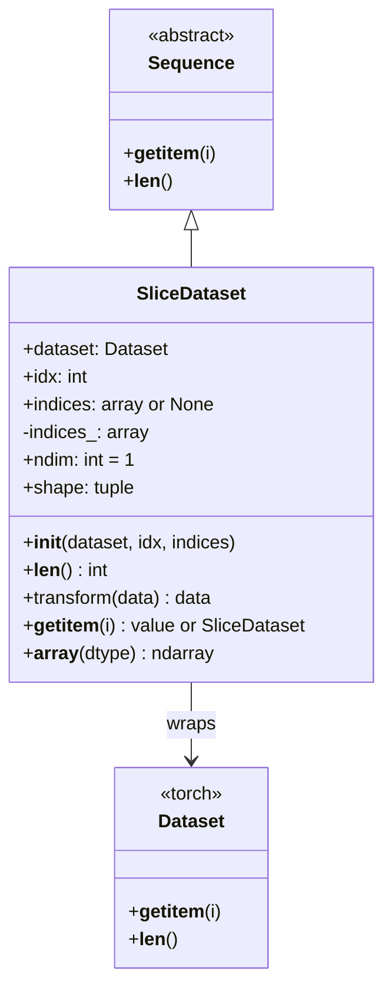

**Sources:** [skorch/helper.py:151-269]()

### Key Design Decisions

| Aspect | Behavior | Rationale |
|--------|----------|-----------|
| Integer Indexing | Returns actual data value | Triggers data loading from dataset |
| Slice/Array Indexing | Returns new `SliceDataset` | Avoids loading all data into memory |
| Default `idx` Parameter | 0 (returns X) | Datasets return (X, y), sklearn needs X separately |
| `indices_` Attribute | Tracks active subset | Enables chained slicing operations |

### Lazy Loading Strategy

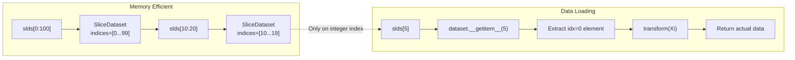

**Sources:** [skorch/helper.py:169-176](), [skorch/helper.py:242-260]()

### Usage Patterns

**Basic wrapping for GridSearchCV:**
```
Pattern demonstrated in [skorch/tests/test_helper.py:436-468]()
```

The typical workflow:
1. Wrap dataset with `SliceDataset(dataset)`
2. Pass to sklearn tool (e.g., `GridSearchCV`)
3. sklearn slices the dataset for train/validation splits
4. `SliceDataset` creates subset references (no data copying)
5. During training, data is loaded batch-by-batch

**Extracting different elements:**
```
[skorch/helper.py:190-194]()
```
- `idx=0`: Return X from (X, y) tuples (default)
- `idx=1`: Return y from (X, y) tuples

### Implementation Details

**Getitem with lazy evaluation:**
```
[skorch/helper.py:242-260]()
```
- Integer index → load and return actual data
- Slice → create new `SliceDataset` with subset indices
- Array index → create new `SliceDataset` with subset indices

**Transform hook:**
```
[skorch/helper.py:219-228]()
```
Override this method in subclasses to apply transformations on data after loading.

**NumPy array protocol:**
```
[skorch/helper.py:262-268]()
```
Supports `np.asarray(slds)` by loading all data (use carefully with large datasets).

**Sources:** [skorch/helper.py:153-269](), [skorch/tests/test_helper.py:276-538](), [docs/user/FAQ.rst:70-83]()

---

## predefined_split: Custom Validation Sets

### Purpose

The `predefined_split` function allows users to provide their own validation dataset instead of using skorch's automatic train/validation splitting. This is essential when you've already split your data or want precise control over validation data.

### Function Signature and Usage

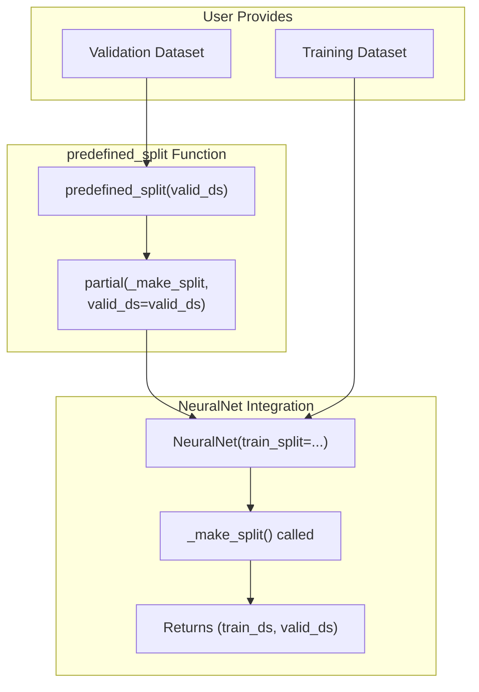

**Sources:** [skorch/helper.py:271-285](), [skorch/utils.py]() (for `_make_split`)

### Implementation

The function is remarkably simple:
```
[skorch/helper.py:271-285]()
```

It returns a `partial` function that wraps `_make_split` with the validation dataset pre-specified. When `NeuralNet.fit()` is called, this partial function is invoked to obtain the train and validation datasets.

### Common Use Cases

| Scenario | Code Pattern |
|----------|--------------|
| Pre-split torch Datasets | `train_split=predefined_split(valid_dataset)` |
| sklearn train_test_split | Create `Dataset(X_test, y_test)`, then use `predefined_split` |
| Time series validation | Use temporal split as validation set |
| Stratified custom split | Pre-split with custom stratification logic |

**Sources:** [docs/user/FAQ.rst:135-173](), [skorch/tests/test_helper.py:540-554]()

### Integration with NeuralNet

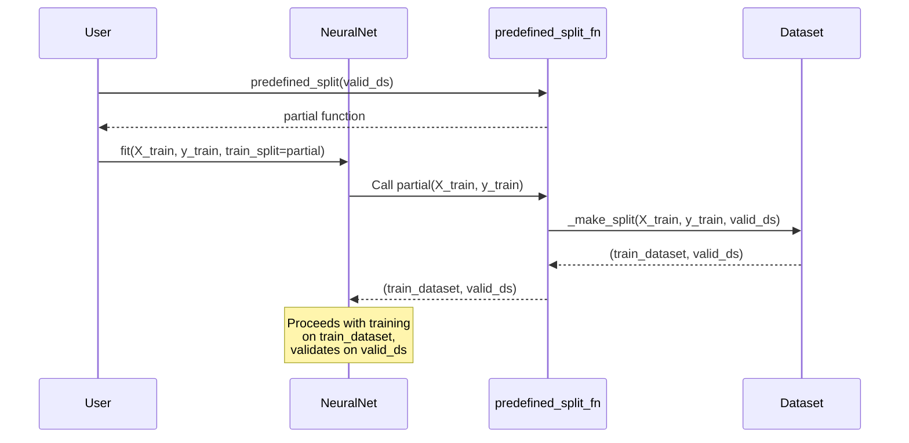

**Sources:** [skorch/helper.py:271-285](), [docs/user/FAQ.rst:135-173]()

---

## DataFrameTransformer: Pandas Integration

### Purpose

`DataFrameTransformer` is a scikit-learn transformer that converts pandas DataFrames into dictionaries suitable for skorch modules. It separates numerical (float/int) columns from categorical columns, encoding categories as integers for embedding layers.

### Transformation Strategy

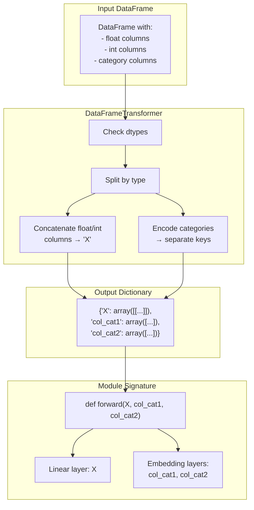

**Sources:** [skorch/helper.py:288-486]()

### Class Structure

`DataFrameTransformer` implements the sklearn transformer interface:

| Method | Purpose | Implementation |
|--------|---------|----------------|
| `__init__` | Configure transformation options | [helper.py:373-381]() |
| `fit` | Validate DataFrame structure | [helper.py:430-432]() |
| `transform` | Convert DataFrame to dict | [helper.py:434-486]() |
| `describe_signature` | Show required module signature | [helper.py:488-534]() |

### Configuration Parameters

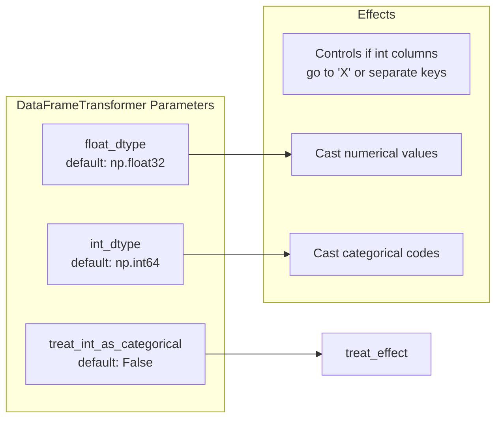

**Sources:** [skorch/helper.py:352-381]()

### Transformation Rules

**Numerical columns (float/int):**
```
[skorch/helper.py:477-485]()
```
- Concatenated into 2D array
- Stored with key `'X'`
- Cast to `float_dtype`

**Categorical columns:**
```
[skorch/helper.py:460-475]()
```
- Encoded as integer codes using pandas `.cat.codes`
- Each column becomes a separate dictionary key
- Cast to `int_dtype`

**Integer handling:**
When `treat_int_as_categorical=True`:
```
[skorch/helper.py:467-475]()
```
Integers are treated as categories rather than numerical values.

### Module Signature Requirements

The module's `forward` method must accept:
1. `X` argument for numerical features (if any float/int columns exist)
2. Named arguments matching each categorical column name

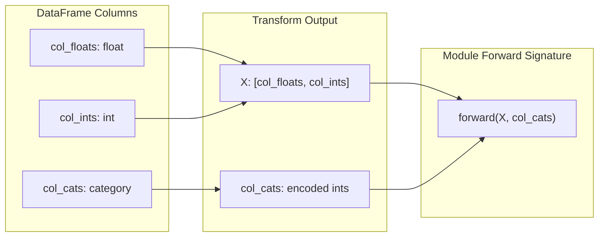

**Sources:** [skorch/helper.py:300-306](), [docs/user/neuralnet.rst:430-431]()

### Helper Method: describe_signature

```
[skorch/helper.py:488-534]()
```

This method analyzes a DataFrame and returns a dictionary describing the required module signature:

```python
{
    'X': {
        'dtype': torch.float32,
        'input_units': 2  # number of numerical columns
    },
    'col_cats': {
        'dtype': torch.int64,
        'input_units': 3  # number of unique categories
    }
}
```

### Common Usage Pattern

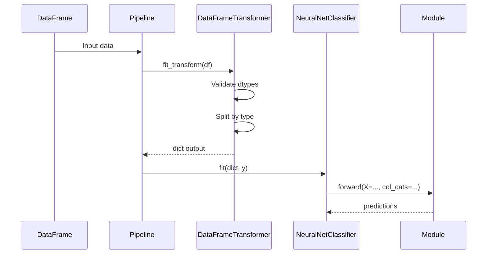

**Sources:** [skorch/tests/test_helper.py:740-749](), [skorch/helper.py:314-349]()

### Validation and Constraints

**Reserved name check:**
```
[skorch/helper.py:402-406]()
```
Cannot have a column named `'X'` as it conflicts with the numerical features key.

**Dtype validation:**
```
[skorch/helper.py:383-427]()
```
Only float, int, and category dtypes are supported. Other dtypes (object, datetime, etc.) raise `TypeError`.

**Sources:** [skorch/helper.py:288-534](), [skorch/tests/test_helper.py:557-782]()

---

## Integration Patterns

### Pattern 1: Multiple Input Features with SliceDict

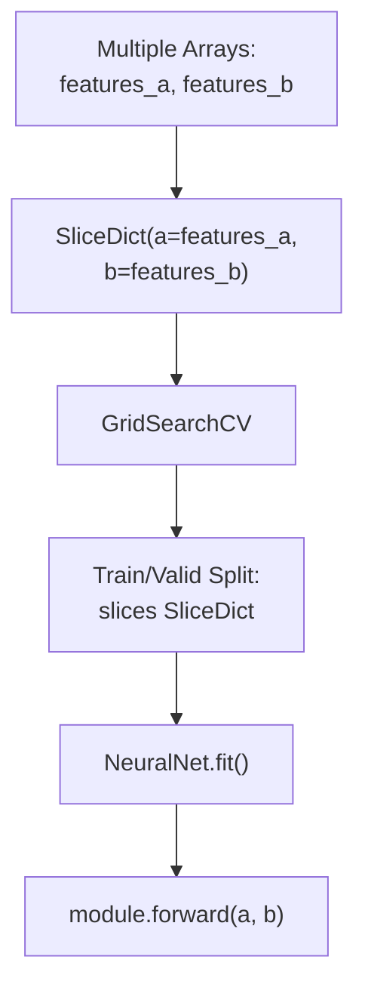

**Sources:** [skorch/helper.py:46-52](), [docs/user/FAQ.rst:58-68]()

### Pattern 2: PyTorch Dataset with Cross-Validation

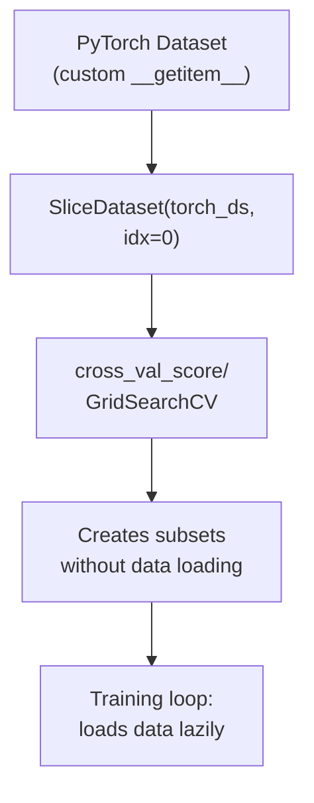

**Sources:** [skorch/helper.py:177-184](), [docs/user/FAQ.rst:70-83]()

### Pattern 3: DataFrame in Pipeline

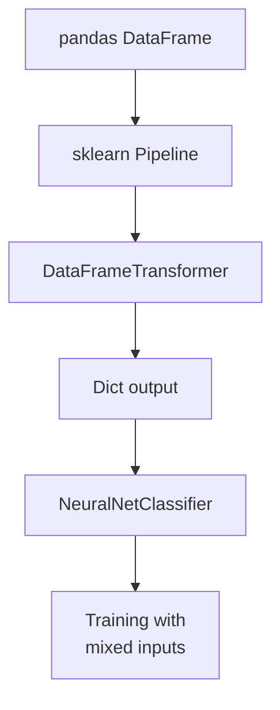

**Sources:** [skorch/helper.py:344-349](), [skorch/tests/test_helper.py:733-749]()

### Pattern 4: Predefined Validation Split

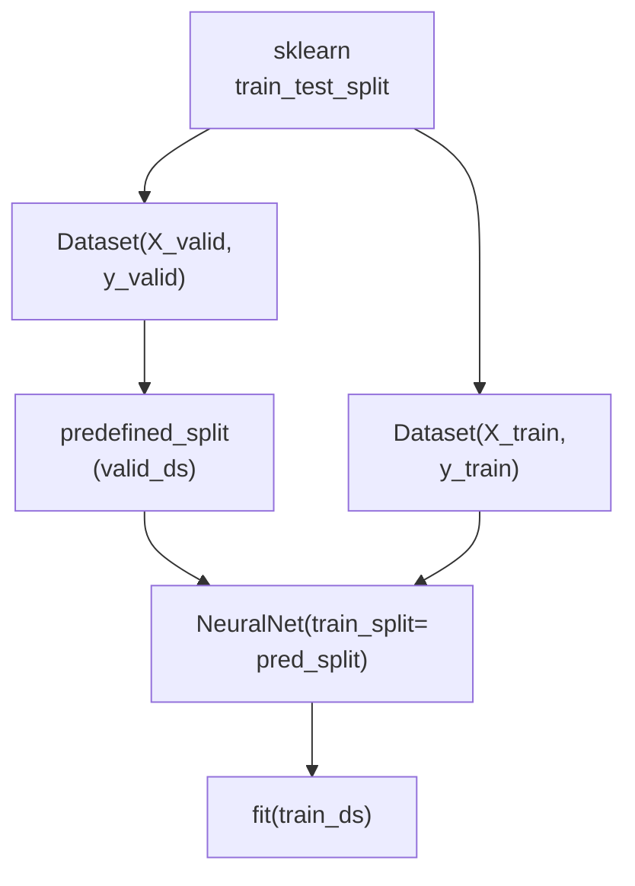

**Sources:** [docs/user/FAQ.rst:153-173]()

---

## Summary Table

| Helper | Primary Purpose | Key Method | Returns | Use Case |
|--------|----------------|------------|---------|----------|
| `SliceDict` | Enable dict slicing | `__getitem__` | `SliceDict` | Multiple input features as dict |
| `SliceDataset` | Wrap torch Datasets | `__getitem__` | Data or `SliceDataset` | Custom PyTorch datasets with sklearn |
| `predefined_split` | Use custom validation set | Function call | Partial function | Pre-split train/validation data |
| `DataFrameTransformer` | Convert DataFrames | `transform` | `dict` | Mixed numerical/categorical features |

**Sources:** [skorch/helper.py:23-30]()

---

