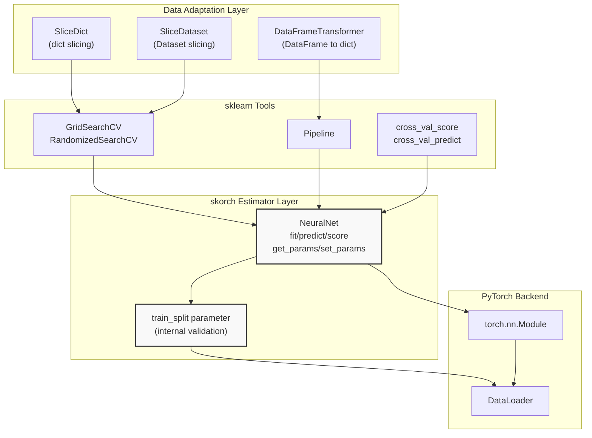
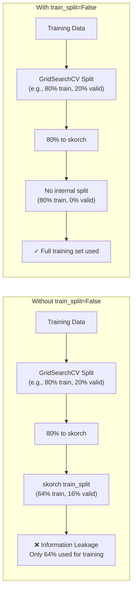
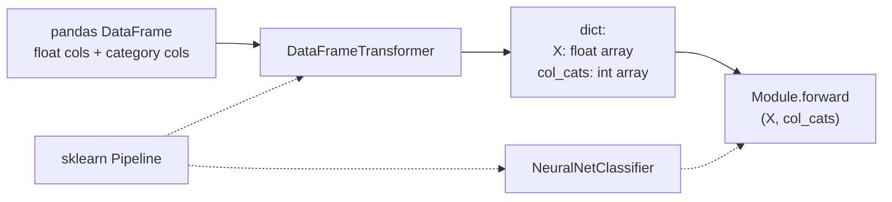
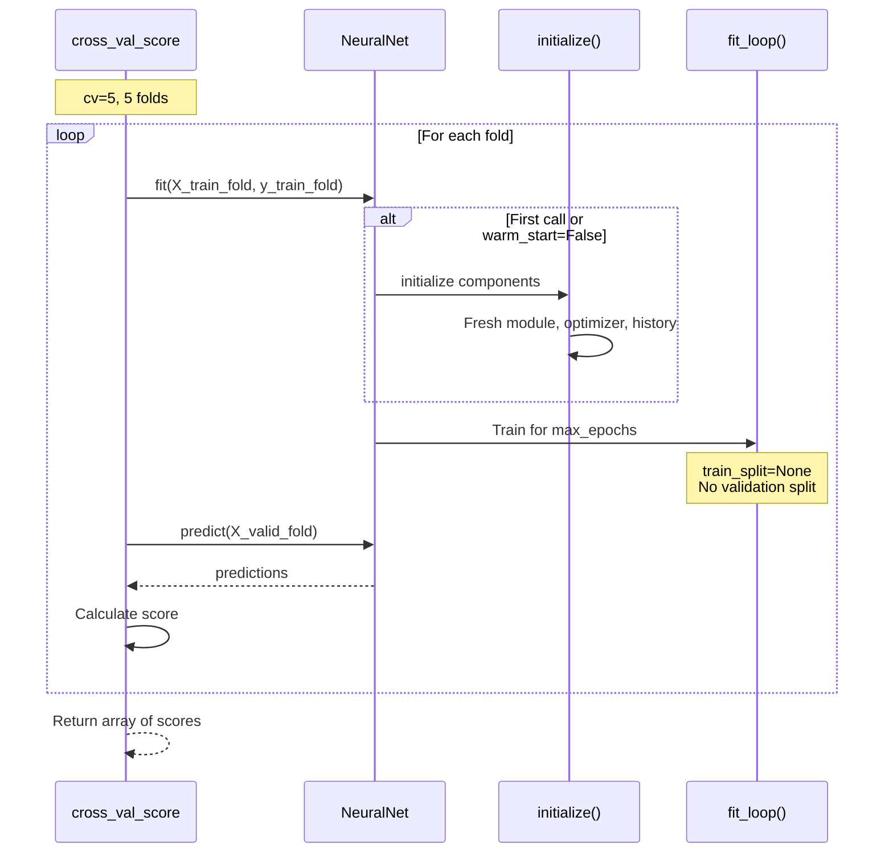
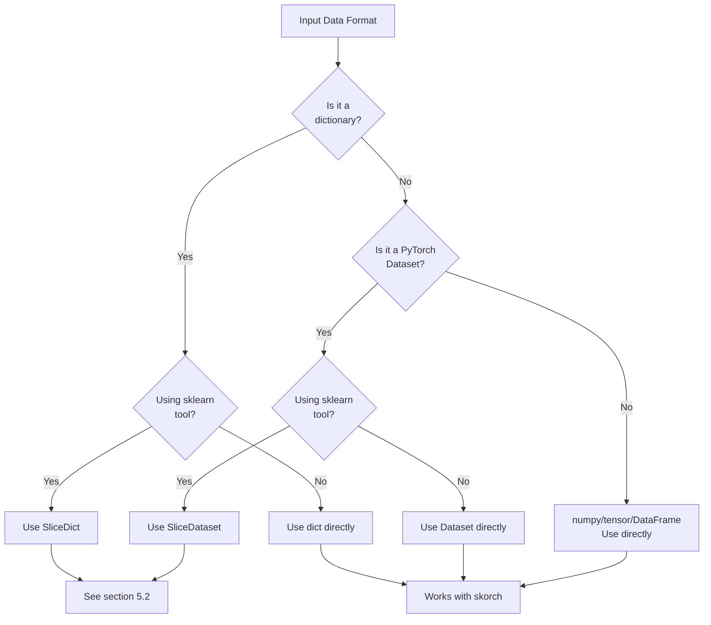
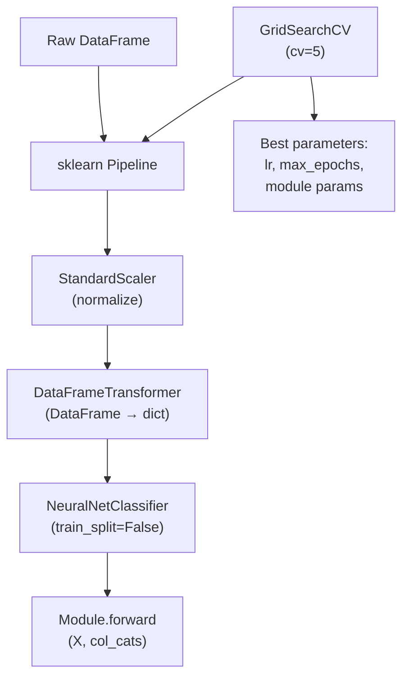

<!-- source: DeepWiki mcp.deepwiki.com · repo skorch-dev/skorch · page 5.3 Using with sklearn Tools · fetched 2026-10-21 -->

# Using with sklearn Tools

<details>
<summary>Relevant source files</summary>

The following files were used as context for generating this wiki page:

- [.github/workflows/testing.yml](.github/workflows/testing.yml)
- [README.rst](README.rst)
- [docs/user/FAQ.rst](docs/user/FAQ.rst)
- [docs/user/callbacks.rst](docs/user/callbacks.rst)
- [docs/user/dataset.rst](docs/user/dataset.rst)
- [docs/user/installation.rst](docs/user/installation.rst)
- [docs/user/neuralnet.rst](docs/user/neuralnet.rst)
- [skorch/helper.py](skorch/helper.py)
- [skorch/tests/test_helper.py](skorch/tests/test_helper.py)

</details>


This page demonstrates practical usage of skorch neural networks with scikit-learn's model selection and pipeline tools. For information about the underlying API compatibility mechanisms, see [API Compatibility](#5.1). For details about helper classes that enable sklearn compatibility with special data formats, see [Integration Helpers](#5.2).

## Overview

skorch neural networks are fully compatible with scikit-learn's ecosystem of tools for model evaluation, selection, and composition. The primary tools that work seamlessly with skorch include:

| sklearn Tool | Purpose | Key Consideration |
|--------------|---------|-------------------|
| `GridSearchCV` | Hyperparameter search | Set `train_split=False` to avoid double validation |
| `RandomizedSearchCV` | Randomized hyperparameter search | Set `train_split=False` to avoid double validation |
| `Pipeline` | Chain transformers with estimator | Works with any sklearn-compatible transformers |
| `cross_val_score` | K-fold cross-validation | Set `train_split=None` to use all data for training |
| `cross_val_predict` | Out-of-fold predictions | Set `train_split=None` to use all data for training |
| `train_test_split` | Simple train/test split | Use with `predefined_split` for validation |

Sources: [README.rst:83-115](), [docs/user/FAQ.rst:58-83]()

## Integration Architecture



**Diagram: sklearn Tool Integration Architecture**

This diagram shows how sklearn tools interact with skorch estimators through the standard sklearn API (`fit`, `predict`, `get_params`, `set_params`). The data adaptation layer enables sklearn tools to work with PyTorch-specific data formats.

Sources: [README.rst:83-115](), [docs/user/neuralnet.rst:1-100]()

## GridSearchCV for Hyperparameter Tuning

### Basic Usage

`GridSearchCV` performs exhaustive search over a parameter grid. With skorch, you can search over both module parameters (using `module__` prefix) and training parameters.

**Example from codebase:**

[README.rst:98-115]() demonstrates the canonical usage pattern:

```python
from sklearn.model_selection import GridSearchCV

# Deactivate skorch-internal train-valid split and verbose logging
net.set_params(train_split=False, verbose=0)

params = {
    'lr': [0.01, 0.02],
    'max_epochs': [10, 20],
    'module__num_units': [10, 20],
}

gs = GridSearchCV(net, params, refit=False, cv=3, scoring='accuracy', verbose=2)
gs.fit(X, y)
print("best score: {:.3f}, best params: {}".format(gs.best_score_, gs.best_params_))
```

Sources: [README.rst:98-115]()

### Critical Configuration: Disabling Internal Validation

When using `GridSearchCV` or any sklearn cross-validation tool, **you must set `train_split=False` or `train_split=None`** to prevent double validation:



**Diagram: Impact of train_split on GridSearchCV**

Sources: [README.rst:104-105](), [docs/user/neuralnet.rst:210-214](), [docs/user/FAQ.rst:58-68]()

### Controlling Verbosity

Set `verbose=0` when using `GridSearchCV` to prevent cluttered output from each fold:

```python
net.set_params(train_split=False, verbose=0)
```

This suppresses skorch's per-epoch logging, while `GridSearchCV`'s own `verbose` parameter controls grid search progress.

Sources: [README.rst:105]()

### Searching Callback Parameters

You can search over callback parameters using the double-underscore notation:

```python
from skorch.callbacks import LRScheduler

net = NeuralNetClassifier(
    module=MyModule,
    callbacks=[
        ('lr_scheduler', LRScheduler(policy='CyclicLR')),
    ],
)

params = {
    'callbacks__lr_scheduler__max_lr': [0.01, 0.1, 1.0],
}

gs = GridSearchCV(net, params, cv=3)
```

Sources: [docs/user/callbacks.rst:287-296]()

### Deactivating Callbacks in Grid Search

To test the usefulness of a callback, you can include `None` in the parameter grid to deactivate it:

```python
params = {
    'callbacks__my_callback': [None, MyCallback()],
}
```

Sources: [docs/user/callbacks.rst:131-140]()

## Pipeline for Data Processing

### Basic Pipeline Structure

skorch works seamlessly with sklearn `Pipeline`, allowing you to chain preprocessing steps with neural network training.

**Example from codebase:**

[README.rst:83-96]() demonstrates basic pipeline usage:

```python
from sklearn.pipeline import Pipeline
from sklearn.preprocessing import StandardScaler

pipe = Pipeline([
    ('scale', StandardScaler()),
    ('net', net),
])

pipe.fit(X, y)
y_proba = pipe.predict_proba(X)
```

Sources: [README.rst:83-96]()

### Pipeline with DataFrameTransformer

For pandas DataFrames, use `DataFrameTransformer` to convert DataFrames into dict format suitable for skorch:



**Diagram: DataFrameTransformer in Pipeline**

**Example from codebase:**

[skorch/tests/test_helper.py:732-749]() demonstrates the complete pattern:

```python
from sklearn.pipeline import Pipeline
from skorch.helper import DataFrameTransformer

pipe = Pipeline([
    ('transform', DataFrameTransformer()),
    ('net', net),
])

pipe.fit(df, y)
y_proba = pipe.predict_proba(df)
```

The module's `forward` method must match the transformed dict keys:

```python
class MyModule(nn.Module):
    def forward(self, X, col_cats):
        # X contains float columns concatenated
        # col_cats contains integer-encoded categorical column
        ...
```

Sources: [skorch/tests/test_helper.py:732-749](), [skorch/helper.py:288-349]()

## Cross-Validation

### Using cross_val_score

For k-fold cross-validation, use `cross_val_score` with `train_split=None`:

**Example from codebase:**

[docs/user/dataset.rst:49-59]() shows the recommended pattern:

```python
from sklearn.model_selection import cross_val_score

net = NeuralNetClassifier(
    module=MyModule,
    train_split=None,  # Use all data provided to fit()
)

scores = cross_val_score(net, X, y, cv=5, scoring='accuracy')
```

Sources: [docs/user/dataset.rst:49-59]()

### Using cross_val_predict

For out-of-fold predictions:

```python
from sklearn.model_selection import cross_val_predict

net = NeuralNetClassifier(
    module=MyModule,
    train_split=None,
)

y_pred = cross_val_predict(net, X, y, cv=5)
```

Sources: [docs/user/dataset.rst:56-59]()

### Cross-Validation Flow



**Diagram: Cross-Validation Execution Flow**

Sources: [docs/user/dataset.rst:34-59](), [docs/user/neuralnet.rst:282-293]()

## Working with Special Data Formats

### Using SliceDict with GridSearchCV

When your input is a dictionary, sklearn tools cannot slice it directly. Use `SliceDict` to make dictionaries sliceable:

**Example from codebase:**

[skorch/tests/test_helper.py:164-179]() demonstrates the solution:

```python
from skorch.helper import SliceDict
from sklearn.model_selection import GridSearchCV

# Without SliceDict - fails
X = {'key0': val0, 'key1': val1}
gs = GridSearchCV(net, params, cv=3)
gs.fit(X, y)  # Raises error

# With SliceDict - works
X = SliceDict(key0=val0, key1=val1)
gs = GridSearchCV(net, params, cv=3)
gs.fit(X, y)  # Works correctly
```

Sources: [skorch/tests/test_helper.py:164-179](), [skorch/helper.py:33-82](), [docs/user/FAQ.rst:58-68]()

### Using SliceDataset with GridSearchCV

For PyTorch `Dataset` objects, use `SliceDataset` to enable sklearn compatibility:

**Example from codebase:**

[skorch/tests/test_helper.py:436-469]() demonstrates usage patterns:

```python
from skorch.helper import SliceDataset
from sklearn.model_selection import GridSearchCV

# Wrap the dataset
ds = SliceDataset(custom_dataset)

# Now works with GridSearchCV
net = NeuralNetClassifier(classifier_module, train_split=False, verbose=0)
params = {
    'lr': [0.01, 0.02],
    'max_epochs': [10, 20],
}
gs = GridSearchCV(net, params, refit=False, cv=3, scoring='accuracy')
gs.fit(ds, y)
```

Sources: [skorch/tests/test_helper.py:436-469](), [skorch/helper.py:153-261](), [docs/user/FAQ.rst:70-83]()

### Data Format Decision Tree



**Diagram: Choosing the Right Data Format Wrapper**

Sources: [skorch/helper.py:1-286](), [docs/user/FAQ.rst:58-83]()

## Using predefined_split for Custom Validation Sets

When you have a predefined validation dataset, use `predefined_split` instead of relying on sklearn's cross-validation:

**Example from codebase:**

[docs/user/FAQ.rst:136-173]() shows two patterns:

```python
from skorch.helper import predefined_split
from skorch.dataset import Dataset

# Pattern 1: With PyTorch Dataset
valid_ds = Dataset(X_valid, y_valid)
net = NeuralNet(
    ...,
    train_split=predefined_split(valid_ds)
)
net.fit(train_ds)

# Pattern 2: With train_test_split
from sklearn.model_selection import train_test_split

X_train, X_test, y_train, y_test = train_test_split(X, y)
valid_ds = Dataset(X_test, y_test)

net = NeuralNet(
    ...,
    train_split=predefined_split(valid_ds)
)
net.fit(X_train, y_train)
```

This is particularly useful when:
- You want to use the same validation set across multiple experiments
- Your validation set requires special handling
- You're comparing sklearn tools (which do CV) with skorch's internal validation

Sources: [docs/user/FAQ.rst:136-173](), [skorch/helper.py:271-286]()

## Best Practices Summary

| Scenario | Configuration | Rationale |
|----------|--------------|-----------|
| Using `GridSearchCV` | `train_split=False, verbose=0` | Avoid double validation, reduce log clutter |
| Using `cross_val_score` | `train_split=None` | Use all provided data for training |
| Dict input with sklearn tools | Wrap with `SliceDict` | Enable slicing by sklearn |
| Dataset input with sklearn tools | Wrap with `SliceDataset` | Enable slicing by sklearn |
| Predefined validation set | Use `predefined_split()` | Maintain consistent validation |
| Searching callback params | Use `callbacks__<name>__<param>` | Standard double-underscore notation |
| Testing callback usefulness | Include `None` in param grid | Deactivate callback in some runs |

Sources: [README.rst:83-115](), [docs/user/FAQ.rst:1-83](), [docs/user/neuralnet.rst:210-214]()

## Common Issues and Solutions

### Issue: "Cannot slice dictionary"

**Problem:** sklearn tools cannot slice standard Python dictionaries.

**Solution:** Use `SliceDict`:

```python
from skorch.helper import SliceDict

X_dict = SliceDict(key0=val0, key1=val1)
```

Sources: [docs/user/FAQ.rst:58-68](), [skorch/helper.py:33-82]()

### Issue: "Cannot slice PyTorch Dataset"

**Problem:** sklearn tools cannot slice PyTorch `Dataset` objects.

**Solution:** Use `SliceDataset`:

```python
from skorch.helper import SliceDataset

X_wrapped = SliceDataset(pytorch_dataset)
```

Sources: [docs/user/FAQ.rst:70-83](), [skorch/helper.py:153-261]()

### Issue: Poor performance with GridSearchCV

**Problem:** Model performance is worse when using `GridSearchCV` than when training directly.

**Solution:** Ensure `train_split=False` to prevent double validation splitting:

```python
net.set_params(train_split=False)
```

Sources: [README.rst:104-105](), [docs/user/neuralnet.rst:210-214]()

### Issue: Too much output during grid search

**Problem:** Each fold prints training progress, creating thousands of lines of output.

**Solution:** Set `verbose=0` on the net:

```python
net.set_params(verbose=0)
```

Sources: [README.rst:105]()

## Complete Example: Pipeline + GridSearchCV

This example combines multiple concepts:



**Diagram: Complete Pipeline with GridSearchCV**

Conceptual example combining patterns from the codebase:

```python
from sklearn.pipeline import Pipeline
from sklearn.preprocessing import StandardScaler
from sklearn.model_selection import GridSearchCV
from skorch import NeuralNetClassifier
from skorch.helper import DataFrameTransformer

# Define pipeline
pipe = Pipeline([
    ('scale', StandardScaler()),
    ('transform', DataFrameTransformer()),
    ('net', NeuralNetClassifier(
        MyModule,
        train_split=False,  # GridSearchCV handles validation
        verbose=0,          # Reduce output
    )),
])

# Define parameter grid
params = {
    'net__lr': [0.01, 0.001],
    'net__max_epochs': [10, 20],
    'net__module__hidden_units': [50, 100],
}

# Run grid search
gs = GridSearchCV(pipe, params, cv=5, scoring='accuracy', verbose=2)
gs.fit(df, y)

print(f"Best score: {gs.best_score_:.3f}")
print(f"Best params: {gs.best_params_}")
```

Sources: [README.rst:83-115](), [skorch/tests/test_helper.py:732-749]()

---

