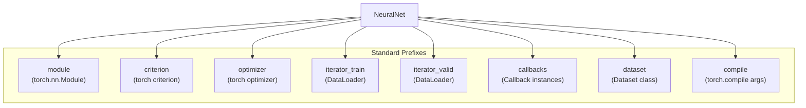
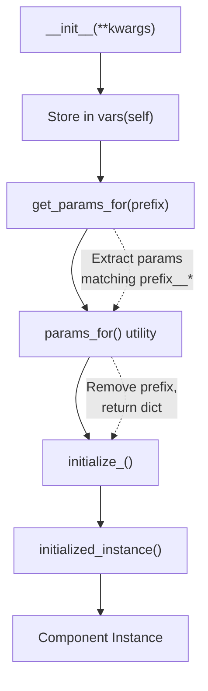
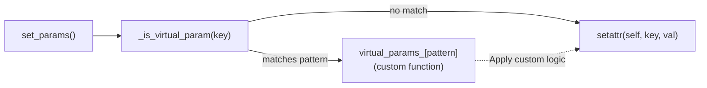
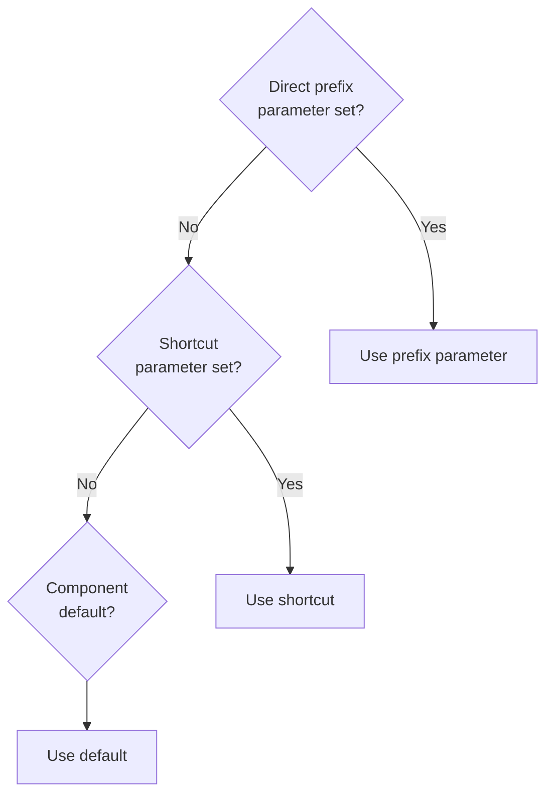
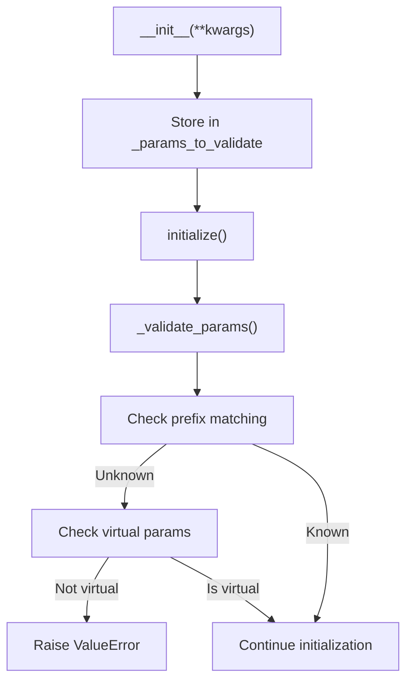

<!-- source: DeepWiki mcp.deepwiki.com · repo skorch-dev/skorch · page 5.4 Parameter Passing Conventions · fetched 2026-10-21 -->

# Parameter Passing Conventions

<details>
<summary>Relevant source files</summary>

The following files were used as context for generating this wiki page:

- [docs/user/FAQ.rst](docs/user/FAQ.rst)
- [docs/user/callbacks.rst](docs/user/callbacks.rst)
- [docs/user/dataset.rst](docs/user/dataset.rst)
- [docs/user/neuralnet.rst](docs/user/neuralnet.rst)
- [skorch/net.py](skorch/net.py)
- [skorch/tests/test_net.py](skorch/tests/test_net.py)

</details>


This page documents skorch's parameter passing conventions, specifically the double-underscore notation for nested parameters and the virtual parameter system. These conventions enable seamless integration with scikit-learn's hyperparameter search tools while maintaining flexibility for PyTorch components.

For information about using these conventions with sklearn tools like GridSearchCV, see [Using with sklearn Tools](#5.3). For general API compatibility details, see [API Compatibility](#5.1).

---

## Overview

skorch uses a parameter passing convention that allows users to configure nested components (modules, optimizers, criteria, callbacks) without directly instantiating them. This is accomplished through:

1. **Double-underscore notation** (`__`) - separates component names from their parameters
2. **Prefixes** - identify which component receives parameters
3. **Virtual parameters** - dynamic parameter handling for special cases

Sources: [skorch/net.py:57-313](), [docs/user/neuralnet.rst:500-525]()

---

## Double-Underscore Notation

### Basic Concept

The double-underscore (`__`) notation follows the same semantic as scikit-learn: `<component>__<parameter>` means "set `<parameter>` on `<component>`". This allows parameters to be passed during initialization and modified later via `set_params()`.

```python
net = NeuralNet(
    module=MyModule,
    module__num_units=100,          # passes num_units to module
    optimizer__momentum=0.9,        # passes momentum to optimizer
    criterion__weight=weight,       # passes weight to criterion
)

# Can be modified later
net.set_params(module__num_units=200, optimizer__momentum=0.95)
```

Sources: [skorch/net.py:66-90](), [docs/user/neuralnet.rst:73-89]()

### Why This Convention Exists

This convention serves two primary purposes:

1. **Deferred Initialization** - Components are not instantiated until `fit()` or `initialize()` is called, allowing the net to be cloned (required by sklearn)
2. **sklearn Integration** - Enables hyperparameter search with `GridSearchCV`, `RandomizedSearchCV`, etc.

Sources: [skorch/net.py:45-57](), [docs/user/neuralnet.rst:42-60]()

---

## Component Prefixes

### Standard Prefixes

The `prefixes_` attribute defines which component names accept nested parameters:



**Standard Prefixes Defined in Code**

| Prefix | Target Component | Example Parameter |
|--------|------------------|-------------------|
| `module` | PyTorch module | `module__num_units=100` |
| `criterion` | Loss function | `criterion__reduction='mean'` |
| `optimizer` | Optimizer | `optimizer__momentum=0.9` |
| `iterator_train` | Training DataLoader | `iterator_train__shuffle=True` |
| `iterator_valid` | Validation DataLoader | `iterator_valid__batch_size=64` |
| `callbacks` | Callback instances | `callbacks__print_log__verbose=True` |
| `dataset` | Dataset wrapper | `dataset__length=1000` |
| `compile` | torch.compile | `compile__dynamic=True` |

Sources: [skorch/net.py:314](), [skorch/net.py:327-348]()

### Dynamic Prefixes

Additional prefixes are populated dynamically during initialization:

- **`_modules`** - Names of all torch modules (collected during initialization)
- **`_criteria`** - Names of all criteria (collected during initialization)  
- **`_optimizers`** - Names of all optimizers (collected during initialization)

These lists allow custom components to be registered and receive parameters:

```python
class MyNet(NeuralNet):
    def __init__(self, *args, **kwargs):
        super().__init__(*args, **kwargs)
        self.encoder = MyEncoder  # will be added to _modules

# Now encoder__hidden_size works
net = MyNet(module=MyModule, encoder__hidden_size=256)
```

Sources: [skorch/net.py:298-312](), [skorch/net.py:726-791]()

---

## Parameter Extraction and Routing

### Parameter Flow Diagram



**Key Methods for Parameter Routing**

| Method | Location | Purpose |
|--------|----------|---------|
| `get_params_for(prefix)` | [skorch/net.py:1015-1036]() | Extract all parameters for a given prefix |
| `params_for(prefix, kwargs)` | [skorch/utils.py]() | Utility to filter and strip prefix from parameters |
| `initialized_instance()` | [skorch/net.py:571-605]() | Initialize component with extracted parameters |
| `get_params_for_optimizer()` | [skorch/net.py:999-1014]() | Special handling for optimizer parameters |

Sources: [skorch/net.py:571-677]()

### Parameter Extraction Process

1. **Storage**: All `__init__` kwargs are stored in `vars(self)`
2. **Extraction**: `get_params_for(prefix)` finds matching parameters
3. **Stripping**: Prefix is removed, leaving clean parameter names
4. **Application**: Parameters passed to component during initialization

Example flow for `module__num_units=100`:

```
__init__(module__num_units=100)
  ↓
vars(self) = {'module__num_units': 100}
  ↓
get_params_for('module') → {'num_units': 100}
  ↓
initialized_instance(MyModule, {'num_units': 100})
  ↓
MyModule(num_units=100)
```

Sources: [skorch/net.py:614-631](), [skorch/utils.py]()

---

## Virtual Parameters

### Concept and Purpose

Virtual parameters are parameters that don't directly correspond to component attributes but require special handling during `set_params()`. They are registered with pattern matching and custom setter functions.



**Virtual Parameter System Methods**

| Method | Location | Purpose |
|--------|----------|---------|
| `_is_virtual_param(key)` | [skorch/net.py:633-634]() | Check if parameter matches a virtual pattern |
| `_register_virtual_param()` | [skorch/net.py:639-643]() | Register pattern and handler function |
| `_apply_virtual_params()` | [skorch/net.py:645-650]() | Apply virtual parameter handlers |
| `initialize_virtual_params()` | [skorch/net.py:652-653]() | Initialize virtual_params_ dict |

Sources: [skorch/net.py:633-653]()

### Optimizer Virtual Parameters

Optimizer parameters are virtual because they need special handling to update optimizer state after initialization:

**Registered Patterns for Optimizer**
- `optimizer__param_groups__*__*` - Parameter group settings
- `optimizer__*` - Direct optimizer parameters  
- `lr` - Shortcut for `optimizer__lr`

```python
# Virtual parameter registration for optimizer
self._register_virtual_param(
    ['optimizer__param_groups__*__*', 'optimizer__*', 'lr'],
    setter=partial(optimizer_setter, optimizer_attr='optimizer_', optimizer_name='optimizer')
)
```

Sources: [skorch/net.py:912-923](), [skorch/setter.py]()

### Optimizer Setter Function

The `optimizer_setter` function handles updates to optimizer parameters:

1. Extracts the parameter being set (e.g., `lr`, `momentum`)
2. Locates the correct parameter group in the optimizer
3. Updates the parameter in-place
4. Also sets the attribute on the net for consistency

Sources: [skorch/setter.py]()

---

## Special Cases

### The `lr` Shortcut

The `lr` parameter is a convenience shortcut for `optimizer__lr`:

```python
# These are equivalent:
net = NeuralNet(module=MyModule, lr=0.01)
net = NeuralNet(module=MyModule, optimizer__lr=0.01)

# If both are set, optimizer__lr takes precedence
net = NeuralNet(module=MyModule, lr=0.01, optimizer__lr=0.001)  # uses 0.001
```

Implementation: `lr` is registered as a virtual parameter that maps to `optimizer__lr`.

Sources: [skorch/net.py:110-113](), [skorch/net.py:914-916]()

### The `batch_size` Shortcut

Similarly, `batch_size` is a convenience parameter for both iterators:

```python
# This:
net = NeuralNet(module=MyModule, batch_size=128)

# Is equivalent to:
net = NeuralNet(
    module=MyModule,
    iterator_train__batch_size=128,
    iterator_valid__batch_size=128,
)
```

Sources: [skorch/net.py:118-123](), [docs/user/neuralnet.rst:186-194]()

### Callback Parameters

Callbacks can be referenced by name using the `callbacks__<name>__<param>` pattern:

```python
net = NeuralNet(
    module=MyModule,
    callbacks=[
        ('my_checkpoint', Checkpoint(...)),
        ('early_stop', EarlyStopping(...)),
    ],
    callbacks__my_checkpoint__monitor='valid_acc_best',
    callbacks__early_stop__patience=5,
)
```

Sources: [skorch/net.py:524-569](), [docs/user/callbacks.rst:92-105]()

### Compile Parameters

When `compile=True`, additional parameters can be passed to `torch.compile`:

```python
net = NeuralNet(
    module=MyModule,
    compile=True,
    compile__dynamic=True,
    compile__mode='reduce-overhead',
)
```

Sources: [skorch/net.py:219-227](), [skorch/net.py:794-842]()

---

## Parameter Resolution Order

### Priority Rules

When multiple ways exist to set the same parameter:



**Example: Learning Rate Priority**

```python
net = NeuralNet(
    module=MyModule,
    lr=0.01,                    # Priority 2 (shortcut)
    optimizer__lr=0.001,        # Priority 1 (direct prefix) - WINS
)
# Resulting lr: 0.001
```

**Example: Batch Size Priority**

```python
net = NeuralNet(
    module=MyModule,
    batch_size=128,                      # Priority 3 (shortcut)
    iterator_train__batch_size=64,       # Priority 2 - WINS for train
    iterator_valid__batch_size=32,       # Priority 1 - WINS for valid
)
# Resulting train batch size: 64
# Resulting valid batch size: 32
```

Sources: [skorch/net.py:110-113](), [skorch/net.py:118-123]()

---

## Error Handling and Validation

### Missing Double-Underscore Detection

skorch detects when users forget the double-underscore and provides helpful suggestions:

```python
# Common mistake: using single underscore
net = NeuralNet(module=MyModule, optimizer_momentum=0.9)  # WRONG

# Error message:
# "Got an unexpected argument optimizer_momentum, did you mean optimizer__momentum?"
```

**Detection Algorithm:**
1. Check if argument matches a known prefix followed by underscore(s)
2. Suggest the correct double-underscore version
3. Multiple typos are detected and reported together

Sources: [skorch/net.py:1037-1078](), [skorch/tests/test_net.py:198-246]()

### Unknown Argument Detection

Arguments that don't match any prefix are flagged as unknown:

```python
net = NeuralNet(module=MyModule, unknown_arg=123)

# Error message:
# "__init__() got unexpected argument(s) unknown_arg. Either you made a typo,
#  or you added new arguments in a subclass; if that is the case, the subclass
#  should deal with the new arguments explicitly."
```

Sources: [skorch/net.py:1037-1078](), [skorch/tests/test_net.py:176-196]()

### Validation Flow



Sources: [skorch/net.py:368-378](), [skorch/net.py:931-945]()

---

## Usage Examples

### Basic Component Configuration

```python
from skorch import NeuralNet
import torch

net = NeuralNet(
    module=MyModule,
    module__num_units=100,
    module__dropout=0.5,
    criterion=torch.nn.CrossEntropyLoss,
    criterion__weight=class_weights,
    optimizer=torch.optim.Adam,
    optimizer__lr=0.001,
    optimizer__weight_decay=1e-4,
    max_epochs=10,
)
```

Sources: [docs/user/neuralnet.rst:500-520]()

### Iterator Configuration

```python
net = NeuralNet(
    module=MyModule,
    batch_size=32,                          # sets both iterators
    iterator_train__shuffle=True,           # training-specific
    iterator_train__num_workers=4,
    iterator_valid__shuffle=False,          # validation-specific
    iterator_valid__drop_last=False,
)
```

Sources: [docs/user/FAQ.rst:37-55]()

### Callback Configuration

```python
from skorch.callbacks import EarlyStopping, Checkpoint

net = NeuralNet(
    module=MyModule,
    callbacks=[
        ('checkpoint', Checkpoint()),
        ('early_stopping', EarlyStopping()),
    ],
    callbacks__checkpoint__monitor='valid_loss_best',
    callbacks__checkpoint__f_params='best_model.pt',
    callbacks__early_stopping__patience=5,
    callbacks__early_stopping__threshold=0.001,
)
```

Sources: [docs/user/callbacks.rst:92-105]()

### With GridSearchCV

```python
from sklearn.model_selection import GridSearchCV

param_grid = {
    'module__num_units': [50, 100, 200],
    'module__dropout': [0.3, 0.5, 0.7],
    'optimizer__lr': [0.001, 0.01, 0.1],
    'batch_size': [16, 32, 64],
}

net = NeuralNet(module=MyModule)
search = GridSearchCV(net, param_grid, cv=3)
search.fit(X, y)
```

Sources: [docs/user/FAQ.rst:58-68]()

### Parameter Groups

```python
# Set different learning rates for different parameter groups
net = NeuralNet(
    module=MyModule,
    optimizer=torch.optim.SGD,
    optimizer__param_groups=[
        ('embedding.*', {'lr': 0.0}),      # freeze embeddings
        ('linear0.bias', {'lr': 0.1}),     # high lr for bias
    ],
)
```

Sources: [docs/user/neuralnet.rst:126-136]()

### Custom Prefixes in Subclasses

```python
class MyNet(NeuralNet):
    prefixes_ = NeuralNet.prefixes_ + ['encoder', 'decoder']
    
    def __init__(self, *args, encoder=None, decoder=None, **kwargs):
        super().__init__(*args, **kwargs)
        self.encoder = encoder or DefaultEncoder
        self.decoder = decoder or DefaultDecoder

# Now encoder__ and decoder__ prefixes work
net = MyNet(
    module=MyModule,
    encoder__hidden_dim=256,
    decoder__output_dim=128,
)
```

Sources: [skorch/net.py:314](), [skorch/tests/test_net.py:248-267]()

---

## Summary

**Key Takeaways:**

| Concept | Pattern | Example |
|---------|---------|---------|
| Component parameters | `<component>__<param>` | `module__num_units=100` |
| Nested parameters | `<component>__<sub>__<param>` | `callbacks__checkpoint__monitor='loss'` |
| Virtual parameters | Registered patterns | `lr` → `optimizer__lr` |
| Shortcuts | Special convenience params | `batch_size` sets both iterators |
| Error detection | Missing `__` detected | Suggests correct form |

**Best Practices:**

1. Use double-underscore notation for all nested parameters
2. Prefer shortcuts (`lr`, `batch_size`) for common parameters
3. Name callbacks explicitly when setting multiple of the same type
4. Extend `prefixes_` when adding custom components in subclasses
5. Let errors guide you - they provide helpful suggestions

Sources: [skorch/net.py:57-945](), [docs/user/neuralnet.rst:42-525]()

---

