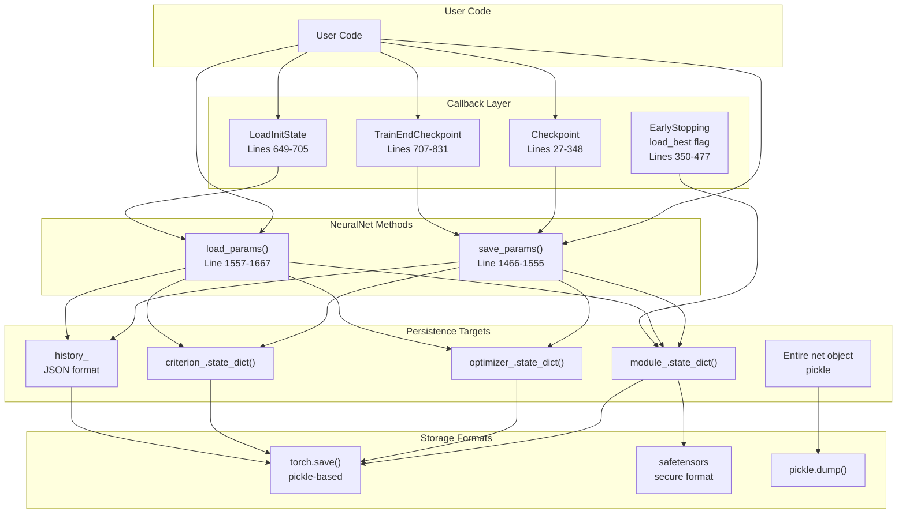
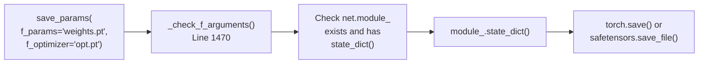
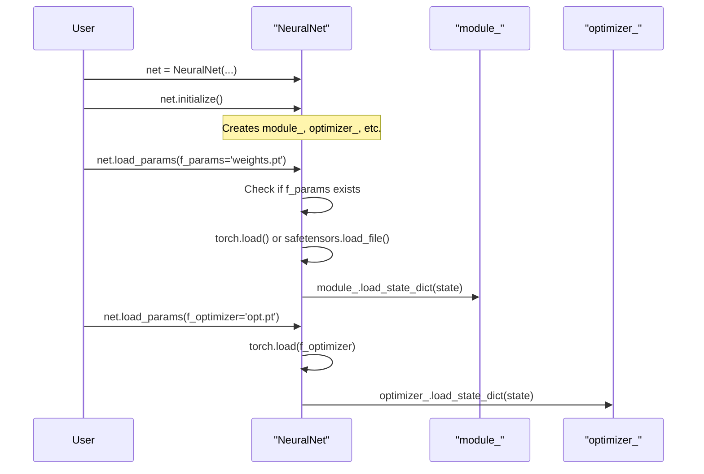
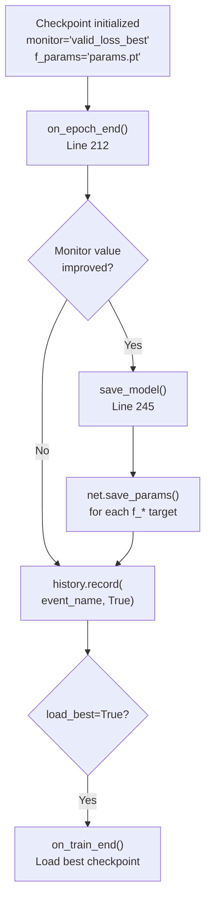
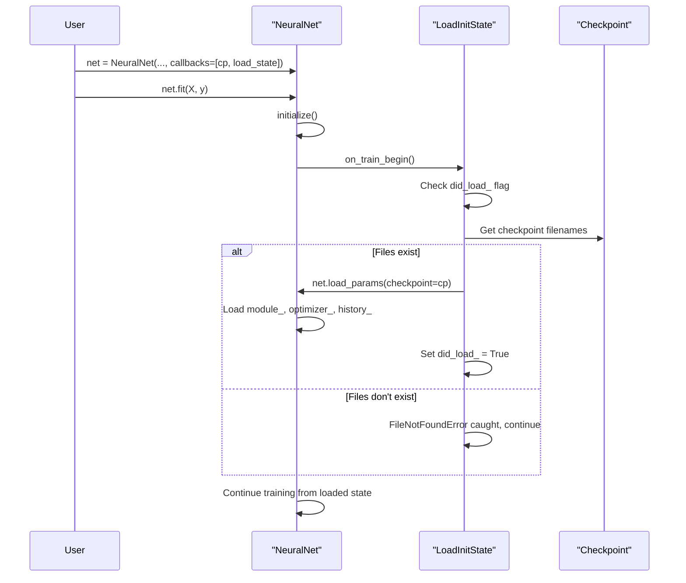
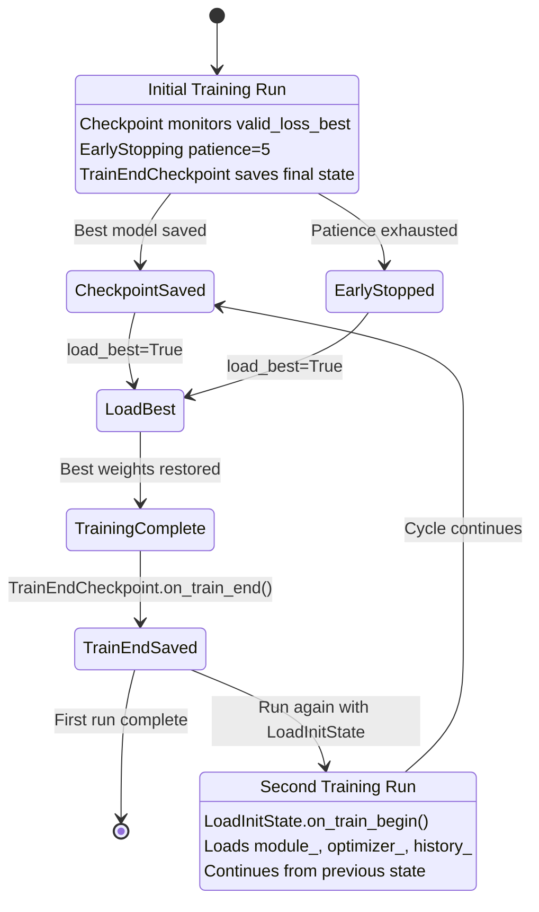
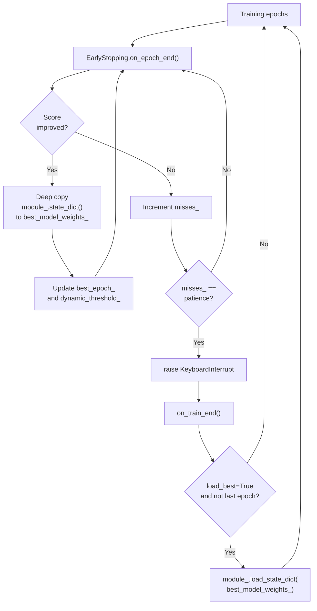
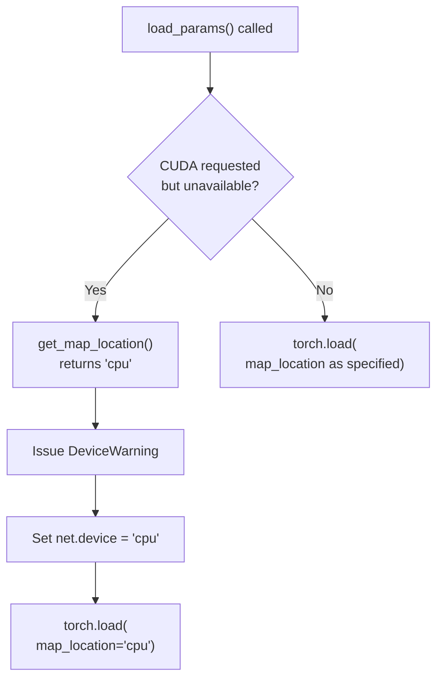

<!-- source: DeepWiki mcp.deepwiki.com · repo skorch-dev/skorch · page 6 Model Persistence and State Management · fetched 2026-10-21 -->

# Model Persistence and State Management

<details>
<summary>Relevant source files</summary>

The following files were used as context for generating this wiki page:

- [docs/user/save_load.rst](docs/user/save_load.rst)
- [skorch/callbacks/__init__.py](skorch/callbacks/__init__.py)
- [skorch/callbacks/training.py](skorch/callbacks/training.py)
- [skorch/net.py](skorch/net.py)
- [skorch/tests/callbacks/test_training.py](skorch/tests/callbacks/test_training.py)
- [skorch/tests/test_net.py](skorch/tests/test_net.py)

</details>


This page documents how skorch handles saving and loading models, including module parameters, optimizer state, training history, and complete model objects. This encompasses both direct methods on the `NeuralNet` class and callback-based approaches for automatic checkpointing during training.

For information about the training lifecycle and how callbacks integrate with training, see [Training Lifecycle](#2.3). For details on the history object structure, see [History and Training Tracking](#2.5).

## Overview

skorch provides multiple strategies for model persistence:

| Strategy | Method | Use Case | Robustness |
|----------|--------|----------|------------|
| Full pickling | `pickle.dump(net, f)` | Entire pipeline, including hyperparameters | Low - breaks with code changes |
| Component saving | `net.save_params()` | Module weights, optimizer, criterion, history | High - only state, not code |
| Automatic checkpointing | `Checkpoint` callback | Save best model during training | High - configurable monitoring |
| Training continuation | `LoadInitState` callback | Resume from checkpoint | High - restores complete state |
| End-of-training snapshot | `TrainEndCheckpoint` callback | Save final model state | High - simple continuation |

Sources: [docs/user/save_load.rst:1-381](), [skorch/net.py:57-313]()

## Core Persistence Architecture

The following diagram shows how the key persistence components interact within the skorch ecosystem:



Sources: [skorch/net.py:1466-1667](), [skorch/callbacks/training.py:27-831]()

## NeuralNet Save and Load Methods

### save_params Method

The `save_params` method saves PyTorch module/optimizer state dictionaries to disk. It accepts parameters with the `f_` prefix to specify target files:

**Key parameters:**
- `f_params` or `f_module`: Module parameters (interchangeable names)
- `f_optimizer`: Optimizer state
- `f_criterion`: Criterion state  
- `f_history`: Training history (JSON format)
- `f_<custom>`: Any custom module (e.g., `f_mymodule`)
- `use_safetensors`: Boolean flag to use safetensors format instead of pickle

**Implementation details:**

The method at [skorch/net.py:1466-1555]() validates parameter names, checks for `state_dict()` methods on the target attributes, and delegates to `torch.save()` or `safetensors.save_file()` depending on configuration.



Sources: [skorch/net.py:1466-1555](), [skorch/utils.py:879-903]()

### load_params Method

The `load_params` method loads state dictionaries back into the net's components. It requires the net to be initialized first.

**Key features:**
- Accepts `checkpoint` parameter to load from a `Checkpoint` callback instance
- Uses `_TorchLoadUnpickler` to handle device mapping (CPU/CUDA)
- Supports `use_safetensors` flag matching save behavior
- Handles `torch_load_kwargs` for security settings (weights_only)

**Critical requirement:** The net must be initialized before calling `load_params()`. This is done either by calling `net.initialize()` explicitly or by fitting the model first.



Sources: [skorch/net.py:1557-1667](), [skorch/utils.py:40-78]()

## Persistent Component Details

The following table details what each component stores and when it's needed:

| Component | Attribute | Contains | Format | Required For |
|-----------|-----------|----------|--------|--------------|
| Module parameters | `module_` | Weights, biases, batch norm stats | Tensors | Inference, training |
| Optimizer state | `optimizer_` | Momentum, learning rates, step counts | Mixed | Continued training |
| Criterion state | `criterion_` | Learnable criterion parameters | Tensors | Training with learnable loss |
| History | `history_` | Loss curves, metrics, epochs | JSON-serializable | Analysis, resuming |
| Full pickle | Entire net | All attributes, hyperparameters | Python objects | Pipeline integration |

Sources: [skorch/net.py:270-312](), [docs/user/save_load.rst:44-118]()

## Checkpoint Callback System

### Checkpoint Callback

The `Checkpoint` callback automatically saves model state when a monitored metric improves:



**Key parameters:**

- `monitor`: Metric to observe (default: `'valid_loss_best'`). Can be a string, callable, or `None` (save every epoch)
- `f_params`, `f_optimizer`, `f_criterion`, `f_history`, `f_pickle`: Target files for each component
- `dirname`: Directory for all checkpoint files
- `fn_prefix`: Prefix for filenames
- `load_best`: Automatically restore best checkpoint after training
- `use_safetensors`: Use safetensors format instead of pickle

**Filename formatting:**

Checkpoint supports format specifiers in filenames at [skorch/callbacks/training.py:312-323]():

```python
# Example usage:
cb = Checkpoint(
    f_params="model_epoch_{last_epoch[epoch]}_loss_{last_epoch[train_loss]:.3f}.pt"
)
# Produces: model_epoch_5_loss_0.234.pt
```

Sources: [skorch/callbacks/training.py:27-348](), [skorch/tests/callbacks/test_training.py:21-502]()

### LoadInitState Callback

The `LoadInitState` callback loads a checkpoint at the beginning of training:



**Usage pattern for training continuation:**

```python
cp = Checkpoint(dirname='exp1')
load_state = LoadInitState(cp)
net = NeuralNetClassifier(
    module,
    callbacks=[cp, load_state],
)
net.fit(X, y)  # First run: trains from scratch, saves checkpoint
net.fit(X, y)  # Second run: loads checkpoint, continues training
```

Sources: [skorch/callbacks/training.py:649-705](), [docs/user/save_load.rst:240-274]()

### TrainEndCheckpoint Callback

The `TrainEndCheckpoint` callback saves the model at the end of training (not based on metrics):

**Key differences from Checkpoint:**
- No `monitor` parameter - always saves at training end
- Default `fn_prefix='train_end_'` instead of empty string  
- No `load_best` parameter - not relevant for end-of-training saves
- Internally creates a `Checkpoint` instance with `monitor=None`

Implementation at [skorch/callbacks/training.py:707-831]():

```python
class TrainEndCheckpoint(Callback):
    def initialize(self):
        self.checkpoint_ = Checkpoint(
            monitor=None,
            fn_prefix=self.fn_prefix,
            dirname=self.dirname,
            event_name=None,
            sink=self.sink,
            use_safetensors=self.use_safetensors,
            **self._f_kwargs()
        )
        self.checkpoint_.initialize()
        return self
    
    def on_train_end(self, net, **kwargs):
        self.checkpoint_.save_model(net)
```

Sources: [skorch/callbacks/training.py:707-831]()

## File Format Considerations

### Pickle Format (Default)

**Advantages:**
- Can save any Python object, including optimizer state
- Native PyTorch support via `torch.save()` and `torch.load()`
- Full state preservation

**Disadvantages:**
- Security risk - arbitrary code execution possible
- Breaks with code structure changes
- Not portable across Python versions

**Security mitigation:**

As of PyTorch 2.6+, the default will switch to `weights_only=True`. Configure via `torch_load_kwargs`:

```python
net = NeuralNet(
    module,
    torch_load_kwargs={'weights_only': False}  # Old behavior, insecure
)
```

Sources: [skorch/net.py:243-269](), [skorch/tests/test_net.py:587-596]()

### Safetensors Format

**Advantages:**
- Security by design - no code execution
- Fast loading
- Cross-framework compatibility
- Strict validation

**Disadvantages:**
- Only supports tensors - cannot save optimizer state
- Requires explicit flag: `use_safetensors=True`
- Additional dependency required

**Usage:**

```python
# Installation:
# pip install safetensors

# Saving:
net.save_params(f_params='model.safetensors', use_safetensors=True)

# Loading:
net.load_params(f_params='model.safetensors', use_safetensors=True)

# With Checkpoint callback:
cp = Checkpoint(
    f_params='model.safetensors',
    f_optimizer=None,  # Cannot save optimizer with safetensors
    use_safetensors=True,
)
```

Sources: [docs/user/save_load.rst:119-162](), [skorch/tests/test_net.py:674-716]()

## Complete Persistence Workflow

The following diagram shows a complete workflow combining checkpointing, early stopping, and training continuation:



Sources: [docs/user/save_load.rst:172-346](), [skorch/callbacks/training.py:27-831]()

## EarlyStopping Integration

The `EarlyStopping` callback includes a `load_best` parameter that restores the best model weights without requiring `Checkpoint`:



**Important distinction:**
- `EarlyStopping.load_best=True`: Restores only `module_` weights (lightweight)
- `Checkpoint.load_best=True`: Restores full checkpoint including optimizer and history (heavyweight)

Sources: [skorch/callbacks/training.py:350-477](), [skorch/tests/callbacks/test_training.py:548-634]()

## Device Handling During Load

When loading parameters, skorch handles device mismatches (CPU/CUDA) automatically:

**Device mapping logic at [skorch/utils.py:40-78]():**



**Attributes affected:** The `cuda_dependent_attributes_` list at [skorch/net.py:316]() determines which attributes are mapped to CPU. By default, this list is empty, but subclasses can populate it.

Sources: [skorch/utils.py:40-78](), [skorch/tests/test_net.py:424-526]()

## Custom Module Checkpointing

For custom modules beyond the standard `module_`, `optimizer_`, and `criterion_`, use the `f_<name>` pattern:

**Example with custom module:**

```python
class MyNet(NeuralNet):
    def __init__(self, *args, discriminator=MyDiscriminator, **kwargs):
        self.discriminator = discriminator
        super().__init__(*args, **kwargs)
    
    def initialize_module(self, *args, **kwargs):
        super().initialize_module(*args, **kwargs)
        # Creates self.discriminator_
        params = self.get_params_for('discriminator')
        self.discriminator_ = self.discriminator(**params)
        return self

# Checkpoint automatically detects discriminator_ via f_discriminator
cp = Checkpoint(
    f_params='generator.pt',
    f_discriminator='discriminator.pt',
    f_optimizer=None,
    monitor='valid_loss_best',
)

net = MyNet(module=Generator, callbacks=[cp])
net.fit(X, y)
```

The checkpoint callback inspects parameters starting with `f_` at [skorch/callbacks/training.py:241-267]() and attempts to save corresponding attributes ending with `_`.

Sources: [skorch/tests/callbacks/test_training.py:423-459](), [skorch/callbacks/training.py:241-267]()

## Common Patterns and Best Practices

### Pattern 1: Checkpointing with Early Stopping

```python
from skorch.callbacks import Checkpoint, EarlyStopping

cp = Checkpoint(
    monitor='valid_loss_best',
    f_params='best_model.pt',
    load_best=True,  # Restore best after training
)

early_stop = EarlyStopping(
    monitor='valid_loss',
    patience=10,
    load_best=False,  # Let Checkpoint handle restoration
)

net = NeuralNetClassifier(
    module,
    callbacks=[cp, early_stop],
)
```

Sources: [docs/user/save_load.rst:172-240]()

### Pattern 2: Experiment Tracking with Directories

```python
cp = Checkpoint(
    dirname='experiments/exp_001',
    fn_prefix='model_v2_',
    f_params='params.pt',
    f_optimizer='optimizer.pt',
    f_history='history.json',
)

load_state = LoadInitState(cp)

net = NeuralNetClassifier(
    module,
    callbacks=[cp, load_state],
)

# First run: saves to experiments/exp_001/model_v2_params.pt
net.fit(X, y)

# Second run: loads from checkpoint, continues training
net.fit(X, y)
```

Sources: [docs/user/save_load.rst:314-346](), [skorch/tests/callbacks/test_training.py:340-388]()

### Pattern 3: Safetensors for Production

```python
# Secure checkpointing for production deployment
cp = Checkpoint(
    monitor='valid_loss_best',
    f_params='model.safetensors',
    f_optimizer=None,  # Cannot save with safetensors
    f_history='history.json',
    use_safetensors=True,
)

# Requires matching flag in LoadInitState
load_state = LoadInitState(cp, use_safetensors=True)

net = NeuralNetClassifier(
    module,
    callbacks=[cp, load_state],
)
```

Sources: [docs/user/save_load.rst:364-372](), [skorch/callbacks/training.py:149-199]()

### Pattern 4: Manual Save/Load for Inference

```python
# After training, save only what's needed for inference
net.fit(X, y)
net.save_params(f_params='inference_weights.pt')

# Later, in production/inference code:
inference_net = NeuralNetClassifier(module)
inference_net.initialize()  # Critical: must initialize first
inference_net.load_params(f_params='inference_weights.pt')

predictions = inference_net.predict(X_test)
```

Sources: [docs/user/save_load.rst:56-76](), [skorch/net.py:1557-1667]()

## State Dictionary Access

For direct access to PyTorch state dictionaries without file I/O:

```python
# Get state dicts
module_state = net.module_.state_dict()
optimizer_state = net.optimizer_.state_dict()

# Later, restore
net.module_.load_state_dict(module_state)
net.optimizer_.load_state_dict(optimizer_state)
```

This pattern is useful when implementing custom persistence logic or integrating with other frameworks.

Sources: [skorch/callbacks/training.py:436-437](), [skorch/tests/callbacks/test_training.py:548-626]()

## Error Handling and Validation

Common errors and their causes:

| Error | Cause | Solution |
|-------|-------|----------|
| `AttributeError: net.xyz_` | Trying to save non-existent attribute | Check attribute name, ensure initialized |
| `NotInitializedError` | Calling `load_params()` before `initialize()` | Call `net.initialize()` first |
| `FileNotFoundError` | Checkpoint files missing | Normal for first run with `LoadInitState` |
| `TypeError: f_params and f_module` | Both `f_params` and `f_module` specified | Use only one (they're aliases) |
| `ValueError: safetensors optimizer` | Trying to save optimizer with safetensors | Set `f_optimizer=None` |

The validation logic at [skorch/net.py:1470-1511]() and [skorch/callbacks/training.py:189-198]() provides detailed error messages for misconfigurations.

Sources: [skorch/net.py:1470-1511](), [skorch/tests/test_net.py:537-585](), [skorch/tests/callbacks/test_training.py:66-83]()

---

