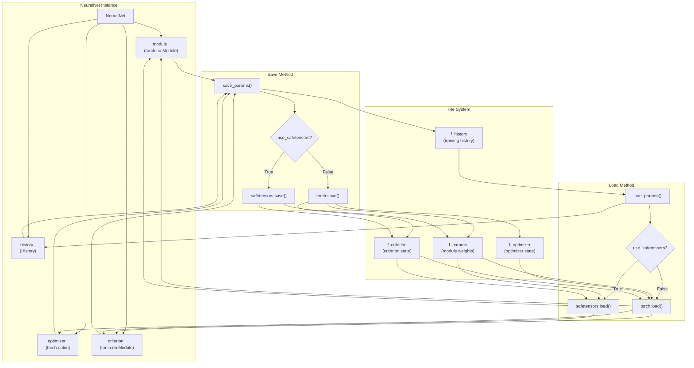
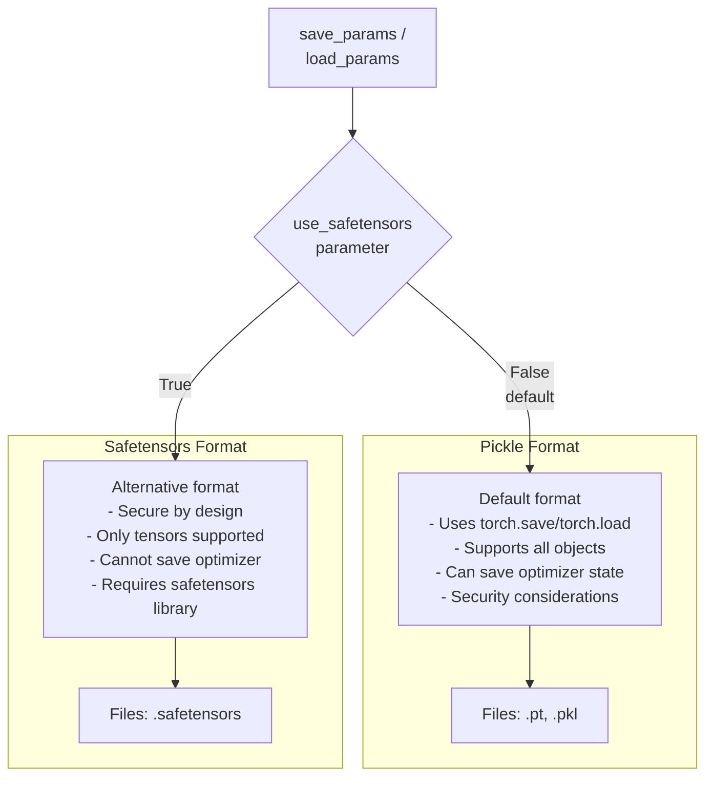
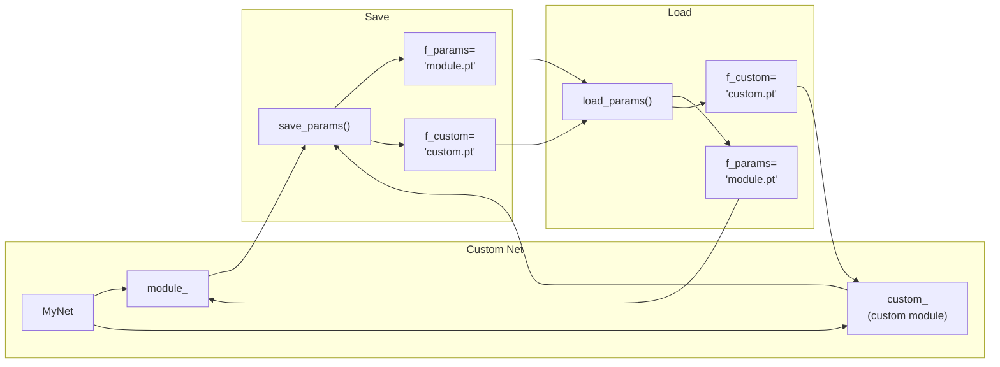
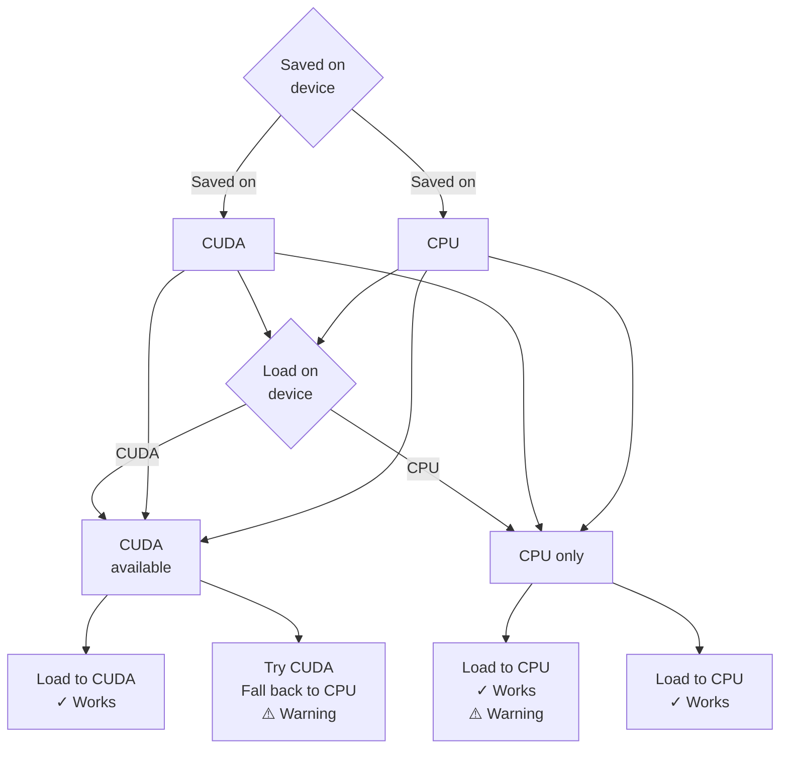
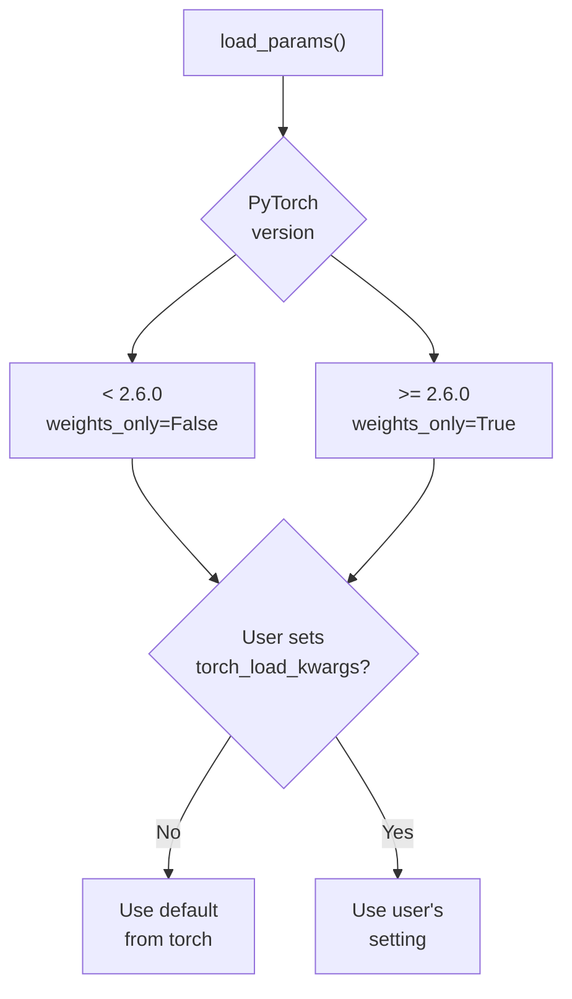

<!-- source: DeepWiki mcp.deepwiki.com · repo skorch-dev/skorch · page 6.1 Save and Load Methods · fetched 2026-10-21 -->

# Save and Load Methods

<details>
<summary>Relevant source files</summary>

The following files were used as context for generating this wiki page:

- [CHANGES.md](CHANGES.md)
- [skorch/net.py](skorch/net.py)
- [skorch/tests/test_net.py](skorch/tests/test_net.py)

</details>


This page documents the methods and mechanisms for saving and loading neural network parameters and state in skorch. These methods allow persistence of trained models, resuming training from checkpoints, and model deployment.

For automatic checkpointing during training, see [Checkpointing During Training](#6.2). For resuming training from saved states, see [Resuming Training](#6.3).

---

## Overview

The `NeuralNet` class provides two primary methods for model persistence:
- `save_params`: Saves module parameters, optimizer state, criterion state, and training history
- `load_params`: Loads previously saved states back into a net instance

These methods support multiple components and file formats, enabling flexible model persistence strategies.

**Sources:** [skorch/net.py:2170-2380]()

---

## Save and Load Architecture



**Diagram: Save and load architecture showing the flow from NeuralNet components to file storage**

**Sources:** [skorch/net.py:2170-2380](), [skorch/tests/test_net.py:598-823]()

---

## save_params Method

The `save_params` method persists network state to disk. It can save multiple components simultaneously to separate files.

### Method Signature

```python
def save_params(
    self,
    f_params=None,
    f_optimizer=None,
    f_criterion=None,
    f_history=None,
    f_module=None,
    use_safetensors=False,
    **kwargs
)
```

### Parameters

| Parameter | Type | Description |
|-----------|------|-------------|
| `f_params` | str, Path, or file-like | Path or file object for module parameters (alias for f_module) |
| `f_module` | str, Path, or file-like | Path or file object for module parameters |
| `f_optimizer` | str, Path, or file-like | Path or file object for optimizer state |
| `f_criterion` | str, Path, or file-like | Path or file object for criterion state |
| `f_history` | str, Path, or file-like | Path or file object for training history (JSON) |
| `use_safetensors` | bool | Whether to use safetensors format instead of pickle |

**Sources:** [skorch/net.py:2170-2266]()

### Basic Usage Examples

```python
# Save only module parameters
net.save_params(f_params='model.pt')

# Save module and optimizer
net.save_params(f_params='model.pt', f_optimizer='optimizer.pt')

# Save all components
net.save_params(
    f_params='model.pt',
    f_optimizer='optimizer.pt',
    f_criterion='criterion.pt',
    f_history='history.json'
)

# Using safetensors format
net.save_params(f_params='model.safetensors', use_safetensors=True)
```

**Sources:** [skorch/tests/test_net.py:598-635]()

### File Path Types

The save methods accept multiple path representations:

```python
# String path
net.save_params(f_params='weights.pt')

# Path object
from pathlib import Path
net.save_params(f_params=Path('weights.pt'))

# File object
with open('weights.pt', 'wb') as f:
    net.save_params(f_params=f)
```

**Sources:** [skorch/tests/test_net.py:1097-1110]()

---

## load_params Method

The `load_params` method restores network state from saved files. It can load from individual files or from a `Checkpoint` instance.

### Method Signature

```python
def load_params(
    self,
    f_params=None,
    f_optimizer=None,
    f_criterion=None,
    f_history=None,
    f_module=None,
    checkpoint=None,
    use_safetensors=False,
)
```

### Parameters

| Parameter | Type | Description |
|-----------|------|-------------|
| `f_params` | str, Path, or file-like | Path or file object for module parameters |
| `f_module` | str, Path, or file-like | Path or file object for module parameters (alias) |
| `f_optimizer` | str, Path, or file-like | Path or file object for optimizer state |
| `f_criterion` | str, Path, or file-like | Path or file object for criterion state |
| `f_history` | str, Path, or file-like | Path or file object for training history |
| `checkpoint` | Checkpoint instance | Load from a Checkpoint callback instance |
| `use_safetensors` | bool | Whether files are in safetensors format |

**Sources:** [skorch/net.py:2268-2380]()

### Basic Usage Examples

```python
# Load only module parameters
net.load_params(f_params='model.pt')

# Load module and optimizer
net.load_params(f_params='model.pt', f_optimizer='optimizer.pt')

# Load from safetensors
net.load_params(f_params='model.safetensors', use_safetensors=True)

# Load from checkpoint (see section below)
from skorch.callbacks import Checkpoint
cp = Checkpoint(...)
net.load_params(checkpoint=cp)
```

**Sources:** [skorch/tests/test_net.py:598-635](), [skorch/tests/test_net.py:825-875]()

### Initialization Requirements

The net must be initialized before loading parameters:

```python
# Initialize first
net = NeuralNetClassifier(MyModule)
net.initialize()
net.load_params(f_params='model.pt')

# Or initialize implicitly during load
net = NeuralNetClassifier(MyModule)
# load_params will call initialize() if needed
net.load_params(f_params='model.pt')
```

**Sources:** [skorch/tests/test_net.py:1005-1017]()

---

## File Format Options



**Diagram: File format decision tree for save_params and load_params**

**Sources:** [skorch/net.py:2170-2380](), [CHANGES.md:58]()

### Pickle Format (Default)

The default format uses PyTorch's `torch.save` and `torch.load`:

**Advantages:**
- Supports all Python objects
- Can save optimizer state (including momentum buffers, etc.)
- Can save criterion parameters
- Can save custom modules

**Disadvantages:**
- Potential security risk when loading untrusted files
- Larger file sizes
- Pickle version compatibility issues

```python
# Save with pickle (default)
net.save_params(f_params='model.pt')

# Load with pickle
net.load_params(f_params='model.pt')
```

**Sources:** [skorch/net.py:2170-2266](), [skorch/net.py:2268-2380]()

### Safetensors Format

The safetensors format provides a secure alternative:

**Advantages:**
- Secure by design (cannot execute arbitrary code)
- Fast loading
- Memory efficient
- No version compatibility issues

**Disadvantages:**
- Only supports tensors (no optimizer state)
- Requires separate `safetensors` library
- Cannot save non-tensor data

```python
# Save with safetensors
net.save_params(f_params='model.safetensors', use_safetensors=True)

# Cannot save optimizer with safetensors
net.save_params(
    f_params='model.safetensors',
    use_safetensors=True,
    # f_optimizer not supported with safetensors
)

# Load with safetensors
net.load_params(f_params='model.safetensors', use_safetensors=True)
```

**Sources:** [skorch/tests/test_net.py:702-715](), [CHANGES.md:58]()

---

## Saving Individual Components

### Component Overview

| Component | Attribute | Content | Format Support |
|-----------|-----------|---------|----------------|
| Module | `module_` | Neural network weights and biases | Pickle, Safetensors |
| Optimizer | `optimizer_` | Optimizer state (momentum, etc.) | Pickle only |
| Criterion | `criterion_` | Loss function parameters | Pickle, Safetensors |
| History | `history_` | Training metrics and logs | JSON (both) |

**Sources:** [skorch/net.py:2170-2380]()

### Module Parameters (f_params / f_module)

The module contains the neural network weights:

```python
# Save module
net.save_params(f_params='weights.pt')

# Load module
net.load_params(f_params='weights.pt')

# Verify loading worked
X_test = ...
predictions = net.predict(X_test)
```

**Sources:** [skorch/tests/test_net.py:598-635]()

### Optimizer State (f_optimizer)

The optimizer state includes momentum buffers, learning rates, and other stateful information:

```python
# Important for stateful optimizers like Adam, RMSprop
net = NeuralNetClassifier(
    MyModule,
    optimizer=torch.optim.Adam,
    max_epochs=10
)
net.fit(X, y)

# Save optimizer state
net.save_params(
    f_params='model.pt',
    f_optimizer='optimizer.pt'
)

# Resume training with same optimizer state
new_net = NeuralNetClassifier(
    MyModule,
    optimizer=torch.optim.Adam,
    warm_start=True
)
new_net.initialize()
new_net.load_params(f_params='model.pt', f_optimizer='optimizer.pt')
new_net.partial_fit(X, y)  # Continues with preserved momentum
```

**Sources:** [skorch/tests/test_net.py:717-823]()

### Criterion State (f_criterion)

If the criterion has learnable parameters (e.g., custom loss functions with weights):

```python
class MyCriterion(nn.Module):
    def __init__(self):
        super().__init__()
        self.weight = nn.Parameter(torch.randn(10))
    
    def forward(self, y_pred, y_true):
        return ((y_pred - y_true) * self.weight).mean()

net = NeuralNetClassifier(MyModule, criterion=MyCriterion)
net.fit(X, y)

# Save criterion parameters
net.save_params(
    f_params='model.pt',
    f_criterion='criterion.pt'
)

# Load criterion parameters
new_net = NeuralNetClassifier(MyModule, criterion=MyCriterion)
new_net.initialize()
new_net.load_params(f_params='model.pt', f_criterion='criterion.pt')
```

**Sources:** [skorch/tests/test_net.py:737-796]()

### Training History (f_history)

The history contains all training metrics and epoch information:

```python
# Save history
net.save_params(f_history='history.json')

# Load history to resume or analyze
new_net = NeuralNetClassifier(MyModule)
new_net.initialize()
new_net.load_params(f_history='history.json')

# Access loaded history
print(net.history[:, 'train_loss'])
print(net.history[:, 'valid_acc'])
```

**Sources:** [skorch/tests/test_net.py:1082-1110]()

---

## Custom Modules

When using custom modules beyond the default `module_`, `criterion_`, and `optimizer_`, they can also be saved and loaded:



**Diagram: Saving and loading custom modules**

```python
class MyNet(NeuralNetClassifier):
    def __init__(self, *args, custom=MyCustomModule, **kwargs):
        self.custom = custom
        super().__init__(*args, **kwargs)
    
    def initialize_module(self, *args, **kwargs):
        super().initialize_module(*args, **kwargs)
        params = self.get_params_for('custom')
        self.custom_ = self.custom(**params)
        return self

# Save custom module
net = MyNet(MyModule)
net.fit(X, y)
net.save_params(f_params='module.pt', f_custom='custom.pt')

# Load custom module
new_net = MyNet(MyModule)
new_net.initialize()
new_net.load_params(f_params='module.pt', f_custom='custom.pt')
```

**Sources:** [skorch/tests/test_net.py:2970-3018]()

---

## Loading from Checkpoints

The `Checkpoint` callback integrates with `load_params`:

```python
from skorch.callbacks import Checkpoint

# Create checkpoint that saves during training
cp = Checkpoint(
    monitor='valid_loss_best',
    f_params='model_{last_epoch[epoch]}.pt',
    f_optimizer='optimizer_{last_epoch[epoch]}.pt',
    f_history='history.json'
)

# Train with checkpoint
net = NeuralNetClassifier(
    MyModule,
    callbacks=[cp],
    max_epochs=10
)
net.fit(X, y)

# Load from checkpoint
new_net = NeuralNetClassifier(MyModule)
new_net.initialize()
new_net.load_params(checkpoint=cp)  # Loads best saved state

# Continue training
new_net.partial_fit(X, y)
```

When loading from a checkpoint, the method extracts file paths from the checkpoint's configuration and loads all saved components.

**Sources:** [skorch/tests/test_net.py:825-875](), [skorch/tests/test_net.py:892-956]()

---

## Device Compatibility



**Diagram: Device compatibility when loading parameters**

### Loading CUDA Parameters on CPU

When loading parameters saved on CUDA to a CPU device:

```python
# Save on CUDA
net_cuda = NeuralNetClassifier(MyModule, device='cuda')
net_cuda.fit(X, y)
net_cuda.save_params(f_params='model_cuda.pt')

# Load on CPU (automatic mapping)
net_cpu = NeuralNetClassifier(MyModule, device='cpu')
net_cpu.initialize()
net_cpu.load_params(f_params='model_cuda.pt')  # Works with warning
```

The `load_params` method automatically uses `get_map_location` to map CUDA tensors to CPU when CUDA is unavailable.

**Sources:** [skorch/tests/test_net.py:1019-1080](), [skorch/net.py:2316-2330]()

### Loading CPU Parameters on CUDA

Loading CPU parameters to CUDA works seamlessly:

```python
# Save on CPU
net_cpu = NeuralNetClassifier(MyModule, device='cpu')
net_cpu.fit(X, y)
net_cpu.save_params(f_params='model_cpu.pt')

# Load on CUDA
net_cuda = NeuralNetClassifier(MyModule, device='cuda')
net_cuda.initialize()
net_cuda.load_params(f_params='model_cpu.pt')  # Works without issues
```

**Sources:** [skorch/tests/test_net.py:1042-1053]()

---

## Security Considerations: torch_load_kwargs

The `torch_load_kwargs` parameter controls how PyTorch loads pickled files:



**Diagram: torch_load_kwargs behavior based on PyTorch version**

### Default Behavior

Starting with PyTorch 2.6.0, the default for `torch.load` changes to `weights_only=True` for security:

```python
# Pre PyTorch 2.6: weights_only=False (loads all objects)
# PyTorch 2.6+: weights_only=True (only loads tensors)

net = NeuralNetClassifier(MyModule)
net.initialize()
net.load_params(f_params='model.pt')  # Uses PyTorch default
```

**Sources:** [skorch/net.py:243-269](), [skorch/tests/test_net.py:3020-3085]()

### Overriding for Legacy Files

To load files with non-weight objects (e.g., older pickle files):

```python
# Override to load all objects (less secure)
net = NeuralNetClassifier(
    MyModule,
    torch_load_kwargs={'weights_only': False}
)
net.initialize()
net.load_params(f_params='legacy_model.pt')
```

**Warning:** Only use `weights_only=False` if you trust the source of the file.

**Sources:** [skorch/net.py:243-269]()

### Recommended Practice

For new projects, use safetensors to avoid pickle security issues:

```python
# Secure approach: use safetensors
net.save_params(f_params='model.safetensors', use_safetensors=True)
net.load_params(f_params='model.safetensors', use_safetensors=True)
```

**Sources:** [CHANGES.md:58](), [skorch/tests/test_net.py:674-715]()

---

## Error Handling

### Parameter Name Validation

The methods validate parameter names to catch common mistakes:

```python
# Typo in parameter name
try:
    net.save_params(foobar='model.pt')
except TypeError as e:
    print(e)  # "save_params got an unexpected argument 'foobar', 
              #  did you mean 'f_foobar'?"
```

**Sources:** [skorch/tests/test_net.py:537-547](), [skorch/net.py:2172-2177]()

### Conflicting Parameters

Cannot use both `f_params` and `f_module`:

```python
# This raises an error
net.save_params(f_params='model.pt', f_module='other.pt')
# TypeError: save_params called with both f_params and f_module, please choose one
```

**Sources:** [skorch/tests/test_net.py:549-557](), [skorch/net.py:2179-2183]()

### Uninitialized Net

The net must be initialized before saving or loading:

```python
from skorch.exceptions import NotInitializedError

net = NeuralNetClassifier(MyModule)  # Not initialized

try:
    net.save_params(f_params='model.pt')
except NotInitializedError:
    print("Must initialize first")

# Initialize before saving
net.initialize()
net.save_params(f_params='model.pt')  # Now works
```

**Sources:** [skorch/tests/test_net.py:991-1017](), [skorch/net.py:2193-2198]()

### Missing Attributes

When trying to save/load a component that doesn't exist:

```python
try:
    net.save_params(f_unknown='file.pt')
except AttributeError as e:
    print(e)  # "You are trying to save 'f_unknown' but for that to work,
              #  the net needs to have an attribute called 'net.unknown_'"
```

**Sources:** [skorch/tests/test_net.py:573-585](), [skorch/net.py:2204-2209]()

---

## Complete Usage Examples

### Basic Training and Saving

```python
from skorch import NeuralNetClassifier
import torch.nn as nn

# Train model
net = NeuralNetClassifier(
    MyModule,
    max_epochs=10,
    lr=0.01
)
net.fit(X_train, y_train)

# Save trained model
net.save_params(f_params='trained_model.pt')

# Later: load and use
new_net = NeuralNetClassifier(MyModule)
new_net.initialize()
new_net.load_params(f_params='trained_model.pt')
predictions = new_net.predict(X_test)
```

**Sources:** [skorch/tests/test_net.py:598-635]()

### Resuming Training with Optimizer State

```python
# Initial training
net = NeuralNetClassifier(
    MyModule,
    optimizer=torch.optim.Adam,
    max_epochs=5
)
net.fit(X, y)

# Save everything
net.save_params(
    f_params='model.pt',
    f_optimizer='optimizer.pt',
    f_history='history.json'
)

# Resume training
net_resumed = NeuralNetClassifier(
    MyModule,
    optimizer=torch.optim.Adam,
    warm_start=True,  # Important for resuming
    max_epochs=10  # Will train 5 more epochs
)
net_resumed.initialize()
net_resumed.load_params(
    f_params='model.pt',
    f_optimizer='optimizer.pt',
    f_history='history.json'
)
net_resumed.partial_fit(X, y)  # Continues from epoch 5
```

**Sources:** [skorch/tests/test_net.py:798-823]()

### Using Safetensors for Security

```python
# Save with safetensors (secure)
net.fit(X, y)
net.save_params(
    f_params='model.safetensors',
    f_criterion='criterion.safetensors',
    use_safetensors=True
)

# Load with safetensors
new_net = NeuralNetClassifier(MyModule)
new_net.initialize()
new_net.load_params(
    f_params='model.safetensors',
    f_criterion='criterion.safetensors',
    use_safetensors=True
)
```

**Sources:** [skorch/tests/test_net.py:674-700]()

---

## API Reference Summary

### save_params Arguments

| Argument | Type | Default | Description |
|----------|------|---------|-------------|
| f_params | str/Path/file | None | Module parameters file |
| f_module | str/Path/file | None | Alias for f_params |
| f_optimizer | str/Path/file | None | Optimizer state file |
| f_criterion | str/Path/file | None | Criterion state file |
| f_history | str/Path/file | None | History JSON file |
| use_safetensors | bool | False | Use safetensors format |

### load_params Arguments

| Argument | Type | Default | Description |
|----------|------|---------|-------------|
| f_params | str/Path/file | None | Module parameters file |
| f_module | str/Path/file | None | Alias for f_params |
| f_optimizer | str/Path/file | None | Optimizer state file |
| f_criterion | str/Path/file | None | Criterion state file |
| f_history | str/Path/file | None | History JSON file |
| checkpoint | Checkpoint | None | Load from Checkpoint instance |
| use_safetensors | bool | False | Files in safetensors format |

### NeuralNet Parameter

| Parameter | Type | Default | Description |
|-----------|------|---------|-------------|
| torch_load_kwargs | dict | None | Additional arguments for torch.load |

**Sources:** [skorch/net.py:2170-2380](), [skorch/net.py:243-269]()

---

