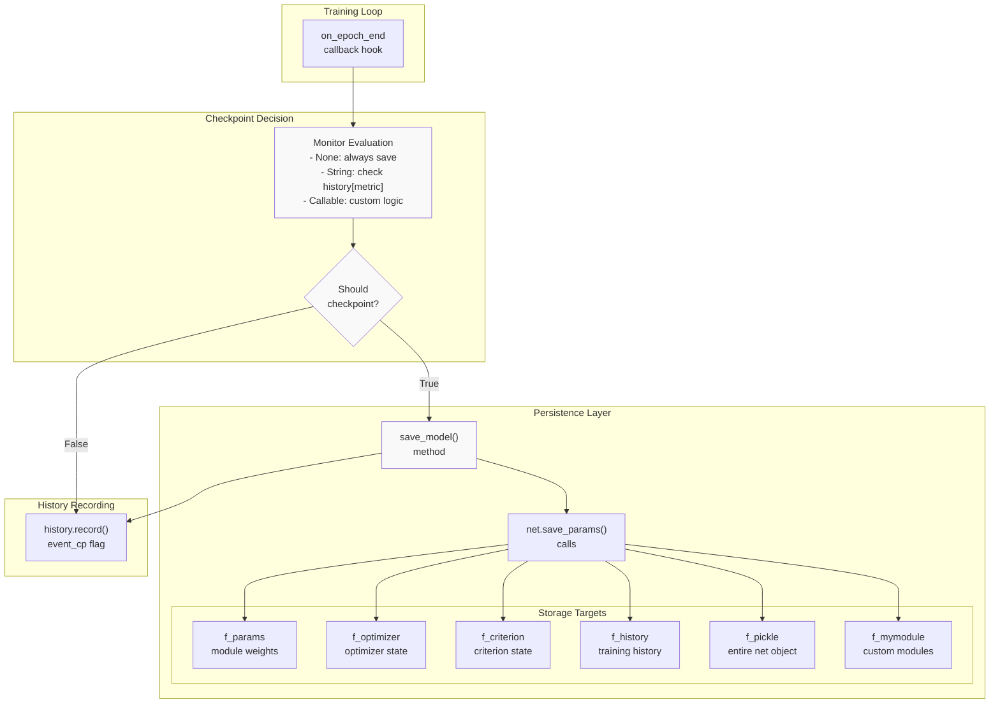
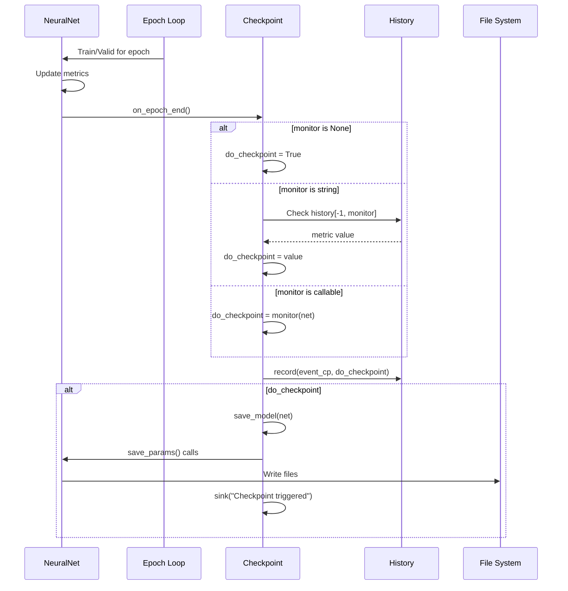
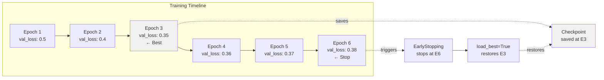

<!-- source: DeepWiki mcp.deepwiki.com · repo skorch-dev/skorch · page 6.2 Checkpointing During Training · fetched 2026-10-21 -->

# Checkpointing During Training

<details>
<summary>Relevant source files</summary>

The following files were used as context for generating this wiki page:

- [docs/user/FAQ.rst](docs/user/FAQ.rst)
- [docs/user/callbacks.rst](docs/user/callbacks.rst)
- [docs/user/dataset.rst](docs/user/dataset.rst)
- [docs/user/neuralnet.rst](docs/user/neuralnet.rst)
- [docs/user/save_load.rst](docs/user/save_load.rst)
- [skorch/callbacks/__init__.py](skorch/callbacks/__init__.py)
- [skorch/callbacks/training.py](skorch/callbacks/training.py)
- [skorch/tests/callbacks/test_training.py](skorch/tests/callbacks/test_training.py)

</details>


## Purpose and Scope

This page documents the `Checkpoint` callback, which automatically saves model state during training when specified metrics improve. Checkpointing enables recovery from training interruptions, selection of the best model during training, and continuation of training from a previous state.

For information about manually saving and loading models outside of the training loop, see [Save and Load Methods](#6.1). For resuming training from a saved checkpoint, see [Resuming Training](#6.3).

## Overview

The `Checkpoint` callback monitors a specified metric during training and creates snapshots of the model when that metric improves. By default, it monitors validation loss (`valid_loss_best`), but can be configured to watch any history metric or use custom monitoring logic.

**Primary class:** `skorch.callbacks.Checkpoint` [skorch/callbacks/training.py:27-348]()

Sources: [skorch/callbacks/training.py:27-56](), [docs/user/callbacks.rst:224-254]()

## Checkpoint Architecture



**Checkpoint Flow During Training**

Sources: [skorch/callbacks/training.py:212-240](), [skorch/callbacks/training.py:245-279]()

## Basic Usage

### Default Configuration

The simplest usage relies on default settings, which monitor `valid_loss_best`:

```python
from skorch.callbacks import Checkpoint

net = NeuralNet(
    module=MyModule,
    callbacks=[Checkpoint()],
)
net.fit(X, y)
```

This creates checkpoints whenever validation loss improves, saving to default files: `params.pt`, `optimizer.pt`, `criterion.pt`, `history.json`.

Sources: [docs/user/callbacks.rst:224-243](), [skorch/callbacks/training.py:157-187]()

### Checkpoint Parameters

| Parameter | Type | Default | Purpose |
|-----------|------|---------|---------|
| `monitor` | str, callable, None | `'valid_loss_best'` | Metric to watch or custom function |
| `f_params` | str, file-like, None | `'params.pt'` | Module parameters file path |
| `f_optimizer` | str, file-like, None | `'optimizer.pt'` | Optimizer state file path |
| `f_criterion` | str, file-like, None | `'criterion.pt'` | Criterion state file path |
| `f_history` | str, file-like, None | `'history.json'` | Training history file path |
| `f_pickle` | str, file-like, None | `None` | Pickle entire net object |
| `fn_prefix` | str | `''` | Prefix for all filenames |
| `dirname` | str | `''` | Directory for saved files |
| `event_name` | str, None | `'event_cp'` | History column name for checkpoint events |
| `sink` | callable | `noop` | Output target for checkpoint messages |
| `load_best` | bool | `False` | Auto-load best checkpoint after training |
| `use_safetensors` | bool | `False` | Use safetensors library instead of pickle |

Sources: [skorch/callbacks/training.py:74-155](), [skorch/callbacks/training.py:157-187]()

## Monitoring Strategies

### String-Based Monitoring

Monitor any metric in the history by name. The callback checks if the last history entry for that key is truthy:

```python
# Monitor custom scoring metric
from skorch.callbacks import EpochScoring, Checkpoint

callbacks = [
    EpochScoring('roc_auc', name='valid_auc', lower_is_better=False),
    Checkpoint(monitor='valid_auc_best'),
]
net = NeuralNet(module=MyModule, callbacks=callbacks)
```

Sources: [skorch/callbacks/training.py:76-82](), [docs/user/callbacks.rst:234-243]()

### Callable Monitoring

Use a function for complex checkpoint logic. The function receives the net instance and returns a boolean:

```python
def custom_monitor(net):
    # Save when both train and valid losses are best
    return all(net.history[-1, (
        'train_loss_best', 'valid_loss_best')])

checkpoint = Checkpoint(monitor=custom_monitor)
```

Sources: [skorch/callbacks/training.py:69-72](), [skorch/callbacks/training.py:221-230]()

### Always Checkpoint

Set `monitor=None` to save after every epoch:

```python
checkpoint = Checkpoint(monitor=None)
```

Sources: [skorch/callbacks/training.py:81-82](), [skorch/callbacks/training.py:219-220]()

## Monitoring Execution Flow



**Monitor Evaluation Sequence**

Sources: [skorch/callbacks/training.py:212-240]()

## File Persistence Options

### Selective Saving

Control which components are saved by setting file parameters to `None`:

```python
# Save only model parameters and history
checkpoint = Checkpoint(
    f_params='model.pt',
    f_optimizer=None,    # Don't save optimizer
    f_criterion=None,    # Don't save criterion
    f_history='history.json',
    f_pickle=None,       # Don't pickle net
)
```

Sources: [skorch/callbacks/training.py:88-124](), [skorch/callbacks/training.py:261-279]()

### Directory Organization

Use `dirname` and `fn_prefix` to organize checkpoints:

```python
checkpoint = Checkpoint(
    dirname='experiments/exp1',
    fn_prefix='model_v2_',
    # Creates: experiments/exp1/model_v2_params.pt
    #          experiments/exp1/model_v2_optimizer.pt
    #          etc.
)
```

The directory is created automatically if it doesn't exist [skorch/callbacks/training.py:200-204]().

Sources: [skorch/callbacks/training.py:126-131](), [skorch/callbacks/training.py:200-204](), [skorch/callbacks/training.py:325-343]()

### Format Specifiers

Filenames support dynamic formatting with epoch information:

```python
checkpoint = Checkpoint(
    f_params='model_epoch_{last_epoch[epoch]}_maxep_{net.max_epochs}.pt',
    # Creates: model_epoch_5_maxep_10.pt (at epoch 5)
)
```

Available format values:
- `net`: The NeuralNet instance
- `last_epoch`: History entry for last epoch
- `last_batch`: Last batch entry from last epoch

Sources: [skorch/callbacks/training.py:93-98](), [skorch/callbacks/training.py:312-323]()

## Automatic Model Restoration

### load_best Parameter

Set `load_best=True` to automatically restore the best checkpoint after training completes:

```python
checkpoint = Checkpoint(
    monitor='valid_loss_best',
    load_best=True,  # Restore best model at end
)
net = NeuralNet(module=MyModule, callbacks=[checkpoint])
net.fit(X, y)  # Training ends with best model loaded
```

This is particularly useful with `EarlyStopping`, where training ends after patience expires but the best model was several epochs earlier:



**Automatic Best Model Restoration with Early Stopping**

Sources: [skorch/callbacks/training.py:142-147](), [skorch/callbacks/training.py:206-210]()

### Restoration Mechanism

The restoration happens in the `on_train_end` hook:

[skorch/callbacks/training.py:206-210]()

```python
def on_train_end(self, net, **kwargs):
    if not self.load_best or self.monitor is None:
        return
    self._sink("Loading best checkpoint after training.", net.verbose)
    net.load_params(checkpoint=self, use_safetensors=self.use_safetensors)
```

Note: `load_best` only works when `monitor` is not `None`, as the callback needs to track which checkpoint is best.

Sources: [skorch/callbacks/training.py:206-210]()

## Advanced Features

### Safetensors Support

The `safetensors` library provides a secure alternative to pickle for storing tensors:

```python
checkpoint = Checkpoint(
    use_safetensors=True,
    f_optimizer=None,  # Required: safetensors can't save optimizer
)
```

**Safetensors Limitations:**
- Cannot serialize optimizer state (only PyTorch tensors)
- Must set `f_optimizer=None` when `use_safetensors=True`
- Raises `ValueError` if both are enabled [skorch/callbacks/training.py:195-198]()

Sources: [skorch/callbacks/training.py:149-155](), [skorch/callbacks/training.py:195-198]()

### Custom Module Checkpointing

Checkpoint custom modules by passing `f_<module_name>` parameters:

```python
class MyNet(NeuralNet):
    def __init__(self, *args, mymodule=CustomModule, **kwargs):
        self.mymodule = mymodule
        super().__init__(*args, **kwargs)
    
    def initialize_module(self, *args, **kwargs):
        super().initialize_module(*args, **kwargs)
        params = self.get_params_for('mymodule')
        self.mymodule_ = self.mymodule(**params)
        return self

checkpoint = Checkpoint(
    f_params='model.pt',
    f_mymodule='custom.pt',  # Save custom module
)
```

The callback automatically detects any `f_*` parameter that doesn't match standard components and treats it as a custom module [skorch/callbacks/training.py:189-194]().

Sources: [skorch/callbacks/training.py:52-53](), [skorch/callbacks/training.py:258-268]()

### History Event Recording

The checkpoint writes a boolean flag to the history indicating whether a checkpoint was created:

```python
checkpoint = Checkpoint(event_name='my_checkpoint')
net.fit(X, y)

# Check when checkpoints occurred
checkpoint_epochs = [
    i for i, v in enumerate(net.history[:, 'my_checkpoint']) 
    if v
]
```

Set `event_name=None` to disable history recording [skorch/callbacks/training.py:133-135]().

Sources: [skorch/callbacks/training.py:58-59](), [skorch/callbacks/training.py:232-233]()

### Custom Sink for Logging

The `sink` parameter controls where checkpoint messages are sent:

```python
import logging
logger = logging.getLogger(__name__)

checkpoint = Checkpoint(
    sink=logger.info,  # Send to logger instead of print
)

# Or suppress output entirely
from skorch.utils import noop
checkpoint = Checkpoint(sink=noop)
```

Sources: [skorch/callbacks/training.py:137-140](), [skorch/callbacks/training.py:344-347]()

## Integration with Training Flow

### Checkpoint Lifecycle

```mermaid
graph TB
    subgraph "Initialization Phase"
        Init["Checkpoint.initialize()"]
        CreateDir["Create dirname<br/>if needed"]
        Validate["_validate_filenames()"]
    end
    
    subgraph "Training Phase"
        OnEpochEnd["on_epoch_end()<br/>called each epoch"]
        CheckMonitor["Evaluate monitor<br/>condition"]
        SaveIfTrue{"Checkpoint<br/>triggered?"}
        SaveModel["save_model(net)"]
        RecordEvent["history.record()<br/>event_cp"]
    end
    
    subgraph "Completion Phase"
        OnTrainEnd["on_train_end()"]
        ShouldLoad{"load_best<br/>enabled?"}
        LoadParams["net.load_params()<br/>restore best"]
    end
    
    Init --> CreateDir
    CreateDir --> Validate
    
    OnEpochEnd --> CheckMonitor
    CheckMonitor --> SaveIfTrue
    SaveIfTrue -->|Yes| SaveModel
    SaveIfTrue -->|No| RecordEvent
    SaveModel --> RecordEvent
    
    OnTrainEnd --> ShouldLoad
    ShouldLoad -->|Yes| LoadParams
```



**Complete Checkpoint Lifecycle**

Sources: [skorch/callbacks/training.py:200-210](), [skorch/callbacks/training.py:212-240]()

### Warning: Monitor vs. Monitor_best

The callback warns if you specify a metric without the `_best` suffix when that suffix exists in history:

```python
# This will warn
checkpoint = Checkpoint(monitor='valid_loss')  # Should be 'valid_loss_best'
```

The warning: `"Checkpoint monitor parameter is set to 'valid_loss' and the history contains 'valid_loss_best'. Perhaps you meant to set the parameter to 'valid_loss_best'"` [skorch/callbacks/training.py:213-217]()

Sources: [skorch/callbacks/training.py:212-217]()

### Validation Data Requirement

When using the default `monitor='valid_loss_best'`, the net must have validation data. Without it, a `SkorchException` is raised:

```
Key 'valid_loss_best' was not found in history. Make sure you have 
validation data if you use validation scores for checkpointing.
```

To avoid this, either provide validation data or change the monitor parameter [skorch/callbacks/training.py:224-230]().

Sources: [skorch/callbacks/training.py:224-230]()

## File Format Details

### Parameters Files

Parameter files (`.pt` extension) store PyTorch `state_dict` objects using `torch.save()`:

```python
# What gets saved in f_params
torch.save(net.module_.state_dict(), f_params)

# What gets saved in f_optimizer  
torch.save(net.optimizer_.state_dict(), f_optimizer)
```

### History Files

History files (`.json` extension) store the entire training history as JSON. Only JSON-serializable data can be saved; NumPy arrays and PyTorch tensors in history will cause errors.

### Pickle Files

When `f_pickle` is specified, the entire `NeuralNet` object is pickled, including:
- Hyperparameters
- Module architecture
- All trained state
- History
- Callbacks

This is the most comprehensive but least portable option [skorch/callbacks/training.py:274-278]().

Sources: [skorch/callbacks/training.py:245-279]()

## Retrieving Formatted Filenames

The `get_formatted_files()` method returns the actual filenames after format substitution:

```python
checkpoint = Checkpoint(
    f_params='model_e{last_epoch[epoch]}.pt',
    dirname='checkpoints',
)
net.fit(X, y)

files = checkpoint.get_formatted_files(net)
# Returns: {'f_params': 'checkpoints/model_e10.pt', ...}
```

This is useful for determining which files were actually created [skorch/callbacks/training.py:290-302]().

Sources: [skorch/callbacks/training.py:290-302]()

## Related Callbacks

### TrainEndCheckpoint

`TrainEndCheckpoint` is a specialized callback that saves only at training end, with default `fn_prefix='train_end_'`. It shares the same file parameters as `Checkpoint` but lacks monitoring logic. See [Resuming Training](#6.3) for usage with `LoadInitState`.

Sources: [skorch/callbacks/training.py:707-848]()

### LoadInitState

`LoadInitState` restores saved checkpoints at the beginning of training, enabling continuation from a previous state. See [Resuming Training](#6.3).

Sources: [skorch/callbacks/training.py:649-705]()

### EarlyStopping

When used together, `EarlyStopping` and `Checkpoint` enable training to stop when metrics plateau while preserving the best model via `load_best=True`. See [Training Control Callbacks](#3.2).

Sources: [docs/user/callbacks.rst:224-254]()

---

