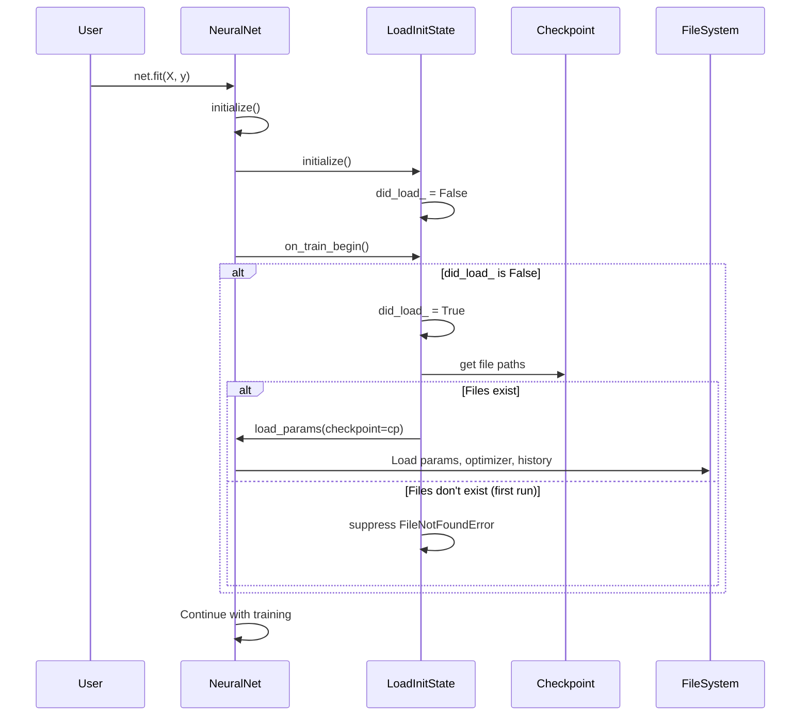
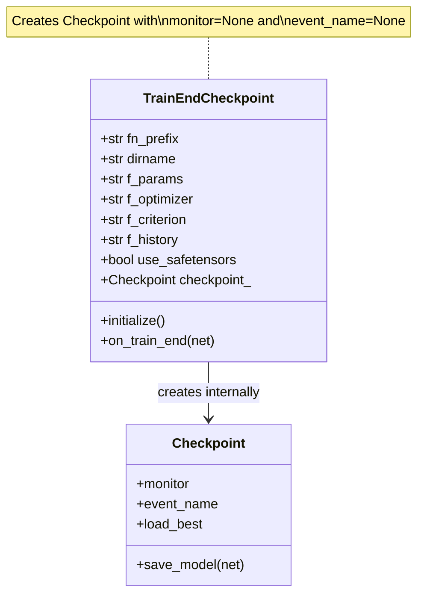
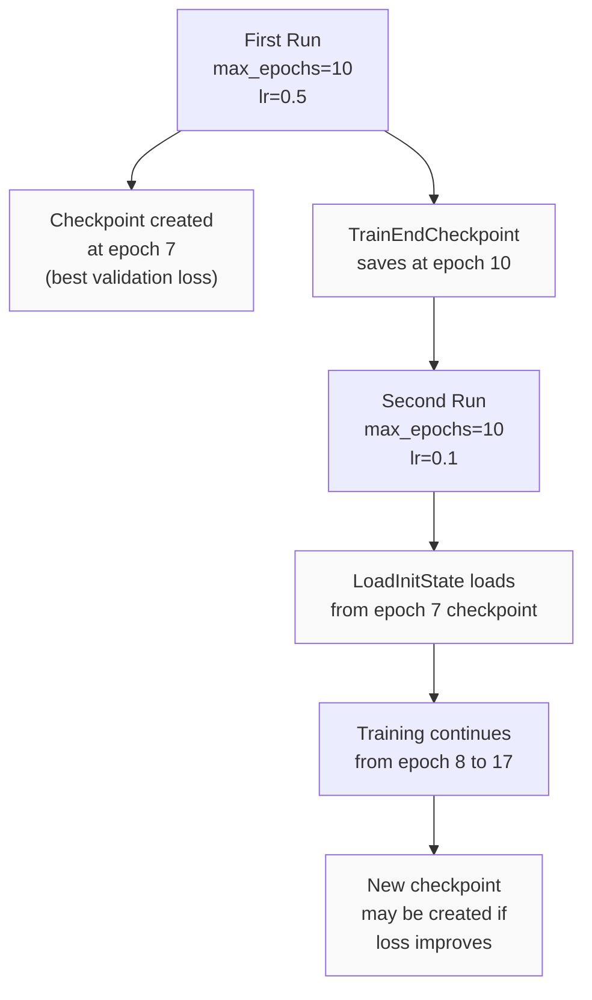
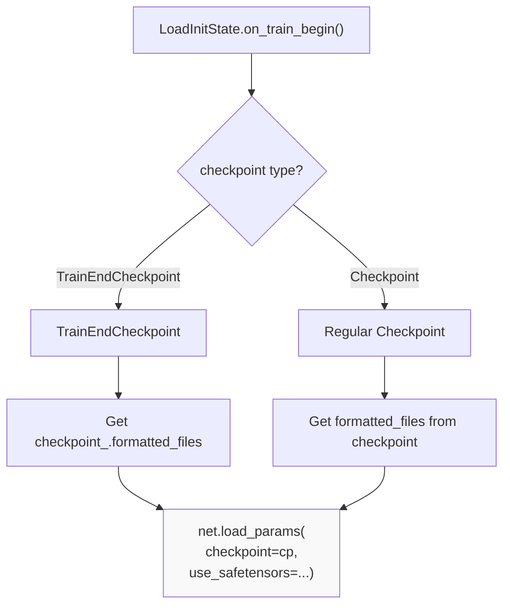
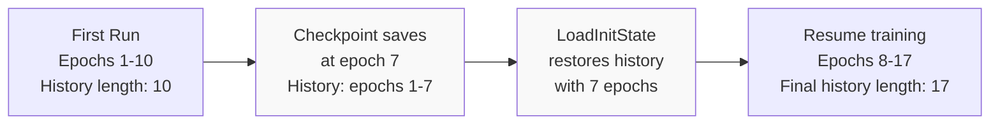

<!-- source: DeepWiki mcp.deepwiki.com · repo skorch-dev/skorch · page 6.3 Resuming Training · fetched 2026-10-21 -->

# Resuming Training

<details>
<summary>Relevant source files</summary>

The following files were used as context for generating this wiki page:

- [CHANGES.md](CHANGES.md)
- [docs/user/save_load.rst](docs/user/save_load.rst)
- [skorch/callbacks/__init__.py](skorch/callbacks/__init__.py)
- [skorch/callbacks/training.py](skorch/callbacks/training.py)
- [skorch/tests/callbacks/test_training.py](skorch/tests/callbacks/test_training.py)

</details>


This page documents how to continue training a neural network from a previously saved checkpoint. Resuming training allows you to stop and restart training sessions while preserving the model parameters, optimizer state, and training history.

For information about saving and loading methods in general, see [Save and Load Methods](#6.1). For information about automatic checkpointing during training, see [Checkpointing During Training](#6.2).

## Overview

Resuming training is useful when:

- Training is interrupted (e.g., system crashes, time limits on compute clusters)
- You want to continue training after inspecting intermediate results
- You need to adjust hyperparameters and continue from a good checkpoint
- You want to perform multi-stage training with different learning rates

skorch provides two callbacks specifically designed for resuming training:
- `LoadInitState` - loads a saved checkpoint when training begins
- `TrainEndCheckpoint` - saves a checkpoint when training ends

These callbacks work in conjunction with the `Checkpoint` callback documented in [section 6.2](#6.2).

Sources: [docs/user/save_load.rst:172-380](), [skorch/callbacks/training.py:649-831]()

## LoadInitState Callback

The `LoadInitState` callback restores model state at the beginning of training from a previously saved checkpoint. It is invoked during the `on_train_begin` event.

### Basic Configuration

```python
from skorch.callbacks import Checkpoint, LoadInitState

cp = Checkpoint(dirname='exp1')
load_state = LoadInitState(cp)
net = NeuralNetClassifier(
    MyModule,
    callbacks=[cp, load_state]
)
```

### Parameters

| Parameter | Type | Default | Description |
|-----------|------|---------|-------------|
| `checkpoint` | `Checkpoint` or `TrainEndCheckpoint` | required | The checkpoint instance to load from |
| `use_safetensors` | `bool` | `False` | Whether to use safetensors library for loading |

Sources: [skorch/callbacks/training.py:649-684]()

### Initialization and Execution



**LoadInitState Execution Flow**

The callback uses the `did_load_` flag to ensure it only loads state once, even if training is restarted within the same Python session.

Sources: [skorch/callbacks/training.py:686-705]()

## TrainEndCheckpoint Callback

`TrainEndCheckpoint` is a specialized callback that saves the model state at the end of training. Unlike `Checkpoint`, which saves based on a monitored metric, `TrainEndCheckpoint` always saves once when training completes.

### Default Behavior

```python
from skorch.callbacks import TrainEndCheckpoint

train_end_cp = TrainEndCheckpoint(dirname='exp1')
net = NeuralNetClassifier(
    MyModule,
    callbacks=[train_end_cp]
)
net.fit(X, y)
```

By default, `TrainEndCheckpoint` saves files with the prefix `'train_end_'`:
- `train_end_params.pt`
- `train_end_optimizer.pt`
- `train_end_criterion.pt`
- `train_end_history.json`

### Parameters

| Parameter | Type | Default | Description |
|-----------|------|---------|-------------|
| `f_params` | `str` or file-like | `'params.pt'` | Filename for model parameters |
| `f_optimizer` | `str` or file-like | `'optimizer.pt'` | Filename for optimizer state |
| `f_criterion` | `str` or file-like | `'criterion.pt'` | Filename for criterion state |
| `f_history` | `str` or file-like | `'history.json'` | Filename for training history |
| `f_pickle` | `str` or file-like | `None` | Filename for pickled model |
| `fn_prefix` | `str` | `'train_end_'` | Prefix for all filenames |
| `dirname` | `str` | `''` | Directory for saved files |
| `use_safetensors` | `bool` | `False` | Whether to use safetensors |
| `sink` | callable | `noop` | Function to log messages |

Sources: [skorch/callbacks/training.py:707-831]()

### Internal Structure



**TrainEndCheckpoint Internal Design**

Internally, `TrainEndCheckpoint.initialize()` creates a `Checkpoint` instance with `monitor=None` and `event_name=None`, stored in `self.checkpoint_`. The `on_train_end` method then calls `checkpoint_.save_model(net)`.

Sources: [skorch/callbacks/training.py:814-831]()

## Basic Usage Pattern

### First Training Run

```python
from skorch.callbacks import Checkpoint, LoadInitState

cp = Checkpoint(dirname='exp1')
load_state = LoadInitState(cp)
net = NeuralNetClassifier(
    MyModule,
    max_epochs=10,
    callbacks=[cp, load_state]
)
net.fit(X, y)  # Trains for 10 epochs
```

On the first run:
- `LoadInitState` attempts to load but suppresses `FileNotFoundError` since no checkpoint exists
- Training proceeds normally from epoch 1 to 10
- `Checkpoint` saves whenever the monitored metric improves

### Continuing Training

```python
# Same setup, but potentially with different hyperparameters
cp = Checkpoint(dirname='exp1')
load_state = LoadInitState(cp)
net = NeuralNetClassifier(
    MyModule,
    max_epochs=10,
    lr=0.1,  # Changed learning rate
    callbacks=[cp, load_state]
)
net.fit(X, y)  # Continues from previous best checkpoint
```

On subsequent runs:
- `LoadInitState` successfully loads the previous checkpoint
- History is restored, so training continues from the last saved epoch
- Epoch numbering continues (e.g., if checkpoint was at epoch 7, training resumes at epoch 8)

Sources: [docs/user/save_load.rst:241-274](), [skorch/tests/callbacks/test_training.py:1029-1068]()

## Complete Training Session Example



**Multi-Session Training Flow**

Sources: [docs/user/save_load.rst:205-274]()

## Working with TrainEndCheckpoint

`TrainEndCheckpoint` is designed for scenarios where you want to continue from the final model state, not necessarily the best model state.

### Combined Usage

```python
from skorch.callbacks import Checkpoint, TrainEndCheckpoint, LoadInitState

# First training session
cp = Checkpoint(dirname='exp1')
train_end_cp = TrainEndCheckpoint(dirname='exp1')
net = NeuralNetClassifier(
    MyModule,
    max_epochs=10,
    callbacks=[cp, train_end_cp]
)
net.fit(X, y)  # Epochs 1-10
```

At the end of this session:
- `Checkpoint` has saved the best model (e.g., at epoch 7)
- `TrainEndCheckpoint` has saved the final model (at epoch 10)

### Continuing from Final State

```python
# Continue from the final state, not the best state
load_state = LoadInitState(train_end_cp)
new_cp = Checkpoint(dirname='exp1', fn_prefix='continued_')
net = NeuralNetClassifier(
    MyModule,
    max_epochs=10,
    callbacks=[new_cp, load_state]
)
net.fit(X, y)  # Epochs 11-20
```

This resumes from epoch 10 (the final state) and continues to epoch 20.

Sources: [docs/user/save_load.rst:276-311](), [skorch/tests/callbacks/test_training.py:1287-1296]()

## State Components Restored

When `LoadInitState` loads a checkpoint, it restores:

| Component | File | Description |
|-----------|------|-------------|
| Model Parameters | `f_params` | Module weights and biases via `state_dict()` |
| Optimizer State | `f_optimizer` | Optimizer parameters including momentum buffers |
| Training History | `f_history` | Complete history object with all recorded metrics |
| Criterion State | `f_criterion` | Criterion parameters if criterion is a module |

### What is NOT Restored

- **Learned attributes**: Attributes like `classes_` on `NeuralNetClassifier` are not saved by `save_params()` and thus not restored
- **Callback state**: Internal state of other callbacks (except history)
- **Random state**: PyTorch, NumPy, and Python random number generator states
- **Custom attributes**: User-defined attributes added to the net instance

For complete model persistence including learned attributes, use `pickle` to serialize the entire net as described in [section 6.1](#6.1).

Sources: [docs/user/save_load.rst:78-117](), [skorch/callbacks/training.py:245-279]()

## Implementation Details

### How LoadInitState Finds Files



**LoadInitState File Resolution**

The callback checks if the checkpoint is a `TrainEndCheckpoint` or regular `Checkpoint` and accesses the appropriate internal checkpoint object to get file paths.

Sources: [skorch/callbacks/training.py:690-705]()

### The did_load_ Flag Mechanism

```python
def initialize(self):
    self.did_load_ = False
    return self

def on_train_begin(self, net, X=None, y=None, **kwargs):
    if not self.did_load_:
        self.did_load_ = True
        with suppress(FileNotFoundError):
            # ... load checkpoint
```

The `did_load_` flag ensures that:
1. State is loaded only once per callback instance
2. Multiple calls to `fit()` on the same net don't reload
3. To reload, create a new `LoadInitState` instance

Sources: [skorch/callbacks/training.py:686-705]()

### FileNotFoundError Suppression

On the first training run, no checkpoint files exist yet. The `LoadInitState` callback uses `contextlib.suppress(FileNotFoundError)` to silently ignore the missing files and allow training to proceed normally.

```python
from contextlib import suppress

with suppress(FileNotFoundError):
    net.load_params(checkpoint=self.checkpoint, use_safetensors=self.use_safetensors)
```

This design enables the same code to work for both initial training and resumed training without conditional logic.

Sources: [skorch/callbacks/training.py:694-704]()

## Using with safetensors

When using the `safetensors` library for secure serialization, both the checkpoint and load callbacks must be configured consistently.

### Configuration

```python
# Checkpoint cannot save optimizer with safetensors
cp = Checkpoint(
    dirname='exp1',
    f_optimizer=None,  # Required when use_safetensors=True
    use_safetensors=True
)

# LoadInitState must match
load_state = LoadInitState(cp, use_safetensors=True)

net = NeuralNetClassifier(
    MyModule,
    callbacks=[cp, load_state]
)
```

### Limitations

| Component | Supported with safetensors |
|-----------|---------------------------|
| Module parameters | ✓ Yes |
| Criterion parameters | ✓ Yes (if criterion is a module) |
| Optimizer state | ✗ No - contains non-tensor values |
| History | ✓ Yes (JSON serialization) |
| Custom modules | ✓ Yes (if all state is tensors) |

When using `safetensors`:
- Set `f_optimizer=None` on `Checkpoint` and `TrainEndCheckpoint`
- Pass `use_safetensors=True` to both save and load callbacks
- Optimizer learning rate and momentum will reset on resume

Sources: [docs/user/save_load.rst:364-373](), [skorch/callbacks/training.py:149-155](), [CHANGES.md:58-59]()

## History Continuation

When training resumes, the history object maintains continuity of epoch numbering and recorded metrics.

### History Behavior



**History Preservation Across Sessions**

The restored history contains:
- All metrics from previous epochs
- Correct epoch numbers
- Batch-level information if recorded
- Custom recorded values

Access history after resuming:
```python
net.fit(X, y)
print(len(net.history))  # Total epochs including previous runs
print(net.history[-1, 'epoch'])  # Last epoch number
```

Sources: [skorch/tests/callbacks/test_training.py:1061-1068](), [docs/user/save_load.rst:78-109]()

## Practical Examples

### Adjusting Learning Rate After Inspection

```python
# Initial training with high learning rate
cp = Checkpoint(dirname='exp1')
load_state = LoadInitState(cp)
net = NeuralNetClassifier(
    MyModule,
    lr=0.5,
    max_epochs=10,
    callbacks=[cp, load_state]
)
net.fit(X, y)

# Check results, then continue with lower learning rate
net2 = NeuralNetClassifier(
    MyModule,
    lr=0.1,  # Lower learning rate
    max_epochs=10,
    callbacks=[cp, load_state]
)
net2.fit(X, y)  # Continues from best checkpoint
```

Sources: [docs/user/save_load.rst:241-274]()

### Multiple Experiments with Different Architectures

```python
# Experiment 1: 10 hidden units
cp1 = Checkpoint(dirname='exp1')
load1 = LoadInitState(cp1)
net1 = NeuralNetClassifier(
    MyModule,
    module__num_units=10,
    callbacks=[cp1, load1]
)
net1.fit(X, y)

# Experiment 2: 20 hidden units (different directory)
cp2 = Checkpoint(dirname='exp2')
load2 = LoadInitState(cp2)
net2 = NeuralNetClassifier(
    MyModule,
    module__num_units=20,
    callbacks=[cp2, load2]
)
net2.fit(X, y)
```

Each experiment maintains its own checkpoint directory and can be resumed independently.

Sources: [docs/user/save_load.rst:313-346]()

### Ensuring Compatibility with ParamMapper

When using `ParamMapper`, `Freezer`, `Unfreezer`, or `Initializer` callbacks, be aware that these callbacks may re-initialize parameters on the first epoch. To avoid unintended re-initialization when resuming:

1. Use pickle to save the entire model (including callback states), or
2. Save and load history (so callbacks know which epoch they're on), or  
3. Remove the parameter mapper callbacks before resuming training

Sources: [skorch/callbacks/training.py:488-496]()

---

