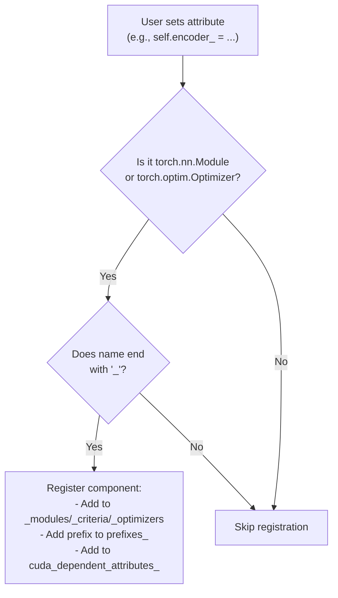
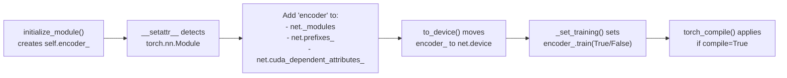
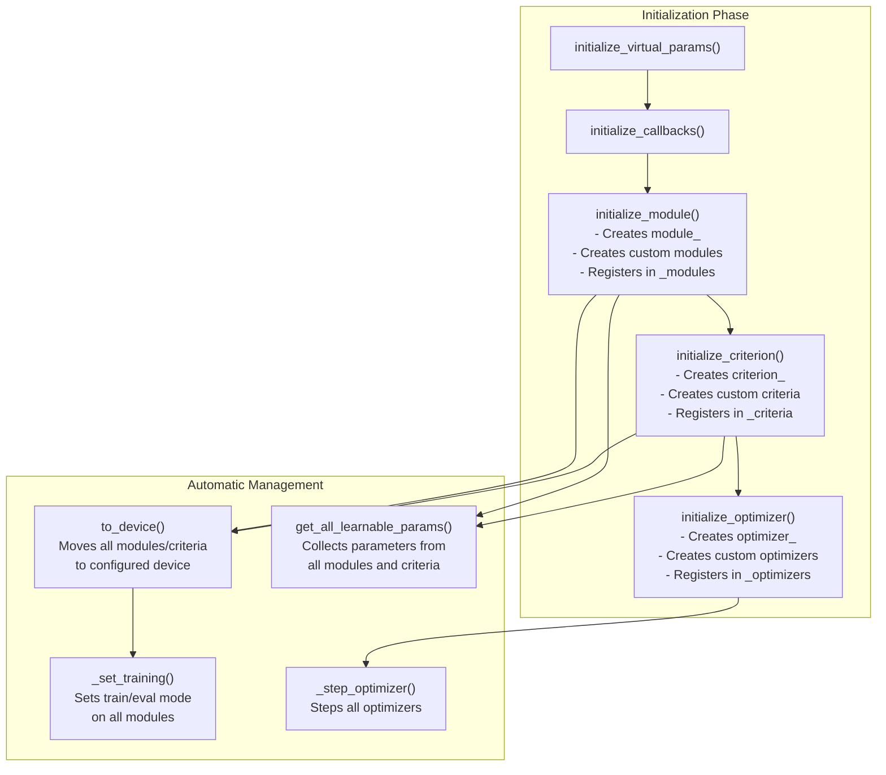
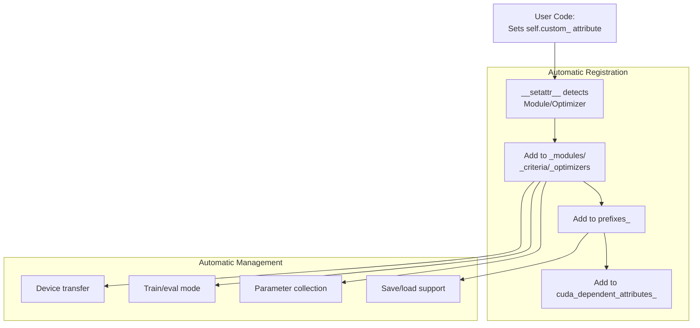

<!-- source: DeepWiki mcp.deepwiki.com · repo skorch-dev/skorch · page 7.1 Custom Modules and Components · fetched 2026-10-21 -->

# Custom Modules and Components

<details>
<summary>Relevant source files</summary>

The following files were used as context for generating this wiki page:

- [CHANGES.md](CHANGES.md)
- [skorch/net.py](skorch/net.py)
- [skorch/tests/test_net.py](skorch/tests/test_net.py)

</details>


This page documents how to register and use custom PyTorch modules, criteria (loss functions), and optimizers within skorch's neural network classes. Custom components are automatically managed by skorch, receiving the same treatment as the standard `module_`, `criterion_`, and `optimizer_` attributes.

For information about using standard modules and criteria, see the [Core Architecture](#2). For details on parameter management and the double-underscore notation, see [Parameter Passing Conventions](#5.4).

## Purpose and Scope

Skorch allows users to extend neural networks with additional PyTorch modules, criteria, or optimizers beyond the standard ones. When properly registered, these custom components automatically benefit from:

- Device management (CPU/CUDA/MPS)
- Train/eval mode switching
- Parameter collection for optimization
- Integration with the parameter system (e.g., `set_params`)
- Checkpoint saving and loading

This document explains how to register custom components, how skorch manages them, and common usage patterns.

Sources: [skorch/net.py:298-324](), [CHANGES.md:147]()

## Component Registration System

Skorch dynamically tracks custom components through three internal lists maintained on the `NeuralNet` instance:

| Attribute | Purpose | Example Values |
|-----------|---------|----------------|
| `_modules` | Names of custom PyTorch modules | `['module', 'encoder', 'decoder']` |
| `_criteria` | Names of custom loss functions | `['criterion', 'auxiliary_loss']` |
| `_optimizers` | Names of custom optimizers | `['optimizer', 'discriminator_optimizer']` |

When you set an attribute ending with `_` that is a `torch.nn.Module` or `torch.optim.Optimizer`, skorch automatically:
1. Adds its name to the appropriate tracking list
2. Registers its prefix in `prefixes_` for parameter passing
3. Adds it to `cuda_dependent_attributes_` for device management

**Component Registration Flow**



Sources: [skorch/net.py:298-324]()

## Registering Custom Modules

Custom modules are additional PyTorch `nn.Module` instances beyond the standard `module_`. They are registered by setting an attribute with a name ending in `_`.

**Basic Registration Pattern**

```python
class MyNet(NeuralNetClassifier):
    def __init__(self, *args, encoder=MyEncoder, **kwargs):
        self.encoder = encoder
        super().__init__(*args, **kwargs)
    
    def initialize_module(self):
        super().initialize_module()
        params = self.get_params_for('encoder')
        self.encoder_ = self.encoder(**params)
        return self
```

In this example:
- The `encoder` class is stored as a regular attribute
- During initialization, `encoder_` is created (note the trailing underscore)
- Skorch automatically detects `encoder_` is a `torch.nn.Module` and registers it

**What Happens Automatically**



Sources: [skorch/net.py:760-791](), [skorch/tests/test_net.py:2765-2786]()

**Device Management**

Custom modules are automatically moved to the configured device:

```python
net = MyNet(MyModule, encoder=MyEncoder, device='cuda')
net.initialize()
# Both module_ and encoder_ are now on CUDA
```

The device transfer happens in `_initialize_module()` after the module is created.

Sources: [skorch/net.py:783-789]()

**Train/Eval Mode**

During training and validation, skorch automatically sets the mode for all registered modules:

```python
def _set_training(self, training=True):
    """Set training/evaluation mode on all modules"""
    for module_name in self._modules + self._criteria:
        module = getattr(self, module_name + '_')
        if isinstance(module, torch.nn.Module):
            module.train(training)
```

Sources: [skorch/net.py:960-973]()

## Registering Custom Criteria

Custom criteria (loss functions) work similarly to custom modules. They can be either `torch.nn.Module` instances or regular callables.

**Module-Based Criterion**

```python
class MyLoss(nn.Module):
    def __init__(self, weight=1.0):
        super().__init__()
        self.weight = weight
        self.linear = nn.Linear(10, 1)  # learnable parameters
    
    def forward(self, y_pred, y_true):
        adjustment = self.linear(y_pred[:, :10])
        return ((y_pred - y_true) ** 2).mean() * self.weight

class MyNet(NeuralNetRegressor):
    def initialize_criterion(self):
        super().initialize_criterion()
        params = self.get_params_for('auxiliary_loss')
        self.auxiliary_loss_ = MyLoss(**params)
        return self
```

When a criterion is a `torch.nn.Module`:
- Its parameters are included in `get_all_learnable_params()`
- It's automatically moved to the appropriate device
- Its train/eval mode is managed

Sources: [skorch/net.py:726-758](), [skorch/tests/test_net.py:2788-2809]()

**Callable Criterion**

```python
class MyNet(NeuralNetClassifier):
    def initialize_criterion(self):
        super().initialize_criterion()
        # Simple callable, not a Module
        self.custom_loss_ = lambda y_pred, y_true: y_pred.mean()
        return self
```

Non-module callables are registered in `_criteria` but don't receive device management or train/eval mode switching.

Sources: [skorch/tests/test_net.py:2699-2706]()

## Registering Custom Optimizers

Custom optimizers allow training different parts of the network with different update rules.

**Basic Custom Optimizer**

```python
class MyNet(NeuralNetClassifier):
    def initialize_optimizer(self):
        # Initialize the default optimizer
        super().initialize_optimizer()
        
        # Add a custom optimizer for a specific module
        self.discriminator_optimizer_ = torch.optim.Adam(
            self.discriminator_.parameters(),
            lr=0.0002
        )
        return self
```

Sources: [skorch/net.py:899-923](), [skorch/tests/test_net.py:2811-2832]()

**Handling Multiple Optimizers in Training**

When using multiple optimizers, you'll need to override the training step to update them appropriately:

```python
class MyNet(NeuralNetClassifier):
    def train_step(self, batch, **fit_params):
        # Train generator
        self.optimizer_.zero_grad()
        step_gen = self.train_step_single(batch, **fit_params)
        self.optimizer_.step()
        
        # Train discriminator
        self.discriminator_optimizer_.zero_grad()
        step_disc = self.train_discriminator(batch, **fit_params)
        self.discriminator_optimizer_.step()
        
        return step_gen
```

Sources: [skorch/net.py:1096-1140]()

**Default Optimizer Stepping**

By default, skorch calls `step()` on all registered optimizers in `_step_optimizer()`:

```python
def _step_optimizer(self, step_fn):
    for name in self._optimizers:
        optimizer = getattr(self, name + '_')
        if step_fn is None:
            optimizer.step()
        else:
            optimizer.step(step_fn)
```

Sources: [skorch/net.py:1076-1094]()

## Automatic Component Management

Once registered, custom components are automatically managed throughout the training lifecycle.

**Lifecycle Integration**



Sources: [skorch/net.py:931-945](), [skorch/net.py:960-973]()

**Parameter Collection**

The `get_all_learnable_params()` method automatically collects parameters from all registered modules and criteria:

```python
def get_all_learnable_params(self):
    """Yield the learnable parameters of all modules"""
    seen = set()
    for name in self._modules + self._criteria:
        module = getattr(self, name + '_')
        named_parameters = getattr(module, 'named_parameters', None)
        if not named_parameters:
            continue
        
        for param_name, param in named_parameters():
            if param in seen:
                continue
            seen.add(param)
            yield param_name, param
```

This ensures that:
- All learnable parameters are available to optimizers
- Duplicate parameters (e.g., when one module references another) are handled correctly

Sources: [skorch/net.py:844-897](), [skorch/tests/test_net.py:2862-2883]()

## Parameter System Integration

Custom components automatically integrate with skorch's parameter system, allowing configuration via `set_params()` and constructor arguments.

**Virtual Parameters for Optimizers**

When a custom optimizer is registered, skorch automatically creates virtual parameters for it:

```python
def _initialize_optimizer(self, reason=None):
    # ... initialization code ...
    
    # Register virtual params for all optimizers
    for name in self._optimizers:
        param_pattern = [name + '__param_groups__*__*', name + '__*']
        if name == 'optimizer':
            param_pattern.append('lr')  # 'lr' is short for optimizer__lr
        setter = partial(
            optimizer_setter,
            optimizer_attr=name + '_',
            optimizer_name=name,
        )
        self._register_virtual_param(param_pattern, setter)
```

This allows runtime parameter updates without re-initialization:

```python
net.set_params(discriminator_optimizer__lr=0.001)
# Changes the learning rate without re-initializing the optimizer
```

Sources: [skorch/net.py:912-922](), [skorch/tests/test_net.py:2834-2860]()

**Setting Parameters on Custom Modules**

Custom modules can receive parameters through the double-underscore notation:

```python
net = MyNet(
    MyModule,
    encoder=MyEncoder,
    encoder__num_layers=5,
    encoder__dropout=0.3
)
net.initialize()
```

The parameters are extracted in `initialize_module()` via `get_params_for()`:

```python
def initialize_module(self):
    super().initialize_module()
    params = self.get_params_for('encoder')
    # params = {'num_layers': 5, 'dropout': 0.3}
    self.encoder_ = self.encoder(**params)
    return self
```

Sources: [skorch/net.py:627](), [skorch/tests/test_net.py:2989-2998]()

**Parameter Namespace Table**

| Component Type | Prefix Pattern | Example Usage |
|---------------|----------------|---------------|
| Default module | `module__*` | `module__hidden_units=10` |
| Custom module | `<name>__*` | `encoder__num_layers=5` |
| Default criterion | `criterion__*` | `criterion__weight=weights` |
| Custom criterion | `<name>__*` | `auxiliary_loss__weight=0.5` |
| Default optimizer | `optimizer__*` or `lr` | `optimizer__momentum=0.9` |
| Custom optimizer | `<name>__*` | `discriminator_optimizer__lr=0.001` |

Sources: [skorch/net.py:314]()

## Saving and Loading Custom Components

Custom components can be saved and loaded using the same mechanisms as standard components.

**Saving Custom Module State**

```python
net = MyNet(MyModule, encoder=MyEncoder).initialize()
net.fit(X, y)

# Save both default and custom modules
net.save_params(
    f_params='model.pt',          # module_ state
    f_encoder='encoder.pt',       # encoder_ state
    f_optimizer='optimizer.pt'    # optimizer_ state
)
```

Sources: [skorch/tests/test_net.py:3000-3018]()

**Loading Custom Module State**

```python
net_new = MyNet(MyModule, encoder=MyEncoder).initialize()

# Load both default and custom modules
net_new.load_params(
    f_params='model.pt',
    f_encoder='encoder.pt',
    f_optimizer='optimizer.pt'
)
```

The `f_<name>` pattern works for any registered component. Skorch looks for an attribute `<name>_` and calls its `state_dict()` or `load_state_dict()` method.

Sources: [skorch/tests/test_net.py:3000-3018]()

**Safetensors Support**

Custom modules can be saved with safetensors:

```python
net.save_params(
    f_encoder='encoder.safetensors',
    use_safetensors=True
)
```

Note: Safetensors only works for modules (which have pure tensor state_dicts), not for optimizers (which have mixed-type state_dicts).

Sources: [skorch/net.py:1](), [skorch/tests/test_net.py:702-715]()

## Advanced Patterns

### Pattern 1: Module with Learnable Criterion

Some architectures benefit from criteria with learnable parameters:

```python
class LearnableLoss(nn.Module):
    def __init__(self):
        super().__init__()
        self.adjustment = nn.Linear(10, 1)
    
    def forward(self, y_pred, y_true):
        adj = self.adjustment(y_pred[:, :10])
        return ((y_pred - y_true) ** 2 + adj).mean()

class MyNet(NeuralNetRegressor):
    def initialize_criterion(self):
        super().initialize_criterion()
        self.learnable_criterion_ = LearnableLoss()
        return self
```

The learnable criterion's parameters are automatically:
- Collected by `get_all_learnable_params()`
- Updated by the optimizer
- Moved to the correct device

Sources: [skorch/net.py:844-897](), [skorch/tests/test_net.py:726-748]()

### Pattern 2: Multiple Optimizers with Separate Parameter Groups

Train different components with different optimization strategies:

```python
class MyNet(NeuralNetClassifier):
    def initialize_optimizer(self):
        # Optimizer for main network
        named_params = self.module_.named_parameters()
        args, kwargs = self.get_params_for_optimizer('optimizer', named_params)
        self.optimizer_ = self.optimizer(*args, **kwargs)
        
        # Separate optimizer for custom module
        named_params = self.encoder_.named_parameters()
        args, kwargs = self.get_params_for_optimizer('encoder_optimizer', named_params)
        self.encoder_optimizer_ = torch.optim.Adam(*args, **kwargs)
        
        return self
```

This pattern is documented in the `get_all_learnable_params()` docstring as a recommended approach.

Sources: [skorch/net.py:856-870]()

### Pattern 3: Avoiding Duplicate Parameters

When one module references another, ensure parameters aren't counted twice:

```python
class ReferencingCriterion(nn.Module):
    def __init__(self, themodule):
        super().__init__()
        self.themodule = themodule  # References main module
    
    def forward(self, y_pred, y_true):
        # Use themodule in loss computation
        features = self.themodule.get_features()
        return compute_loss(y_pred, y_true, features)
```

Skorch automatically deduplicates parameters in `get_all_learnable_params()` by checking parameter identity:

```python
seen = set()
for name in self._modules + self._criteria:
    # ... iterate parameters ...
    if param in seen:
        continue
    seen.add(param)
    yield param_name, param
```

Sources: [skorch/net.py:880-897](), [skorch/tests/test_net.py:2862-2883]()

### Pattern 4: Conditional Component Registration

Register components conditionally based on configuration:

```python
class MyNet(NeuralNetClassifier):
    def __init__(self, *args, use_auxiliary=True, **kwargs):
        self.use_auxiliary = use_auxiliary
        super().__init__(*args, **kwargs)
    
    def initialize_module(self):
        super().initialize_module()
        if self.use_auxiliary:
            self.auxiliary_ = AuxiliaryModule()
        return self
```

If `use_auxiliary=False`, the auxiliary module won't be created or registered.

**Custom Component Management Summary**



Sources: [skorch/net.py:298-324](), [skorch/net.py:726-791](), [skorch/net.py:844-897]()

## Common Pitfalls

**1. Forgetting the Trailing Underscore**

```python
# Wrong - won't be registered
self.encoder = MyEncoder()

# Correct - will be registered
self.encoder_ = MyEncoder()
```

Only attributes ending with `_` are automatically registered.

**2. Setting Attributes Before Initialization**

```python
# Wrong - net not initialized yet
net = MyNet(MyModule)
net.custom_ = CustomModule()  # Won't work properly

# Correct - override initialize methods
class MyNet(NeuralNetClassifier):
    def initialize_module(self):
        super().initialize_module()
        self.custom_ = CustomModule()
        return self
```

Custom components should be created during the initialization phase.

**3. Not Handling Custom Optimizers in Training**

If you register a custom optimizer but don't override `train_step()` or `_step_optimizer()`, it will still be stepped automatically. Make sure this is the desired behavior.

Sources: [skorch/net.py:1076-1094]()

---

