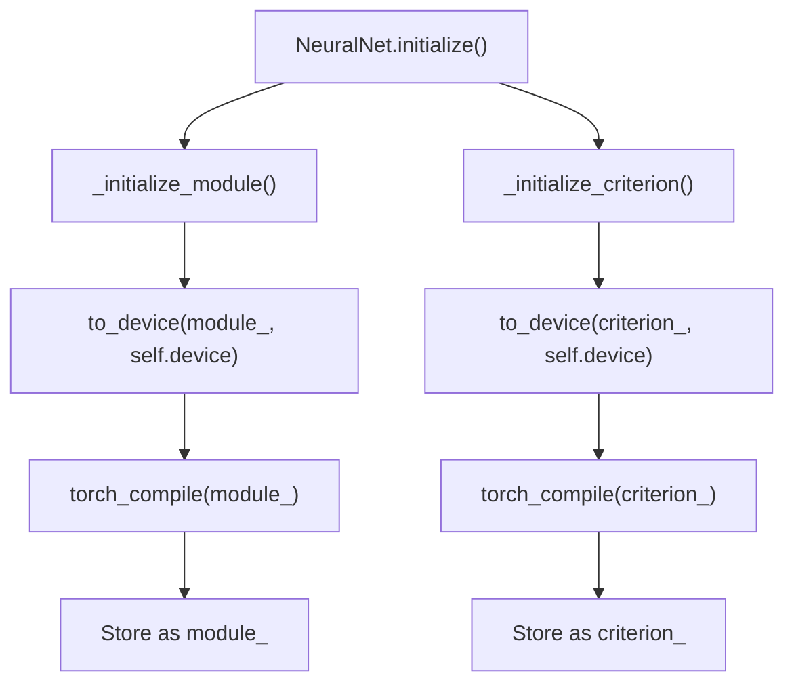
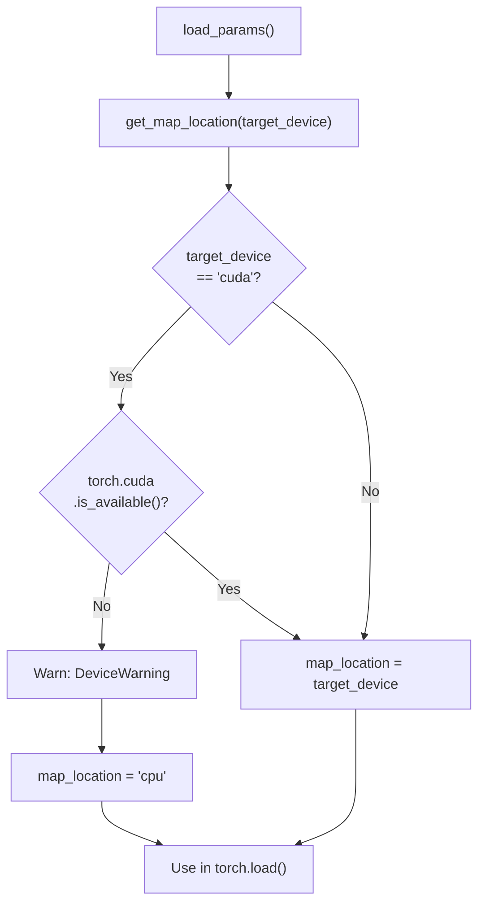

<!-- source: DeepWiki mcp.deepwiki.com · repo skorch-dev/skorch · page 7.2 Device Management · fetched 2026-10-21 -->

# Device Management

<details>
<summary>Relevant source files</summary>

The following files were used as context for generating this wiki page:

- [skorch/net.py](skorch/net.py)
- [skorch/tests/test_net.py](skorch/tests/test_net.py)
- [skorch/tests/test_utils.py](skorch/tests/test_utils.py)
- [skorch/utils.py](skorch/utils.py)

</details>


## Overview

This document covers device management in skorch, explaining how to control where computations occur (CPU, CUDA, MPS) and how skorch handles device placement for modules, data, and saved models. Device management is particularly important when working with GPU acceleration or when transferring models between machines with different hardware configurations.

For information about model compilation for performance optimization, see [Model Compilation](#7.3). For distributed training across multiple devices, see [Distributed Training](#7.4).

**Sources:** [skorch/net.py:1-2290]()

---

## Device Parameter

The `device` parameter in `NeuralNet` controls where all PyTorch components (modules, criteria, and data) are placed during training and inference.

### Setting the Device

The device can be specified as:
- `'cpu'` - CPU computation (default)
- `'cuda'` or `'cuda:0'` - GPU computation on the specified CUDA device
- `'mps'` - Apple Metal Performance Shaders (on supported systems)
- `None` - Leave all devices unmodified (no automatic transfer)
- `torch.device` object - Any PyTorch device object

```python
# CPU (default)
net = NeuralNet(module, device='cpu')

# CUDA device
net = NeuralNet(module, device='cuda')

# Specific CUDA device
net = NeuralNet(module, device='cuda:1')

# No automatic device management
net = NeuralNet(module, device=None)

# PyTorch device object
net = NeuralNet(module, device=torch.device('cuda'))
```

### When Device Transfer Occurs

Device transfer happens automatically at initialization:



**Sources:** [skorch/net.py:760-791](), [skorch/net.py:726-758]()

---

## Automatic Device Handling

### Module and Criterion Transfer

All modules and criteria registered with the net are automatically transferred to the specified device during initialization. This includes custom modules and criteria added to the net.

The following code from `_initialize_module` shows how modules are transferred:

```python
# Line 783-789 in skorch/net.py
for name in self._modules:
    module = getattr(self, name + '_')
    if isinstance(module, torch.nn.Module):
        module = to_device(module, self.device)
        module = self.torch_compile(module, name=name)
        setattr(self, name + '_', module)
```

The same pattern applies to criteria:

```python
# Line 750-756 in skorch/net.py
for name in self._criteria:
    criterion = getattr(self, name + '_')
    if isinstance(criterion, torch.nn.Module):
        criterion = to_device(criterion, self.device)
        criterion = self.torch_compile(criterion, name=name)
        setattr(self, name + '_', criterion)
```

### Data Transfer During Training

Data is automatically converted to tensors and transferred to the device during training and inference through the `to_tensor` function. This happens transparently when data flows through the net.

**Sources:** [skorch/net.py:760-791](), [skorch/net.py:726-758](), [skorch/utils.py:64-120]()

---

## Device Transfer Utilities

### `to_device` Function

The `to_device` function is the core utility for transferring data and modules between devices. It handles various data types:

| Data Type | Behavior |
|-----------|----------|
| `torch.Tensor` | Transfer using `.to(device)` |
| `torch.nn.Module` | Transfer using `.to(device)` |
| `dict` | Recursively transfer all values |
| `list` / `tuple` | Recursively transfer all elements |
| `PackedSequence` | Transfer underlying data |
| PyTorch distributions | Return unchanged (no device API) |

```python
# Function signature
def to_device(X, device):
    """Generic function to modify the device type of the tensor(s) or module.
    
    Parameters
    ----------
    X : input data or module
    device : str, torch.device
        The compute device. If device=None, return input unmodified
    """
```

**Key behavior:** If `device=None`, the input is returned unmodified without any device transfer.

**Sources:** [skorch/utils.py:167-204]()

### `to_tensor` Function

The `to_tensor` function converts various data types to PyTorch tensors and places them on the specified device:

```python
def to_tensor(X, device, accept_sparse=False):
    """Turn input data to torch tensor.
    
    Handles:
    - PackedSequence
    - numpy array
    - torch Tensor
    - scipy sparse CSR matrix (if accept_sparse=True)
    - list/tuple of the above
    - dict with values of the above
    """
```

The function internally uses `to_device` to place tensors on the target device.

**Sources:** [skorch/utils.py:64-120]()

---

## Saving and Loading Across Devices

### Map Location Strategy

When loading saved parameters, skorch uses `get_map_location` to determine where to load the data. This handles the common case of loading CUDA-trained models on CPU-only machines:



The function signature is:

```python
def get_map_location(target_device, fallback_device='cpu'):
    """Determine the location to map loaded data (e.g., weights)
    for a given target device (e.g. 'cuda').
    """
```

**Sources:** [skorch/utils.py:557-576]()

### Device Warning System

When device mismatches occur during loading, skorch issues a `DeviceWarning`. This happens in two scenarios:

1. **Loading CUDA parameters without CUDA available:** The parameters are automatically loaded to CPU with a warning
2. **Device mismatch after unpickling:** The net's device is updated to match available hardware

Example warning message:
```
DeviceWarning: Requested to load data to CUDA but no CUDA devices are available. 
Loading on device "cpu" instead.
```

**Sources:** [skorch/utils.py:557-576](), [skorch/net.py:1-54]()

### Pickling with Device Attributes

When unpickling a net, skorch handles device-dependent attributes specially. The `cuda_dependent_attributes_` list specifies which attributes should be remapped when CUDA is unavailable:

```python
class NeuralNet(BaseEstimator):
    cuda_dependent_attributes_ = []  # Default: empty
    
    # User can extend this for custom attributes
```

This mechanism ensures that models trained on GPU can be loaded and used on CPU-only machines without manual intervention.

**Sources:** [skorch/net.py:316]()

---

## CUDA-Dependent Attributes

### Purpose

The `cuda_dependent_attributes_` list allows you to specify custom attributes that should be remapped from CUDA to CPU when unpickling on a machine without CUDA support.

### Extending for Custom Components

If you add custom modules or components that are CUDA-dependent, add their prefixes to this list:

```python
class MyNet(NeuralNet):
    def __init__(self, module, *args, custom_module=None, **kwargs):
        super().__init__(module, *args, **kwargs)
        self.custom_module = custom_module
        
        # Declare that custom_module_ is CUDA-dependent
        self.cuda_dependent_attributes_ = ['custom_module']
    
    def initialize_custom_module(self):
        self.custom_module_ = self.custom_module()
        self.custom_module_ = to_device(self.custom_module_, self.device)
        return self
```

### Attribute Format

The list should contain attribute name prefixes without the trailing underscore:
- Correct: `['module', 'custom_module']`
- Incorrect: `['module_', 'custom_module_']`

Skorch automatically appends the underscore when checking for these attributes.

**Sources:** [skorch/net.py:278-283](), [skorch/net.py:316]()

---

## Device-Aware Forward Pass

### Explicit Device Control

The `forward` method accepts an optional `device` parameter to override the net's default device for a single forward pass:

```python
# Use net's default device
y_pred = net.forward(X)

# Override to CPU for this call
y_pred = net.forward(X, device='cpu')

# Override to CUDA for this call
y_pred = net.forward(X, device='cuda:0')
```

### Internal Flow


The `infer` method uses `to_tensor` to convert and transfer input data to the appropriate device before passing it to the module.

**Sources:** [skorch/net.py:360-377]() (test showing forward with device), [skorch/utils.py:64-120]()

---

## Device Management Patterns

### Pattern 1: Training on GPU, Inference on CPU

```python
# Train on GPU
net = NeuralNet(module, device='cuda')
net.fit(X_train, y_train)

# Save parameters
net.save_params(f_params='model.pt')

# Load on CPU machine
net_cpu = NeuralNet(module, device='cpu').initialize()
net_cpu.load_params(f_params='model.pt')
# Parameters automatically mapped to CPU
```

### Pattern 2: Conditional GPU Usage

```python
device = 'cuda' if torch.cuda.is_available() else 'cpu'
net = NeuralNet(module, device=device)
net.fit(X, y)
```

### Pattern 3: No Automatic Device Management

```python
# Let user handle all device placement
net = NeuralNet(module, device=None)

# Manually move module to desired device
net.module_ = net.module_.to('cuda')

# User must ensure data is on correct device
X_cuda = X.to('cuda')
y_pred = net.forward(X_cuda)
```

### Pattern 4: Mixed Precision Training

```python
# Use CUDA with automatic mixed precision (AMP)
# Device management still handled by skorch
net = NeuralNet(
    module, 
    device='cuda',
    # Additional AMP configuration would go here
)
```

**Sources:** [skorch/tests/test_net.py:1042-1080]() (various device patterns in tests)

---

## Common Device Management Issues

### Issue 1: Device Mismatch Errors

**Symptom:** `RuntimeError: Expected all tensors to be on the same device`

**Cause:** Input data or model parameters on different devices

**Solution:** Ensure consistent device setting, or use `device=None` for manual control

### Issue 2: CUDA Out of Memory

**Symptom:** `RuntimeError: CUDA out of memory`

**Cause:** Batch size too large for GPU memory

**Solution:** 
- Reduce `batch_size` parameter
- Use gradient accumulation
- Switch to CPU temporarily

### Issue 3: Loading Parameters Fails

**Symptom:** Warning about CUDA unavailability when loading

**Cause:** Model saved on GPU, loading on CPU

**Solution:** This is handled automatically by skorch with a warning. No action needed unless you want to suppress the warning.

### Issue 4: Custom Modules Not Transferred

**Symptom:** Custom modules remain on wrong device

**Cause:** Custom modules not registered with skorch

**Solution:** Register modules in `_modules` list and add to `cuda_dependent_attributes_` if needed:

```python
class MyNet(NeuralNet):
    def __init__(self, *args, custom_module=None, **kwargs):
        super().__init__(*args, **kwargs)
        self.custom_module = custom_module
        self._modules = ['module', 'custom_module']
        self.cuda_dependent_attributes_ = ['custom_module']
```

**Sources:** [skorch/net.py:298-311](), [skorch/net.py:316]()

---

## Summary Table: Device Management Components

| Component | Location | Purpose |
|-----------|----------|---------|
| `device` parameter | [skorch/net.py:213-217]() | Set target compute device for all components |
| `to_device()` | [skorch/utils.py:167-204]() | Transfer tensors/modules between devices |
| `to_tensor()` | [skorch/utils.py:64-120]() | Convert data to tensor and place on device |
| `get_map_location()` | [skorch/utils.py:557-576]() | Determine safe device for loading parameters |
| `cuda_dependent_attributes_` | [skorch/net.py:316]() | List of attributes to remap during unpickling |
| `_initialize_module()` | [skorch/net.py:760-791]() | Transfer modules to device during init |
| `_initialize_criterion()` | [skorch/net.py:726-758]() | Transfer criteria to device during init |
| `DeviceWarning` | [skorch/exceptions.py]() | Warning for device mismatches |

**Sources:** [skorch/net.py:1-2290](), [skorch/utils.py:1-819]()

---

