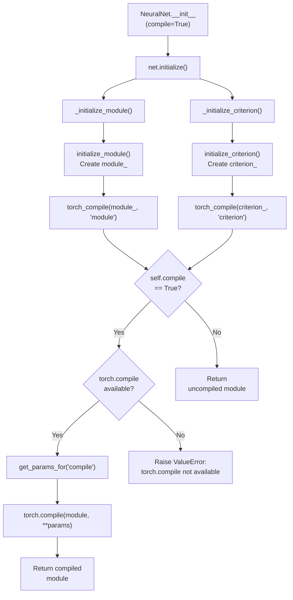
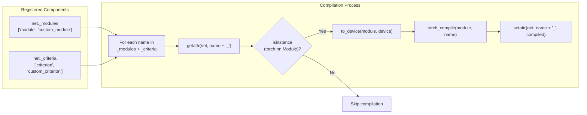
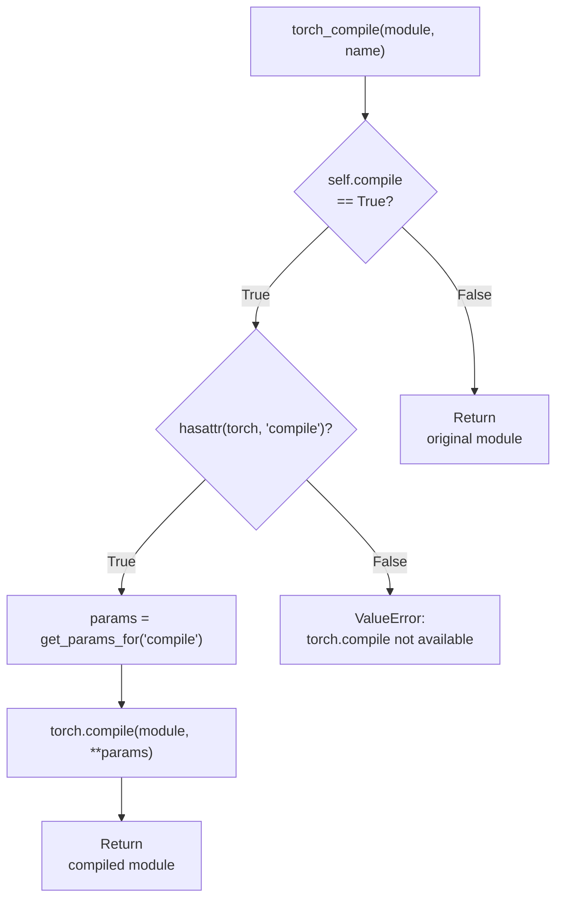
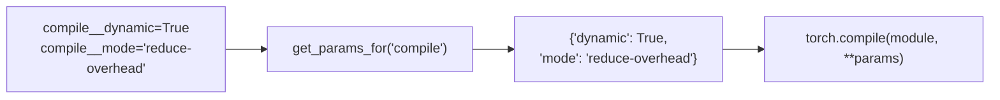
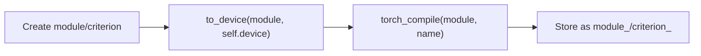
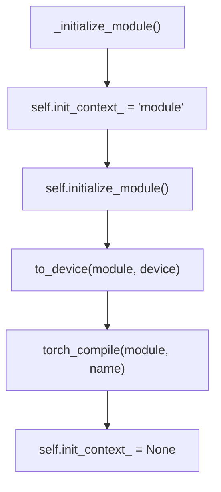

<!-- source: DeepWiki mcp.deepwiki.com · repo skorch-dev/skorch · page 7.3 Model Compilation · fetched 2026-10-21 -->

# Model Compilation

<details>
<summary>Relevant source files</summary>

The following files were used as context for generating this wiki page:

- [CHANGES.md](CHANGES.md)
- [skorch/net.py](skorch/net.py)
- [skorch/tests/test_net.py](skorch/tests/test_net.py)

</details>


## Purpose and Scope

This page documents skorch's integration with PyTorch's `torch.compile` feature for performance optimization. Model compilation allows PyTorch modules to be compiled into optimized representations that can run significantly faster on modern GPU architectures. This feature is available starting from PyTorch 2.0 (with initial support in PyTorch 1.14) and can provide substantial speedups without requiring code changes.

For information about device management (CPU/CUDA), see [Device Management](#7.2). For information about custom modules, see [Custom Modules and Components](#7.1).

## Overview

PyTorch 2.0 introduced `torch.compile`, a just-in-time (JIT) compilation feature that transforms PyTorch modules into optimized code. Skorch provides seamless integration with this feature through the `compile` parameter on `NeuralNet`. When enabled, skorch automatically compiles all PyTorch modules (typically `module_` and `criterion_`) during initialization, making compiled models work identically to non-compiled models while providing performance benefits on supported hardware.

**Sources:** [skorch/net.py:219-227](), [CHANGES.md:86-87]()

## Configuration

### Basic Usage

Enable compilation by setting `compile=True` when initializing a net:

```python
net = NeuralNetClassifier(
    MyModule,
    compile=True,
    max_epochs=10,
)
```

### Advanced Configuration

Additional arguments to `torch.compile` can be specified using double-underscore notation:

```python
net = NeuralNetClassifier(
    MyModule,
    compile=True,
    compile__dynamic=True,
    compile__mode='reduce-overhead',
    compile__backend='inductor',
)
```

The `compile__` prefix allows setting any parameter accepted by `torch.compile`.

**Sources:** [skorch/net.py:219-227](), [skorch/net.py:840]()

## Compilation Architecture

### Compilation Flow During Initialization



**Sources:** [skorch/net.py:760-791](), [skorch/net.py:794-842]()

### Module Registration and Compilation

The compilation process applies to all registered modules and criteria:



**Sources:** [skorch/net.py:783-789](), [skorch/net.py:794-842]()

## The `torch_compile` Method

### Method Signature and Behavior

The `torch_compile` method is responsible for conditionally compiling PyTorch modules. It is called during module and criterion initialization and can be overridden for custom compilation behavior.

| Aspect | Description |
|--------|-------------|
| **Method Name** | `torch_compile` |
| **Parameters** | `module` (torch.nn.Module), `name` (str) |
| **Return Type** | torch.nn.Module or torch._dynamo.OptimizedModule |
| **Called From** | `_initialize_module`, `_initialize_criterion` |
| **Override Pattern** | Can be overridden to customize compilation behavior (e.g., skip certain modules) |

### Implementation Details



The `name` parameter is provided but not used by default. It allows custom implementations to selectively compile modules:

```python
def torch_compile(self, module, name):
    if not self.compile or name == 'criterion':
        return module  # Skip compilation for criterion
    # ... compile module
```

**Sources:** [skorch/net.py:794-842]()

## Parameter Extraction

Compilation parameters are extracted using the standard `get_params_for` mechanism:



The `compile` prefix is registered in `NeuralNet.prefixes_`, allowing the parameter system to recognize and extract `compile__*` parameters.

**Sources:** [skorch/net.py:314](), [skorch/net.py:840]()

## Compatibility and Requirements

### PyTorch Version Requirements

| PyTorch Version | Support Status |
|-----------------|----------------|
| < 1.14 | Not supported |
| 1.14 | Supported (experimental) |
| 2.0+ | Fully supported |

When `compile=True` is set but `torch.compile` is not available, skorch raises a `ValueError` with a helpful message indicating the PyTorch version requirement.

### Error Handling

```python
if not torch_compile_available:
    raise ValueError(
        "Setting compile=True but torch.compile is not available. Please "
        f"check that your installed PyTorch version ({torch.__version__}) "
        "supports torch.compile (requires v1.14, v2.0 or higher)")
```

**Sources:** [skorch/net.py:834-838]()

## Compilation Scope

### What Gets Compiled

Skorch compiles all PyTorch modules that are instances of `torch.nn.Module`:

| Component | Compiled | Notes |
|-----------|----------|-------|
| `module_` | Yes | The main neural network module |
| `criterion_` | Yes | If it's a `torch.nn.Module` (e.g., `nn.CrossEntropyLoss`) |
| Custom modules | Yes | Any user-defined modules added as `*_` attributes |
| Custom criteria | Yes | Any user-defined criteria that are `torch.nn.Module` instances |
| Optimizers | No | Optimizers are not compiled |
| Non-Module criteria | No | Callables that are not `torch.nn.Module` instances |

### Device Placement and Compilation Order

Compilation occurs after device placement in the initialization sequence:



This ensures that modules are on the correct device before compilation.

**Sources:** [skorch/net.py:783-789]()

## Performance Considerations

### Expected Benefits

- **Speedup**: Typically 1.2x-3x faster on supported hardware (Volta and Ampere GPUs)
- **No code changes**: Compiled models work identically to non-compiled models
- **Automatic optimization**: PyTorch selects appropriate optimizations based on hardware

### Overhead

- **Compilation time**: First run incurs compilation overhead (seconds to minutes)
- **Memory**: Compiled models may use more memory
- **Warm-up**: Performance improves after the first few iterations

### When to Use

Compilation is most beneficial for:
- Training or inference on modern GPUs (Volta, Ampere, or newer)
- Models with repeated operations
- Production deployments where initial compilation time is acceptable

Compilation may not help for:
- Small models where compilation overhead dominates
- Models with highly dynamic control flow
- CPU-only environments

**Sources:** [skorch/net.py:219-227](), [CHANGES.md:86-87]()

## Integration with Initialization Context

The compilation process is aware of the initialization context through the `init_context_` attribute:



This context tracking helps callbacks and custom code understand which component is being initialized.

**Sources:** [skorch/net.py:703-709](), [skorch/net.py:760-791]()

## Custom Compilation Behavior

Users can override `torch_compile` to implement custom compilation logic:

```python
class MyNet(NeuralNetClassifier):
    def torch_compile(self, module, name):
        # Don't compile the criterion
        if name == 'criterion':
            return module
        
        # Use custom settings for main module
        if name == 'module':
            return torch.compile(module, mode='max-autotune')
        
        return super().torch_compile(module, name)
```

The `name` parameter allows distinguishing between different modules during compilation.

**Sources:** [skorch/net.py:794-842]()

## Summary

Model compilation in skorch provides a simple interface to PyTorch's `torch.compile` feature:

| Feature | Implementation |
|---------|----------------|
| **Enable/Disable** | `compile` parameter (boolean) |
| **Configuration** | `compile__*` parameters |
| **Scope** | All `torch.nn.Module` instances |
| **Timing** | During `initialize()` |
| **Customization** | Override `torch_compile()` method |
| **Requirements** | PyTorch ≥ 1.14 (2.0+ recommended) |

The compilation is transparent to the user—compiled models behave identically to non-compiled models while providing performance benefits on supported hardware.

**Sources:** [skorch/net.py:219-227](), [skorch/net.py:314](), [skorch/net.py:794-842]()

---

