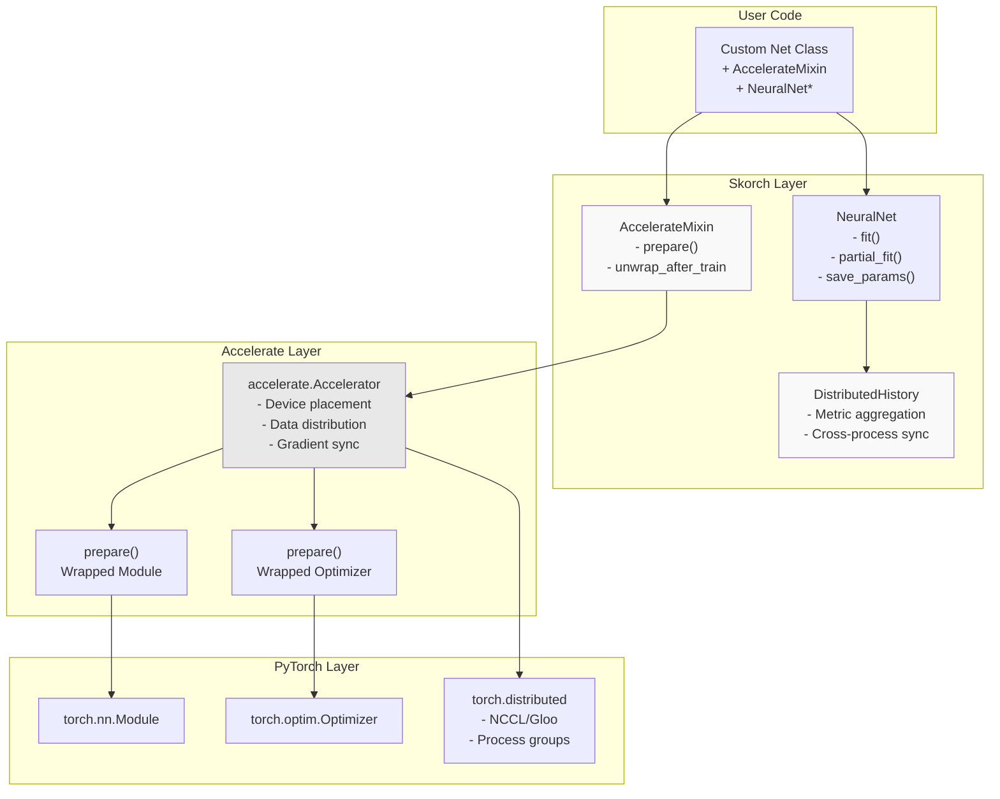
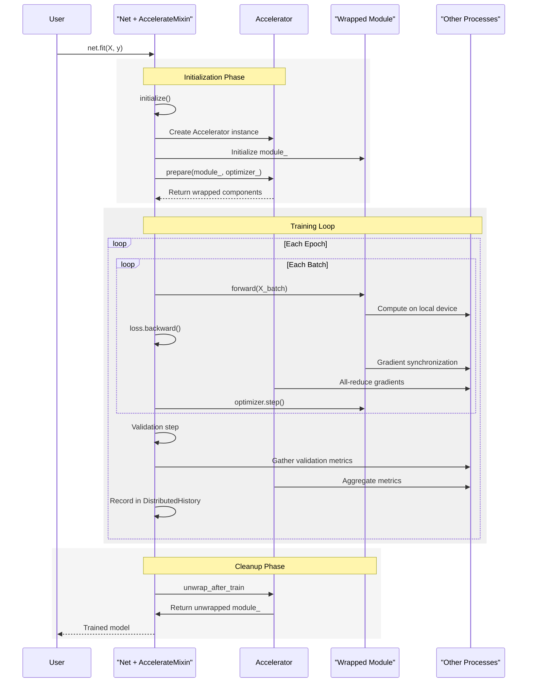
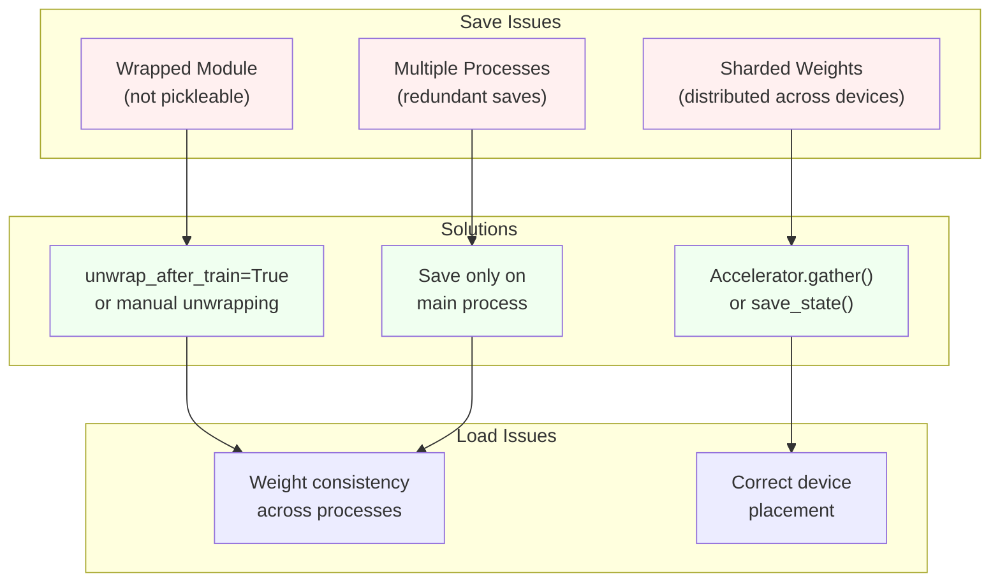
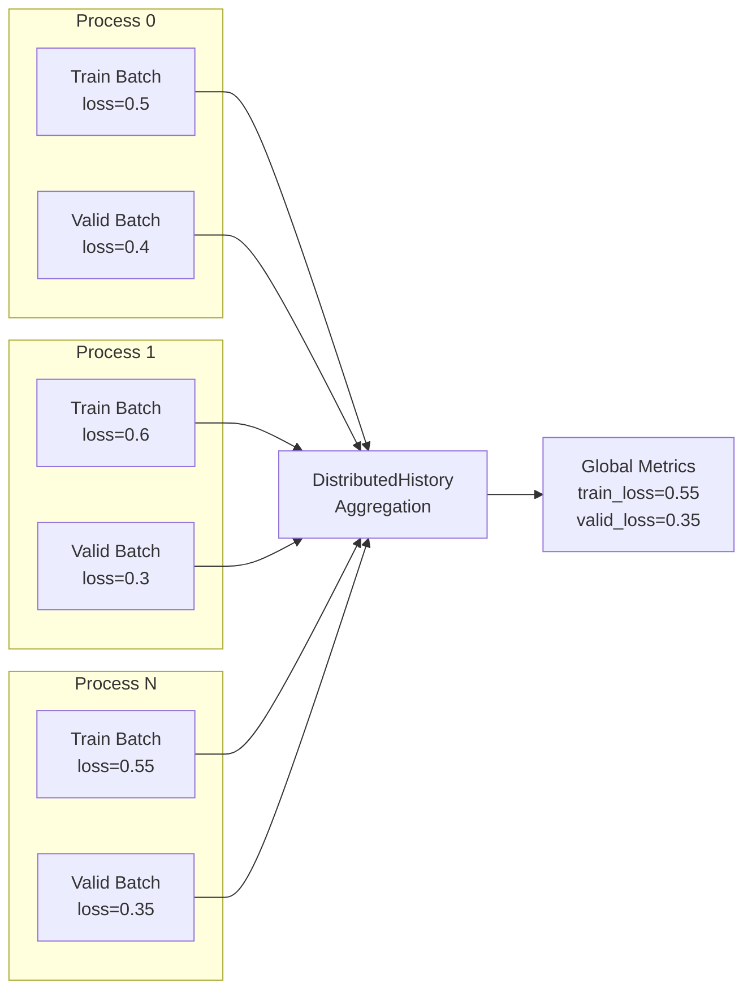

<!-- source: DeepWiki mcp.deepwiki.com · repo skorch-dev/skorch · page 7.4 Distributed Training · fetched 2026-10-21 -->

# Distributed Training

<details>
<summary>Relevant source files</summary>

The following files were used as context for generating this wiki page:

- [CHANGES.md](CHANGES.md)
- [skorch/net.py](skorch/net.py)
- [skorch/tests/test_net.py](skorch/tests/test_net.py)

</details>


## Purpose and Scope

This page documents skorch's support for distributed and multi-GPU training scenarios using the `AccelerateMixin` integration with the Hugging Face Accelerate library. For information about general device management (CPU, CUDA, MPS), see [Device Management](#7.2). For model saving/loading, see [Model Persistence and State Management](#6).

Distributed training allows you to train neural networks across multiple GPUs or multiple machines, significantly reducing training time for large models and datasets. Skorch provides this capability through integration with the Hugging Face Accelerate library, which handles the complexities of distributed training while maintaining skorch's scikit-learn compatible API.

---

## Core Components

### AccelerateMixin

The `AccelerateMixin` is the primary mechanism for enabling distributed training in skorch. It is a mixin class that you combine with your neural net class to add advanced training capabilities provided by the Hugging Face Accelerate library.

**Key Features:**
- Multi-GPU training on a single machine
- Distributed training across multiple machines
- Mixed precision training (FP16/BF16)
- Gradient accumulation
- Integration with DeepSpeed for large-scale training
- Automatic device placement and data distribution

The mixin wraps your PyTorch module and handles all the complexities of distributing your model and data across available devices.

**Sources:** [CHANGES.md:117]()

### DistributedHistory

`DistributedHistory` is a specialized version of the standard `History` class designed for multi-GPU training scenarios. It ensures that metrics are properly aggregated across all distributed processes.

In a distributed setting, each process computes metrics on its local batch. The `DistributedHistory` class synchronizes these metrics across all processes to provide accurate global metrics in the training history.

**Sources:** [CHANGES.md:87]()

---

## Architecture Overview



**Diagram: Distributed Training Component Architecture**

The `AccelerateMixin` serves as a bridge between skorch's neural net classes and the Accelerate library. During initialization, it wraps the PyTorch module and optimizer with Accelerate's `prepare()` method, which handles device placement and distributed training setup.

**Sources:** [CHANGES.md:87](), [CHANGES.md:117]()

---

## Training Lifecycle in Distributed Mode



**Diagram: Distributed Training Sequence**

The training lifecycle in distributed mode follows the standard skorch training flow with additional steps for distributed coordination. The `Accelerator` instance handles gradient synchronization and metric aggregation automatically.

**Sources:** [CHANGES.md:89](), [CHANGES.md:100]()

---

## Implementation Patterns

### Creating a Distributed Net

To enable distributed training, create a custom net class that combines `AccelerateMixin` with your chosen net class:

| Component | Role |
|-----------|------|
| `AccelerateMixin` | Provides distributed training capabilities via Accelerate |
| `NeuralNetClassifier` / `NeuralNetRegressor` | Base net functionality and scikit-learn API |
| Custom class | Combines both through multiple inheritance |

The order of inheritance matters: `AccelerateMixin` should typically come first to ensure its methods have priority.

**Example Pattern:**
```python
from skorch.hf import AccelerateMixin
from skorch import NeuralNetClassifier

class DistributedNet(AccelerateMixin, NeuralNetClassifier):
    pass
```

**Sources:** [CHANGES.md:117]()

### Module Unwrapping

After distributed training, the module is wrapped by Accelerate's `prepare()` method. This wrapping needs to be undone for certain operations:

| Parameter | Behavior |
|-----------|----------|
| `unwrap_after_train=False` (default) | Module remains wrapped after training |
| `unwrap_after_train=True` | Automatically unwraps module after training completes |

Unwrapping is important for:
- Saving the model (the wrapped module may not be pickleable)
- Using the model outside of a distributed context
- Inspecting module internals

If `unwrap_after_train=False`, you may need to manually unwrap the module before saving or using it.

**Sources:** [CHANGES.md:89](), [CHANGES.md:100]()

---

## Saving and Loading Parameters

### Challenges in Distributed Settings

Distributed training introduces special considerations for saving and loading model parameters:



**Diagram: Parameter Saving Challenges and Solutions**

**Key Issues:**

1. **Wrapped modules may not be pickleable:** The Accelerate wrapper adds state that doesn't serialize well
2. **Multiple processes saving simultaneously:** Can cause file corruption or wasted I/O
3. **Sharded model weights:** In some configurations, weights are split across devices

**Sources:** [CHANGES.md:65](), [CHANGES.md:100]()

### Best Practices

| Practice | Description |
|----------|-------------|
| Use `unwrap_after_train=True` | Automatically unwrap module before saving |
| Check for main process | Only save from the main process in distributed settings |
| Use safetensors | The safetensors format (via `use_safetensors=True`) avoids some pickling issues |
| Test loading on CPU | Ensure model can be loaded without GPU dependencies |

The standard skorch methods `save_params()` and `load_params()` work with distributed training, but you must ensure modules are unwrapped first.

**Sources:** [CHANGES.md:65](), [skorch/net.py:549-617]()

---

## Using DistributedHistory

### Purpose

In distributed training, each process computes metrics on its own subset of data. The `DistributedHistory` class ensures these metrics are properly aggregated across all processes to give accurate global metrics.

### Integration



**Diagram: Metric Aggregation in DistributedHistory**

Without `DistributedHistory`, each process would only see its local metrics, making it impossible to get accurate global loss values or accuracies.

**Sources:** [CHANGES.md:87]()

---

## Common Patterns and Pitfalls

### Initialization Order

| Component | When Initialized | Notes |
|-----------|-----------------|-------|
| `Accelerator` | During `net.initialize()` | Created by `AccelerateMixin` |
| `module_` | Before wrapping | Standard skorch initialization |
| Wrapped `module_` | After `accelerator.prepare()` | Replaces original module |
| `optimizer_` | Before wrapping | Standard skorch initialization |
| Wrapped `optimizer_` | After `accelerator.prepare()` | Replaces original optimizer |

The `AccelerateMixin` modifies the standard skorch initialization flow to wrap components after they are created but before training begins.

### Device Management

The `AccelerateMixin` takes control of device placement. Setting `device='cuda'` on the net may not work as expected because Accelerate handles device placement automatically.

**Recommendation:** Let Accelerate manage device placement. Don't explicitly set device parameters when using `AccelerateMixin`.

**Sources:** [skorch/net.py:213-218]()

### Checkpoint Compatibility

When using distributed training with checkpoints:

1. Ensure checkpoints are saved only from the main process
2. Use `unwrap_after_train=True` to avoid serialization issues
3. Consider using `use_safetensors=True` for more robust serialization

The `Checkpoint` callback works with distributed training, but you must configure it appropriately.

**Sources:** [CHANGES.md:65](), [skorch/net.py:599-617]()

---

## Troubleshooting

### Module Not Pickleable

**Problem:** Error when trying to pickle/save the net after distributed training.

**Solution:** Set `unwrap_after_train=True` when initializing the net, or manually unwrap the module before saving.

**Sources:** [CHANGES.md:100]()

### Incorrect Metrics

**Problem:** Training metrics don't match expected values in distributed setting.

**Solution:** Use `DistributedHistory` instead of the standard `History` class.

**Sources:** [CHANGES.md:87]()

### Loading Parameters Fails

**Problem:** Cannot load parameters saved during distributed training.

**Solution:** Ensure the module was unwrapped before saving. Try loading with `use_safetensors=True` if available.

**Sources:** [CHANGES.md:65]()

### Multiple Save Operations

**Problem:** All processes are saving checkpoints, causing file corruption.

**Solution:** Implement logic to save only from the main process (usually process with rank 0).

---

## Version History

| Version | Change |
|---------|--------|
| 0.12.0 | Added experimental support for Hugging Face Accelerate via `AccelerateMixin` |
| 0.13.0 | Added `DistributedHistory` class for multi-GPU training; added `unwrap_after_train` parameter |
| 0.15.0 | Fixed issues with saving/loading in multi-GPU settings |

**Sources:** [CHANGES.md:54-155]()

---

