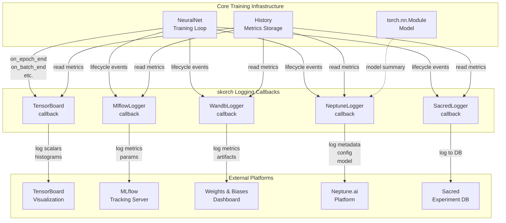
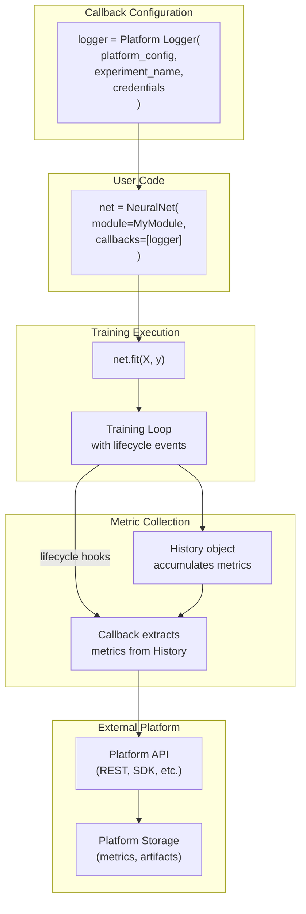
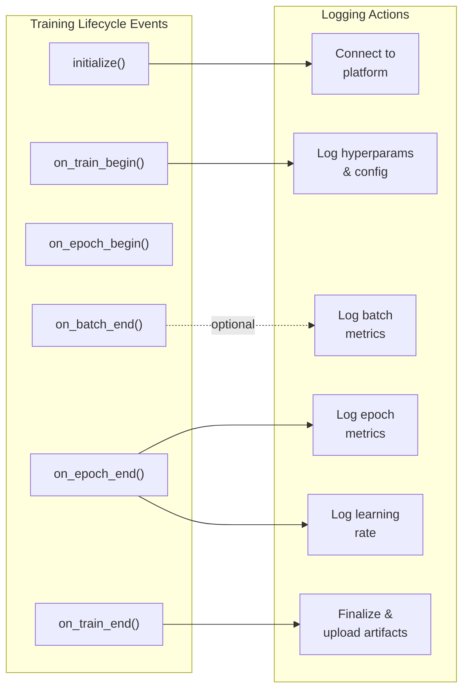

<!-- source: DeepWiki mcp.deepwiki.com · repo skorch-dev/skorch · page 7.5 Integration with ML Platforms · fetched 2026-10-21 -->

# Integration with ML Platforms

<details>
<summary>Relevant source files</summary>

The following files were used as context for generating this wiki page:

- [CHANGES.md](CHANGES.md)

</details>


## Purpose and Scope

This document covers skorch's integration with machine learning experiment tracking and logging platforms. Skorch provides specialized logging callbacks that automatically track training metrics, hyperparameters, model artifacts, and other experiment metadata to external platforms during the training lifecycle.

For general information about the callback system and creating custom callbacks, see [Callback Basics](#3.1). For details on computing and recording metrics, see [Scoring Callbacks](#3.3). For model persistence and checkpointing, see [Model Persistence and State Management](#6).

---

## Overview

Skorch provides first-class support for integrating with popular ML experiment tracking platforms through dedicated logging callbacks. These callbacks hook into the training lifecycle to automatically log information without requiring manual instrumentation of training code.

### Supported Platforms

| Platform | Callback Class | Added in Version | Key Features |
|----------|---------------|------------------|--------------|
| TensorBoard | `TensorBoard` | 0.7.0 | Automatic logging to TensorBoard |
| MLflow | `MlflowLogger` | 0.11.0 | Logging to MLflow tracking server |
| Weights & Biases | `WandbLogger` | 0.8.0 | Integration with W&B dashboard |
| Neptune.ai | `NeptuneLogger` | 0.8.0 | Experiment metadata logging, model summary, configuration |
| Sacred | `SacredLogger` | 0.10.0 | Integration with Sacred experiment framework |

**Sources:** [CHANGES.md:231](), [CHANGES.md:139](), [CHANGES.md:207](), [CHANGES.md:205](), [CHANGES.md:159]()

---

## System Architecture

### Logging Callback Integration



This diagram shows how logging callbacks integrate with the core training infrastructure. All logging callbacks inherit from the base `Callback` class and receive training lifecycle events from `NeuralNet`. They extract metrics from the `History` object and forward them to their respective external platforms.

**Sources:** [CHANGES.md:231](), [CHANGES.md:139](), [CHANGES.md:207](), [CHANGES.md:159]()

---

### Training Lifecycle Integration

```mermaid
sequenceDiagram
    participant NeuralNet
    participant History
    participant LogCallback["Logging Callback<br/>(TensorBoard, MLflow, etc.)"]
    participant Platform["External Platform"]
    
    rect rgb(250, 250, 250)
        Note over NeuralNet,Platform: Initialization Phase
        NeuralNet->>LogCallback: initialize()
        LogCallback->>Platform: Connect/authenticate
    end
    
    rect rgb(250, 250, 250)
        Note over NeuralNet,Platform: Training Phase
        NeuralNet->>LogCallback: on_train_begin()
        LogCallback->>Platform: Log hyperparameters
        LogCallback->>Platform: Log model configuration
        
        loop Each Epoch
            NeuralNet->>LogCallback: on_epoch_begin()
            
            loop Each Batch
                NeuralNet->>LogCallback: on_batch_end()
                Note over LogCallback: Optional: log batch metrics
            end
            
            NeuralNet->>History: Record epoch metrics
            NeuralNet->>LogCallback: on_epoch_end()
            LogCallback->>History: Read epoch metrics
            LogCallback->>Platform: Log metrics (loss, accuracy, etc.)
            LogCallback->>Platform: Log learning rate (if available)
        end
        
        NeuralNet->>LogCallback: on_train_end()
        LogCallback->>Platform: Finalize logging
        LogCallback->>Platform: Log final model artifacts
    end
```

This sequence diagram illustrates how logging callbacks participate in the training lifecycle. They connect to the external platform during initialization, log hyperparameters at training start, extract and forward metrics during training, and finalize logging at training end.

**Sources:** [CHANGES.md:231](), [CHANGES.md:139](), [CHANGES.md:207](), [CHANGES.md:106]()

---

## Common Patterns

All logging callbacks share common implementation patterns that make them consistent and easy to use:

### Callback Lifecycle Hooks

Logging callbacks typically implement these event hooks:

| Hook | Purpose |
|------|---------|
| `initialize()` | Establish connection to platform, authenticate |
| `on_train_begin()` | Log hyperparameters, model configuration |
| `on_epoch_end()` | Extract and log epoch-level metrics from History |
| `on_batch_end()` | Optionally log batch-level metrics |
| `on_train_end()` | Finalize logging, upload artifacts |

### Metric Extraction

Logging callbacks read metrics from the `History` object, which stores all training and validation metrics accumulated during training. The callbacks typically:

1. Access `net.history` to retrieve the History instance
2. Extract specific metrics (e.g., `train_loss`, `valid_acc`)
3. Format and forward metrics to the external platform

### Platform Connection Management

Each callback handles platform-specific connection details:
- Authentication credentials (API keys, tokens)
- Experiment/run identification
- Connection lifecycle (connect, log, disconnect)

**Sources:** [CHANGES.md:231](), [CHANGES.md:139](), [CHANGES.md:207]()

---

## Platform-Specific Features

### TensorBoard

The `TensorBoard` callback provides automatic logging to TensorBoard for visualization.

**Key Features:**
- Logs scalar metrics (loss, accuracy, etc.)
- Supports histogram logging for model parameters
- Integrates with TensorBoard's visualization interface

**Added:** Version 0.7.0

**Sources:** [CHANGES.md:231]()

---

### MlflowLogger

The `MlflowLogger` callback integrates with MLflow's experiment tracking capabilities.

**Key Features:**
- Logs metrics to MLflow tracking server
- Records hyperparameters and configuration
- Supports artifact logging
- Compatible with MLflow's experiment organization

**Added:** Version 0.11.0

**Sources:** [CHANGES.md:139]()

---

### WandbLogger

The `WandbLogger` callback integrates with Weights & Biases for comprehensive experiment tracking.

**Key Features:**
- Logs metrics to W&B dashboard
- Records hyperparameters and model configuration
- Supports artifact and media logging
- Integrates with W&B's visualization and comparison tools

**Added:** Version 0.8.0

**Sources:** [CHANGES.md:207]()

---

### NeptuneLogger

The `NeptuneLogger` callback provides integration with Neptune.ai for experiment metadata tracking.

**Key Features:**
- Logs experiment metadata to Neptune.ai platform
- Records model summary and architecture
- Logs hyperparameters and configuration
- Tracks learning rate changes when available
- Supports version logging

**Added:** Version 0.8.0

**Updated:** Version 0.12.1 - Updated to work with Neptune client v0.14.3 or higher, now logs additional data including model summary, configuration, and learning rate

**Sources:** [CHANGES.md:205](), [CHANGES.md:72](), [CHANGES.md:106]()

---

### SacredLogger

The `SacredLogger` callback integrates with the Sacred experiment framework.

**Key Features:**
- Logs to Sacred experiment database
- Compatible with Sacred's experiment organization
- Records metrics and configuration according to Sacred conventions

**Added:** Version 0.10.0

**Sources:** [CHANGES.md:159]()

---

## Integration Architecture



This diagram shows the complete integration flow from user code to external platform storage. The user configures a logging callback with platform-specific settings, adds it to the net, and calls `fit()`. During training, metrics accumulate in History, the callback extracts them at appropriate lifecycle points, and forwards them to the external platform via its API.

**Sources:** [CHANGES.md:231](), [CHANGES.md:139](), [CHANGES.md:207]()

---

## Configuration Patterns

### Basic Usage Pattern

The typical pattern for using logging callbacks involves:

1. **Import the callback**
2. **Initialize with platform configuration**
3. **Add to net's callbacks list**
4. **Train normally**

The callback automatically handles all logging during training without requiring additional code changes.

### Platform Authentication

Most logging callbacks require authentication credentials:
- API keys
- Access tokens
- Project identifiers
- Experiment names

These are typically provided during callback initialization.

### Metric Selection

Logging callbacks automatically log all metrics present in `net.history`. The specific metrics available depend on:
- The scoring callbacks configured on the net
- The default metrics computed by the net (e.g., `train_loss`, `valid_loss`)
- Custom metrics added through callbacks

**Sources:** [CHANGES.md:231](), [CHANGES.md:139](), [CHANGES.md:207](), [CHANGES.md:106]()

---

## Advanced Features

### Model Artifact Logging

Some logging callbacks support logging model artifacts:
- Model checkpoints
- Model architecture/summary
- Serialized model files

The `NeptuneLogger`, for example, logs the model summary and configuration automatically.

### Learning Rate Tracking

Logging callbacks can track learning rate changes during training. The `NeptuneLogger` specifically logs learning rate information when available (added in version 0.12.1).

This integrates with the `LRScheduler` callback, which can record learning rate changes in history using the `event_name` parameter.

**Sources:** [CHANGES.md:106](), [CHANGES.md:176]()

---

## Relationship with Other Systems

### Integration with History System

Logging callbacks depend on the `History` object to access training metrics. The History system (documented in [History and Training Tracking](#2.5)) accumulates all metrics during training, which logging callbacks then extract and forward to external platforms.

### Integration with Scoring Callbacks

Logging callbacks work seamlessly with scoring callbacks (documented in [Scoring Callbacks](#3.3)):
- `EpochScoring` computes epoch-level metrics
- `BatchScoring` computes batch-level metrics
- `PassthroughScoring` aggregates batch scores to epoch level

All these metrics are stored in History and automatically picked up by logging callbacks.

### Integration with Checkpoint System

Logging callbacks complement the checkpoint system (documented in [Checkpointing During Training](#6.2)):
- Checkpoints handle model persistence
- Logging callbacks handle experiment tracking
- Both can run simultaneously during training

Some logging platforms support storing checkpoint artifacts through their logging callbacks.

**Sources:** [CHANGES.md:231](), [CHANGES.md:139](), [CHANGES.md:207]()

---

## Callback Lifecycle Events



This diagram maps the callback lifecycle events to typical logging actions performed by logging callbacks. The `on_batch_end()` hook is optional and depends on whether batch-level logging is desired.

**Sources:** [CHANGES.md:231](), [CHANGES.md:139](), [CHANGES.md:207](), [CHANGES.md:106]()

---

## Version-Specific Considerations

### Neptune Client Version Compatibility

The `NeptuneLogger` was updated in version 0.12.1 to work with Neptune client v0.14.3 or higher. The updated version logs additional information:
- Model summary
- Model configuration  
- Learning rate (when available)

Users should ensure they have a compatible Neptune client version when using `NeptuneLogger`.

### Learning Rate Scheduler Integration

Support for logging learning rate from `ReduceLROnPlateau` and other schedulers was added in version 1.1.0. The learning rate is recorded in history (e.g., `net.history[:, 'event_lr']`), making it available to logging callbacks like `NeptuneLogger`.

**Sources:** [CHANGES.md:106](), [CHANGES.md:42](), [CHANGES.md:176]()

---

## Best Practices

### Choosing a Platform

Consider these factors when selecting an ML platform:
- **Team requirements**: Platform features, collaboration tools
- **Infrastructure**: Self-hosted vs. cloud, authentication requirements
- **Integration depth**: Metrics, artifacts, model versioning
- **Visualization**: Dashboard features, comparison tools

### Multiple Logging Callbacks

Multiple logging callbacks can be used simultaneously:
```python
# Conceptual example - exact syntax may vary
callbacks = [
    TensorBoard(...),
    MlflowLogger(...),
]
net = NeuralNet(module=MyModule, callbacks=callbacks)
```

This enables logging to multiple platforms concurrently.

### Performance Considerations

Logging callbacks add overhead to training:
- Network I/O for uploading metrics
- Serialization of data
- Platform API calls

For high-frequency logging (e.g., per-batch), consider:
- Batching log requests
- Asynchronous logging
- Selective metric logging

**Sources:** [CHANGES.md:231](), [CHANGES.md:139](), [CHANGES.md:207]()

---

## Summary

Skorch's logging callbacks provide seamless integration with major ML experiment tracking platforms through a consistent callback-based architecture. They automatically capture training metrics, hyperparameters, and model artifacts without requiring manual instrumentation. The callbacks hook into the training lifecycle, extract information from the History object, and forward it to external platforms using platform-specific APIs.

For implementing custom logging integrations, refer to [Callback Basics](#3.1) for information on creating callbacks and [History and Training Tracking](#2.5) for accessing training metrics.

**Sources:** [CHANGES.md:231](), [CHANGES.md:139](), [CHANGES.md:207](), [CHANGES.md:205](), [CHANGES.md:159](), [CHANGES.md:106]()

---

