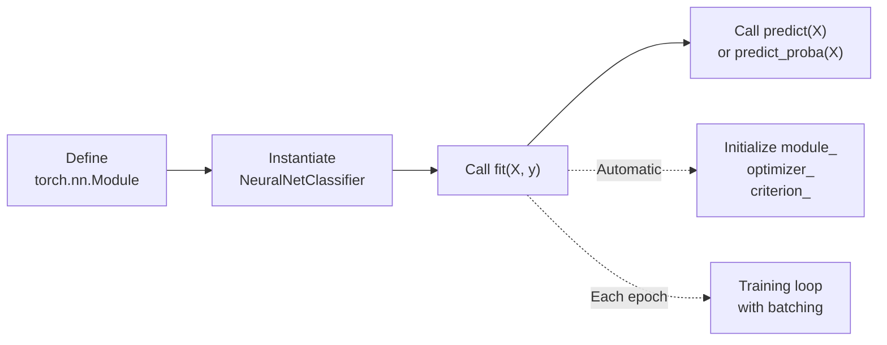
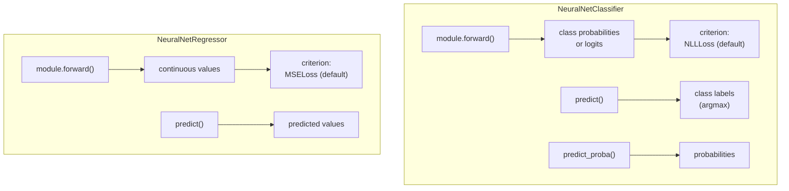
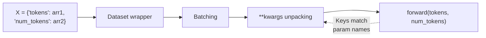
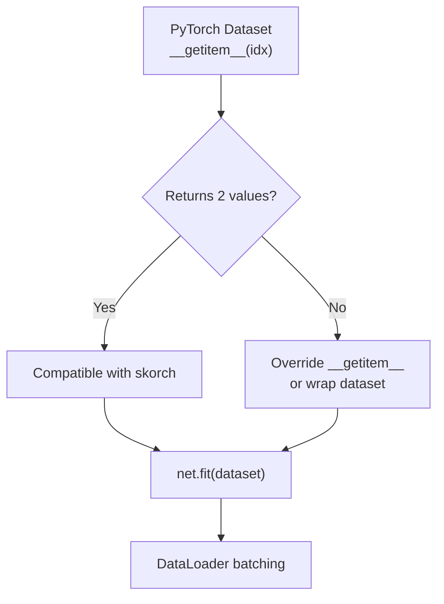
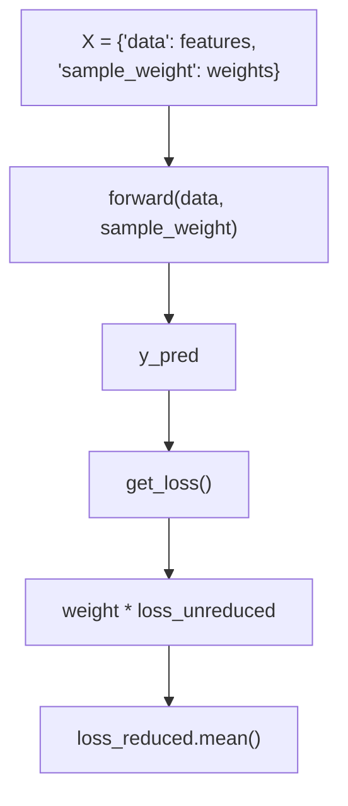
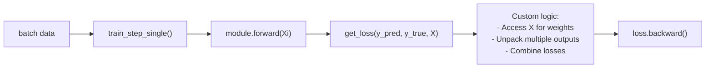
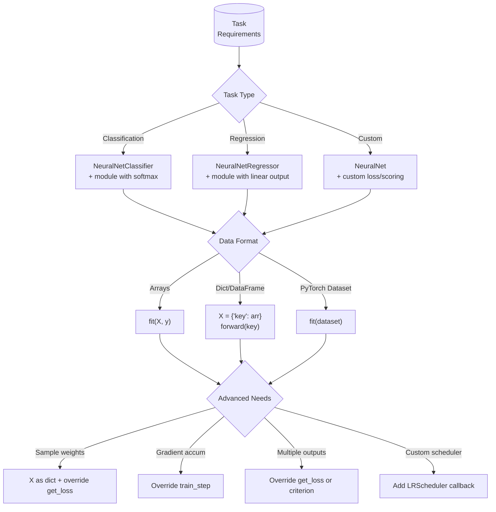

<!-- source: DeepWiki mcp.deepwiki.com · repo skorch-dev/skorch · page 8 Usage Patterns and Examples · fetched 2026-10-21 -->

# Usage Patterns and Examples

<details>
<summary>Relevant source files</summary>

The following files were used as context for generating this wiki page:

- [.github/workflows/testing.yml](.github/workflows/testing.yml)
- [README.rst](README.rst)
- [docs/user/FAQ.rst](docs/user/FAQ.rst)
- [docs/user/callbacks.rst](docs/user/callbacks.rst)
- [docs/user/dataset.rst](docs/user/dataset.rst)
- [docs/user/installation.rst](docs/user/installation.rst)
- [docs/user/neuralnet.rst](docs/user/neuralnet.rst)

</details>


This page provides practical examples and common usage patterns for training neural networks with skorch. It demonstrates how to use the core functionality for various machine learning tasks, from basic classification to advanced training scenarios.

For detailed information about the underlying architecture and components, see [Core Architecture](#2). For information about integrating with scikit-learn tools, see [Using with sklearn Tools](#5.3). For troubleshooting common issues, see [Troubleshooting and FAQ](#11).

## Overview

This document covers concrete usage patterns organized by task type and complexity:

| Pattern Category | Key Classes | Use Cases |
|-----------------|-------------|-----------|
| Basic Classification | `NeuralNetClassifier`, `NeuralNetBinaryClassifier` | Standard classification tasks with class labels |
| Regression | `NeuralNetRegressor` | Predicting continuous values |
| Multi-Format Data | `SliceDict`, `DataFrameTransformer`, `Dataset` | Working with dicts, DataFrames, sparse matrices |
| Advanced Training | Custom callbacks, overridden methods | Gradient accumulation, sample weighting, custom losses |

## Basic Classification Example

The most common usage pattern involves training a classifier with `NeuralNetClassifier`. The workflow follows sklearn conventions while wrapping PyTorch modules.



**Basic Classification Workflow**

The standard pattern demonstrated in [README.rst:43-81]() involves:

1. **Define PyTorch Module**: Create a `torch.nn.Module` subclass with `__init__` and `forward` methods
2. **Instantiate NeuralNetClassifier**: Pass the module class (not instance) and training parameters
3. **Call fit**: Train on numpy arrays or other supported data formats
4. **Make predictions**: Use `predict()` for class labels or `predict_proba()` for probabilities

Key parameters for `NeuralNetClassifier`:
- `module`: PyTorch module class or instance
- `max_epochs`: Number of training epochs
- `lr`: Learning rate
- `iterator_train__shuffle`: Whether to shuffle training batches
- `train_split`: Validation split strategy (default 0.2)

The module's `forward` method should return class probabilities or logits. When using the default `torch.nn.NLLLoss` criterion, `NeuralNetClassifier` automatically applies a logarithm to the outputs [docs/user/neuralnet.rst:108-112]().

**Pipeline Integration**: [README.rst:83-96]() demonstrates using `NeuralNetClassifier` in sklearn pipelines with `StandardScaler`.

**Grid Search Integration**: [README.rst:98-114]() shows hyperparameter tuning with `GridSearchCV`. Important: set `train_split=False` and `verbose=0` when using cross-validation tools, as they handle validation splitting internally [docs/user/neuralnet.rst:210-214]().

Sources: [README.rst:43-114](), [docs/user/neuralnet.rst:8-29](), [docs/user/neuralnet.rst:108-116]()

## Regression Tasks

For regression tasks, use `NeuralNetRegressor` instead of `NeuralNetClassifier`. The main differences are the default criterion and the absence of class-specific methods.



**Classifier vs Regressor Differences**

The `NeuralNetRegressor` class:
- Uses `torch.nn.MSELoss` as default criterion instead of `torch.nn.NLLLoss` [docs/user/neuralnet.rst:114-116]()
- Returns predicted values directly from `predict()` without argmax
- Does not have `predict_proba()` method
- Has a `score()` method that returns R² coefficient of determination

The module design for regression is simpler since no softmax or log operations are needed in the output layer. The `forward` method should return raw predicted values.

Sources: [docs/user/neuralnet.rst:114-116](), [docs/user/neuralnet.rst:389-396]()

## Working with Different Data Types

skorch supports multiple input formats beyond simple numpy arrays, enabling flexible data handling for complex architectures.

### Dictionary Inputs

When your model requires multiple input arrays with different shapes, pass them as a dictionary. The dictionary keys must match the parameter names in the module's `forward` method.



**Dictionary Input Flow**

Example from [docs/user/neuralnet.rst:467-478]():
- Create dictionary with meaningful keys: `X_dict = {'tokens': tokens, 'num_tokens': num_tokens}`
- Module's `forward` method signature must match: `def forward(self, tokens, num_tokens)`
- Use `SliceDict` wrapper for sklearn compatibility [docs/user/FAQ.rst:58-67]()

For preventing automatic unpacking (e.g., when using external modules), wrap the module and repack the dict [docs/user/dataset.rst:148-167]().

Sources: [docs/user/neuralnet.rst:454-497](), [docs/user/dataset.rst:90-133]()

### Multiple Inputs with Dataset Class

The `Dataset` class in skorch wraps various data formats and applies transformations before batching [docs/user/dataset.rst:61-147]().

Supported formats:
- `numpy.ndarray`
- PyTorch `torch.Tensor`
- scipy sparse CSR matrices (converted to dense during batching)
- pandas DataFrames or Series
- Dictionaries of the above
- Lists of the above

The `Dataset` class from [docs/user/dataset.rst:99-128]() shows how DataFrame column names or dictionary keys are automatically mapped to `forward` method parameters.

For custom data transformations, subclass `Dataset` and override the `transform` method [docs/user/dataset.rst:139-146]().

Sources: [docs/user/dataset.rst:61-147](), [docs/user/neuralnet.rst:422-497]()

### PyTorch Dataset Integration

Native PyTorch `Dataset` classes work with skorch if their `__getitem__` returns exactly two values (X and y).



**PyTorch Dataset Compatibility**

Example from [docs/user/FAQ.rst:220-265]():
- Dataset must implement `__len__()` and `__getitem__()`
- `__getitem__` must return tuple of (X, y)
- Pass dataset directly to `fit()`: `net.fit(train_ds)`
- May pass `y=None` when fitting, but some sklearn tools may fail [docs/user/neuralnet.rst:336-340]()

For datasets returning more than two values, override `__getitem__` to rearrange outputs [docs/user/neuralnet.rst:448-452]().

Sources: [docs/user/FAQ.rst:220-266](), [docs/user/neuralnet.rst:438-453]()

### Predefined Train/Validation Split

When you have already split your data, use `predefined_split` to avoid re-splitting.

Example from [docs/user/FAQ.rst:135-172]():
- Wrap validation dataset: `valid_ds = predefined_split(valid_dataset)`
- Pass to `train_split` parameter: `NeuralNet(..., train_split=valid_ds)`
- Works with both PyTorch datasets and skorch `Dataset` objects

Sources: [docs/user/FAQ.rst:135-173]()

## Advanced Training Patterns

### Sample Weighting

To apply different weights to training samples, pass sample weights as part of the input dictionary and override `get_loss`.



**Sample Weighting Pattern**

The pattern from [docs/user/FAQ.rst:84-133]() involves:

1. **Add weights to input**: `X = {'data': features, 'sample_weight': weights}`
2. **Accept in forward**: `def forward(self, data, sample_weight)` - typically ignore sample_weight here
3. **Set reduce=False**: `criterion__reduce=False` to get per-sample losses
4. **Override get_loss**: Extract sample_weight from X and apply to unreduced loss
5. **Return weighted mean**: `(sample_weight * loss_unreduced).mean()`

This pattern ensures sample weights are properly batched and applied during training.

Sources: [docs/user/FAQ.rst:84-133]()

### Gradient Accumulation

For training with larger effective batch sizes than GPU memory allows, implement gradient accumulation by customizing the training step.

The pattern from [docs/user/FAQ.rst:289-335]() requires:

1. **Subclass NeuralNet**: Create custom class with `acc_steps` parameter
2. **Normalize loss**: Divide loss by `acc_steps` in `get_loss()`
3. **Override train_step**: Only call `optimizer.step()` every n batches
4. **Track batch count**: Use `len(self.history[-1, 'batches'])` to count batches

Key consideration: Handle last batch of epoch if batch count doesn't divide evenly by accumulation steps [docs/user/FAQ.rst:326-330]().

Alternative: Use `AccelerateMixin` from the Hugging Face accelerate integration [docs/user/FAQ.rst:332-335]().

Sources: [docs/user/FAQ.rst:289-336]()

### Multiple Return Values from Forward

When the module's `forward` method returns multiple values, handle them explicitly in `get_loss` or use a custom criterion.

From [docs/user/FAQ.rst:268-287]():
- Return tuple from `forward`: `return output, auxiliary_output`
- Override `get_loss` to unpack tuple: `y_pred, aux = y_pred`
- Or implement criterion that accepts tuple
- Use `forward()` or `forward_iter()` methods to inspect all outputs

Sources: [docs/user/FAQ.rst:268-288]()

### Custom Loss Functions

Override `get_loss` to implement custom loss computation that accesses batch data, model predictions, and targets.



**Custom Loss Pattern**

The `get_loss` method receives [docs/user/FAQ.rst:124-129]():
- `y_pred`: Model predictions
- `y_true`: Target values
- `X`: Input data (useful for accessing sample weights or other metadata)
- Additional `*args, **kwargs`

Common customizations:
- Weighted losses using sample weights from X
- Combined losses from multiple outputs
- Regularization terms based on model parameters

Sources: [docs/user/FAQ.rst:124-129](), [docs/user/FAQ.rst:268-287]()

### Dynamic Input Size Determination

Set module parameters dynamically based on input data shape using a callback that triggers before training.

Pattern from [docs/user/FAQ.rst:337-367]():

1. **Create callback**: `class InputShapeSetter(Callback)`
2. **Override on_train_begin**: `def on_train_begin(self, net, X, y)`
3. **Set module parameter**: `net.set_params(module__input_dim=X.shape[1])`
4. **Add to callbacks**: `callbacks=[InputShapeSetter()]`

This allows the module to be instantiated with the correct input dimensions at training time rather than requiring them to be specified upfront.

Sources: [docs/user/FAQ.rst:337-367]()

### Shuffling Training Data

Control data shuffling through the `iterator_train__shuffle` parameter, which passes through to PyTorch's `DataLoader`.

From [docs/user/FAQ.rst:37-56]():
- Enable shuffling: `iterator_train__shuffle=True`
- Separate control for train and validation: `iterator_train` vs `iterator_valid`
- Generally only shuffle training data, not validation/test data

The double-underscore notation passes parameters to the underlying `DataLoader` [docs/user/FAQ.rst:43-51]().

Sources: [docs/user/FAQ.rst:37-56]()

### L2 Regularization

Apply L2 regularization (weight decay) via optimizer parameters using double-underscore notation.

Example from [docs/user/FAQ.rst:8-21]():
```python
net = NeuralNet(..., optimizer__weight_decay=0.01)
```

This passes `weight_decay` directly to the PyTorch optimizer constructor.

Sources: [docs/user/FAQ.rst:8-21]()

### Continuing Training

Two mechanisms for continuing training from a previous state:

| Method | Use Case | Behavior |
|--------|----------|----------|
| `partial_fit()` | Continue single training session | Always continues from current state [docs/user/FAQ.rst:24-35]() |
| `warm_start=True` | Multiple fit() calls | Each fit() continues from previous state [docs/user/neuralnet.rst:282-292]() |

From [docs/user/FAQ.rst:24-35]():
- Default `fit()` behavior: Re-initializes model from scratch (sklearn convention)
- `partial_fit()`: Continues training regardless of `warm_start` setting
- `warm_start=True`: Makes `fit()` behave like `partial_fit()`

Use `partial_fit()` for incremental learning when data doesn't fit in memory [docs/user/neuralnet.rst:347-348]().

Sources: [docs/user/FAQ.rst:24-35](), [docs/user/neuralnet.rst:282-292](), [docs/user/neuralnet.rst:342-349]()

## Common Patterns Summary



**Pattern Selection Guide**

Key decision points:
1. **Task type** determines base class (`NeuralNetClassifier` vs `NeuralNetRegressor` vs `NeuralNet`)
2. **Data format** determines input preparation (arrays, dicts, datasets)
3. **Advanced requirements** determine which methods to override or callbacks to add

Sources: [README.rst:43-126](), [docs/user/neuralnet.rst:1-561](), [docs/user/FAQ.rst:1-544]()

---

