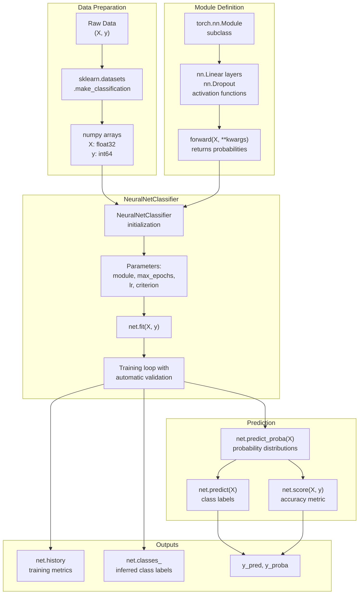
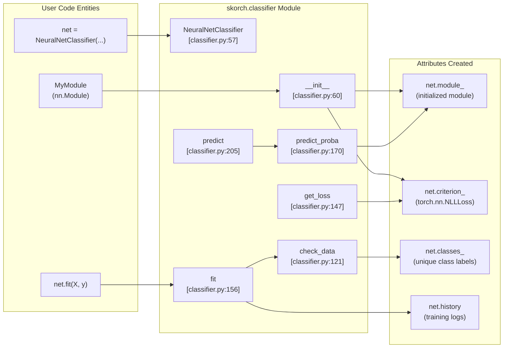
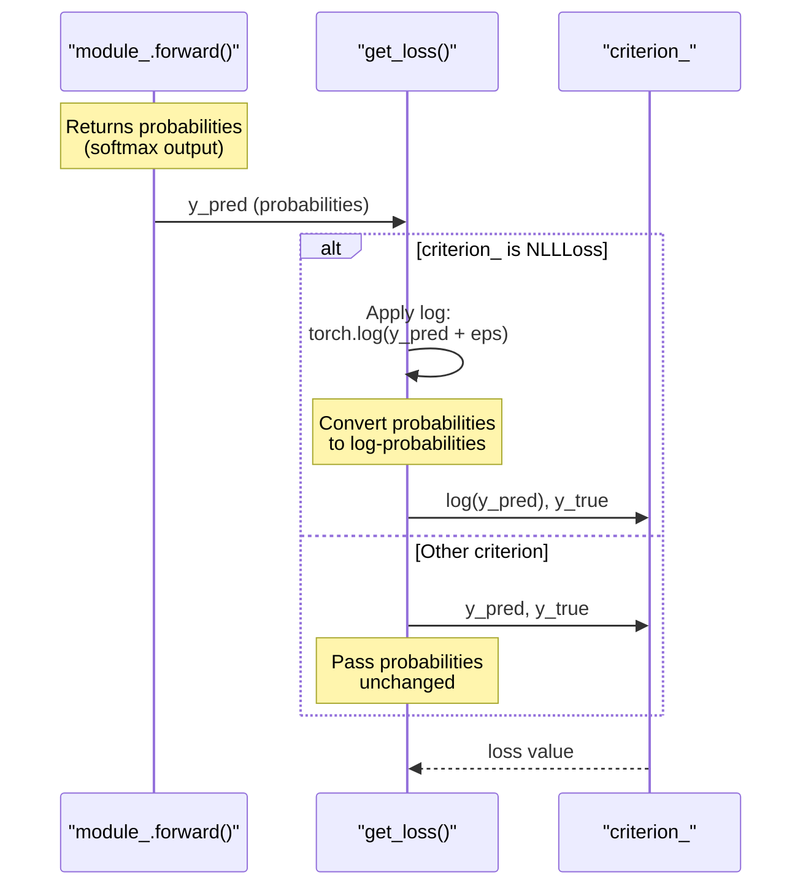

<!-- source: DeepWiki mcp.deepwiki.com · repo skorch-dev/skorch · page 8.1 Basic Classification · fetched 2026-10-21 -->

# Basic Classification

<details>
<summary>Relevant source files</summary>

The following files were used as context for generating this wiki page:

- [.github/workflows/testing.yml](.github/workflows/testing.yml)
- [README.rst](README.rst)
- [docs/user/installation.rst](docs/user/installation.rst)
- [skorch/classifier.py](skorch/classifier.py)
- [skorch/tests/test_classifier.py](skorch/tests/test_classifier.py)
- [skorch/tests/test_regressor.py](skorch/tests/test_regressor.py)

</details>


## Purpose and Scope

This page demonstrates how to perform basic classification tasks using `NeuralNetClassifier`, the primary class for multi-class classification in skorch. It covers the fundamental workflow from defining a PyTorch module through training and making predictions.

For binary classification tasks specifically, see [Regression Tasks](#8.2). For more advanced classification patterns including custom loss functions and sample weighting, see [Advanced Training Patterns](#8.4). For integration with scikit-learn tools like `GridSearchCV` and `Pipeline`, see [Using with sklearn Tools](#5.3).

---

## NeuralNetClassifier Overview

`NeuralNetClassifier` is a subclass of `NeuralNet` that adds classification-specific functionality:

| Feature | Description | Default Value |
|---------|-------------|---------------|
| Criterion | Loss function for training | `torch.nn.NLLLoss` |
| Train Split | Automatic train/validation split | `ValidSplit(5, stratified=True)` |
| Classes Inference | Automatically determines unique classes from `y` | Inferred from data |
| Default Metrics | Validation accuracy tracked by default | `valid_acc` |
| Output Processing | Expects probability distributions from module | Applies log for NLLLoss |
| Predict Method | Returns class labels (argmax of probabilities) | N/A |

**Sources:** [skorch/classifier.py:57-76]()

---

## Classification Workflow



**Sources:** [README.rst:43-82](), [skorch/classifier.py:57-169]()

---

## Basic Classification Example

The following example from the README demonstrates a complete classification workflow:

### Step 1: Prepare Data

Data should be prepared as numpy arrays with appropriate dtypes:

```python
X, y = make_classification(1000, 20, n_informative=10, random_state=0)
X = X.astype(np.float32)  # Convert to float32
y = y.astype(np.int64)    # Convert to int64
```

**Key Requirements:**
- `X`: Feature matrix, typically `np.float32`
- `y`: Target labels, typically `np.int64`
- Binary or multi-class labels supported

**Sources:** [README.rst:50-52]()

### Step 2: Define PyTorch Module

The module must return probability distributions (before log transformation):

```python
class MyModule(nn.Module):
    def __init__(self, num_units=10, nonlin=nn.ReLU()):
        super().__init__()
        self.dense0 = nn.Linear(20, num_units)
        self.nonlin = nonlin
        self.dropout = nn.Dropout(0.5)
        self.dense1 = nn.Linear(num_units, num_units)
        self.output = nn.Linear(num_units, 2)
        self.softmax = nn.Softmax(dim=-1)  # Returns probabilities

    def forward(self, X, **kwargs):
        X = self.nonlin(self.dense0(X))
        X = self.dropout(X)
        X = self.nonlin(self.dense1(X))
        X = self.softmax(self.output(X))
        return X
```

**Module Requirements:**
- Output shape must match number of classes: `(batch_size, n_classes)`
- For default `NLLLoss`, output must be probabilities (0-1 range, sum to 1)
- Must accept `**kwargs` in forward method for compatibility

**Sources:** [README.rst:54-70]()

### Step 3: Initialize and Fit

```python
net = NeuralNetClassifier(
    MyModule,
    max_epochs=10,
    lr=0.1,
    iterator_train__shuffle=True,  # Shuffle training data
)

net.fit(X, y)
```

**Automatic Behaviors:**
- Module instantiation (lazy initialization)
- Optimizer creation (`torch.optim.SGD` by default)
- Train/validation split (80/20 stratified by default)
- Training loop with callback execution

**Sources:** [README.rst:72-80]()

### Step 4: Make Predictions

```python
# Probability distributions for all classes
y_proba = net.predict_proba(X)  # Shape: (n_samples, n_classes)

# Class labels (argmax of probabilities)
y_pred = net.predict(X)  # Shape: (n_samples,)

# Accuracy score
accuracy = net.score(X, y)
```

**Sources:** [README.rst:81](), [skorch/classifier.py:170-235]()

---

## Component Mapping



**Sources:** [skorch/classifier.py:57-235]()

---

## Classes Inference

`NeuralNetClassifier` automatically infers unique class labels from the target data:


**Key Points:**
- Classes are inferred by calling `np.unique(y)` during `fit()`
- Stored in `classes_inferred_` attribute
- Accessed via `classes_` property
- Can be explicitly provided via `classes` parameter
- Works with gaps in class labels (e.g., [1, 2, 4, 5] without 0 or 3)

**Sources:** [skorch/classifier.py:98-144](), [skorch/tests/test_classifier.py:111-133]()

---

## Loss Function and Output Processing

`NeuralNetClassifier` has special handling for `NLLLoss`:



**Implementation:**
- Module should output probabilities (softmax)
- `get_loss()` automatically applies log transformation for `NLLLoss`
- For other criteria (e.g., `CrossEntropyLoss`), probabilities pass through unchanged
- Small epsilon added to prevent `log(0)` errors

**Sources:** [skorch/classifier.py:147-153](), [skorch/tests/test_classifier.py:76-102]()

---

## Prediction Methods

### predict_proba()

Returns probability distributions for all classes:

| Aspect | Details |
|--------|---------|
| Method Signature | `net.predict_proba(X)` |
| Return Type | `numpy.ndarray` |
| Shape | `(n_samples, n_classes)` |
| Value Range | [0, 1] with rows summing to 1 |
| Source | Module forward pass output |

**Sources:** [skorch/classifier.py:170-203](), [skorch/tests/test_classifier.py:61-68]()

### predict()

Returns class labels by taking argmax of probabilities:

```python
def predict(self, X):
    return self.predict_proba(X).argmax(axis=1)
```

| Aspect | Details |
|--------|---------|
| Method Signature | `net.predict(X)` |
| Return Type | `numpy.ndarray` |
| Shape | `(n_samples,)` |
| Values | Class labels from `classes_` |
| Implementation | `argmax(predict_proba(X), axis=1)` |

**Sources:** [skorch/classifier.py:205-235]()

### score()

Returns accuracy score (inherited from `ClassifierMixin`):

| Aspect | Details |
|--------|---------|
| Method Signature | `net.score(X, y)` |
| Return Type | `float` |
| Value Range | [0.0, 1.0] |
| Metric | Accuracy (fraction of correct predictions) |
| Source | `sklearn.base.ClassifierMixin` |

**Sources:** [skorch/tests/test_classifier.py:70-73]()

---

## Default Callbacks

`NeuralNetClassifier` includes default callbacks for common metrics:

| Callback | Name | Purpose | When Triggered |
|----------|------|---------|----------------|
| `EpochTimer` | 'epoch_timer' | Times each epoch | Every epoch |
| `PassthroughScoring` | 'train_loss' | Records training loss | After each batch (training) |
| `PassthroughScoring` | 'valid_loss' | Records validation loss | After validation |
| `EpochScoring` | 'valid_acc' | Computes validation accuracy | After validation |
| `PrintLog` | 'print_log' | Prints training progress | After each epoch |

**Accessing Metrics:**

```python
# Training and validation loss per epoch
train_losses = net.history[:, 'train_loss']
valid_losses = net.history[:, 'valid_loss']

# Validation accuracy per epoch
valid_accuracies = net.history[:, 'valid_acc']

# Most recent metrics
last_train_loss = net.history[-1, 'train_loss']
last_valid_acc = net.history[-1, 'valid_acc']
```

**Sources:** [skorch/classifier.py:79-95](), [skorch/tests/test_classifier.py:309-314]()

---

## Key Parameters

### Initialization Parameters

```python
NeuralNetClassifier(
    module,                              # PyTorch module class or instance
    criterion=torch.nn.NLLLoss,         # Loss function
    optimizer=torch.optim.SGD,          # Optimizer class
    lr=0.01,                            # Learning rate
    max_epochs=10,                      # Number of training epochs
    batch_size=128,                     # Batch size for training
    iterator_train__shuffle=True,       # Shuffle training data
    train_split=ValidSplit(5, stratified=True),  # Validation split
    callbacks='default',                # Callback list or 'default'
    classes=None,                       # Explicit class labels (optional)
    device='cpu',                       # Device for training
)
```

### Common Parameter Patterns

| Pattern | Example | Purpose |
|---------|---------|---------|
| Module parameters | `module__num_units=20` | Pass args to module `__init__` |
| Optimizer parameters | `optimizer__momentum=0.9` | Configure optimizer |
| Iterator parameters | `iterator_train__num_workers=4` | Configure DataLoader |
| Criterion parameters | `criterion__weight=class_weights` | Pass args to loss function |

**Sources:** [skorch/classifier.py:60-76](), [README.rst:72-78]()

---

## Common Patterns

### Disabling Train Split for Cross-Validation

When using sklearn's `cross_val_score` or `GridSearchCV`, disable internal validation:

```python
net.set_params(train_split=False, verbose=0)
```

**Sources:** [README.rst:105]()

### Custom Module Parameters via Double Underscore

```python
net = NeuralNetClassifier(
    MyModule,
    module__num_units=20,      # Passed to MyModule.__init__
    module__nonlin=nn.Tanh(),
)
```

**Sources:** [README.rst:109]()

### Explicit Classes

When classes cannot be inferred (e.g., training without `y`), provide explicitly:

```python
net = NeuralNetClassifier(
    MyModule,
    classes=['cat', 'dog', 'bird'],  # Explicit class labels
)
```

**Sources:** [skorch/tests/test_classifier.py:135-137]()

### Working with PyTorch Datasets

When using `torch.utils.data.Dataset` or `TensorDataset`:

```python
dataset = torch.utils.data.TensorDataset(X_tensor, y_tensor)
net.fit(dataset, y=y_tensor)  # Pass y explicitly for class inference
```

**Sources:** [skorch/tests/test_classifier.py:139-147]()

---

## Troubleshooting

### Classes Cannot Be Inferred

**Error:** `AttributeError: NeuralNetClassifier could not infer the classes from y`

**Cause:** Training with a custom Dataset that doesn't expose `y`, or training with `y=None`

**Solution:** Provide `classes` parameter explicitly:

```python
net = NeuralNetClassifier(MyModule, classes=[0, 1, 2, 3])
```

**Sources:** [skorch/classifier.py:107-118](), [skorch/tests/test_classifier.py:180-205]()

### Module Output Shape Mismatch

**Error:** Loss computation fails or gives unexpected results

**Cause:** Module output shape doesn't match number of classes

**Solution:** Ensure module output has shape `(batch_size, n_classes)`:

```python
# Correct: output layer matches number of classes
self.output = nn.Linear(hidden_units, n_classes)
self.softmax = nn.Softmax(dim=-1)
```

**Sources:** [README.rst:54-70]()

### High Loss with NLLLoss

**Error:** Loss is very negative or NaN

**Cause:** Module not outputting probabilities (values not in [0, 1])

**Solution:** Apply softmax in module's forward method:

```python
def forward(self, X, **kwargs):
    X = self.final_layer(X)
    X = nn.Softmax(dim=-1)(X)  # Required for NLLLoss
    return X
```

**Sources:** [skorch/classifier.py:147-153](), [skorch/tests/test_classifier.py:76-89]()

---

