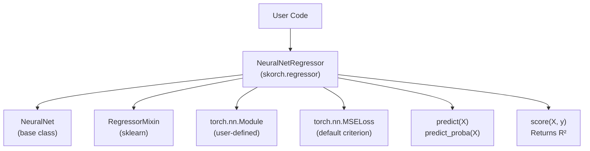
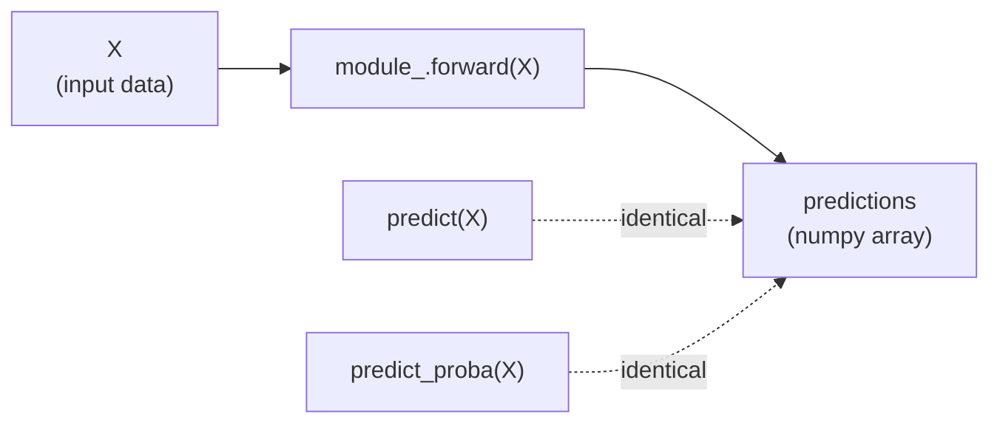
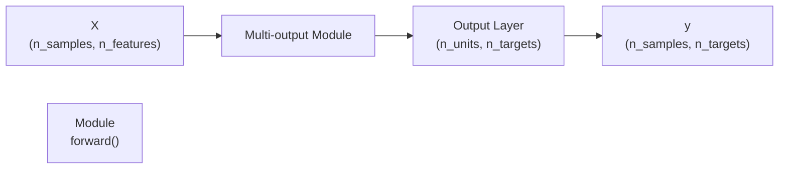
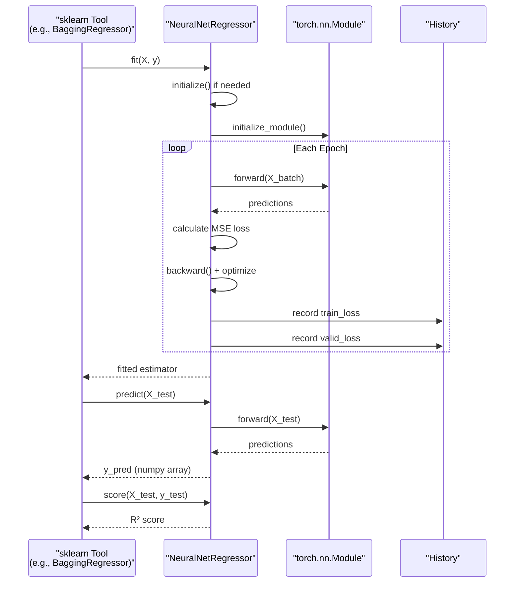

<!-- source: DeepWiki mcp.deepwiki.com · repo skorch-dev/skorch · page 8.2 Regression Tasks · fetched 2026-10-21 -->

# Regression Tasks

<details>
<summary>Relevant source files</summary>

The following files were used as context for generating this wiki page:

- [docs/user/FAQ.rst](docs/user/FAQ.rst)
- [docs/user/callbacks.rst](docs/user/callbacks.rst)
- [docs/user/dataset.rst](docs/user/dataset.rst)
- [docs/user/neuralnet.rst](docs/user/neuralnet.rst)
- [skorch/classifier.py](skorch/classifier.py)
- [skorch/tests/test_classifier.py](skorch/tests/test_classifier.py)
- [skorch/tests/test_regressor.py](skorch/tests/test_regressor.py)

</details>


## Purpose and Scope

This page documents how to use skorch for regression tasks through the `NeuralNetRegressor` class. It covers basic usage patterns, configuration, prediction methods, and integration with scikit-learn tools for continuous target variables.

For classification tasks, see [Basic Classification](#8.1). For general `NeuralNet` concepts, see [NeuralNet Base Class](#2.1). For more advanced training patterns applicable to both regression and classification, see [Advanced Training Patterns](#8.4).

---

## NeuralNetRegressor Overview

`NeuralNetRegressor` is a subclass of `NeuralNet` that specializes in regression tasks. It provides a scikit-learn compatible interface for training PyTorch models on continuous target data.

### Key Features

| Feature | Description |
|---------|-------------|
| **Default Criterion** | `torch.nn.MSELoss` (mean squared error) |
| **Score Method** | Returns R² (coefficient of determination) |
| **Predict Methods** | Both `predict()` and `predict_proba()` return identical predictions |
| **Multi-Output** | Supports multiple regression targets |
| **sklearn Compatible** | Works with `GridSearchCV`, `cross_val_score`, `BaggingRegressor`, etc. |

**Sources:** [skorch/tests/test_regressor.py:16-201](), [docs/user/neuralnet.rst:114-116]()

---

## Component Architecture



**Diagram: NeuralNetRegressor Class Structure**

This diagram shows how `NeuralNetRegressor` inherits from both `NeuralNet` (for neural network lifecycle management) and sklearn's `RegressorMixin` (for the `score()` method that returns R²).

**Sources:** [skorch/tests/test_regressor.py:33-35](), [docs/user/neuralnet.rst:114-116]()

---

## Basic Usage Pattern

### Minimal Example

A basic regression workflow follows this pattern:

1. Define a PyTorch module with continuous output
2. Instantiate `NeuralNetRegressor` with the module
3. Call `fit(X, y)` with training data
4. Use `predict(X)` for inference

**Code Reference Pattern:**
```python
# Module definition (user code)
class MyModule(torch.nn.Module):
    def __init__(self, num_units=10):
        super().__init__()
        self.dense = torch.nn.Linear(20, num_units)
        self.output = torch.nn.Linear(num_units, 1)
    
    def forward(self, X):
        hidden = F.relu(self.dense(X))
        return self.output(hidden)

# Network instantiation
net = NeuralNetRegressor(
    module=MyModule,
    max_epochs=20,
    lr=0.1,
)

# Training
net.fit(X, y)

# Prediction
y_pred = net.predict(X_test)
```

**Sources:** [skorch/tests/test_regressor.py:22-43](), [docs/user/neuralnet.rst:18-28]()

---

## Default Configuration

### Criterion and Optimizer

`NeuralNetRegressor` uses the following defaults:

| Parameter | Default Value | Purpose |
|-----------|---------------|---------|
| `criterion` | `torch.nn.MSELoss` | Mean squared error loss |
| `optimizer` | `torch.optim.SGD` | Stochastic gradient descent |
| `lr` | `0.01` | Learning rate |
| `max_epochs` | `10` | Number of training epochs |
| `batch_size` | `128` | Batch size for training and validation |
| `train_split` | `ValidSplit(5)` | 20% validation split |

**Sources:** [docs/user/neuralnet.rst:114-116](), [skorch/tests/test_regressor.py:38-43]()

### Default Callbacks

The regressor includes these callbacks by default:

- `EpochTimer`: Tracks epoch duration
- `PassthroughScoring` for train loss: Records average training loss per epoch
- `PassthroughScoring` for valid loss: Records average validation loss per epoch
- `PrintLog`: Prints training progress

**Note:** Unlike `NeuralNetClassifier`, the regressor does NOT include a default accuracy callback, since accuracy is not meaningful for continuous targets.

**Sources:** [skorch/tests/test_regressor.py:112-115]()

---

## Prediction Methods

### predict() and predict_proba()



**Diagram: Prediction Method Equivalence**

For `NeuralNetRegressor`, both `predict()` and `predict_proba()` return identical outputs. This differs from classification, where `predict_proba()` returns probabilities and `predict()` returns class labels.

**Test Evidence:**
```python
# From test suite
y_pred = net_fit.predict(X)
y_proba = net_fit.predict_proba(X)
# These are identical for regression
assert np.allclose(y_pred, y_proba, atol=1e-6)
```

**Sources:** [skorch/tests/test_regressor.py:117-126]()

---

## Scoring

### R² Score Method

The `score(X, y)` method returns the coefficient of determination (R² score), consistent with scikit-learn's regression estimators.

**R² Score Properties:**
- Range: (-∞, 1]
- Perfect prediction: R² = 1
- Mean baseline: R² = 0
- Worse than mean: R² < 0

**Test Evidence:**
```python
r2_score = net_fit.score(X, y)
assert r2_score <= 1.
```

**Sources:** [skorch/tests/test_regressor.py:128-131](), [docs/user/neuralnet.rst:389-396]()

---

## Multi-Output Regression

`NeuralNetRegressor` supports multiple continuous target variables without special configuration.

### Multi-Output Example Structure



**Diagram: Multi-Output Regression Flow**

### Module Requirements

For multi-output regression, the module's output layer should have units equal to the number of targets:

**Code Pattern:**
```python
# Module with 3 output units for 3 targets
from skorch.toy import make_regressor
module = make_regressor(output_units=3, dropout=0.5)

net = NeuralNetRegressor(module, max_epochs=1, lr=0.1)
net.fit(X, y)  # y has shape (n_samples, 3)
r2_score = net.score(X, y)  # Returns scalar R² score
```

**Sources:** [skorch/tests/test_regressor.py:46-56](), [skorch/tests/test_regressor.py:133-137]()

---

## Module Output Shape Requirements

### 1D vs 2D Output Behavior

The module can return predictions in two shapes:

| Output Shape | Use Case | Behavior |
|--------------|----------|----------|
| `(n,)` | Single target, 1D output | Accepted without warning |
| `(n, 1)` | Single target, 2D output | Standard and recommended |
| `(n, k)` where k>1 | Multiple targets | Multi-output regression |

### Dimension Mismatch Warning

**Important:** If the module output and target have mismatched dimensions, PyTorch's MSE loss will broadcast them, potentially causing incorrect results. Skorch tests ensure this warning is surfaced:

```python
# If y is 1D but module outputs 2D:
# PyTorch warning: "This will likely lead to incorrect results 
# due to broadcasting. Please ensure they have the same size"
```

**Solutions:**

1. **Recommended:** Use 2D targets and 2D module outputs
   ```python
   y = y.reshape(-1, 1)  # Ensure y is 2D
   ```

2. **For sklearn compatibility:** Use 1D target AND 1D module output
   ```python
   # Module that returns 1D (e.g., with squeeze_output=True)
   from skorch.toy import MLPModule
   module = partial(MLPModule, output_units=1, squeeze_output=True)
   net = NeuralNetRegressor(module)
   net.fit(X, y.flatten())  # Both are 1D
   ```

**Sources:** [skorch/tests/test_regressor.py:139-181]()

---

## Integration with scikit-learn

### Training Lifecycle Compatibility



**Diagram: NeuralNetRegressor with sklearn Tools**

**Sources:** [skorch/tests/test_regressor.py:183-200]()

### BaggingRegressor Example

`NeuralNetRegressor` works seamlessly with sklearn's ensemble methods:

**Code Reference:**
```python
from sklearn.ensemble import BaggingRegressor
from skorch import NeuralNetRegressor
from skorch.toy import MLPModule
from functools import partial

# Module that returns 1D output for sklearn compatibility
module = partial(MLPModule, output_units=1, squeeze_output=True)
net = NeuralNetRegressor(module)

# Use in BaggingRegressor
regr = BaggingRegressor(net, n_estimators=2, random_state=0)
regr.fit(X, y.flatten())  # sklearn expects 1D targets
```

**Key Requirements:**
- Target `y` must be 1D (use `y.flatten()`)
- Module must return 1D output to avoid shape mismatch
- This pattern works with other sklearn meta-estimators

**Sources:** [skorch/tests/test_regressor.py:183-200]()

### GridSearchCV for Hyperparameter Tuning

`NeuralNetRegressor` supports hyperparameter search:

**Pattern:**
```python
from sklearn.model_selection import GridSearchCV

net = NeuralNetRegressor(module=MyModule)

param_grid = {
    'lr': [0.01, 0.1, 1.0],
    'max_epochs': [10, 20],
    'module__hidden_units': [10, 50, 100],
}

search = GridSearchCV(net, param_grid, cv=3)
search.fit(X, y)
best_net = search.best_estimator_
```

**Sources:** [docs/user/FAQ.rst:8-21](), [docs/user/callbacks.rst:284-295]()

---

## Common Patterns

### Custom Loss Functions

Override the default MSE loss by passing a different criterion:

**Pattern:**
```python
import torch.nn as nn

net = NeuralNetRegressor(
    module=MyModule,
    criterion=nn.L1Loss,  # Mean absolute error
    max_epochs=10,
)

# Or with parameters
net = NeuralNetRegressor(
    module=MyModule,
    criterion=nn.HuberLoss,
    criterion__delta=1.0,  # Huber loss parameter
    max_epochs=10,
)
```

**Sources:** [docs/user/neuralnet.rst:102-119]()

### Sample Weighting

For weighted regression (where some samples are more important), pass weights as part of input dictionary:

**Reference:** See [FAQ: I want to use sample_weight](#11) for the complete pattern. The approach involves:

1. Pass `X` as a dictionary with data and weights
2. Override `get_loss()` to apply weights
3. Ensure criterion uses `reduce=False`

**Sources:** [docs/user/FAQ.rst:84-132]()

### Setting Input Size Dynamically

When input dimensions are unknown until runtime (e.g., after feature selection):

**Pattern:**
```python
from skorch.callbacks import Callback

class InputShapeSetter(Callback):
    def on_train_begin(self, net, X, y):
        net.set_params(module__input_dim=X.shape[1])

net = NeuralNetRegressor(
    MyModule,
    callbacks=[InputShapeSetter()],
)
```

**Sources:** [docs/user/FAQ.rst:337-367]()

---

## Training Verification

### Monitoring Training Progress

Default callbacks track loss metrics in `history`:

**Pattern:**
```python
net.fit(X, y)

# Access training history
train_losses = net.history[:, 'train_loss']
valid_losses = net.history[:, 'valid_loss']

# Verify learning occurred
assert train_losses[0] > 2 * train_losses[-1]
```

**Expected History Keys:**
- `train_loss`: Average training loss per epoch
- `valid_loss`: Average validation loss per epoch
- `epoch`: Epoch number
- `dur`: Epoch duration
- `batches`: List of batch-level metrics

**Sources:** [skorch/tests/test_regressor.py:101-115]()

### Error States

```mermaid
graph TB
    Net["NeuralNetRegressor"]
    NotInit["NotInitializedError"]
    NotFit["NotFittedError"]
    
    PreInit["Before initialize()"]
    PostInit["After initialize()"]
    PostFit["After fit()"]
    
    PreInit -->|predict(), forward()| NotInit
    PostInit -->|sklearn check_is_fitted()| NotFit
    PostFit -->|All methods work| Net
```

**Diagram: NeuralNetRegressor State Machine**

**Error Messages:**
- `NotInitializedError`: "This NeuralNetRegressor instance is not initialized yet. Call 'initialize' or 'fit' with appropriate arguments before using this method."
- `NotFittedError`: "This NeuralNetRegressor instance is not fitted yet. Call 'fit' with appropriate arguments before using this estimator."

**Sources:** [skorch/tests/test_regressor.py:72-99]()

---

## Key Differences from Classification

| Aspect | NeuralNetClassifier | NeuralNetRegressor |
|--------|---------------------|-------------------|
| **Default Criterion** | `NLLLoss` | `MSELoss` |
| **Default Callbacks** | Includes accuracy scoring | No accuracy (continuous targets) |
| **predict() Output** | Class labels (argmax) | Continuous values |
| **predict_proba() Output** | Class probabilities | Same as predict() |
| **score() Method** | Accuracy | R² (coefficient of determination) |
| **Target Processing** | May apply log for NLLLoss | No transformation |
| **classes_ Attribute** | Yes (required by sklearn) | No |

**Sources:** [skorch/classifier.py:57-236](), [skorch/tests/test_regressor.py:117-131](), [docs/user/neuralnet.rst:389-396]()

---

