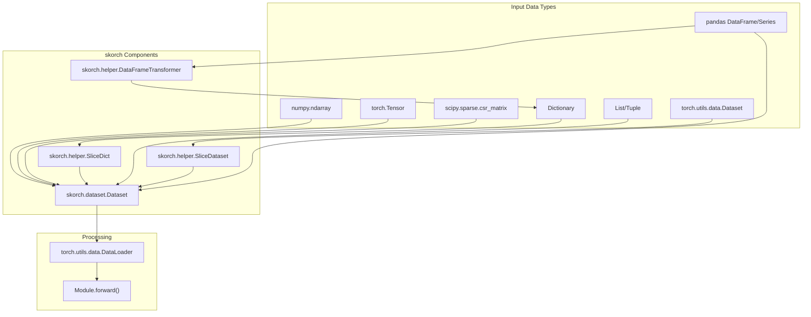
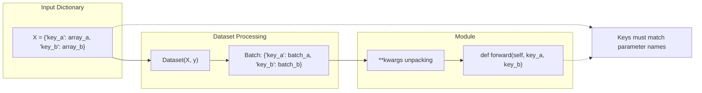
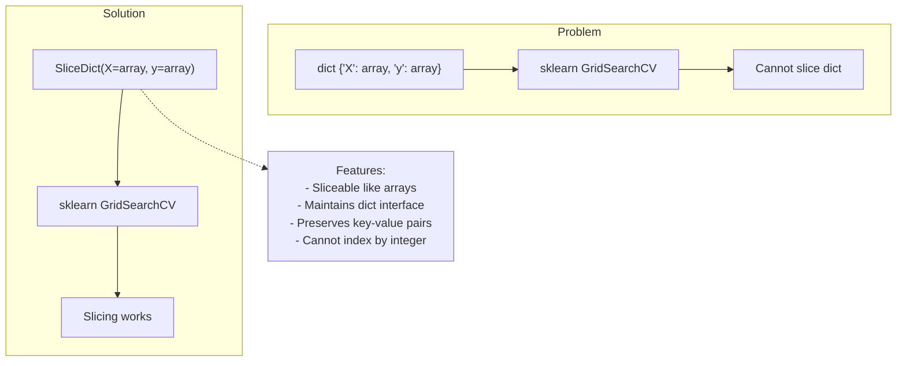
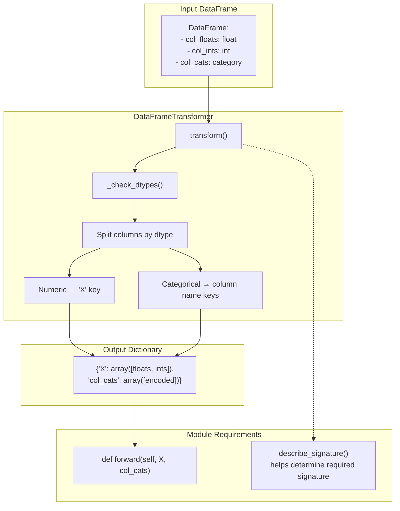
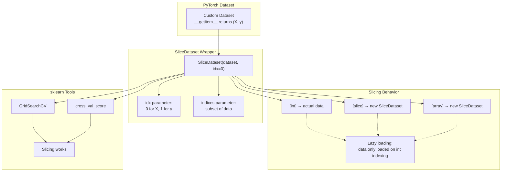
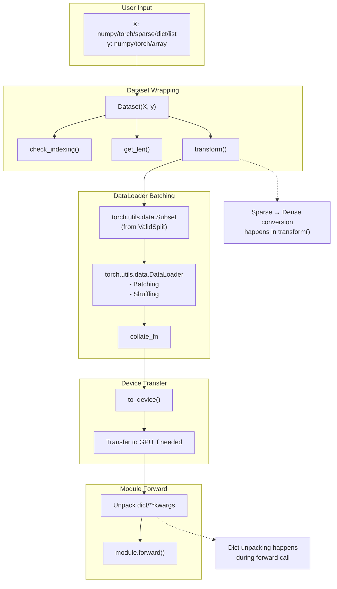

<!-- source: DeepWiki mcp.deepwiki.com · repo skorch-dev/skorch · page 8.3 Working with Different Data Types · fetched 2026-10-21 -->

# Working with Different Data Types

<details>
<summary>Relevant source files</summary>

The following files were used as context for generating this wiki page:

- [docs/user/FAQ.rst](docs/user/FAQ.rst)
- [docs/user/callbacks.rst](docs/user/callbacks.rst)
- [docs/user/dataset.rst](docs/user/dataset.rst)
- [docs/user/neuralnet.rst](docs/user/neuralnet.rst)
- [skorch/dataset.py](skorch/dataset.py)
- [skorch/helper.py](skorch/helper.py)
- [skorch/tests/test_dataset.py](skorch/tests/test_dataset.py)
- [skorch/tests/test_helper.py](skorch/tests/test_helper.py)

</details>


## Purpose and Scope

This page documents how to work with various data formats when using skorch, including numpy arrays, PyTorch tensors, sparse matrices, pandas DataFrames, dictionaries, lists, and PyTorch Datasets. It covers both native support and helper classes that enable compatibility with scikit-learn tools.

For information about the underlying `Dataset` class and `ValidSplit`, see [2.4](#2.4). For details on sklearn integration helpers more broadly, see [5.2](#5.2).

## Overview of Data Type Support

skorch's `Dataset` class provides built-in support for multiple data formats, making it easy to use different data types without additional preprocessing.



**Diagram: Data Type Flow Through skorch**

Sources: [skorch/dataset.py:107-203](), [docs/user/neuralnet.rst:422-497](), [docs/user/dataset.rst:78-98]()

## Natively Supported Data Types

The `Dataset` class directly supports the following data types without requiring any special handling:

| Data Type | Description | Notes |
|-----------|-------------|-------|
| `numpy.ndarray` | NumPy arrays | Most common format |
| `torch.Tensor` | PyTorch tensors | Native PyTorch format |
| `scipy.sparse.csr_matrix` | Sparse matrices in CSR format | Converted to dense during batching |
| `pandas.DataFrame` | Pandas DataFrames | Column names used as forward arguments |
| `pandas.Series` | Pandas Series | Treated as single column |

The `Dataset` class automatically handles conversion between these types and PyTorch tensors during training.

Sources: [skorch/dataset.py:118-126](), [docs/user/neuralnet.rst:428-431](), [docs/user/dataset.rst:78-88]()

### Basic Usage Example

```python
import numpy as np
import torch
from scipy import sparse
from skorch import NeuralNetClassifier

# NumPy arrays (most common)
X_numpy = np.random.randn(100, 20).astype(np.float32)
y_numpy = np.random.randint(0, 2, 100)

# PyTorch tensors
X_torch = torch.randn(100, 20)
y_torch = torch.randint(0, 2, (100,))

# Sparse matrices
X_sparse = sparse.csr_matrix(np.random.randn(100, 20).astype(np.float32))

# All work directly with NeuralNet
net = NeuralNetClassifier(MyModule, ...)
net.fit(X_numpy, y_numpy)  # Works
net.fit(X_torch, y_torch)  # Works
net.fit(X_sparse, y_numpy)  # Works
```

Sources: [skorch/dataset.py:141-165](), [skorch/tests/test_dataset.py:28-52]()

## Dictionary Inputs

Dictionary inputs are particularly powerful because they allow passing multiple different inputs to your module's `forward` method as named arguments.

### How Dictionary Keys Map to Forward Arguments

When `X` is a dictionary, the keys are automatically unpacked as keyword arguments to the module's `forward` method. The keys must exactly match the parameter names in `forward`.



**Diagram: Dictionary Key to Forward Parameter Mapping**

Sources: [docs/user/neuralnet.rst:454-497](), [docs/user/dataset.rst:92-132]()

### Dictionary Input Example

```python
import numpy as np
import torch
import torch.nn as nn
import torch.nn.functional as F
from skorch import NeuralNetClassifier

class MyModule(nn.Module):
    def __init__(self):
        super().__init__()
        self.dense_a = nn.Linear(10, 100)
        self.dense_b = nn.Linear(20, 100)
        self.output = nn.Linear(200, 2)
    
    # Parameter names must match dictionary keys
    def forward(self, key_a, key_b):
        hid_a = F.relu(self.dense_a(key_a))
        hid_b = F.relu(self.dense_b(key_b))
        concat = torch.cat((hid_a, hid_b), dim=1)
        out = F.softmax(self.output(concat), dim=-1)
        return out

# Create dictionary with keys matching forward parameters
X = {
    'key_a': np.random.random((1000, 10)).astype(np.float32),
    'key_b': np.random.random((1000, 20)).astype(np.float32),
}
y = np.random.randint(0, 2, size=1000)

net = NeuralNetClassifier(MyModule)
net.fit(X, y)
```

Sources: [docs/user/dataset.rst:99-129](), [skorch/tests/test_dataset.py:240-295]()

### Using SliceDict for sklearn Compatibility

Regular Python dictionaries cannot be sliced by sklearn tools like `GridSearchCV`. The `SliceDict` class solves this by making dictionaries sliceable across their values.



**Diagram: SliceDict Purpose and Usage**

Sources: [skorch/helper.py:33-149](), [docs/user/FAQ.rst:58-68]()

#### SliceDict Constraints

The `SliceDict` class has specific requirements and limitations:

| Feature | Behavior |
|---------|----------|
| **Value shapes** | All values must have same `shape[0]` |
| **Value types** | Accepts numpy arrays and torch tensors |
| **Slicing** | Supports slices, lists, and boolean masks |
| **Integer indexing** | Not supported (raises `ValueError`) |
| **Access** | Use `[start:end]` instead of `[index]` |

Sources: [skorch/helper.py:54-81](), [skorch/tests/test_helper.py:41-145]()

#### SliceDict Example

```python
from sklearn.model_selection import GridSearchCV
from skorch import NeuralNetClassifier
from skorch.helper import SliceDict

# Regular dict would fail with GridSearchCV
X_dict = {
    'feature_a': np.random.randn(100, 10).astype(np.float32),
    'feature_b': np.random.randn(100, 20).astype(np.float32),
}
y = np.random.randint(0, 2, 100)

# Wrap with SliceDict
X_sliceable = SliceDict(**X_dict)

# Now works with GridSearchCV
net = NeuralNetClassifier(MyModule, ...)
params = {'lr': [0.01, 0.02], 'max_epochs': [10, 20]}
gs = GridSearchCV(net, params, cv=3, scoring='accuracy')
gs.fit(X_sliceable, y)  # Works!

# Slicing operations
X_subset = X_sliceable[0:10]  # Returns SliceDict
X_subset = X_sliceable[[0, 5, 10]]  # Works with list
X_subset = X_sliceable[mask]  # Works with boolean mask
# X_sliceable[0]  # Raises ValueError - use [0:1] instead
```

Sources: [skorch/helper.py:33-149](), [skorch/tests/test_helper.py:164-178]()

## List and Tuple Inputs

Lists and tuples of arrays are also supported, allowing multiple inputs without needing to name them.

```python
class MyModule(nn.Module):
    def __init__(self):
        super().__init__()
        self.dense = nn.Linear(20, 2)
    
    def forward(self, X):
        # X is a list/tuple passed as single argument
        X_concat = torch.cat(X, dim=1)
        return F.softmax(self.dense(X_concat), dim=-1)

# Pass as list or tuple
X_list = [
    np.random.randn(100, 10).astype(np.float32),
    np.random.randn(100, 10).astype(np.float32),
]
y = np.random.randint(0, 2, 100)

net = NeuralNetClassifier(MyModule, ...)
net.fit(X_list, y)
```

**Note**: Unlike dictionaries, lists/tuples are passed as a single argument to `forward`, not unpacked.

Sources: [skorch/tests/test_dataset.py:297-338](), [skorch/dataset.py:37-56]()

## Pandas DataFrames

### Native DataFrame Support

Pandas DataFrames are supported natively. When using a DataFrame, column names become keyword arguments to the `forward` method.

```python
import pandas as pd

# DataFrame columns become forward arguments
df = pd.DataFrame({
    'col_a': np.random.randn(100, 10),
    'col_b': np.random.randn(100, 20),
})

class MyModule(nn.Module):
    def forward(self, **kwargs):
        # kwargs contains col_a, col_b, etc.
        X = torch.cat(list(kwargs.values()), dim=1)
        return self.process(X)
```

Sources: [skorch/dataset.py:196-198](), [skorch/tests/test_dataset.py:340-391]()

### DataFrameTransformer for Advanced DataFrame Handling

For more sophisticated DataFrame processing, especially with categorical features, use `DataFrameTransformer`. This transformer:

- Separates float/int columns from categorical columns
- Concatenates numeric columns under key `'X'`
- Encodes categorical columns as integers using their column names as keys
- Integrates seamlessly with sklearn pipelines



**Diagram: DataFrameTransformer Processing Flow**

Sources: [skorch/helper.py:288-534](), [skorch/tests/test_helper.py:557-781]()

### DataFrameTransformer Parameters

| Parameter | Type | Default | Description |
|-----------|------|---------|-------------|
| `treat_int_as_categorical` | bool | `False` | Whether to treat integers as categorical |
| `float_dtype` | numpy dtype or None | `np.float32` | Target dtype for numeric columns |
| `int_dtype` | numpy dtype or None | `np.int64` | Target dtype for categorical columns |

Sources: [skorch/helper.py:373-381]()

### DataFrameTransformer Example

```python
import pandas as pd
import numpy as np
from sklearn.pipeline import Pipeline
from skorch import NeuralNetClassifier
from skorch.helper import DataFrameTransformer

# Create DataFrame with mixed types
df = pd.DataFrame({
    'col_floats': np.linspace(0, 1, 12),
    'col_ints': [11, 11, 10] * 4,
    'col_cats': ['a', 'b', 'a'] * 4,
})
df['col_cats'] = df['col_cats'].astype('category')
y = np.array([0, 1, 0] * 4)

# Module must accept 'X' for numeric and column names for categorical
class MyModule(nn.Module):
    def __init__(self):
        super().__init__()
        self.embedding = nn.Embedding(2, 10)  # for col_cats
        self.linear = nn.Linear(2, 10)  # for X (col_floats, col_ints)
        self.out = nn.Linear(20, 2)
    
    def forward(self, X, col_cats):
        # X contains concatenated numeric columns
        # col_cats contains encoded categorical column
        X_lin = self.linear(X)
        X_cat = self.embedding(col_cats)
        X_concat = torch.cat((X_lin, X_cat), dim=1)
        return F.softmax(self.out(X_concat), dim=-1)

# Use in pipeline
net = NeuralNetClassifier(MyModule, ...)
pipe = Pipeline([
    ('transform', DataFrameTransformer()),
    ('net', net),
])
pipe.fit(df, y)

# Get required signature for your data
transformer = DataFrameTransformer()
signature = transformer.describe_signature(df)
# Returns: {
#     'X': {'dtype': torch.float32, 'input_units': 2},
#     'col_cats': {'dtype': torch.int64, 'input_units': 2}
# }
```

Sources: [skorch/helper.py:288-534](), [skorch/tests/test_helper.py:698-781]()

## PyTorch Datasets

### Using PyTorch Datasets Directly

PyTorch `Dataset` objects can be passed directly to `fit()` or `partial_fit()`. The dataset must return exactly two values from `__getitem__`: `(X, y)`.

```python
import torch.utils.data

class MyDataset(torch.utils.data.Dataset):
    def __init__(self):
        self.X = torch.randn(128, 10)
        self.y = torch.randn(128, 10)
    
    def __getitem__(self, idx):
        # Must return exactly 2 values
        return self.X[idx], self.y[idx]
    
    def __len__(self):
        return 128

train_ds = MyDataset()
net = NeuralNet(MyModule, criterion=torch.nn.MSELoss)
net.fit(train_ds)  # Pass dataset directly
```

Sources: [docs/user/FAQ.rst:220-266](), [skorch/tests/test_dataset.py:234-244]()

### SliceDataset for sklearn Compatibility

Regular PyTorch `Dataset` objects cannot be sliced by sklearn tools like `GridSearchCV` or `cross_val_score`. The `SliceDataset` wrapper makes them compatible.



**Diagram: SliceDataset Behavior and Use Cases**

Sources: [skorch/helper.py:153-269](), [docs/user/FAQ.rst:70-82]()

### SliceDataset Key Features

| Feature | Behavior |
|---------|----------|
| **Integer indexing** | Returns actual data values |
| **Slice/array indexing** | Returns new `SliceDataset` referencing subset |
| **Lazy loading** | Data only loaded into memory when accessed by integer |
| **idx parameter** | Selects which element to return (0 for X, 1 for y) |
| **Memory efficiency** | Avoids loading all data during sklearn splits |

The lazy loading behavior is crucial for working with large datasets that don't fit in memory.

Sources: [skorch/helper.py:168-176](), [skorch/tests/test_helper.py:276-453]()

### SliceDataset Example

```python
from sklearn.model_selection import GridSearchCV
from skorch.helper import SliceDataset

# Custom PyTorch dataset
class MyDataset(torch.utils.data.Dataset):
    def __len__(self):
        return len(self.X)
    
    def __getitem__(self, i):
        return self.X[i], self.y[i]

dataset = MyDataset()

# Wrap with SliceDataset for sklearn compatibility
X = SliceDataset(dataset, idx=0)  # idx=0 for X
y = SliceDataset(dataset, idx=1)  # idx=1 for y

# Now works with GridSearchCV
net = NeuralNetClassifier(MyModule, ...)
params = {'lr': [0.01, 0.02]}
gs = GridSearchCV(net, params, cv=3)
gs.fit(X, y)  # Works!

# Alternative: wrap once and pass y separately
X = SliceDataset(dataset, idx=0)
y = original_y_array
gs.fit(X, y)  # Also works
```

Sources: [skorch/tests/test_helper.py:426-468](), [docs/user/FAQ.rst:70-82]()

## Special Cases

### Huggingface Transformers Tokenizers

Tokenized outputs from Huggingface transformers work seamlessly with skorch without special handling.

```python
# Huggingface tokenizer example
from transformers import AutoTokenizer

tokenizer = AutoTokenizer.from_pretrained('bert-base-uncased')
X = ['hello there'] * 10
tokens = tokenizer(X, padding='max_length', truncation=True, return_tensors='pt')

# tokens is a BatchEncoding (dict-like) that works with Dataset
class MyModule(nn.Module):
    def forward(self, input_ids, attention_mask):
        # Parameters match keys in tokens
        ...

net = NeuralNetClassifier(MyModule, ...)
net.fit(tokens, y)  # Works directly
```

The `Dataset` class handles Huggingface `BatchEncoding` objects specially to determine length correctly.

Sources: [skorch/dataset.py:72-77](), [skorch/tests/test_dataset.py:393-464]()

### Multiple Inputs with Different Sizes

When inputs have different sizes (different number of samples), you must implement a custom `Dataset` that handles the relationship between samples.

```python
class CustomDataset(torch.utils.data.Dataset):
    def __init__(self, features_1000, features_2000, targets):
        # features_1000 has 1000 samples
        # features_2000 has 2000 samples
        # Your logic to map samples together
        self.features_1 = features_1000
        self.features_2 = features_2000
        self.targets = targets
    
    def __len__(self):
        return len(self.targets)
    
    def __getitem__(self, idx):
        # Custom logic to get corresponding samples
        f1 = self.features_1[self.map_idx_to_f1(idx)]
        f2 = self.features_2[self.map_idx_to_f2(idx)]
        y = self.targets[idx]
        return {'f1': f1, 'f2': f2}, y
```

This scenario requires domain knowledge about how different-sized inputs relate to each other.

Sources: [docs/user/neuralnet.rst:488-497]()

### Preventing Dictionary Unpacking

If your module expects a dictionary as input rather than unpacked keyword arguments, wrap the module to pack the arguments back:

```python
from other_lib import ModuleExpectingDict

class WrappedModule(ModuleExpectingDict):
    def forward(self, **kwargs):
        # Catch **kwargs, pass as a dict
        return super().forward(kwargs)

# Use wrapped module
net = NeuralNet(WrappedModule, ...)
X_dict = {'key1': array1, 'key2': array2}
net.fit(X_dict, y)
```

This technique is useful when integrating third-party modules that have specific input requirements.

Sources: [docs/user/dataset.rst:148-167]()

## Data Type Conversion Flow

Understanding how skorch converts between data types during training:



**Diagram: Complete Data Type Conversion Pipeline**

Sources: [skorch/dataset.py:141-203](), [skorch/utils.py]() (referenced for to_device)

## Summary: Choosing the Right Approach

| Use Case | Recommended Approach | Helper Class |
|----------|---------------------|--------------|
| Simple numpy/torch arrays | Use directly | None |
| Multiple named inputs | Dictionary | `SliceDict` for sklearn |
| Multiple unnamed inputs | List/tuple | None |
| Pandas with categoricals | Pipeline with transformer | `DataFrameTransformer` |
| PyTorch Dataset | Use directly | `SliceDataset` for sklearn |
| Sparse matrices | Use directly (auto-densified) | None |
| Huggingface tokenizers | Use directly | None |

The key principle: skorch tries to accept data in the format you already have, minimizing preprocessing overhead while maintaining sklearn compatibility when needed.

Sources: [skorch/dataset.py:107-203](), [skorch/helper.py:1-535](), [docs/user/neuralnet.rst:422-497]()

---

