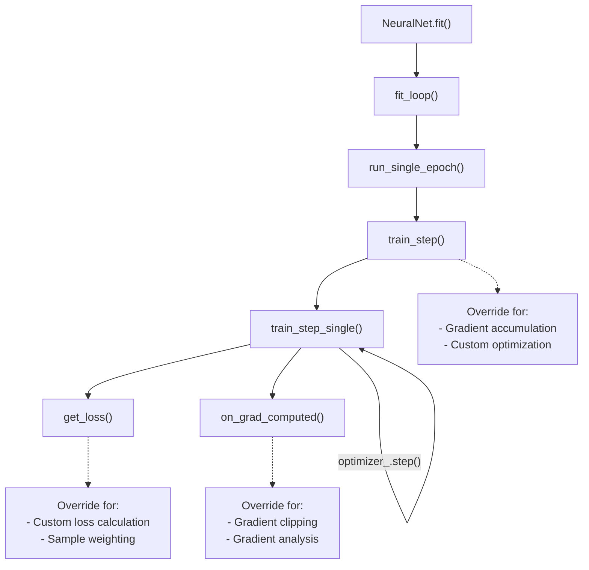
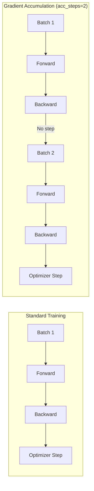
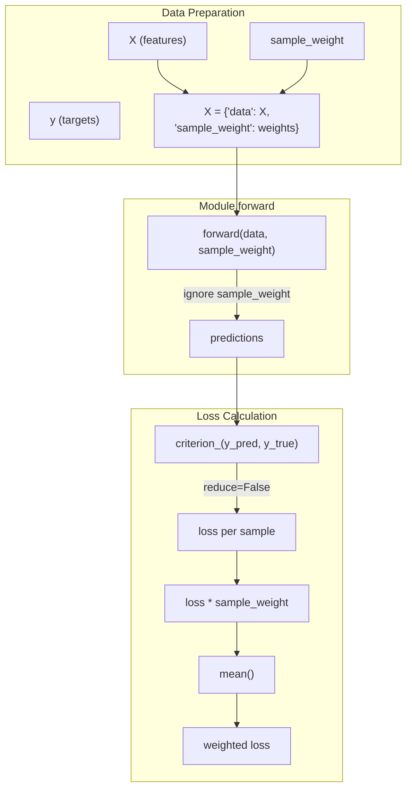
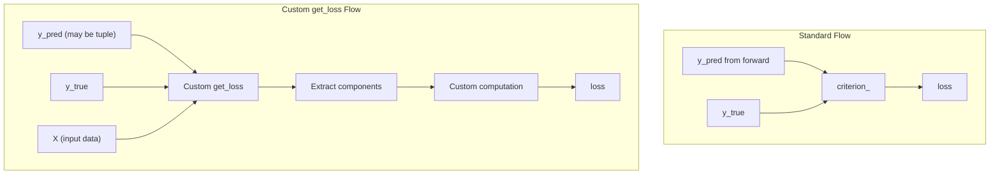
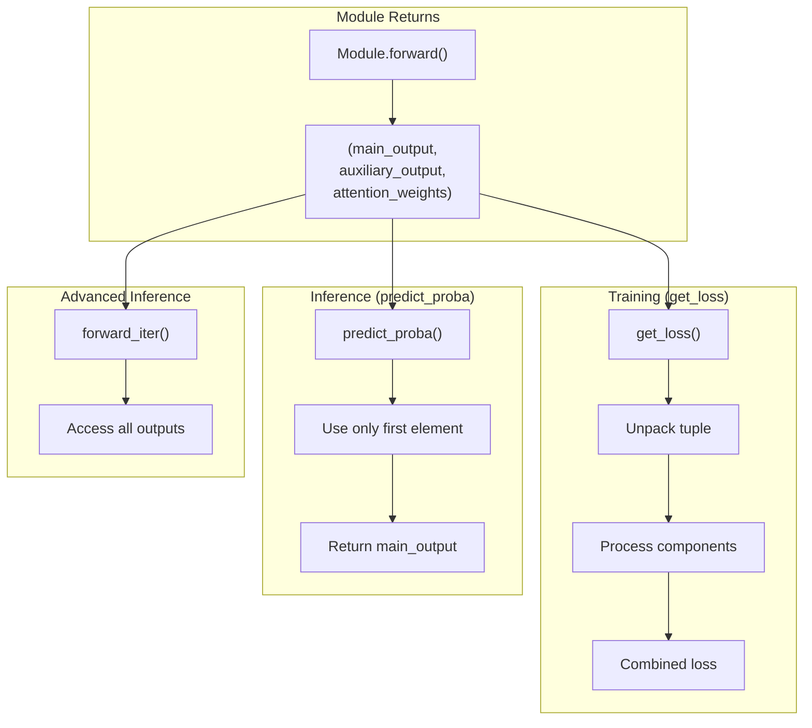
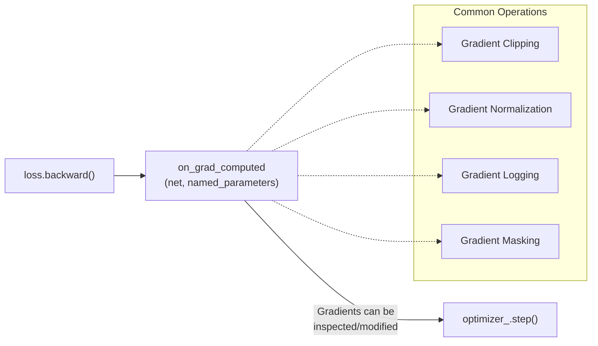
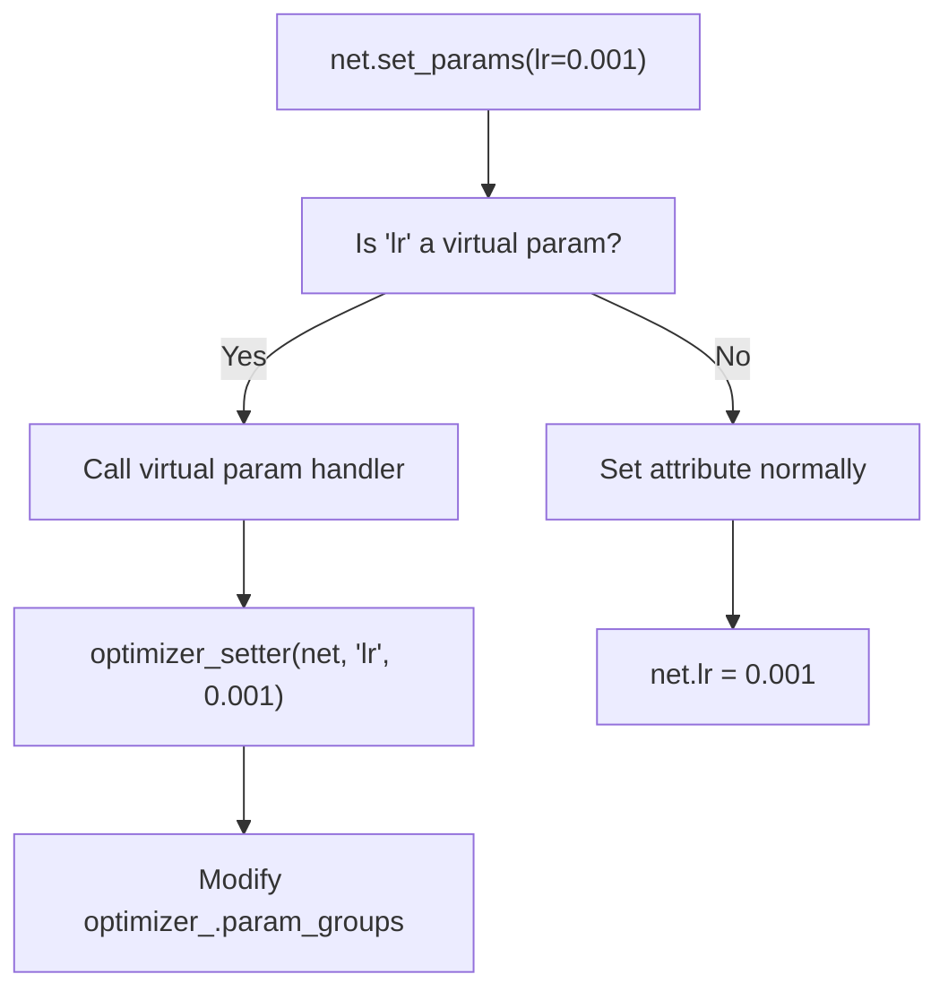
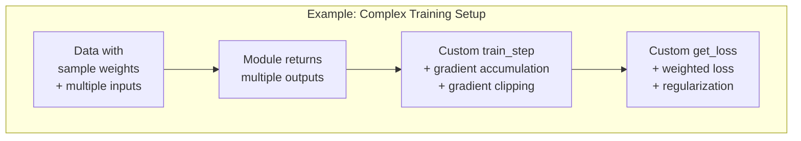

<!-- source: DeepWiki mcp.deepwiki.com · repo skorch-dev/skorch · page 8.4 Advanced Training Patterns · fetched 2026-10-21 -->

# Advanced Training Patterns

<details>
<summary>Relevant source files</summary>

The following files were used as context for generating this wiki page:

- [docs/user/FAQ.rst](docs/user/FAQ.rst)
- [docs/user/callbacks.rst](docs/user/callbacks.rst)
- [docs/user/dataset.rst](docs/user/dataset.rst)
- [docs/user/neuralnet.rst](docs/user/neuralnet.rst)
- [skorch/net.py](skorch/net.py)
- [skorch/tests/test_net.py](skorch/tests/test_net.py)

</details>


This page documents advanced training patterns for customizing the training process in skorch beyond the basic fit/predict workflow. These patterns are useful when the standard training loop needs to be extended or modified for specific requirements such as gradient accumulation, custom loss calculations, sample weighting, or manual gradient manipulation.

For basic classification and regression examples, see [Basic Classification](#8.1) and [Regression Tasks](#8.2). For information about working with different data formats, see [Working with Different Data Types](#8.3). For details on callback-based customization, see [Callback System](#3).

---

## Training Loop Extension Points

The `NeuralNet` training loop provides several extension points for customization. Understanding these is crucial for implementing advanced training patterns.



**Key Extension Points:**

| Method | Purpose | Common Use Cases |
|--------|---------|------------------|
| `train_step` | Process all batches in epoch | Gradient accumulation, custom batch iteration |
| `train_step_single` | Process single batch | Custom forward/backward logic |
| `get_loss` | Compute loss from predictions | Sample weighting, custom loss functions |
| `on_grad_computed` | Hook after gradients computed | Gradient clipping, gradient inspection |

Sources: [skorch/net.py:1397-1437](), [docs/user/FAQ.rst:289-330](), [docs/user/neuralnet.rst:446-449]()

---

## Gradient Accumulation

Gradient accumulation allows training with effectively larger batch sizes than fit in memory by accumulating gradients over multiple mini-batches before performing an optimizer step.



**Implementation Pattern:**

The gradient accumulation pattern requires:
1. Overriding `train_step` to control when optimizer steps occur
2. Normalizing loss by `acc_steps` to maintain equivalent effective learning rate
3. Tracking batch count to determine when to step

```python
class GradAccNet(NeuralNetClassifier):
    def __init__(self, *args, acc_steps=2, **kwargs):
        super().__init__(*args, **kwargs)
        self.acc_steps = acc_steps

    def get_loss(self, *args, **kwargs):
        loss = super().get_loss(*args, **kwargs)
        return loss / self.acc_steps  # Normalize loss

    def train_step(self, batch, **fit_params):
        # Count batches (starts at 1 each epoch)
        n_train_batches = len(self.history[-1, 'batches'])
        step = self.train_step_single(batch, **fit_params)

        # Only optimize every acc_steps batches
        if n_train_batches % self.acc_steps == 0:
            self.optimizer_.step()
            self.optimizer_.zero_grad()
        return step
```

**Important Considerations:**

| Aspect | Details |
|--------|---------|
| Loss Normalization | Loss must be divided by `acc_steps` to maintain equivalent gradients |
| Epoch Boundaries | Handle last batch if total batches not divisible by `acc_steps` |
| Memory | Gradients accumulate in memory; still need to fit multiple batches |
| Optimizer State | Only updated at step intervals, not per batch |

Sources: [docs/user/FAQ.rst:289-330](), [skorch/net.py:1397-1437]()

---

## Sample Weighting

Sample weighting allows assigning different importance to individual samples during loss calculation, useful for class imbalance or instance-specific importance.



**Implementation Pattern:**

```python
class MyModule(nn.Module):
    def forward(self, data, sample_weight):
        # sample_weight passed but typically ignored in forward
        # Your normal forward logic here
        return self.model(data)

class WeightedNet(NeuralNet):
    def __init__(self, *args, criterion__reduce=False, **kwargs):
        # Must set reduce=False to get per-sample losses
        super().__init__(*args, criterion__reduce=criterion__reduce, **kwargs)

    def get_loss(self, y_pred, y_true, X, *args, **kwargs):
        # Get unreduced loss (one value per sample)
        loss_unreduced = super().get_loss(y_pred, y_true, X, *args, **kwargs)
        
        # Extract and apply sample weights
        sample_weight = skorch.utils.to_tensor(
            X['sample_weight'], device=self.device)
        loss_weighted = (sample_weight * loss_unreduced).mean()
        return loss_weighted

# Usage
X_dict = {
    'data': X_features,
    'sample_weight': sample_weights
}
net = WeightedNet(MyModule, ...)
net.fit(X_dict, y)
```

**Key Requirements:**

| Requirement | Implementation |
|-------------|----------------|
| Pass weights with X | Use dictionary: `X = {'data': X, 'sample_weight': weights}` |
| Module signature | `forward(data, sample_weight)` must accept all dict keys |
| Criterion setting | Set `criterion__reduce=False` to get per-sample losses |
| Override get_loss | Apply weighting and reduce in custom `get_loss` method |
| Device handling | Use `to_tensor(..., device=self.device)` for weights |

Sources: [docs/user/FAQ.rst:84-132](), [skorch/net.py:1274-1313]()

---

## Custom Loss Functions

For complex loss calculations beyond what standard PyTorch criteria provide, override the `get_loss` method.



**Common Custom Loss Patterns:**

### Multiple Outputs

When the module returns multiple values, `get_loss` must handle tuple unpacking:

```python
class MyModule(nn.Module):
    def forward(self, X):
        main_output = self.main_network(X)
        auxiliary_output = self.aux_network(X)
        return main_output, auxiliary_output

class MultiOutputNet(NeuralNet):
    def get_loss(self, y_pred, y_true, X, *args, **kwargs):
        # y_pred is tuple of (main_output, auxiliary_output)
        main_pred, aux_pred = y_pred
        
        # Compute losses separately
        main_loss = self.criterion_(main_pred, y_true)
        aux_loss = self.auxiliary_criterion_(aux_pred, y_true)
        
        # Combine losses
        return main_loss + 0.4 * aux_loss
```

### Regularization Terms

```python
class RegularizedNet(NeuralNet):
    def __init__(self, *args, l1_weight=0.01, **kwargs):
        super().__init__(*args, **kwargs)
        self.l1_weight = l1_weight

    def get_loss(self, y_pred, y_true, X, *args, **kwargs):
        # Standard loss
        loss = super().get_loss(y_pred, y_true, X, *args, **kwargs)
        
        # Add L1 regularization
        l1_reg = sum(p.abs().sum() for p in self.module_.parameters())
        return loss + self.l1_weight * l1_reg
```

### Loss Components from Input

```python
class CustomLossNet(NeuralNet):
    def get_loss(self, y_pred, y_true, X, *args, **kwargs):
        # Access input data for loss calculation
        if isinstance(X, dict):
            # Extract specific components
            feature_penalties = X.get('penalties', 0)
        
        base_loss = super().get_loss(y_pred, y_true, X, *args, **kwargs)
        return base_loss + feature_penalties.mean()
```

Sources: [docs/user/FAQ.rst:268-287](), [skorch/net.py:1274-1313]()

---

## Multiple Return Values from Module

Modules can return multiple values, but this requires handling in `get_loss` and affects predict methods.



**Handling Multiple Outputs:**

| Method | Behavior with Multiple Outputs |
|--------|-------------------------------|
| `predict_proba` | Returns only first element of tuple |
| `predict` | Applies argmax to first element |
| `forward` | Returns complete tuple |
| `forward_iter` | Yields complete tuples (lazy) |

**Implementation:**

```python
class MultiOutputModule(nn.Module):
    def forward(self, X):
        features = self.feature_extractor(X)
        main_out = self.classifier(features)
        attention = self.attention_layer(features)
        return main_out, attention

class MultiOutputNet(NeuralNetClassifier):
    def get_loss(self, y_pred, y_true, X, *args, **kwargs):
        # y_pred is tuple
        main_pred, attention = y_pred
        
        # Only use main prediction for classification loss
        loss = self.criterion_(main_pred, y_true)
        
        # Optional: add attention regularization
        attention_reg = (attention ** 2).mean()
        return loss + 0.01 * attention_reg

# For inference, access all outputs
net = MultiOutputNet(MultiOutputModule, ...)
net.fit(X, y)

# Standard predict uses only first output
predictions = net.predict(X_test)

# Access all outputs
for main_out, attention in net.forward_iter(X_test):
    # Process both outputs
    pass
```

Sources: [docs/user/FAQ.rst:268-287](), [docs/user/neuralnet.rst:359-377]()

---

## Custom Training Steps

For advanced control over the training loop, override `train_step_single` or `train_step`.

```mermaid
graph TB
    subgraph "train_step_single Flow"
        batch["batch"]
        batch --> step_begin["on_batch_begin"]
        step_begin --> unpack["unpack_data"]
        unpack --> forward["forward pass"]
        forward --> loss["get_loss"]
        loss --> backward["loss.backward()"]
        backward --> grad_hook["on_grad_computed"]
        grad_hook --> opt_step["optimizer_.step()"]
        opt_step --> zero_grad["optimizer_.zero_grad()"]
        zero_grad --> step_end["on_batch_end"]
        step_end --> return["return loss, y_pred"]
    end
```



**Common Customizations:**

### Gradient Clipping

```python
class GradClipNet(NeuralNet):
    def __init__(self, *args, clip_value=1.0, **kwargs):
        super().__init__(*args, **kwargs)
        self.clip_value = clip_value

    def on_grad_computed(self, net, named_parameters, **kwargs):
        # Clip gradients by value
        parameters = [p for name, p in named_parameters]
        torch.nn.utils.clip_grad_value_(parameters, self.clip_value)
```

### Mixed Precision Training

```python
class MixedPrecisionNet(NeuralNet):
    def initialize(self):
        super().initialize()
        self.scaler_ = torch.cuda.amp.GradScaler()
        return self

    def train_step_single(self, batch, **fit_params):
        self.notify('on_batch_begin', batch=batch, training=True)
        Xi, yi = unpack_data(batch)
        
        # Mixed precision forward and backward
        with torch.cuda.amp.autocast():
            y_pred = self.infer(Xi, **fit_params)
            loss = self.get_loss(y_pred, yi, X=Xi, training=True, **fit_params)
        
        self.scaler_.scale(loss).backward()
        self.notify('on_grad_computed', 
                    named_parameters=list(self.module_.named_parameters()),
                    batch=batch)
        
        self.scaler_.step(self.optimizer_)
        self.scaler_.update()
        self.optimizer_.zero_grad()
        
        self.notify('on_batch_end', batch=batch, training=True, 
                    loss=loss, y_pred=y_pred)
        return {'loss': loss, 'y_pred': y_pred}
```

### Custom Optimizer Logic

```python
class TwoStepNet(NeuralNet):
    """Net with two optimizers stepping alternately"""
    def initialize_optimizer(self):
        # First optimizer for main parameters
        named_params = self.module_.named_parameters()
        args, kwargs = self.get_params_for_optimizer('optimizer', named_params)
        self.optimizer_ = self.optimizer(*args, **kwargs)
        
        # Second optimizer for auxiliary parameters
        named_params = self.module2_.named_parameters()
        args, kwargs = self.get_params_for_optimizer('optimizer2', named_params)
        self.optimizer2_ = self.optimizer2(*args, **kwargs)
        return self

    def train_step_single(self, batch, **fit_params):
        # Train main network
        step_result = super().train_step_single(batch, **fit_params)
        
        # Train auxiliary network
        Xi, yi = unpack_data(batch)
        aux_pred = self.module2_(Xi)
        aux_loss = self.criterion2_(aux_pred, yi)
        aux_loss.backward()
        self.optimizer2_.step()
        self.optimizer2_.zero_grad()
        
        return step_result
```

Sources: [skorch/net.py:1419-1465](), [skorch/net.py:1397-1417]()

---

## Manual Gradient Manipulation

The `on_grad_computed` hook provides access to gradients after backpropagation but before the optimizer step.



**Gradient Manipulation Patterns:**

### Gradient Clipping by Norm

```python
class GradClipNormNet(NeuralNet):
    def __init__(self, *args, clip_norm=1.0, **kwargs):
        super().__init__(*args, **kwargs)
        self.clip_norm = clip_norm

    def on_grad_computed(self, net, named_parameters, **kwargs):
        parameters = [p for name, p in named_parameters]
        torch.nn.utils.clip_grad_norm_(parameters, self.clip_norm)
```

### Gradient Analysis/Logging

```python
class GradientAnalysisNet(NeuralNet):
    def on_grad_computed(self, net, named_parameters, **kwargs):
        grad_norms = {}
        for name, param in named_parameters:
            if param.grad is not None:
                grad_norms[name] = param.grad.norm().item()
        
        # Log to history
        self.history.record_batch('grad_norms', grad_norms)
```

### Selective Gradient Zeroing

```python
class SelectiveGradNet(NeuralNet):
    def on_grad_computed(self, net, named_parameters, **kwargs):
        # Zero gradients for specific layers conditionally
        for name, param in named_parameters:
            if 'frozen_layer' in name and param.grad is not None:
                param.grad.zero_()
```

**Callback-Based Gradient Manipulation:**

Gradient manipulation can also be implemented via callbacks:

```python
from skorch.callbacks import Callback

class GradientClipper(Callback):
    def __init__(self, clip_value=1.0):
        self.clip_value = clip_value

    def on_grad_computed(self, net, named_parameters, **kwargs):
        parameters = [p for name, p in named_parameters]
        torch.nn.utils.clip_grad_value_(parameters, self.clip_value)

net = NeuralNet(
    module=MyModule,
    callbacks=[GradientClipper(clip_value=0.5)],
)
```

Sources: [skorch/net.py:446-448](), [docs/user/callbacks.rst:83-89]()

---

## Virtual Parameters

Virtual parameters allow dynamic parameter setting that doesn't correspond to actual attributes but triggers custom logic.



**Built-in Virtual Parameters:**

| Pattern | Example | Effect |
|---------|---------|--------|
| `lr` | `net.set_params(lr=0.001)` | Sets `optimizer__lr` |
| `optimizer__lr` | `net.set_params(optimizer__lr=0.001)` | Updates optimizer learning rate |
| `optimizer__param_groups__*__*` | `net.set_params(optimizer__param_groups__0__lr=0.001)` | Updates specific param group |

**Implementation Details:**

Virtual parameters are registered during optimizer initialization at [skorch/net.py:912-922]():

```python
# From NeuralNet._initialize_optimizer
for name in self._optimizers:
    param_pattern = [name + '__param_groups__*__*', name + '__*']
    if name == 'optimizer':  # 'lr' is short for optimizer__lr
        param_pattern.append('lr')
    setter = partial(
        optimizer_setter,
        optimizer_attr=name + '_',
        optimizer_name=name,
    )
    self._register_virtual_param(param_pattern, setter)
```

**Creating Custom Virtual Parameters:**

```python
class CustomParamNet(NeuralNet):
    def initialize_virtual_params(self):
        super().initialize_virtual_params()
        
        # Register custom virtual parameter
        def dropout_setter(net, key, val):
            # Custom logic to set dropout rate on all dropout layers
            for module in net.module_.modules():
                if isinstance(module, nn.Dropout):
                    module.p = val
        
        self._register_virtual_param('dropout_rate', dropout_setter)

# Usage
net = CustomParamNet(MyModule, ...)
net.initialize()
net.set_params(dropout_rate=0.3)  # Triggers custom setter
```

Sources: [skorch/net.py:633-650](), [skorch/net.py:899-923](), [skorch/setter.py]()

---

## Combining Patterns

Advanced training scenarios often combine multiple patterns:



**Combined Example:**

```python
class AdvancedNet(NeuralNetClassifier):
    """Net with gradient accumulation, sample weighting, and gradient clipping"""
    def __init__(self, *args, acc_steps=2, clip_norm=1.0, 
                 criterion__reduce=False, **kwargs):
        super().__init__(*args, criterion__reduce=criterion__reduce, **kwargs)
        self.acc_steps = acc_steps
        self.clip_norm = clip_norm

    def get_loss(self, y_pred, y_true, X, *args, **kwargs):
        # Handle multiple outputs
        if isinstance(y_pred, tuple):
            main_pred, aux_pred = y_pred
            y_pred = main_pred
        
        # Get per-sample loss
        loss_unreduced = super().get_loss(y_pred, y_true, X, *args, **kwargs)
        
        # Apply sample weights if present
        if isinstance(X, dict) and 'sample_weight' in X:
            weights = skorch.utils.to_tensor(X['sample_weight'], device=self.device)
            loss = (weights * loss_unreduced).mean()
        else:
            loss = loss_unreduced.mean()
        
        # Normalize for gradient accumulation
        return loss / self.acc_steps

    def on_grad_computed(self, net, named_parameters, **kwargs):
        # Gradient clipping
        parameters = [p for name, p in named_parameters]
        torch.nn.utils.clip_grad_norm_(parameters, self.clip_norm)

    def train_step(self, batch, **fit_params):
        # Gradient accumulation
        n_train_batches = len(self.history[-1, 'batches'])
        step = self.train_step_single(batch, **fit_params)

        if n_train_batches % self.acc_steps == 0:
            self.optimizer_.step()
            self.optimizer_.zero_grad()
        return step
```

Sources: [docs/user/FAQ.rst:289-330](), [docs/user/FAQ.rst:84-132](), [skorch/net.py:1397-1465]()

---

## Summary Table

| Pattern | Override Method | Key Considerations |
|---------|----------------|-------------------|
| Gradient Accumulation | `train_step`, `get_loss` | Normalize loss, handle epoch boundaries |
| Sample Weighting | `get_loss` | Pass weights in X dict, set `reduce=False` |
| Custom Loss | `get_loss` | Handle tuple outputs, access X for context |
| Multiple Outputs | `get_loss`, use `forward_iter` | Unpack tuples, combine losses |
| Custom Training Step | `train_step_single`, `train_step` | Maintain callback hooks, handle optimizer |
| Gradient Manipulation | `on_grad_computed` | Modify gradients before optimizer step |
| Virtual Parameters | `initialize_virtual_params` | Register patterns and setter functions |

Sources: [skorch/net.py:1274-1465](), [docs/user/FAQ.rst:84-330](), [docs/user/neuralnet.rst:1-562]()

---

