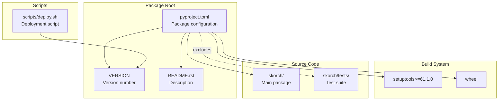
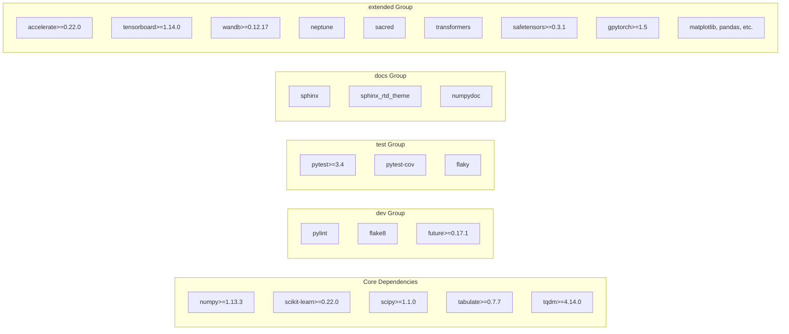
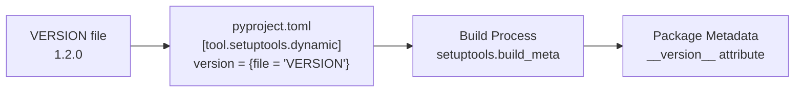
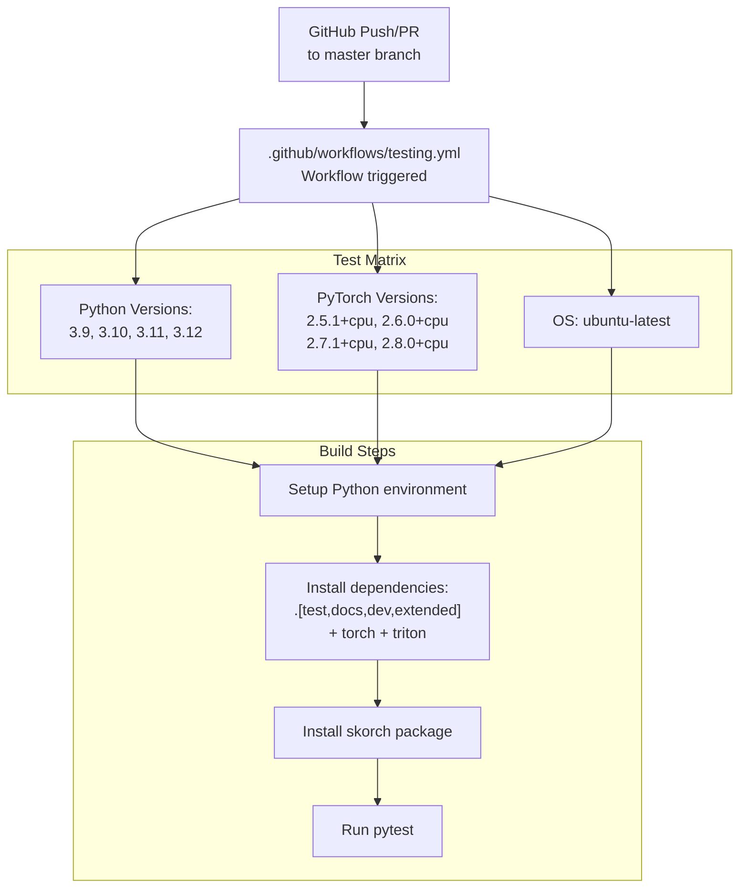
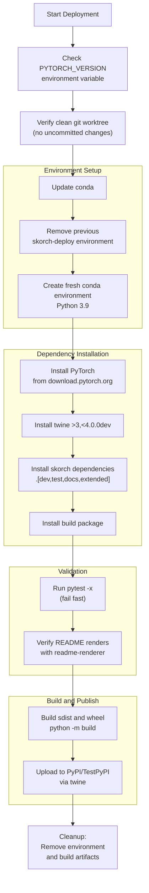
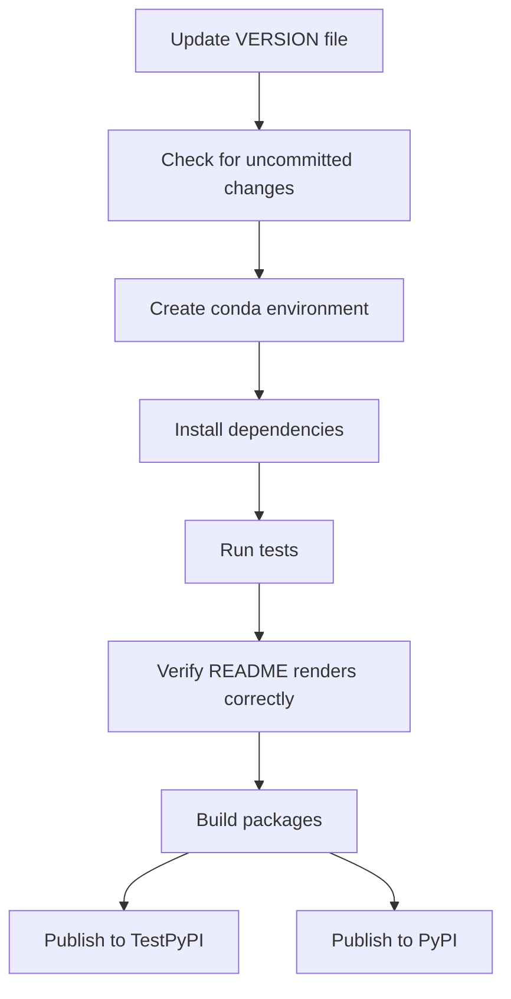

<!-- source: DeepWiki mcp.deepwiki.com · repo skorch-dev/skorch · page 9 Package Development · fetched 2026-10-21 -->

# Package Development

<details>
<summary>Relevant source files</summary>

The following files were used as context for generating this wiki page:

- [.github/workflows/testing.yml](.github/workflows/testing.yml)
- [README.rst](README.rst)
- [VERSION](VERSION)
- [docs/user/installation.rst](docs/user/installation.rst)
- [pyproject.toml](pyproject.toml)
- [scripts/deploy.sh](scripts/deploy.sh)

</details>


This page documents the skorch package structure, build system configuration, testing infrastructure, and deployment process. It provides information for developers who want to contribute to skorch or understand how the package is built and released.

## Package Structure

The skorch package follows a modular structure with the following key components:

| Directory/File | Purpose |
|---------------|---------|
| `skorch/` | Main package directory containing all Python modules |
| `skorch/tests/` | Test suite organized by component |
| `scripts/` | Build and deployment scripts |
| `docs/` | Documentation source files |
| `pyproject.toml` | Package configuration and metadata |
| `VERSION` | Single source of truth for version number |
| `README.rst` | Package description and quick start guide |

### Package Configuration File Structure

**Package Configuration Overview**



Sources: [pyproject.toml:1-187](), [VERSION:1-2](), [README.rst:1-285]()

## Build System Configuration

The skorch package uses [pyproject.toml:1-4]() to define its build system, following PEP 517 and PEP 518 standards. The build backend is `setuptools.build_meta`.

### Build System Definition

The `[build-system]` section specifies:
- **Backend**: `setuptools.build_meta` [pyproject.toml:3]()
- **Requirements**: `setuptools>=61.1.0` and `wheel` [pyproject.toml:2]()

### Package Metadata

The `[project]` section [pyproject.toml:12-45]() defines core package metadata:

| Field | Value | Source |
|-------|-------|--------|
| `name` | `"skorch"` | [pyproject.toml:13]() |
| `version` | Dynamic from `VERSION` file | [pyproject.toml:14](), [pyproject.toml:185]() |
| `readme` | Dynamic from `README.rst` | [pyproject.toml:14](), [pyproject.toml:186]() |
| `requires-python` | `">=3.9"` | [pyproject.toml:18]() |
| `description` | scikit-learn compatible neural network library for pytorch | [pyproject.toml:15]() |
| `license` | BSD-3-Clause | [pyproject.toml:16-17]() |

### Supported Python Versions

The package officially supports Python 3.9 through 3.13, as declared in [pyproject.toml:34-38]():
- Python 3.9
- Python 3.10
- Python 3.11
- Python 3.12
- Python 3.13

Sources: [pyproject.toml:12-45](), [pyproject.toml:184-186]()

## Dependency Management

### Core Dependencies

The package has minimal required dependencies defined in [pyproject.toml:19-25]():

```
numpy>=1.13.3
scikit-learn>=0.22.0
scipy>=1.1.0
tabulate>=0.7.7
tqdm>=4.14.0
```

Note that PyTorch is **not** included as a dependency because the required version depends on the user's OS and hardware (CPU, CUDA, MPS). Users must install PyTorch separately according to their system requirements.

### Optional Dependencies

**Dependency Groups**



The optional dependency groups are defined in [pyproject.toml:47-83]():

| Group | Purpose | Key Packages |
|-------|---------|--------------|
| `dev` | Code quality tools | pylint, flake8 |
| `test` | Testing framework | pytest, pytest-cov, flaky |
| `docs` | Documentation generation | sphinx, numpydoc |
| `extended` | Advanced features and integrations | accelerate, tensorboard, wandb, neptune, transformers, safetensors |

### Installing Development Dependencies

To install all development dependencies:

```bash
python -m pip install '.[test,docs,dev,extended]'
```

Sources: [pyproject.toml:19-83](), [README.rst:194](), [docs/user/installation.rst:53]()

## Version Management

### Version File System

**Version Flow Diagram**



The version number is stored in a single location: the `VERSION` file [VERSION:1](), which currently contains `1.2.0`. The [pyproject.toml:185]() configuration dynamically reads this file during the build process:

```toml
[tool.setuptools.dynamic]
version = {file = "VERSION"}
```

This approach ensures the version number is defined in exactly one place, following the DRY (Don't Repeat Yourself) principle.

Sources: [VERSION:1-2](), [pyproject.toml:184-186]()

## Testing Infrastructure

### Test Suite Organization

The test suite is located in `skorch/tests/` and organized by component. The test configuration is defined in [pyproject.toml:103-109]():

```toml
[tool.pytest.ini_options]
addopts = [
    "--cov=skorch",
    "--cov-report=term-missing",
]
python_files = "test*.py"
testpaths = ["skorch/tests"]
```

### Coverage Configuration

Coverage settings are specified in [pyproject.toml:86-96]():
- **Source**: Current directory (`.`)
- **Include**: `skorch/*`
- **Omit**: `skorch/tests/*` and `skorch/_version.py`
- **Reporting**: Show missing lines, don't skip covered files

### Continuous Integration

**CI/CD Testing Workflow**



The GitHub Actions workflow [.github/workflows/testing.yml:1-54]() tests skorch across a matrix of Python and PyTorch versions:

| Configuration | Values |
|--------------|--------|
| Python versions | 3.9, 3.10, 3.11, 3.12 [.github/workflows/testing.yml:23]() |
| PyTorch versions | 2.5.1+cpu, 2.6.0+cpu, 2.7.1+cpu, 2.8.0+cpu [.github/workflows/testing.yml:24]() |
| Operating system | ubuntu-latest [.github/workflows/testing.yml:25]() |

The workflow installs dependencies with `python -m pip install '.[test,docs,dev,extended]'` [.github/workflows/testing.yml:38]() and runs the test suite with `pytest` [.github/workflows/testing.yml:53]().

### Running Tests Locally

To run the test suite locally:

```bash
# Run all tests with coverage
pytest

# Run specific test file
pytest skorch/tests/test_net.py

# Run with verbose output
pytest -v

# Run specific test class or function
pytest skorch/tests/test_net.py::TestNeuralNet
```

Sources: [pyproject.toml:86-109](), [.github/workflows/testing.yml:1-54](), [README.rst:196](), [docs/user/installation.rst:55-56]()

## Code Quality Configuration

### Linting with Pylint

Pylint configuration is defined in [pyproject.toml:111-183](). Key settings include:

| Setting | Value | Purpose |
|---------|-------|---------|
| `max-line-length` | 88 | [pyproject.toml:146]() |
| `max-module-lines` | 1500 | [pyproject.toml:147]() |
| `max-args` | 14 | [pyproject.toml:175]() |
| `max-locals` | 24 | [pyproject.toml:177]() |
| `max-branches` | 21 | [pyproject.toml:179]() |
| `max-attributes` | 19 | [pyproject.toml:180]() |
| `max-public-methods` | 40 | [pyproject.toml:182]() |

Good variable names that are allowed despite being short: `main`, `_`, `X`, `y`, `T`, `Xt`, `Xs`, `yt`, `f`, `__` [pyproject.toml:165]().

To run pylint:

```bash
pylint skorch
```

### Flake8 Configuration

Flake8 settings [pyproject.toml:98-101]():
- `max-line-length`: 88
- `docstring-convention`: numpy
- Ignore: D204, D401

Sources: [pyproject.toml:98-183](), [README.rst:197](), [docs/user/installation.rst:56]()

## Deployment and Release Process

### Deployment Script Overview

The deployment process is automated through [scripts/deploy.sh:1-74](), which handles building and publishing the package to PyPI.

**Deployment Flow**



### Deployment Script Configuration

Key configuration variables in [scripts/deploy.sh:5-8]():

| Variable | Default | Purpose |
|----------|---------|---------|
| `PYTORCH_VERSION` | (required) | PyTorch version to install |
| `PYTHON_VERSION` | `"3.9"` | Python version for deployment environment |
| `TWINE_VERSION` | `">3,<4.0.0dev"` | Twine version constraint |
| `CONDA_ENV` | `"skorch-deploy"` | Conda environment name |

### Deployment Commands

The script supports two modes:

1. **Stage deployment** (TestPyPI):
   ```bash
   PYTORCH_VERSION=2.8.0 ./scripts/deploy.sh stage
   ```

2. **Live deployment** (PyPI):
   ```bash
   PYTORCH_VERSION=2.8.0 ./scripts/deploy.sh live
   ```

The script performs the following steps:

1. **Pre-checks** [scripts/deploy.sh:15-21]():
   - Validates PYTORCH_VERSION is set
   - Checks git worktree is clean (no uncommitted changes)

2. **Environment management** [scripts/deploy.sh:24-32]():
   - Updates conda
   - Removes previous deployment environment
   - Creates fresh Python 3.9 environment

3. **Dependency installation** [scripts/deploy.sh:51-59]():
   - Installs PyTorch from `download.pytorch.org/whl/cpu`
   - Installs twine for PyPI uploads
   - Upgrades pyOpenSSL (workaround for known issue)
   - Installs skorch with all extras: `'.[dev,test,docs,extended]'`
   - Installs build package

4. **Validation** [scripts/deploy.sh:61-65]():
   - Runs test suite with `pytest -x` (fail fast)
   - Verifies README.rst renders correctly on PyPI

5. **Build** [scripts/deploy.sh:67]():
   - Builds both source distribution (sdist) and wheel
   - Uses `python -m build --sdist --wheel`

6. **Publish** [scripts/deploy.sh:69-73]():
   - Uploads to TestPyPI (stage) or PyPI (live)
   - Uploads all files matching the version in VERSION file: `dist/*"$(cat VERSION)"*`

7. **Cleanup** [scripts/deploy.sh:34-42]():
   - Removes deployment environment
   - Cleans build and dist directories

### Package File Inclusion

The [pyproject.toml:5-10]() configuration specifies which files to include in the package:

```toml
[tool.setuptools.package-data]
"*" = ["VERSION", "LICENSE", "*.rst"]

[tool.setuptools.packages.find]
include = ["skorch*"]
exclude = ["notebooks", "assets"]
```

This includes:
- All `skorch*` packages
- VERSION, LICENSE, and RST files
- Excludes notebooks and assets directories

Sources: [scripts/deploy.sh:1-74](), [pyproject.toml:5-10](), [VERSION:1-2]()

## Release Process

The release process is managed by maintainers using the `scripts/deploy.sh` script.



### Release Steps

1. **Update the VERSION file** with the new version number

2. **Run the deployment script**:
   ```bash
   PYTORCH_VERSION=x.y.z ./scripts/deploy.sh [stage|live]
   ```

   The deployment script:
   - Checks for uncommitted changes
   - Creates a clean conda environment
   - Installs dependencies
   - Runs the test suite
   - Verifies the README renders correctly on PyPI
   - Builds distribution packages (sdist and wheel)
   - Uploads to TestPyPI (stage) or PyPI (live)

Sources: [VERSION](), [scripts/deploy.sh:1-75]()

## Integration with External Libraries

skorch provides integration with various logging and experiment tracking frameworks. When contributing to these integrations, ensure your code works with the actual frameworks and add appropriate tests.

### Logging Framework Integration Table

| Framework | Class | Purpose |
|-----------|-------|---------|
| TensorBoard | TensorBoard | Visualization and metrics tracking |
| Neptune | NeptuneLogger | Experiment tracking |
| Weights & Biases | WandbLogger | Experiment tracking |
| MLflow | MlflowLogger | Experiment lifecycle management |
| Sacred | SacredLogger | Experiment configuration and logging |

The test files for these integrations use conditional execution with pytest.mark.skipif to check for the presence of the required packages:

```python
@pytest.mark.skipif(not neptune_installed, reason='neptune is not installed')
class TestNeptune:
    # Test code here
```

Sources: [skorch/callbacks/logging.py:19-20](), [skorch/callbacks/logging.py:67-290](), [skorch/tests/callbacks/test_logging.py:21-259]()

## Getting Help

If you need help with development:

- Open an issue on the GitHub repository
- Discuss your question in existing issues
- Check the documentation for more information

Remember that skorch is an open-source project maintained by volunteers, so be patient and provide as much context as possible when seeking help.

---

