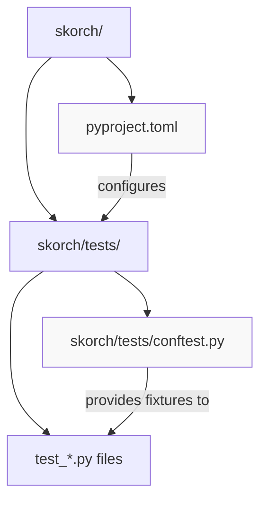
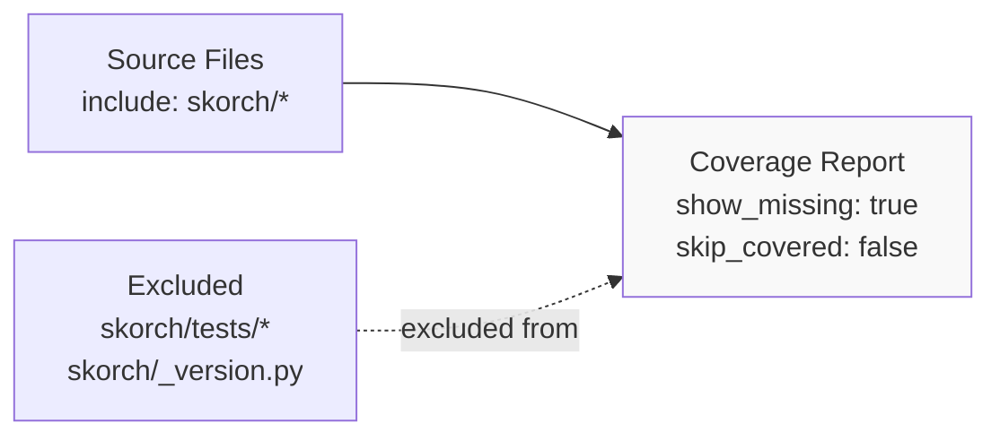
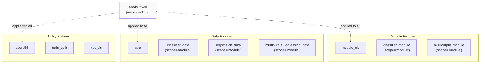
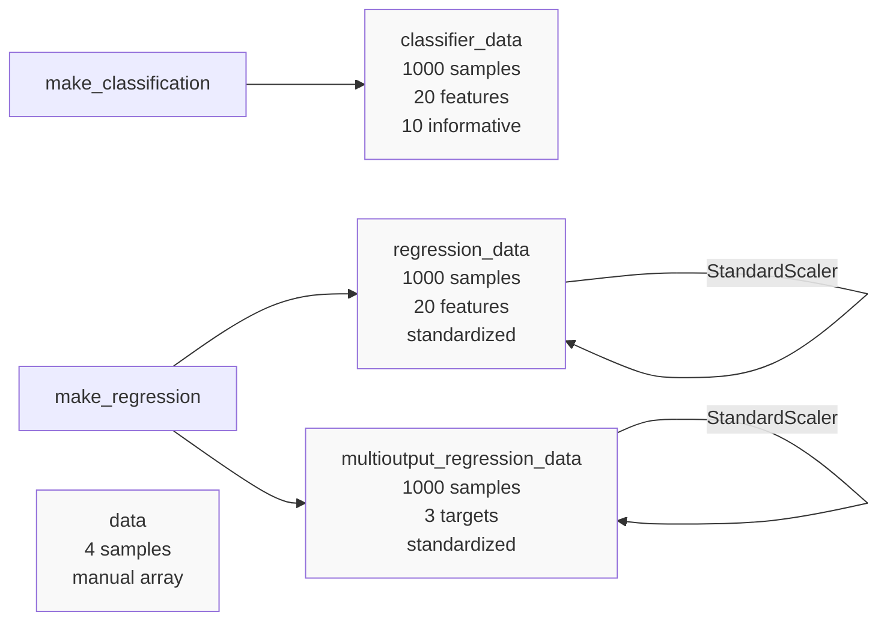
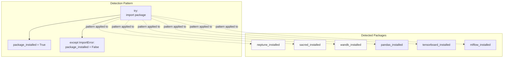
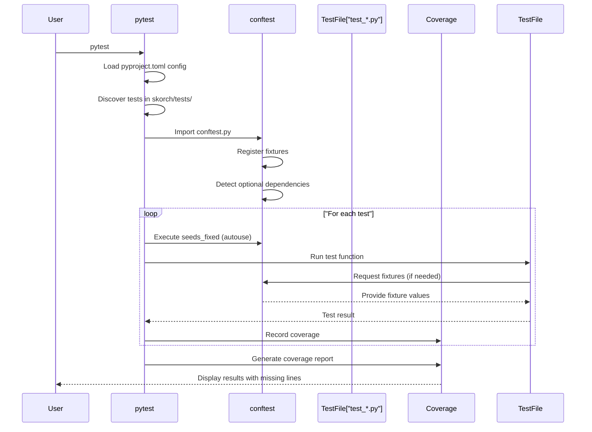
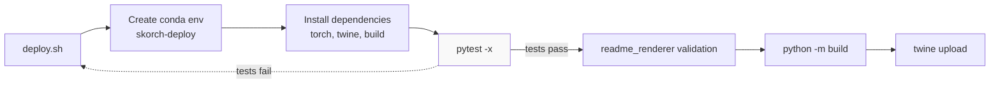

<!-- source: DeepWiki mcp.deepwiki.com · repo skorch-dev/skorch · page 9.2 Testing Infrastructure · fetched 2026-10-21 -->

# Testing Infrastructure

<details>
<summary>Relevant source files</summary>

The following files were used as context for generating this wiki page:

- [VERSION](VERSION)
- [pyproject.toml](pyproject.toml)
- [scripts/deploy.sh](scripts/deploy.sh)
- [skorch/tests/conftest.py](skorch/tests/conftest.py)

</details>


## Purpose and Scope

This document describes the testing infrastructure used in the skorch codebase, including the pytest configuration, shared fixtures, test organization, and integration with the build system. For information about contributing tests and code style requirements, see [Contributing Guidelines](#9.3). For information about the build and deployment system, see [Build System and Deployment](#9.1).

The testing infrastructure provides:
- Consistent test environment setup through pytest fixtures
- Reproducible test execution with fixed random seeds
- Reusable mock modules and data generators
- Optional dependency detection for integration tests
- Code coverage measurement and reporting

## Test Suite Organization

The test suite is organized under the `skorch/tests/` directory, with configuration managed through `pyproject.toml` and shared test utilities in `conftest.py`.

### Directory Structure



**Test Organization Architecture**

The test files follow the naming pattern `test*.py` and are automatically discovered by pytest. The `conftest.py` file provides shared fixtures that are available to all test modules.

Sources: [pyproject.toml:103-109](), [skorch/tests/conftest.py:1]()

## Pytest Configuration

The pytest configuration is defined in `pyproject.toml` under the `[tool.pytest.ini_options]` section.

### Core Configuration Settings

| Setting | Value | Description |
|---------|-------|-------------|
| `python_files` | `test*.py` | Pattern for test file discovery |
| `testpaths` | `["skorch/tests"]` | Root directory for test collection |
| `addopts` | `["--cov=skorch", "--cov-report=term-missing"]` | Default command-line options |

The configuration automatically enables code coverage measurement for all test runs, reporting missing lines in the terminal output.

Sources: [pyproject.toml:103-109]()

### Coverage Configuration

Code coverage is configured separately under `[tool.coverage.run]` and `[tool.coverage.report]`:



**Coverage Configuration Flow**

Coverage includes all files under `skorch/` except test files and the auto-generated `_version.py` module. Reports show both missing lines and covered code for comprehensive visibility.

Sources: [pyproject.toml:86-96]()

## Shared Fixtures

The `conftest.py` file provides a suite of shared fixtures that ensure consistent test behavior and reduce code duplication across test modules.

### Fixture Hierarchy



**Fixture Dependency Architecture**

Sources: [skorch/tests/conftest.py:21-140]()

### Seed Management

The `seeds_fixed` fixture is marked with `autouse=True`, meaning it runs automatically before every test function without needing to be explicitly requested:

```python
@pytest.fixture(autouse=True)
def seeds_fixed():
    torch.manual_seed(0)
    torch.cuda.manual_seed(0)
    np.random.seed(0)
```

This fixture ensures reproducible results by setting fixed seeds for PyTorch (CPU and CUDA) and NumPy random number generators before each test.

Sources: [skorch/tests/conftest.py:21-25]()

### Module Fixtures

Module fixtures provide mock PyTorch modules for testing:

| Fixture | Scope | Purpose | Key Features |
|---------|-------|---------|--------------|
| `module_cls` | function | Simple pass-through module | Has `nn.Linear` layer but returns input unchanged |
| `classifier_module` | module | Classifier module | Created via `make_classifier` with 20 inputs, 10 hidden units, 2 hidden layers, 0.5 dropout |
| `multioutput_module` | module | Multi-output classifier | Returns tuple of 3 outputs: softmax probabilities, first class prob, every-other-sample slice |

The `module_cls` fixture is particularly useful for testing scoring mechanisms without actual model training:

```python
class MyModule(nn.Module):
    def __init__(self):
        super(MyModule, self).__init__()
        self.dense = nn.Linear(1, 1)
    
    def forward(self, X):
        X = X + 0.0 * self.dense(X)  # Identity function with parameter dependency
        return X
```

Sources: [skorch/tests/conftest.py:28-77]()

### Data Generation Fixtures

Data fixtures generate synthetic datasets using scikit-learn's dataset generators:



**Data Generation Pipeline**

All data fixtures with `scope='module'` are created once per test module to improve performance. The regression fixtures apply `StandardScaler` to both features and targets for numerical stability.

Sources: [skorch/tests/conftest.py:80-140]()

### Utility Fixtures

Utility fixtures provide reusable test components:

**`score55` Fixture**

A simple scoring function that always returns 55, useful for testing scoring callbacks without actual computation:

```python
def func(est, X, y, foo=123):
    return 55

func.__name__ = 'score55'
```

The function signature includes an optional `foo` parameter to test argument passing.

**`train_split` Fixture**

A custom train/validation splitting function that splits datasets at index 2:

```python
def func(dataset, y):
    ds_train = type(dataset)(dataset.X[:2], dataset.y[:2])
    ds_valid = type(dataset)(dataset.X[2:], dataset.y[2:])
    return ds_train, ds_valid
```

This creates predictable splits for testing validation logic.

**`net_cls` Fixture**

Returns `NeuralNetRegressor` as the default neural network class for tests that need a concrete estimator type.

Sources: [skorch/tests/conftest.py:106-132]()

## Optional Dependency Detection

The testing infrastructure includes feature detection for optional dependencies to enable conditional test execution:



**Optional Dependency Detection Pattern**

Each optional dependency is wrapped in a try-except block that sets a boolean flag. Tests can use these flags with `pytest.skipif` decorators to conditionally skip tests that require unavailable packages.

| Variable | Package | Purpose |
|----------|---------|---------|
| `neptune_installed` | neptune | Neptune AI logging integration |
| `sacred_installed` | sacred | Sacred experiment tracking |
| `wandb_installed` | wandb | Weights & Biases logging |
| `pandas_installed` | pandas | DataFrame support |
| `tensorboard_installed` | tensorboard | TensorBoard logging |
| `mlflow_installed` | mlflow | MLflow experiment tracking |

Sources: [skorch/tests/conftest.py:142-194]()

## Test Execution Flow

The complete test execution flow integrates fixtures, configuration, and coverage measurement:



**Test Execution Sequence**

The execution flow ensures:
1. Configuration is loaded from `pyproject.toml`
2. Shared fixtures are registered before tests run
3. Seeds are reset before each test for reproducibility
4. Coverage is tracked throughout execution
5. Results include detailed coverage information

Sources: [pyproject.toml:103-109](), [skorch/tests/conftest.py:21-25]()

## Inference Methods Constant

The module defines a constant `INFERENCE_METHODS` that lists the inference method names tested throughout the codebase:

```python
INFERENCE_METHODS = ['predict', 'predict_proba', 'forward', 'forward_iter']
```

This constant is used by tests to ensure consistent behavior across all inference methods provided by neural network classes. Tests can iterate over these methods to verify that each produces correct results.

Sources: [skorch/tests/conftest.py:13]()

## Integration with Deployment

The testing infrastructure is integrated with the deployment pipeline through the `deploy.sh` script:



**Deployment Pipeline with Testing**

The deployment script runs `pytest -x` (stop on first failure) to ensure all tests pass before building and uploading the package. This prevents broken releases from reaching PyPI.

Key deployment test commands:
- `run_in_env pytest -x` - Run tests in isolated conda environment, stopping at first failure
- Tests must pass before README validation
- Tests must pass before building distribution packages
- Tests must pass before uploading to PyPI (live or test)

Sources: [scripts/deploy.sh:61]()

## Test Dependencies

The test infrastructure requires several dependencies defined in `pyproject.toml`:

| Package | Minimum Version | Purpose |
|---------|----------------|---------|
| `pytest` | >=3.4 | Test framework |
| `pytest-cov` | (latest) | Coverage integration |
| `flaky` | (latest) | Retry flaky tests |

These are installed via the `[project.optional-dependencies]` `test` group and can be installed with:

```bash
pip install -e .[test]
```

The extended test suite, which includes integration tests for optional features, requires additional dependencies from the `extended` group.

Sources: [pyproject.toml:54-58](), [pyproject.toml:66-83]()

---

