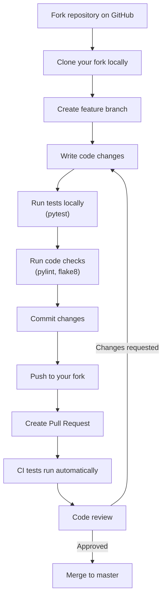
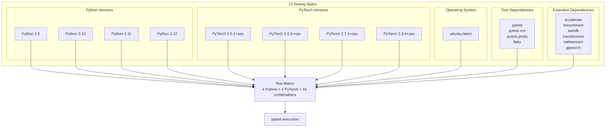
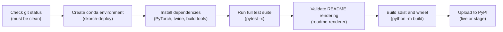
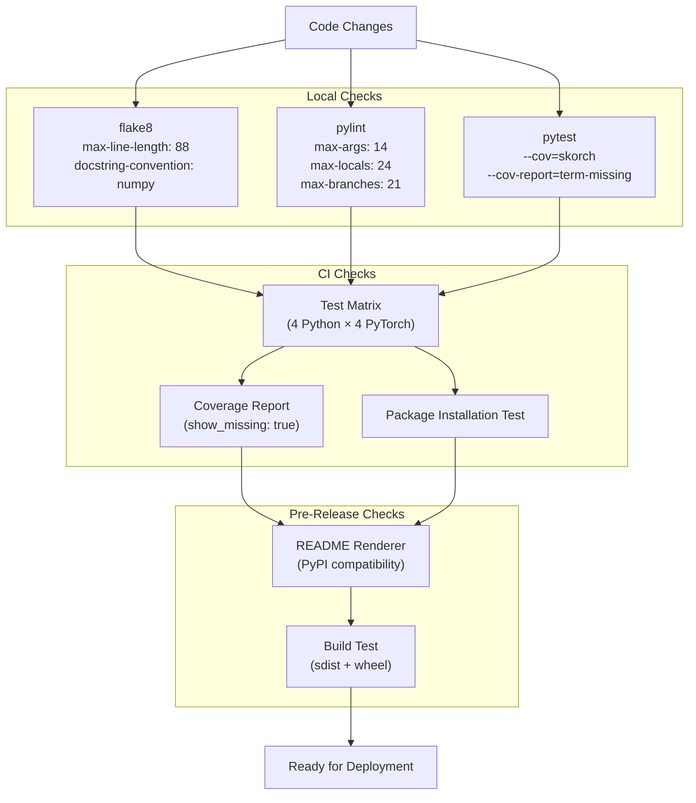

<!-- source: DeepWiki mcp.deepwiki.com · repo skorch-dev/skorch · page 9.3 Contributing Guidelines · fetched 2026-10-21 -->

# Contributing Guidelines

<details>
<summary>Relevant source files</summary>

The following files were used as context for generating this wiki page:

- [.github/workflows/testing.yml](.github/workflows/testing.yml)
- [README.rst](README.rst)
- [VERSION](VERSION)
- [docs/user/installation.rst](docs/user/installation.rst)
- [pyproject.toml](pyproject.toml)
- [scripts/deploy.sh](scripts/deploy.sh)

</details>


This document provides guidelines for contributing to the skorch codebase. It covers development environment setup, code style requirements, testing procedures, and the pull request process.

For information about the package build system and deployment, see [Build System and Deployment](#9.1). For details about the test suite structure, see [Testing Infrastructure](#9.2).

---

## Development Environment Setup

### Prerequisites

Skorch requires Python 3.9 or higher. The project officially supports the last four minor PyTorch versions.

### Installation for Development

**Using conda:**

```bash
git clone https://github.com/skorch-dev/skorch.git
cd skorch
conda create -n skorch-env python=3.12
conda activate skorch-env
python -m pip install torch
python -m pip install -e '.[test,docs,dev,extended]'
```

**Using pip:**

```bash
git clone https://github.com/skorch-dev/skorch.git
cd skorch
# create and activate a virtual environment
python -m pip install torch
python -m pip install -e '.[test,docs,dev,extended]'
```

The `-e` flag installs the package in editable mode, allowing you to modify the source code and see changes without reinstalling.

### Optional Dependencies

The project defines several optional dependency groups in [pyproject.toml:47-83]():

| Dependency Group | Purpose | Key Packages |
|-----------------|---------|--------------|
| `test` | Unit testing | pytest, pytest-cov, flaky |
| `dev` | Code quality checks | pylint, flake8, future |
| `docs` | Documentation building | sphinx, sphinx_rtd_theme, numpydoc |
| `extended` | Extended functionality | accelerate, tensorboard, wandb, neptune, sacred, transformers, safetensors, gpytorch |

**Sources:** [README.rst:185-225](), [docs/user/installation.rst:44-86](), [pyproject.toml:47-83]()

---

## Development Workflow

### Development Process Flow



### Running Tests Locally

Execute the test suite using pytest:

```bash
py.test
```

Run tests with coverage reporting:

```bash
pytest --cov=skorch --cov-report=term-missing
```

The pytest configuration is defined in [pyproject.toml:103-109](). Tests are located in `skorch/tests/` and follow the naming pattern `test*.py`.

### Running Code Quality Checks

Execute pylint to check code style:

```bash
pylint skorch
```

The pylint configuration is extensive and defined in [pyproject.toml:111-183]().

**Sources:** [README.rst:196-198](), [README.rst:224-225](), [pyproject.toml:103-109]()

---

## Code Style Guidelines

### General Style Rules

The codebase follows these style conventions defined in [pyproject.toml:98-102]():

| Rule | Value | Description |
|------|-------|-------------|
| `max-line-length` | 88 | Maximum characters per line |
| `docstring-convention` | numpy | Docstring format |
| `docstring-min-length` | 10 | Minimum docstring length |

### Naming Conventions

The project uses specific naming patterns defined in [pyproject.toml:152-166]():

- **Classes**: PascalCase (e.g., `NeuralNet`, `Checkpoint`)
- **Functions/Methods**: snake_case or CamelCase depending on context
- **Variables**: snake_case
- **Constants**: UPPER_SNAKE_CASE
- **Good single-letter names**: `X`, `y`, `f`, `T`, `Xt`, `Xs`, `yt`, `_`

### Pylint Configuration

Key pylint settings from [pyproject.toml:111-183]():

| Setting | Value | Purpose |
|---------|-------|---------|
| `max-args` | 14 | Maximum function arguments |
| `max-locals` | 24 | Maximum local variables |
| `max-branches` | 21 | Maximum conditional branches |
| `max-attributes` | 19 | Maximum class attributes |
| `max-module-lines` | 1500 | Maximum lines per module |
| `min-public-methods` | 0 | Minimum public methods (no minimum) |
| `max-public-methods` | 40 | Maximum public methods |

### Disabled Checks

Several pylint checks are disabled in [pyproject.toml:115-133](), including:
- `cyclic-import`
- `fixme` 
- `import-error`
- `no-member`
- `import-outside-toplevel`

**Sources:** [pyproject.toml:98-102](), [pyproject.toml:111-183]()

---

## Testing Requirements

### Test Coverage

The project maintains comprehensive test coverage. Coverage configuration is defined in [pyproject.toml:86-96]():

- **Source**: All files in `skorch/*`
- **Excluded**: `skorch/tests/*`, `skorch/_version.py`
- **Reports**: Show missing lines, don't skip covered files

### Continuous Integration Matrix



The CI workflow runs on every push to master and every pull request. It tests all combinations of supported Python and PyTorch versions.

### Running Specific Tests

Run tests for a specific module:

```bash
pytest skorch/tests/test_net.py
```

Run tests matching a pattern:

```bash
pytest -k "test_fit"
```

Run tests with verbose output:

```bash
pytest -v
```

### Test Utilities

The project uses `flaky` for handling non-deterministic test failures. Tests that may occasionally fail due to randomness can be decorated with `@flaky`.

**Sources:** [.github/workflows/testing.yml:1-54](), [pyproject.toml:54-58](), [pyproject.toml:86-96]()

---

## Pull Request Process

### Creating a Pull Request

1. **Fork and clone** the repository
2. **Create a feature branch** from `master`
3. **Make your changes** with clear, logical commits
4. **Add tests** for new functionality
5. **Run tests and linting** locally
6. **Update documentation** if needed
7. **Push to your fork** and create a pull request

### Pull Request Checklist

Before submitting a pull request, ensure:

- [ ] All tests pass locally (`pytest`)
- [ ] Code passes pylint checks (`pylint skorch`)
- [ ] New functionality has tests
- [ ] Documentation is updated (if applicable)
- [ ] Commit messages are clear and descriptive
- [ ] Changes are made in a feature branch (not `master`)

### CI Checks

When you create a pull request, GitHub Actions automatically runs the test suite across all supported Python and PyTorch versions. All checks must pass before the pull request can be merged.

The CI workflow is defined in [.github/workflows/testing.yml:1-54]() and includes:

1. Setting up the environment
2. Installing dependencies
3. Installing skorch
4. Running pytest with coverage

### Code Review

Maintainers will review your pull request and may request changes. Address feedback by:

- Making additional commits to your branch
- Pushing changes to your fork (the PR updates automatically)
- Responding to review comments

**Sources:** [.github/workflows/testing.yml:1-54](), [README.rst:276-284]()

---

## Communication Channels

### GitHub Discussions

Use [GitHub discussions](https://github.com/skorch-dev/skorch/discussions) for:
- User questions
- Installation issues
- General discussions
- Feature ideas

### GitHub Issues

Use [GitHub issues](https://github.com/skorch-dev/skorch/issues) for:
- Bug reports
- Feature requests
- RFCs (Request for Comments)
- Technical discussions

### Slack

Join the `#skorch` channel on the [PyTorch Slack server](https://pytorch.slack.com/) for real-time discussions. Request access at [https://bit.ly/ptslack](https://bit.ly/ptslack).

**Sources:** [README.rst:272-284]()

---

## Documentation Standards

### Docstring Format

Use NumPy-style docstrings as specified in [pyproject.toml:100](). Example:

```python
def my_function(param1, param2):
    """Brief description of the function.
    
    More detailed description if needed.
    
    Parameters
    ----------
    param1 : type
        Description of param1
    param2 : type
        Description of param2
        
    Returns
    -------
    return_type
        Description of return value
    """
```

### Documentation Files

Documentation source files are located in the `docs/` directory. To build documentation locally:

```bash
pip install '.[docs]'
cd docs
make html
```

Generated documentation will be in `docs/_build/html/`.

**Sources:** [pyproject.toml:60-64](), [pyproject.toml:100]()

---

## Release Process

### Version Management

The current version is stored in the `VERSION` file in the repository root. The version string is read by the build system via [pyproject.toml:185]().

### Deployment Script

Releases are managed using the deployment script at [scripts/deploy.sh:1-74](). The deployment process:



The deployment script:
1. Verifies the working tree is clean
2. Creates a fresh conda environment with Python 3.9
3. Installs PyTorch and build dependencies
4. Runs the full test suite
5. Validates README rendering for PyPI
6. Builds source distribution and wheel
7. Uploads to PyPI (live or test server)

### Deployment Requirements

- Clean git working tree (no uncommitted changes)
- `PYTORCH_VERSION` environment variable must be set
- All tests must pass
- README must render correctly

**Usage:**

```bash
# Deploy to test PyPI
PYTORCH_VERSION=2.8.0 ./scripts/deploy.sh stage

# Deploy to production PyPI
PYTORCH_VERSION=2.8.0 ./scripts/deploy.sh live
```

**Sources:** [scripts/deploy.sh:1-74](), [VERSION:1-2](), [pyproject.toml:185]()

---

## Code Quality Pipeline

### Quality Checks Flow



This pipeline ensures code quality at multiple stages:

1. **Local development**: flake8 and pylint for style, pytest for functionality
2. **Continuous integration**: Full test matrix across Python/PyTorch versions
3. **Pre-release**: README validation and build verification

**Sources:** [pyproject.toml:86-109](), [.github/workflows/testing.yml:1-54](), [scripts/deploy.sh:61-67]()

---

## Best Practices

### Commit Messages

Write clear, descriptive commit messages:
- Use present tense ("Add feature" not "Added feature")
- First line should be a brief summary (50 chars or less)
- Add detailed explanation in the body if needed
- Reference issue numbers when applicable (e.g., "Fixes #123")

### Code Organization

- Keep functions focused on a single responsibility
- Limit function complexity (max 21 branches per function)
- Use descriptive variable names
- Add docstrings to all public functions and classes

### Testing

- Write tests for all new features
- Include edge cases and error conditions
- Use meaningful test names that describe what is being tested
- Keep tests independent and reproducible

### Documentation

- Update relevant documentation when adding features
- Include examples for new functionality
- Keep docstrings synchronized with code changes
- Use cross-references to related functionality

**Sources:** [pyproject.toml:111-183]()

---

