# Page: Overview

# Overview

<details>
<summary>Relevant source files</summary>

The following files were used as context for generating this wiki page:

- [.github/workflows/testing.yml](.github/workflows/testing.yml)
- [CHANGES.md](CHANGES.md)
- [README.rst](README.rst)
- [docs/user/FAQ.rst](docs/user/FAQ.rst)
- [docs/user/callbacks.rst](docs/user/callbacks.rst)
- [docs/user/dataset.rst](docs/user/dataset.rst)
- [docs/user/installation.rst](docs/user/installation.rst)
- [docs/user/neuralnet.rst](docs/user/neuralnet.rst)

</details>


This page provides a comprehensive introduction to skorch, a Python library that bridges PyTorch and scikit-learn by providing a scikit-learn compatible interface for neural networks implemented in PyTorch. For detailed information about specific components, please refer to their respective pages in this wiki.

## What is skorch?

skorch is a high-level neural network library that wraps PyTorch models in a scikit-learn compatible API. It allows users to build, train, and evaluate PyTorch neural networks using familiar scikit-learn patterns and workflows, including integration with GridSearchCV, Pipelines, and other scikit-learn tools.

The library provides a seamless interface between PyTorch's flexibility in creating custom neural network architectures and scikit-learn's consistent API and wealth of utility functions for model selection, evaluation, and preprocessing.

Sources: [README.rst:8-8](), [setup.py:34-34]()

## Core Architecture

skorch is built around a central `NeuralNet` class which serves as the foundation for more specialized neural network implementations.

### Architecture Diagram

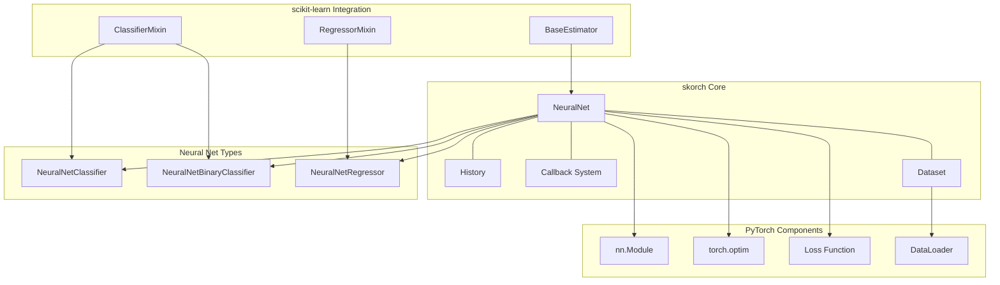

Sources: [CHANGES.md:28-28](), [README.rst:44-82]()

The diagram shows the core architecture of skorch. The central `NeuralNet` class inherits from scikit-learn's `BaseEstimator` and serves as the base for specialized classes like `NeuralNetClassifier`, `NeuralNetBinaryClassifier`, and `NeuralNetRegressor`. The `NeuralNet` class wraps PyTorch components (module, optimizer, criterion) and provides a scikit-learn compatible interface.

## Training and Callback Lifecycle

skorch implements a comprehensive training loop with well-defined lifecycle events where callbacks can be triggered.

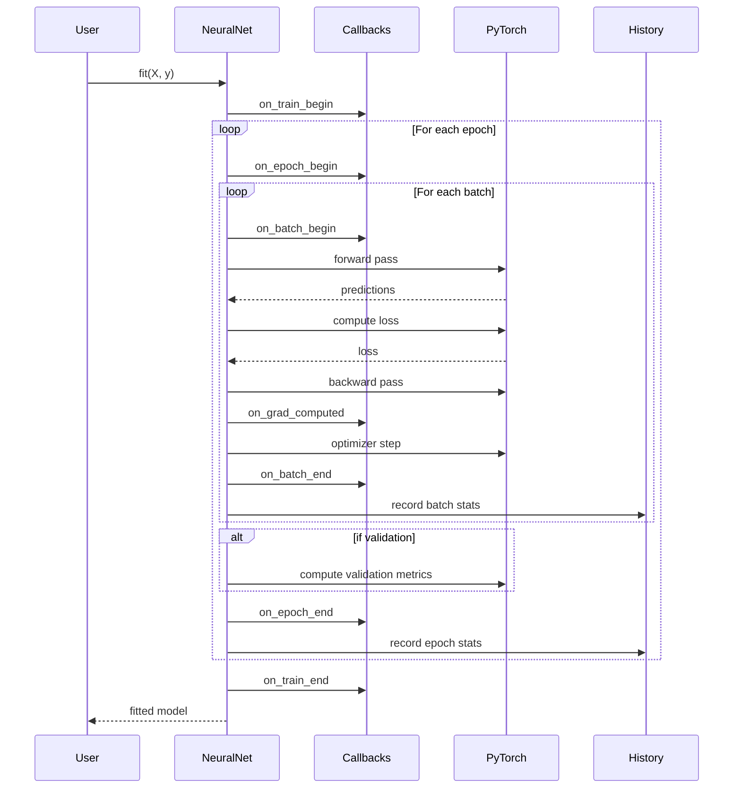

Sources: [CHANGES.md:132-132](), [CHANGES.md:111-112]()

This diagram illustrates the training lifecycle in skorch and how callbacks integrate with it. When you call `fit()`, the process involves multiple nested loops over epochs and batches, with callback methods triggered at specific points to allow for customization of the training process.

## Key Features

### scikit-learn Compatibility

skorch is fully compatible with scikit-learn's ecosystem:

- Works seamlessly in scikit-learn pipelines
- Compatible with model selection tools like GridSearchCV
- Follows scikit-learn's fit/predict API pattern
- Inherits from scikit-learn's BaseEstimator

Sources: [README.rst:83-96](), [README.rst:98-114]()

### Rich Callback Ecosystem

```mermaid
graph TD
    subgraph "Callback Base"
        Callback["Callback"]
    end
    
    subgraph "Training Control"
        EarlyStopping["EarlyStopping"]
        Checkpoint["Checkpoint"]
        TrainEndCheckpoint["TrainEndCheckpoint"]
        LoadInitState["LoadInitState"]
        ParamMapper["ParamMapper"]
        Freezer["Freezer"]
        Unfreezer["Unfreezer"]
    end
    
    subgraph "Scoring & Metrics"
        EpochScoring["EpochScoring"]
        BatchScoring["BatchScoring"]
        PassthroughScoring["PassthroughScoring"]
    end
    
    subgraph "Learning Rate"
        LRScheduler["LRScheduler"]
        WarmRestartLR["WarmRestartLR"]
    end
    
    subgraph "Logging & Visualization"
        PrintLog["PrintLog"]
        ProgressBar["ProgressBar"]
        TensorBoard["TensorBoard"]
        NeptuneLogger["NeptuneLogger"]
        WandbLogger["WandbLogger"]
        MlflowLogger["MlflowLogger"]
        SacredLogger["SacredLogger"]
    end
    
    Callback --> EarlyStopping
    Callback --> Checkpoint
    Callback --> TrainEndCheckpoint
    Callback --> LoadInitState
    Callback --> ParamMapper
    ParamMapper --> Freezer
    ParamMapper --> Unfreezer
    
    Callback --> EpochScoring
    Callback --> BatchScoring
    Callback --> PassthroughScoring
    
    Callback --> LRScheduler
    
    Callback --> PrintLog
    Callback --> ProgressBar
    Callback --> TensorBoard
    Callback --> NeptuneLogger
    Callback --> WandbLogger
    Callback --> MlflowLogger
    Callback --> SacredLogger
```

Sources: [README.rst:119-128](), [CHANGES.md:123-124](), [CHANGES.md:119-121](), [CHANGES.md:146-147]()

skorch provides a rich ecosystem of callbacks that allow customizing various aspects of the training process:

- **Training Control**: Early stopping, checkpointing, parameter freezing/unfreezing
- **Scoring & Metrics**: Performance evaluation during training
- **Learning Rate**: Learning rate scheduling
- **Logging & Visualization**: Progress tracking and visualization

### Flexible Data Handling

skorch handles data conversion between different formats:

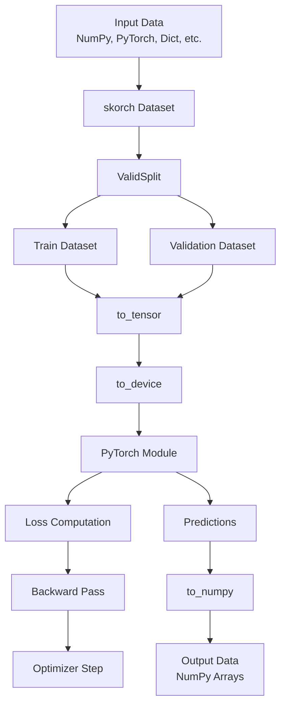

Sources: [CHANGES.md:177-179](), [CHANGES.md:112-112](), [CHANGES.md:657-658]()

The diagram shows how skorch handles data flow, including automatic conversion between NumPy arrays and PyTorch tensors, and support for various input data formats.

### Hugging Face Integration

skorch provides integration with the Hugging Face ecosystem for working with transformer models:

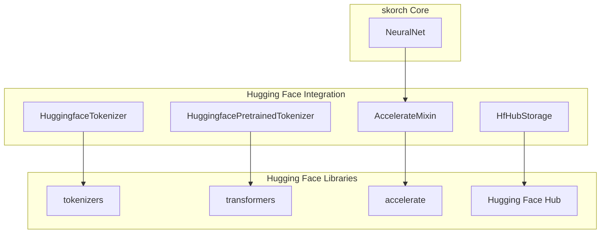

Sources: [README.rst:127-127](), [CHANGES.md:104-107]()

The diagram shows skorch's integration with Hugging Face's ecosystem, including support for tokenizers, transformers, and the accelerate library for advanced training capabilities.

## Version and Platform Support

skorch is compatible with:

- Python 3.9 or higher
- PyTorch - officially supports the last four minor versions:
  - 2.3.1
  - 2.4.1
  - 2.5.1
  - 2.6.0
- scikit-learn 0.22.0 or higher

Sources: [README.rst:133-133](), [README.rst:237-246](), [CHANGES.md:110-110]()

## Basic Usage Example

Here's a simple example demonstrating how to use skorch:

```python
import numpy as np
from sklearn.datasets import make_classification
from torch import nn
from skorch import NeuralNetClassifier

X, y = make_classification(1000, 20, n_informative=10, random_state=0)
X = X.astype(np.float32)
y = y.astype(np.int64)

class MyModule(nn.Module):
    def __init__(self, num_units=10, nonlin=nn.ReLU()):
        super().__init__()

        self.dense0 = nn.Linear(20, num_units)
        self.nonlin = nonlin
        self.dropout = nn.Dropout(0.5)
        self.dense1 = nn.Linear(num_units, num_units)
        self.output = nn.Linear(num_units, 2)
        self.softmax = nn.Softmax(dim=-1)

    def forward(self, X, **kwargs):
        X = self.nonlin(self.dense0(X))
        X = self.dropout(X)
        X = self.nonlin(self.dense1(X))
        X = self.softmax(self.output(X))
        return X

net = NeuralNetClassifier(
    MyModule,
    max_epochs=10,
    lr=0.1,
    # Shuffle training data on each epoch
    iterator_train__shuffle=True,
)

net.fit(X, y)
y_proba = net.predict_proba(X)
```

Sources: [README.rst:44-82]()

## Integration with scikit-learn Pipeline

skorch neural networks can be used in scikit-learn pipelines:

```python
from sklearn.pipeline import Pipeline
from sklearn.preprocessing import StandardScaler

pipe = Pipeline([
    ('scale', StandardScaler()),
    ('net', net),
])

pipe.fit(X, y)
y_proba = pipe.predict_proba(X)
```

Sources: [README.rst:83-96]()

## Grid Search with skorch

skorch models can be used with scikit-learn's GridSearchCV:

```python
from sklearn.model_selection import GridSearchCV

# deactivate skorch-internal train-valid split and verbose logging
net.set_params(train_split=False, verbose=0)
params = {
    'lr': [0.01, 0.02],
    'max_epochs': [10, 20],
    'module__num_units': [10, 20],
}
gs = GridSearchCV(net, params, refit=False, cv=3, scoring='accuracy', verbose=2)

gs.fit(X, y)
print("best score: {:.3f}, best params: {}".format(gs.best_score_, gs.best_params_))
```

Sources: [README.rst:98-114]()

## Further Resources

For more detailed information about specific components of skorch, please refer to their respective pages in this wiki:

- For detailed documentation on the NeuralNet class, see [NeuralNet Class](#2.1)
- For specialized neural network types, see [Neural Network Types](#2.2)
- For information about the callback system, see [Callback System](#3)
- For integration with other libraries, see [Integration & Extensions](#5)

---

# Page: Core Architecture

# Core Architecture

<details>
<summary>Relevant source files</summary>

The following files were used as context for generating this wiki page:

- [.github/workflows/testing.yml](.github/workflows/testing.yml)
- [README.rst](README.rst)
- [docs/user/installation.rst](docs/user/installation.rst)
- [skorch/net.py](skorch/net.py)
- [skorch/tests/test_net.py](skorch/tests/test_net.py)

</details>


This page explains the core architectural design and main components of the skorch library. It details how skorch bridges PyTorch and scikit-learn by providing a standardized, scikit-learn compatible interface for neural networks implemented in PyTorch.

For more specific information about the NeuralNet class, see [NeuralNet Class](#2.1). For details on dataset handling, see [Dataset Handling](#2.3).

## Overview

skorch's core architecture is designed to make PyTorch models work with scikit-learn's API while minimizing boilerplate code. It handles tasks like converting between NumPy arrays and PyTorch tensors, implementing the training loop, managing batching, and providing a callback system for customization.

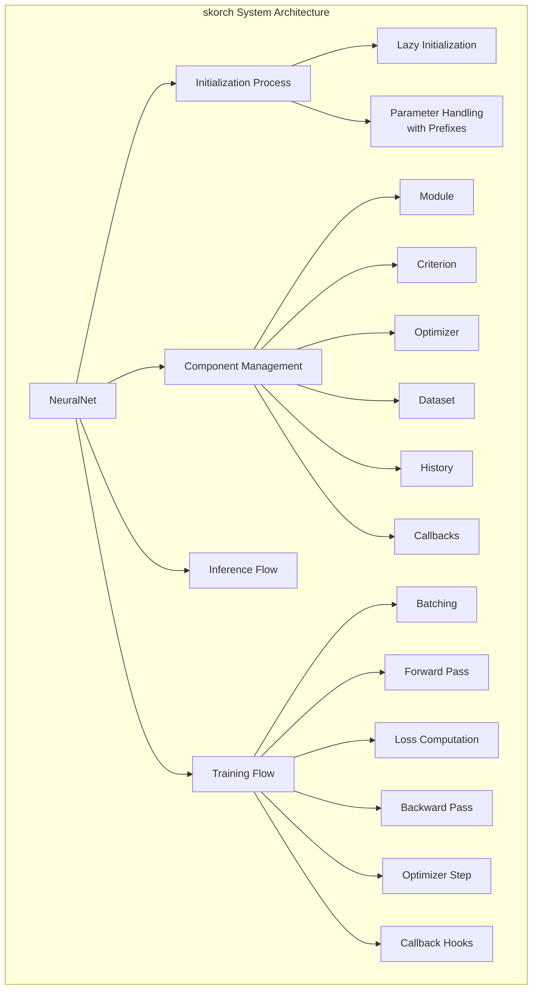

Sources: [skorch/net.py:55-311](). This diagram is based on the core components described in the NeuralNet class docstring.

## Class Hierarchy and Inheritance

skorch provides a scikit-learn compatible interface through its class hierarchy. The base `NeuralNet` class inherits from scikit-learn's `BaseEstimator`, and specialized variants inherit from `NeuralNet`.

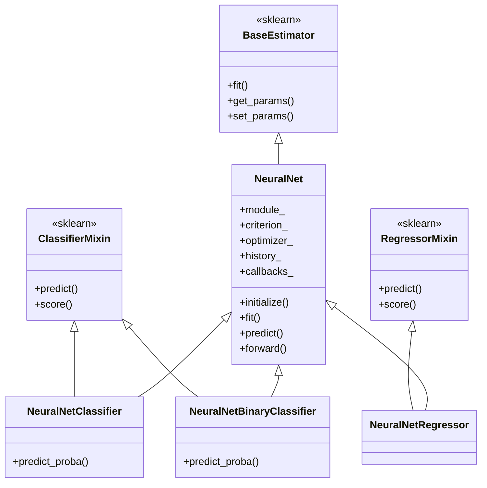

Sources: [skorch/net.py:55-56](), [docs/user/neuralnet.rst:8-16]()

## Core Components

The main components of skorch's architecture work together to provide the bridge between PyTorch and scikit-learn:

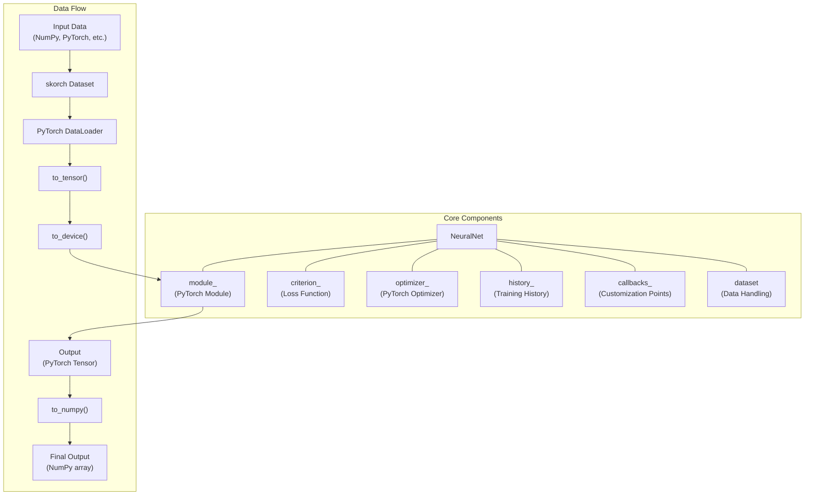

Sources: [skorch/net.py:94-239](), [docs/user/neuralnet.rst:62-101]()

### NeuralNet

The `NeuralNet` class is the central component of skorch's architecture. It acts as a wrapper around PyTorch modules and provides scikit-learn compatibility.

Key responsibilities:
- Initializes and manages PyTorch components (module, criterion, optimizer)
- Implements the training loop
- Converts data between NumPy and PyTorch formats
- Manages callback execution during training
- Tracks training metrics in the history

Sources: [skorch/net.py:55-311](), [docs/user/neuralnet.rst:8-16]()

### Initialization Process

skorch uses lazy initialization, meaning components are only initialized when needed. When a `NeuralNet` is instantiated, arguments are stored but not immediately used.

The initialization sequence is:

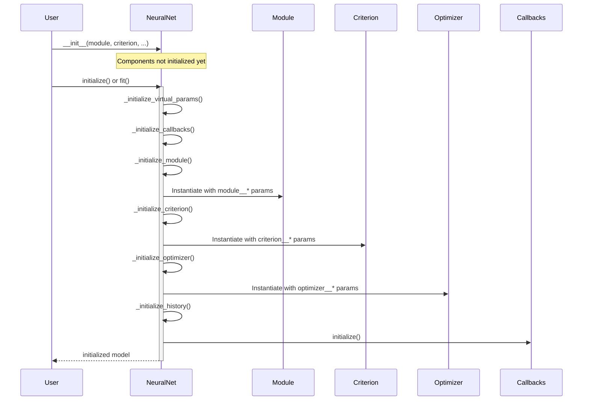

Sources: [skorch/net.py:929-943](), [docs/user/neuralnet.rst:42-60]()

### Parameter Handling

skorch uses a special parameter naming convention with double underscores to set parameters on subcomponents:

```
module__num_units=100      # Sets num_units=100 on module initialization
criterion__weight=weights  # Sets weight=weights on criterion initialization
optimizer__momentum=0.9    # Sets momentum=0.9 on optimizer initialization
```

This allows convenient configuration of all components from the top-level `NeuralNet` instance.

Sources: [skorch/net.py:63-87](), [docs/user/neuralnet.rst:499-526]()

### Component Management

skorch manages several key components:

1. **module_**: The instantiated PyTorch module that defines the neural network architecture.
2. **criterion_**: The loss function used during training.
3. **optimizer_**: The optimization algorithm that updates model parameters.
4. **history_**: Tracks metrics during training.
5. **callbacks_**: Custom callback objects for modifying the training process.

Components are initialized when needed, and each has a dedicated initialization method:

| Component | Initialization Method | Description |
|-----------|------------------------|-------------|
| Module | `initialize_module()` | Instantiates the PyTorch module |
| Criterion | `initialize_criterion()` | Instantiates the loss function |
| Optimizer | `initialize_optimizer()` | Instantiates the optimizer |
| History | `initialize_history()` | Creates a new History object |
| Callbacks | `initialize_callbacks()` | Sets up all callbacks |

Sources: [skorch/net.py:605-682](), [docs/user/neuralnet.rst:69-119]()

## Training and Inference Flow

The training process in skorch follows a fixed pattern, with callbacks serving as customization points at each step:

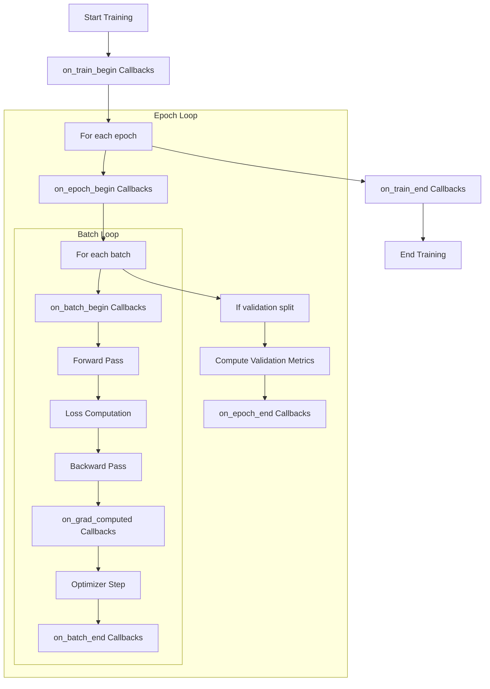

Sources: [skorch/net.py:403-446](), [docs/user/callbacks.rst:40-89]()

### Inference Flow

During inference (prediction), the data follows a similar flow but skips the training-specific components:

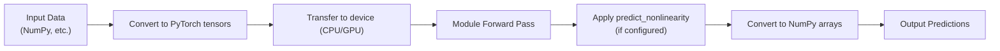

Sources: [skorch/net.py:334-356](), [docs/user/neuralnet.rst:359-388]()

## Callback System

The callback system is a key architectural feature that provides customization points throughout the training process:

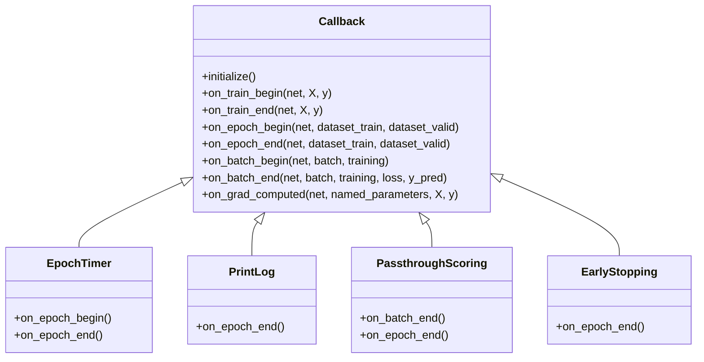

skorch provides default callbacks and allows custom callbacks to be added. The default callbacks include:
- `EpochTimer`: Times each epoch
- `PrintLog`: Prints training metrics
- `PassthroughScoring`: Records metrics during training

Sources: [skorch/net.py:386-398](), [docs/user/callbacks.rst:1-24]()

## Dataset Handling

skorch handles various input data types through its `Dataset` class:

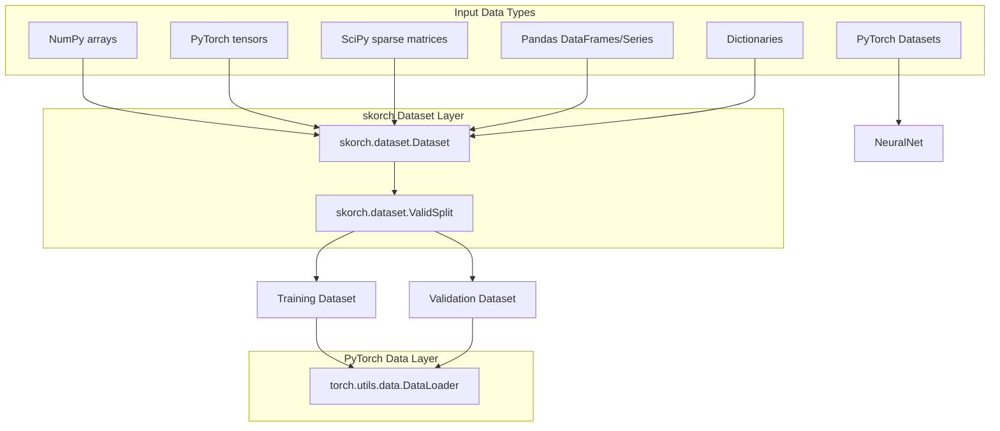

The dataset system handles:
- Converting various input types to a format PyTorch can use
- Splitting data into training and validation sets
- Providing a consistent interface for different data types
- Supporting dictionary inputs to match module parameter names

Sources: [docs/user/dataset.rst:1-147](), [skorch/net.py:131-147]()

## Summary

skorch's core architecture provides a clean integration between PyTorch and scikit-learn. The `NeuralNet` class wraps PyTorch modules, the callback system enables customization, and the dataset handling makes working with different data formats seamless.

The architecture is designed to be flexible and extensible while hiding the complexity of boilerplate code, allowing users to focus on model development.

---

# Page: NeuralNet Base Class

# NeuralNet Class

<details>
<summary>Relevant source files</summary>

The following files were used as context for generating this wiki page:

- [docs/user/FAQ.rst](docs/user/FAQ.rst)
- [docs/user/callbacks.rst](docs/user/callbacks.rst)
- [docs/user/dataset.rst](docs/user/dataset.rst)
- [docs/user/neuralnet.rst](docs/user/neuralnet.rst)
- [skorch/net.py](skorch/net.py)
- [skorch/tests/test_net.py](skorch/tests/test_net.py)

</details>


The `NeuralNet` class is the core component of skorch, providing a scikit-learn compatible interface for PyTorch neural networks. It serves as the base class that wraps PyTorch's `nn.Module` while handling training loops, batching, data conversion, and other boilerplate code. For specialized versions that handle classification and regression tasks, see [Neural Network Types](#2.2).

## Overview

`NeuralNet` is designed to bridge the gap between PyTorch's flexibility and scikit-learn's ease of use. It inherits from scikit-learn's `BaseEstimator` and provides methods like `fit()`, `predict()`, and `score()` that sklearn users are familiar with.

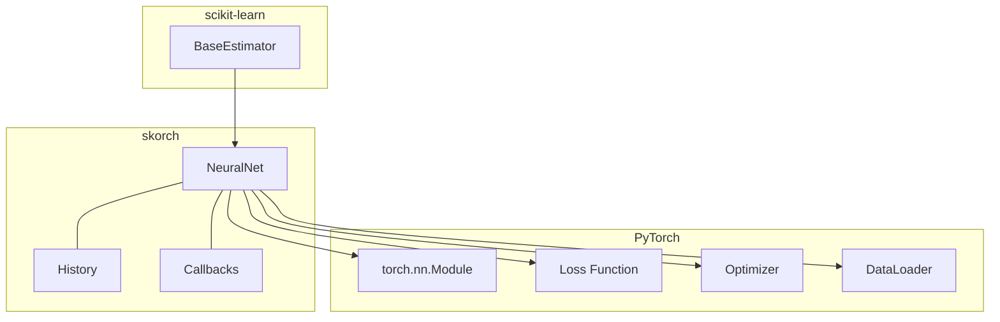

Sources: [skorch/net.py:55-312](). [docs/user/neuralnet.rst:8-37]().

## Initialization Process

The `NeuralNet` class follows a two-step initialization process:

1. **Instantiation**: When you create a `NeuralNet` object, parameters are stored but not initialized.
2. **Initialization**: When you call `fit()` or `initialize()`, components are actually initialized.

After initialization, components are available as attributes with trailing underscores (e.g., `module_`, `criterion_`, `optimizer_`).

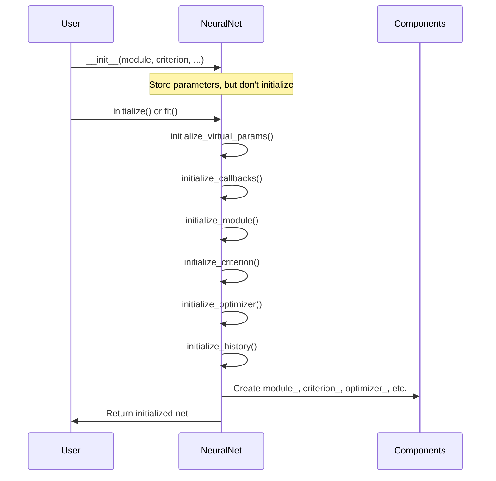

Sources: [skorch/net.py:929-943](). [docs/user/neuralnet.rst:42-60]().

## Key Parameters

The `NeuralNet` class accepts numerous parameters to configure behavior. Here are the most important ones:

| Parameter | Description |
|-----------|-------------|
| `module` | PyTorch `nn.Module` class or instance |
| `criterion` | PyTorch loss function class |
| `optimizer` | PyTorch optimizer class (default: `torch.optim.SGD`) |
| `lr` | Learning rate (shortcut for `optimizer__lr`) |
| `max_epochs` | Number of training epochs |
| `batch_size` | Size of mini-batches for training |
| `callbacks` | List of callbacks for customizing behavior |
| `train_split` | Function for splitting data into train/validation |
| `device` | Computation device ('cpu', 'cuda', etc.) |
| `warm_start` | Whether to reuse previous initialization |

Additionally, `NeuralNet` supports parameter passing to components using double-underscore notation:

```
net = NeuralNet(
    module=MyModule,
    module__num_units=100,
    optimizer__momentum=0.9,
)
```

Sources: [skorch/net.py:93-267](). [docs/user/neuralnet.rst:62-203]().

## Mechanism of Operation

### Lifecycle and Training Flow

The diagram below illustrates the key methods and flow during training:

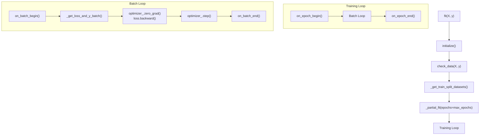

Sources: [skorch/net.py:1003-1157](). [skorch/net.py:421-442]().

### Callback System Integration

Callbacks are notified at specific points in the training lifecycle:

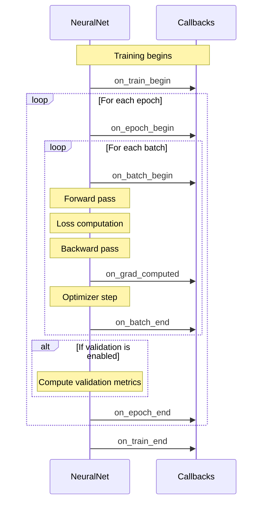

Sources: [skorch/net.py:403-446](). [docs/user/callbacks.rst:35-89]().

## Component Architecture

The `NeuralNet` class orchestrates several key components:

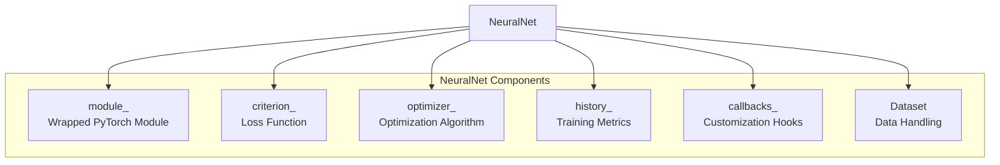

Sources: [skorch/net.py:55-312](). [docs/user/neuralnet.rst:8-37]().

### Module

The `module` parameter is the PyTorch neural network you want to train. It should be a class that inherits from `torch.nn.Module` or an instance of such a class. After initialization, the instantiated module is available as `module_`.

Sources: [skorch/net.py:95-102](). [docs/user/neuralnet.rst:69-101]().

### Criterion

The `criterion` parameter is the loss function used for training. It should be a PyTorch criterion class (not an instance). After initialization, the instantiated criterion is available as `criterion_`.

Sources: [skorch/net.py:100-102](). [docs/user/neuralnet.rst:102-118]().

### Optimizer

The `optimizer` parameter is the optimization algorithm used for training. It should be a PyTorch optimizer class (not an instance). The default is `torch.optim.SGD`. After initialization, the instantiated optimizer is available as `optimizer_`.

Sources: [skorch/net.py:104-107](). [docs/user/neuralnet.rst:120-156]().

### History

The `history_` attribute tracks metrics during training. It's automatically created and updated during training. You don't pass it as a parameter to `NeuralNet`.

Sources: [skorch/net.py:268-269](). [docs/user/neuralnet.rst:58-60]().

### Callbacks

The `callbacks` parameter allows customizing behavior at various points in the training process. By default, `NeuralNet` uses several callbacks including `EpochTimer`, `PassthroughScoring`, and `PrintLog`.

Sources: [skorch/net.py:148-170](). [docs/user/neuralnet.rst:217-281]().

### Dataset and Data Handling

`NeuralNet` handles various input data types including numpy arrays, PyTorch tensors, scipy sparse matrices, and pandas DataFrames. It converts these to PyTorch tensors before passing them to the model.

Sources: [skorch/net.py:131-146](). [docs/user/dataset.rst:61-146]().

## Key Methods

### initialize()

The `initialize()` method initializes all components of the net. It's automatically called by `fit()`, but you can also call it explicitly.

Sources: [skorch/net.py:929-943](). [docs/user/neuralnet.rst:304-323]().

### fit(X, y)

The `fit(X, y)` method trains the model. It initializes the model if not already initialized, then runs the training loop for `max_epochs` epochs.

Sources: [skorch/net.py:1003-1157](). [docs/user/neuralnet.rst:324-358]().

### predict(X) and predict_proba(X)

These methods perform inference on input data. `predict_proba()` returns the raw outputs from the model's forward pass, while `predict()` applies an appropriate transformation (e.g., argmax for classification).

Sources: [skorch/net.py:1219-1327](). [docs/user/neuralnet.rst:359-388]().

### save_params() and load_params()

These methods save and load model parameters to/from disk, allowing model persistence without pickling the entire object.

Sources: [skorch/net.py:1711-1855](). [docs/user/neuralnet.rst:397-420]().

## Advanced Features

### Virtual Parameters

`NeuralNet` supports "virtual parameters" that can be set using `set_params()` but don't correspond directly to attributes. For example, optimizer parameters can be updated after initialization using `net.set_params(optimizer__lr=0.01)`.

Sources: [skorch/net.py:631-648]().

### Device Management

`NeuralNet` automatically handles moving data and models between devices (CPU/GPU) based on the `device` parameter.

Sources: [skorch/net.py:213-216](). [docs/user/neuralnet.rst:294-303]().

### PyTorch Module Compilation

Recent versions support compiling PyTorch modules for better performance using `torch.compile()` via the `compile` parameter.

Sources: [skorch/net.py:217-226](). [skorch/net.py:791-841]().

## Usage Example

Here's a simple example of using `NeuralNet`:

```python
class MyModule(torch.nn.Module):
    def __init__(self, num_units=10):
        super().__init__()
        self.dense = torch.nn.Linear(20, num_units)
        self.output = torch.nn.Linear(num_units, 2)
        
    def forward(self, X):
        X = torch.relu(self.dense(X))
        X = torch.softmax(self.output(X), dim=-1)
        return X

net = NeuralNet(
    module=MyModule,
    module__num_units=100,
    criterion=torch.nn.NLLLoss,
    optimizer=torch.optim.SGD,
    optimizer__momentum=0.9,
    max_epochs=10,
    lr=0.1,
)

net.fit(X, y)
y_pred = net.predict(X_test)
```

Sources: [docs/user/neuralnet.rst:16-29]().

## Integration with sklearn

As `NeuralNet` inherits from sklearn's `BaseEstimator`, it can be used with sklearn tools like `GridSearchCV`, `Pipeline`, etc.

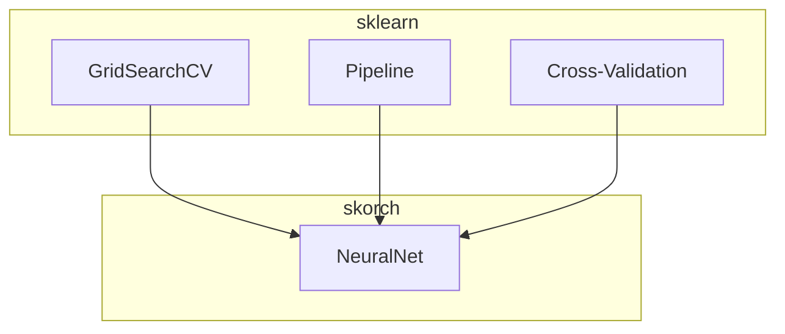

Sources: [docs/user/neuralnet.rst:8-11]().

---

# Page: Neural Network Types

# Neural Network Types

<details>
<summary>Relevant source files</summary>

The following files were used as context for generating this wiki page:

- [skorch/classifier.py](skorch/classifier.py)
- [skorch/net.py](skorch/net.py)
- [skorch/tests/test_classifier.py](skorch/tests/test_classifier.py)
- [skorch/tests/test_net.py](skorch/tests/test_net.py)
- [skorch/tests/test_regressor.py](skorch/tests/test_regressor.py)

</details>


This document describes the specialized neural network classes in skorch that extend the base `NeuralNet` class for specific machine learning tasks. These specialized classes provide task-specific defaults and interfaces that align with scikit-learn's API conventions. For information about the core `NeuralNet` class, see [NeuralNet Class](#2.1).

## Overview

Skorch provides three specialized neural network classes that cater to different types of machine learning tasks:

- **NeuralNetClassifier**: For multi-class classification tasks
- **NeuralNetBinaryClassifier**: Specifically for binary classification tasks
- **NeuralNetRegressor**: For regression tasks

Each of these classes inherits from the base `NeuralNet` class and incorporates scikit-learn's mixins to ensure compatibility with the scikit-learn ecosystem.

```mermaid
classDiagram
    class "sklearn.base.BaseEstimator" {
    }
    class "sklearn.base.ClassifierMixin" {
        +predict(X)
        +score(X, y)
    }
    class "sklearn.base.RegressorMixin" {
        +predict(X)
        +score(X, y)
    }
    class "NeuralNet" {
        +fit(X, y)
        +predict(X)
        +predict_proba(X)
        +score(X, y)
    }
    class "NeuralNetClassifier" {
        +criterion: torch.nn.NLLLoss
        +classes_
        +predict(X)
        +predict_proba(X)
    }
    class "NeuralNetBinaryClassifier" {
        +criterion: torch.nn.BCEWithLogitsLoss
        +threshold: float
        +classes_
        +predict(X)
        +predict_proba(X)
    }
    class "NeuralNetRegressor" {
        +criterion: torch.nn.MSELoss
        +predict(X)
    }
    
    "sklearn.base.BaseEstimator" <|-- "NeuralNet"
    "NeuralNet" <|-- "NeuralNetClassifier"
    "NeuralNet" <|-- "NeuralNetBinaryClassifier"
    "NeuralNet" <|-- "NeuralNetRegressor"
    "sklearn.base.ClassifierMixin" <|-- "NeuralNetClassifier"
    "sklearn.base.ClassifierMixin" <|-- "NeuralNetBinaryClassifier"
    "sklearn.base.RegressorMixin" <|-- "NeuralNetRegressor"
```

Sources: [skorch/classifier.py:57-68](), [skorch/classifier.py:266-286](), [skorch/regressor.py:39-54]()

## NeuralNetClassifier

`NeuralNetClassifier` is designed for multi-class classification tasks where the target variable can have multiple categories.

### Key Features and Defaults

- **Default Loss Function**: `torch.nn.NLLLoss` (Negative Log Likelihood Loss), which expects log probabilities as input
- **Default Callbacks**: Includes `EpochTimer`, `PassthroughScoring` for tracking loss, and `EpochScoring` with 'accuracy' metric
- **Classes Handling**: Automatically infers class labels from the training data
- **Validation Split**: Uses `ValidSplit` with stratified sampling by default

```mermaid
flowchart TD
    subgraph "NeuralNetClassifier"
        Init["__init__()
        - criterion=torch.nn.NLLLoss
        - train_split=ValidSplit(stratified=True)
        - classes=None"]
        
        Classes["classes_ property
        1. Return user-specified classes if provided
        2. Otherwise return inferred classes"]
        
        CheckData["check_data(X, y)
        1. Validate inputs
        2. Infer classes from y"]
        
        GetLoss["get_loss(y_pred, y_true)
        Apply log transform if using NLLLoss"]
        
        Predict["predict(X)
        Return argmax of predict_proba"]
        
        PredictProba["predict_proba(X)
        Return class probabilities"]
    end
    
    Init --> Classes
    Init --> CheckData
    CheckData --> Classes
    PredictProba --> Predict
    GetLoss
```

Sources: [skorch/classifier.py:57-168]()

### Example Usage

The `NeuralNetClassifier` is best used when you have a multi-class classification problem. It automatically applies the log transformation when using `NLLLoss` and provides class probability predictions with `predict_proba()`.

Key behaviors to note:
- The class infers the unique classes from your training data and stores them in the `classes_` attribute
- It converts the output of your PyTorch module (which should be probabilities) to log probabilities if using `NLLLoss`
- The `predict()` method returns the class with the highest probability

Sources: [skorch/classifier.py:156-235](), [skorch/tests/test_classifier.py:61-68]()

## NeuralNetBinaryClassifier

`NeuralNetBinaryClassifier` is specialized for binary classification tasks where the target variable has exactly two categories (typically 0 and 1).

### Key Features and Defaults

- **Default Loss Function**: `torch.nn.BCEWithLogitsLoss` (Binary Cross Entropy with Logits)
- **Default Callbacks**: Similar to `NeuralNetClassifier` with accuracy scoring
- **Fixed Classes**: Always has `classes_` as `[0, 1]`
- **Threshold**: Uses a configurable threshold (default 0.5) for binary predictions
- **Target Shape**: Requires 1-dimensional target values
- **Module Output**: Expects module to output logits with shape (n,) or (n, 1)

```mermaid
flowchart TD
    subgraph "NeuralNetBinaryClassifier"
        Init["__init__()
        - criterion=torch.nn.BCEWithLogitsLoss
        - train_split=ValidSplit(stratified=True)
        - threshold=0.5"]
        
        Classes["classes_ property
        Always returns np.array([0, 1])"]
        
        CheckData["check_data(X, y)
        Ensure y is 1-dimensional"]
        
        Infer["infer(x)
        Ensure output has shape (n,)"]
        
        Predict["predict(X)
        Apply threshold to probabilities"]
        
        PredictProba["predict_proba(X)
        Return binary probabilities [1-p, p]"]
    end
    
    Init --> Classes
    Init --> CheckData
    Init --> Infer
    PredictProba --> Predict
```

Sources: [skorch/classifier.py:266-386]()

### Example Usage

The `NeuralNetBinaryClassifier` is designed specifically for binary classification tasks. It has several optimizations and validations specific to this use case:

- It ensures that the target variable is one-dimensional
- It makes sure the module output has the correct shape (either (n,) or (n, 1))
- It uses a threshold to convert probabilities to binary predictions
- It automatically applies the sigmoid function to convert logits to probabilities when using `BCEWithLogitsLoss`

Sources: [skorch/classifier.py:341-386](), [skorch/tests/test_classifier.py:306-329]()

## NeuralNetRegressor

`NeuralNetRegressor` is designed for regression tasks where the target variable is continuous.

### Key Features and Defaults

- **Default Loss Function**: `torch.nn.MSELoss` (Mean Squared Error)
- **Target Handling**: Flexible with target dimensionality, but should align with model output dimensions

```mermaid
flowchart TD
    subgraph "NeuralNetRegressor"
        Init["__init__()
        - criterion=torch.nn.MSELoss"]
        
        CheckData["check_data(X, y)
        Validate inputs for regression"]
        
        Fit["fit(X, y)
        Train the regressor model"]
        
        Predict["predict(X)
        Return continuous predictions
        (identical to predict_proba)"]
    end
    
    Init --> CheckData
    CheckData --> Fit
    Fit --> Predict
```

Sources: [skorch/regressor.py:39-85]()

### Example Usage

The `NeuralNetRegressor` is used for predicting continuous values. When using this class:

- The target values are typically continuous and not categorized
- `predict()` and `predict_proba()` return identical results, as probability doesn't apply in regression
- There's no need for class inference as in classification tasks
- The model is typically evaluated using R² score or other regression metrics

A key consideration when using `NeuralNetRegressor` is ensuring that your target values and model outputs have matching dimensions to avoid broadcasting issues, which can lead to incorrect results.

Sources: [skorch/regressor.py:72-85](), [skorch/tests/test_regressor.py:102-116](), [skorch/tests/test_regressor.py:124-147]()

## Comparison of Neural Network Types

```mermaid
graph TD
    subgraph "Task Type Selection"
        Start["Select Neural Network Type"]
        
        Question1{"What type of task?"}
        
        Regression["Use NeuralNetRegressor
        - continuous output
        - MSELoss
        - no classes"]
        
        Classification{"Binary or 
        Multi-class?"}
        
        Binary["Use NeuralNetBinaryClassifier
        - 1D target (0/1)
        - BCEWithLogitsLoss
        - fixed classes [0,1]
        - threshold for prediction"]
        
        MultiClass["Use NeuralNetClassifier
        - categorized target
        - NLLLoss
        - inferred classes
        - argmax for prediction"]
        
        Start --> Question1
        Question1 -- "Regression" --> Regression
        Question1 -- "Classification" --> Classification
        Classification -- "Binary" --> Binary
        Classification -- "Multi-class" --> MultiClass
    end
```

This diagram helps you select the appropriate neural network type based on your task.

Sources: [skorch/classifier.py:19-43](), [skorch/classifier.py:238-253](), [skorch/regressor.py:15-26]()

## Integration with scikit-learn

A key advantage of all these neural network types is their compatibility with scikit-learn's ecosystem. They implement the necessary interfaces from `BaseEstimator` and the respective mixins (`ClassifierMixin` or `RegressorMixin`).

### Key Integration Features

- **Grid Search**: Compatible with `GridSearchCV` for hyperparameter tuning
- **Pipelines**: Can be used in scikit-learn `Pipeline` objects
- **Cross-Validation**: Works with various cross-validation schemes
- **Model Selection**: Compatible with scikit-learn's model selection tools

The specialized neural network classes ensure that methods like `predict()`, `predict_proba()`, and `score()` behave in a way that's consistent with scikit-learn's expectations for each task type.

Sources: [skorch/tests/test_classifier.py:394-403](), [skorch/tests/test_regressor.py:118-122](), [skorch/tests/test_classifier.py:174-184]()

---

# Page: Training Lifecycle

# Training Lifecycle

<details>
<summary>Relevant source files</summary>

The following files were used as context for generating this wiki page:

- [docs/user/FAQ.rst](docs/user/FAQ.rst)
- [docs/user/callbacks.rst](docs/user/callbacks.rst)
- [docs/user/dataset.rst](docs/user/dataset.rst)
- [docs/user/neuralnet.rst](docs/user/neuralnet.rst)
- [skorch/net.py](skorch/net.py)
- [skorch/tests/test_net.py](skorch/tests/test_net.py)

</details>


## Purpose and Scope

This document describes the complete training lifecycle in skorch, from initialization through training completion. It covers:

- The initialization phase and lazy component creation
- The structure of the training loop (epochs, batches, validation)
- Callback invocation points throughout the lifecycle
- The training step process (forward pass, loss computation, backpropagation, optimization)
- State management and history tracking

For information about specific neural network types (classifier, regressor), see [Neural Network Types](#2.2). For details on callback implementation, see [Callback Basics](#3.1). For dataset handling and splitting, see [Dataset Handling](#2.4).

---

## Overview of the Training Lifecycle

The skorch training lifecycle consists of two main phases: **initialization** and **training**. Components are initialized lazily (only when needed), and the training loop iterates through epochs and batches while invoking callbacks at specific hook points.

### Lifecycle Phases Diagram

```mermaid
graph TB
    Instantiate["User instantiates NeuralNet"]
    CallFit["User calls fit(X, y)"]
    CheckInit{"Is net<br/>initialized?"}
    Initialize["initialize()"]
    FitLoop["fit_loop()"]
    Complete["Training Complete"]
    
    Instantiate --> CallFit
    CallFit --> CheckInit
    CheckInit -->|No| Initialize
    CheckInit -->|Yes| FitLoop
    Initialize --> FitLoop
    FitLoop --> Complete
    
    InitPhase["Initialization Phase:<br/>- initialize_module()<br/>- initialize_criterion()<br/>- initialize_optimizer()<br/>- initialize_callbacks()<br/>- initialize_history()"]
    
    TrainPhase["Training Phase:<br/>- on_train_begin<br/>- Epoch Loop<br/>- on_train_end"]
    
    Initialize -.-> InitPhase
    FitLoop -.-> TrainPhase
```

**Sources:** [skorch/net.py:931-945](), [skorch/net.py:1032-1049](), [docs/user/neuralnet.rst:42-57]()

---

## Initialization Phase

### Lazy Initialization

When you instantiate a `NeuralNet`, components are **not** immediately initialized. Arguments are stored as-is, allowing the instance to be cloned and ensuring sklearn compatibility. Initialization occurs only when `fit()` or `initialize()` is called.

**Key characteristics:**
- Uninitialized attributes: `module`, `criterion`, `optimizer`, `callbacks`, `train_split`, `dataset`
- Initialized attributes (with trailing underscore): `module_`, `criterion_`, `optimizer_`, `callbacks_`, `history_`
- The `initialized_` boolean flag tracks initialization state

```mermaid
graph LR
    Before["Before Initialization:<br/>module (class)<br/>criterion (class)<br/>optimizer (class)<br/>callbacks (list)"]
    
    InitMethod["initialize()"]
    
    After["After Initialization:<br/>module_ (instance)<br/>criterion_ (instance)<br/>optimizer_ (instance)<br/>callbacks_ (list of tuples)<br/>history_ (History instance)"]
    
    Before --> InitMethod --> After
```

**Sources:** [skorch/net.py:327-378](), [skorch/net.py:931-945](), [docs/user/neuralnet.rst:42-61]()

### Initialization Method Sequence

The `initialize()` method calls several component-specific initialization methods in sequence:

| Order | Method | Purpose | Key Actions |
|-------|--------|---------|-------------|
| 1 | `_initialize_virtual_params()` | Set up virtual parameter handling | Registers patterns for optimizer param groups |
| 2 | `_initialize_callbacks()` | Initialize all callbacks | Creates `callbacks_` list with unique names |
| 3 | `_initialize_module()` | Initialize PyTorch module | Instantiates `module_`, moves to device, compiles if requested |
| 4 | `_initialize_criterion()` | Initialize loss criterion | Instantiates `criterion_`, moves to device, compiles if requested |
| 5 | `_initialize_optimizer()` | Initialize optimizer | Instantiates `optimizer_` with learnable parameters |
| 6 | `_initialize_history()` | Initialize history tracker | Creates or clears `history_` |

```mermaid
sequenceDiagram
    participant User
    participant NeuralNet
    participant Components
    
    User->>NeuralNet: initialize()
    
    rect rgb(240, 240, 240)
        Note over NeuralNet,Components: Initialization Sequence
        NeuralNet->>NeuralNet: check_training_readiness()
        NeuralNet->>NeuralNet: _initialize_virtual_params()
        NeuralNet->>Components: _initialize_callbacks()
        NeuralNet->>Components: _initialize_module()
        Note right of Components: Creates module_<br/>Moves to device<br/>Compiles if compile=True
        NeuralNet->>Components: _initialize_criterion()
        Note right of Components: Creates criterion_<br/>Moves to device
        NeuralNet->>Components: _initialize_optimizer()
        Note right of Components: Gets learnable params<br/>Creates optimizer_
        NeuralNet->>Components: _initialize_history()
        NeuralNet->>NeuralNet: _validate_params()
        NeuralNet->>NeuralNet: Set initialized_ = True
    end
    
    NeuralNet-->>User: Returns self
```

**Sources:** [skorch/net.py:931-945](), [skorch/net.py:711-758](), [skorch/net.py:760-791](), [skorch/net.py:899-923]()

### Re-initialization Behavior

Components may be re-initialized during training under specific conditions:

**When `warm_start=False` (default):**
- Each `fit()` call triggers full re-initialization
- Training starts from scratch
- Module weights are reset

**When `warm_start=True`:**
- `fit()` continues from the current state
- No re-initialization occurs
- Training continues where it left off

**Using `partial_fit()`:**
- Always continues from current state, regardless of `warm_start`
- Does not re-initialize if already initialized

**Sources:** [skorch/net.py:200-203](), [docs/user/neuralnet.rst:282-292](), [docs/user/FAQ.rst:24-34]()

---

## The fit() Method and Variants

### Method Relationships

```mermaid
graph TB
    fit["fit(X, y, **fit_params)"]
    partial_fit["partial_fit(X, y, **fit_params)"]
    fit_loop["fit_loop(X, y, epochs)"]
    
    fit -->|"If not initialized:<br/>initialize()"| fit_loop
    fit -->|"If warm_start=False:<br/>initialize()"| fit_loop
    partial_fit -->|"If not initialized:<br/>initialize()"| fit_loop
    partial_fit -->|"Never re-initializes<br/>if already initialized"| fit_loop
    
    fit_loop -->|"Calls for max_epochs"| run_single_epoch["run_single_epoch(iterator, training=True)"]
```

**Sources:** [skorch/net.py:1032-1049](), [skorch/net.py:1051-1083](), [skorch/net.py:1240-1271]()

### fit() Method Flow

The `fit()` method performs these steps:

1. **Check initialization:** If not initialized or `warm_start=False`, call `initialize()`
2. **Prepare data:** Create datasets from `X` and `y`
3. **Apply train/valid split:** Use `train_split` to create `dataset_train` and `dataset_valid`
4. **Call fit_loop:** Execute training for `max_epochs` epochs
5. **Return self:** Enable method chaining

**Sources:** [skorch/net.py:1032-1049]()

---

## Training Loop Structure

### Epoch and Batch Structure

The training loop has a hierarchical structure with distinct phases at train, epoch, and batch levels:

```mermaid
graph TB
    subgraph "Training Level"
        on_train_begin["on_train_begin<br/>(net, X, y)"]
        epoch_loop["Epoch Loop<br/>(1 to max_epochs)"]
        on_train_end["on_train_end<br/>(net, X, y)"]
    end
    
    subgraph "Epoch Level"
        on_epoch_begin["on_epoch_begin<br/>(net, dataset_train, dataset_valid)"]
        train_batches["Training Batches"]
        valid_step["Validation Step<br/>(if dataset_valid exists)"]
        on_epoch_end["on_epoch_end<br/>(net, dataset_train, dataset_valid)"]
    end
    
    subgraph "Batch Level"
        on_batch_begin["on_batch_begin<br/>(net, batch, training)"]
        forward_pass["Forward Pass"]
        loss_calc["Loss Calculation"]
        backward_pass["Backward Pass"]
        on_grad_computed["on_grad_computed<br/>(net, named_parameters, batch)"]
        optimizer_step["Optimizer Step"]
        on_batch_end["on_batch_end<br/>(net, batch, training, loss, y_pred)"]
    end
    
    on_train_begin --> epoch_loop
    epoch_loop --> on_train_end
    
    on_epoch_begin --> train_batches
    train_batches --> valid_step
    valid_step --> on_epoch_end
    
    on_batch_begin --> forward_pass
    forward_pass --> loss_calc
    loss_calc --> backward_pass
    backward_pass --> on_grad_computed
    on_grad_computed --> optimizer_step
    optimizer_step --> on_batch_end
```

**Sources:** [skorch/net.py:1240-1271](), [skorch/net.py:1293-1329](), [skorch/net.py:1404-1462]()

### Detailed Training Loop Sequence

```mermaid
sequenceDiagram
    participant NeuralNet
    participant Callbacks
    participant DataLoader
    participant Module
    participant Optimizer
    participant History
    
    NeuralNet->>Callbacks: notify('on_train_begin', X, y)
    
    loop For each epoch (1 to max_epochs)
        NeuralNet->>History: new_epoch()
        NeuralNet->>History: record('epoch', len(history))
        NeuralNet->>Callbacks: notify('on_epoch_begin', dataset_train, dataset_valid)
        
        NeuralNet->>Module: train()
        NeuralNet->>DataLoader: get_iterator(dataset_train, training=True)
        
        loop For each training batch
            NeuralNet->>History: new_batch()
            NeuralNet->>Callbacks: notify('on_batch_begin', batch, training=True)
            
            NeuralNet->>NeuralNet: train_step_single(batch)
            Note over NeuralNet: Unpacks batch into Xi, yi
            NeuralNet->>Module: forward(Xi)
            Module-->>NeuralNet: y_pred
            NeuralNet->>NeuralNet: get_loss(y_pred, yi, Xi)
            NeuralNet->>NeuralNet: loss.backward()
            
            NeuralNet->>Callbacks: notify('on_grad_computed', named_parameters, batch)
            NeuralNet->>Optimizer: step()
            NeuralNet->>Optimizer: zero_grad()
            
            NeuralNet->>History: record_batch('train_loss', loss.item())
            NeuralNet->>Callbacks: notify('on_batch_end', batch, training=True, loss, y_pred)
        end
        
        alt dataset_valid exists
            NeuralNet->>NeuralNet: validation_step(dataset_valid)
            Note over NeuralNet: Similar to training<br/>but no backprop
        end
        
        NeuralNet->>Callbacks: notify('on_epoch_end', dataset_train, dataset_valid)
    end
    
    NeuralNet->>Callbacks: notify('on_train_end', X, y)
```

**Sources:** [skorch/net.py:1240-1271](), [skorch/net.py:1293-1329](), [skorch/net.py:1404-1462](), [skorch/net.py:1464-1510]()

---

## Callback Hook Points

### Hook Point Reference Table

| Hook | When Called | Arguments | Typical Use Cases |
|------|-------------|-----------|-------------------|
| `on_train_begin` | Once at training start | `net`, `X`, `y` | Load checkpoints, initialize logging |
| `on_train_end` | Once at training end | `net`, `X`, `y` | Save final model, load best weights |
| `on_epoch_begin` | Start of each epoch | `net`, `dataset_train`, `dataset_valid` | Learning rate scheduling, parameter freezing |
| `on_epoch_end` | End of each epoch | `net`, `dataset_train`, `dataset_valid` | Checkpointing, early stopping checks, metric logging |
| `on_batch_begin` | Before each batch | `net`, `batch`, `training` | Batch-level monitoring |
| `on_batch_end` | After each batch | `net`, `batch`, `training`, `loss`, `y_pred` | Batch scoring, logging |
| `on_grad_computed` | After backward, before optimizer step | `net`, `named_parameters`, `batch`, `training` | Gradient clipping, gradient analysis |

**Sources:** [skorch/net.py:405-448](), [docs/user/callbacks.rst:36-90]()

### Callback Notification Mechanism

The `notify()` method is the central mechanism for invoking callbacks:

```mermaid
graph LR
    NeuralNet["NeuralNet.notify(method_name, **kwargs)"]
    SelfMethod["Call method on self<br/>(e.g., self.on_epoch_begin)"]
    CallbackLoop["For each callback in callbacks_"]
    CallbackMethod["Call method on callback<br/>(e.g., cb.on_epoch_begin)"]
    
    NeuralNet --> SelfMethod
    NeuralNet --> CallbackLoop
    CallbackLoop --> CallbackMethod
```

**Sources:** [skorch/net.py:405-420]()

---

## Training Step Details

### Single Training Step (train_step_single)

The `train_step_single()` method handles one batch of training data:

```mermaid
graph TB
    Input["train_step_single(batch, **fit_params)"]
    Unpack["Unpack batch:<br/>Xi, yi = unpack_data(batch)"]
    Infer["infer(Xi, **fit_params):<br/>y_pred = module_(Xi)"]
    Loss["get_loss(y_pred, yi, Xi, **fit_params):<br/>Compute loss"]
    Backward["loss.backward():<br/>Compute gradients"]
    Return["Return step dict:<br/>{'loss': loss, 'y_pred': y_pred}"]
    
    Input --> Unpack
    Unpack --> Infer
    Infer --> Loss
    Loss --> Backward
    Backward --> Return
```

**Process details:**
1. **Unpack batch:** Splits batch into `Xi` (input) and `yi` (target) using `unpack_data()`
2. **Forward pass:** Calls `infer()` which sets module to train mode and calls `module_.forward()`
3. **Loss computation:** Calls `get_loss()` to compute the loss value
4. **Backward pass:** Calls `loss.backward()` to compute gradients
5. **Return step info:** Returns dict with loss and predictions for history recording

**Sources:** [skorch/net.py:1404-1462](), [skorch/net.py:1358-1402]()

### Training Step Integration (train_step)

The `train_step()` method wraps `train_step_single()` with callback notifications and optimization:

```mermaid
sequenceDiagram
    participant run_single_epoch
    participant train_step
    participant Callbacks
    participant train_step_single
    participant Optimizer
    participant History
    
    run_single_epoch->>Callbacks: notify('on_batch_begin', batch, training=True)
    run_single_epoch->>train_step: train_step(batch, **fit_params)
    
    train_step->>train_step_single: Execute forward and backward
    train_step_single-->>train_step: Return {'loss': loss, 'y_pred': y_pred}
    
    train_step->>Callbacks: notify('on_grad_computed', named_parameters, batch)
    train_step->>Optimizer: step()
    train_step->>Optimizer: zero_grad()
    
    train_step-->>run_single_epoch: Return step dict
    
    run_single_epoch->>History: record_batch('train_loss', loss)
    run_single_epoch->>Callbacks: notify('on_batch_end', batch, training=True, loss, y_pred)
```

**Sources:** [skorch/net.py:1464-1510](), [skorch/net.py:1293-1329]()

### Validation Step

The validation step is similar to training but without backpropagation:

**Key differences from training:**
- Module set to eval mode via `module_.eval()`
- No gradient computation (wrapped in `torch.no_grad()`)
- No optimizer step
- Uses `iterator_valid` instead of `iterator_train`
- Callbacks receive `training=False`

```mermaid
graph TB
    Start["validation_step(dataset_valid, **fit_params)"]
    Iterator["get_iterator(dataset_valid, training=False)"]
    Module["module_.eval()"]
    NoGrad["torch.no_grad() context"]
    Loop["For each batch"]
    Forward["y_pred = module_.forward(Xi)"]
    Loss["loss = get_loss(y_pred, yi, Xi)"]
    Record["Record to history"]
    Callbacks["Notify callbacks"]
    
    Start --> Iterator
    Iterator --> Module
    Module --> NoGrad
    NoGrad --> Loop
    Loop --> Forward
    Forward --> Loss
    Loss --> Record
    Record --> Callbacks
```

**Sources:** [skorch/net.py:1512-1556]()

---

## Data Flow During Training

### From Input to Module

```mermaid
graph LR
    Input["X, y<br/>(numpy/tensor/dict/DataFrame)"]
    Dataset["Dataset(X, y)<br/>Wraps data"]
    Split["train_split<br/>(ValidSplit)"]
    TrainDS["dataset_train"]
    ValidDS["dataset_valid"]
    TrainLoader["DataLoader<br/>(training)"]
    ValidLoader["DataLoader<br/>(validation)"]
    Batch["Batch<br/>(Xi, yi)"]
    ToDevice["to_device(Xi, device)"]
    Module["module_.forward(Xi)"]
    
    Input --> Dataset
    Dataset --> Split
    Split --> TrainDS
    Split --> ValidDS
    TrainDS --> TrainLoader
    ValidDS --> ValidLoader
    TrainLoader --> Batch
    Batch --> ToDevice
    ToDevice --> Module
```

**Sources:** [skorch/net.py:1085-1152](), [skorch/net.py:1154-1177](), [skorch/dataset.py:1-100]()

### Data Transformations

1. **Input data** → **Dataset wrapper:** Converts various input types to unified interface
2. **Dataset** → **Train/Valid split:** Uses `train_split` (typically `ValidSplit`) to create subsets
3. **Subsets** → **DataLoader:** Wraps in PyTorch `DataLoader` for batching and shuffling
4. **DataLoader** → **Batches:** Yields batches during iteration
5. **Batches** → **Device transfer:** Moves tensors to specified device (CPU/CUDA/MPS)
6. **Device tensors** → **Module:** Passed to `forward()` method

**Sources:** [skorch/net.py:1154-1238](), [docs/user/dataset.rst:61-89]()

---

## State Management and History

### History Object Structure

The `history_` attribute (an instance of `History`) tracks all training metrics:

**Hierarchical structure:**
- **Epoch level:** Stores aggregated metrics for each epoch
- **Batch level:** Stores metrics for each batch within epochs

```mermaid
graph TB
    History["History"]
    Epoch1["Epoch 1"]
    Epoch2["Epoch 2"]
    Batches1["Batches:<br/>[batch1, batch2, ...]"]
    Batches2["Batches:<br/>[batch1, batch2, ...]"]
    EpochMetrics["Epoch metrics:<br/>train_loss, valid_loss,<br/>train_acc, valid_acc, etc."]
    BatchMetrics["Batch metrics:<br/>train_loss, train_acc, etc."]
    
    History --> Epoch1
    History --> Epoch2
    Epoch1 --> Batches1
    Epoch1 --> EpochMetrics
    Batches1 --> BatchMetrics
    Epoch2 --> Batches2
```

**Common history operations:**
- `history.new_epoch()`: Start tracking a new epoch
- `history.new_batch()`: Start tracking a new batch
- `history.record(key, value)`: Record a metric at current level
- `history.record_batch(key, value)`: Record a batch-level metric
- `history[-1, 'train_loss']`: Access metrics using indexing

**Sources:** [skorch/history.py:1-300](), [skorch/net.py:431-442](), [docs/user/neuralnet.rst:59-60]()

### What Gets Recorded

**Automatically recorded:**
- `epoch`: Epoch number
- `train_loss`: Average training loss per epoch (via `PassthroughScoring`)
- `valid_loss`: Validation loss per epoch (via `PassthroughScoring`)
- `dur`: Epoch duration (via `EpochTimer`)
- Batch-level losses in `history[-1, 'batches', :, 'train_loss']`

**Optional (via callbacks):**
- Custom metrics from `EpochScoring` or `BatchScoring`
- Learning rates from `LRScheduler`
- Best scores from scoring callbacks (e.g., `train_loss_best`)

**Sources:** [skorch/net.py:389-403](), [skorch/callbacks/scoring.py:1-300](), [skorch/callbacks/training.py:1-200]()

---

## Error Handling and Interruption

### KeyboardInterrupt Handling

skorch gracefully handles `KeyboardInterrupt` (Ctrl+C), allowing training to stop cleanly:

```mermaid
graph TB
    Training["Training Loop"]
    Interrupt["KeyboardInterrupt<br/>raised"]
    Catch["Catch exception<br/>in fit_loop"]
    OnInterrupt["on_train_end callbacks<br/>still called"]
    PrintMsg["Print interruption message"]
    Return["Return self<br/>(partially trained model)"]
    
    Training --> Interrupt
    Interrupt --> Catch
    Catch --> OnInterrupt
    OnInterrupt --> PrintMsg
    PrintMsg --> Return
```

**Behavior:**
- Training stops at the current batch
- `on_train_end` callbacks are invoked
- The net is returned in its current state
- History reflects completed epochs/batches

**Sources:** [skorch/net.py:1240-1271](), [docs/user/neuralnet.rst:350-357]()

### Training Readiness Check

Before initialization, `check_training_readiness()` verifies the net can be trained:

**Checks performed:**
- Net has not been trimmed for prediction (via `trim_for_prediction()`)
- Raises `SkorchTrainingImpossibleError` if training is not possible

**Sources:** [skorch/net.py:947-955]()

---

## Special Cases and Considerations

### Multiple Optimizers

Users can define multiple optimizers by overriding `initialize_optimizer()`:

```mermaid
graph LR
    Module1["module_<br/>(main module)"]
    Module2["module2_<br/>(custom module)"]
    Optimizer1["optimizer_<br/>(for module_)"]
    Optimizer2["optimizer2_<br/>(for module2_)"]
    
    Module1 -.-> Optimizer1
    Module2 -.-> Optimizer2
```

**Implementation approach:**
1. Override `initialize_optimizer()`
2. Call parent method to initialize `optimizer_`
3. Initialize additional optimizers (e.g., `optimizer2_`)
4. Override `train_step()` to call multiple optimizer steps

**Sources:** [skorch/net.py:844-870]()

### Gradient Accumulation Pattern

While not built-in, gradient accumulation can be implemented by overriding `train_step()`:

**Key modifications:**
1. Normalize loss by accumulation steps in `get_loss()`
2. Only call `optimizer_.step()` every N batches in `train_step()`
3. Track batch count to determine when to optimize

**Sources:** [docs/user/FAQ.rst:289-330]()

### Compiled Modules

When `compile=True`, modules are wrapped with `torch.compile()`:

**Compilation occurs:**
- During `_initialize_module()` for `module_`
- During `_initialize_criterion()` for `criterion_`
- After moving to device

**Parameters passed to torch.compile:**
- Use `compile__<param>` notation to pass arguments
- Example: `compile__dynamic=True` → `torch.compile(module, dynamic=True)`

**Sources:** [skorch/net.py:793-842](), [skorch/net.py:219-227]()

---

## Code Entity Reference

### Key Methods in Training Lifecycle

| Method | Location | Purpose |
|--------|----------|---------|
| `initialize()` | [skorch/net.py:931-945]() | Main initialization entry point |
| `fit()` | [skorch/net.py:1032-1049]() | Public API for training |
| `partial_fit()` | [skorch/net.py:1051-1083]() | Continue training without re-init |
| `fit_loop()` | [skorch/net.py:1240-1271]() | Execute epoch loop |
| `run_single_epoch()` | [skorch/net.py:1293-1329]() | Execute one epoch |
| `train_step()` | [skorch/net.py:1464-1510]() | Execute training step with optimization |
| `train_step_single()` | [skorch/net.py:1404-1462]() | Forward and backward for one batch |
| `validation_step()` | [skorch/net.py:1512-1556]() | Validation loop |
| `get_loss()` | [skorch/net.py:1331-1356]() | Compute loss from predictions |
| `notify()` | [skorch/net.py:405-420]() | Invoke callbacks |

### Key Attributes

| Attribute | Type | Purpose |
|-----------|------|---------|
| `initialized_` | bool | Tracks initialization state |
| `module_` | torch.nn.Module | Initialized PyTorch module |
| `criterion_` | callable | Initialized loss function |
| `optimizer_` | torch.optim.Optimizer | Initialized optimizer |
| `callbacks_` | list of tuples | Initialized callbacks with names |
| `history_` | History | Training metrics tracker |

**Sources:** [skorch/net.py:270-312](), [skorch/net.py:1-56]()

---

# Page: Dataset Handling

# Dataset Handling

<details>
<summary>Relevant source files</summary>

The following files were used as context for generating this wiki page:

- [docs/user/FAQ.rst](docs/user/FAQ.rst)
- [docs/user/callbacks.rst](docs/user/callbacks.rst)
- [docs/user/dataset.rst](docs/user/dataset.rst)
- [docs/user/neuralnet.rst](docs/user/neuralnet.rst)
- [skorch/dataset.py](skorch/dataset.py)
- [skorch/tests/test_dataset.py](skorch/tests/test_dataset.py)

</details>


This page documents how skorch handles datasets, covering the core dataset classes and train/validation splitting mechanisms. Skorch provides flexible data handling capabilities that work seamlessly with various input formats while maintaining compatibility with both PyTorch's and scikit-learn's data processing conventions.

The primary components covered in this document are the `Dataset` class for data representation and the `ValidSplit` class for creating train/validation splits. For information about tracking training metrics, see [History and Training Tracking](#2.4).

## Dataset Class Overview

The `Dataset` class is a general-purpose wrapper around various data types that implements PyTorch's `torch.utils.data.Dataset` interface. This class standardizes data access patterns regardless of the underlying data format.

```mermaid
graph TD
    subgraph "Supported Input Formats"
        numpy["NumPy arrays"]
        torch["PyTorch Tensors"]
        sparse["SciPy sparse matrices"]
        pandas["Pandas DataFrames"]
        dict["Dictionaries"]
        list["Lists/Tuples"]
        hf["Hugging Face outputs"]
    end

    subgraph "Dataset Class"
        init["__init__(X, y=None, length=None)"]
        getitem["__getitem__(i)"]
        len["__len__()"]
        transform["transform(X, y)"]
    end

    subgraph "Output"
        output["(X_batch, y_batch)"]
    end

    numpy --> init
    torch --> init
    sparse --> init
    pandas --> init
    dict --> init
    list --> init
    hf --> init
    
    init --> len
    len --> getitem
    getitem --> transform
    transform --> output
```

Sources: [skorch/dataset.py:107-203]()

The `Dataset` class has these key features:

- **Consistent Interface**: Always returns a tuple of (X, y) regardless of input format
- **Flexible Data Types**: Works with NumPy arrays, PyTorch tensors, sparse matrices, Pandas DataFrames, dictionaries, lists, and even Hugging Face tokenizer outputs
- **Automatic Conversion**: Transforms inputs to PyTorch tensors for model consumption
- **None Handling**: Properly handles cases where targets (y) are not provided

### Dataset Initialization

When creating a `Dataset` instance, you provide:

1. `X`: The input features in any supported format
2. `y`: The target values (optional)
3. `length`: Optional explicit length specification

The dataset automatically checks data consistency and determines appropriate indexing methods for each data type.

```python
# Examples of creating Dataset instances
from skorch.dataset import Dataset

# With NumPy arrays
X_numpy = np.random.rand(100, 10)
y_numpy = np.random.randint(0, 2, size=100)
dataset = Dataset(X_numpy, y_numpy)

# With dictionary input
X_dict = {'feature1': np.random.rand(100, 5), 'feature2': np.random.rand(100, 5)}
dataset = Dataset(X_dict, y_numpy)

# Without targets (for inference)
dataset = Dataset(X_numpy)
```

Sources: [skorch/dataset.py:141-164]()

### Data Retrieval and Transformation

The `Dataset` class provides two key methods for data access:

1. `__getitem__(i)`: Retrieves the i-th sample and applies transformations
2. `transform(X, y)`: Converts data to PyTorch tensors and handles special cases

```mermaid
flowchart TD
    A["__getitem__(i)"] --> B["Extract Xi, yi from data"]
    B --> C["Apply multi_indexing"]
    C --> D["transform(Xi, yi)"]
    D --> E["Convert sparse matrices \nto dense arrays"]
    D --> F["Convert None targets \nto dummy tensors"]
    E --> G["Return (Xi, yi) tuple"]
    F --> G
```

Sources: [skorch/dataset.py:169-202]()

## ValidSplit Class

The `ValidSplit` class implements train/validation splitting functionality, providing an interface similar to scikit-learn's cross-validation utilities but adapted for neural network training.

```mermaid
graph TD
    subgraph "Input"
        dataset["Dataset instance"]
        y["Optional target values"]
        groups["Optional grouping variable"]
    end

    subgraph "ValidSplit Configuration"
        cv["cv: int, float, or splitter"]
        stratified["stratified: bool"]
        random_state["random_state: int or None"]
    end

    subgraph "Split Types"
        kfold["K-Fold (when cv is integer)"]
        percentage["Percentage split \n(when cv is float)"]
        custom["Custom CV splitter \n(sklearn compatible)"]
    end

    subgraph "Output"
        train["dataset_train: PyTorch Dataset"]
        valid["dataset_valid: PyTorch Dataset"]
    end

    dataset --> call["__call__(dataset, y, groups)"]
    y --> call
    groups --> call
    
    cv --> check["check_cv(y)"]
    stratified --> check
    random_state --> check
    
    check --> kfold
    check --> percentage
    check --> custom
    
    kfold --> split["Get train/valid indices"]
    percentage --> split
    custom --> split
    
    split --> create["Create PyTorch Subset"]
    create --> train
    create --> valid
    
    call --> check
    check --> split
```

Sources: [skorch/dataset.py:205-333]()

### Key Features of ValidSplit

The `ValidSplit` class offers several ways to split your data:

1. **K-Fold Cross-Validation**: When `cv` is an integer (e.g., `cv=5`), it uses the first fold of a K-fold split
2. **Percentage Split**: When `cv` is a float (e.g., `cv=0.2`), it performs a percentage-based split (similar to `train_test_split`)
3. **Custom Splitters**: Accepts any scikit-learn compatible cross-validation generator
4. **Stratification**: Maintains class distribution across train and validation sets when `stratified=True`
5. **Reproducibility**: Ensures consistent splits with the `random_state` parameter

```python
# Examples of using ValidSplit
from skorch.dataset import Dataset, ValidSplit

# Basic k-fold split (uses first fold of a 5-fold split)
valid_split = ValidSplit(cv=5)

# Percentage-based split (80% train, 20% validation)
valid_split = ValidSplit(cv=0.2)

# Stratified split that preserves class distribution
valid_split = ValidSplit(cv=5, stratified=True)

# Reproducible split with fixed random state
valid_split = ValidSplit(cv=0.2, random_state=42)

# Applying the split to a dataset
dataset_train, dataset_valid = valid_split(dataset, y=y)
```

Sources: [skorch/dataset.py:244-266](), [skorch/dataset.py:301-329]()

### Internal Workflow

When calling a `ValidSplit` instance with a dataset, the following process happens:

1. Determine the appropriate cross-validation strategy based on parameters
2. For stratified splits, ensure appropriate target values are provided
3. Generate train and validation indices using the CV strategy
4. Create PyTorch `Subset` instances for both training and validation data
5. Return both subsets for use in training

The split operation always returns only the first fold, unlike scikit-learn's cross-validation that would iterate through all folds.

## Integration with NeuralNet

The dataset handling components integrate with skorch's neural network classes through the training process:

```mermaid
sequenceDiagram
    participant App as "User Code"
    participant Net as "NeuralNet"
    participant DS as "Dataset"
    participant VS as "ValidSplit"
    participant DL as "DataLoader"
    
    App->>Net: fit(X, y)
    Net->>DS: Create Dataset(X, y)
    Net->>VS: Split dataset
    VS->>DS: __call__(dataset)
    VS-->>Net: dataset_train, dataset_valid
    Net->>DL: Create DataLoader(dataset_train)
    Net->>DL: Create DataLoader(dataset_valid)
    loop For each epoch
        Net->>DL: Iterate over batches
        DL->>DS: __getitem__(indices)
        DS-->>DL: (X_batch, y_batch)
        DL-->>Net: batch data
        Net->>Net: Train on batch
    end
    Net-->>App: Trained model
```

Sources: [skorch/dataset.py:107-203](), [skorch/dataset.py:205-333]()

## Handling Special Data Types

Skorch's dataset handling has specific accommodations for various data types:

### Sparse Matrices

Sparse matrices are automatically converted to dense arrays during the transform step, as PyTorch doesn't directly support sparse matrix inputs.

Sources: [skorch/dataset.py:189-193]()

### Dictionary Inputs

Dictionary inputs (common in models with multiple feature sets) are processed by applying transformations to each value in the dictionary.

Sources: [skorch/dataset.py:37-56]()

### Hugging Face Integration

There's special handling for Hugging Face tokenizer outputs, which are detected by checking for the presence of an 'input_ids' key in dictionary-like inputs.

Sources: [skorch/dataset.py:72-77]()

### Pandas DataFrames

Pandas DataFrames are converted to dictionaries of values for individual handling and transformation.

Sources: [skorch/dataset.py:197-198]()

## Practical Considerations

When using skorch's dataset handling, keep these points in mind:

1. **Consistent Lengths**: All components of X and y must have the same length, or an error will be raised
2. **Dataset Transformation**: Override the `transform` method to customize data preprocessing
3. **Stratification Requirements**: Stratified splits require explicit y values in a format compatible with stratification
4. **Reproducible Splits**: Set `random_state` when using percentage-based splits for reproducibility
5. **Memory Efficiency**: For large datasets, `ValidSplit` uses scikit-learn's indices to create subsets, avoiding data duplication

## Error Messages

The dataset module provides helpful error messages for common issues:

- Non-skorch datasets that return incorrect number of values
- Datasets with inconsistent lengths
- Attempting to use stratified CV without appropriate target values
- Using random_state with non-random CV strategies

Sources: [skorch/dataset.py:23-34](), [skorch/dataset.py:258-263]()

## Common Use Cases

Here are typical ways to use these classes in practice:

### Basic Training with Validation Split

```python
from skorch import NeuralNetClassifier
from skorch.dataset import ValidSplit

net = NeuralNetClassifier(
    module=MyModule,
    train_split=ValidSplit(cv=0.2),
    # other parameters...
)

# This will automatically:
# 1. Create a Dataset from X and y
# 2. Split it using ValidSplit
# 3. Train using the resulting training set
# 4. Validate using the validation set
net.fit(X, y)
```

### Custom Dataset Transformation

```python
from skorch.dataset import Dataset
import torch

class MyDataset(Dataset):
    def transform(self, X, y):
        # Apply custom normalization
        X = (X - self.mean) / self.std
        # Convert to PyTorch tensors
        X = torch.tensor(X, dtype=torch.float32)
        y = torch.tensor(y, dtype=torch.long) if y is not None else y
        return X, y
```

### Working with Dictionary Inputs

```python
# For models that take multiple inputs
X = {
    'text': text_features,
    'numerical': numerical_features,
    'categorical': categorical_features
}

# ValidSplit works with dictionary inputs too
train_split = ValidSplit(cv=0.2)
dataset = Dataset(X, y)
dataset_train, dataset_valid = train_split(dataset)
```

---

# Page: History and Training Tracking

# History and Training Tracking

<details>
<summary>Relevant source files</summary>

The following files were used as context for generating this wiki page:

- [skorch/callbacks/scoring.py](skorch/callbacks/scoring.py)
- [skorch/net.py](skorch/net.py)
- [skorch/tests/callbacks/test_scoring.py](skorch/tests/callbacks/test_scoring.py)
- [skorch/tests/test_net.py](skorch/tests/test_net.py)

</details>


This page explains skorch's system for tracking training progress and metrics. The `History` class provides a structured way to record, access, and analyze metrics during neural network training, such as losses, validation scores, and timings. This tracking is crucial for diagnosing model performance issues and making hyperparameter optimization decisions.

For information about callbacks that can enhance history tracking with custom metrics, see [Callback System](#3).

## History Data Structure

The `History` class provides a hierarchical organization of training metrics, storing data at both epoch and batch levels. This data structure allows for comprehensive tracking of model performance throughout the training process.

```mermaid
graph TD
    History["History"] --> Epochs["Epochs"]
    Epochs --> Epoch1["Epoch 1"]
    Epochs --> Epoch2["Epoch 2"]
    Epochs --> EpochN["Epoch N"]
    
    Epoch1 --> E1Metrics["Epoch Metrics: \n - train_loss \n - valid_loss \n - epoch \n - dur \n - train_batch_count \n - valid_batch_count"]
    Epoch1 --> E1Batches["Batches"]
    
    E1Batches --> E1B1["Batch 1"]
    E1Batches --> E1B2["Batch 2"]
    E1Batches --> E1BM["Batch M"]
    
    E1B1 --> E1B1Metrics["Batch Metrics: \n - train_loss \n - train_batch_size \n - valid_loss \n - valid_batch_size"]
```

Sources: [skorch/net.py:35](), [skorch/net.py:677-683]()

## History in Training Workflow

The following diagram illustrates how the `History` class is integrated into the training process. The history is updated at specific points during training to record metrics at both epoch and batch levels.

```mermaid
sequenceDiagram
    participant User
    participant NeuralNet
    participant History
    participant Callbacks
    
    User->>NeuralNet: fit(X, y)
    NeuralNet->>History: initialize_history()
    
    loop Each epoch
        NeuralNet->>Callbacks: on_epoch_begin
        NeuralNet->>History: new_epoch()
        NeuralNet->>History: record('epoch', len(history))
        
        loop Each batch (training)
            NeuralNet->>Callbacks: on_batch_begin
            NeuralNet->>History: new_batch()
            NeuralNet->>NeuralNet: train_step()
            NeuralNet->>History: record_batch('train_loss', loss.item())
            NeuralNet->>History: record_batch('train_batch_size', batch_size)
            NeuralNet->>Callbacks: on_batch_end
        end
        
        loop Each batch (validation)
            NeuralNet->>NeuralNet: validation_step()
            NeuralNet->>History: record_batch('valid_loss', loss.item())
            NeuralNet->>History: record_batch('valid_batch_size', batch_size)
        end
        
        NeuralNet->>History: record('train_batch_count', batch_count)
        NeuralNet->>History: record('valid_batch_count', batch_count)
        NeuralNet->>Callbacks: on_epoch_end
    end
    
    NeuralNet->>Callbacks: on_train_end
    NeuralNet-->>User: Fitted model
```

Sources: [skorch/net.py:429-431](), [skorch/net.py:438-439](), [skorch/net.py:1231-1267](), [skorch/net.py:1308-1314]()

## Default Recorded Metrics

By default, skorch's `History` tracks the following metrics:

| Level | Metric | Description |
|-------|--------|-------------|
| Epoch | `epoch` | Current epoch number |
| Epoch | `train_loss` | Average training loss for the epoch |
| Epoch | `valid_loss` | Average validation loss for the epoch (if validation data provided) |
| Epoch | `dur` | Duration of the epoch in seconds (added by `EpochTimer` callback) |
| Epoch | `train_batch_count` | Number of training batches processed |
| Epoch | `valid_batch_count` | Number of validation batches processed |
| Batch | `train_loss` | Loss for individual training batches |
| Batch | `train_batch_size` | Size of individual training batches |
| Batch | `valid_loss` | Loss for individual validation batches |
| Batch | `valid_batch_size` | Size of individual validation batches |

Additional metrics can be added by callbacks, such as accuracy scores from `EpochScoring` or learning rates from `LRScheduler`.

Sources: [skorch/net.py:1259-1262](), [skorch/net.py:1266]()

## Accessing History Data

The `History` class provides a flexible indexing interface to access recorded metrics. The examples below demonstrate common access patterns:

```python
# Access last epoch's metrics (as dict)
last_epoch_metrics = net.history[-1]

# Access training loss from last epoch
last_train_loss = net.history[-1, 'train_loss']

# Access all training losses across epochs (as numpy array)
all_train_losses = net.history[:, 'train_loss']

# Access training losses for batches in last epoch
batch_losses = net.history[-1, 'batches', :, 'train_loss']

# Check history length (number of epochs)
num_epochs = len(net.history)
```

Sources: [skorch/net.py:379-384]()

## History and Callbacks Integration

The `History` class works closely with skorch's callback system. Callbacks can record metrics, monitor progress, and make decisions based on history data.

```mermaid
graph TD
    subgraph "History System"
        History["History"]
        Metrics["Training Metrics"]
        History --- Metrics
    end
    
    subgraph "Callback Types"
        Scoring["Scoring Callbacks"]
        Monitoring["Monitoring Callbacks"]
        Training["Training Control Callbacks"]
    end
    
    Scoring -->|"record metrics"| History
    History -->|"provide data"| Monitoring
    History -->|"inform decisions"| Training
    
    subgraph "Specific Callbacks"
        EpochScoring["EpochScoring"]
        BatchScoring["BatchScoring"]
        PrintLog["PrintLog"]
        EarlyStopping["EarlyStopping"]
        Checkpoint["Checkpoint"]
    end
    
    EpochScoring --- Scoring
    BatchScoring --- Scoring
    PrintLog --- Monitoring
    EarlyStopping --- Training
    Checkpoint --- Training
```

Sources: [skorch/net.py:388-398](), [skorch/net.py:403-418](), [skorch/net.py:1229-1267]()

## Adding Custom Metrics

You can extend the default metrics tracked in the history by creating custom callbacks that record additional metrics:

```python
from skorch.callbacks import Callback

class CustomMetricCallback(Callback):
    def on_epoch_end(self, net, **kwargs):
        # Calculate your custom metric
        custom_value = calculate_something(net)
        # Record it in the history
        net.history.record('custom_metric', custom_value)

# Add to your net
net = NeuralNetClassifier(
    module=MyModule,
    callbacks=[CustomMetricCallback()]
)
```

For batch-level metrics, you can use `on_batch_end` and `record_batch()` instead.

Sources: [skorch/net.py:441-442]()

## Persisting and Loading History

History data can be saved and loaded, which is useful for resuming training, external analysis, or comparison between runs.

### Saving History

```python
# Save only history
net.save_params(f_history='history.json')

# Save history along with model parameters
net.save_params(
    f_params='model.pt',
    f_optimizer='optimizer.pt',
    f_history='history.json'
)
```

### Loading History

```python
# Load history into a new or existing net
net.load_params(f_history='history.json')

# Load complete training state
net.load_params(
    f_params='model.pt',
    f_optimizer='optimizer.pt',
    f_history='history.json'
)
```

Sources: [skorch/net.py:2458-2596]()

## Practical Example

Here's a complete example showing how to use history for tracking and visualizing metrics:

```python
import numpy as np
import matplotlib.pyplot as plt
from skorch import NeuralNetClassifier
from skorch.callbacks import EpochScoring
import torch

# Define a simple model
class MyModule(torch.nn.Module):
    def __init__(self):
        super().__init__()
        self.linear = torch.nn.Linear(20, 2)
        
    def forward(self, X):
        return torch.softmax(self.linear(X), dim=1)

# Create a neural network with custom metrics
net = NeuralNetClassifier(
    MyModule,
    max_epochs=20,
    callbacks=[
        EpochScoring('f1', name='f1_score', lower_is_better=False)
    ]
)

# Create dummy data
X = np.random.rand(1000, 20).astype(np.float32)
y = np.random.randint(0, 2, size=1000)

# Train the model
net.fit(X, y)

# Plot training metrics
plt.figure(figsize=(12, 6))

plt.subplot(1, 2, 1)
plt.plot(net.history[:, 'train_loss'], label='Train Loss')
plt.plot(net.history[:, 'valid_loss'], label='Valid Loss')
plt.xlabel('Epoch')
plt.ylabel('Loss')
plt.legend()

plt.subplot(1, 2, 2)
plt.plot(net.history[:, 'f1_score'], label='F1 Score')
plt.xlabel('Epoch')
plt.ylabel('F1 Score')
plt.legend()

plt.tight_layout()
plt.show()
```

## History Implementation Details

The `History` class is imported and initialized in the `NeuralNet` class. The history is updated at specific points during training:

1. **Initialization**: The history is initialized in `initialize_history()` method
2. **Epoch Start**: A new epoch is created and the epoch number is recorded
3. **Batch Start**: A new batch entry is created for each batch
4. **Batch End**: Batch-level metrics like loss and batch size are recorded
5. **Epoch End**: Epoch-level metrics are recorded and callbacks may add additional metrics

The history can be accessed through both `net.history` property and `net.history_` attribute. The property is just a convenience access method for the attribute.

Sources: [skorch/net.py:677-683](), [skorch/net.py:926-927](), [skorch/net.py:429-431](), [skorch/net.py:438-439](), [skorch/net.py:1259-1266]()

## Summary

The History and Training Tracking system in skorch provides:

- A hierarchical structure for organizing training metrics at epoch and batch levels
- Default tracking of essential metrics like losses and batch statistics
- Flexible indexing for easy access to recorded data
- Integration with callbacks for extended functionality
- Persistence through saving and loading
- A foundation for visualization and analysis of training progress

This system is a critical component of skorch that enables monitoring, debugging, and optimizing neural network training.

---

# Page: Callback System

# Callback System

<details>
<summary>Relevant source files</summary>

The following files were used as context for generating this wiki page:

- [docs/user/FAQ.rst](docs/user/FAQ.rst)
- [docs/user/callbacks.rst](docs/user/callbacks.rst)
- [docs/user/dataset.rst](docs/user/dataset.rst)
- [docs/user/neuralnet.rst](docs/user/neuralnet.rst)
- [skorch/net.py](skorch/net.py)
- [skorch/tests/test_net.py](skorch/tests/test_net.py)

</details>


## Purpose and Scope

The Callback System is the primary extension mechanism in skorch, providing a flexible way to customize training behavior without subclassing `NeuralNet`. Callbacks can observe and modify the training process at specific lifecycle points, enabling features like checkpointing, early stopping, learning rate scheduling, metric tracking, and parameter manipulation.

This page covers the callback architecture and integration with `NeuralNet`. For details on:
- Writing custom callbacks and lifecycle hooks, see [Callback Basics](#3.1)
- Checkpointing and early stopping, see [Training Control Callbacks](#3.2)
- Computing and recording metrics, see [Scoring Callbacks](#3.3)
- Dynamic learning rate adjustment, see [Learning Rate Schedulers](#3.4)
- Weight freezing and initialization, see [Parameter Manipulation Callbacks](#3.5)

For information on other extension systems, see [Dataset Handling](#2.4) for data processing and [Integration Helpers](#5.2) for sklearn compatibility.

## System Architecture

The callback system consists of a base `Callback` class and specialized callback categories that integrate with the `NeuralNet` training lifecycle.

### Callback Categories and Class Hierarchy

```mermaid
graph TB
    subgraph "Base Infrastructure"
        Callback["Callback<br/>(skorch.callbacks.Callback)"]
    end
    
    subgraph "Training Control"
        Checkpoint["Checkpoint<br/>- Model persistence<br/>- Best model tracking<br/>- safetensors support"]
        EarlyStopping["EarlyStopping<br/>- Patience mechanism<br/>- Metric monitoring<br/>- Best model loading"]
        LoadInitState["LoadInitState<br/>- Resume training<br/>- History restoration"]
        TrainEndCheckpoint["TrainEndCheckpoint<br/>- Save on completion"]
    end
    
    subgraph "Scoring"
        ScoringBase["ScoringBase<br/>- Best score tracking<br/>- sklearn metric support"]
        BatchScoring["BatchScoring<br/>- Batch-level metrics"]
        EpochScoring["EpochScoring<br/>- Epoch-level metrics<br/>- Caching support"]
        PassthroughScoring["PassthroughScoring<br/>- Aggregate batch scores"]
    end
    
    subgraph "Learning Rate Management"
        LRScheduler["LRScheduler<br/>- PyTorch scheduler wrapper<br/>- Step every epoch/batch<br/>- Metric monitoring"]
        WarmRestartLR["WarmRestartLR<br/>- SGDR policy<br/>- Cosine annealing"]
    end
    
    subgraph "Parameter Manipulation"
        ParamMapper["ParamMapper<br/>- Pattern matching<br/>- Function application<br/>- Scheduling"]
        Freezer["Freezer<br/>- Freeze parameters"]
        Unfreezer["Unfreezer<br/>- Unfreeze parameters"]
        Initializer["Initializer<br/>- Weight initialization"]
    end
    
    Callback --> Checkpoint
    Callback --> EarlyStopping
    Callback --> LoadInitState
    Callback --> TrainEndCheckpoint
    Callback --> ScoringBase
    Callback --> ParamMapper
    Callback --> LRScheduler
    
    ScoringBase --> BatchScoring
    ScoringBase --> EpochScoring
    ScoringBase --> PassthroughScoring
    LRScheduler --> WarmRestartLR
    ParamMapper --> Freezer
    ParamMapper --> Unfreezer
    ParamMapper --> Initializer
```

Sources: Based on high-level architecture diagrams and callback system architecture from context.

## Integration with NeuralNet

### Callback Lifecycle Hook Points

`NeuralNet` invokes callbacks at eight distinct points during training. Each hook receives the net instance and relevant context data.

```mermaid
graph LR
    subgraph "Training Process"
        Start["fit() called"]
        TrainBegin["on_train_begin"]
        EpochLoop["for each epoch"]
        EpochBegin["on_epoch_begin"]
        BatchLoop["for each batch"]
        BatchBegin["on_batch_begin"]
        Forward["forward pass"]
        Backward["backward pass"]
        GradComputed["on_grad_computed"]
        OptStep["optimizer.step()"]
        BatchEnd["on_batch_end"]
        EpochEnd["on_epoch_end"]
        TrainEnd["on_train_end"]
        Done["training complete"]
    end
    
    Start --> TrainBegin
    TrainBegin --> EpochLoop
    EpochLoop --> EpochBegin
    EpochBegin --> BatchLoop
    BatchLoop --> BatchBegin
    BatchBegin --> Forward
    Forward --> Backward
    Backward --> GradComputed
    GradComputed --> OptStep
    OptStep --> BatchEnd
    BatchEnd --> BatchLoop
    BatchLoop --> EpochEnd
    EpochEnd --> EpochLoop
    EpochLoop --> TrainEnd
    TrainEnd --> Done
```

| Hook | Signature | Invocation Frequency | Common Uses |
|------|-----------|---------------------|-------------|
| `on_train_begin` | `(net, X, y)` | Once per fit call | Load checkpoints, initialize tracking |
| `on_epoch_begin` | `(net, dataset_train, dataset_valid)` | Once per epoch | Apply parameter schedules, record epoch start |
| `on_batch_begin` | `(net, batch, training)` | Once per batch | Pre-batch logging, dynamic scheduling |
| `on_grad_computed` | `(net, named_parameters, batch, training)` | Once per training batch | Gradient clipping, gradient inspection |
| `on_batch_end` | `(net, batch, training, loss, y_pred)` | Once per batch | Batch scoring, batch logging |
| `on_epoch_end` | `(net, dataset_train, dataset_valid)` | Once per epoch | Epoch scoring, checkpointing, early stopping |
| `on_train_end` | `(net, X, y)` | Once per fit call | Final checkpoint, load best model |

Sources: [skorch/net.py:405-448]()

### Callback Notification Mechanism

The `NeuralNet.notify` method dispatches lifecycle events to all registered callbacks:

```mermaid
sequenceDiagram
    participant NeuralNet
    participant Self["self (NeuralNet)"]
    participant CB1["Callback 1"]
    participant CB2["Callback 2"]
    participant CBN["Callback N"]
    
    NeuralNet->>Self: on_epoch_end(self, **kwargs)
    NeuralNet->>CB1: on_epoch_end(net, **kwargs)
    NeuralNet->>CB2: on_epoch_end(net, **kwargs)
    NeuralNet->>CBN: on_epoch_end(net, **kwargs)
    
    Note over NeuralNet,CBN: Each callback can access net state<br/>and modify behavior
```

The notify implementation [skorch/net.py:405-420]() first calls the hook method on the net itself, then iterates through all registered callbacks in `callbacks_`, calling the same method on each.

Sources: [skorch/net.py:405-420]()

## Default Callbacks

Every `NeuralNet` instance starts with a set of default callbacks that provide essential functionality:

```mermaid
graph LR
    subgraph "Default Callbacks"
        EpochTimer["EpochTimer<br/>- Times epoch duration"]
        TrainLoss["PassthroughScoring<br/>name='train_loss'<br/>on_train=True"]
        ValidLoss["PassthroughScoring<br/>name='valid_loss'<br/>on_train=False"]
        PrintLog["PrintLog<br/>- Console output<br/>- Always runs last"]
    end
    
    subgraph "Execution Order"
        EpochTimer --> TrainLoss
        TrainLoss --> ValidLoss
        ValidLoss --> PrintLog
    end
```

The default callbacks are defined in the `_default_callbacks` property [skorch/net.py:389-403](). User-provided callbacks are executed after default callbacks, except `PrintLog` which always runs last [docs/user/neuralnet.rst:274-280]().

Sources: [skorch/net.py:389-403](), [docs/user/neuralnet.rst:274-280]()

## Callback Registration and Initialization

### Registration Flow

Callbacks can be registered in three ways:
1. As a list of callback instances
2. As a list of `(name, callback)` tuples
3. As a list mixing both formats

```mermaid
graph TB
    UserCallbacks["User Callbacks<br/>callbacks=[...]"]
    DefaultCallbacks["Default Callbacks<br/>get_default_callbacks()"]
    YieldCallbacks["_yield_callbacks()<br/>- Merge default + user<br/>- Infer names<br/>- PrintLog goes last"]
    GroupByName["_callbacks_grouped_by_name()<br/>- Group by name<br/>- Track user-set names"]
    UniqueNames["_uniquely_named_callbacks()<br/>- Resolve conflicts<br/>- Add suffixes (_1, _2, etc.)"]
    InitCallbacks["initialize_callbacks()<br/>- Apply params<br/>- Call initialize()<br/>- Store in callbacks_"]
    
    UserCallbacks --> YieldCallbacks
    DefaultCallbacks --> YieldCallbacks
    YieldCallbacks --> GroupByName
    GroupByName --> UniqueNames
    UniqueNames --> InitCallbacks
```

Sources: [skorch/net.py:450-569]()

### Callback Naming and Uniqueness

When callbacks are registered without explicit names, names are inferred from class names. If conflicts occur, skorch appends count suffixes:

| Input | Resulting Name |
|-------|----------------|
| `MyCallback()` | `MyCallback` |
| `MyCallback()`, `MyCallback()` | `MyCallback_1`, `MyCallback_2` |
| `('my_cb', MyCallback())` | `my_cb` (user-defined, must be unique) |

User-defined names that conflict raise a `ValueError` [skorch/net.py:508-511]().

Sources: [skorch/net.py:500-522]()

### Initialization Process

The `initialize_callbacks` method [skorch/net.py:524-569]():

1. Iterates through uniquely named callbacks
2. Checks if callback itself was replaced via `set_params` (e.g., `callbacks__my_cb=None`)
3. Extracts parameters for the callback using `get_params_for('callbacks__<name>')`
4. Instantiates callback if it's a class, or updates params if already instantiated
5. Calls `callback.initialize()` on each callback
6. Stores initialized callbacks in the `callbacks_` attribute

```mermaid
sequenceDiagram
    participant Net as NeuralNet
    participant Method as initialize_callbacks()
    participant CB as Callback
    
    Net->>Method: initialize_callbacks()
    loop For each callback
        Method->>Method: Check if callback replaced
        Method->>Method: Extract params (callbacks__name__*)
        alt Callback is class
            Method->>CB: __init__(**params)
        else Callback is instance
            Method->>CB: set_params(**params)
        end
        Method->>CB: initialize()
        Method->>Net: Append to callbacks_
    end
```

Sources: [skorch/net.py:524-569]()

## Callback Parameter Management

### Double-Underscore Notation

Callbacks support parameter setting through sklearn's double-underscore notation:

```python
net = NeuralNet(
    module=MyModule,
    callbacks=[
        ('checkpoint', Checkpoint(monitor='valid_acc_best')),
        ('early_stop', EarlyStopping(patience=5)),
    ],
)

# Set callback parameters
net.set_params(
    callbacks__checkpoint__monitor='valid_loss_best',
    callbacks__early_stop__patience=10,
)
```

This enables:
- Dynamic parameter adjustment during training
- Grid search over callback parameters with `GridSearchCV`
- Programmatic callback configuration

Sources: [docs/user/neuralnet.rst:265-270]()

### Callback Deactivation

Callbacks can be temporarily deactivated by setting them to `None`:

```python
# Deactivate a callback
net.set_params(callbacks__my_callback=None)

# Disable ALL callbacks (including defaults)
net = NeuralNet(module=MyModule, callbacks="disable")
```

When `callbacks="disable"`, the `initialize_callbacks` method sets `callbacks_` to an empty list [skorch/net.py:717-724]().

Sources: [docs/user/callbacks.rst:114-140](), [skorch/net.py:717-724]()

## Accessing Net State from Callbacks

Callbacks receive the `net` instance as their first argument in all hook methods, providing access to:

| Attribute | Description | Example Access |
|-----------|-------------|----------------|
| `module_` | Initialized PyTorch module | `net.module_.parameters()` |
| `optimizer_` | Initialized optimizer | `net.optimizer_.param_groups` |
| `criterion_` | Initialized criterion | `net.criterion_` |
| `history` | Training history object | `net.history[-1, 'train_loss']` |
| `callbacks_` | List of initialized callbacks | `net.callbacks_` |
| Device | Current device | `net.device` |
| Training state | Various flags | `net.initialized_`, `net.verbose` |

Callbacks commonly use `net.history` to:
- Read past metric values
- Write new metrics (e.g., `net.history.record('my_metric', value)`)
- Check for improvements (e.g., `net.history[-1, 'valid_loss_best']`)

Sources: [docs/user/callbacks.rst:7-11]()

## Callback Execution Order

```mermaid
graph TB
    Start["Lifecycle event occurs"]
    NetMethod["Net's on_* method called"]
    
    subgraph "Default Callbacks (in order)"
        D1["EpochTimer"]
        D2["PassthroughScoring (train_loss)"]
        D3["PassthroughScoring (valid_loss)"]
    end
    
    subgraph "User Callbacks (in order defined)"
        U1["User Callback 1"]
        U2["User Callback 2"]
        UN["User Callback N"]
    end
    
    subgraph "PrintLog (always last)"
        PL["PrintLog"]
    end
    
    Start --> NetMethod
    NetMethod --> D1
    D1 --> D2
    D2 --> D3
    D3 --> U1
    U1 --> U2
    U2 --> UN
    UN --> PL
```

Key ordering rules:
1. `NeuralNet`'s own hook method executes first
2. Default callbacks execute in their defined order
3. User callbacks execute in the order they were registered
4. `PrintLog` callbacks always execute last (moved to end during `_yield_callbacks`)

This ensures that metrics are computed before being printed, and that user callbacks can depend on default callback functionality.

Sources: [skorch/net.py:450-490](), [docs/user/neuralnet.rst:274-280]()

## Special Callback Behaviors

### PrintLog Prioritization

The `_yield_callbacks` method [skorch/net.py:450-490]() collects `PrintLog` callbacks separately and yields them last, regardless of their original position in the callback list. This ensures that all metrics are computed before printing.

### Callback Dependencies

Some callbacks have implicit dependencies:

| Callback | Depends On | Reason |
|----------|------------|--------|
| `EarlyStopping` | Scoring callbacks | Monitors metric improvements |
| `Checkpoint` | Scoring callbacks (optional) | Can monitor metrics for saving condition |
| `LoadInitState` | None (but affects others) | Restores state before other callbacks run |
| `PrintLog` | All callbacks | Displays metrics computed by other callbacks |

User-defined callback order must respect these dependencies when metrics or state from one callback are used by another.

Sources: [docs/user/callbacks.rst:274-280]()

## Callback State Management

### The `initialize()` Method

Callbacks implement an `initialize()` method [docs/user/callbacks.rst:41-45]() that is called during `NeuralNet.initialize_callbacks()`. This method should:
- Reset stateful attributes when the net is re-initialized
- Prepare any resources needed during training
- Not assume the net is fully initialized (optimizer may not exist yet)

Example pattern:
```python
class MyCallback(Callback):
    def initialize(self):
        # Reset state that should be cleared on re-initialization
        self.epoch_count_ = 0
        self.best_score_ = None
        return self
```

### Callback Lifecycle

```mermaid
stateDiagram-v2
    [*] --> Uninitialized: Callback created
    Uninitialized --> Initialized: initialize() called
    Initialized --> Active: Training starts
    Active --> Active: Hook methods called
    Active --> Initialized: Training ends (warm_start=True)
    Active --> Uninitialized: Net re-initialized (warm_start=False)
    Initialized --> [*]: Net destroyed
```

With `warm_start=False` (default), callbacks are re-initialized on each `fit()` call. With `warm_start=True`, callbacks maintain state across multiple `fit()` calls.

Sources: [docs/user/callbacks.rst:41-45](), [skorch/net.py:524-569]()

## Common Callback Patterns

### Monitoring and Logging

Callbacks frequently access `net.history` to track metrics over time:

```python
# Pattern: Check if current epoch has best score
current_score = net.history[-1, 'valid_acc']
best_score = net.history[-1, 'valid_acc_best']
if best_score:
    # This epoch achieved a new best score
    pass
```

### Conditional Execution

Callbacks can skip execution based on conditions:

```python
class MyCallback(Callback):
    def on_epoch_end(self, net, **kwargs):
        # Only run every 5 epochs
        if len(net.history) % 5 != 0:
            return
        # ... callback logic ...
```

### Cross-Callback Communication

Callbacks can access other callbacks via `net.callbacks_`:

```python
class MyCallback(Callback):
    def on_train_begin(self, net, **kwargs):
        # Find another callback by name
        for name, cb in net.callbacks_:
            if name == 'my_other_callback':
                # Access or modify the other callback
                cb.some_attribute = value
```

Sources: [docs/user/callbacks.rst:7-11]()

## Integration with Training Loop

The complete training loop with callback integration:

```mermaid
sequenceDiagram
    participant User
    participant Net as NeuralNet
    participant Callbacks
    participant History
    
    User->>Net: fit(X, y)
    
    rect rgba(200, 200, 200, 0.1)
        Note over Net,Callbacks: Initialization Phase
        Net->>Net: initialize() if not initialized_
        Net->>Callbacks: initialize_callbacks()
        Callbacks->>Callbacks: initialize() on each
    end
    
    rect rgba(200, 200, 200, 0.1)
        Note over Net,History: Training Phase
        Net->>Callbacks: on_train_begin(net, X, y)
        
        loop Each Epoch
            Net->>History: new_epoch()
            Net->>Callbacks: on_epoch_begin(net, datasets)
            
            loop Each Training Batch
                Net->>History: new_batch()
                Net->>Callbacks: on_batch_begin(net, batch, training=True)
                Net->>Net: forward + backward
                Net->>Callbacks: on_grad_computed(net, named_params, batch)
                Net->>Net: optimizer.step()
                Net->>Callbacks: on_batch_end(net, batch, training, loss, y_pred)
            end
            
            Net->>Net: Validation step
            Net->>Callbacks: on_epoch_end(net, datasets)
        end
        
        Net->>Callbacks: on_train_end(net, X, y)
    end
    
    Net-->>User: Fitted net
```

Key integration points:
1. Callbacks are initialized before training starts
2. Each lifecycle event triggers `notify()` which dispatches to all callbacks
3. Callbacks can record to `History` during hooks
4. Training can be interrupted by callbacks (e.g., `EarlyStopping` raising `KeyboardInterrupt`)

Sources: [skorch/net.py:405-448](), High-level architecture diagram 4 from context.

## Memory and Performance Considerations

### Callback Overhead

Each callback adds overhead at each lifecycle point. The `notify` method [skorch/net.py:405-420]() iterates through all callbacks, so having many callbacks can impact performance, especially for frequent hooks like `on_batch_begin` and `on_batch_end`.

### History Storage

Callbacks that record metrics to `History` consume memory proportional to the number of epochs and metrics. For long training runs with many metrics, this can become significant.

### Caching in Scoring Callbacks

The `use_caching` parameter [skorch/net.py:229-241]() globally controls whether scoring callbacks cache inference results. Setting `use_caching=False` reduces memory consumption but increases computation time by repeating forward passes.

Sources: [skorch/net.py:229-241]()

## Summary

The Callback System provides:

| Feature | Implementation | Location |
|---------|----------------|----------|
| Base class | `Callback` with hook methods | `skorch.callbacks.Callback` |
| Registration | List of callbacks or (name, callback) tuples | `NeuralNet.__init__(callbacks=...)` |
| Initialization | `initialize_callbacks()` during net initialization | [skorch/net.py:524-569]() |
| Dispatching | `notify(method_name, **kwargs)` at lifecycle points | [skorch/net.py:405-420]() |
| Naming | Automatic inference or user-defined | [skorch/net.py:450-522]() |
| Parameters | Double-underscore notation | `callbacks__<name>__<param>` |
| Deactivation | Set to `None` or `callbacks="disable"` | [docs/user/callbacks.rst:114-140]() |
| Default set | `EpochTimer`, `PassthroughScoring` (x2), `PrintLog` | [skorch/net.py:389-403]() |

The callback system enables extensive customization of training behavior while maintaining a clean separation between core training logic and extensions.

Sources: [skorch/net.py:57-569](), [docs/user/callbacks.rst:1-296]()

---

# Page: Callback Basics

# Callback Basics

<details>
<summary>Relevant source files</summary>

The following files were used as context for generating this wiki page:

- [docs/user/FAQ.rst](docs/user/FAQ.rst)
- [docs/user/callbacks.rst](docs/user/callbacks.rst)
- [docs/user/dataset.rst](docs/user/dataset.rst)
- [docs/user/neuralnet.rst](docs/user/neuralnet.rst)
- [skorch/net.py](skorch/net.py)
- [skorch/tests/test_net.py](skorch/tests/test_net.py)

</details>


## Purpose and Scope

This page documents the fundamental callback system in skorch, including the `Callback` base class, lifecycle hook methods, and how to create and use custom callbacks. Callbacks provide a flexible mechanism to customize training behavior without subclassing `NeuralNet`.

For specific callback implementations, see:
- [Training Control Callbacks](#3.2) - Checkpoint, EarlyStopping, LoadInitState
- [Scoring Callbacks](#3.3) - BatchScoring, EpochScoring, PassthroughScoring  
- [Learning Rate Schedulers](#3.4) - LRScheduler, WarmRestartLR
- [Parameter Manipulation Callbacks](#3.5) - ParamMapper, Freezer, Unfreezer, Initializer

---

## The Callback Base Class

The `Callback` class serves as the base class for all callback implementations in skorch. It defines the interface that callbacks use to hook into the training process.

**Key Characteristics:**

| Aspect | Description |
|--------|-------------|
| **Location** | `skorch.callbacks.Callback` (base class) |
| **Purpose** | Define hook methods invoked at specific training stages |
| **Inheritance** | All callbacks must inherit from this class |
| **Hook Methods** | 8 lifecycle methods that can be overridden |
| **State Management** | Callbacks can maintain state across training |

**Hook Method Interface:**

All callback hook methods follow this signature pattern:
- First argument: `net` (the `NeuralNet` instance)
- Additional arguments: context-specific data (e.g., batch data, datasets)
- Must include `**kwargs` for forward compatibility

Sources: [docs/user/callbacks.rst:16-33](), [skorch/net.py:405-448]()

---

## Callback Lifecycle Hooks

Callbacks can override eight lifecycle methods to execute code at specific points during training. The `NeuralNet` class invokes these methods through its `notify` mechanism.

### Hook Method Overview

| Method | When Called | Key Parameters | Typical Use Cases |
|--------|-------------|----------------|-------------------|
| `initialize()` | Before training begins (once per fit) | None | Reset callback state, allocate resources |
| `on_train_begin(net, X, y)` | Start of training | Full dataset | Load checkpoints, initialize tracking |
| `on_epoch_begin(net, dataset_train, dataset_valid)` | Start of each epoch | Train/valid datasets | Apply parameter changes, epoch setup |
| `on_batch_begin(net, batch, training)` | Before processing each batch | Batch data, training flag | Pre-batch modifications |
| `on_grad_computed(net, named_parameters, batch, training)` | After gradients computed, before optimizer step | Parameters with gradients | Gradient clipping, gradient inspection |
| `on_batch_end(net, batch, training, loss, y_pred)` | After processing each batch | Batch data, loss, predictions | Batch-level metrics, logging |
| `on_epoch_end(net, dataset_train, dataset_valid)` | End of each epoch | Train/valid datasets | Epoch-level metrics, checkpointing |
| `on_train_end(net, X, y)` | End of training | Full dataset | Final cleanup, load best model |

### Callback Invocation Flow

```mermaid
sequenceDiagram
    participant User
    participant NeuralNet
    participant Callback1
    participant Callback2
    participant Module
    
    User->>NeuralNet: fit(X, y)
    
    rect rgb(240, 240, 240)
        Note over NeuralNet,Callback2: Training Initialization
        NeuralNet->>NeuralNet: initialize()
        NeuralNet->>Callback1: initialize()
        NeuralNet->>Callback2: initialize()
    end
    
    rect rgb(240, 240, 240)
        Note over NeuralNet,Module: Training Loop
        NeuralNet->>Callback1: on_train_begin(net, X, y)
        NeuralNet->>Callback2: on_train_begin(net, X, y)
        
        loop Each Epoch
            NeuralNet->>Callback1: on_epoch_begin(net, dataset_train, dataset_valid)
            NeuralNet->>Callback2: on_epoch_begin(net, dataset_train, dataset_valid)
            
            loop Each Training Batch
                NeuralNet->>Callback1: on_batch_begin(net, batch, training=True)
                NeuralNet->>Callback2: on_batch_begin(net, batch, training=True)
                
                NeuralNet->>Module: forward(X_batch)
                Module-->>NeuralNet: y_pred
                NeuralNet->>NeuralNet: loss.backward()
                
                NeuralNet->>Callback1: on_grad_computed(net, named_parameters, batch, training=True)
                NeuralNet->>Callback2: on_grad_computed(net, named_parameters, batch, training=True)
                
                NeuralNet->>NeuralNet: optimizer.step()
                
                NeuralNet->>Callback1: on_batch_end(net, batch, training=True, loss, y_pred)
                NeuralNet->>Callback2: on_batch_end(net, batch, training=True, loss, y_pred)
            end
            
            NeuralNet->>Callback1: on_epoch_end(net, dataset_train, dataset_valid)
            NeuralNet->>Callback2: on_epoch_end(net, dataset_train, dataset_valid)
        end
        
        NeuralNet->>Callback1: on_train_end(net, X, y)
        NeuralNet->>Callback2: on_train_end(net, X, y)
    end
    
    NeuralNet-->>User: Trained model
```

**Callback Invocation Order:**

1. Default callbacks are invoked first (in their defined order)
2. User-defined callbacks are invoked second (in the order provided)
3. `PrintLog` callbacks are always invoked last
4. Within each batch/epoch, callbacks are invoked in the same order

Sources: [skorch/net.py:405-448](), [docs/user/callbacks.rst:36-90](), [Diagram 4 from overview]()

---

## Callback Integration in NeuralNet

The `NeuralNet` class orchestrates callback execution through several key mechanisms:

### The notify Method

The `notify` method is the central dispatcher for callback invocations:

```mermaid
graph TB
    NeuralNet["NeuralNet.notify(method_name, **cb_kwargs)"]
    SelfMethod["net.method_name(net, **cb_kwargs)"]
    CallbackLoop["Loop through callbacks_"]
    CallbackMethod["callback.method_name(net, **cb_kwargs)"]
    
    NeuralNet --> SelfMethod
    NeuralNet --> CallbackLoop
    CallbackLoop --> CallbackMethod
    
    subgraph "Example: notify('on_epoch_end', ...)"
        Note1["1. net.on_epoch_end(net, ...)"]
        Note2["2. epoch_timer.on_epoch_end(net, ...)"]
        Note3["3. train_loss.on_epoch_end(net, ...)"]
        Note4["4. user_callback.on_epoch_end(net, ...)"]
        Note5["5. print_log.on_epoch_end(net, ...)"]
    end
```

The `notify` implementation at [skorch/net.py:405-420]():
- First calls the corresponding method on `NeuralNet` itself
- Then iterates through `self.callbacks_` and calls the method on each callback
- Passes the `NeuralNet` instance and relevant keyword arguments to each callback

### Callback Storage Structure

Callbacks are stored in `NeuralNet` as:

| Attribute | Type | Purpose | Populated When |
|-----------|------|---------|----------------|
| `callbacks` | list or None | User-provided callbacks | `__init__` |
| `callbacks_` | list of tuples | Initialized (name, callback) pairs | `initialize_callbacks()` |

### Default Callbacks

Every `NeuralNet` instance starts with default callbacks defined in `_default_callbacks` property at [skorch/net.py:389-400]():

1. `('epoch_timer', EpochTimer())` - Tracks epoch duration
2. `('train_loss', PassthroughScoring(name='train_loss', on_train=True))` - Aggregates training loss
3. `('valid_loss', PassthroughScoring(name='valid_loss'))` - Aggregates validation loss
4. `('print_log', PrintLog())` - Prints training progress

Sources: [skorch/net.py:405-420](), [skorch/net.py:389-400](), [skorch/net.py:524-569]()

---

## Creating Custom Callbacks

To create a custom callback, inherit from `Callback` and override one or more lifecycle hook methods.

### Basic Custom Callback Structure

```mermaid
classDiagram
    class Callback {
        +initialize()
        +on_train_begin(net, X, y, **kwargs)
        +on_train_end(net, X, y, **kwargs)
        +on_epoch_begin(net, dataset_train, dataset_valid, **kwargs)
        +on_epoch_end(net, dataset_train, dataset_valid, **kwargs)
        +on_batch_begin(net, batch, training, **kwargs)
        +on_batch_end(net, batch, training, loss, y_pred, **kwargs)
        +on_grad_computed(net, named_parameters, batch, training, **kwargs)
    }
    
    class CustomCallback {
        -custom_state
        +initialize()
        +on_epoch_end(net, dataset_train, dataset_valid, **kwargs)
    }
    
    Callback <|-- CustomCallback
```

### Implementation Guidelines

**Rule 1: Always include `**kwargs` in method signatures**
- Ensures forward compatibility when new arguments are added
- Example: `def on_epoch_end(self, net, **kwargs):`

**Rule 2: Use `initialize()` for state reset**
- Called when `NeuralNet.initialize()` is invoked
- Reset any state that should be fresh for each fit
- Allocate resources that depend on initialization

**Rule 3: Access training state through `net.history`**
- Current epoch: `len(net.history)`
- Previous epoch data: `net.history[-1]`
- Specific metrics: `net.history[-1, 'train_loss']`

**Rule 4: Use proper parameter extraction**
- For getting callback parameters: implement `get_params()` and `set_params()`
- Usually inherited from base `Callback` class automatically

### Example: Input Shape Setter Callback

From [docs/user/FAQ.rst:352-354](), a callback that dynamically sets module input size:

```python
class InputShapeSetter(skorch.callbacks.Callback):
    def on_train_begin(self, net, X, y):
        net.set_params(module__input_dim=X.shape[1])
```

This callback:
- Overrides `on_train_begin` (called once at training start)
- Accesses `X` to determine input dimension
- Uses `net.set_params()` to update module configuration
- Triggers module re-initialization before training begins

Sources: [docs/user/callbacks.rst:16-33](), [docs/user/FAQ.rst:337-367]()

---

## Adding Callbacks to NeuralNet

There are multiple ways to provide callbacks when creating a `NeuralNet` instance.

### Method 1: Pass List of Callback Instances

```python
net = NeuralNet(
    module=MyModule,
    callbacks=[
        MyCallback1(...),
        MyCallback2(...),
    ],
)
```

**Characteristics:**
- Callback names are inferred from class names
- Results in names: `"MyCallback1"`, `"MyCallback2"`
- Names may be suffixed with `_1`, `_2`, etc. if conflicts occur

### Method 2: Pass List of (name, callback) Tuples

```python
net = NeuralNet(
    module=MyModule,
    callbacks=[
        ('cb1', MyCallback1(...)),
        ('cb2', MyCallback2(...)),
    ],
)
```

**Characteristics:**
- Explicit control over callback names
- Enables parameter setting via `callbacks__cb1__param=value`
- Recommended when you need to reference callbacks later

### Method 3: Mix Named and Unnamed Callbacks

```python
net = NeuralNet(
    module=MyModule,
    callbacks=[
        ('my_checkpoint', Checkpoint(...)),
        EarlyStopping(...),  # Name will be 'EarlyStopping'
    ],
)
```

### Callback Name Resolution

```mermaid
graph TD
    Start["Callback provided to NeuralNet"]
    CheckTuple{"Is it a (name, callback) tuple?"}
    UseTupleName["Use provided name"]
    CheckInstance{"Is callback an instance?"}
    UseClassName["Use callback.__class__.__name__"]
    UseClassNameDirect["Use callback.__name__"]
    CheckConflict{"Name conflicts with existing?"}
    AddSuffix["Append _1, _2, etc."]
    CheckPrintLog{"Is it PrintLog?"}
    DeferToEnd["Add to end of list"]
    AddToList["Add to callbacks list"]
    
    Start --> CheckTuple
    CheckTuple -->|Yes| UseTupleName
    CheckTuple -->|No| CheckInstance
    CheckInstance -->|Yes| UseClassName
    CheckInstance -->|No| UseClassNameDirect
    UseTupleName --> CheckConflict
    UseClassName --> CheckConflict
    UseClassNameDirect --> CheckConflict
    CheckConflict -->|Yes| AddSuffix
    CheckConflict -->|No| CheckPrintLog
    AddSuffix --> CheckPrintLog
    CheckPrintLog -->|Yes| DeferToEnd
    CheckPrintLog -->|No| AddToList
    DeferToEnd --> AddToList
```

The `_yield_callbacks` method at [skorch/net.py:450-489]() handles this logic:
- Processes both default and user callbacks
- Handles both named and unnamed callbacks
- Handles both initialized and uninitialized callbacks
- Ensures `PrintLog` callbacks are always processed last

Sources: [docs/user/callbacks.rst:217-281](), [skorch/net.py:450-489](), [skorch/net.py:500-522]()

---

## Callback Initialization

Callbacks are initialized during `NeuralNet.initialize()` through the `initialize_callbacks()` method.

### Initialization Process

```mermaid
graph TB
    Start["NeuralNet.initialize()"]
    InitCallbacks["initialize_callbacks()"]
    YieldCallbacks["_yield_callbacks()"]
    UniquelyNamed["_uniquely_named_callbacks()"]
    
    subgraph "For Each Callback"
        CheckParamSet{"Callback parameter set\nvia callbacks__name?"}
        UseParamValue["Use that callback"]
        UseOriginal["Use original callback"]
        CheckNone{"Is callback None?"}
        Skip["Skip this callback"]
        CheckInit{"Is callback\nalready initialized?"}
        GetParams["Get params via\nget_params_for('callbacks__name')"]
        InitClass["Initialize: callback(**params)"]
        SetParams["Set params: callback.set_params(**params)"]
        CallInitialize["callback.initialize()"]
        AddToList["Add (name, callback) to callbacks_"]
    end
    
    Start --> InitCallbacks
    InitCallbacks --> YieldCallbacks
    YieldCallbacks --> UniquelyNamed
    UniquelyNamed --> CheckParamSet
    
    CheckParamSet -->|Yes| UseParamValue
    CheckParamSet -->|No| UseOriginal
    UseParamValue --> CheckNone
    UseOriginal --> CheckNone
    
    CheckNone -->|Yes| Skip
    CheckNone -->|No| CheckInit
    
    CheckInit -->|No| GetParams
    CheckInit -->|Yes| GetParams
    GetParams --> CheckInit
    CheckInit -->|No| InitClass
    CheckInit -->|Yes| SetParams
    InitClass --> CallInitialize
    SetParams --> CallInitialize
    CallInitialize --> AddToList
```

**Key Steps** at [skorch/net.py:524-569]():

1. **Combine callbacks**: Default callbacks + user callbacks
2. **Resolve names**: Make callback names unique
3. **Check for parameter overrides**: Look for `callbacks__<name>` parameters
4. **Handle None callbacks**: Skip if callback is set to `None`
5. **Initialize or update**: 
   - If uninitialized (class): instantiate with parameters
   - If initialized (instance): call `set_params()` with parameters
6. **Call initialize()**: Invoke each callback's `initialize()` method
7. **Store result**: Save as `(name, callback)` tuple in `callbacks_`

### Duplicate Name Handling

The `_uniquely_named_callbacks` method at [skorch/net.py:500-522]() ensures unique names:

- User-defined names cannot have conflicts (raises `ValueError`)
- Auto-generated names are made unique by appending `_1`, `_2`, etc.
- Example: Two unnamed `EpochScoring` callbacks → `EpochScoring_1`, `EpochScoring_2`

Sources: [skorch/net.py:524-569](), [skorch/net.py:500-522](), [docs/user/callbacks.rst:243-281]()

---

## Setting Callback Parameters

Callback parameters can be set using the double-underscore notation, similar to sklearn's parameter passing convention.

### Parameter Syntax

| Pattern | Example | Description |
|---------|---------|-------------|
| `callbacks__<name>__<param>` | `callbacks__checkpoint__monitor='valid_acc_best'` | Set parameter on named callback |
| `callbacks__<name>` | `callbacks__my_callback=None` | Replace or deactivate callback |

### Setting Parameters at Initialization

```python
net = NeuralNet(
    module=MyModule,
    callbacks=[
        ('checkpoint', Checkpoint()),
        ('early_stop', EarlyStopping()),
    ],
    # Set parameters on callbacks
    callbacks__checkpoint__monitor='valid_acc_best',
    callbacks__checkpoint__f_params='best_model.pt',
    callbacks__early_stop__patience=5,
)
```

### Setting Parameters After Initialization

```python
net = NeuralNet(
    module=MyModule,
    callbacks=[('scoring', EpochScoring('accuracy'))],
)

# Update callback parameters
net.set_params(
    callbacks__scoring__name='my_accuracy',
    callbacks__scoring__lower_is_better=False,
)
```

**Effect of `set_params` on callbacks:**
- If callback parameter changes: callback is re-initialized
- Uses `get_params_for('callbacks__<name>')` to extract parameters
- Applies parameters during next `initialize()` call

### Parameter Extraction Flow

```mermaid
graph LR
    SetParams["net.set_params(callbacks__cb1__foo=123)"]
    StoreParam["Store in net attributes"]
    Initialize["net.initialize()"]
    GetParams["get_params_for('callbacks__cb1')"]
    ExtractParams["{'foo': 123}"]
    ApplyParams["cb1.set_params(foo=123)\nor\nCallback(**{'foo': 123})"]
    CallInit["cb1.initialize()"]
    
    SetParams --> StoreParam
    StoreParam --> Initialize
    Initialize --> GetParams
    GetParams --> ExtractParams
    ExtractParams --> ApplyParams
    ApplyParams --> CallInit
```

Sources: [docs/user/callbacks.rst:92-106](), [skorch/net.py:545-565]()

---

## Deactivating Callbacks

Callbacks can be temporarily or permanently deactivated by setting them to `None`.

### Deactivating User Callbacks

```python
net = NeuralNet(
    module=MyModule,
    callbacks=[
        ('my_callback', MyCallback()),
        ('checkpoint', Checkpoint()),
    ],
)

# Deactivate 'my_callback'
net.set_params(callbacks__my_callback=None)
```

### Deactivating Default Callbacks

Default callbacks can also be deactivated:

```python
net = NeuralNet(
    module=MyModule,
    callbacks__print_log=None,  # Disable training output
    callbacks__epoch_timer=None,  # Disable epoch timing
)
```

### Disabling All Callbacks

To completely disable all callbacks, including defaults:

```python
net = NeuralNet(
    module=MyModule,
    callbacks='disable',
)
```

**Effect:** 
- `callbacks_` is set to empty list `[]`
- No callbacks are invoked during training
- Useful for minimal overhead or custom training loops

### Callback Deactivation Flow

```mermaid
graph TD
    CheckDisable{"callbacks == 'disable'?"}
    SetEmpty["callbacks_ = []"]
    CheckCallbacks["Process each callback"]
    CheckNone{"Callback set to None?"}
    Skip["Skip this callback"]
    Process["Initialize and add callback"]
    Return["Return from initialize_callbacks()"]
    
    CheckDisable -->|Yes| SetEmpty
    CheckDisable -->|No| CheckCallbacks
    SetEmpty --> Return
    CheckCallbacks --> CheckNone
    CheckNone -->|Yes| Skip
    CheckNone -->|No| Process
    Process --> CheckCallbacks
    Skip --> CheckCallbacks
```

At [skorch/net.py:717-724](), when `callbacks="disable"`:
- `callbacks_` is immediately set to empty list
- `initialize_callbacks()` returns early
- No further callback processing occurs

Sources: [docs/user/callbacks.rst:114-139](), [skorch/net.py:717-724](), [skorch/net.py:554-558]()

---

## Callback-History Interaction

Most callbacks interact with the `History` object to read or write training metrics. The `History` provides a hierarchical structure for storing training data.

### History Structure

```mermaid
graph TD
    History["History"]
    Epochs["Epochs (list)"]
    Epoch1["Epoch 1"]
    Epoch2["Epoch 2"]
    EpochData["Epoch-level data"]
    Batches["Batches (list)"]
    Batch1["Batch 1"]
    Batch2["Batch 2"]
    BatchData["Batch-level data"]
    
    History --> Epochs
    Epochs --> Epoch1
    Epochs --> Epoch2
    Epoch1 --> EpochData
    Epoch1 --> Batches
    Epoch2 --> EpochData
    Epoch2 --> Batches
    Batches --> Batch1
    Batches --> Batch2
    Batch1 --> BatchData
    Batch2 --> BatchData
    
    EpochData --> EpochMetrics["'train_loss', 'valid_loss',\n'valid_acc', 'dur', etc."]
    BatchData --> BatchMetrics["'train_loss', 'train_batch_size', etc."]
```

### Common History Operations in Callbacks

| Operation | Code | When Used |
|-----------|------|-----------|
| Start new epoch | `net.history.new_epoch()` | `on_epoch_begin` in NeuralNet |
| Record epoch metric | `net.history.record('metric_name', value)` | `on_epoch_end` |
| Start new batch | `net.history.new_batch()` | `on_batch_begin` in NeuralNet |
| Record batch metric | `net.history.record_batch('metric_name', value)` | `on_batch_end` |
| Get current epoch number | `len(net.history)` | Any callback method |
| Get last epoch data | `net.history[-1]` | `on_epoch_end`, `on_train_end` |
| Get specific metric | `net.history[-1, 'train_loss']` | Checkpoint, EarlyStopping |

### Callback Types by History Usage

**Readers** (consume history data):
- `Checkpoint` - reads metrics to determine when to save
- `EarlyStopping` - reads validation loss to stop training
- `PrintLog` - reads all metrics to display them

**Writers** (produce history data):
- `EpochScoring` - writes epoch-level scores
- `BatchScoring` - writes batch-level scores  
- `PassthroughScoring` - writes aggregated scores
- `EpochTimer` - writes epoch duration

**Both** (read and write):
- Custom callbacks often both read existing metrics and write new ones

Sources: [skorch/net.py:431-442](), For more on History, see [History and Training Tracking](#2.5)

---

# Page: Training Control Callbacks

# Training Control Callbacks

<details>
<summary>Relevant source files</summary>

The following files were used as context for generating this wiki page:

- [CHANGES.md](CHANGES.md)
- [docs/user/save_load.rst](docs/user/save_load.rst)
- [skorch/callbacks/__init__.py](skorch/callbacks/__init__.py)
- [skorch/callbacks/training.py](skorch/callbacks/training.py)
- [skorch/tests/callbacks/test_training.py](skorch/tests/callbacks/test_training.py)

</details>


## Purpose and Scope

This page documents the callbacks in skorch that control the training flow by managing checkpointing, early stopping, and state restoration. These callbacks allow you to save models during training, stop training based on metrics, and resume from saved checkpoints.

The callbacks covered here are:
- `Checkpoint` - saves model state when metrics improve
- `EarlyStopping` - stops training when metrics plateau
- `LoadInitState` - restores state from checkpoints at training start
- `TrainEndCheckpoint` - saves model state at training end

For information about the callback base class and lifecycle hooks, see [3.1](#3.1). For parameter manipulation callbacks like `Freezer` and `Initializer`, see [3.5](#3.5).

Sources: [skorch/callbacks/training.py:1-24](), [docs/user/save_load.rst:1-381]()

## Overview

Training control callbacks integrate into the `NeuralNet` training lifecycle at specific event hooks to monitor metrics, persist state, and control execution flow. They enable patterns like:
- Saving the best model based on validation metrics
- Stopping training when performance plateaus
- Resuming training from saved checkpoints
- Creating final snapshots at training completion

### Callback Lifecycle Integration

```mermaid
sequenceDiagram
    participant Net as NeuralNet
    participant ES as EarlyStopping
    participant CP as Checkpoint
    participant LIS as LoadInitState
    participant TEC as TrainEndCheckpoint
    
    Note over Net,TEC: Training Start
    Net->>LIS: on_train_begin()
    LIS->>Net: load_params() if checkpoint exists
    
    loop Each Epoch
        Net->>ES: on_epoch_end()
        ES->>ES: Check if metric improved
        ES-->>Net: Raise KeyboardInterrupt if patience exceeded
        
        Net->>CP: on_epoch_end()
        CP->>CP: Check monitor condition
        alt Monitor condition met
            CP->>Net: save_params()
            CP->>CP: Record event_cp=True
        end
    end
    
    Note over Net,TEC: Training End (or Early Stop)
    Net->>CP: on_train_end()
    alt load_best=True
        CP->>Net: load_params(checkpoint)
    end
    
    Net->>ES: on_train_end()
    alt load_best=True and stopped early
        ES->>Net: module_.load_state_dict()
    end
    
    Net->>TEC: on_train_end()
    TEC->>Net: save_params()
```

Sources: [skorch/callbacks/training.py:27-831](), [CHANGES.md:115-138]()

## Checkpoint Callback

The `Checkpoint` callback saves model state during training when a monitored metric improves. By default, it monitors `valid_loss_best` and saves parameters, optimizer state, criterion state, and history.

### Key Parameters

| Parameter | Type | Default | Description |
|-----------|------|---------|-------------|
| `monitor` | str, callable, None | `'valid_loss_best'` | Metric to monitor or function that determines when to checkpoint |
| `f_params` | str, file-like, None | `'params.pt'` | Path to save model parameters |
| `f_optimizer` | str, file-like, None | `'optimizer.pt'` | Path to save optimizer state |
| `f_criterion` | str, file-like, None | `'criterion.pt'` | Path to save criterion state |
| `f_history` | str, file-like, None | `'history.json'` | Path to save training history |
| `f_pickle` | str, file-like, None | `None` | Path to pickle entire model |
| `fn_prefix` | str | `''` | Prefix for all filenames |
| `dirname` | str | `''` | Directory for saved files |
| `event_name` | str, None | `'event_cp'` | History column name for checkpoint events |
| `load_best` | bool | `False` | Load best checkpoint at training end |
| `use_safetensors` | bool | `False` | Use safetensors library instead of pickle |

Sources: [skorch/callbacks/training.py:27-156]()

### Monitor Strategies

The `monitor` parameter supports three strategies:

1. **String Monitor** - Monitors a specific history key:
```python
# Monitor validation loss (default)
Checkpoint(monitor='valid_loss_best')

# Monitor custom metric
Checkpoint(monitor='valid_accuracy_best')
```

2. **Callable Monitor** - Custom function determines when to save:
```python
# Save when both train and valid loss are best
def both_best(net):
    return all(net.history[-1, ('train_loss_best', 'valid_loss_best')])

Checkpoint(monitor=both_best)
```

3. **None Monitor** - Save at every epoch:
```python
Checkpoint(monitor=None)
```

Sources: [skorch/callbacks/training.py:74-87](), [skorch/callbacks/training.py:219-231]()

### Filename Formatting

String filenames support format specifiers to create dynamic names:

```python
Checkpoint(
    f_params='params_epoch_{last_epoch[epoch]}.pt',
    f_optimizer='opt_epoch_{last_epoch[epoch]}.pt',
)
# Creates: params_epoch_5.pt, opt_epoch_5.pt, etc.
```

Available format variables:
- `{net}` - the NeuralNet instance
- `{last_epoch[epoch]}` - epoch number of last checkpoint
- `{last_batch}` - last batch information

Sources: [skorch/callbacks/training.py:88-99](), [skorch/callbacks/training.py:312-323]()

### Saving Components

```mermaid
graph TB
    subgraph "Checkpoint.save_model()"
        Check["Check what to save"]
    end
    
    subgraph "Saveable Components"
        Params["f_params → module state"]
        Opt["f_optimizer → optimizer state"]
        Crit["f_criterion → criterion state"]
        Hist["f_history → history JSON"]
        Pickle["f_pickle → entire net"]
        Custom["f_mymodule → custom module state"]
    end
    
    Check --> Params
    Check --> Opt
    Check --> Crit
    Check --> Hist
    Check --> Pickle
    Check --> Custom
    
    Params --> SaveP["net.save_params(f_module=...)"]
    Opt --> SaveO["net.save_params(f_optimizer=...)"]
    Crit --> SaveC["net.save_params(f_criterion=...)"]
    Hist --> SaveH["net.save_params(f_history=...)"]
    Pickle --> PickleD["pickle.dump(net, f)"]
    Custom --> SaveCu["net.save_params(f_mymodule=...)"]
```

Sources: [skorch/callbacks/training.py:245-279]()

### Custom Module Checkpointing

Custom modules added to the net can be checkpointed by passing `f_<modulename>`:

```python
# Net with custom module
class MyNet(NeuralNetRegressor):
    def __init__(self, *args, mymodule=MyModule, **kwargs):
        self.mymodule = mymodule
        super().__init__(*args, **kwargs)
    
    def initialize_module(self, *args, **kwargs):
        super().initialize_module(*args, **kwargs)
        params = self.get_params_for('mymodule')
        self.mymodule_ = self.mymodule(**params)
        return self

# Checkpoint custom module
cp = Checkpoint(
    f_params='params.pt',
    f_mymodule='mymodule.pt',  # Custom module parameter
)
```

Sources: [skorch/callbacks/training.py:53-56](), [skorch/tests/callbacks/test_training.py:423-460]()

### Automatic Best Model Loading

When `load_best=True`, the best checkpoint is automatically loaded at training end:

```python
cp = Checkpoint(monitor='valid_loss_best', load_best=True)
net = NeuralNetClassifier(module, callbacks=[cp])
net.fit(X, y)
# net now contains parameters from best epoch, not final epoch
```

This is useful with early stopping to ensure the best model is available for prediction, even if early stopping occurred several epochs after the best result.

Sources: [skorch/callbacks/training.py:142-148](), [skorch/callbacks/training.py:206-210]()

## EarlyStopping Callback

The `EarlyStopping` callback monitors a metric and stops training when it fails to improve for a specified number of epochs (patience). It can optionally restore weights from the best epoch.

### Key Parameters

| Parameter | Type | Default | Description |
|-----------|------|---------|-------------|
| `monitor` | str | `'valid_loss'` | History key to monitor |
| `patience` | int | `5` | Number of epochs to wait for improvement |
| `threshold` | float | `1e-4` | Minimum change to count as improvement |
| `threshold_mode` | str | `'rel'` | Whether threshold is relative (`'rel'`) or absolute (`'abs'`) |
| `lower_is_better` | bool | `True` | Whether lower metric values are better |
| `load_best` | bool | `False` | Restore module weights from best epoch |
| `sink` | callable | `print` | Where to send stopping messages |

Sources: [skorch/callbacks/training.py:350-391]()

### Stopping Logic

```mermaid
graph TD
    Start["on_epoch_end()"] --> GetScore["current_score = history[-1, monitor]"]
    GetScore --> Compare["Is score improved?"]
    
    Compare -->|Yes| Reset["misses = 0"]
    Reset --> Update["Update dynamic_threshold"]
    Update --> SaveWeights{"load_best=True?"}
    SaveWeights -->|Yes| Store["Store module state_dict"]
    SaveWeights -->|No| Continue
    Store --> Continue["Continue training"]
    
    Compare -->|No| Increment["misses += 1"]
    Increment --> CheckPatience{"misses == patience?"}
    CheckPatience -->|Yes| Stop["Raise KeyboardInterrupt"]
    CheckPatience -->|No| Continue
    
    Stop --> End["Training stops"]
    Continue --> End
```

Sources: [skorch/callbacks/training.py:428-443]()

### Threshold Modes

The callback supports two threshold modes:

**Relative Threshold** (`threshold_mode='rel'`):
- Improvement must exceed `threshold * current_best`
- Default mode
- Useful when metric scales vary

**Absolute Threshold** (`threshold_mode='abs'`):
- Improvement must exceed fixed `threshold` value
- Useful for metrics with known scales

```python
# Relative: requires 0.1% improvement
EarlyStopping(threshold=1e-3, threshold_mode='rel')

# Absolute: requires 0.01 improvement
EarlyStopping(threshold=0.01, threshold_mode='abs')
```

Sources: [skorch/callbacks/training.py:371-377](), [skorch/callbacks/training.py:460-471]()

### Weight Restoration

When `load_best=True`, the callback stores module weights at each improvement and restores them at training end if the best epoch differs from the final epoch:

```python
early_stop = EarlyStopping(
    patience=3,
    monitor='valid_acc',
    lower_is_better=False,
    load_best=True,  # Restore best weights
)
net = NeuralNetClassifier(module, callbacks=[early_stop])
net.fit(X, y)
# net.module_ contains weights from best epoch
```

Note: Only module weights are restored, not optimizer state. Use `Checkpoint` with `load_best=True` to restore the complete state.

Sources: [skorch/callbacks/training.py:384-390](), [skorch/callbacks/training.py:445-454]()

## LoadInitState Callback

The `LoadInitState` callback loads model parameters, optimizer state, and history from a checkpoint at the beginning of training. This enables resuming interrupted training or continuing from a previous experiment.

### Key Parameters

| Parameter | Type | Default | Description |
|-----------|------|---------|-------------|
| `checkpoint` | Checkpoint or TrainEndCheckpoint | Required | Checkpoint instance to load from |
| `use_safetensors` | bool | `False` | Whether to use safetensors for loading |

Sources: [skorch/callbacks/training.py:649-684]()

### Loading Behavior

```mermaid
graph TB
    Start["on_train_begin()"] --> Check{"First call?<br/>(did_load_=False)"}
    Check -->|No| Skip["Skip - already loaded"]
    Check -->|Yes| SetFlag["did_load_ = True"]
    
    SetFlag --> GetFiles["Get checkpoint files"]
    GetFiles --> TryLoad["Try load_params()"]
    
    TryLoad --> Exists{"Files exist?"}
    Exists -->|Yes| Load["Load params, optimizer,<br/>criterion, history"]
    Exists -->|No| Suppress["Suppress FileNotFoundError<br/>Continue with fresh state"]
    
    Load --> ContinueTraining["Continue training<br/>from checkpoint epoch"]
    Suppress --> ContinueTraining
    Skip --> End["Continue"]
    ContinueTraining --> End
```

Sources: [skorch/callbacks/training.py:686-705]()

### Usage Pattern

The typical pattern combines `Checkpoint` (or `TrainEndCheckpoint`) with `LoadInitState`:

```python
# First run
cp = Checkpoint(monitor='valid_loss_best', dirname='exp1')
load_state = LoadInitState(cp)
net = NeuralNetClassifier(module, callbacks=[cp, load_state])
net.fit(X, y)  # Trains normally, saves checkpoint

# Second run (resume from checkpoint)
cp = Checkpoint(monitor='valid_loss_best', dirname='exp1')
load_state = LoadInitState(cp)
net = NeuralNetClassifier(module, callbacks=[cp, load_state])
net.fit(X, y)  # Loads checkpoint, continues from saved epoch
```

Sources: [skorch/callbacks/training.py:649-705](), [docs/user/save_load.rst:240-274]()

### TrainEndCheckpoint Support

`LoadInitState` detects when the checkpoint is a `TrainEndCheckpoint` and accesses its internal `checkpoint_` attribute:

```python
train_end_cp = TrainEndCheckpoint(dirname='exp1')
load_state = LoadInitState(train_end_cp)  # Loads from train_end_cp.checkpoint_
net = NeuralNetClassifier(module, callbacks=[train_end_cp, load_state])
```

Sources: [skorch/callbacks/training.py:695-704](), [skorch/tests/callbacks/test_training.py:1287-1309]()

## TrainEndCheckpoint Callback

The `TrainEndCheckpoint` callback saves model state at the end of training, regardless of metrics. It's useful for creating final snapshots or enabling training continuation.

### Key Parameters

| Parameter | Type | Default | Description |
|-----------|------|---------|-------------|
| `f_params` | str, file-like, None | `'params.pt'` | Path to save model parameters |
| `f_optimizer` | str, file-like, None | `'optimizer.pt'` | Path to save optimizer state |
| `f_criterion` | str, file-like, None | `'criterion.pt'` | Path to save criterion state |
| `f_history` | str, file-like, None | `'history.json'` | Path to save training history |
| `f_pickle` | str, file-like, None | `None` | Path to pickle entire model |
| `fn_prefix` | str | `'train_end_'` | Prefix for all filenames |
| `dirname` | str | `''` | Directory for saved files |
| `use_safetensors` | bool | `False` | Use safetensors library |
| `sink` | callable | `noop` | Where to send messages |

Sources: [skorch/callbacks/training.py:707-784]()

### Implementation Details

`TrainEndCheckpoint` internally creates a `Checkpoint` instance with `monitor=None` and triggers saving at `on_train_end()`:

```mermaid
graph LR
    Init["TrainEndCheckpoint.__init__()"] --> Store["Store f_params, f_optimizer, etc."]
    Store --> Initialize["initialize()"]
    Initialize --> CreateCP["Create Checkpoint instance<br/>with monitor=None"]
    
    CreateCP --> checkpoint_["self.checkpoint_"]
    
    TrainEnd["on_train_end()"] --> Save["checkpoint_.save_model(net)"]
```

Sources: [skorch/callbacks/training.py:814-831]()

### Continuation Pattern

Combining `TrainEndCheckpoint` and `LoadInitState` enables multi-session training:

```python
# Session 1
train_end_cp = TrainEndCheckpoint(dirname='exp1')
load_state = LoadInitState(train_end_cp)
net = NeuralNetClassifier(module, callbacks=[train_end_cp, load_state])
net.fit(X, y, epochs=10)  # Trains 10 epochs, saves at end

# Session 2 (later)
train_end_cp = TrainEndCheckpoint(dirname='exp1')
load_state = LoadInitState(train_end_cp)
net = NeuralNetClassifier(module, callbacks=[train_end_cp, load_state])
net.fit(X, y, epochs=10)  # Loads state, trains 10 more epochs (11-20)
```

Sources: [docs/user/save_load.rst:276-311]()

## Working with Multiple Callbacks

Training control callbacks are designed to work together to implement sophisticated training strategies.

### Checkpoint + EarlyStopping

Combine to stop early and restore the best model:

```python
cp = Checkpoint(
    monitor='valid_loss_best',
    load_best=True,  # Load best at training end
    dirname='checkpoints',
)
early_stop = EarlyStopping(
    monitor='valid_loss',
    patience=5,
)
net = NeuralNetClassifier(
    module,
    callbacks=[cp, early_stop],
)
net.fit(X, y)
# Training stops when patience exceeded
# Best checkpoint is automatically loaded
```

Note: When using both `Checkpoint` and `EarlyStopping` with `load_best=True`, the `Checkpoint` restoration happens after `EarlyStopping`, so the checkpoint takes precedence.

Sources: [skorch/callbacks/training.py:39-42](), [docs/user/save_load.rst:234-274]()

### Multiple Experiments

Use `dirname` and `fn_prefix` to organize multiple experiments:

```python
# Experiment 1: Default hyperparameters
cp1 = Checkpoint(dirname='exp1', fn_prefix='baseline_')
load1 = LoadInitState(cp1)
net1 = NeuralNetClassifier(module, callbacks=[cp1, load1])
net1.fit(X, y)

# Experiment 2: Different hyperparameters
cp2 = Checkpoint(dirname='exp2', fn_prefix='lr_0.01_')
load2 = LoadInitState(cp2)
net2 = NeuralNetClassifier(module, lr=0.01, callbacks=[cp2, load2])
net2.fit(X, y)
```

Sources: [docs/user/save_load.rst:313-346]()

### Callback Execution Order

```mermaid
graph TB
    subgraph "on_train_begin"
        LIS["LoadInitState<br/>Loads previous state"]
    end
    
    subgraph "on_epoch_end"
        ES["EarlyStopping<br/>Checks improvement"]
        CP["Checkpoint<br/>Saves if improved"]
    end
    
    subgraph "on_train_end"
        CP_Load["Checkpoint<br/>Loads best if load_best=True"]
        ES_Load["EarlyStopping<br/>Loads best if load_best=True"]
        TEC["TrainEndCheckpoint<br/>Saves final state"]
    end
    
    LIS --> ES
    ES --> CP
    CP --> CP_Load
    CP_Load --> ES_Load
    ES_Load --> TEC
```

The order matters:
1. `LoadInitState` runs first to restore state
2. During epochs, `EarlyStopping` checks before `Checkpoint` saves
3. At training end, `Checkpoint` loads before `EarlyStopping` (checkpoint takes precedence)

Sources: [skorch/callbacks/training.py:206-210](), [skorch/callbacks/training.py:445-454](), [skorch/callbacks/training.py:827-830]()

## Safetensors Support

All training control callbacks support the `safetensors` library as an alternative to pickle for saving model parameters. Safetensors provides security and performance benefits but has limitations.

### Enabling Safetensors

Pass `use_safetensors=True` to any checkpoint callback:

```python
cp = Checkpoint(
    monitor='valid_loss_best',
    f_params='model.safetensors',
    f_optimizer=None,  # Cannot save optimizer with safetensors
    use_safetensors=True,
)
```

### Limitations

Safetensors can only serialize PyTorch tensors, not arbitrary Python objects:

| Component | Supported | Notes |
|-----------|-----------|-------|
| Module parameters | ✓ | Full support |
| Criterion state | ✓ | If criterion is a PyTorch module |
| Optimizer state | ✗ | Contains non-tensor data, use `f_optimizer=None` |
| History | ✓ | Uses JSON, not affected |
| Custom modules | ✓ | If they only contain tensors |

Sources: [skorch/callbacks/training.py:149-155](), [CHANGES.md:56-59](), [docs/user/save_load.rst:119-162]()

### Validation

Attempting to save the optimizer with safetensors raises a `ValueError`:

```python
# This raises ValueError
cp = Checkpoint(
    f_optimizer='optimizer.pt',
    use_safetensors=True,  # Error: cannot save optimizer
)
```

The validation occurs at callback initialization to fail fast:

Sources: [skorch/callbacks/training.py:195-199](), [skorch/tests/callbacks/test_training.py:77-84]()

### LoadInitState Configuration

When loading from safetensors checkpoints, `LoadInitState` must also use safetensors:

```python
cp = Checkpoint(
    f_params='model.safetensors',
    f_optimizer=None,
    use_safetensors=True,
)
load_state = LoadInitState(cp, use_safetensors=True)  # Must match
net = NeuralNetClassifier(module, callbacks=[cp, load_state])
```

Sources: [skorch/callbacks/training.py:675-680](), [docs/user/save_load.rst:364-373]()

## History Recording

Training control callbacks record events in the history to track their actions.

### Event Columns

| Callback | Column | Values | Description |
|----------|--------|--------|-------------|
| `Checkpoint` | `event_cp` (default) | `bool` | True when checkpoint created |
| `EarlyStopping` | N/A | N/A | Stops training via exception |
| `TrainEndCheckpoint` | N/A | N/A | No history recording |

The `Checkpoint` event column can be customized:

```python
cp = Checkpoint(event_name='my_checkpoint_event')
# Creates history column: 'my_checkpoint_event'

cp = Checkpoint(event_name=None)
# Disables history recording
```

Sources: [skorch/callbacks/training.py:58-60](), [skorch/callbacks/training.py:232-234]()

### Accessing Checkpoint History

Use the history to find when checkpoints occurred:

```python
net.fit(X, y)

# Get epochs where checkpoints were created
checkpoint_epochs = [
    epoch for epoch, cp in enumerate(net.history[:, 'event_cp'], 1)
    if cp
]

# Get last checkpoint index
last_cp_idx = net.history[:, 'event_cp'][::-1].index(True)
```

Sources: [skorch/tests/callbacks/test_training.py:86-97](), [skorch/tests/callbacks/test_training.py:254-258]()

---

# Page: Scoring Callbacks

# Scoring Callbacks

<details>
<summary>Relevant source files</summary>

The following files were used as context for generating this wiki page:

- [docs/user/FAQ.rst](docs/user/FAQ.rst)
- [docs/user/callbacks.rst](docs/user/callbacks.rst)
- [docs/user/dataset.rst](docs/user/dataset.rst)
- [docs/user/neuralnet.rst](docs/user/neuralnet.rst)
- [skorch/callbacks/scoring.py](skorch/callbacks/scoring.py)
- [skorch/tests/callbacks/test_scoring.py](skorch/tests/callbacks/test_scoring.py)

</details>


This page documents the scoring callback system in skorch, which provides a flexible way to evaluate model performance during training using various metrics. Scoring callbacks integrate with scikit-learn's scoring functions while maintaining compatibility with PyTorch models. For information about other callback types like training control callbacks or logging callbacks, see [Training Callbacks](#3.3) and [Logging Callbacks](#3.4).

## Overview

Scoring callbacks in skorch serve several key purposes:

- Track model performance metrics during training
- Calculate scores on either training or validation data
- Record scores in the training history for later analysis
- Keep track of the best score achieved so far
- Enable early stopping and model selection based on performance metrics

## Callback Types

Skorch provides three main types of scoring callbacks, each with a specific approach to calculating performance metrics:

```mermaid
classDiagram
    class Callback {
        +initialize()
        +on_train_begin()
        +on_epoch_begin()
        +on_batch_begin()
        +on_batch_end()
        +on_epoch_end()
        +on_train_end()
    }
    
    class ScoringBase {
        +scoring
        +lower_is_better
        +on_train
        +name
        +target_extractor
        +use_caching
        +best_score_
        -_get_name()
        -_scoring()
        -_is_best_score()
    }
    
    class BatchScoring {
        +on_batch_end()
        +get_avg_score()
        +on_epoch_end()
    }
    
    class EpochScoring {
        -_initialize_cache()
        +on_epoch_begin()
        +on_batch_end()
        +get_test_data()
        -_record_score()
        +on_epoch_end()
        +on_train_end()
    }
    
    class PassthroughScoring {
        +get_avg_score()
        +on_epoch_end()
    }
    
    Callback <|-- ScoringBase
    ScoringBase <|-- BatchScoring
    ScoringBase <|-- EpochScoring
    Callback <|-- PassthroughScoring
```

Sources: [skorch/callbacks/scoring.py:12-22](), [skorch/callbacks/scoring.py:80-154](), [skorch/callbacks/scoring.py:156-252](), [skorch/callbacks/scoring.py:254-460](), [skorch/callbacks/scoring.py:462-534]()

### 1. BatchScoring

`BatchScoring` calculates scores for each batch during training or validation and then computes a weighted average of those scores at the end of each epoch. This approach gives immediate feedback on model performance but may not be appropriate for all metrics.

Key characteristics:
- Calculates metrics on individual batches
- Averages batch scores at the end of each epoch (weighted by batch size)
- Updates quickly but may be less accurate for some metrics (e.g., ROC AUC)

Sources: [skorch/callbacks/scoring.py:156-252]()

### 2. EpochScoring

`EpochScoring` makes predictions on the entire dataset at the end of each epoch to calculate metrics. This approach is more accurate for metrics that need to be calculated on the entire dataset but requires an additional inference step.

Key characteristics:
- Calculates metrics on the entire dataset once per epoch
- More appropriate for metrics like ROC AUC, precision-recall, etc.
- Can use caching to avoid redundant computations
- Supports arbitrary datasets as input (with caching enabled)

Sources: [skorch/callbacks/scoring.py:254-460]()

### 3. PassthroughScoring

`PassthroughScoring` doesn't calculate new scores but instead takes existing batch-level scores and creates weighted averages at the epoch level. This callback is useful when scores are already being calculated at the batch level for other purposes.

Key characteristics:
- Doesn't perform any new metric calculations
- Takes existing batch-level scores and computes epoch-level averages
- Lighter weight than other scoring callbacks

Sources: [skorch/callbacks/scoring.py:462-534]()

## Training Flow and Scoring Execution

The following diagram shows when each scoring callback is executed during the training process:

```mermaid
sequenceDiagram
    participant Net as NeuralNet
    participant Epoch as EpochScoring
    participant Batch as BatchScoring
    participant Pass as PassthroughScoring
    
    Net->>Epoch: on_train_begin()
    
    loop Each Epoch
        Net->>Epoch: on_epoch_begin()
        
        loop Each Batch
            Net->>Net: forward pass
            Net->>Net: backward pass
            Net->>Batch: on_batch_end(y_pred)
            Note over Batch: Calculate batch score
            Net->>Pass: on_batch_end()
            Note over Pass: Record batch values
        end
        
        Net->>Epoch: on_epoch_end()
        Note over Epoch: Calculate epoch score
        Note over Epoch: Cache predictions if enabled
        
        Net->>Pass: on_epoch_end()
        Note over Pass: Average batch scores
        
        Net->>Net: Update history with scores
        Note over Net: Track best scores
    end
    
    Net->>Epoch: on_train_end()
```

Sources: [skorch/callbacks/scoring.py:208-252](), [skorch/callbacks/scoring.py:332-459](), [skorch/callbacks/scoring.py:519-534]()

## Common Parameters

All scoring callbacks share several common parameters that control their behavior:

| Parameter | Description | Default | Used In |
|-----------|-------------|---------|---------|
| `scoring` | Metric to use (string, callable, or None) | None | ScoringBase |
| `lower_is_better` | Whether lower scores are better | True | ScoringBase, PassthroughScoring |
| `on_train` | Calculate on training data instead of validation | False | ScoringBase, PassthroughScoring |
| `name` | Name of the score in history | Auto-detected | ScoringBase, PassthroughScoring |
| `target_extractor` | Function to extract targets | to_numpy | ScoringBase |
| `use_caching` | Cache predictions to avoid redundant computations | True | ScoringBase |

Sources: [skorch/callbacks/scoring.py:84-99](), [skorch/callbacks/scoring.py:487-495]()

### Specifying Scoring Metrics

The `scoring` parameter supports several formats:

1. **None**: Uses the model's own `score` method
2. **String**: Uses a scikit-learn scoring name (e.g., "accuracy", "f1", "neg_mean_squared_error")
3. **Callable**: Uses a custom function with signature `(model, X, y) -> score`
4. **scikit-learn Scorer**: Uses a scorer created by `sklearn.metrics.make_scorer`

Sources: [skorch/callbacks/scoring.py:60-77](), [skorch/callbacks/scoring.py:178-196](), [skorch/callbacks/scoring.py:292-320]()

## Caching Mechanism

The scoring callbacks use a caching system to avoid redundant computations. This is particularly important for `EpochScoring`, which needs to make predictions on the entire dataset.

```mermaid
flowchart TD
    subgraph "EpochScoring with Caching"
        E1["on_batch_end()"] --> E2["Store y and y_pred references"]
        E3["on_epoch_end()"] --> E4["Use cached predictions"]
        E4 --> E5["Calculate score"]
    end
    
    subgraph "EpochScoring without Caching"
        N1["on_epoch_end()"] --> N2["Run inference again"]
        N2 --> N3["Calculate score"]
    end
    
    subgraph "BatchScoring"
        B1["on_batch_end()"] --> B2["Calculate score on batch"]
        B3["on_epoch_end()"] --> B4["Average batch scores"]
    end
```

The caching system is implemented using the `_cache_net_forward_iter` context manager which temporarily modifies the neural network's `forward_iter` method to return cached predictions.

Sources: [skorch/callbacks/scoring.py:25-57](), [skorch/callbacks/scoring.py:323-360](), [skorch/callbacks/scoring.py:953-1042]()

### Controlling Caching Globally

The neural network can control the caching behavior globally by setting the `use_caching` parameter to 'auto', True, or False:

- **'auto'** (default): Each callback uses its own caching setting
- **True**: Force all callbacks to use caching
- **False**: Force all callbacks to not use caching

This global control can be useful for debugging or performance optimization.

Sources: [skorch/callbacks/scoring.py:340-344](), [skorch/callbacks/scoring.py:441-443](), [skorch/callbacks/scoring.py:949-1042]()

## Best Score Tracking

All scoring callbacks can track whether the current score is the best score achieved so far. This is controlled by the `lower_is_better` parameter:

- **True**: Lower scores are better (e.g., loss, error rate)
- **False**: Higher scores are better (e.g., accuracy, F1-score)
- **None**: Don't track best scores

When a new best score is found, the callback records a boolean flag in the history with the name `{score_name}_best`.

Sources: [skorch/callbacks/scoring.py:148-153](), [skorch/callbacks/scoring.py:426-432](), [skorch/callbacks/scoring.py:527-534]()

## Usage Examples

Here are some common ways to use scoring callbacks:

### Tracking Accuracy During Training

```python
from skorch import NeuralNetClassifier
from skorch.callbacks import EpochScoring

net = NeuralNetClassifier(
    module=MyModule,
    callbacks=[
        EpochScoring('accuracy', name='valid_acc'),
        EpochScoring('accuracy', on_train=True, name='train_acc'),
    ],
    max_epochs=10,
)
```

### Using Custom Scoring Functions

```python
from skorch import NeuralNetClassifier
from skorch.callbacks import EpochScoring

def my_custom_score(net, X, y):
    y_pred = net.predict(X)
    # Custom score calculation
    return some_calculation(y, y_pred)

net = NeuralNetClassifier(
    module=MyModule,
    callbacks=[
        EpochScoring(my_custom_score, name='my_metric'),
    ],
    max_epochs=10,
)
```

### Computing Multiple Metrics

```python
from skorch import NeuralNetClassifier
from skorch.callbacks import EpochScoring

net = NeuralNetClassifier(
    module=MyModule,
    callbacks=[
        EpochScoring('accuracy'),
        EpochScoring('f1', name='f1_score'),
        EpochScoring('roc_auc', name='auc'),
    ],
    max_epochs=10,
)
```

## Integration with Other Callbacks

Scoring callbacks work well in combination with other callbacks like `EarlyStopping` and `Checkpoint`:

```python
from skorch import NeuralNetClassifier
from skorch.callbacks import EpochScoring, EarlyStopping, Checkpoint

net = NeuralNetClassifier(
    module=MyModule,
    callbacks=[
        EpochScoring('accuracy', name='valid_acc'),
        EarlyStopping(monitor='valid_acc', patience=5, lower_is_better=False),
        Checkpoint(monitor='valid_acc', lower_is_better=False),
    ],
    max_epochs=100,
)
```

## Common Pitfalls

1. **Using BatchScoring for inappropriate metrics**: Some metrics like ROC AUC are not meaningful on individual batches. Use `EpochScoring` for these.

2. **Performance impact**: Using multiple scoring callbacks, especially `EpochScoring` without caching, can significantly slow down training. Consider which metrics you really need.

3. **Missing target data**: When the validation dataset doesn't provide target values (`y=None`), make sure your scoring function can handle this case.

Sources: [skorch/callbacks/scoring.py:169-173](), [skorch/callbacks/scoring.py:327-363](), [skorch/callbacks/scoring.py:399-401]()

## Technical Details

### Target Extraction

By default, targets are converted to NumPy arrays using `to_numpy`, but you can provide a custom `target_extractor` function. This is useful for custom preprocessing of targets before scoring.

Sources: [skorch/callbacks/scoring.py:98](), [skorch/callbacks/scoring.py:396-417]()

### Name Auto-Detection

If `name` is not provided, the callback attempts to infer a name from the scoring function:
- For string scorers: the string itself
- For callables: the function name
- For sklearn scorers: the name of the underlying function

Sources: [skorch/callbacks/scoring.py:101-121]()

### Subclassing for Custom Behavior

You can subclass `EpochScoring` to implement custom behavior, such as computing multiple metrics in a single callback or implementing complex scoring logic.

Sources: [skorch/tests/callbacks/test_scoring.py:510-548]()

This documentation provides a comprehensive overview of skorch's scoring callbacks, detailing their functionality, parameters, and usage. The scoring callbacks are a key component of the skorch framework, enabling effective model evaluation and selection during training.

---

# Page: Learning Rate Schedulers

# Learning Rate Schedulers

<details>
<summary>Relevant source files</summary>

The following files were used as context for generating this wiki page:

- [CHANGES.md](CHANGES.md)
- [skorch/__init__.py](skorch/__init__.py)
- [skorch/callbacks/lr_scheduler.py](skorch/callbacks/lr_scheduler.py)
- [skorch/tests/callbacks/test_lr_scheduler.py](skorch/tests/callbacks/test_lr_scheduler.py)
- [skorch/tests/net_cuda.pkl](skorch/tests/net_cuda.pkl)

</details>


This page documents the learning rate scheduler components in skorch, which allow for dynamic adjustment of learning rates during model training. Learning rate schedulers are implemented as callbacks and provide an interface for both PyTorch's built-in schedulers as well as custom scheduling policies.

For information on other types of callbacks in skorch, see [Callback System](#3).

## Overview

Learning rate schedulers are an essential technique for improving neural network training by dynamically adjusting the learning rate parameter during the optimization process. skorch implements learning rate scheduling through its callback system, providing a flexible and extensible way to incorporate various learning rate adjustment strategies into your training workflow.

```mermaid
flowchart TD
    subgraph "skorch.callbacks"
        Callback["Callback (Base Class)"]
        LRScheduler["LRScheduler"]
        WarmRestartLR["WarmRestartLR"]
    end

    subgraph "PyTorch Schedulers"
        StepLR["torch.optim.lr_scheduler.StepLR"]
        MultiStepLR["torch.optim.lr_scheduler.MultiStepLR"]
        ExponentialLR["torch.optim.lr_scheduler.ExponentialLR"]
        CosineAnnealingLR["torch.optim.lr_scheduler.CosineAnnealingLR"]
        ReduceLROnPlateau["torch.optim.lr_scheduler.ReduceLROnPlateau"]
        CyclicLR["torch.optim.lr_scheduler.CyclicLR"]
        LambdaLR["torch.optim.lr_scheduler.LambdaLR"]
    end

    Callback --> LRScheduler
    LRScheduler --> PyTorchSchedulers["Any PyTorch Scheduler"]
    LRScheduler --> CustomSchedulers["Custom Schedulers"]
    WarmRestartLR --> CustomSchedulers
    
    PyTorchSchedulers -.-> StepLR
    PyTorchSchedulers -.-> MultiStepLR
    PyTorchSchedulers -.-> ExponentialLR
    PyTorchSchedulers -.-> CosineAnnealingLR
    PyTorchSchedulers -.-> ReduceLROnPlateau
    PyTorchSchedulers -.-> CyclicLR
    PyTorchSchedulers -.-> LambdaLR
```

Sources: [skorch/callbacks/lr_scheduler.py:1-333]()

## Core Components

### LRScheduler Callback

The `LRScheduler` is a callback that integrates learning rate scheduling into the skorch training process. It wraps both PyTorch's native schedulers and custom schedulers, applying learning rate adjustments at specified intervals (epochs or batches).

```mermaid
sequenceDiagram
    participant NeuralNet as "NeuralNet"
    participant LRScheduler as "LRScheduler Callback"
    participant Policy as "LR Policy (e.g., StepLR)"
    participant Optimizer as "Optimizer"
    
    Note over NeuralNet,Optimizer: Training Initialization
    NeuralNet->>LRScheduler: on_train_begin()
    LRScheduler->>Policy: create scheduler instance
    
    alt Step on Epoch
        loop Each Epoch
            NeuralNet->>LRScheduler: on_epoch_end()
            alt If ReduceLROnPlateau
                LRScheduler->>NeuralNet: get monitor score
                LRScheduler->>Policy: step(score)
            else
                LRScheduler->>Policy: step()
            end
            Policy->>Optimizer: update learning rate
            LRScheduler->>NeuralNet: record learning rate in history
        end
    else Step on Batch
        loop Each Batch
            NeuralNet->>LRScheduler: on_batch_end()
            alt If ReduceLROnPlateau
                LRScheduler->>NeuralNet: get monitor score
                LRScheduler->>Policy: step(score)
            else
                LRScheduler->>Policy: step()
            end
            Policy->>Optimizer: update learning rate
            LRScheduler->>NeuralNet: record learning rate in history
        end
    end
```

Sources: [skorch/callbacks/lr_scheduler.py:36-261]()

#### Key Parameters

The `LRScheduler` callback offers several configuration options:

| Parameter | Description | Default |
|-----------|-------------|---------|
| `policy` | Learning rate policy name or scheduler class | `'WarmRestartLR'` |
| `monitor` | Value from history to monitor or callable function | `'train_loss'` |
| `event_name` | Name of event to record in history (set to `None` to disable) | `'event_lr'` |
| `step_every` | When to apply scheduler step (`'epoch'` or `'batch'`) | `'epoch'` |
| `kwargs` | Additional arguments passed to the scheduler | `{}` |

Sources: [skorch/callbacks/lr_scheduler.py:36-76]()

### Learning Rate Policies

skorch supports both PyTorch's built-in scheduling policies and custom policies. The built-in policies include:

1. **StepLR**: Decays the learning rate by a factor every specified number of steps
2. **MultiStepLR**: Decays the learning rate at specified milestones
3. **ExponentialLR**: Applies exponential decay to the learning rate
4. **CosineAnnealingLR**: Adjusts learning rate according to a cosine function
5. **ReduceLROnPlateau**: Reduces learning rate when a metric has stopped improving
6. **CyclicLR**: Cycles the learning rate between two boundaries
7. **LambdaLR**: Sets the learning rate based on a function

Additionally, skorch provides a custom policy:

8. **WarmRestartLR**: Implements Stochastic Gradient Descent with Warm Restarts (SGDR)

Sources: [skorch/callbacks/lr_scheduler.py:10-18](), [skorch/callbacks/lr_scheduler.py:263-333]()

### WarmRestartLR

`WarmRestartLR` is a custom learning rate scheduler that implements Stochastic Gradient Descent with Warm Restarts (SGDR). It periodically resets the learning rate to a high value and then decreases it according to a cosine schedule, which can help the model escape local minima.

```mermaid
graph LR
    subgraph "Learning Rate over Time with WarmRestartLR"
        direction TB
        Start["Training Start"] --> Period1["Base Period"]
        Period1 --> Period2["Period × period_mult"]
        Period2 --> Period3["Period × period_mult²"]
        Period3 --> More["..."]
        
        subgraph "Each Period"
            direction TB
            PeriodStart["Period Start\nLR = max_lr"] --> PeriodMiddle["Period Middle\nLR decreasing"]
            PeriodMiddle --> PeriodEnd["Period End\nLR ≈ min_lr"]
            PeriodEnd --> NextPeriodStart["Next Period Start\nReset LR to max_lr"]
        end
    end
```

Key parameters for `WarmRestartLR`:

| Parameter | Description | Default |
|-----------|-------------|---------|
| `min_lr` | Minimum learning rate | `1e-6` |
| `max_lr` | Maximum learning rate | `0.05` |
| `base_period` | Initial restart period | `10` |
| `period_mult` | Multiplier to increase period after each restart | `2` |

Sources: [skorch/callbacks/lr_scheduler.py:263-333]()

## Usage Examples

### Basic Usage

To use a learning rate scheduler with a skorch neural network:

```python
from skorch import NeuralNetClassifier
from skorch.callbacks import LRScheduler
from torch.optim.lr_scheduler import StepLR

net = NeuralNetClassifier(
    ...,
    callbacks=[
        ('lr_scheduler', LRScheduler(StepLR, step_size=10, gamma=0.1))
    ]
)
```

### ReduceLROnPlateau with Validation Loss Monitoring

For adaptive learning rate reduction based on validation loss:

```python
from torch.optim.lr_scheduler import ReduceLROnPlateau

net = NeuralNetClassifier(
    ...,
    callbacks=[
        ('lr_scheduler', LRScheduler(
            ReduceLROnPlateau,
            monitor='valid_loss',
            patience=5,
            factor=0.1,
            verbose=True
        ))
    ]
)
```

### WarmRestartLR Example

For using the custom warm restart scheduler:

```python
from skorch.callbacks import LRScheduler

net = NeuralNetClassifier(
    ...,
    callbacks=[
        ('lr_scheduler', LRScheduler(
            'WarmRestartLR',
            min_lr=1e-5,
            max_lr=0.1,
            base_period=20,
            period_mult=2
        ))
    ]
)
```

### Batch-level Learning Rate Adjustments

For more frequent learning rate updates:

```python
from torch.optim.lr_scheduler import CyclicLR

net = NeuralNetClassifier(
    ...,
    callbacks=[
        ('lr_scheduler', LRScheduler(
            CyclicLR,
            base_lr=1e-3,
            max_lr=6e-3,
            step_size_up=4,
            step_every='batch'
        ))
    ]
)
```

Sources: [skorch/tests/callbacks/test_lr_scheduler.py:78-105](), [skorch/tests/callbacks/test_lr_scheduler.py:232-272]()

## Visualizing Learning Rate Schedules

The `LRScheduler` callback provides a `simulate` method that allows previewing how a scheduler will adjust the learning rate over time. This is useful for understanding the behavior of different schedulers before actual training.

```python
from skorch.callbacks import LRScheduler
from torch.optim.lr_scheduler import StepLR

# Create a scheduler
scheduler = LRScheduler(StepLR, step_size=30, gamma=0.1)

# Simulate learning rate changes over 100 epochs
learning_rates = scheduler.simulate(steps=100, initial_lr=0.1)

# Plot the results
import matplotlib.pyplot as plt
plt.plot(learning_rates)
plt.xlabel('Epochs')
plt.ylabel('Learning Rate')
plt.title('Learning Rate Schedule')
plt.show()
```

Sources: [skorch/callbacks/lr_scheduler.py:78-119](), [skorch/tests/callbacks/test_lr_scheduler.py:24-76]()

## Learning Rate Tracking

When a learning rate scheduler is used, the current learning rate can be recorded in the training history for later analysis. By default, learning rates are stored under the key `'event_lr'` in the history:

```python
# After training
learning_rates = net.history[:, 'event_lr']
```

For batch-level schedulers, learning rates are recorded at the batch level:

```python
# Access batch-level learning rates
batch_learning_rates = net.history[-1, 'batches', :, 'event_lr']
```

Sources: [skorch/callbacks/lr_scheduler.py:177-199](), [skorch/tests/callbacks/test_lr_scheduler.py:232-272]()

## Integration with Other Callbacks

Learning rate schedulers often work in tandem with other callbacks. For example:

1. **EarlyStopping**: Can be used alongside `ReduceLROnPlateau` to first reduce the learning rate when performance plateaus, and eventually stop training if no further improvement is seen.

2. **Checkpoint**: Can save the model after learning rate adjustments to keep the best-performing model.

3. **Scoring**: When using `ReduceLROnPlateau`, a scoring callback with the same monitor name must be placed before the `LRScheduler` in the callbacks list.

```python
from skorch.callbacks import EarlyStopping, Checkpoint, LRScheduler

net = NeuralNetClassifier(
    ...,
    callbacks=[
        ('valid_acc', Accuracy('valid')),  # Scoring callback
        ('lr_scheduler', LRScheduler(
            ReduceLROnPlateau, 
            monitor='valid_acc',  # Matches the name of the scoring callback
            patience=5
        )),
        ('early', EarlyStopping(patience=15)),
        ('checkpoint', Checkpoint(monitor='valid_acc_best'))
    ]
)
```

Sources: [skorch/callbacks/lr_scheduler.py:207-218](), [skorch/callbacks/lr_scheduler.py:230-241]()

## Technical Implementation Details

### Mechanism for Learning Rate Adjustment

The learning rate adjustment is implemented through the PyTorch optimizer's parameter groups. The `LRScheduler` callback integrates with the PyTorch scheduler API and applies changes to the optimizer's learning rates at the appropriate times during training.

### Accelerator Integration

The `LRScheduler` callback is designed to work with mixed-precision training through the Hugging Face Accelerate library. It respects the special requirements when optimizer steps are skipped in mixed-precision training:

```mermaid
flowchart TD
    subgraph "LRScheduler Step Process"
        Start["Start step"]
        CheckAccelerator["Check if using Accelerator"]
        CheckSkipped["Check if optimizer step was skipped"]
        SkipStep["Skip LR step"]
        PerformStep["Perform LR step"]
        End["End"]
        
        Start --> CheckAccelerator
        CheckAccelerator -- "Yes" --> CheckSkipped
        CheckSkipped -- "Step was skipped" --> SkipStep
        CheckSkipped -- "Step was not skipped" --> PerformStep
        CheckAccelerator -- "No" --> PerformStep
        SkipStep --> End
        PerformStep --> End
    end
```

Sources: [skorch/callbacks/lr_scheduler.py:152-175]()

## Common Issues and Troubleshooting

### ReduceLROnPlateau Monitor Not Found

When using `ReduceLROnPlateau` with a custom monitor, ensure that a scoring callback with the matching name is placed before the `LRScheduler` callback. Otherwise, you'll get a `ValueError` with a message like:

```
'monitor_name' was not found in history. A Scoring callback with name='monitor_name' should be placed before the LRScheduler callback
```

Sources: [skorch/callbacks/lr_scheduler.py:207-218](), [skorch/callbacks/lr_scheduler.py:230-241](), [skorch/tests/callbacks/test_lr_scheduler.py:341-356]()

### Learning Rate Records Not Available for PyTorch < 1.4

The feature to record learning rates in history (`event_lr`) works only for PyTorch version 1.4 or above, as it requires the `get_last_lr()` method of the scheduler which was introduced in that version.

Sources: [skorch/callbacks/lr_scheduler.py:53-55](), [skorch/callbacks/lr_scheduler.py:186-194]()

## Summary

The learning rate scheduler system in skorch provides a flexible and powerful way to integrate dynamic learning rate adjustments into your neural network training. Through the callback interface, it supports both PyTorch's built-in schedulers and custom policies like `WarmRestartLR`. The system allows for epoch-level or batch-level adjustments, monitoring of metrics for adaptive scheduling, and visualization of learning rate trajectories through simulation.

---

# Page: Parameter Manipulation Callbacks

# Parameter Manipulation Callbacks

<details>
<summary>Relevant source files</summary>

The following files were used as context for generating this wiki page:

- [docs/user/FAQ.rst](docs/user/FAQ.rst)
- [docs/user/callbacks.rst](docs/user/callbacks.rst)
- [docs/user/dataset.rst](docs/user/dataset.rst)
- [docs/user/neuralnet.rst](docs/user/neuralnet.rst)
- [docs/user/save_load.rst](docs/user/save_load.rst)
- [skorch/callbacks/__init__.py](skorch/callbacks/__init__.py)
- [skorch/callbacks/training.py](skorch/callbacks/training.py)
- [skorch/tests/callbacks/test_training.py](skorch/tests/callbacks/test_training.py)

</details>


This page documents callbacks that manipulate model parameters during training. These callbacks allow you to apply functions to specific parameters filtered by pattern matching, enabling operations like weight initialization, freezing/unfreezing layers, and custom parameter transformations.

For information about other callback types, see [Callback Basics](#3.1), [Training Control Callbacks](#3.2), [Scoring Callbacks](#3.3), and [Learning Rate Schedulers](#3.4).

## Overview

Parameter manipulation callbacks in skorch provide a flexible mechanism to modify module parameters during the training lifecycle. The core component is `ParamMapper`, which serves as the base class for specialized callbacks like `Freezer`, `Unfreezer`, and `Initializer`. These callbacks operate at the beginning of each epoch (by default at `on_epoch_begin`) and use pattern matching to select which parameters to modify.

**Architecture Diagram: Parameter Manipulation Callback Hierarchy**

```mermaid
graph TB
    Callback["Callback<br/>(base class)"]
    ParamMapper["ParamMapper<br/>skorch.callbacks.training:479-606<br/>- Pattern matching<br/>- Function application<br/>- Scheduling"]
    Freezer["Freezer<br/>skorch.callbacks.training:609-619<br/>fn=freeze_parameter"]
    Unfreezer["Unfreezer<br/>skorch.callbacks.training:622-627<br/>fn=unfreeze_parameter"]
    Initializer["Initializer<br/>skorch.callbacks.training:630-646<br/>Custom initialization fn"]
    
    Callback --> ParamMapper
    ParamMapper --> Freezer
    ParamMapper --> Unfreezer
    ParamMapper --> Initializer
    
    style ParamMapper stroke-width:3px
```

Sources: [skorch/callbacks/training.py:479-646](), [skorch/callbacks/__init__.py:17-42]()

## ParamMapper Base Class

`ParamMapper` is the foundational class for all parameter manipulation callbacks. It provides a general-purpose mechanism to apply arbitrary functions to filtered parameters.

### Core Components

| Component | Type | Description |
|-----------|------|-------------|
| `patterns` | str, callable, or list | Pattern(s) to match parameter names (UNIX globbing) |
| `fn` | function | Function to apply to each matched parameter |
| `at` | int or callable | Determines when the function is applied |
| `schedule` | callable or None | Dynamically returns the function to apply each epoch |

**Execution Flow Diagram**

```mermaid
sequenceDiagram
    participant NeuralNet
    participant ParamMapper
    participant Module
    
    NeuralNet->>ParamMapper: initialize()
    ParamMapper->>ParamMapper: Setup patterns and schedule
    
    loop Each Epoch
        NeuralNet->>ParamMapper: on_epoch_begin(net, **kwargs)
        ParamMapper->>NeuralNet: named_parameters(net)
        NeuralNet-->>ParamMapper: List of (name, param) tuples
        ParamMapper->>ParamMapper: filter_parameters(patterns, params)
        ParamMapper->>ParamMapper: schedule(net) -> map_fn
        loop For each matched parameter
            ParamMapper->>Module: map_fn(param)
        end
    end
```

Sources: [skorch/callbacks/training.py:479-606]()

### Pattern Matching

`ParamMapper` supports three types of patterns for selecting parameters:

1. **String patterns**: UNIX globbing patterns (e.g., `'linear*.weight'`)
2. **Callable patterns**: Functions that receive parameter names and return truthy values
3. **Lists**: Multiple patterns to match different parameter groups

**Pattern Matching Implementation**

The pattern matching logic is implemented in [skorch/callbacks/training.py:582-589]():

- Patterns are converted to callables if they are strings (using `fnmatch`)
- Each pattern is tested against each parameter name
- The Cartesian product of patterns and parameters is evaluated
- Matched parameters are yielded for function application

Sources: [skorch/callbacks/training.py:582-589](), [skorch/callbacks/training.py:526-537]()

### Timing Control

The `at` parameter controls when the function is applied to parameters:

| `at` Type | Behavior | Example |
|-----------|----------|---------|
| `int` | Apply at specific epoch number | `at=1` (first epoch) |
| `callable` | Apply when callable returns `True` | `at=lambda net: net.history[-1, 'train_loss'] < 0.1` |

The implementation converts integer values to epoch-checking functions during initialization [skorch/callbacks/training.py:570-575]().

Sources: [skorch/callbacks/training.py:557-577]()

### Dynamic Scheduling

The `schedule` parameter enables periodic or conditional parameter manipulation:

**Scheduling Function Diagram**

```mermaid
graph LR
    A["on_epoch_begin()"] --> B["schedule(net)"]
    B --> C["Returns function<br/>to apply"]
    C --> D["Apply to<br/>filtered params"]
    
    B -.-> E["Can return different<br/>functions each epoch"]
    B -.-> F["Can return noop<br/>to skip epoch"]
```

Example use case: Periodically freeze and unfreeze layers [skorch/callbacks/training.py:514-522]().

Sources: [skorch/callbacks/training.py:548-554](), [skorch/callbacks/training.py:591-594]()

## Freezer Callback

`Freezer` is a specialized `ParamMapper` that prevents gradient computation for matched parameters by setting `requires_grad=False`.

### Implementation Details

| Attribute | Default Value | Description |
|-----------|---------------|-------------|
| `fn` | `freeze_parameter` | Function from `skorch.utils` |
| `at` | `1` | Freezes at first epoch by default |

The `freeze_parameter` utility function is imported from [skorch/callbacks/training.py:18]() and applied via the `ParamMapper` mechanism.

**Freezing Execution**

```mermaid
graph TB
    A["Freezer initialized<br/>with patterns"] --> B["on_epoch_begin<br/>(at epoch 1)"]
    B --> C["Filter parameters<br/>matching patterns"]
    C --> D["For each param:<br/>freeze_parameter(p)"]
    D --> E["p.requires_grad = False"]
    E --> F["Parameter excluded<br/>from optimization"]
```

### Usage Example

From [skorch/callbacks/training.py:609-619](), a typical usage pattern:

```python
# Freeze embedding layers at the start of training
freezer = Freezer('embedding*.weight', at=1)
net = NeuralNet(MyModule, callbacks=[('freezer', freezer)])
```

Sources: [skorch/callbacks/training.py:609-619](), [skorch/utils:freeze_parameter]()

## Unfreezer Callback

`Unfreezer` is the inverse operation of `Freezer`, enabling gradient computation by setting `requires_grad=True`.

### Implementation Details

| Attribute | Default Value | Description |
|-----------|---------------|-------------|
| `fn` | `unfreeze_parameter` | Function from `skorch.utils` |
| `at` | `1` | Unfreezes at first epoch by default |

This callback is commonly used for progressive unfreezing strategies in transfer learning [skorch/callbacks/training.py:622-627]().

Sources: [skorch/callbacks/training.py:622-627](), [skorch/utils:unfreeze_parameter]()

## Initializer Callback

`Initializer` applies custom initialization functions to parameters at the beginning of training (or at a specified point).

### Key Characteristics

- Default timing: `at=1` (first epoch) [skorch/callbacks/training.py:644-645]()
- Function must accept a parameter tensor as input
- Commonly used with PyTorch initialization functions from `torch.nn.init`

**Initialization Pattern**

```mermaid
graph LR
    A["Initialize net"] --> B["First epoch begins"]
    B --> C["Initializer.on_epoch_begin()"]
    C --> D["Filter params by pattern"]
    D --> E["Apply init function<br/>to each param"]
    E --> F["Training proceeds<br/>with initialized weights"]
```

### Usage Example

From the documentation [skorch/callbacks/training.py:633-642]():

```python
from functools import partial
import torch.nn.init

init_fn = partial(torch.nn.init.uniform_, a=-1e-3, b=1e-3)
initializer = Initializer('dense*.weight', fn=init_fn)
net = NeuralNet(MyModule, callbacks=[initializer])
```

Sources: [skorch/callbacks/training.py:630-646](), [docs/user/callbacks.rst:633-642]()

## Common Use Cases

### 1. Layer-wise Freezing for Transfer Learning

Freeze early layers while training later layers:

```python
freezer = Freezer(['conv1.*', 'conv2.*'], at=1)
net = NeuralNet(PretrainedModule, callbacks=[freezer])
```

### 2. Progressive Unfreezing

Unfreeze layers after certain conditions are met:

```python
# Unfreeze when train loss reaches threshold
unfreeze_condition = lambda net: net.history[-1, 'train_loss'] < 0.1
unfreezer = Unfreezer('conv1.*', at=unfreeze_condition)
```

### 3. Periodic Freezing/Unfreezing

Alternate between frozen and unfrozen states:

```python
def alternating_schedule(net):
    if len(net.history) % 2 == 0:
        return freeze_parameter
    else:
        return unfreeze_parameter

param_mapper = ParamMapper('embedding*.weight', schedule=alternating_schedule)
```

Sources: [skorch/callbacks/training.py:514-522](), [docs/user/callbacks.rst:500-522]()

### 4. Custom Weight Initialization

Initialize specific layers with custom strategies:

```python
# Initialize with Xavier uniform
init_fn = partial(torch.nn.init.xavier_uniform_, gain=1.0)
initializer = Initializer('linear*.weight', fn=init_fn, at=1)
```

Sources: [skorch/callbacks/training.py:630-646]()

## Integration with Training Lifecycle

**Parameter Manipulation Callback Integration**

```mermaid
graph TB
    subgraph "NeuralNet.fit()"
        A["initialize()"] --> B["on_train_begin"]
        B --> C["Training Loop"]
    end
    
    subgraph "Each Epoch"
        C --> D["on_epoch_begin"]
        D --> E["ParamMapper invoked"]
        E --> F["Get all learnable params"]
        F --> G["Filter by patterns"]
        G --> H["Apply function"]
        H --> I["Training batches"]
        I --> J["on_epoch_end"]
    end
    
    J --> K{More epochs?}
    K -->|Yes| D
    K -->|No| L["on_train_end"]
```

### Callback Timing

Parameter manipulation callbacks are invoked at `on_epoch_begin` [skorch/callbacks/training.py:599-605](), which occurs:

1. After `on_train_begin` (once per fit call)
2. Before any training batches are processed
3. At the start of each epoch

This timing ensures that parameters are in the correct state before gradient computation begins.

Sources: [skorch/callbacks/training.py:599-605](), [skorch/net:NeuralNet training lifecycle]()

## Important Considerations

### State Persistence Warning

From [skorch/callbacks/training.py:488-496]():

When saving and loading models, `ParamMapper` callbacks may re-initialize parts of the model if the history is not saved. To avoid this:

1. Use pickle to save the entire model
2. Save and load the history along with parameters
3. Remove parameter mapper callbacks before continuing training

**State Management Diagram**

```mermaid
graph TB
    A["Save model"] --> B{Include history?}
    B -->|Yes| C["ParamMapper state preserved"]
    B -->|No| D["ParamMapper may re-initialize"]
    
    D --> E["Solution 1:<br/>Use pickle"]
    D --> F["Solution 2:<br/>Save history"]
    D --> G["Solution 3:<br/>Remove callback"]
```

Sources: [skorch/callbacks/training.py:488-496]()

### Pattern Matching Best Practices

| Practice | Recommendation | Reason |
|----------|----------------|--------|
| Pattern specificity | Use specific patterns like `'linear0.weight'` | Avoids unintended matches |
| Multiple patterns | Use lists: `['linear0.*', 'linear1.bias']` | Better than complex glob patterns |
| Callable patterns | Use for complex logic | More flexible than glob patterns |
| Testing patterns | Use `net.get_all_learnable_params()` | Verify matched parameters |

Sources: [skorch/callbacks/training.py:526-537](), [skorch/callbacks/training.py:579-580]()

## API Reference Summary

### ParamMapper

**Class**: `skorch.callbacks.ParamMapper`

**Methods**:
- `initialize()`: Sets up patterns and schedule [skorch/callbacks/training.py:563-577]()
- `named_parameters(net)`: Returns all learnable parameters [skorch/callbacks/training.py:579-580]()
- `filter_parameters(patterns, params)`: Filters parameters by patterns [skorch/callbacks/training.py:582-589]()
- `on_epoch_begin(net, **kwargs)`: Applies function to matched parameters [skorch/callbacks/training.py:599-605]()

### Freezer

**Class**: `skorch.callbacks.Freezer`

**Inherits from**: `ParamMapper`

**Default behavior**: Freezes matched parameters at epoch 1 [skorch/callbacks/training.py:616-618]()

### Unfreezer

**Class**: `skorch.callbacks.Unfreezer`

**Inherits from**: `ParamMapper`

**Default behavior**: Unfreezes matched parameters at epoch 1 [skorch/callbacks/training.py:625-626]()

### Initializer

**Class**: `skorch.callbacks.Initializer`

**Inherits from**: `ParamMapper`

**Default behavior**: Applies initialization function at epoch 1 [skorch/callbacks/training.py:644-645]()

Sources: [skorch/callbacks/training.py:479-646](), [skorch/callbacks/__init__.py:17-42]()

---

# Page: Data Utilities

# Data Utilities

<details>
<summary>Relevant source files</summary>

The following files were used as context for generating this wiki page:

- [skorch/dataset.py](skorch/dataset.py)
- [skorch/tests/test_dataset.py](skorch/tests/test_dataset.py)
- [skorch/tests/test_utils.py](skorch/tests/test_utils.py)
- [skorch/utils.py](skorch/utils.py)

</details>


## Purpose and Scope

This page documents the utility functions in `skorch/utils.py` that provide foundational data manipulation capabilities used throughout skorch. These utilities handle:

- **Data type conversion** between numpy arrays, PyTorch tensors, and various container types
- **Device management** for moving data between CPU, CUDA, and MPS devices
- **Indexing operations** that work uniformly across multiple data structures
- **Model output processing** for prediction nonlinearities

These utilities form the foundation layer (see Diagram 6 in the high-level architecture) that supports all higher-level skorch components. For dataset-specific functionality like train/validation splitting, see [Dataset Handling](#2.4). For scikit-learn integration helpers like `SliceDict` and `SliceDataset`, see [Integration Helpers](#5.2).

---

## Data Type Conversion Functions

The conversion functions enable seamless interoperability between PyTorch tensors and other data formats commonly used in machine learning workflows.

### Supported Data Types

```mermaid
graph TB
    subgraph "Input Types"
        numpy["numpy.ndarray"]
        tensor["torch.Tensor"]
        sparse["scipy.sparse matrices"]
        pandas["pandas DataFrame/Series"]
        dict["dict of arrays"]
        list["list/tuple of arrays"]
        scalar["Python scalars"]
        packed["PackedSequence"]
        geometric["torch_geometric.data.Data"]
        hf["HuggingFace BatchEncoding"]
    end
    
    subgraph "Conversion Functions"
        to_tensor["to_tensor()"]
        to_numpy["to_numpy()"]
        to_device["to_device()"]
    end
    
    subgraph "Output Types"
        out_tensor["torch.Tensor"]
        out_numpy["numpy.ndarray"]
        out_device["Tensor on device"]
    end
    
    numpy --> to_tensor
    tensor --> to_tensor
    sparse --> to_tensor
    pandas --> to_tensor
    dict --> to_tensor
    list --> to_tensor
    scalar --> to_tensor
    packed --> to_tensor
    geometric --> to_tensor
    hf --> to_tensor
    
    to_tensor --> out_tensor
    
    tensor --> to_numpy
    dict --> to_numpy
    list --> to_numpy
    to_numpy --> out_numpy
    
    tensor --> to_device
    dict --> to_device
    list --> to_device
    to_device --> out_device
```

**Sources:** [skorch/utils.py:64-120](), [skorch/utils.py:127-164](), [skorch/utils.py:167-203]()

### to_tensor

Converts input data to PyTorch tensors with device placement.

| Parameter | Type | Description |
|-----------|------|-------------|
| `X` | various | Input data (numpy array, tensor, sparse matrix, dict, list, etc.) |
| `device` | str/torch.device | Target device ('cpu', 'cuda', 'mps') |
| `accept_sparse` | bool | Whether to accept scipy sparse matrices (converts to COO tensor) |

**Behavior by Input Type:**

```mermaid
graph LR
    subgraph "to_tensor Dispatch Logic"
        input["Input X"]
        
        check1{"is_torch_data_type?"}
        check2{"is_geometric_data?"}
        check3{"has convert_to_tensors?"}
        check4{"isinstance Mapping?"}
        check5{"isinstance list/tuple?"}
        check6{"np.isscalar?"}
        check7{"isinstance Sequence?"}
        check8{"isinstance ndarray?"}
        check9{"sparse.issparse?"}
        
        result1["to_device(X)"]
        result2["to_device(X)"]
        result3["X.convert_to_tensors('pt')"]
        result4["dict comprehension with recursion"]
        result5["list comprehension with recursion"]
        result6["torch.as_tensor(X, device)"]
        result7["torch.as_tensor(np.array(X))"]
        result8["torch.as_tensor(X, device)"]
        result9a["torch.sparse_coo_tensor if accept_sparse"]
        result9b["raise TypeError"]
        result10["raise TypeError"]
    end
    
    input --> check1
    check1 -->|yes| result1
    check1 -->|no| check2
    check2 -->|yes| result2
    check2 -->|no| check3
    check3 -->|yes| result3
    check3 -->|no| check4
    check4 -->|yes| result4
    check4 -->|no| check5
    check5 -->|yes| result5
    check5 -->|no| check6
    check6 -->|yes| result6
    check6 -->|no| check7
    check7 -->|yes| result7
    check7 -->|no| check8
    check8 -->|yes| result8
    check8 -->|no| check9
    check9 -->|yes + accept_sparse| result9a
    check9 -->|yes + not accept_sparse| result9b
    check9 -->|no| result10
```

**Sources:** [skorch/utils.py:64-120]()

**Example Usage:**
```python
# Convert numpy array to tensor on CUDA
X_tensor = to_tensor(np.array([1, 2, 3]), device='cuda')

# Convert dict of arrays recursively
X_dict = {'a': np.array([1, 2]), 'b': np.array([3, 4])}
X_tensors = to_tensor(X_dict, device='cpu')
# Returns: {'a': tensor([1, 2]), 'b': tensor([3, 4])}
```

**Sources:** [skorch/tests/test_utils.py:15-138]()

### to_numpy

Converts PyTorch tensors to numpy arrays, handling GPU/MPS tensors and gradients automatically.

**Conversion Steps:**

```mermaid
graph LR
    input["Input X"]
    check1{"already ndarray?"}
    check2{"is Mapping?"}
    check3{"is pandas NDFrame?"}
    check4{"is tuple/list?"}
    check5{"is SliceDataset?"}
    check6{"is_torch_data_type?"}
    
    step1["Return X"]
    step2["Recursive dict conversion"]
    step3["Return X.values"]
    step4["Recursive list/tuple conversion"]
    step5["Return np.asarray(X)"]
    step6a["X.cpu() if CUDA"]
    step6b["X.cpu() if MPS"]
    step6c["X.detach() if requires_grad"]
    step6d["Return X.numpy()"]
    error["raise TypeError"]
    
    input --> check1
    check1 -->|yes| step1
    check1 -->|no| check2
    check2 -->|yes| step2
    check2 -->|no| check3
    check3 -->|yes| step3
    check3 -->|no| check4
    check4 -->|yes| step4
    check4 -->|no| check5
    check5 -->|yes| step5
    check5 -->|no| check6
    check6 -->|yes| step6a
    step6a --> step6b
    step6b --> step6c
    step6c --> step6d
    check6 -->|no| error
```

**Sources:** [skorch/utils.py:127-164]()

**Key Features:**
- Automatically moves tensors from CUDA/MPS to CPU
- Detaches tensors that require gradients
- Recursively handles nested structures (dicts, lists, tuples)
- Handles pandas DataFrames by extracting `.values`
- Handles `SliceDataset` objects by converting to numpy array

**Sources:** [skorch/tests/test_utils.py:140-211]()

### to_device

Moves tensors, modules, or nested structures to a specified device.

**Dispatch Logic:**

| Input Type | Action |
|------------|--------|
| `device=None` | Return input unchanged |
| `Mapping` | Recursively move all values, preserving mapping type |
| `tuple/list` (not PackedSequence) | Recursively move all elements |
| `PackedSequence` | Move to device (special handling) |
| `torch.distributions.Distribution` | Return unchanged (no device API) |
| Any other with `.to()` method | Call `.to(device)` |

**Sources:** [skorch/utils.py:167-203]()

**Example Usage:**
```python
# Move single tensor
X_cuda = to_device(X_cpu, device='cuda')

# Move dict of tensors
X_dict = {'a': tensor1, 'b': tensor2}
X_cuda = to_device(X_dict, device='cuda')  
# Both tensors moved to CUDA

# Move module
model_cuda = to_device(model, device='cuda')
```

**Sources:** [skorch/tests/test_utils.py:213-379]()

---

## Indexing and Data Access

The indexing utilities provide uniform slicing and indexing operations across diverse data types.

### Architecture Overview

```mermaid
graph TB
    subgraph "Public API"
        multi_indexing["multi_indexing(data, i, indexing=None)"]
        check_indexing["check_indexing(data)"]
    end
    
    subgraph "Indexing Functions"
        none["_indexing_none(data, i)"]
        dict["_indexing_dict(data, i)"]
        list_tuple["_indexing_list_tuple_of_data(data, i)"]
        ndframe["_indexing_ndframe(data, i)"]
        other["_indexing_other(data, i)"]
    end
    
    subgraph "Helper Functions"
        normalize["_normalize_numpy_indices(i)"]
        safe["sklearn.utils.safe_indexing()"]
    end
    
    check_indexing -->|returns| none
    check_indexing -->|returns| dict
    check_indexing -->|returns| list_tuple
    check_indexing -->|returns| ndframe
    check_indexing -->|returns| other
    
    multi_indexing -->|calls if indexing=None| check_indexing
    multi_indexing -->|uses| normalize
    
    other -->|uses| safe
    list_tuple -->|recursive| multi_indexing
```

**Sources:** [skorch/utils.py:230-373]()

### multi_indexing

Performs indexing on multiple data structures uniformly.

**Supported Structures:**

| Data Type | Indexing Method | Example |
|-----------|----------------|---------|
| numpy arrays | Direct indexing | `arr[i]` |
| torch tensors | Direct indexing | `tensor[i]` |
| pandas DataFrames | `.iloc[i]` | `df.iloc[i]` |
| dicts | Index each value | `{k: v[i] for k, v in data.items()}` |
| lists/tuples | Index each element | `[x[i] for x in data]` |
| nested structures | Recursive indexing | Applied recursively |

**Function Signature:**
```python
def multi_indexing(data, i, indexing=None):
    """
    Parameters
    ----------
    data : various
        Data structure to index
    i : int, slice, or array-like
        Index or slice to apply
    indexing : callable or None
        Pre-determined indexing function (optional optimization)
    """
```

**Sources:** [skorch/utils.py:317-373]()

**Examples:**

```python
# Index numpy array
multi_indexing(np.array([1, 2, 3, 4]), slice(0, 2))
# Returns: array([1, 2])

# Index dict of arrays
data = {'a': np.array([1, 2, 3]), 'b': np.array([4, 5, 6])}
multi_indexing(data, slice(0, 2))
# Returns: {'a': array([1, 2]), 'b': array([4, 5])}

# Index nested list
data = [[1, 2, 3], np.array([4, 5, 6]), {'x': [7, 8, 9]}]
multi_indexing(data, 0)
# Returns: [1, 4, {'x': 7}]
```

**Sources:** [skorch/tests/test_utils.py:528-761]()

### check_indexing

Determines the appropriate indexing function for a data structure upfront, enabling efficient repeated indexing.

**Decision Tree:**

```mermaid
graph TB
    data["Input data"]
    
    check1{"data is None?"}
    check2{"isinstance(Mapping)?"}
    check3{"isinstance(list/tuple)?"}
    check4{"can index [0]?"}
    check5{"is_pandas_ndframe?"}
    
    result1["_indexing_none"]
    result2["_indexing_dict"]
    result3["partial(_indexing_list_tuple_of_data, indexings=...)"]
    result4["_indexing_other"]
    result5["_indexing_ndframe"]
    result6["_indexing_other"]
    
    data --> check1
    check1 -->|yes| result1
    check1 -->|no| check2
    check2 -->|yes| result2
    check2 -->|no| check3
    check3 -->|yes| check4
    check4 -->|yes| result3
    check4 -->|no| result4
    check3 -->|no| check5
    check5 -->|yes| result5
    check5 -->|no| result6
```

**Sources:** [skorch/utils.py:269-303]()

**Usage Pattern:**
```python
# Determine indexing once
indexing_fn = check_indexing(data)

# Use repeatedly in a loop
for i in indices:
    batch = indexing_fn(data, i)  # Fast, no type checking
```

This optimization is used internally by `Dataset` to avoid repeated type checking for each batch:
```python
# In Dataset.__init__:
self.X_indexing = check_indexing(X)
self.y_indexing = check_indexing(y)

# In Dataset.__getitem__:
Xi = multi_indexing(X, i, self.X_indexing)  # Uses pre-determined function
yi = multi_indexing(y, i, self.y_indexing)
```

**Sources:** [skorch/dataset.py:150-152](), [skorch/dataset.py:200-201]()

### data_from_dataset

Extracts X and y from a dataset, handling `Subset` wrappers recursively.

**Extraction Logic:**

```mermaid
graph TB
    input["dataset"]
    
    check1{"isinstance(Subset)?"}
    check2{"has X and y attrs?"}
    check3{"is TensorDataset with 2 tensors?"}
    
    recurse["Recursively extract from dataset.dataset"]
    index["Apply indices: X[indices], y[indices]"]
    extract1["Return dataset.X, dataset.y"]
    extract2["Return tensors[0], tensors[1]"]
    error["raise AttributeError"]
    
    input --> check1
    check1 -->|yes| recurse
    recurse --> index
    check1 -->|no| check2
    check2 -->|yes| extract1
    check2 -->|no| check3
    check3 -->|yes| extract2
    check3 -->|no| error
```

**Sources:** [skorch/utils.py:424-465]()

**Example:**
```python
from skorch.dataset import Dataset
from torch.utils.data import Subset

# Create nested subset
ds = Dataset(X, y)
subset1 = Subset(ds, [0, 1, 2])
subset2 = Subset(subset1, [1, 2])  # Nested!

# Extract X and y
X_extracted, y_extracted = data_from_dataset(subset2)
# Returns X[[1, 2]] and y[[1, 2]] (indices applied recursively)
```

**Sources:** [skorch/tests/test_utils.py:431-525]()

---

## Model Output Processing

Utilities for transforming model outputs into prediction formats expected by scikit-learn.

### _infer_predict_nonlinearity

Automatically determines the appropriate output transformation based on the loss function.

**Inference Rules:**

| Criterion | Output Transformation | Purpose |
|-----------|----------------------|---------|
| `CrossEntropyLoss` | `softmax(dim=-1)` | Convert logits to probabilities |
| `BCEWithLogitsLoss` | `sigmoid` → 2D probs | Convert logits to binary probs |
| `BCELoss` | Make 2D | Already probabilities, just reshape |
| Other / Multiple criteria | Identity (no change) | Return raw outputs |

**Sources:** [skorch/utils.py:647-676]()

**Implementation Flow:**

```mermaid
graph TB
    net["NeuralNet instance"]
    
    check1{"len(net._criteria) == 1?"}
    check2{"isinstance(CrossEntropyLoss)?"}
    check3{"isinstance(BCEWithLogitsLoss)?"}
    check4{"isinstance(BCELoss)?"}
    
    result1["return _identity"]
    result2["return partial(torch.softmax, dim=-1)"]
    result3["return _sigmoid_then_2d"]
    result4["return _make_2d_probs"]
    result5["return _identity"]
    
    net --> check1
    check1 -->|no| result1
    check1 -->|yes| check2
    check2 -->|yes| result2
    check2 -->|no| check3
    check3 -->|yes| result3
    check3 -->|no| check4
    check4 -->|yes| result4
    check4 -->|no| result5
```

**Sources:** [skorch/utils.py:647-676]()

**Usage in Prediction:**

This function is called by `NeuralNetClassifier.predict_proba()` to automatically apply the correct transformation:

```python
# In NeuralNetClassifier.initialize()
nonlin = _infer_predict_nonlinearity(self)
self._predict_nonlinearity = nonlin

# In predict_proba()
y_proba = self._predict_nonlinearity(y_pred)
```

This allows users to get correct probability outputs without manually specifying transformations.

**Sources:** [skorch/tests/test_utils.py:844-909]()

### Helper Functions

**_sigmoid_then_2d:**
Transforms 1D logits to 2D probabilities for binary classification:
```python
def _sigmoid_then_2d(x):
    prob = torch.sigmoid(x)  # Apply sigmoid
    return torch.stack((1 - prob, prob), 1)  # Make 2D
```

**Sources:** [skorch/utils.py:616-638]()

**_make_2d_probs:**
Converts 1D probabilities to 2D (for BCE loss where sigmoid is already applied):
```python
def _make_2d_probs(prob):
    return torch.stack((1 - prob, prob), 1)
```

**Sources:** [skorch/utils.py:604-613]()

---

## Additional Utilities

### Parameter and Dataset Utilities

**params_for:**
Extracts parameters belonging to a specific module prefix:
```python
kwargs = {'encoder__lr': 0.1, 'encoder__momentum': 0.9, 'decoder__lr': 0.2}
encoder_params = params_for('encoder', kwargs)
# Returns: {'lr': 0.1, 'momentum': 0.9}
```

**Sources:** [skorch/utils.py:401-416]()

**is_skorch_dataset:**
Checks if a dataset is a `skorch.dataset.Dataset`, even when wrapped in `Subset`:
```python
from skorch.dataset import Dataset
from torch.utils.data import Subset

ds = Dataset(X, y)
subset = Subset(ds, [0, 1, 2])

is_skorch_dataset(subset)  # Returns True (checks recursively)
```

**Sources:** [skorch/utils.py:468-475](), [skorch/tests/test_utils.py:785-820]()

### Type Checking Utilities

| Function | Purpose | Example |
|----------|---------|---------|
| `is_torch_data_type(x)` | Check if x is tensor or PackedSequence | `is_torch_data_type(torch.zeros(3))` |
| `is_dataset(x)` | Check if x is torch Dataset | `is_dataset(Dataset(X, y))` |
| `is_geometric_data_type(x)` | Check if x is torch_geometric Data | For graph neural networks |
| `is_pandas_ndframe(x)` | Check if x has `.iloc` (DataFrame/Series) | `is_pandas_ndframe(pd.DataFrame())` |

**Sources:** [skorch/utils.py:49-56](), [skorch/utils.py:217-219]()

### Device Management

**get_map_location:**
Determines the appropriate device for loading saved model weights, with fallback logic:
```python
# User requests CUDA but none available
map_location = get_map_location('cuda', fallback_device='cpu')
# Returns torch.device('cpu') and issues DeviceWarning
```

**Sources:** [skorch/utils.py:557-575]()

**get_dim:**
Returns the number of dimensions for tensors or arrays:
```python
get_dim(torch.zeros(2, 3, 4))  # Returns 3
get_dim(np.zeros((5, 6)))      # Returns 2
```

**Sources:** [skorch/utils.py:206-214]()

### Parameter Freezing

**freeze_parameter / unfreeze_parameter:**
Convenience functions for gradient control:
```python
freeze_parameter(param)    # Sets param.requires_grad = False
unfreeze_parameter(param)  # Sets param.requires_grad = True
```

Used by `Freezer` and `Unfreezer` callbacks.

**Sources:** [skorch/utils.py:543-554]()

### Miscellaneous

**flatten:**
Generator that recursively flattens nested structures:
```python
nested = [[1, 2], {'a': 3}, [4, [5, 6]]]
list(flatten(nested))  # Returns [1, 2, 3, 4, 5, 6]
```

**Sources:** [skorch/utils.py:222-227]()

**duplicate_items:**
Finds duplicate items across multiple collections:
```python
duplicate_items([1, 2], [2, 3], [3, 4])  # Returns {2, 3}
```

**Sources:** [skorch/utils.py:376-398]()

**TeeGenerator:**
Allows multiple iterations over a generator:
```python
def gen():
    yield from [1, 2, 3]

tee_gen = TeeGenerator(gen())
list(tee_gen)  # [1, 2, 3]
list(tee_gen)  # [1, 2, 3] again!
```

**Sources:** [skorch/utils.py:704-715](), [skorch/tests/test_utils.py:823-841]()

**check_is_fitted:**
Checks whether a net is initialized, raising `NotInitializedError` if not:
```python
check_is_fitted(net, attributes=['module_'])
# Raises NotInitializedError if net.module_ doesn't exist
```

**Sources:** [skorch/utils.py:578-596]()

---

## Usage Patterns

### Converting Data for Training

```python
from skorch.utils import to_tensor

# Convert mixed data types to tensors
X_train = to_tensor(X_train_numpy, device='cuda')
X_dict = to_tensor({'feat1': X1, 'feat2': X2}, device='cuda')

# Handle sparse matrices
X_sparse = scipy.sparse.csr_matrix(...)
X_tensor = to_tensor(X_sparse, device='cuda', accept_sparse=True)
```

### Efficient Batch Indexing

```python
from skorch.utils import check_indexing, multi_indexing

# Determine indexing method once
indexing_fn = check_indexing(X)

# Use in batch loop (no repeated type checking)
for batch_idx in batch_indices:
    X_batch = multi_indexing(X, batch_idx, indexing_fn)
    # ... process batch
```

### Working with Nested Datasets

```python
from skorch.utils import data_from_dataset
from torch.utils.data import Subset

# Extract data from nested Subset
dataset = Dataset(X, y)
train_subset = Subset(dataset, train_indices)
validation_subset = Subset(train_subset, val_indices)

X_val, y_val = data_from_dataset(validation_subset)
# Handles nested indices automatically
```

---

## Function Reference Table

| Function | Input | Output | Primary Use Case |
|----------|-------|--------|------------------|
| `to_tensor` | numpy/list/dict → | torch.Tensor | Convert data to tensors |
| `to_numpy` | torch.Tensor → | numpy.ndarray | Convert tensors to numpy |
| `to_device` | tensor/module + device → | moved tensor/module | Device management |
| `multi_indexing` | data + indices → | indexed data | Uniform slicing |
| `check_indexing` | data → | indexing function | Optimize repeated indexing |
| `data_from_dataset` | Dataset/Subset → | (X, y) tuple | Extract raw data |
| `_infer_predict_nonlinearity` | NeuralNet → | transform function | Auto-select output transform |
| `params_for` | prefix + kwargs → | filtered kwargs | Extract module params |
| `is_skorch_dataset` | dataset → | bool | Type checking |
| `get_map_location` | device string → | torch.device | Safe device loading |
| `freeze_parameter` | parameter → | None (modifies) | Gradient control |
| `flatten` | nested structure → | flat generator | Flatten collections |
| `duplicate_items` | *collections → | set of duplicates | Find duplicates |

**Sources:** [skorch/utils.py:1-819]()

---

# Page: Data Conversion Functions

# Data Conversion

<details>
<summary>Relevant source files</summary>

The following files were used as context for generating this wiki page:

- [skorch/tests/test_utils.py](skorch/tests/test_utils.py)
- [skorch/utils.py](skorch/utils.py)

</details>


This page documents the data conversion utilities provided by skorch for transforming between different data formats and moving data between devices. These utilities form a crucial bridge between scikit-learn's NumPy-based ecosystem and PyTorch's tensor-based operations.

The utilities covered here focus on data type conversion and don't include data loading or dataset manipulation, which are covered in [Dataset Handling](#2.3).

## Overview of Data Conversion Flow

Data in skorch frequently needs to be converted between different formats as it moves through the system. The primary conversion functions handle transformations between NumPy arrays, PyTorch tensors, and other formats.

### Data Type Conversion Flow

```mermaid
flowchart LR
    subgraph "Input Formats"
        numpy["NumPy Arrays"]
        scipy["SciPy Sparse Matrices"]
        pandas["Pandas DataFrames"]
        lists["Python Lists/Tuples"]
        dicts["Python Dictionaries"]
        scalar["Python Scalars"]
    end
    
    subgraph "PyTorch Formats"
        tensor["torch.Tensor"]
        cuda["CUDA Tensors"]
        cpu["CPU Tensors"]
        packed["PackedSequence"]
    end
    
    numpy <-->|"to_tensor()/to_numpy()"| tensor
    scipy -->|"to_tensor(accept_sparse=True)"| tensor
    pandas <-->|"to_tensor()/to_numpy()"| tensor
    lists <-->|"to_tensor()/to_numpy()"| tensor
    dicts <-->|"to_tensor()/to_numpy()"| tensor
    scalar -->|"to_tensor()"| tensor
    
    tensor <-->|"to_device()"| cuda
    tensor <-->|"to_device()"| cpu
```

Sources: [skorch/utils.py:64-119](), [skorch/utils.py:127-164](), [skorch/utils.py:167-203]()

## Key Conversion Functions

### to_tensor

The `to_tensor` function converts various input data types to PyTorch tensors and optionally moves them to a specified device.

```mermaid
flowchart TD
    input["Input Data"]
    
    checkTorch{"Is Torch Tensor?"}
    checkGeometric{"Is Geometric Data?"}
    checkHF{"Has convert_to_tensors?"}
    checkMapping{"Is Mapping?"}
    checkList{"Is List/Tuple?"}
    checkScalar{"Is Scalar?"}
    checkSequence{"Is Sequence?"}
    checkNumpy{"Is NumPy array?"}
    checkSparse{"Is Sparse Matrix?"}
    checkSparseAccept{"accept_sparse=True?"}
    
    toDevice["Move to Device"]
    processMapping["Process each key-value"]
    processList["Process each item"]
    convertScalar["Convert to Tensor"]
    convertSequence["Convert to Tensor"]
    convertNumpy["Convert to Tensor"]
    convertSparse["Convert to COO Tensor"]
    error["Raise TypeError"]
    
    input --> checkTorch
    
    checkTorch -->|"Yes"| toDevice
    checkTorch -->|"No"| checkGeometric
    
    checkGeometric -->|"Yes"| toDevice
    checkGeometric -->|"No"| checkHF
    
    checkHF -->|"Yes"| hf["Convert with convert_to_tensors('pt')"]
    checkHF -->|"No"| checkMapping
    
    checkMapping -->|"Yes"| processMapping
    checkMapping -->|"No"| checkList
    
    checkList -->|"Yes"| processList
    checkList -->|"No"| checkScalar
    
    checkScalar -->|"Yes"| convertScalar
    checkScalar -->|"No"| checkSequence
    
    checkSequence -->|"Yes"| convertSequence
    checkSequence -->|"No"| checkNumpy
    
    checkNumpy -->|"Yes"| convertNumpy
    checkNumpy -->|"No"| checkSparse
    
    checkSparse -->|"Yes"| checkSparseAccept
    checkSparse -->|"No"| error
    
    checkSparseAccept -->|"Yes"| convertSparse
    checkSparseAccept -->|"No"| error
    
    toDevice --> output["PyTorch Tensor"]
    hf --> output
    processMapping --> output
    processList --> output
    convertScalar --> output
    convertSequence --> output
    convertNumpy --> output
    convertSparse --> output
```

The `to_tensor` function supports the following input types:
- PyTorch tensors (returns as-is but moved to specified device)
- PyTorch geometric data types (if torch_geometric is installed)
- Hugging Face BatchEncoding objects (uses their convert_to_tensors method)
- Mappings (like dictionaries, processes each value recursively)
- Lists/tuples (processes each item recursively)
- Python scalars
- Sequences (converts to numpy array then to tensor)
- NumPy arrays
- SciPy sparse matrices (only if accept_sparse=True)

Sources: [skorch/utils.py:64-119](), [skorch/tests/test_utils.py:15-138]()

### to_numpy

The `to_numpy` function converts PyTorch tensors back to NumPy arrays. This is essential for interfacing with scikit-learn metrics and other NumPy-based functions.

```mermaid
flowchart TD
    input["Input Data"]
    
    checkNumpy{"Is NumPy Array?"}
    checkMapping{"Is Mapping?"}
    checkPandas{"Is Pandas DataFrame?"}
    checkList{"Is List/Tuple?"}
    checkSlice{"Is SliceDataset?"}
    checkTorch{"Is Torch Data Type?"}
    
    returnSame["Return As-Is"]
    processMapping["Process each key-value"]
    getPandasValues["Return df.values"]
    processList["Process each item"]
    arraySlice["Convert to NumPy array"]
    processTorch["Process Tensor"]
    
    checkCuda{"Is CUDA Tensor?"}
    checkMPS{"Is MPS Tensor?"}
    checkGrad{"Requires Grad?"}
    moveCPU["Move to CPU"]
    detach["Detach from Computation Graph"]
    toNumpy["Convert to NumPy array"]
    error["Raise TypeError"]
    
    input --> checkNumpy
    
    checkNumpy -->|"Yes"| returnSame
    checkNumpy -->|"No"| checkMapping
    
    checkMapping -->|"Yes"| processMapping
    checkMapping -->|"No"| checkPandas
    
    checkPandas -->|"Yes"| getPandasValues
    checkPandas -->|"No"| checkList
    
    checkList -->|"Yes"| processList
    checkList -->|"No"| checkSlice
    
    checkSlice -->|"Yes"| arraySlice
    checkSlice -->|"No"| checkTorch
    
    checkTorch -->|"Yes"| processTorch
    checkTorch -->|"No"| error
    
    processTorch --> checkCuda
    
    checkCuda -->|"Yes"| moveCPU
    checkCuda -->|"No"| checkMPS
    
    checkMPS -->|"Yes"| moveCPU
    checkMPS -->|"No"| checkGrad
    
    moveCPU --> checkGrad
    
    checkGrad -->|"Yes"| detach
    checkGrad -->|"No"| toNumpy
    
    detach --> toNumpy
    
    returnSame --> output["NumPy Array"]
    processMapping --> output
    getPandasValues --> output
    processList --> output
    arraySlice --> output
    toNumpy --> output
```

The `to_numpy` function handles:
- NumPy arrays (returns as-is)
- Mappings (processes each value recursively)
- Pandas DataFrames (returns the underlying values)
- Lists/tuples (processes each item recursively)
- SliceDataset objects (converts to NumPy array)
- PyTorch tensors, with special handling for:
  - CUDA tensors (moves to CPU first)
  - MPS tensors (moves to CPU first)
  - Tensors with gradients (detaches from computation graph)

Sources: [skorch/utils.py:127-164](), [skorch/tests/test_utils.py:140-211]()

### to_device

The `to_device` function moves PyTorch tensors to a specific device (CPU or GPU/CUDA).

```mermaid
flowchart TD
    input["Input Data"]
    
    checkDeviceNone{"device is None?"}
    checkMapping{"Is Mapping?"}
    checkListTuple{"Is List/Tuple but not PackedSequence?"}
    checkDistribution{"Is PyTorch Distribution?"}
    
    returnSame["Return As-Is"]
    processMapping["Process each key-value"]
    processList["Process each item"]
    moveDevice["Move to Target Device"]
    
    input --> checkDeviceNone
    
    checkDeviceNone -->|"Yes"| returnSame
    checkDeviceNone -->|"No"| checkMapping
    
    checkMapping -->|"Yes"| processMapping
    checkMapping -->|"No"| checkListTuple
    
    checkListTuple -->|"Yes"| processList
    checkListTuple -->|"No"| checkDistribution
    
    checkDistribution -->|"Yes"| returnSame
    checkDistribution -->|"No"| moveDevice
    
    returnSame --> output["Data on Target Device"]
    processMapping --> output
    processList --> output
    moveDevice --> output
```

The `to_device` function handles:
- PyTorch tensors and modules
- Mappings (like dictionaries)
- Lists and tuples (except PackedSequence objects)
- PyTorch Distribution objects (left unchanged)

The function is a no-op if the device parameter is None.

Sources: [skorch/utils.py:167-203](), [skorch/tests/test_utils.py:213-378]()

## Data Indexing Utilities

skorch provides utilities for consistent indexing across different data structures. This is particularly useful for batch processing during training.

### multi_indexing

The `multi_indexing` function applies an index or slice to various data structures in a consistent way.

```mermaid
flowchart TD
    input["Input Data + Index"]
    
    normalizeIndices["Normalize numpy indices"]
    checkIndexing{"Is indexing function provided?"}
    determineIndexing["Determine appropriate indexing function"]
    
    checkNone{"Is Data None?"}
    checkDict{"Is Data Mapping?"}
    checkListTuple{"Is Data List/Tuple?"}
    checkIsListOfData{"Is List of Data?"}
    checkPandas{"Is Pandas DataFrame?"}
    checkOther{"Other Data Type"}
    
    returnNone["Return None"]
    indexDict["Index each value in dict"]
    indexListOfValues["Index list of values"]
    indexListOfData["Index list of data structures"]
    indexPandas["Use DataFrame.iloc or Series indexing"]
    indexOther["Use sklearn's safe_indexing or direct indexing"]
    
    input --> normalizeIndices
    normalizeIndices --> checkIndexing
    
    checkIndexing -->|"Yes"| applyIndexing["Apply provided indexing function"]
    checkIndexing -->|"No"| determineIndexing
    
    determineIndexing --> checkNone
    
    checkNone -->|"Yes"| returnNone
    checkNone -->|"No"| checkDict
    
    checkDict -->|"Yes"| indexDict
    checkDict -->|"No"| checkListTuple
    
    checkListTuple -->|"Yes"| checkIsListOfData
    checkListTuple -->|"No"| checkPandas
    
    checkIsListOfData -->|"Yes"| indexListOfData
    checkIsListOfData -->|"No"| indexListOfValues
    
    checkPandas -->|"Yes"| indexPandas
    checkPandas -->|"No"| checkOther
    
    checkOther --> indexOther
    
    applyIndexing --> output["Indexed Data"]
    returnNone --> output
    indexDict --> output
    indexListOfValues --> output
    indexListOfData --> output
    indexPandas --> output
    indexOther --> output
```

The `multi_indexing` function is versatile and can handle:
- NumPy arrays
- PyTorch tensors
- Pandas DataFrames and Series
- Dictionaries of the above
- Lists/tuples of the above
- SciPy sparse matrices

It can also handle boolean and integer NumPy array indices, making it compatible with complex selection operations.

Sources: [skorch/utils.py:317-373](), [skorch/utils.py:377-316](), [skorch/tests/test_utils.py:528-783]()

### data_from_dataset

The `data_from_dataset` function extracts the underlying X and y data from a skorch dataset or a subset of it.

```mermaid
flowchart TD
    input["Dataset"]
    
    checkSubset{"Is Subset?"}
    checkXY{"Has X and y attributes?"}
    checkTensorDataset{"Is TensorDataset with exactly 2 tensors?"}
    
    getParentData["Extract data from parent dataset"]
    extractXY["Get X and y attributes"]
    extractTensors["Get tensors as X and y"]
    applyIndices["Apply subset indices"]
    error["Raise AttributeError"]
    
    input --> checkSubset
    
    checkSubset -->|"Yes"| getParentData
    checkSubset -->|"No"| checkXY
    
    checkXY -->|"Yes"| extractXY
    checkXY -->|"No"| checkTensorDataset
    
    checkTensorDataset -->|"Yes"| extractTensors
    checkTensorDataset -->|"No"| error
    
    getParentData --> applyIndices
    
    extractXY --> output["X, y"]
    extractTensors --> output
    applyIndices --> output
```

This function is particularly useful for accessing the data inside nested datasets, such as when dealing with validation splits or cross-validation.

Sources: [skorch/utils.py:424-465](), [skorch/tests/test_utils.py:431-526]()

## Common Use Cases

The data conversion utilities in skorch are used extensively throughout the framework. Here are some common use cases:

1. **Converting input data during fit/predict**: 
   - NumPy arrays from scikit-learn are converted to PyTorch tensors
   - Data is moved to the appropriate device (CPU/GPU)

2. **Processing model outputs**:
   - Model predictions in tensor form are converted back to NumPy arrays
   - This allows integration with scikit-learn metrics and visualization tools

3. **Batch processing**:
   - During training, `multi_indexing` is used to extract batches from datasets
   - Ensures consistent behavior across different data structures

4. **Dataset access**:
   - `data_from_dataset` extracts underlying data for preprocessing or visualization
   - Works with both direct datasets and subsets (like validation splits)

5. **Device management**:
   - `to_device` moves tensors between CPU and GPU as needed
   - Handles nested data structures automatically

These utilities enable skorch to act as an effective bridge between scikit-learn's NumPy-based ecosystem and PyTorch's tensor-based deep learning capabilities.

Sources: [skorch/utils.py:64-203]()

## Type Handling Edge Cases

When working with skorch's data conversion utilities, be aware of these important edge cases:

1. **Sparse matrices**:
   - By default, sparse matrices raise an error in `to_tensor` 
   - Set `accept_sparse=True` to convert them to COO tensors

2. **Complex data structures**:
   - Nested dictionaries, lists, and tuples are processed recursively
   - The original structure is preserved, with each element converted appropriately

3. **Gradient tensors**:
   - `to_numpy` automatically detaches tensors that require gradients
   - This prevents unintended gradient computation during evaluation or prediction

4. **CUDA/MPS tensors**:
   - Automatically moved to CPU before conversion to NumPy (which can't handle GPU tensors)
   - Preserves the underlying data without requiring manual device management

5. **Special PyTorch objects**:
   - PackedSequence objects are handled specially by all conversion functions
   - Distribution objects are not moved by `to_device` to preserve their behavior

Understanding these edge cases helps avoid common pitfalls when working with skorch's data conversion utilities.

Sources: [skorch/utils.py:64-203](), [skorch/tests/test_utils.py:15-378]()

---

# Page: Indexing and Data Access

# Indexing and Data Access

<details>
<summary>Relevant source files</summary>

The following files were used as context for generating this wiki page:

- [skorch/dataset.py](skorch/dataset.py)
- [skorch/tests/test_dataset.py](skorch/tests/test_dataset.py)
- [skorch/tests/test_utils.py](skorch/tests/test_utils.py)
- [skorch/utils.py](skorch/utils.py)

</details>


## Purpose and Scope

This page documents the indexing and data access utilities that enable skorch to work uniformly with diverse data types. These utilities provide a consistent interface for slicing and accessing data from numpy arrays, PyTorch tensors, pandas DataFrames, dictionaries, lists, and sparse matrices.

For information about data conversion between types (e.g., `to_tensor`, `to_numpy`), see [Data Conversion Functions](#4.1). For information about how the `Dataset` class uses these utilities, see [Dataset Handling](#2.4).

## Overview

Skorch needs to handle data in many different formats to maintain compatibility with both PyTorch and scikit-learn ecosystems. The core challenge is that different data structures have different indexing behaviors:

- NumPy arrays and PyTorch tensors support integer and slice indexing
- Pandas DataFrames require `.iloc[]` for positional indexing
- Dictionaries need to index each value separately
- Lists and tuples may contain indexable elements or be primitive sequences
- Sparse matrices have special requirements

The solution is a two-part system:

1. **`check_indexing`**: Inspects data upfront and returns an appropriate indexing function
2. **`multi_indexing`**: Applies indexing operations uniformly across all supported types

This approach allows skorch to determine the indexing strategy once during dataset initialization, then apply it efficiently during training.

**Sources:** [skorch/utils.py:269-373]()

## Indexing Strategy Architecture

```mermaid
graph TB
    Input["Input Data<br/>(any supported type)"]
    CheckIdx["check_indexing(data)"]
    
    IdxNone["_indexing_none"]
    IdxDict["_indexing_dict"]
    IdxList["_indexing_list_tuple_of_data"]
    IdxNDFrame["_indexing_ndframe"]
    IdxOther["_indexing_other"]
    
    MultiIdx["multi_indexing(data, i, indexing)"]
    Output["Indexed Result"]
    
    Input --> CheckIdx
    
    CheckIdx -->|"data is None"| IdxNone
    CheckIdx -->|"isinstance(data, Mapping)"| IdxDict
    CheckIdx -->|"isinstance(data, (list, tuple))<br/>of containers"| IdxList
    CheckIdx -->|"is_pandas_ndframe(data)"| IdxNDFrame
    CheckIdx -->|"numpy, torch, list of values"| IdxOther
    
    IdxNone --> MultiIdx
    IdxDict --> MultiIdx
    IdxList --> MultiIdx
    IdxNDFrame --> MultiIdx
    IdxOther --> MultiIdx
    
    MultiIdx --> Output
    
    Note1["Determined once<br/>at initialization"]
    Note2["Applied repeatedly<br/>during training"]
    
    CheckIdx -.-> Note1
    MultiIdx -.-> Note2
```

**Sources:** [skorch/utils.py:269-303](), [skorch/utils.py:317-373]()

## Supported Data Types

The indexing system supports the following data types and structures:

| Data Type | Example | Indexing Handler | Notes |
|-----------|---------|------------------|-------|
| `None` | `None` | `_indexing_none` | Always returns `None` |
| NumPy array | `np.array([1, 2, 3])` | `_indexing_other` | Direct indexing via `data[i]` or `safe_indexing` |
| PyTorch tensor | `torch.tensor([1, 2, 3])` | `_indexing_other` | Direct indexing via `data[i]` |
| Pandas DataFrame | `pd.DataFrame({'a': [1, 2]})` | `_indexing_ndframe` | Uses `.iloc[i]` for positional indexing |
| Pandas Series | `pd.Series([1, 2, 3])` | `_indexing_ndframe` | Uses `.iloc[i]` for positional indexing |
| Dictionary | `{'x': arr1, 'y': arr2}` | `_indexing_dict` | Indexes each value: `{k: v[i] for k, v in data.items()}` |
| List/tuple of containers | `[arr1, arr2]` | `_indexing_list_tuple_of_data` | Recursively indexes each element |
| List/tuple of values | `[1, 2, 3]` | `_indexing_other` | Direct indexing via `data[i]` |
| Sparse matrix (scipy) | `sparse.csr_matrix(...)` | `_indexing_other` | Direct indexing via `data[i]` |

**Sources:** [skorch/utils.py:231-303](), [skorch/tests/test_utils.py:528-783]()

## check_indexing Function

The `check_indexing` function examines input data and returns the appropriate indexing function. This inspection happens once, typically during `Dataset` initialization, allowing efficient batch indexing during training.

```mermaid
graph TD
    Start["check_indexing(data)"]
    
    CheckNone{"data is None?"}
    CheckMapping{"isinstance(data, Mapping)?"}
    CheckSequence{"isinstance(data, (list, tuple))?"}
    CheckPandas{"is_pandas_ndframe(data)?"}
    
    TryIndex["Try to index data[0][0]<br/>to detect container-of-containers"]
    
    RetNone["return _indexing_none"]
    RetDict["return _indexing_dict"]
    RetList["return partial(_indexing_list_tuple_of_data,<br/>indexings=[...])"]
    RetOther1["return _indexing_other"]
    RetNDFrame["return _indexing_ndframe"]
    RetOther2["return _indexing_other"]
    
    Start --> CheckNone
    CheckNone -->|Yes| RetNone
    CheckNone -->|No| CheckMapping
    
    CheckMapping -->|Yes| RetDict
    CheckMapping -->|No| CheckSequence
    
    CheckSequence -->|Yes| TryIndex
    CheckSequence -->|No| CheckPandas
    
    TryIndex -->|"Success:<br/>container-of-containers"| RetList
    TryIndex -->|"TypeError:<br/>sequence-of-values"| RetOther1
    
    CheckPandas -->|Yes| RetNDFrame
    CheckPandas -->|No| RetOther2
```

The function stores indexing functions for nested structures to avoid repeated type checking:

```python
# From skorch/dataset.py:150-151
self.X_indexing = check_indexing(X)
self.y_indexing = check_indexing(y)
```

**Sources:** [skorch/utils.py:269-303](), [skorch/dataset.py:150-151]()

## multi_indexing Function

The `multi_indexing` function applies an index to data, either using a pre-determined indexing function or by determining it on the fly.

### Function Signature

```python
def multi_indexing(data, i, indexing=None):
    """
    Parameters
    ----------
    data : supported data type
        Data to be indexed
    
    i : int, slice, or array-like
        The index to apply
    
    indexing : callable or None
        Pre-determined indexing function. If None, 
        check_indexing is called to determine it.
    
    Returns
    -------
    Indexed data in the same structure as input
    """
```

### Index Normalization

Before indexing, NumPy arrays used as indices are normalized:

```mermaid
graph LR
    Input["Index i"]
    Check{"isinstance(i, np.ndarray)?"}
    CheckBool{"i.dtype == bool?"}
    CheckInt{"i.dtype == int?"}
    
    ToBool["Convert to tuple:<br/>tuple(j.tolist() for j in i.nonzero())"]
    ToInt["Convert to list:<br/>i.tolist()"]
    NoChange["Use as-is"]
    
    Output["Normalized Index"]
    
    Input --> Check
    Check -->|No| NoChange
    Check -->|Yes| CheckBool
    CheckBool -->|Yes| ToBool
    CheckBool -->|No| CheckInt
    CheckInt -->|Yes| ToInt
    CheckInt -->|No| NoChange
    
    ToBool --> Output
    ToInt --> Output
    NoChange --> Output
```

This normalization ensures that NumPy boolean and integer arrays work correctly with PyTorch tensors.

**Sources:** [skorch/utils.py:306-314](), [skorch/utils.py:317-373]()

## Indexing Function Implementations

### Dictionary Indexing

```python
# From skorch/utils.py:235-236
def _indexing_dict(data, i):
    return {k: v[i] for k, v in data.items()}
```

Applies the index to each value in the dictionary, preserving keys.

### List/Tuple Indexing

```python
# From skorch/utils.py:239-251
def _indexing_list_tuple_of_data(data, i, indexings=None):
    if not indexings:
        return [multi_indexing(x, i) for x in data]
    return [multi_indexing(x, i, indexing)
            for x, indexing in zip(data, indexings)]
```

Recursively indexes each element in the list or tuple. If `indexings` are provided (from `check_indexing`), uses them for efficiency.

### Pandas NDFrame Indexing

```python
# From skorch/utils.py:254-259
def _indexing_ndframe(data, i):
    if hasattr(data, 'iloc'):
        return data.iloc[i]
    return _indexing_dict(data, i)
```

Uses `.iloc[]` for pandas DataFrames/Series. Falls back to dictionary indexing if the data was converted to a dict (which happens during `Dataset` creation for pandas inputs).

### Other Types

```python
# From skorch/utils.py:262-266
def _indexing_other(data, i):
    if isinstance(i, (int, np.integer, slice, tuple)):
        return data[i]
    return safe_indexing(data, i)
```

For simple types (numpy arrays, torch tensors, lists), uses direct indexing. For complex indices, delegates to sklearn's `safe_indexing`.

**Sources:** [skorch/utils.py:231-266]()

## data_from_dataset Function

The `data_from_dataset` function extracts X and y from skorch `Dataset` or PyTorch `Subset` objects, even when nested.

```mermaid
graph TD
    Input["data_from_dataset(dataset,<br/>X_indexing, y_indexing)"]
    
    CheckSubset{"isinstance(dataset, Subset)?"}
    RecurseSubset["Recursively call:<br/>X, y = data_from_dataset(dataset.dataset)"]
    IndexSubset["Index with subset.indices:<br/>X = multi_indexing(X, dataset.indices)<br/>y = multi_indexing(y, dataset.indices)"]
    
    CheckAttrs{"hasattr(dataset, 'X') and<br/>hasattr(dataset, 'y')?"}
    GetAttrs["X, y = dataset.X, dataset.y"]
    
    CheckTensor{"isinstance(dataset,<br/>TensorDataset)?"}
    CheckLen{"len(dataset.tensors) == 2?"}
    GetTensors["X, y = dataset.tensors"]
    
    RaiseError["raise AttributeError:<br/>'Could not access X and y'"]
    
    Return["return X, y"]
    
    Input --> CheckSubset
    CheckSubset -->|Yes| RecurseSubset
    RecurseSubset --> IndexSubset
    IndexSubset --> Return
    
    CheckSubset -->|No| CheckAttrs
    CheckAttrs -->|Yes| GetAttrs
    CheckAttrs -->|No| CheckTensor
    
    CheckTensor -->|Yes| CheckLen
    CheckLen -->|Yes| GetTensors
    CheckLen -->|No| RaiseError
    
    CheckTensor -->|No| RaiseError
    GetAttrs --> Return
    GetTensors --> Return
```

### Usage in ValidSplit

The `data_from_dataset` function is particularly useful when working with train/validation splits:

```python
# From test_dataset.py, checking stratification
dataset_train, dataset_valid = valid_split(cv, stratified=True)(data, y)
y_train = data_from_dataset(dataset_train)[1]
y_valid = data_from_dataset(dataset_valid)[1]
```

### Handling Nested Subsets

The function recursively unwraps `Subset` objects:

```python
# Example: Subset of a Subset
dataset = Dataset(X, y)
subset1 = Subset(dataset, [1, 2, 3])
subset2 = Subset(subset1, [0, 2])

X_final, y_final = data_from_dataset(subset2)
# X_final contains data at indices [1, 3] from original X
```

**Sources:** [skorch/utils.py:424-465](), [skorch/tests/test_utils.py:431-526]()

## Special Handling Cases

### Pandas DataFrames

Pandas DataFrames are converted to dictionaries during `Dataset` initialization to ensure consistent behavior:

```python
# From skorch/dataset.py:197-198
if self.X_is_ndframe:
    X = {k: X[k].values.reshape(-1, 1) for k in X}
```

This conversion:
- Makes each column independently indexable
- Converts Series values to 2D arrays for consistency
- Preserves column names as dictionary keys

**Sources:** [skorch/dataset.py:195-202]()

### Sparse Matrices

Sparse matrices (scipy CSR format) require special handling in the `Dataset.transform` method:

```python
# From skorch/dataset.py:191-192
if sparse.issparse(X):
    X = X.toarray().squeeze(0)
```

Since PyTorch cannot directly handle sparse scipy matrices, they are converted to dense arrays. The `squeeze(0)` removes the batch dimension that CSR matrices add.

**Sources:** [skorch/dataset.py:191-192](), [skorch/tests/test_dataset.py:506-514]()

### HuggingFace Tokenizers

Special handling for HuggingFace `BatchEncoding` objects in length detection:

```python
# From skorch/dataset.py:73-76
if isinstance(data, Mapping) and (data.get('input_ids') is not None):
    # Special casing Huggingface BatchEncodings
    return len(data['input_ids'])
```

This prevents incorrectly determining length from the sequence dimension instead of the batch dimension.

**Sources:** [skorch/dataset.py:72-77](), [skorch/tests/test_dataset.py:69-75]()

## Integration with Dataset Class

The `Dataset` class uses these indexing utilities in its initialization and `__getitem__` method:

```mermaid
graph TD
    Init["Dataset.__init__(X, y)"]
    CheckIdx["check_indexing(X)<br/>check_indexing(y)"]
    Store["Store indexing functions:<br/>self.X_indexing<br/>self.y_indexing"]
    
    GetItem["Dataset.__getitem__(i)"]
    MultiIdx["Xi = multi_indexing(X, i, self.X_indexing)<br/>yi = multi_indexing(y, i, self.y_indexing)"]
    Transform["Xi, yi = self.transform(Xi, yi)"]
    
    Init --> CheckIdx
    CheckIdx --> Store
    
    GetItem --> MultiIdx
    MultiIdx --> Transform
    
    Note1["✓ Indexing strategy determined once"]
    Note2["✓ Applied efficiently per batch"]
    
    Store -.-> Note1
    MultiIdx -.-> Note2
```

### Performance Optimization

By pre-computing indexing functions during initialization, `Dataset` avoids repeated type checking during training:

| Approach | Type Checking Frequency | Typical Overhead per Epoch |
|----------|------------------------|----------------------------|
| **Without check_indexing** | Every batch access | Significant (10-20% slower) |
| **With check_indexing** | Once at initialization | Negligible |

**Sources:** [skorch/dataset.py:150-151](), [skorch/dataset.py:195-202]()

## Usage Examples

### Basic Array Indexing

```python
# NumPy array
X = np.array([[1, 2], [3, 4], [5, 6]])
result = multi_indexing(X, np.s_[:2])
# Result: array([[1, 2], [3, 4]])

# PyTorch tensor
X = torch.tensor([[1, 2], [3, 4], [5, 6]])
result = multi_indexing(X, 1)
# Result: tensor([3, 4])
```

### Dictionary Indexing

```python
# Dictionary of arrays
X = {'features': np.array([1, 2, 3, 4]), 
     'metadata': np.array([10, 20, 30, 40])}
result = multi_indexing(X, np.s_[1:3])
# Result: {'features': array([2, 3]), 'metadata': array([20, 30])}
```

### Mixed Data Types

```python
# List containing different types
data = [
    np.array([1, 2, 3]),
    torch.tensor([4, 5, 6]),
    {'a': np.array([7, 8, 9])}
]
result = multi_indexing(data, 0)
# Result: [1, tensor(4), {'a': 7}]
```

### Pre-computed Indexing

```python
# Determine indexing function once
X = {'x1': np.zeros((100, 10)), 'x2': np.ones((100, 5))}
indexing_fn = check_indexing(X)

# Apply efficiently in a loop
for i in batch_indices:
    Xi = multi_indexing(X, i, indexing=indexing_fn)
    # Process Xi...
```

**Sources:** [skorch/tests/test_utils.py:534-783]()

## Error Handling

### Type Conversion Errors

When `multi_indexing` encounters unsupported types, it delegates to sklearn's `safe_indexing`, which may raise appropriate errors:

```python
# Float indices are not supported
X = np.zeros(10)
i = np.arange(3, 0.5)  # Float array
multi_indexing(X, i)
# Raises: IndexError or ValueError (sklearn version dependent)
```

### Inconsistent Lengths

The `get_len` function validates that all components have consistent lengths:

```python
data = [np.zeros(5), np.zeros(4)]  # Inconsistent lengths
get_len(data)
# Raises: ValueError: "Dataset does not have consistent lengths."
```

**Sources:** [skorch/tests/test_utils.py:731-745](), [skorch/tests/test_dataset.py:55-67]()

## Type Support Matrix

```mermaid
graph LR
    subgraph "Tensor Types"
        NP["NumPy<br/>ndarray"]
        PT["PyTorch<br/>Tensor"]
        SP["Scipy<br/>Sparse"]
    end
    
    subgraph "Structured Types"
        PD["Pandas<br/>DataFrame/Series"]
        DC["Dict"]
        LS["List/Tuple"]
    end
    
    subgraph "Special Types"
        HF["HuggingFace<br/>BatchEncoding"]
        PS["PackedSequence"]
    end
    
    subgraph "Indexing Functions"
        IdxOther["_indexing_other"]
        IdxNDFrame["_indexing_ndframe"]
        IdxDict["_indexing_dict"]
        IdxList["_indexing_list_tuple_of_data"]
    end
    
    NP --> IdxOther
    PT --> IdxOther
    SP --> IdxOther
    
    PD --> IdxNDFrame
    
    DC --> IdxDict
    LS --> IdxList
    LS --> IdxOther
    
    HF --> IdxDict
    PS -.->|"handled by<br/>to_device"| PT
```

**Sources:** [skorch/utils.py:231-303](), [skorch/utils.py:49-60]()

---

# Page: Model Output Processing

# Model Output Processing

<details>
<summary>Relevant source files</summary>

The following files were used as context for generating this wiki page:

- [skorch/classifier.py](skorch/classifier.py)
- [skorch/tests/test_classifier.py](skorch/tests/test_classifier.py)
- [skorch/tests/test_regressor.py](skorch/tests/test_regressor.py)
- [skorch/tests/test_utils.py](skorch/tests/test_utils.py)
- [skorch/utils.py](skorch/utils.py)

</details>


## Purpose and Scope

This document covers utilities for processing neural network model outputs, specifically for converting raw model outputs (logits, unnormalized scores) into formats suitable for prediction and probability estimation in classification tasks. These utilities handle the automatic inference and application of appropriate nonlinearities (softmax, sigmoid, etc.) based on the loss function being used.

For information about converting data types and managing device placement, see [Data Conversion Functions](#4.1). For general data indexing and access patterns, see [Indexing and Data Access](#4.2).

**Sources:** [skorch/utils.py:599-701]()

---

## Overview

Model output processing in skorch addresses a key challenge: different loss functions expect different input formats during training, but users typically want normalized probabilities during prediction. The system automatically infers and applies the correct transformation based on the criterion used.

### Key Challenges Addressed

| Challenge | Solution |
|-----------|----------|
| CrossEntropyLoss expects raw logits but users want probabilities | Automatically apply softmax during prediction |
| BCEWithLogitsLoss expects raw logits but users want probabilities | Automatically apply sigmoid during prediction |
| BCELoss expects probabilities, no transformation needed | Return probabilities as-is |
| Binary classification requires 2D probability arrays for sklearn | Convert 1D probabilities to 2D format |

**Sources:** [skorch/utils.py:647-676](), [skorch/classifier.py:170-235]()

---

## Nonlinearity Inference System

The `_infer_predict_nonlinearity` function is the central component that determines which transformation to apply to model outputs during prediction.

```mermaid
graph TB
    subgraph "Input"
        Net["net (NeuralNet instance)"]
    end
    
    subgraph "Inference Logic"
        CheckCriteria["Check len(net._criteria)"]
        GetCriterion["Get criterion from net"]
        UnwrapCompile["Unwrap _orig_mod if torch.compile used"]
        CheckType["Check criterion type"]
    end
    
    subgraph "Decision Points"
        IsCrossEntropy{"isinstance<br/>CrossEntropyLoss?"}
        IsBCELogits{"isinstance<br/>BCEWithLogitsLoss?"}
        IsBCE{"isinstance<br/>BCELoss?"}
    end
    
    subgraph "Output Functions"
        Softmax["partial(torch.softmax, dim=-1)"]
        SigmoidThen2D["_sigmoid_then_2d"]
        Make2DProbs["_make_2d_probs"]
        Identity["_identity"]
    end
    
    Net --> CheckCriteria
    CheckCriteria -->|"!= 1"| Identity
    CheckCriteria -->|"== 1"| GetCriterion
    GetCriterion --> UnwrapCompile
    UnwrapCompile --> CheckType
    CheckType --> IsCrossEntropy
    IsCrossEntropy -->|Yes| Softmax
    IsCrossEntropy -->|No| IsBCELogits
    IsBCELogits -->|Yes| SigmoidThen2D
    IsBCELogits -->|No| IsBCE
    IsBCE -->|Yes| Make2DProbs
    IsBCE -->|No| Identity
    
    style Identity fill:#f9f9f9
    style Softmax fill:#e8f4f8
    style SigmoidThen2D fill:#e8f4f8
    style Make2DProbs fill:#e8f4f8
```

**Sources:** [skorch/utils.py:647-676]()

---

## Core Transformation Functions

### _identity

The identity function returns input unchanged. Used when no transformation is needed (e.g., for regression or when custom loss functions are used).

```python
# skorch/utils.py:599-601
def _identity(x):
    """Return input as is, the identity operation"""
    return x
```

**Usage:** When `_infer_predict_nonlinearity` cannot determine the appropriate transformation or when no transformation is required.

**Sources:** [skorch/utils.py:599-601]()

---

### _make_2d_probs

Converts 1-dimensional probability vectors into 2-dimensional arrays required by scikit-learn conventions for binary classification.

```mermaid
graph LR
    Input["prob: [0.8, 0.3, 0.6]<br/>(shape: n,)"]
    Stack["torch.stack((1-prob, prob), 1)"]
    Output["y_proba:<br/>[[0.2, 0.8],<br/> [0.7, 0.3],<br/> [0.4, 0.6]]<br/>(shape: n, 2)"]
    
    Input --> Stack --> Output
```

**Function signature and behavior:**
- **Input:** 1D torch tensor of probabilities (shape: `(n,)`)
- **Output:** 2D torch tensor with complementary probabilities (shape: `(n, 2)`)
- **Purpose:** sklearn expects probabilities for both classes even in binary classification

**Sources:** [skorch/utils.py:604-613]()

---

### _sigmoid_then_2d

Applies sigmoid activation to raw logits and then converts to 2D probability format for binary classification.

```mermaid
graph TB
    Input["x: raw logits<br/>[2.1, -0.5, 1.3]<br/>(shape: n,)"]
    Sigmoid["torch.sigmoid(x)"]
    Prob["prob: [0.891, 0.378, 0.786]"]
    Stack["_make_2d_probs(prob)"]
    Output["y_proba:<br/>[[0.109, 0.891],<br/> [0.622, 0.378],<br/> [0.214, 0.786]]<br/>(shape: n, 2)"]
    
    Input --> Sigmoid --> Prob --> Stack --> Output
```

**Function signature and behavior:**
- **Input:** 1D torch tensor of raw logits (shape: `(n,)`)
- **Process:** Apply sigmoid → Create complementary probabilities → Stack into 2D
- **Output:** 2D torch tensor with valid probabilities summing to 1.0 along axis 1
- **Use case:** BCEWithLogitsLoss criterion in binary classification

**Sources:** [skorch/utils.py:616-638]()

---

## Criterion-to-Transformation Mapping

The following table shows how different PyTorch loss functions map to output transformations:

| Criterion | Training Input Expected | Prediction Transformation | Result Format |
|-----------|------------------------|---------------------------|---------------|
| `torch.nn.NLLLoss` | Log-probabilities | `_identity` | Raw output (caller handles log) |
| `torch.nn.CrossEntropyLoss` | Raw logits | `partial(torch.softmax, dim=-1)` | Probabilities (multiclass) |
| `torch.nn.BCEWithLogitsLoss` | Raw logits | `_sigmoid_then_2d` | 2D probabilities (binary) |
| `torch.nn.BCELoss` | Probabilities | `_make_2d_probs` | 2D probabilities (binary) |
| Custom/Unknown | Varies | `_identity` | Raw output |
| Multiple criteria | Multiple | `_identity` | Raw output (ambiguous) |

**Key insight:** The transformation is inferred once at prediction time and applied consistently across all predictions.

**Sources:** [skorch/utils.py:647-676]()

---

## Integration with Classifier Classes

### NeuralNetClassifier Integration

The `NeuralNetClassifier` uses `_infer_predict_nonlinearity` in its `predict_proba` method to automatically apply the correct transformation.

```mermaid
sequenceDiagram
    participant User
    participant NNC as NeuralNetClassifier
    participant Infer as _infer_predict_nonlinearity
    participant Transform as "nonlinearity function"
    participant Forward as forward/forward_iter
    
    User->>NNC: predict_proba(X)
    NNC->>NNC: check predict_nonlinearity parameter
    alt predict_nonlinearity == 'auto'
        NNC->>Infer: _infer_predict_nonlinearity(self)
        Infer->>Infer: Check self._criteria length
        Infer->>Infer: Get criterion instance
        Infer->>Infer: Match criterion type
        Infer-->>NNC: Return transformation function
    else predict_nonlinearity is callable
        NNC->>NNC: Use provided function
    end
    NNC->>Forward: Get raw predictions
    Forward-->>NNC: y_pred (raw logits)
    NNC->>Transform: Apply nonlinearity
    Transform-->>NNC: y_proba (probabilities)
    NNC-->>User: Return y_proba
```

**Sources:** [skorch/classifier.py:170-203](), [skorch/net.py]() (predict_proba implementation)

---

### NeuralNetBinaryClassifier Integration

Binary classifier has additional considerations for threshold-based prediction and ensuring output dimensionality.

```mermaid
graph TB
    subgraph "predict_proba"
        PredictProba["predict_proba(X)"]
        InferNonlin["_infer_predict_nonlinearity"]
        ForwardIter["forward_iter(X)"]
        ApplyNonlin["Apply nonlinearity"]
        CheckShape["Check output shape"]
        Reshape["Reshape if needed"]
        Output2D["2D probability array"]
    end
    
    subgraph "predict"
        PredictMethod["predict(X)"]
        CallProba["Call predict_proba(X)"]
        GetProb["Get proba[:, 1]"]
        CompareThresh["prob > threshold"]
        ToUint8["Cast to uint8"]
        OutputPred["Binary predictions"]
    end
    
    PredictProba --> InferNonlin
    InferNonlin --> ForwardIter
    ForwardIter --> ApplyNonlin
    ApplyNonlin --> CheckShape
    CheckShape --> Reshape
    Reshape --> Output2D
    
    PredictMethod --> CallProba
    CallProba --> GetProb
    GetProb --> CompareThresh
    CompareThresh --> ToUint8
    ToUint8 --> OutputPred
    
    style Output2D fill:#e8f4f8
    style OutputPred fill:#e8f4f8
```

**Key differences for binary classifier:**
1. Module output must be 1D or (n, 1) shaped - validated in `infer` method
2. Output is reshaped to 1D before applying nonlinearity
3. `predict` applies threshold to probability column 1 for final predictions
4. Default threshold is 0.5, configurable via `threshold` parameter

**Sources:** [skorch/classifier.py:266-386]()

---

## Special Handling for NLLLoss

`NeuralNetClassifier` has special handling for `NLLLoss` during training, which affects how outputs are processed.

```mermaid
graph TB
    Module["module.forward(X)"]
    GetLoss["get_loss(y_pred, y_true)"]
    CheckCrit{"criterion_ is<br/>torch.nn.NLLLoss?"}
    ApplyLog["y_pred = torch.log(y_pred + eps)"]
    CallCriterion["criterion_(y_pred, y_true)"]
    Loss["loss value"]
    
    Module --> GetLoss
    GetLoss --> CheckCrit
    CheckCrit -->|Yes| ApplyLog
    CheckCrit -->|No| CallCriterion
    ApplyLog --> CallCriterion
    CallCriterion --> Loss
```

**Important:** During training with `NLLLoss`, the module should output probabilities (not log-probabilities). The `get_loss` method automatically applies log. However, during prediction, no transformation is applied by default (returns raw output), so users typically need to ensure their module outputs valid probabilities or use a different criterion.

**Sources:** [skorch/classifier.py:147-153]()

---

## Code Entity Reference

### Primary Functions

| Function | Location | Purpose |
|----------|----------|---------|
| `_infer_predict_nonlinearity` | [skorch/utils.py:647-676]() | Infers appropriate transformation based on criterion |
| `_identity` | [skorch/utils.py:599-601]() | Identity transformation (no-op) |
| `_make_2d_probs` | [skorch/utils.py:604-613]() | Converts 1D probabilities to 2D format |
| `_sigmoid_then_2d` | [skorch/utils.py:616-638]() | Applies sigmoid and converts to 2D |

### Integration Points

| Class | Method | Usage |
|-------|--------|-------|
| `NeuralNetClassifier` | `predict_proba` | Calls `_infer_predict_nonlinearity` when `predict_nonlinearity='auto'` |
| `NeuralNetClassifier` | `predict` | Uses `predict_proba` then takes argmax |
| `NeuralNetBinaryClassifier` | `predict_proba` | Inherits behavior, ensures 2D output |
| `NeuralNetBinaryClassifier` | `predict` | Applies threshold to probability column |
| `NeuralNetBinaryClassifier` | `infer` | Validates and reshapes module output to 1D |

**Sources:** [skorch/classifier.py:57-386](), [skorch/utils.py:599-676]()

---

## Testing and Validation

The test suite validates correct behavior for different criterion types:

### Test Coverage

| Test File | Test Cases | What It Validates |
|-----------|------------|-------------------|
| [skorch/tests/test_utils.py:844-910]() | `TestInferPredictNonlinearity` | Correct transformation inference for each criterion type |
| [skorch/tests/test_classifier.py:61-69]() | `test_predict_and_predict_proba` | Probabilities sum to 1, predict uses argmax of proba |
| [skorch/tests/test_classifier.py:316-340]() | `test_predict_predict_proba` (binary) | Different thresholds, avoid double-sigmoid |
| [skorch/tests/test_classifier.py:363-393]() | Custom loss handling | Custom nonlinearity functions work correctly |
| [skorch/tests/test_classifier.py:447-477]() | BCELoss integration | Correct probability handling with BCELoss |

**Key test insight:** Tests explicitly check that sigmoid is not applied twice (lines 329-334 in test_classifier.py), which would constrain probabilities to `[expit(-1), expit(1)]` range instead of `[0, 1]`.

**Sources:** [skorch/tests/test_utils.py:844-910](), [skorch/tests/test_classifier.py:61-477]()

---

## Advanced Usage: Custom Nonlinearities

Users can override the automatic inference by providing a custom `predict_nonlinearity` callable when initializing a classifier:

```python
# Example: Custom nonlinearity function
def custom_nonlinearity(x):
    """Custom transformation for model outputs"""
    return torch.stack((1 - x, x), 1)

net = NeuralNetBinaryClassifier(
    module,
    criterion=torch.nn.MSELoss,
    predict_nonlinearity=custom_nonlinearity,  # Override automatic inference
)
```

When `predict_nonlinearity` is set to a callable:
- Automatic inference is bypassed
- The provided function is applied to all model outputs during prediction
- The function must return the correct format (2D for binary/multiclass classification)

**Sources:** [skorch/tests/test_classifier.py:363-381]()

---

## Common Pitfalls and Solutions

### Issue: Double Sigmoid Application

**Problem:** Manually applying sigmoid in module output when using `BCEWithLogitsLoss`

```python
# INCORRECT - sigmoid applied twice
class MyModule(nn.Module):
    def forward(self, x):
        x = self.linear(x)
        return torch.sigmoid(x)  # Don't do this with BCEWithLogitsLoss!

net = NeuralNetBinaryClassifier(
    MyModule(),
    criterion=torch.nn.BCEWithLogitsLoss,  # Expects raw logits
)
```

**Solution:** Return raw logits from module or use `BCELoss` instead

```python
# CORRECT - return raw logits
class MyModule(nn.Module):
    def forward(self, x):
        return self.linear(x)  # Return logits

# OR use BCELoss if module outputs probabilities
net = NeuralNetBinaryClassifier(
    MyModuleWithSigmoid(),
    criterion=torch.nn.BCELoss,  # Expects probabilities
)
```

**Sources:** [skorch/tests/test_classifier.py:329-334]()

---

### Issue: Multiple Criteria Ambiguity

**Problem:** When a model has multiple criteria registered, automatic inference returns identity function

```python
net = NeuralNet(
    module,
    criterion=torch.nn.CrossEntropyLoss,
    # ... additional criteria added via custom initialization
)
# len(net._criteria) > 1, so _infer_predict_nonlinearity returns _identity
```

**Solution:** Explicitly provide `predict_nonlinearity` parameter

```python
net = NeuralNetClassifier(
    module,
    criterion=torch.nn.CrossEntropyLoss,
    predict_nonlinearity=partial(torch.softmax, dim=-1),
)
```

**Sources:** [skorch/utils.py:659-661]()

---

## Performance Considerations

1. **Inference overhead:** The nonlinearity function is inferred once (when first accessed) and cached via the `predict_nonlinearity` parameter mechanism
2. **Transformation cost:** Applied element-wise to predictions, dominated by forward pass cost
3. **Memory:** Converting 1D to 2D doubles memory for probability arrays in binary classification

**Sources:** [skorch/classifier.py:170-203]()

---

# Page: Scikit-learn Integration

# Scikit-learn Integration

<details>
<summary>Relevant source files</summary>

The following files were used as context for generating this wiki page:

- [.github/workflows/testing.yml](.github/workflows/testing.yml)
- [README.rst](README.rst)
- [docs/user/FAQ.rst](docs/user/FAQ.rst)
- [docs/user/callbacks.rst](docs/user/callbacks.rst)
- [docs/user/dataset.rst](docs/user/dataset.rst)
- [docs/user/installation.rst](docs/user/installation.rst)
- [docs/user/neuralnet.rst](docs/user/neuralnet.rst)
- [skorch/helper.py](skorch/helper.py)
- [skorch/tests/test_helper.py](skorch/tests/test_helper.py)

</details>


## Purpose and Scope

This document explains how skorch integrates with scikit-learn's ecosystem, enabling PyTorch neural networks to be used seamlessly with sklearn's tools for hyperparameter tuning, pipelines, and cross-validation. For details on individual integration components, see:
- API compatibility methods: [5.1](#5.1)
- Helper classes for data compatibility: [5.2](#5.2)
- Practical examples with sklearn tools: [5.3](#5.3)
- Parameter naming conventions: [5.4](#5.4)

## Integration Architecture

The following diagram shows how skorch bridges PyTorch and scikit-learn through three integration layers:

```mermaid
graph TB
    subgraph sklearn["sklearn Ecosystem"]
        GridSearchCV["GridSearchCV<br/>(param search)"]
        Pipeline["Pipeline<br/>(workflow)"]
        cross_val["cross_val_score<br/>(validation)"]
    end
    
    subgraph skorch_api["skorch API Layer"]
        fit["fit(X, y)<br/>partial_fit(X, y)"]
        predict["predict(X)<br/>predict_proba(X)"]
        score["score(X, y)"]
        params["get_params()<br/>set_params(**params)"]
    end
    
    subgraph skorch_helpers["skorch Helper Layer"]
        SliceDict["SliceDict<br/>(dict slicing)"]
        SliceDataset["SliceDataset<br/>(dataset wrapping)"]
        DataFrameTransformer["DataFrameTransformer<br/>(pandas support)"]
        predefined_split["predefined_split<br/>(validation control)"]
    end
    
    subgraph pytorch["PyTorch Backend"]
        Module["torch.nn.Module"]
        DataLoader["torch.utils.data.DataLoader"]
        Tensor["torch.Tensor"]
    end
    
    GridSearchCV --> fit
    Pipeline --> fit
    Pipeline --> predict
    cross_val --> fit
    cross_val --> predict
    cross_val --> score
    
    fit --> Module
    predict --> Module
    score --> Module
    params --> Module
    
    SliceDict --> GridSearchCV
    SliceDataset --> GridSearchCV
    DataFrameTransformer --> Pipeline
    predefined_split --> fit
    
    Module --> Tensor
    fit --> DataLoader
    predict --> DataLoader
```

Sources: [README.rst:83-114](), [docs/user/FAQ.rst:58-83](), [skorch/helper.py:1-535]()

## Core Integration Mechanisms

### sklearn Estimator API Implementation

The `NeuralNet` base class implements sklearn's estimator interface, providing compatibility with all sklearn tools:

```mermaid
graph LR
    subgraph sklearn_interface["sklearn Estimator Interface"]
        BaseEstimator["BaseEstimator"]
    end
    
    subgraph skorch_classes["skorch Classes"]
        NeuralNet["NeuralNet<br/>skorch/net.py"]
        NeuralNetClassifier["NeuralNetClassifier<br/>skorch/classifier.py"]
        NeuralNetRegressor["NeuralNetRegressor<br/>skorch/regressor.py"]
    end
    
    subgraph methods["Required Methods"]
        fit_method["fit(X, y)<br/>→ self"]
        predict_method["predict(X)<br/>→ y_pred"]
        get_params_method["get_params(deep=True)<br/>→ dict"]
        set_params_method["set_params(**params)<br/>→ self"]
        score_method["score(X, y)<br/>→ float"]
    end
    
    BaseEstimator -.->|"requires"| methods
    NeuralNet -.->|"implements"| methods
    NeuralNet --> NeuralNetClassifier
    NeuralNet --> NeuralNetRegressor
```

| Method | Purpose | Returns | Notes |
|--------|---------|---------|-------|
| `fit(X, y)` | Train model from scratch | `self` | Initializes if needed, trains for `max_epochs` |
| `partial_fit(X, y)` | Continue training | `self` | Does not re-initialize, useful for incremental learning |
| `predict(X)` | Generate predictions | `numpy.ndarray` | For classifiers, returns class labels |
| `predict_proba(X)` | Generate probabilities | `numpy.ndarray` | Available for classifiers |
| `score(X, y)` | Evaluate model | `float` | Accuracy for classifiers, R² for regressors |
| `get_params(deep=True)` | Get all parameters | `dict` | Includes nested parameters |
| `set_params(**params)` | Set parameters | `self` | Supports double-underscore notation |

Sources: [docs/user/neuralnet.rst:1-421](), [README.rst:72-114]()

### Behavioral Alignment with sklearn

skorch provides specific parameters and behaviors to ensure compatibility with sklearn workflows:

```mermaid
graph TB
    subgraph behaviors["Behavioral Alignment"]
        train_split["train_split=None<br/>(disable internal validation)"]
        warm_start["warm_start=True<br/>(continue training)"]
        verbose["verbose=0<br/>(suppress output)"]
        double_underscore["module__param=value<br/>(nested parameters)"]
    end
    
    subgraph use_cases["Use Cases"]
        cv["Cross-Validation<br/>(GridSearchCV, cross_val_score)"]
        pipeline["Pipeline Integration"]
        incremental["Incremental Learning"]
        hyperopt["Hyperparameter Tuning"]
    end
    
    train_split --> cv
    verbose --> cv
    double_underscore --> hyperopt
    warm_start --> incremental
    double_underscore --> pipeline
```

Key behavioral features:

| Feature | Parameter | Purpose | Example |
|---------|-----------|---------|---------|
| Disable internal validation | `train_split=None` | Let sklearn handle splitting | Used with `GridSearchCV` |
| Continue training | `warm_start=True` | Don't re-initialize on `fit()` | Multiple `fit()` calls |
| Suppress output | `verbose=0` | Quiet training | Grid search with many fits |
| Nested parameters | `module__<param>` | Access sub-component params | `module__num_units=10` |

Sources: [README.rst:104-114](), [docs/user/neuralnet.rst:282-293](), [docs/user/FAQ.rst:24-35]()

## Data Compatibility Helpers

skorch provides helper classes to bridge data format gaps between sklearn and PyTorch:

### SliceDict - Dictionary Slicing Support

The `SliceDict` class enables dictionaries to work with sklearn tools that expect array-like slicing:

```mermaid
graph LR
    subgraph input["Input Data"]
        dict_input["Python dict<br/>{key: array}"]
    end
    
    subgraph helper["SliceDict Helper<br/>skorch/helper.py:33-149"]
        SliceDict_class["SliceDict(**kwargs)"]
        getitem["__getitem__(slice)"]
        len["__len__()"]
        shape["shape property"]
    end
    
    subgraph sklearn_ops["sklearn Operations"]
        split["train_test_split"]
        cv_split["CV splitter"]
        indexing["Array indexing"]
    end
    
    dict_input --> SliceDict_class
    SliceDict_class --> len
    SliceDict_class --> getitem
    SliceDict_class --> shape
    
    len --> sklearn_ops
    getitem --> sklearn_ops
    shape --> sklearn_ops
```

Key characteristics:
- Wraps a dictionary of arrays with equal first dimension
- Supports slicing across all values simultaneously
- Cannot be indexed by single integers (use `[i:i+1]` instead)
- Preserves dictionary keys during slicing
- Compatible with numpy arrays and torch tensors as values

Sources: [skorch/helper.py:33-149](), [docs/user/FAQ.rst:58-68]()

### SliceDataset - PyTorch Dataset Wrapping

The `SliceDataset` class wraps PyTorch datasets for sklearn compatibility:

```mermaid
graph TB
    subgraph pytorch["PyTorch Data"]
        Dataset["torch.utils.data.Dataset"]
    end
    
    subgraph wrapper["SliceDataset Wrapper<br/>skorch/helper.py:153-269"]
        SliceDataset_class["SliceDataset(dataset, idx=0)"]
        lazy_slicing["Lazy slicing behavior"]
        subset_behavior["Returns SliceDataset on slice"]
        value_behavior["Returns actual value on int"]
    end
    
    subgraph sklearn_tools["sklearn Tools"]
        GridSearchCV_use["GridSearchCV<br/>(creates splits)"]
        cross_val_use["cross_val_score<br/>(creates folds)"]
    end
    
    Dataset --> SliceDataset_class
    SliceDataset_class --> lazy_slicing
    lazy_slicing --> subset_behavior
    lazy_slicing --> value_behavior
    
    subset_behavior --> GridSearchCV_use
    value_behavior --> GridSearchCV_use
    
    subset_behavior --> cross_val_use
    value_behavior --> cross_val_use
```

Important behavior:
- Returns `SliceDataset` when sliced (not actual data)
- Only loads data when indexed by integer
- Prevents loading entire dataset into memory during splitting
- Supports `idx` parameter to select X or y from dataset tuples
- Can apply transformations via `transform()` method

Sources: [skorch/helper.py:153-269](), [docs/user/FAQ.rst:70-83]()

### DataFrameTransformer - Pandas Integration

The `DataFrameTransformer` converts pandas DataFrames to dictionary format suitable for skorch:

```mermaid
graph TB
    subgraph pandas_data["Pandas Data"]
        DataFrame["pd.DataFrame<br/>(mixed types)"]
        float_cols["Float columns"]
        int_cols["Integer columns"]
        cat_cols["Categorical columns"]
    end
    
    subgraph transformer["DataFrameTransformer<br/>skorch/helper.py:288-534"]
        fit_transform["fit_transform(df)"]
        concat_floats["Concatenate floats → 'X'"]
        encode_cats["Encode categoricals → keys"]
    end
    
    subgraph output["Output Dictionary"]
        X_key["'X': float array"]
        cat_keys["'col_name': int arrays"]
    end
    
    subgraph module["Module Forward"]
        forward["forward(X, col_name, ...)"]
    end
    
    DataFrame --> float_cols
    DataFrame --> int_cols
    DataFrame --> cat_cols
    
    float_cols --> fit_transform
    int_cols --> fit_transform
    cat_cols --> fit_transform
    
    fit_transform --> concat_floats
    fit_transform --> encode_cats
    
    concat_floats --> X_key
    encode_cats --> cat_keys
    
    X_key --> forward
    cat_keys --> forward
```

Configuration options:

| Parameter | Default | Purpose |
|-----------|---------|---------|
| `treat_int_as_categorical` | `False` | Treat integers like categorical |
| `float_dtype` | `np.float32` | Cast float arrays to this dtype |
| `int_dtype` | `np.int64` | Cast categorical encodings to this dtype |

The transformer's `describe_signature()` method helps design module signatures by analyzing the required input dimensions.

Sources: [skorch/helper.py:288-534](), [skorch/tests/test_helper.py:557-782]()

### predefined_split - Custom Validation Sets

The `predefined_split()` function allows using pre-defined validation datasets:

```mermaid
graph LR
    subgraph data_prep["Data Preparation"]
        train_ds["Training Dataset"]
        valid_ds["Validation Dataset"]
    end
    
    subgraph predefined["predefined_split<br/>skorch/helper.py:271-285"]
        wrap["predefined_split(valid_ds)"]
        split_func["Returns split function"]
    end
    
    subgraph neuralnet["NeuralNet"]
        train_split_param["train_split=<func>"]
        fit_call["fit(train_ds)"]
    end
    
    valid_ds --> wrap
    wrap --> split_func
    split_func --> train_split_param
    train_ds --> fit_call
    train_split_param --> fit_call
```

This is particularly useful when:
- Data is already split (e.g., via `train_test_split`)
- Validation set has specific requirements
- Using predefined fold assignments

Sources: [skorch/helper.py:271-285](), [docs/user/FAQ.rst:135-173]()

## Integration with sklearn Tools

### GridSearchCV Integration

The following diagram shows the complete flow when using skorch with `GridSearchCV`:

```mermaid
sequenceDiagram
    participant User
    participant GridSearchCV
    participant NeuralNet
    participant Module
    
    User->>NeuralNet: set_params(train_split=None, verbose=0)
    User->>GridSearchCV: GridSearchCV(net, param_grid)
    User->>GridSearchCV: fit(X, y)
    
    loop For each param combination
        loop For each CV fold
            GridSearchCV->>NeuralNet: fit(X_train_fold, y_train_fold)
            NeuralNet->>NeuralNet: initialize() (if needed)
            NeuralNet->>Module: Train for max_epochs
            Module-->>NeuralNet: Training complete
            NeuralNet-->>GridSearchCV: self
            
            GridSearchCV->>NeuralNet: score(X_valid_fold, y_valid_fold)
            NeuralNet->>Module: predict(X_valid_fold)
            Module-->>NeuralNet: predictions
            NeuralNet-->>GridSearchCV: score
        end
    end
    
    GridSearchCV-->>User: best_params_, best_score_
```

Example configuration for grid search:

```python
# From README.rst:98-114
net.set_params(train_split=False, verbose=0)  # Critical settings
params = {
    'lr': [0.01, 0.02],
    'max_epochs': [10, 20],
    'module__num_units': [10, 20],  # Double-underscore for nested params
}
gs = GridSearchCV(net, params, refit=False, cv=3, scoring='accuracy')
```

Key considerations:
- Set `train_split=None` or `train_split=False` to disable internal validation
- Set `verbose=0` to suppress output during many fits
- Use `refit=False` if you only want to find best params without final training
- Use double-underscore notation for module parameters

Sources: [README.rst:98-114](), [docs/user/FAQ.rst:58-68](), [skorch/tests/test_helper.py:164-178]()

### Pipeline Integration

skorch networks work seamlessly in sklearn pipelines:

```mermaid
graph TB
    subgraph pipeline["sklearn Pipeline"]
        step1["Step 1:<br/>StandardScaler"]
        step2["Step 2:<br/>PCA"]
        step3["Step 3:<br/>NeuralNetClassifier"]
    end
    
    subgraph data_flow["Data Flow"]
        input["X, y"]
        scaled["Scaled X"]
        reduced["Reduced X"]
        output["Predictions"]
    end
    
    subgraph methods["Pipeline Methods"]
        fit_pipeline["pipeline.fit(X, y)"]
        predict_pipeline["pipeline.predict(X)"]
        score_pipeline["pipeline.score(X, y)"]
    end
    
    input --> step1
    step1 --> scaled
    scaled --> step2
    step2 --> reduced
    reduced --> step3
    step3 --> output
    
    fit_pipeline -.-> step1
    fit_pipeline -.-> step2
    fit_pipeline -.-> step3
    
    predict_pipeline -.-> step1
    predict_pipeline -.-> step2
    predict_pipeline -.-> step3
```

Example with `DataFrameTransformer`:

```python
# From README.rst:87-96 and skorch/tests/test_helper.py:733-748
pipe = Pipeline([
    ('scale', StandardScaler()),
    ('net', net),
])
pipe.fit(X, y)
y_proba = pipe.predict_proba(X)
```

With DataFrame transformation:

```python
# From skorch/tests/test_helper.py:733-748
pipe = Pipeline([
    ('transform', DataFrameTransformer()),
    ('net', net),
])
pipe.fit(df, y)  # df is a pandas DataFrame
```

Sources: [README.rst:87-96](), [skorch/tests/test_helper.py:733-748]()

### Cross-Validation Integration

Using skorch with sklearn's cross-validation functions:

```mermaid
graph TB
    subgraph cv_tools["Cross-Validation Tools"]
        cross_val_score["cross_val_score(net, X, y, cv=5)"]
        cross_val_predict["cross_val_predict(net, X, y, cv=5)"]
    end
    
    subgraph configuration["Required Configuration"]
        train_split_none["train_split=None<br/>(use CV split only)"]
        verbose_zero["verbose=0<br/>(suppress per-fold output)"]
    end
    
    subgraph execution["Execution"]
        fold1["Fold 1: fit + score"]
        fold2["Fold 2: fit + score"]
        fold3["Fold 3: fit + score"]
        fold4["Fold 4: fit + score"]
        fold5["Fold 5: fit + score"]
    end
    
    train_split_none --> cross_val_score
    verbose_zero --> cross_val_score
    
    cross_val_score --> fold1
    cross_val_score --> fold2
    cross_val_score --> fold3
    cross_val_score --> fold4
    cross_val_score --> fold5
```

Example usage:

```python
# From docs/user/dataset.rst:49-58
net = NeuralNetClassifier(
    module=MyModule,
    train_split=None,  # Critical: use CV split only
)

from sklearn.model_selection import cross_val_predict
y_pred = cross_val_predict(net, X, y, cv=5)
```

Sources: [docs/user/dataset.rst:49-58](), [docs/user/FAQ.rst:70-83]()

## Parameter Passing and Configuration

### Double-Underscore Notation

skorch uses sklearn's double-underscore (`__`) notation to access nested parameters:

```mermaid
graph TB
    subgraph notation["Parameter Notation"]
        module_param["module__num_units=100"]
        optimizer_param["optimizer__weight_decay=0.01"]
        criterion_param["criterion__weight=weights"]
        callback_param["callbacks__cp__monitor='valid_acc'"]
        iterator_param["iterator_train__shuffle=True"]
    end
    
    subgraph components["NeuralNet Components"]
        module["module_"]
        optimizer["optimizer_"]
        criterion["criterion_"]
        callbacks["callbacks_"]
        iterator["iterator_train_"]
    end
    
    module_param --> module
    optimizer_param --> optimizer
    criterion_param --> criterion
    callback_param --> callbacks
    iterator_param --> iterator
```

Common parameter patterns:

| Pattern | Component | Example | Purpose |
|---------|-----------|---------|---------|
| `module__*` | PyTorch module | `module__num_units=10` | Configure module architecture |
| `optimizer__*` | Optimizer | `optimizer__weight_decay=0.01` | Configure optimization |
| `criterion__*` | Loss function | `criterion__reduction='sum'` | Configure loss computation |
| `callbacks__<name>__*` | Specific callback | `callbacks__cp__monitor='valid_loss'` | Configure callback behavior |
| `iterator_train__*` | Training DataLoader | `iterator_train__shuffle=True` | Configure data loading |
| `iterator_valid__*` | Validation DataLoader | `iterator_valid__batch_size=256` | Configure validation batching |

Sources: [docs/user/neuralnet.rst:69-90](), [docs/user/neuralnet.rst:503-526](), [docs/user/FAQ.rst:8-21]()

### Virtual Parameters

Some parameters in skorch are "virtual" shortcuts that map to underlying component parameters:

```mermaid
graph LR
    subgraph virtual["Virtual Parameters"]
        lr["lr=0.01"]
        batch_size["batch_size=128"]
    end
    
    subgraph actual["Actual Parameters"]
        optimizer_lr["optimizer__lr=0.01"]
        train_batch["iterator_train__batch_size=128"]
        valid_batch["iterator_valid__batch_size=128"]
    end
    
    lr -.->|"maps to"| optimizer_lr
    batch_size -.->|"maps to"| train_batch
    batch_size -.->|"maps to"| valid_batch
```

Virtual parameter mapping:

| Virtual | Maps To | Notes |
|---------|---------|-------|
| `lr` | `optimizer__lr` | If both set, `optimizer__lr` takes precedence |
| `batch_size` | `iterator_train__batch_size`, `iterator_valid__batch_size` | Sets both iterators at once |

This provides convenience while maintaining full control through explicit parameters.

Sources: [docs/user/neuralnet.rst:158-194]()

### Parameter Access Methods

The following methods enable parameter introspection and modification:

```mermaid
graph TB
    subgraph methods["Parameter Methods"]
        get_params["get_params(deep=True)"]
        set_params["set_params(**params)"]
    end
    
    subgraph operations["Operations"]
        introspection["Parameter introspection"]
        modification["Parameter modification"]
        cloning["Object cloning"]
        grid_search["Grid search"]
    end
    
    subgraph behavior["Behavior"]
        deep_true["deep=True → recursive dict"]
        deep_false["deep=False → top-level only"]
        reinit["set_params → re-initialize if needed"]
    end
    
    get_params --> introspection
    get_params --> cloning
    get_params --> deep_true
    get_params --> deep_false
    
    set_params --> modification
    set_params --> grid_search
    set_params --> reinit
```

Key behaviors:
- `get_params(deep=True)` returns all parameters including nested ones
- `set_params()` returns `self` for method chaining
- Setting parameters may trigger re-initialization
- Used internally by sklearn's `clone()` function

Sources: [docs/user/neuralnet.rst:63-67](), [docs/user/callbacks.rst:92-106]()

## Complete Integration Example

The following example demonstrates multiple integration features working together:

```python
# From README.rst:44-114 and test files

import numpy as np
from sklearn.datasets import make_classification
from sklearn.model_selection import GridSearchCV
from sklearn.pipeline import Pipeline
from sklearn.preprocessing import StandardScaler
from torch import nn
from skorch import NeuralNetClassifier
from skorch.helper import SliceDict

# Prepare data as dictionary
X, y = make_classification(1000, 20, n_informative=10, random_state=0)
X = SliceDict(X=X.astype(np.float32))  # Wrap for sklearn compatibility

# Define module
class MyModule(nn.Module):
    def __init__(self, num_units=10):
        super().__init__()
        self.dense0 = nn.Linear(20, num_units)
        self.output = nn.Linear(num_units, 2)
    
    def forward(self, X):  # Matches SliceDict key
        X = nn.functional.relu(self.dense0(X))
        return nn.functional.softmax(self.output(X), dim=-1)

# Create pipeline
net = NeuralNetClassifier(
    MyModule,
    max_epochs=10,
    lr=0.1,
    iterator_train__shuffle=True,  # Double-underscore for nested param
)

pipe = Pipeline([
    ('scale', StandardScaler()),
    ('net', net),
])

# Grid search with cross-validation
pipe.set_params(net__train_split=None, net__verbose=0)  # Configure for CV
params = {
    'net__lr': [0.01, 0.1],
    'net__module__num_units': [10, 20],
}
gs = GridSearchCV(pipe, params, cv=3, scoring='accuracy')
gs.fit(X, y)

print(f"Best score: {gs.best_score_:.3f}")
print(f"Best params: {gs.best_params_}")
```

This example shows:
1. Using `SliceDict` for dictionary data compatibility
2. Double-underscore notation for nested parameters
3. Integration with `Pipeline`
4. Integration with `GridSearchCV`
5. Proper configuration for cross-validation

Sources: [README.rst:44-114](), [skorch/tests/test_helper.py:164-178]()

## Common Integration Patterns

### Pattern: Disable Internal Validation for CV

When using sklearn cross-validation tools, disable skorch's internal train/validation split:

```python
net = NeuralNetClassifier(
    module=MyModule,
    train_split=None,  # or train_split=False
    verbose=0,
)
```

### Pattern: Dictionary Input with GridSearchCV

When using dictionary inputs, wrap with `SliceDict`:

```python
from skorch.helper import SliceDict

X_dict = {'input': X_array}
X_sliceable = SliceDict(**X_dict)
gs.fit(X_sliceable, y)
```

### Pattern: Dataset Input with GridSearchCV

When using PyTorch datasets, wrap with `SliceDataset`:

```python
from skorch.helper import SliceDataset

ds = MyPyTorchDataset(...)
ds_sliceable = SliceDataset(ds, idx=0)  # idx=0 for X, idx=1 for y
gs.fit(ds_sliceable, y)
```

### Pattern: Pre-defined Validation Split

When you have a specific validation set:

```python
from skorch.helper import predefined_split
from skorch.dataset import Dataset

valid_ds = Dataset(X_valid, y_valid)
net = NeuralNetClassifier(
    module=MyModule,
    train_split=predefined_split(valid_ds),
)
net.fit(X_train, y_train)
```

### Pattern: DataFrames in Pipeline

When working with pandas DataFrames:

```python
from skorch.helper import DataFrameTransformer

pipe = Pipeline([
    ('transform', DataFrameTransformer()),
    ('net', net),
])
pipe.fit(df, y)
```

Sources: [docs/user/FAQ.rst:58-173](), [skorch/helper.py:271-285]()

---

# Page: API Compatibility

# API Compatibility

<details>
<summary>Relevant source files</summary>

The following files were used as context for generating this wiki page:

- [.github/workflows/testing.yml](.github/workflows/testing.yml)
- [README.rst](README.rst)
- [docs/user/FAQ.rst](docs/user/FAQ.rst)
- [docs/user/callbacks.rst](docs/user/callbacks.rst)
- [docs/user/dataset.rst](docs/user/dataset.rst)
- [docs/user/installation.rst](docs/user/installation.rst)
- [docs/user/neuralnet.rst](docs/user/neuralnet.rst)
- [skorch/net.py](skorch/net.py)
- [skorch/tests/test_net.py](skorch/tests/test_net.py)

</details>


## Purpose and Scope

This document explains how skorch implements the scikit-learn estimator API, enabling PyTorch neural networks to be used seamlessly with sklearn's ecosystem. It covers the core methods, parameter conventions, and compatibility requirements that make skorch models drop-in replacements for sklearn estimators.

For information about specific integration helpers like `SliceDict` and `DataFrameTransformer`, see [Integration Helpers](#5.2). For practical examples of using skorch with sklearn tools, see [Using with sklearn Tools](#5.3). For details on parameter passing conventions, see [Parameter Passing Conventions](#5.4).

## sklearn BaseEstimator Inheritance

skorch's `NeuralNet` class inherits from sklearn's `BaseEstimator`, which establishes the foundation for API compatibility. This inheritance provides automatic implementations of `get_params` and `set_params`, as well as support for cloning.

```mermaid
graph TB
    BaseEstimator["sklearn.base.BaseEstimator<br/>- get_params()<br/>- set_params()<br/>- clone support"]
    NeuralNet["skorch.net.NeuralNet<br/>- fit(X, y)<br/>- partial_fit(X, y)<br/>- predict(X)<br/>- predict_proba(X)<br/>- score(X, y)<br/>- initialize()"]
    NeuralNetClassifier["skorch.classifier.NeuralNetClassifier<br/>- predict_proba(X)<br/>- score(X, y)<br/>- classes_ attribute"]
    NeuralNetRegressor["skorch.regressor.NeuralNetRegressor<br/>- score(X, y)<br/>- R² metric"]
    
    BaseEstimator --> NeuralNet
    NeuralNet --> NeuralNetClassifier
    NeuralNet --> NeuralNetRegressor
```

**Inheritance Structure**

Sources: [skorch/net.py:21-57](), [skorch/net.py:57]()

## Core API Methods

### fit(X, y) Method

The `fit` method follows sklearn conventions for training models. It accepts input data `X` and target `y`, performs training for `max_epochs` epochs, and returns `self` for method chaining.

```mermaid
graph LR
    User["User Code"] -->|"fit(X, y)"| NeuralNet["NeuralNet.fit()"]
    NeuralNet -->|"calls if not initialized"| Initialize["initialize()"]
    Initialize --> InitModule["initialize_module()"]
    Initialize --> InitOptimizer["initialize_optimizer()"]
    Initialize --> InitCallbacks["initialize_callbacks()"]
    Initialize --> InitHistory["initialize_history()"]
    NeuralNet --> FitLoop["fit_loop(X, y, epochs)"]
    FitLoop -->|"returns"| Self["self"]
    Self -->|"enables chaining"| User
```

**fit Method Flow**

Key characteristics:
- **Cold start by default**: Unless `warm_start=True`, each `fit` call re-initializes the model
- **Returns self**: Enables method chaining like sklearn estimators
- **Lazy initialization**: Components are only initialized when `fit` is called
- **Supports keyboard interrupts**: Training can be stopped gracefully with Ctrl+C

Sources: [skorch/net.py:324-360](), [skorch/net.py:931-945](), [docs/user/neuralnet.rst:324-358]()

### partial_fit(X, y, epochs) Method

The `partial_fit` method allows incremental training, continuing from the current state regardless of the `warm_start` setting. This is useful for online learning or when data doesn't fit in memory.

| Feature | `fit(X, y)` | `partial_fit(X, y)` |
|---------|------------|---------------------|
| Re-initializes model | Yes (unless `warm_start=True`) | No |
| Continues training | Only with `warm_start=True` | Always |
| Use case | Full training from scratch | Incremental/online learning |
| Epochs parameter | Uses `max_epochs` | Uses explicit `epochs` parameter |

Sources: [skorch/net.py:1077-1135](), [docs/user/FAQ.rst:24-34]()

### predict(X) and predict_proba(X) Methods

These methods perform inference on input data and return numpy arrays, following sklearn's convention.

**predict_proba(X)**:
- Returns the output of `module_.forward()` cast to numpy arrays
- For multi-output modules (returning tuples), only the first output is used
- Applies `predict_nonlinearity` transformation if configured

**predict(X)**:
- In `NeuralNetClassifier`: Returns class labels via argmax over `predict_proba`
- In `NeuralNetRegressor`: Returns continuous predictions
- In base `NeuralNet`: Not implemented (raise `NotImplementedError`)

Sources: [skorch/net.py:1440-1476](), [docs/user/neuralnet.rst:359-387]()

### score(X, y) Method

The `score` method provides a default metric for model evaluation, following sklearn conventions:

- **NeuralNetClassifier**: Returns mean accuracy
- **NeuralNetRegressor**: Returns R² coefficient of determination
- **Base NeuralNet**: Not implemented

This method enables skorch models to work with sklearn's model selection tools like `GridSearchCV` and `cross_val_score`.

Sources: [skorch/classifier.py:338-352](), [skorch/regressor.py:79-95](), [docs/user/neuralnet.rst:389-395]()

## Parameter Management

### Double-Underscore Notation

skorch uses sklearn's double-underscore notation to set parameters on nested components. This enables setting parameters on the module, optimizer, criterion, callbacks, and other components without direct access.

```mermaid
graph TB
    User["net.set_params(...)"]
    
    subgraph "Parameter Routing"
        SetParams["set_params(**params)"]
        ParsePrefix["Parse prefix<br/>(before __)"]
    end
    
    subgraph "Target Components"
        Module["module__num_units<br/>→ module_.num_units"]
        Optimizer["optimizer__lr<br/>→ optimizer_.lr"]
        Criterion["criterion__weight<br/>→ criterion_.weight"]
        Callbacks["callbacks__print_log__keys<br/>→ callbacks_['print_log'].keys"]
        Iterator["iterator_train__shuffle<br/>→ iterator_train.shuffle"]
    end
    
    User --> SetParams
    SetParams --> ParsePrefix
    ParsePrefix --> Module
    ParsePrefix --> Optimizer
    ParsePrefix --> Criterion
    ParsePrefix --> Callbacks
    ParsePrefix --> Iterator
```

**Parameter Routing via Double-Underscore**

**Supported Prefixes**:
- `module__*`: Parameters passed to module initialization
- `optimizer__*`: Parameters passed to optimizer initialization
- `criterion__*`: Parameters passed to criterion initialization
- `callbacks__<name>__*`: Parameters passed to specific callback
- `iterator_train__*`: Parameters passed to training DataLoader
- `iterator_valid__*`: Parameters passed to validation DataLoader
- `dataset__*`: Parameters passed to Dataset wrapper

Sources: [skorch/net.py:69-89](), [skorch/net.py:314](), [docs/user/neuralnet.rst:503-526]()

### get_params(deep=True) and set_params(**params)

These methods are inherited from `BaseEstimator` but with skorch-specific behavior for handling prefixed parameters.

**get_params**:
- Returns all parameters as a flat dictionary
- Includes nested parameters with double-underscore keys
- Supports `deep=True` to traverse nested components

**set_params**:
- Accepts double-underscore notation for nested parameters
- Triggers re-initialization of components when their parameters change
- Validates parameter names against known prefixes
- Raises helpful error messages for typos (e.g., suggests `optimizer__lr` instead of `optimizerlr`)

Sources: [skorch/net.py:1639-1709](), [skorch/tests/test_net.py:198-229]()

## Parameter Validation and Error Handling

skorch provides helpful error messages when parameters are mistyped or incorrectly specified.

```mermaid
graph TB
    SetParams["set_params(**kwargs)"]
    ValidatePrefix["Validate parameter name"]
    
    KnownPrefix{"Has known<br/>prefix?"}
    MissingDunder{"Missing<br/>double-underscore?"}
    Unknown{"Completely<br/>unknown?"}
    
    ApplyParam["Apply parameter"]
    SuggestDunder["Suggest double-underscore:<br/>'optimizer_lr' →<br/>'optimizer__lr'"]
    RaiseUnknown["Raise ValueError:<br/>unexpected argument"]
    
    SetParams --> ValidatePrefix
    ValidatePrefix --> KnownPrefix
    KnownPrefix -->|Yes| ApplyParam
    KnownPrefix -->|No| MissingDunder
    MissingDunder -->|Yes| SuggestDunder
    MissingDunder -->|No| Unknown
    Unknown -->|Yes| RaiseUnknown
```

**Parameter Validation Flow**

Example error messages:
- Missing double-underscore: `"Got an unexpected argument iterator_train_shuffle, did you mean iterator_train__shuffle?"`
- Unknown parameter: `"__init__() got unexpected argument(s) foobar. Either you made a typo, or you added new arguments in a subclass..."`

Sources: [skorch/net.py:957-1066](), [skorch/tests/test_net.py:176-246]()

## Cloning Support

skorch models can be cloned using sklearn's `clone` function, which is essential for cross-validation and grid search. Cloning creates a new instance with the same parameters but without fitted state.

**Cloning Behavior**:
- All initialization parameters are preserved
- Fitted attributes (ending with `_`) are **not** copied
- The cloned instance is uninitialized
- Works correctly with callbacks and custom components

**Implementation Requirements**:
- All constructor parameters must be stored as instance attributes with the same name
- No mutable default arguments in `__init__`
- All parameters must be gettable via `get_params`

Sources: [skorch/net.py:327-378](), [skorch/tests/test_net.py:25]()

## Fitted State Detection

skorch implements fitted state detection following sklearn conventions, allowing tools like `check_is_fitted` to work correctly.

```mermaid
graph TB
    CheckFitted["check_is_fitted(net)"]
    HasInit{"initialized_<br/>== True?"}
    HasModule{"module_<br/>exists?"}
    RaiseFitted["Raise NotFittedError:<br/>'instance is not fitted yet'"]
    ReturnOK["Return (fitted)"]
    
    CheckFitted --> HasInit
    HasInit -->|No| RaiseFitted
    HasInit -->|Yes| HasModule
    HasModule -->|No| RaiseFitted
    HasModule -->|Yes| ReturnOK
```

**Fitted State Detection Logic**

**Key Attributes**:
- `initialized_`: Boolean indicating whether `initialize()` has been called
- `module_`: The instantiated PyTorch module (only exists after initialization)
- Other component attributes: `optimizer_`, `criterion_`, `callbacks_`, `history_`

**NotFittedError**:
When calling methods like `predict` on an unfitted model, skorch raises sklearn's `NotFittedError` with a clear message.

Sources: [skorch/net.py:377-378](), [skorch/net.py:1377-1391](), [skorch/tests/test_net.py:310-335]()

## warm_start and Incremental Training

The `warm_start` parameter controls whether each `fit` call continues training or starts fresh.

| `warm_start` | Behavior | Use Case |
|--------------|----------|----------|
| `False` (default) | Each `fit` re-initializes the model | Standard sklearn behavior, ensures reproducibility |
| `True` | Each `fit` continues from current state | Incremental training, hyperparameter tuning mid-training |

**warm_start=False**:
```python
net = NeuralNetClassifier(module, max_epochs=10)
net.fit(X, y)  # Trains for 10 epochs
net.fit(X, y)  # Trains for another 10 epochs (from scratch)
```

**warm_start=True**:
```python
net = NeuralNetClassifier(module, max_epochs=10, warm_start=True)
net.fit(X, y)  # Trains for 10 epochs
net.fit(X, y)  # Continues for another 10 epochs (total 20)
```

**partial_fit Alternative**:
The `partial_fit` method provides warm start behavior without setting the flag:
```python
net = NeuralNetClassifier(module, max_epochs=10)
net.partial_fit(X, y, epochs=5)  # Trains for 5 epochs
net.partial_fit(X, y, epochs=5)  # Continues for 5 more epochs
```

Sources: [skorch/net.py:200-203](), [skorch/net.py:342](), [docs/user/neuralnet.rst:282-292](), [docs/user/FAQ.rst:24-34]()

## Integration with sklearn Tools

### Pipeline Compatibility

skorch models work seamlessly in sklearn pipelines as transformers or final estimators.

```python
from sklearn.pipeline import Pipeline
from sklearn.preprocessing import StandardScaler

pipe = Pipeline([
    ('scale', StandardScaler()),
    ('net', NeuralNetClassifier(MyModule, max_epochs=10, lr=0.1))
])

pipe.fit(X, y)
y_pred = pipe.predict_proba(X)
```

**Key Requirements**:
- `fit(X, y)` returns `self`
- Input/output types are compatible (numpy arrays, pandas DataFrames)
- Parameters can be set via double-underscore notation: `pipe.set_params(net__lr=0.05)`

Sources: [README.rst:83-96](), [skorch/tests/test_net.py:87-92]()

### GridSearchCV Compatibility

skorch models can be used with sklearn's hyperparameter search tools.

```mermaid
graph TB
    GridSearch["GridSearchCV(net, param_grid)"]
    
    subgraph "For each parameter combination"
        Clone["clone(net)"]
        SetParams["set_params(**params)"]
        CVSplit["Cross-validation split"]
        Fit["fit(X_train, y_train)"]
        Score["score(X_valid, y_valid)"]
    end
    
    BestParams["Select best_params_<br/>and best_estimator_"]
    
    GridSearch --> Clone
    Clone --> SetParams
    SetParams --> CVSplit
    CVSplit --> Fit
    Fit --> Score
    Score -->|"next param set"| Clone
    Score -->|"all done"| BestParams
```

**GridSearchCV Integration Flow**

**Best Practices for GridSearchCV**:
- Set `train_split=None` to disable internal validation (sklearn handles CV)
- Set `verbose=0` to reduce output clutter
- Use double-underscore notation for nested parameters
- Search both sklearn preprocessing and skorch parameters

Example:
```python
from sklearn.model_selection import GridSearchCV

net = NeuralNetClassifier(
    MyModule,
    max_epochs=20,
    lr=0.1,
    train_split=None,  # Let GridSearchCV handle CV
    verbose=0,         # Reduce output
)

params = {
    'lr': [0.01, 0.02],
    'max_epochs': [10, 20],
    'module__num_units': [10, 20],
}

gs = GridSearchCV(net, params, cv=3, scoring='accuracy')
gs.fit(X, y)
```

Sources: [README.rst:98-114](), [skorch/tests/test_net.py:28-29]()

### cross_val_score Compatibility

skorch models work with sklearn's `cross_val_score` and related functions.

**Key Consideration**: 
When using cross-validation functions, remember to set `train_split=None` to prevent double splitting:

```python
from sklearn.model_selection import cross_val_score

net = NeuralNetClassifier(
    MyModule,
    max_epochs=10,
    train_split=None,  # Important: let sklearn handle splitting
)

scores = cross_val_score(net, X, y, cv=5, scoring='accuracy')
```

**Why train_split=None?**:
- sklearn's CV functions already split data into train/validation
- Keeping skorch's internal split would create nested splits
- This wastes data and can lead to confusing results

Sources: [docs/user/neuralnet.rst:196-214](), [docs/user/FAQ.rst:175-218]()

## Compatibility Matrix

The following table summarizes which sklearn tools work with skorch and any special considerations:

| sklearn Tool | Compatible | Requirements | Notes |
|-------------|------------|--------------|-------|
| `Pipeline` | ✓ | None | Works as intermediate transformer or final estimator |
| `GridSearchCV` | ✓ | Set `train_split=None`, `verbose=0` | Supports nested parameter search |
| `RandomizedSearchCV` | ✓ | Set `train_split=None`, `verbose=0` | Same as GridSearchCV |
| `cross_val_score` | ✓ | Set `train_split=None` | Prevents double splitting |
| `cross_val_predict` | ✓ | Set `train_split=None` | For out-of-fold predictions |
| `clone` | ✓ | Follow parameter conventions | Clones uninitialized instance |
| `StratifiedKFold` | ✓ | `NeuralNetClassifier` only | Requires discrete targets |
| `train_test_split` | ✓ | Use with `predefined_split` | See Integration Helpers |

Sources: [README.rst:83-114](), [docs/user/FAQ.rst:58-83]()

## Special Attributes for sklearn Compatibility

### classes_ Attribute

`NeuralNetClassifier` automatically sets a `classes_` attribute after fitting, containing the unique class labels. This is required by many sklearn tools for classification tasks.

```python
net = NeuralNetClassifier(MyModule)
net.fit(X, y)
print(net.classes_)  # array([0, 1, 2, ...])
```

Sources: [skorch/classifier.py:195-202]()

### _estimator_type Attribute

Both `NeuralNetClassifier` and `NeuralNetRegressor` set `_estimator_type` to `'classifier'` or `'regressor'` respectively. This allows sklearn to recognize them as the correct type of estimator.

Sources: [skorch/classifier.py:83](), [skorch/regressor.py:48]()

## Virtual Parameters

skorch supports "virtual parameters" that don't correspond to actual constructor arguments but can be set via `set_params`. These are typically handled by special setter functions.

**Example: Learning Rate**:
The parameter `lr` is a convenience shortcut for `optimizer__lr`. When you set `lr`, it's actually routed to the optimizer:

```python
net = NeuralNetClassifier(MyModule, lr=0.01)
# Equivalent to:
net = NeuralNetClassifier(MyModule, optimizer__lr=0.01)
```

**Implementation**:
Virtual parameters are registered using the `_register_virtual_param` method and handled by custom setter functions during initialization.

Sources: [skorch/net.py:633-650](), [skorch/net.py:912-923]()

## Deviations from sklearn Conventions

While skorch strives for sklearn compatibility, there are some intentional deviations:

1. **Lazy Initialization**: sklearn estimators typically initialize in `__init__`, but skorch delays initialization until `fit` is called. This allows for more flexible module configuration.

2. **History Attribute**: The `history` attribute (without underscore) is a special case that is not set by the user but is accessible as a regular attribute for convenience.

3. **Callbacks Parameter**: The `callbacks` parameter can be set to `"disable"` (a string) to disable all callbacks, which is not a typical sklearn pattern.

4. **Device Parameter**: The `device` parameter controls compute device (CPU/GPU), which has no sklearn equivalent.

5. **Return Value of fit**: While `fit` returns `self` like sklearn, the object may have been partially trained if interrupted with KeyboardInterrupt.

Sources: [skorch/net.py:44-58](), [skorch/net.py:327-387](), [docs/user/neuralnet.rst:42-60]()

---

# Page: Integration Helpers

# Integration Helpers

<details>
<summary>Relevant source files</summary>

The following files were used as context for generating this wiki page:

- [docs/user/FAQ.rst](docs/user/FAQ.rst)
- [docs/user/callbacks.rst](docs/user/callbacks.rst)
- [docs/user/dataset.rst](docs/user/dataset.rst)
- [docs/user/neuralnet.rst](docs/user/neuralnet.rst)
- [skorch/helper.py](skorch/helper.py)
- [skorch/tests/test_helper.py](skorch/tests/test_helper.py)

</details>


## Purpose and Scope

Integration Helpers are specialized classes and functions in skorch that bridge the gap between scikit-learn's data handling expectations and PyTorch's native data structures. This page documents the four primary helper utilities: `SliceDict`, `SliceDataset`, `DataFrameTransformer`, and `predefined_split`. These helpers enable seamless use of skorch models with scikit-learn tools like `GridSearchCV`, `Pipeline`, and cross-validation functions.

For information about how skorch implements the sklearn estimator API (fit, predict, score), see [API Compatibility](#5.1). For practical examples using these helpers with sklearn tools, see [Using with sklearn Tools](#5.3).

---

## Overview: The Compatibility Problem

scikit-learn expects data to be sliceable arrays (supporting indexing operations like `X[0:10]`), while PyTorch uses dictionaries, custom Dataset objects, and DataFrames that don't naturally support sklearn's slicing operations. The integration helpers solve this mismatch.

### Integration Helper Architecture

```mermaid
graph TB
    subgraph "sklearn Expectations"
        sklearn_cv["GridSearchCV/<br/>cross_val_score"]
        sklearn_pipe["Pipeline"]
        sklearn_ops["Operations:<br/>X[indices]<br/>len(X)<br/>X.shape"]
    end
    
    subgraph "Integration Helpers"
        SliceDict["SliceDict<br/>[helper.py:33-149]"]
        SliceDataset["SliceDataset<br/>[helper.py:153-269]"]
        DataFrameTransformer["DataFrameTransformer<br/>[helper.py:288-534]"]
        predefined_split["predefined_split()<br/>[helper.py:271-285]"]
    end
    
    subgraph "PyTorch Data Structures"
        py_dict["Python dict:<br/>{key: tensor}"]
        torch_ds["torch.utils.data.Dataset"]
        pd_df["pandas.DataFrame"]
        torch_subset["torch.utils.data.Subset"]
    end
    
    subgraph "NeuralNet"
        net_fit["NeuralNet.fit()"]
        module_forward["module.forward()"]
    end
    
    sklearn_cv --> SliceDict
    sklearn_cv --> SliceDataset
    sklearn_pipe --> DataFrameTransformer
    
    SliceDict --> py_dict
    SliceDataset --> torch_ds
    DataFrameTransformer --> pd_df
    predefined_split --> torch_subset
    
    SliceDict --> net_fit
    SliceDataset --> net_fit
    DataFrameTransformer --> net_fit
    predefined_split --> net_fit
    
    py_dict --> module_forward
    torch_ds --> module_forward
    pd_df --> module_forward
```

**Sources:** [skorch/helper.py:1-30](), [docs/user/FAQ.rst:58-83]()

---

## SliceDict: Dictionary Slicing

### Purpose

`SliceDict` is a dictionary subclass that enables sklearn to slice dictionary data structures. When using dictionaries as input to accommodate multiple features or inputs (common in PyTorch), sklearn's cross-validation and grid search tools fail because standard Python dicts don't support array-like slicing operations.

### Class Structure

```mermaid
classDiagram
    class dict {
        <<builtin>>
        +__getitem__(key)
        +__setitem__(key, value)
        +keys()
        +values()
        +items()
    }
    
    class SliceDict {
        -int _len
        +__init__(**kwargs)
        +__len__() int
        +__getitem__(sl) SliceDict or value
        +__setitem__(key, value)
        +update(kwargs)
        +shape tuple
        +copy() SliceDict
        +__eq__(other) bool
        +__ne__(other) bool
    }
    
    dict <|-- SliceDict
```

**Sources:** [skorch/helper.py:33-149]()

### Key Features

| Feature | Description | Implementation |
|---------|-------------|----------------|
| Slice Support | Enables `X[0:10]` operations | [helper.py:73-81]() |
| Length Tracking | Maintains consistent length across all values | [helper.py:55-66, 70-71]() |
| Shape Property | Provides `.shape` attribute expected by sklearn | [helper.py:106-108]() |
| Type Preservation | Returns `SliceDict` when sliced (not plain dict) | [helper.py:81]() |
| Validation | Ensures all values have same first dimension | [helper.py:56-61]() |

### Usage Pattern

```mermaid
sequenceDiagram
    participant User
    participant SliceDict
    participant GridSearchCV
    participant NeuralNet
    participant Module
    
    User->>SliceDict: SliceDict(key_a=X_a, key_b=X_b)
    User->>GridSearchCV: fit(SliceDict, y)
    GridSearchCV->>SliceDict: X[train_indices]
    SliceDict-->>GridSearchCV: SliceDict(key_a=X_a[train_indices], ...)
    GridSearchCV->>NeuralNet: fit(sliced_dict, y_train)
    NeuralNet->>Module: forward(key_a=..., key_b=...)
    Note over Module: Dict keys become<br/>keyword arguments
```

**Sources:** [skorch/helper.py:46-52](), [docs/user/FAQ.rst:58-68]()

### Important Constraints

1. **No Integer Indexing**: `SliceDict[3]` raises `ValueError` because integer indexing reduces array dimensions, breaking length consistency [helper.py:74-78]()
2. **String Keys Only**: Setting items requires string keys [helper.py:83-86]()
3. **Consistent Shape[0]**: All values must have the same first dimension [helper.py:87-94]()
4. **Supported Value Types**: Values must be numpy arrays or torch tensors with `.shape[0]` attribute [helper.py:56]()

### Implementation Details

**Initialization with validation:**
```
[skorch/helper.py:55-68]()
```
Validates that all input arrays have matching first dimensions and stores the common length.

**Slicing operation:**
```
[skorch/helper.py:73-81]()
```
Applies the slice to all dictionary values and returns a new `SliceDict`.

**Equality comparison:**
```
[skorch/helper.py:118-148]()
```
Supports comparison of both numpy arrays and torch tensors, handling element-wise equality checks.

**Sources:** [skorch/helper.py:33-149](), [skorch/tests/test_helper.py:23-274]()

---

## SliceDataset: PyTorch Dataset Wrapper

### Purpose

`SliceDataset` wraps PyTorch `Dataset` objects to make them compatible with sklearn's slicing requirements. PyTorch datasets typically don't support slicing operations, which breaks sklearn's train/test splitting and cross-validation.

### Class Structure and Behavior

```mermaid
classDiagram
    class Sequence {
        <<abstract>>
        +__getitem__(i)
        +__len__()
    }
    
    class SliceDataset {
        +dataset: Dataset
        +idx: int
        +indices: array or None
        -indices_: array
        +ndim: int = 1
        +__init__(dataset, idx, indices)
        +__len__() int
        +shape: tuple
        +transform(data) data
        +__getitem__(i) value or SliceDataset
        +__array__(dtype) ndarray
    }
    
    class Dataset {
        <<torch>>
        +__getitem__(i)
        +__len__()
    }
    
    Sequence <|-- SliceDataset
    SliceDataset --> Dataset : wraps
```

**Sources:** [skorch/helper.py:151-269]()

### Key Design Decisions

| Aspect | Behavior | Rationale |
|--------|----------|-----------|
| Integer Indexing | Returns actual data value | Triggers data loading from dataset |
| Slice/Array Indexing | Returns new `SliceDataset` | Avoids loading all data into memory |
| Default `idx` Parameter | 0 (returns X) | Datasets return (X, y), sklearn needs X separately |
| `indices_` Attribute | Tracks active subset | Enables chained slicing operations |

### Lazy Loading Strategy

```mermaid
graph LR
    subgraph "Memory Efficient"
        slice_op["slds[0:100]"]
        subset1["SliceDataset<br/>indices=[0...99]"]
        subset2["slds[10:20]"]
        subset3["SliceDataset<br/>indices=[10...19]"]
    end
    
    subgraph "Data Loading"
        int_idx["slds[5]"]
        load["dataset.__getitem__(5)"]
        extract["Extract idx=0 element"]
        transform["transform(Xi)"]
        return_val["Return actual data"]
    end
    
    slice_op --> subset1
    subset1 --> subset2
    subset2 --> subset3
    subset3 -.->|"Only on integer index"| int_idx
    int_idx --> load
    load --> extract
    extract --> transform
    transform --> return_val
```

**Sources:** [skorch/helper.py:169-176](), [skorch/helper.py:242-260]()

### Usage Patterns

**Basic wrapping for GridSearchCV:**
```
Pattern demonstrated in [skorch/tests/test_helper.py:436-468]()
```

The typical workflow:
1. Wrap dataset with `SliceDataset(dataset)`
2. Pass to sklearn tool (e.g., `GridSearchCV`)
3. sklearn slices the dataset for train/validation splits
4. `SliceDataset` creates subset references (no data copying)
5. During training, data is loaded batch-by-batch

**Extracting different elements:**
```
[skorch/helper.py:190-194]()
```
- `idx=0`: Return X from (X, y) tuples (default)
- `idx=1`: Return y from (X, y) tuples

### Implementation Details

**Getitem with lazy evaluation:**
```
[skorch/helper.py:242-260]()
```
- Integer index → load and return actual data
- Slice → create new `SliceDataset` with subset indices
- Array index → create new `SliceDataset` with subset indices

**Transform hook:**
```
[skorch/helper.py:219-228]()
```
Override this method in subclasses to apply transformations on data after loading.

**NumPy array protocol:**
```
[skorch/helper.py:262-268]()
```
Supports `np.asarray(slds)` by loading all data (use carefully with large datasets).

**Sources:** [skorch/helper.py:153-269](), [skorch/tests/test_helper.py:276-538](), [docs/user/FAQ.rst:70-83]()

---

## predefined_split: Custom Validation Sets

### Purpose

The `predefined_split` function allows users to provide their own validation dataset instead of using skorch's automatic train/validation splitting. This is essential when you've already split your data or want precise control over validation data.

### Function Signature and Usage

```mermaid
graph TB
    subgraph "User Provides"
        train_ds["Training Dataset"]
        valid_ds["Validation Dataset"]
    end
    
    subgraph "predefined_split Function"
        fn["predefined_split(valid_ds)"]
        partial["partial(_make_split,<br/>valid_ds=valid_ds)"]
    end
    
    subgraph "NeuralNet Integration"
        net["NeuralNet(train_split=...)"]
        make_split["_make_split() called"]
        return_sets["Returns (train_ds, valid_ds)"]
    end
    
    valid_ds --> fn
    fn --> partial
    partial --> net
    train_ds --> net
    net --> make_split
    make_split --> return_sets
```

**Sources:** [skorch/helper.py:271-285](), [skorch/utils.py]() (for `_make_split`)

### Implementation

The function is remarkably simple:
```
[skorch/helper.py:271-285]()
```

It returns a `partial` function that wraps `_make_split` with the validation dataset pre-specified. When `NeuralNet.fit()` is called, this partial function is invoked to obtain the train and validation datasets.

### Common Use Cases

| Scenario | Code Pattern |
|----------|--------------|
| Pre-split torch Datasets | `train_split=predefined_split(valid_dataset)` |
| sklearn train_test_split | Create `Dataset(X_test, y_test)`, then use `predefined_split` |
| Time series validation | Use temporal split as validation set |
| Stratified custom split | Pre-split with custom stratification logic |

**Sources:** [docs/user/FAQ.rst:135-173](), [skorch/tests/test_helper.py:540-554]()

### Integration with NeuralNet

```mermaid
sequenceDiagram
    participant User
    participant NeuralNet
    participant predefined_split_fn
    participant Dataset
    
    User->>predefined_split_fn: predefined_split(valid_ds)
    predefined_split_fn-->>User: partial function
    User->>NeuralNet: fit(X_train, y_train, train_split=partial)
    NeuralNet->>predefined_split_fn: Call partial(X_train, y_train)
    predefined_split_fn->>Dataset: _make_split(X_train, y_train, valid_ds)
    Dataset-->>predefined_split_fn: (train_dataset, valid_ds)
    predefined_split_fn-->>NeuralNet: (train_dataset, valid_ds)
    Note over NeuralNet: Proceeds with training<br/>on train_dataset,<br/>validates on valid_ds
```

**Sources:** [skorch/helper.py:271-285](), [docs/user/FAQ.rst:135-173]()

---

## DataFrameTransformer: Pandas Integration

### Purpose

`DataFrameTransformer` is a scikit-learn transformer that converts pandas DataFrames into dictionaries suitable for skorch modules. It separates numerical (float/int) columns from categorical columns, encoding categories as integers for embedding layers.

### Transformation Strategy

```mermaid
graph TB
    subgraph "Input DataFrame"
        df["DataFrame with:<br/>- float columns<br/>- int columns<br/>- category columns"]
    end
    
    subgraph "DataFrameTransformer"
        check["Check dtypes"]
        split["Split by type"]
        floats["Concatenate float/int<br/>columns → 'X'"]
        cats["Encode categories<br/>→ separate keys"]
    end
    
    subgraph "Output Dictionary"
        out["{'X': array([[...]]),<br/> 'col_cat1': array([...]),<br/> 'col_cat2': array([...])}"]
    end
    
    subgraph "Module Signature"
        forward["def forward(X, col_cat1, col_cat2)"]
        linear["Linear layer: X"]
        embed["Embedding layers:<br/>col_cat1, col_cat2"]
    end
    
    df --> check
    check --> split
    split --> floats
    split --> cats
    floats --> out
    cats --> out
    out --> forward
    forward --> linear
    forward --> embed
```

**Sources:** [skorch/helper.py:288-486]()

### Class Structure

`DataFrameTransformer` implements the sklearn transformer interface:

| Method | Purpose | Implementation |
|--------|---------|----------------|
| `__init__` | Configure transformation options | [helper.py:373-381]() |
| `fit` | Validate DataFrame structure | [helper.py:430-432]() |
| `transform` | Convert DataFrame to dict | [helper.py:434-486]() |
| `describe_signature` | Show required module signature | [helper.py:488-534]() |

### Configuration Parameters

```mermaid
graph LR
    subgraph "DataFrameTransformer Parameters"
        treat_int["treat_int_as_categorical<br/>default: False"]
        float_dtype["float_dtype<br/>default: np.float32"]
        int_dtype["int_dtype<br/>default: np.int64"]
    end
    
    subgraph "Effects"
        treat_int_effect["Controls if int columns<br/>go to 'X' or separate keys"]
        float_effect["Cast numerical values"]
        int_effect["Cast categorical codes"]
    end
    
    treat_int --> treat_effect
    float_dtype --> float_effect
    int_dtype --> int_effect
```

**Sources:** [skorch/helper.py:352-381]()

### Transformation Rules

**Numerical columns (float/int):**
```
[skorch/helper.py:477-485]()
```
- Concatenated into 2D array
- Stored with key `'X'`
- Cast to `float_dtype`

**Categorical columns:**
```
[skorch/helper.py:460-475]()
```
- Encoded as integer codes using pandas `.cat.codes`
- Each column becomes a separate dictionary key
- Cast to `int_dtype`

**Integer handling:**
When `treat_int_as_categorical=True`:
```
[skorch/helper.py:467-475]()
```
Integers are treated as categories rather than numerical values.

### Module Signature Requirements

The module's `forward` method must accept:
1. `X` argument for numerical features (if any float/int columns exist)
2. Named arguments matching each categorical column name

```mermaid
graph LR
    subgraph "DataFrame Columns"
        col_floats["col_floats: float"]
        col_ints["col_ints: int"]
        col_cats["col_cats: category"]
    end
    
    subgraph "Transform Output"
        X["X: [col_floats, col_ints]"]
        col_cats_out["col_cats: encoded ints"]
    end
    
    subgraph "Module Forward Signature"
        forward_sig["forward(X, col_cats)"]
    end
    
    col_floats --> X
    col_ints --> X
    col_cats --> col_cats_out
    
    X --> forward_sig
    col_cats_out --> forward_sig
```

**Sources:** [skorch/helper.py:300-306](), [docs/user/neuralnet.rst:430-431]()

### Helper Method: describe_signature

```
[skorch/helper.py:488-534]()
```

This method analyzes a DataFrame and returns a dictionary describing the required module signature:

```python
{
    'X': {
        'dtype': torch.float32,
        'input_units': 2  # number of numerical columns
    },
    'col_cats': {
        'dtype': torch.int64,
        'input_units': 3  # number of unique categories
    }
}
```

### Common Usage Pattern

```mermaid
sequenceDiagram
    participant DataFrame
    participant Pipeline
    participant DataFrameTransformer
    participant NeuralNetClassifier
    participant Module
    
    DataFrame->>Pipeline: Input data
    Pipeline->>DataFrameTransformer: fit_transform(df)
    DataFrameTransformer->>DataFrameTransformer: Validate dtypes
    DataFrameTransformer->>DataFrameTransformer: Split by type
    DataFrameTransformer-->>Pipeline: dict output
    Pipeline->>NeuralNetClassifier: fit(dict, y)
    NeuralNetClassifier->>Module: forward(X=..., col_cats=...)
    Module-->>NeuralNetClassifier: predictions
```

**Sources:** [skorch/tests/test_helper.py:740-749](), [skorch/helper.py:314-349]()

### Validation and Constraints

**Reserved name check:**
```
[skorch/helper.py:402-406]()
```
Cannot have a column named `'X'` as it conflicts with the numerical features key.

**Dtype validation:**
```
[skorch/helper.py:383-427]()
```
Only float, int, and category dtypes are supported. Other dtypes (object, datetime, etc.) raise `TypeError`.

**Sources:** [skorch/helper.py:288-534](), [skorch/tests/test_helper.py:557-782]()

---

## Integration Patterns

### Pattern 1: Multiple Input Features with SliceDict

```mermaid
graph TB
    data["Multiple Arrays:<br/>features_a, features_b"]
    wrap["SliceDict(a=features_a,<br/>b=features_b)"]
    grid["GridSearchCV"]
    split["Train/Valid Split:<br/>slices SliceDict"]
    fit["NeuralNet.fit()"]
    forward["module.forward(a, b)"]
    
    data --> wrap
    wrap --> grid
    grid --> split
    split --> fit
    fit --> forward
```

**Sources:** [skorch/helper.py:46-52](), [docs/user/FAQ.rst:58-68]()

### Pattern 2: PyTorch Dataset with Cross-Validation

```mermaid
graph TB
    torch_ds["PyTorch Dataset<br/>(custom __getitem__)"]
    wrap["SliceDataset(torch_ds,<br/>idx=0)"]
    cv["cross_val_score/<br/>GridSearchCV"]
    subset["Creates subsets<br/>without data loading"]
    train["Training loop:<br/>loads data lazily"]
    
    torch_ds --> wrap
    wrap --> cv
    cv --> subset
    subset --> train
```

**Sources:** [skorch/helper.py:177-184](), [docs/user/FAQ.rst:70-83]()

### Pattern 3: DataFrame in Pipeline

```mermaid
graph TB
    df["pandas DataFrame"]
    pipe["sklearn Pipeline"]
    dft["DataFrameTransformer"]
    dict["Dict output"]
    net["NeuralNetClassifier"]
    train["Training with<br/>mixed inputs"]
    
    df --> pipe
    pipe --> dft
    dft --> dict
    dict --> net
    net --> train
```

**Sources:** [skorch/helper.py:344-349](), [skorch/tests/test_helper.py:733-749]()

### Pattern 4: Predefined Validation Split

```mermaid
graph TB
    split_data["sklearn<br/>train_test_split"]
    train_ds["Dataset(X_train,<br/>y_train)"]
    valid_ds["Dataset(X_valid,<br/>y_valid)"]
    pred_split["predefined_split<br/>(valid_ds)"]
    net["NeuralNet(train_split=<br/>pred_split)"]
    fit["fit(train_ds)"]
    
    split_data --> train_ds
    split_data --> valid_ds
    valid_ds --> pred_split
    pred_split --> net
    train_ds --> net
    net --> fit
```

**Sources:** [docs/user/FAQ.rst:153-173]()

---

## Summary Table

| Helper | Primary Purpose | Key Method | Returns | Use Case |
|--------|----------------|------------|---------|----------|
| `SliceDict` | Enable dict slicing | `__getitem__` | `SliceDict` | Multiple input features as dict |
| `SliceDataset` | Wrap torch Datasets | `__getitem__` | Data or `SliceDataset` | Custom PyTorch datasets with sklearn |
| `predefined_split` | Use custom validation set | Function call | Partial function | Pre-split train/validation data |
| `DataFrameTransformer` | Convert DataFrames | `transform` | `dict` | Mixed numerical/categorical features |

**Sources:** [skorch/helper.py:23-30]()

---

# Page: Using with sklearn Tools

# Using with sklearn Tools

<details>
<summary>Relevant source files</summary>

The following files were used as context for generating this wiki page:

- [.github/workflows/testing.yml](.github/workflows/testing.yml)
- [README.rst](README.rst)
- [docs/user/FAQ.rst](docs/user/FAQ.rst)
- [docs/user/callbacks.rst](docs/user/callbacks.rst)
- [docs/user/dataset.rst](docs/user/dataset.rst)
- [docs/user/installation.rst](docs/user/installation.rst)
- [docs/user/neuralnet.rst](docs/user/neuralnet.rst)
- [skorch/helper.py](skorch/helper.py)
- [skorch/tests/test_helper.py](skorch/tests/test_helper.py)

</details>


This page demonstrates practical usage of skorch neural networks with scikit-learn's model selection and pipeline tools. For information about the underlying API compatibility mechanisms, see [API Compatibility](#5.1). For details about helper classes that enable sklearn compatibility with special data formats, see [Integration Helpers](#5.2).

## Overview

skorch neural networks are fully compatible with scikit-learn's ecosystem of tools for model evaluation, selection, and composition. The primary tools that work seamlessly with skorch include:

| sklearn Tool | Purpose | Key Consideration |
|--------------|---------|-------------------|
| `GridSearchCV` | Hyperparameter search | Set `train_split=False` to avoid double validation |
| `RandomizedSearchCV` | Randomized hyperparameter search | Set `train_split=False` to avoid double validation |
| `Pipeline` | Chain transformers with estimator | Works with any sklearn-compatible transformers |
| `cross_val_score` | K-fold cross-validation | Set `train_split=None` to use all data for training |
| `cross_val_predict` | Out-of-fold predictions | Set `train_split=None` to use all data for training |
| `train_test_split` | Simple train/test split | Use with `predefined_split` for validation |

Sources: [README.rst:83-115](), [docs/user/FAQ.rst:58-83]()

## Integration Architecture

```mermaid
graph TB
    subgraph "sklearn Tools"
        GridSearch["GridSearchCV<br/>RandomizedSearchCV"]
        Pipeline["Pipeline"]
        CrossVal["cross_val_score<br/>cross_val_predict"]
    end
    
    subgraph "skorch Estimator Layer"
        NetAPI["NeuralNet<br/>fit/predict/score<br/>get_params/set_params"]
        TrainSplit["train_split parameter<br/>(internal validation)"]
    end
    
    subgraph "Data Adaptation Layer"
        SliceDict["SliceDict<br/>(dict slicing)"]
        SliceDataset["SliceDataset<br/>(Dataset slicing)"]
        DataFrameTrans["DataFrameTransformer<br/>(DataFrame to dict)"]
    end
    
    subgraph "PyTorch Backend"
        Module["torch.nn.Module"]
        DataLoader["DataLoader"]
    end
    
    GridSearch --> NetAPI
    Pipeline --> NetAPI
    CrossVal --> NetAPI
    
    NetAPI --> TrainSplit
    NetAPI --> Module
    
    SliceDict --> GridSearch
    SliceDataset --> GridSearch
    DataFrameTrans --> Pipeline
    
    TrainSplit --> DataLoader
    Module --> DataLoader
    
    style NetAPI fill:#f9f9f9,stroke:#333,stroke-width:2px
    style TrainSplit fill:#f9f9f9,stroke:#333,stroke-width:2px
```

**Diagram: sklearn Tool Integration Architecture**

This diagram shows how sklearn tools interact with skorch estimators through the standard sklearn API (`fit`, `predict`, `get_params`, `set_params`). The data adaptation layer enables sklearn tools to work with PyTorch-specific data formats.

Sources: [README.rst:83-115](), [docs/user/neuralnet.rst:1-100]()

## GridSearchCV for Hyperparameter Tuning

### Basic Usage

`GridSearchCV` performs exhaustive search over a parameter grid. With skorch, you can search over both module parameters (using `module__` prefix) and training parameters.

**Example from codebase:**

[README.rst:98-115]() demonstrates the canonical usage pattern:

```python
from sklearn.model_selection import GridSearchCV

# Deactivate skorch-internal train-valid split and verbose logging
net.set_params(train_split=False, verbose=0)

params = {
    'lr': [0.01, 0.02],
    'max_epochs': [10, 20],
    'module__num_units': [10, 20],
}

gs = GridSearchCV(net, params, refit=False, cv=3, scoring='accuracy', verbose=2)
gs.fit(X, y)
print("best score: {:.3f}, best params: {}".format(gs.best_score_, gs.best_params_))
```

Sources: [README.rst:98-115]()

### Critical Configuration: Disabling Internal Validation

When using `GridSearchCV` or any sklearn cross-validation tool, **you must set `train_split=False` or `train_split=None`** to prevent double validation:

```mermaid
graph LR
    subgraph "Without train_split=False"
        Data1["Training Data"] --> Split1["GridSearchCV Split<br/>(e.g., 80% train, 20% valid)"]
        Split1 --> Train1["80% to skorch"]
        Train1 --> InternalSplit1["skorch train_split<br/>(64% train, 16% valid)"]
        InternalSplit1 --> Problem["❌ Information Leakage<br/>Only 64% used for training"]
    end
    
    subgraph "With train_split=False"
        Data2["Training Data"] --> Split2["GridSearchCV Split<br/>(e.g., 80% train, 20% valid)"]
        Split2 --> Train2["80% to skorch"]
        Train2 --> NoSplit["No internal split<br/>(80% train, 0% valid)"]
        NoSplit --> Good["✓ Full training set used"]
    end
```

**Diagram: Impact of train_split on GridSearchCV**

Sources: [README.rst:104-105](), [docs/user/neuralnet.rst:210-214](), [docs/user/FAQ.rst:58-68]()

### Controlling Verbosity

Set `verbose=0` when using `GridSearchCV` to prevent cluttered output from each fold:

```python
net.set_params(train_split=False, verbose=0)
```

This suppresses skorch's per-epoch logging, while `GridSearchCV`'s own `verbose` parameter controls grid search progress.

Sources: [README.rst:105]()

### Searching Callback Parameters

You can search over callback parameters using the double-underscore notation:

```python
from skorch.callbacks import LRScheduler

net = NeuralNetClassifier(
    module=MyModule,
    callbacks=[
        ('lr_scheduler', LRScheduler(policy='CyclicLR')),
    ],
)

params = {
    'callbacks__lr_scheduler__max_lr': [0.01, 0.1, 1.0],
}

gs = GridSearchCV(net, params, cv=3)
```

Sources: [docs/user/callbacks.rst:287-296]()

### Deactivating Callbacks in Grid Search

To test the usefulness of a callback, you can include `None` in the parameter grid to deactivate it:

```python
params = {
    'callbacks__my_callback': [None, MyCallback()],
}
```

Sources: [docs/user/callbacks.rst:131-140]()

## Pipeline for Data Processing

### Basic Pipeline Structure

skorch works seamlessly with sklearn `Pipeline`, allowing you to chain preprocessing steps with neural network training.

**Example from codebase:**

[README.rst:83-96]() demonstrates basic pipeline usage:

```python
from sklearn.pipeline import Pipeline
from sklearn.preprocessing import StandardScaler

pipe = Pipeline([
    ('scale', StandardScaler()),
    ('net', net),
])

pipe.fit(X, y)
y_proba = pipe.predict_proba(X)
```

Sources: [README.rst:83-96]()

### Pipeline with DataFrameTransformer

For pandas DataFrames, use `DataFrameTransformer` to convert DataFrames into dict format suitable for skorch:

```mermaid
graph LR
    DataFrame["pandas DataFrame<br/>float cols + category cols"] --> Transform["DataFrameTransformer"]
    Transform --> Dict["dict:<br/>X: float array<br/>col_cats: int array"]
    Dict --> Module["Module.forward<br/>(X, col_cats)"]
    
    Pipeline["sklearn Pipeline"] -.-> Transform
    Pipeline -.-> Net["NeuralNetClassifier"]
    Net -.-> Module
```

**Diagram: DataFrameTransformer in Pipeline**

**Example from codebase:**

[skorch/tests/test_helper.py:732-749]() demonstrates the complete pattern:

```python
from sklearn.pipeline import Pipeline
from skorch.helper import DataFrameTransformer

pipe = Pipeline([
    ('transform', DataFrameTransformer()),
    ('net', net),
])

pipe.fit(df, y)
y_proba = pipe.predict_proba(df)
```

The module's `forward` method must match the transformed dict keys:

```python
class MyModule(nn.Module):
    def forward(self, X, col_cats):
        # X contains float columns concatenated
        # col_cats contains integer-encoded categorical column
        ...
```

Sources: [skorch/tests/test_helper.py:732-749](), [skorch/helper.py:288-349]()

## Cross-Validation

### Using cross_val_score

For k-fold cross-validation, use `cross_val_score` with `train_split=None`:

**Example from codebase:**

[docs/user/dataset.rst:49-59]() shows the recommended pattern:

```python
from sklearn.model_selection import cross_val_score

net = NeuralNetClassifier(
    module=MyModule,
    train_split=None,  # Use all data provided to fit()
)

scores = cross_val_score(net, X, y, cv=5, scoring='accuracy')
```

Sources: [docs/user/dataset.rst:49-59]()

### Using cross_val_predict

For out-of-fold predictions:

```python
from sklearn.model_selection import cross_val_predict

net = NeuralNetClassifier(
    module=MyModule,
    train_split=None,
)

y_pred = cross_val_predict(net, X, y, cv=5)
```

Sources: [docs/user/dataset.rst:56-59]()

### Cross-Validation Flow

```mermaid
sequenceDiagram
    participant CV as cross_val_score
    participant Net as NeuralNet
    participant Init as initialize()
    participant Fit as fit_loop()
    
    Note over CV: cv=5, 5 folds
    
    loop For each fold
        CV->>Net: fit(X_train_fold, y_train_fold)
        
        alt First call or warm_start=False
            Net->>Init: initialize components
            Init->>Init: Fresh module, optimizer, history
        end
        
        Net->>Fit: Train for max_epochs
        Note over Fit: train_split=None<br/>No validation split
        
        CV->>Net: predict(X_valid_fold)
        Net-->>CV: predictions
        CV->>CV: Calculate score
    end
    
    CV-->>CV: Return array of scores
```

**Diagram: Cross-Validation Execution Flow**

Sources: [docs/user/dataset.rst:34-59](), [docs/user/neuralnet.rst:282-293]()

## Working with Special Data Formats

### Using SliceDict with GridSearchCV

When your input is a dictionary, sklearn tools cannot slice it directly. Use `SliceDict` to make dictionaries sliceable:

**Example from codebase:**

[skorch/tests/test_helper.py:164-179]() demonstrates the solution:

```python
from skorch.helper import SliceDict
from sklearn.model_selection import GridSearchCV

# Without SliceDict - fails
X = {'key0': val0, 'key1': val1}
gs = GridSearchCV(net, params, cv=3)
gs.fit(X, y)  # Raises error

# With SliceDict - works
X = SliceDict(key0=val0, key1=val1)
gs = GridSearchCV(net, params, cv=3)
gs.fit(X, y)  # Works correctly
```

Sources: [skorch/tests/test_helper.py:164-179](), [skorch/helper.py:33-82](), [docs/user/FAQ.rst:58-68]()

### Using SliceDataset with GridSearchCV

For PyTorch `Dataset` objects, use `SliceDataset` to enable sklearn compatibility:

**Example from codebase:**

[skorch/tests/test_helper.py:436-469]() demonstrates usage patterns:

```python
from skorch.helper import SliceDataset
from sklearn.model_selection import GridSearchCV

# Wrap the dataset
ds = SliceDataset(custom_dataset)

# Now works with GridSearchCV
net = NeuralNetClassifier(classifier_module, train_split=False, verbose=0)
params = {
    'lr': [0.01, 0.02],
    'max_epochs': [10, 20],
}
gs = GridSearchCV(net, params, refit=False, cv=3, scoring='accuracy')
gs.fit(ds, y)
```

Sources: [skorch/tests/test_helper.py:436-469](), [skorch/helper.py:153-261](), [docs/user/FAQ.rst:70-83]()

### Data Format Decision Tree

```mermaid
graph TD
    Start["Input Data Format"] --> IsDict{"Is it a<br/>dictionary?"}
    IsDict -->|Yes| SklearnTool{"Using sklearn<br/>tool?"}
    SklearnTool -->|Yes| UseSliceDict["Use SliceDict"]
    SklearnTool -->|No| DirectDict["Use dict directly"]
    
    IsDict -->|No| IsDataset{"Is it a PyTorch<br/>Dataset?"}
    IsDataset -->|Yes| SklearnTool2{"Using sklearn<br/>tool?"}
    SklearnTool2 -->|Yes| UseSliceDataset["Use SliceDataset"]
    SklearnTool2 -->|No| DirectDataset["Use Dataset directly"]
    
    IsDataset -->|No| Standard["numpy/tensor/DataFrame<br/>Use directly"]
    
    UseSliceDict --> Note1["See section 5.2"]
    UseSliceDataset --> Note1
    DirectDict --> Note2["Works with skorch"]
    DirectDataset --> Note2
    Standard --> Note2
```

**Diagram: Choosing the Right Data Format Wrapper**

Sources: [skorch/helper.py:1-286](), [docs/user/FAQ.rst:58-83]()

## Using predefined_split for Custom Validation Sets

When you have a predefined validation dataset, use `predefined_split` instead of relying on sklearn's cross-validation:

**Example from codebase:**

[docs/user/FAQ.rst:136-173]() shows two patterns:

```python
from skorch.helper import predefined_split
from skorch.dataset import Dataset

# Pattern 1: With PyTorch Dataset
valid_ds = Dataset(X_valid, y_valid)
net = NeuralNet(
    ...,
    train_split=predefined_split(valid_ds)
)
net.fit(train_ds)

# Pattern 2: With train_test_split
from sklearn.model_selection import train_test_split

X_train, X_test, y_train, y_test = train_test_split(X, y)
valid_ds = Dataset(X_test, y_test)

net = NeuralNet(
    ...,
    train_split=predefined_split(valid_ds)
)
net.fit(X_train, y_train)
```

This is particularly useful when:
- You want to use the same validation set across multiple experiments
- Your validation set requires special handling
- You're comparing sklearn tools (which do CV) with skorch's internal validation

Sources: [docs/user/FAQ.rst:136-173](), [skorch/helper.py:271-286]()

## Best Practices Summary

| Scenario | Configuration | Rationale |
|----------|--------------|-----------|
| Using `GridSearchCV` | `train_split=False, verbose=0` | Avoid double validation, reduce log clutter |
| Using `cross_val_score` | `train_split=None` | Use all provided data for training |
| Dict input with sklearn tools | Wrap with `SliceDict` | Enable slicing by sklearn |
| Dataset input with sklearn tools | Wrap with `SliceDataset` | Enable slicing by sklearn |
| Predefined validation set | Use `predefined_split()` | Maintain consistent validation |
| Searching callback params | Use `callbacks__<name>__<param>` | Standard double-underscore notation |
| Testing callback usefulness | Include `None` in param grid | Deactivate callback in some runs |

Sources: [README.rst:83-115](), [docs/user/FAQ.rst:1-83](), [docs/user/neuralnet.rst:210-214]()

## Common Issues and Solutions

### Issue: "Cannot slice dictionary"

**Problem:** sklearn tools cannot slice standard Python dictionaries.

**Solution:** Use `SliceDict`:

```python
from skorch.helper import SliceDict

X_dict = SliceDict(key0=val0, key1=val1)
```

Sources: [docs/user/FAQ.rst:58-68](), [skorch/helper.py:33-82]()

### Issue: "Cannot slice PyTorch Dataset"

**Problem:** sklearn tools cannot slice PyTorch `Dataset` objects.

**Solution:** Use `SliceDataset`:

```python
from skorch.helper import SliceDataset

X_wrapped = SliceDataset(pytorch_dataset)
```

Sources: [docs/user/FAQ.rst:70-83](), [skorch/helper.py:153-261]()

### Issue: Poor performance with GridSearchCV

**Problem:** Model performance is worse when using `GridSearchCV` than when training directly.

**Solution:** Ensure `train_split=False` to prevent double validation splitting:

```python
net.set_params(train_split=False)
```

Sources: [README.rst:104-105](), [docs/user/neuralnet.rst:210-214]()

### Issue: Too much output during grid search

**Problem:** Each fold prints training progress, creating thousands of lines of output.

**Solution:** Set `verbose=0` on the net:

```python
net.set_params(verbose=0)
```

Sources: [README.rst:105]()

## Complete Example: Pipeline + GridSearchCV

This example combines multiple concepts:

```mermaid
graph TB
    RawData["Raw DataFrame"] --> Pipeline["sklearn Pipeline"]
    
    Pipeline --> Step1["StandardScaler<br/>(normalize)"]
    Step1 --> Step2["DataFrameTransformer<br/>(DataFrame → dict)"]
    Step2 --> Step3["NeuralNetClassifier<br/>(train_split=False)"]
    
    GridSearch["GridSearchCV<br/>(cv=5)"] --> Pipeline
    
    Step3 --> Module["Module.forward<br/>(X, col_cats)"]
    
    GridSearch --> BestParams["Best parameters:<br/>lr, max_epochs,<br/>module params"]
```

**Diagram: Complete Pipeline with GridSearchCV**

Conceptual example combining patterns from the codebase:

```python
from sklearn.pipeline import Pipeline
from sklearn.preprocessing import StandardScaler
from sklearn.model_selection import GridSearchCV
from skorch import NeuralNetClassifier
from skorch.helper import DataFrameTransformer

# Define pipeline
pipe = Pipeline([
    ('scale', StandardScaler()),
    ('transform', DataFrameTransformer()),
    ('net', NeuralNetClassifier(
        MyModule,
        train_split=False,  # GridSearchCV handles validation
        verbose=0,          # Reduce output
    )),
])

# Define parameter grid
params = {
    'net__lr': [0.01, 0.001],
    'net__max_epochs': [10, 20],
    'net__module__hidden_units': [50, 100],
}

# Run grid search
gs = GridSearchCV(pipe, params, cv=5, scoring='accuracy', verbose=2)
gs.fit(df, y)

print(f"Best score: {gs.best_score_:.3f}")
print(f"Best params: {gs.best_params_}")
```

Sources: [README.rst:83-115](), [skorch/tests/test_helper.py:732-749]()

---

# Page: Parameter Passing Conventions

# Parameter Passing Conventions

<details>
<summary>Relevant source files</summary>

The following files were used as context for generating this wiki page:

- [docs/user/FAQ.rst](docs/user/FAQ.rst)
- [docs/user/callbacks.rst](docs/user/callbacks.rst)
- [docs/user/dataset.rst](docs/user/dataset.rst)
- [docs/user/neuralnet.rst](docs/user/neuralnet.rst)
- [skorch/net.py](skorch/net.py)
- [skorch/tests/test_net.py](skorch/tests/test_net.py)

</details>


This page documents skorch's parameter passing conventions, specifically the double-underscore notation for nested parameters and the virtual parameter system. These conventions enable seamless integration with scikit-learn's hyperparameter search tools while maintaining flexibility for PyTorch components.

For information about using these conventions with sklearn tools like GridSearchCV, see [Using with sklearn Tools](#5.3). For general API compatibility details, see [API Compatibility](#5.1).

---

## Overview

skorch uses a parameter passing convention that allows users to configure nested components (modules, optimizers, criteria, callbacks) without directly instantiating them. This is accomplished through:

1. **Double-underscore notation** (`__`) - separates component names from their parameters
2. **Prefixes** - identify which component receives parameters
3. **Virtual parameters** - dynamic parameter handling for special cases

Sources: [skorch/net.py:57-313](), [docs/user/neuralnet.rst:500-525]()

---

## Double-Underscore Notation

### Basic Concept

The double-underscore (`__`) notation follows the same semantic as scikit-learn: `<component>__<parameter>` means "set `<parameter>` on `<component>`". This allows parameters to be passed during initialization and modified later via `set_params()`.

```python
net = NeuralNet(
    module=MyModule,
    module__num_units=100,          # passes num_units to module
    optimizer__momentum=0.9,        # passes momentum to optimizer
    criterion__weight=weight,       # passes weight to criterion
)

# Can be modified later
net.set_params(module__num_units=200, optimizer__momentum=0.95)
```

Sources: [skorch/net.py:66-90](), [docs/user/neuralnet.rst:73-89]()

### Why This Convention Exists

This convention serves two primary purposes:

1. **Deferred Initialization** - Components are not instantiated until `fit()` or `initialize()` is called, allowing the net to be cloned (required by sklearn)
2. **sklearn Integration** - Enables hyperparameter search with `GridSearchCV`, `RandomizedSearchCV`, etc.

Sources: [skorch/net.py:45-57](), [docs/user/neuralnet.rst:42-60]()

---

## Component Prefixes

### Standard Prefixes

The `prefixes_` attribute defines which component names accept nested parameters:

```mermaid
graph TB
    NeuralNet["NeuralNet"]
    
    subgraph "Standard Prefixes"
        module["module<br/>(torch.nn.Module)"]
        criterion["criterion<br/>(torch criterion)"]
        optimizer["optimizer<br/>(torch optimizer)"]
        iterator_train["iterator_train<br/>(DataLoader)"]
        iterator_valid["iterator_valid<br/>(DataLoader)"]
        callbacks["callbacks<br/>(Callback instances)"]
        dataset["dataset<br/>(Dataset class)"]
        compile["compile<br/>(torch.compile args)"]
    end
    
    NeuralNet --> module
    NeuralNet --> criterion
    NeuralNet --> optimizer
    NeuralNet --> iterator_train
    NeuralNet --> iterator_valid
    NeuralNet --> callbacks
    NeuralNet --> dataset
    NeuralNet --> compile
```

**Standard Prefixes Defined in Code**

| Prefix | Target Component | Example Parameter |
|--------|------------------|-------------------|
| `module` | PyTorch module | `module__num_units=100` |
| `criterion` | Loss function | `criterion__reduction='mean'` |
| `optimizer` | Optimizer | `optimizer__momentum=0.9` |
| `iterator_train` | Training DataLoader | `iterator_train__shuffle=True` |
| `iterator_valid` | Validation DataLoader | `iterator_valid__batch_size=64` |
| `callbacks` | Callback instances | `callbacks__print_log__verbose=True` |
| `dataset` | Dataset wrapper | `dataset__length=1000` |
| `compile` | torch.compile | `compile__dynamic=True` |

Sources: [skorch/net.py:314](), [skorch/net.py:327-348]()

### Dynamic Prefixes

Additional prefixes are populated dynamically during initialization:

- **`_modules`** - Names of all torch modules (collected during initialization)
- **`_criteria`** - Names of all criteria (collected during initialization)  
- **`_optimizers`** - Names of all optimizers (collected during initialization)

These lists allow custom components to be registered and receive parameters:

```python
class MyNet(NeuralNet):
    def __init__(self, *args, **kwargs):
        super().__init__(*args, **kwargs)
        self.encoder = MyEncoder  # will be added to _modules

# Now encoder__hidden_size works
net = MyNet(module=MyModule, encoder__hidden_size=256)
```

Sources: [skorch/net.py:298-312](), [skorch/net.py:726-791]()

---

## Parameter Extraction and Routing

### Parameter Flow Diagram

```mermaid
graph TD
    Init["__init__(**kwargs)"]
    Store["Store in vars(self)"]
    GetParams["get_params_for(prefix)"]
    Filter["params_for() utility"]
    Initialize["initialize_<component>()"]
    InitInstance["initialized_instance()"]
    Component["Component Instance"]
    
    Init --> Store
    Store --> GetParams
    GetParams --> Filter
    Filter --> Initialize
    Initialize --> InitInstance
    InitInstance --> Component
    
    GetParams -.->|"Extract params<br/>matching prefix__*"| Filter
    Filter -.->|"Remove prefix,<br/>return dict"| Initialize
```

**Key Methods for Parameter Routing**

| Method | Location | Purpose |
|--------|----------|---------|
| `get_params_for(prefix)` | [skorch/net.py:1015-1036]() | Extract all parameters for a given prefix |
| `params_for(prefix, kwargs)` | [skorch/utils.py]() | Utility to filter and strip prefix from parameters |
| `initialized_instance()` | [skorch/net.py:571-605]() | Initialize component with extracted parameters |
| `get_params_for_optimizer()` | [skorch/net.py:999-1014]() | Special handling for optimizer parameters |

Sources: [skorch/net.py:571-677]()

### Parameter Extraction Process

1. **Storage**: All `__init__` kwargs are stored in `vars(self)`
2. **Extraction**: `get_params_for(prefix)` finds matching parameters
3. **Stripping**: Prefix is removed, leaving clean parameter names
4. **Application**: Parameters passed to component during initialization

Example flow for `module__num_units=100`:

```
__init__(module__num_units=100)
  ↓
vars(self) = {'module__num_units': 100}
  ↓
get_params_for('module') → {'num_units': 100}
  ↓
initialized_instance(MyModule, {'num_units': 100})
  ↓
MyModule(num_units=100)
```

Sources: [skorch/net.py:614-631](), [skorch/utils.py]()

---

## Virtual Parameters

### Concept and Purpose

Virtual parameters are parameters that don't directly correspond to component attributes but require special handling during `set_params()`. They are registered with pattern matching and custom setter functions.

```mermaid
graph LR
    SetParams["set_params()"]
    IsVirtual["_is_virtual_param(key)"]
    VirtualFn["virtual_params_[pattern]<br/>(custom function)"]
    DirectSet["setattr(self, key, val)"]
    
    SetParams --> IsVirtual
    IsVirtual -->|"matches pattern"| VirtualFn
    IsVirtual -->|"no match"| DirectSet
    
    VirtualFn -.->|"Apply custom logic"| DirectSet
```

**Virtual Parameter System Methods**

| Method | Location | Purpose |
|--------|----------|---------|
| `_is_virtual_param(key)` | [skorch/net.py:633-634]() | Check if parameter matches a virtual pattern |
| `_register_virtual_param()` | [skorch/net.py:639-643]() | Register pattern and handler function |
| `_apply_virtual_params()` | [skorch/net.py:645-650]() | Apply virtual parameter handlers |
| `initialize_virtual_params()` | [skorch/net.py:652-653]() | Initialize virtual_params_ dict |

Sources: [skorch/net.py:633-653]()

### Optimizer Virtual Parameters

Optimizer parameters are virtual because they need special handling to update optimizer state after initialization:

**Registered Patterns for Optimizer**
- `optimizer__param_groups__*__*` - Parameter group settings
- `optimizer__*` - Direct optimizer parameters  
- `lr` - Shortcut for `optimizer__lr`

```python
# Virtual parameter registration for optimizer
self._register_virtual_param(
    ['optimizer__param_groups__*__*', 'optimizer__*', 'lr'],
    setter=partial(optimizer_setter, optimizer_attr='optimizer_', optimizer_name='optimizer')
)
```

Sources: [skorch/net.py:912-923](), [skorch/setter.py]()

### Optimizer Setter Function

The `optimizer_setter` function handles updates to optimizer parameters:

1. Extracts the parameter being set (e.g., `lr`, `momentum`)
2. Locates the correct parameter group in the optimizer
3. Updates the parameter in-place
4. Also sets the attribute on the net for consistency

Sources: [skorch/setter.py]()

---

## Special Cases

### The `lr` Shortcut

The `lr` parameter is a convenience shortcut for `optimizer__lr`:

```python
# These are equivalent:
net = NeuralNet(module=MyModule, lr=0.01)
net = NeuralNet(module=MyModule, optimizer__lr=0.01)

# If both are set, optimizer__lr takes precedence
net = NeuralNet(module=MyModule, lr=0.01, optimizer__lr=0.001)  # uses 0.001
```

Implementation: `lr` is registered as a virtual parameter that maps to `optimizer__lr`.

Sources: [skorch/net.py:110-113](), [skorch/net.py:914-916]()

### The `batch_size` Shortcut

Similarly, `batch_size` is a convenience parameter for both iterators:

```python
# This:
net = NeuralNet(module=MyModule, batch_size=128)

# Is equivalent to:
net = NeuralNet(
    module=MyModule,
    iterator_train__batch_size=128,
    iterator_valid__batch_size=128,
)
```

Sources: [skorch/net.py:118-123](), [docs/user/neuralnet.rst:186-194]()

### Callback Parameters

Callbacks can be referenced by name using the `callbacks__<name>__<param>` pattern:

```python
net = NeuralNet(
    module=MyModule,
    callbacks=[
        ('my_checkpoint', Checkpoint(...)),
        ('early_stop', EarlyStopping(...)),
    ],
    callbacks__my_checkpoint__monitor='valid_acc_best',
    callbacks__early_stop__patience=5,
)
```

Sources: [skorch/net.py:524-569](), [docs/user/callbacks.rst:92-105]()

### Compile Parameters

When `compile=True`, additional parameters can be passed to `torch.compile`:

```python
net = NeuralNet(
    module=MyModule,
    compile=True,
    compile__dynamic=True,
    compile__mode='reduce-overhead',
)
```

Sources: [skorch/net.py:219-227](), [skorch/net.py:794-842]()

---

## Parameter Resolution Order

### Priority Rules

When multiple ways exist to set the same parameter:

```mermaid
graph TD
    Check1{"Direct prefix<br/>parameter set?"}
    Check2{"Shortcut<br/>parameter set?"}
    Check3{"Component<br/>default?"}
    Use1["Use prefix parameter"]
    Use2["Use shortcut"]
    Use3["Use default"]
    
    Check1 -->|Yes| Use1
    Check1 -->|No| Check2
    Check2 -->|Yes| Use2
    Check2 -->|No| Check3
    Check3 --> Use3
```

**Example: Learning Rate Priority**

```python
net = NeuralNet(
    module=MyModule,
    lr=0.01,                    # Priority 2 (shortcut)
    optimizer__lr=0.001,        # Priority 1 (direct prefix) - WINS
)
# Resulting lr: 0.001
```

**Example: Batch Size Priority**

```python
net = NeuralNet(
    module=MyModule,
    batch_size=128,                      # Priority 3 (shortcut)
    iterator_train__batch_size=64,       # Priority 2 - WINS for train
    iterator_valid__batch_size=32,       # Priority 1 - WINS for valid
)
# Resulting train batch size: 64
# Resulting valid batch size: 32
```

Sources: [skorch/net.py:110-113](), [skorch/net.py:118-123]()

---

## Error Handling and Validation

### Missing Double-Underscore Detection

skorch detects when users forget the double-underscore and provides helpful suggestions:

```python
# Common mistake: using single underscore
net = NeuralNet(module=MyModule, optimizer_momentum=0.9)  # WRONG

# Error message:
# "Got an unexpected argument optimizer_momentum, did you mean optimizer__momentum?"
```

**Detection Algorithm:**
1. Check if argument matches a known prefix followed by underscore(s)
2. Suggest the correct double-underscore version
3. Multiple typos are detected and reported together

Sources: [skorch/net.py:1037-1078](), [skorch/tests/test_net.py:198-246]()

### Unknown Argument Detection

Arguments that don't match any prefix are flagged as unknown:

```python
net = NeuralNet(module=MyModule, unknown_arg=123)

# Error message:
# "__init__() got unexpected argument(s) unknown_arg. Either you made a typo,
#  or you added new arguments in a subclass; if that is the case, the subclass
#  should deal with the new arguments explicitly."
```

Sources: [skorch/net.py:1037-1078](), [skorch/tests/test_net.py:176-196]()

### Validation Flow

```mermaid
graph TD
    Init["__init__(**kwargs)"]
    StoreValidate["Store in _params_to_validate"]
    Initialize["initialize()"]
    Validate["_validate_params()"]
    CheckPrefix["Check prefix matching"]
    CheckVirtual["Check virtual params"]
    Error["Raise ValueError"]
    Continue["Continue initialization"]
    
    Init --> StoreValidate
    StoreValidate --> Initialize
    Initialize --> Validate
    Validate --> CheckPrefix
    CheckPrefix -->|"Unknown"| CheckVirtual
    CheckPrefix -->|"Known"| Continue
    CheckVirtual -->|"Not virtual"| Error
    CheckVirtual -->|"Is virtual"| Continue
```

Sources: [skorch/net.py:368-378](), [skorch/net.py:931-945]()

---

## Usage Examples

### Basic Component Configuration

```python
from skorch import NeuralNet
import torch

net = NeuralNet(
    module=MyModule,
    module__num_units=100,
    module__dropout=0.5,
    criterion=torch.nn.CrossEntropyLoss,
    criterion__weight=class_weights,
    optimizer=torch.optim.Adam,
    optimizer__lr=0.001,
    optimizer__weight_decay=1e-4,
    max_epochs=10,
)
```

Sources: [docs/user/neuralnet.rst:500-520]()

### Iterator Configuration

```python
net = NeuralNet(
    module=MyModule,
    batch_size=32,                          # sets both iterators
    iterator_train__shuffle=True,           # training-specific
    iterator_train__num_workers=4,
    iterator_valid__shuffle=False,          # validation-specific
    iterator_valid__drop_last=False,
)
```

Sources: [docs/user/FAQ.rst:37-55]()

### Callback Configuration

```python
from skorch.callbacks import EarlyStopping, Checkpoint

net = NeuralNet(
    module=MyModule,
    callbacks=[
        ('checkpoint', Checkpoint()),
        ('early_stopping', EarlyStopping()),
    ],
    callbacks__checkpoint__monitor='valid_loss_best',
    callbacks__checkpoint__f_params='best_model.pt',
    callbacks__early_stopping__patience=5,
    callbacks__early_stopping__threshold=0.001,
)
```

Sources: [docs/user/callbacks.rst:92-105]()

### With GridSearchCV

```python
from sklearn.model_selection import GridSearchCV

param_grid = {
    'module__num_units': [50, 100, 200],
    'module__dropout': [0.3, 0.5, 0.7],
    'optimizer__lr': [0.001, 0.01, 0.1],
    'batch_size': [16, 32, 64],
}

net = NeuralNet(module=MyModule)
search = GridSearchCV(net, param_grid, cv=3)
search.fit(X, y)
```

Sources: [docs/user/FAQ.rst:58-68]()

### Parameter Groups

```python
# Set different learning rates for different parameter groups
net = NeuralNet(
    module=MyModule,
    optimizer=torch.optim.SGD,
    optimizer__param_groups=[
        ('embedding.*', {'lr': 0.0}),      # freeze embeddings
        ('linear0.bias', {'lr': 0.1}),     # high lr for bias
    ],
)
```

Sources: [docs/user/neuralnet.rst:126-136]()

### Custom Prefixes in Subclasses

```python
class MyNet(NeuralNet):
    prefixes_ = NeuralNet.prefixes_ + ['encoder', 'decoder']
    
    def __init__(self, *args, encoder=None, decoder=None, **kwargs):
        super().__init__(*args, **kwargs)
        self.encoder = encoder or DefaultEncoder
        self.decoder = decoder or DefaultDecoder

# Now encoder__ and decoder__ prefixes work
net = MyNet(
    module=MyModule,
    encoder__hidden_dim=256,
    decoder__output_dim=128,
)
```

Sources: [skorch/net.py:314](), [skorch/tests/test_net.py:248-267]()

---

## Summary

**Key Takeaways:**

| Concept | Pattern | Example |
|---------|---------|---------|
| Component parameters | `<component>__<param>` | `module__num_units=100` |
| Nested parameters | `<component>__<sub>__<param>` | `callbacks__checkpoint__monitor='loss'` |
| Virtual parameters | Registered patterns | `lr` → `optimizer__lr` |
| Shortcuts | Special convenience params | `batch_size` sets both iterators |
| Error detection | Missing `__` detected | Suggests correct form |

**Best Practices:**

1. Use double-underscore notation for all nested parameters
2. Prefer shortcuts (`lr`, `batch_size`) for common parameters
3. Name callbacks explicitly when setting multiple of the same type
4. Extend `prefixes_` when adding custom components in subclasses
5. Let errors guide you - they provide helpful suggestions

Sources: [skorch/net.py:57-945](), [docs/user/neuralnet.rst:42-525]()

---

# Page: Model Persistence and State Management

# Model Persistence and State Management

<details>
<summary>Relevant source files</summary>

The following files were used as context for generating this wiki page:

- [docs/user/save_load.rst](docs/user/save_load.rst)
- [skorch/callbacks/__init__.py](skorch/callbacks/__init__.py)
- [skorch/callbacks/training.py](skorch/callbacks/training.py)
- [skorch/net.py](skorch/net.py)
- [skorch/tests/callbacks/test_training.py](skorch/tests/callbacks/test_training.py)
- [skorch/tests/test_net.py](skorch/tests/test_net.py)

</details>


This page documents how skorch handles saving and loading models, including module parameters, optimizer state, training history, and complete model objects. This encompasses both direct methods on the `NeuralNet` class and callback-based approaches for automatic checkpointing during training.

For information about the training lifecycle and how callbacks integrate with training, see [Training Lifecycle](#2.3). For details on the history object structure, see [History and Training Tracking](#2.5).

## Overview

skorch provides multiple strategies for model persistence:

| Strategy | Method | Use Case | Robustness |
|----------|--------|----------|------------|
| Full pickling | `pickle.dump(net, f)` | Entire pipeline, including hyperparameters | Low - breaks with code changes |
| Component saving | `net.save_params()` | Module weights, optimizer, criterion, history | High - only state, not code |
| Automatic checkpointing | `Checkpoint` callback | Save best model during training | High - configurable monitoring |
| Training continuation | `LoadInitState` callback | Resume from checkpoint | High - restores complete state |
| End-of-training snapshot | `TrainEndCheckpoint` callback | Save final model state | High - simple continuation |

Sources: [docs/user/save_load.rst:1-381](), [skorch/net.py:57-313]()

## Core Persistence Architecture

The following diagram shows how the key persistence components interact within the skorch ecosystem:

```mermaid
graph TB
    subgraph "User Code"
        User["User Code"]
    end
    
    subgraph "NeuralNet Methods"
        SaveParams["save_params()<br/>Line 1466-1555"]
        LoadParams["load_params()<br/>Line 1557-1667"]
    end
    
    subgraph "Callback Layer"
        Checkpoint["Checkpoint<br/>Lines 27-348"]
        TrainEndCP["TrainEndCheckpoint<br/>Lines 707-831"]
        LoadInitState["LoadInitState<br/>Lines 649-705"]
        EarlyStopping["EarlyStopping<br/>load_best flag<br/>Lines 350-477"]
    end
    
    subgraph "Persistence Targets"
        Module["module_.state_dict()"]
        Optimizer["optimizer_.state_dict()"]
        Criterion["criterion_.state_dict()"]
        History["history_<br/>JSON format"]
        FullPickle["Entire net object<br/>pickle"]
    end
    
    subgraph "Storage Formats"
        TorchSave["torch.save()<br/>pickle-based"]
        SafeTensors["safetensors<br/>secure format"]
        PickleFile["pickle.dump()"]
    end
    
    User --> SaveParams
    User --> LoadParams
    User --> Checkpoint
    User --> TrainEndCP
    User --> LoadInitState
    
    SaveParams --> Module
    SaveParams --> Optimizer
    SaveParams --> Criterion
    SaveParams --> History
    
    LoadParams --> Module
    LoadParams --> Optimizer
    LoadParams --> Criterion
    LoadParams --> History
    
    Checkpoint --> SaveParams
    TrainEndCP --> SaveParams
    LoadInitState --> LoadParams
    EarlyStopping --> Module
    
    Module --> TorchSave
    Module --> SafeTensors
    Optimizer --> TorchSave
    Criterion --> TorchSave
    History --> TorchSave
    FullPickle --> PickleFile
```

Sources: [skorch/net.py:1466-1667](), [skorch/callbacks/training.py:27-831]()

## NeuralNet Save and Load Methods

### save_params Method

The `save_params` method saves PyTorch module/optimizer state dictionaries to disk. It accepts parameters with the `f_` prefix to specify target files:

**Key parameters:**
- `f_params` or `f_module`: Module parameters (interchangeable names)
- `f_optimizer`: Optimizer state
- `f_criterion`: Criterion state  
- `f_history`: Training history (JSON format)
- `f_<custom>`: Any custom module (e.g., `f_mymodule`)
- `use_safetensors`: Boolean flag to use safetensors format instead of pickle

**Implementation details:**

The method at [skorch/net.py:1466-1555]() validates parameter names, checks for `state_dict()` methods on the target attributes, and delegates to `torch.save()` or `safetensors.save_file()` depending on configuration.

```mermaid
graph LR
    Call["save_params(<br/>f_params='weights.pt',<br/>f_optimizer='opt.pt')"]
    
    Validate["_check_f_arguments()<br/>Line 1470"]
    
    CheckAttr["Check net.module_<br/>exists and has<br/>state_dict()"]
    
    GetState["module_.state_dict()"]
    
    Save["torch.save() or<br/>safetensors.save_file()"]
    
    Call --> Validate
    Validate --> CheckAttr
    CheckAttr --> GetState
    GetState --> Save
```

Sources: [skorch/net.py:1466-1555](), [skorch/utils.py:879-903]()

### load_params Method

The `load_params` method loads state dictionaries back into the net's components. It requires the net to be initialized first.

**Key features:**
- Accepts `checkpoint` parameter to load from a `Checkpoint` callback instance
- Uses `_TorchLoadUnpickler` to handle device mapping (CPU/CUDA)
- Supports `use_safetensors` flag matching save behavior
- Handles `torch_load_kwargs` for security settings (weights_only)

**Critical requirement:** The net must be initialized before calling `load_params()`. This is done either by calling `net.initialize()` explicitly or by fitting the model first.

```mermaid
sequenceDiagram
    participant User
    participant Net as "NeuralNet"
    participant Module as "module_"
    participant Optimizer as "optimizer_"
    
    User->>Net: net = NeuralNet(...)
    User->>Net: net.initialize()
    Note over Net: Creates module_, optimizer_, etc.
    
    User->>Net: net.load_params(f_params='weights.pt')
    Net->>Net: Check if f_params exists
    Net->>Net: torch.load() or safetensors.load_file()
    Net->>Module: module_.load_state_dict(state)
    
    User->>Net: net.load_params(f_optimizer='opt.pt')
    Net->>Net: torch.load(f_optimizer)
    Net->>Optimizer: optimizer_.load_state_dict(state)
```

Sources: [skorch/net.py:1557-1667](), [skorch/utils.py:40-78]()

## Persistent Component Details

The following table details what each component stores and when it's needed:

| Component | Attribute | Contains | Format | Required For |
|-----------|-----------|----------|--------|--------------|
| Module parameters | `module_` | Weights, biases, batch norm stats | Tensors | Inference, training |
| Optimizer state | `optimizer_` | Momentum, learning rates, step counts | Mixed | Continued training |
| Criterion state | `criterion_` | Learnable criterion parameters | Tensors | Training with learnable loss |
| History | `history_` | Loss curves, metrics, epochs | JSON-serializable | Analysis, resuming |
| Full pickle | Entire net | All attributes, hyperparameters | Python objects | Pipeline integration |

Sources: [skorch/net.py:270-312](), [docs/user/save_load.rst:44-118]()

## Checkpoint Callback System

### Checkpoint Callback

The `Checkpoint` callback automatically saves model state when a monitored metric improves:

```mermaid
graph TB
    Init["Checkpoint initialized<br/>monitor='valid_loss_best'<br/>f_params='params.pt'"]
    
    OnEpochEnd["on_epoch_end()<br/>Line 212"]
    
    CheckMonitor{"Monitor value<br/>improved?"}
    
    SaveModel["save_model()<br/>Line 245"]
    
    CallSaveParams["net.save_params()<br/>for each f_* target"]
    
    RecordEvent["history.record(<br/>event_name, True)"]
    
    LoadBest{"load_best=True?"}
    
    RestoreBest["on_train_end()<br/>Load best checkpoint"]
    
    Init --> OnEpochEnd
    OnEpochEnd --> CheckMonitor
    CheckMonitor -->|Yes| SaveModel
    CheckMonitor -->|No| RecordEvent
    SaveModel --> CallSaveParams
    CallSaveParams --> RecordEvent
    RecordEvent --> LoadBest
    LoadBest -->|Yes| RestoreBest
```

**Key parameters:**

- `monitor`: Metric to observe (default: `'valid_loss_best'`). Can be a string, callable, or `None` (save every epoch)
- `f_params`, `f_optimizer`, `f_criterion`, `f_history`, `f_pickle`: Target files for each component
- `dirname`: Directory for all checkpoint files
- `fn_prefix`: Prefix for filenames
- `load_best`: Automatically restore best checkpoint after training
- `use_safetensors`: Use safetensors format instead of pickle

**Filename formatting:**

Checkpoint supports format specifiers in filenames at [skorch/callbacks/training.py:312-323]():

```python
# Example usage:
cb = Checkpoint(
    f_params="model_epoch_{last_epoch[epoch]}_loss_{last_epoch[train_loss]:.3f}.pt"
)
# Produces: model_epoch_5_loss_0.234.pt
```

Sources: [skorch/callbacks/training.py:27-348](), [skorch/tests/callbacks/test_training.py:21-502]()

### LoadInitState Callback

The `LoadInitState` callback loads a checkpoint at the beginning of training:

```mermaid
sequenceDiagram
    participant User
    participant Net as "NeuralNet"
    participant LoadInit as "LoadInitState"
    participant CP as "Checkpoint"
    
    User->>Net: net = NeuralNet(..., callbacks=[cp, load_state])
    User->>Net: net.fit(X, y)
    Net->>Net: initialize()
    Net->>LoadInit: on_train_begin()
    
    LoadInit->>LoadInit: Check did_load_ flag
    LoadInit->>CP: Get checkpoint filenames
    
    alt Files exist
        LoadInit->>Net: net.load_params(checkpoint=cp)
        Net->>Net: Load module_, optimizer_, history_
        LoadInit->>LoadInit: Set did_load_ = True
    else Files don't exist
        LoadInit->>LoadInit: FileNotFoundError caught, continue
    end
    
    Net->>Net: Continue training from loaded state
```

**Usage pattern for training continuation:**

```python
cp = Checkpoint(dirname='exp1')
load_state = LoadInitState(cp)
net = NeuralNetClassifier(
    module,
    callbacks=[cp, load_state],
)
net.fit(X, y)  # First run: trains from scratch, saves checkpoint
net.fit(X, y)  # Second run: loads checkpoint, continues training
```

Sources: [skorch/callbacks/training.py:649-705](), [docs/user/save_load.rst:240-274]()

### TrainEndCheckpoint Callback

The `TrainEndCheckpoint` callback saves the model at the end of training (not based on metrics):

**Key differences from Checkpoint:**
- No `monitor` parameter - always saves at training end
- Default `fn_prefix='train_end_'` instead of empty string  
- No `load_best` parameter - not relevant for end-of-training saves
- Internally creates a `Checkpoint` instance with `monitor=None`

Implementation at [skorch/callbacks/training.py:707-831]():

```python
class TrainEndCheckpoint(Callback):
    def initialize(self):
        self.checkpoint_ = Checkpoint(
            monitor=None,
            fn_prefix=self.fn_prefix,
            dirname=self.dirname,
            event_name=None,
            sink=self.sink,
            use_safetensors=self.use_safetensors,
            **self._f_kwargs()
        )
        self.checkpoint_.initialize()
        return self
    
    def on_train_end(self, net, **kwargs):
        self.checkpoint_.save_model(net)
```

Sources: [skorch/callbacks/training.py:707-831]()

## File Format Considerations

### Pickle Format (Default)

**Advantages:**
- Can save any Python object, including optimizer state
- Native PyTorch support via `torch.save()` and `torch.load()`
- Full state preservation

**Disadvantages:**
- Security risk - arbitrary code execution possible
- Breaks with code structure changes
- Not portable across Python versions

**Security mitigation:**

As of PyTorch 2.6+, the default will switch to `weights_only=True`. Configure via `torch_load_kwargs`:

```python
net = NeuralNet(
    module,
    torch_load_kwargs={'weights_only': False}  # Old behavior, insecure
)
```

Sources: [skorch/net.py:243-269](), [skorch/tests/test_net.py:587-596]()

### Safetensors Format

**Advantages:**
- Security by design - no code execution
- Fast loading
- Cross-framework compatibility
- Strict validation

**Disadvantages:**
- Only supports tensors - cannot save optimizer state
- Requires explicit flag: `use_safetensors=True`
- Additional dependency required

**Usage:**

```python
# Installation:
# pip install safetensors

# Saving:
net.save_params(f_params='model.safetensors', use_safetensors=True)

# Loading:
net.load_params(f_params='model.safetensors', use_safetensors=True)

# With Checkpoint callback:
cp = Checkpoint(
    f_params='model.safetensors',
    f_optimizer=None,  # Cannot save optimizer with safetensors
    use_safetensors=True,
)
```

Sources: [docs/user/save_load.rst:119-162](), [skorch/tests/test_net.py:674-716]()

## Complete Persistence Workflow

The following diagram shows a complete workflow combining checkpointing, early stopping, and training continuation:

```mermaid
stateDiagram-v2
    [*] --> InitialTraining
    
    InitialTraining: Initial Training Run
    InitialTraining: Checkpoint monitors valid_loss_best
    InitialTraining: EarlyStopping patience=5
    InitialTraining: TrainEndCheckpoint saves final state
    
    InitialTraining --> CheckpointSaved: Best model saved
    InitialTraining --> EarlyStopped: Patience exhausted
    
    CheckpointSaved --> LoadBest: load_best=True
    EarlyStopped --> LoadBest: load_best=True
    
    LoadBest --> TrainingComplete: Best weights restored
    
    TrainingComplete --> TrainEndSaved: TrainEndCheckpoint.on_train_end()
    
    TrainEndSaved --> [*]: First run complete
    TrainEndSaved --> ContinueTraining: Run again with LoadInitState
    
    ContinueTraining: Second Training Run
    ContinueTraining: LoadInitState.on_train_begin()
    ContinueTraining: Loads module_, optimizer_, history_
    ContinueTraining: Continues from previous state
    
    ContinueTraining --> CheckpointSaved: Cycle continues
```

Sources: [docs/user/save_load.rst:172-346](), [skorch/callbacks/training.py:27-831]()

## EarlyStopping Integration

The `EarlyStopping` callback includes a `load_best` parameter that restores the best model weights without requiring `Checkpoint`:

```mermaid
graph TB
    Train["Training epochs"]
    
    EpochEnd["EarlyStopping.on_epoch_end()"]
    
    CheckImprove{"Score<br/>improved?"}
    
    SaveWeights["Deep copy<br/>module_.state_dict()<br/>to best_model_weights_"]
    
    UpdateBest["Update best_epoch_<br/>and dynamic_threshold_"]
    
    IncrMiss["Increment misses_"]
    
    CheckPatience{"misses_ ==<br/>patience?"}
    
    RaiseKBI["raise KeyboardInterrupt"]
    
    OnTrainEnd["on_train_end()"]
    
    CheckLoadBest{"load_best=True<br/>and not last epoch?"}
    
    RestoreWeights["module_.load_state_dict(<br/>best_model_weights_)"]
    
    Train --> EpochEnd
    EpochEnd --> CheckImprove
    CheckImprove -->|Yes| SaveWeights
    CheckImprove -->|No| IncrMiss
    SaveWeights --> UpdateBest
    IncrMiss --> CheckPatience
    CheckPatience -->|Yes| RaiseKBI
    CheckPatience -->|No| EpochEnd
    UpdateBest --> EpochEnd
    RaiseKBI --> OnTrainEnd
    OnTrainEnd --> CheckLoadBest
    CheckLoadBest -->|Yes| RestoreWeights
    CheckLoadBest -->|No| Train
    RestoreWeights --> Train
```

**Important distinction:**
- `EarlyStopping.load_best=True`: Restores only `module_` weights (lightweight)
- `Checkpoint.load_best=True`: Restores full checkpoint including optimizer and history (heavyweight)

Sources: [skorch/callbacks/training.py:350-477](), [skorch/tests/callbacks/test_training.py:548-634]()

## Device Handling During Load

When loading parameters, skorch handles device mismatches (CPU/CUDA) automatically:

**Device mapping logic at [skorch/utils.py:40-78]():**

```mermaid
graph TB
    LoadCall["load_params() called"]
    
    CheckDevice{"CUDA requested<br/>but unavailable?"}
    
    MapCPU["get_map_location()<br/>returns 'cpu'"]
    
    Warn["Issue DeviceWarning"]
    
    SetDevice["Set net.device = 'cpu'"]
    
    LoadWithMap["torch.load(<br/>map_location='cpu')"]
    
    LoadNormal["torch.load(<br/>map_location as specified)"]
    
    LoadCall --> CheckDevice
    CheckDevice -->|Yes| MapCPU
    CheckDevice -->|No| LoadNormal
    MapCPU --> Warn
    Warn --> SetDevice
    SetDevice --> LoadWithMap
```

**Attributes affected:** The `cuda_dependent_attributes_` list at [skorch/net.py:316]() determines which attributes are mapped to CPU. By default, this list is empty, but subclasses can populate it.

Sources: [skorch/utils.py:40-78](), [skorch/tests/test_net.py:424-526]()

## Custom Module Checkpointing

For custom modules beyond the standard `module_`, `optimizer_`, and `criterion_`, use the `f_<name>` pattern:

**Example with custom module:**

```python
class MyNet(NeuralNet):
    def __init__(self, *args, discriminator=MyDiscriminator, **kwargs):
        self.discriminator = discriminator
        super().__init__(*args, **kwargs)
    
    def initialize_module(self, *args, **kwargs):
        super().initialize_module(*args, **kwargs)
        # Creates self.discriminator_
        params = self.get_params_for('discriminator')
        self.discriminator_ = self.discriminator(**params)
        return self

# Checkpoint automatically detects discriminator_ via f_discriminator
cp = Checkpoint(
    f_params='generator.pt',
    f_discriminator='discriminator.pt',
    f_optimizer=None,
    monitor='valid_loss_best',
)

net = MyNet(module=Generator, callbacks=[cp])
net.fit(X, y)
```

The checkpoint callback inspects parameters starting with `f_` at [skorch/callbacks/training.py:241-267]() and attempts to save corresponding attributes ending with `_`.

Sources: [skorch/tests/callbacks/test_training.py:423-459](), [skorch/callbacks/training.py:241-267]()

## Common Patterns and Best Practices

### Pattern 1: Checkpointing with Early Stopping

```python
from skorch.callbacks import Checkpoint, EarlyStopping

cp = Checkpoint(
    monitor='valid_loss_best',
    f_params='best_model.pt',
    load_best=True,  # Restore best after training
)

early_stop = EarlyStopping(
    monitor='valid_loss',
    patience=10,
    load_best=False,  # Let Checkpoint handle restoration
)

net = NeuralNetClassifier(
    module,
    callbacks=[cp, early_stop],
)
```

Sources: [docs/user/save_load.rst:172-240]()

### Pattern 2: Experiment Tracking with Directories

```python
cp = Checkpoint(
    dirname='experiments/exp_001',
    fn_prefix='model_v2_',
    f_params='params.pt',
    f_optimizer='optimizer.pt',
    f_history='history.json',
)

load_state = LoadInitState(cp)

net = NeuralNetClassifier(
    module,
    callbacks=[cp, load_state],
)

# First run: saves to experiments/exp_001/model_v2_params.pt
net.fit(X, y)

# Second run: loads from checkpoint, continues training
net.fit(X, y)
```

Sources: [docs/user/save_load.rst:314-346](), [skorch/tests/callbacks/test_training.py:340-388]()

### Pattern 3: Safetensors for Production

```python
# Secure checkpointing for production deployment
cp = Checkpoint(
    monitor='valid_loss_best',
    f_params='model.safetensors',
    f_optimizer=None,  # Cannot save with safetensors
    f_history='history.json',
    use_safetensors=True,
)

# Requires matching flag in LoadInitState
load_state = LoadInitState(cp, use_safetensors=True)

net = NeuralNetClassifier(
    module,
    callbacks=[cp, load_state],
)
```

Sources: [docs/user/save_load.rst:364-372](), [skorch/callbacks/training.py:149-199]()

### Pattern 4: Manual Save/Load for Inference

```python
# After training, save only what's needed for inference
net.fit(X, y)
net.save_params(f_params='inference_weights.pt')

# Later, in production/inference code:
inference_net = NeuralNetClassifier(module)
inference_net.initialize()  # Critical: must initialize first
inference_net.load_params(f_params='inference_weights.pt')

predictions = inference_net.predict(X_test)
```

Sources: [docs/user/save_load.rst:56-76](), [skorch/net.py:1557-1667]()

## State Dictionary Access

For direct access to PyTorch state dictionaries without file I/O:

```python
# Get state dicts
module_state = net.module_.state_dict()
optimizer_state = net.optimizer_.state_dict()

# Later, restore
net.module_.load_state_dict(module_state)
net.optimizer_.load_state_dict(optimizer_state)
```

This pattern is useful when implementing custom persistence logic or integrating with other frameworks.

Sources: [skorch/callbacks/training.py:436-437](), [skorch/tests/callbacks/test_training.py:548-626]()

## Error Handling and Validation

Common errors and their causes:

| Error | Cause | Solution |
|-------|-------|----------|
| `AttributeError: net.xyz_` | Trying to save non-existent attribute | Check attribute name, ensure initialized |
| `NotInitializedError` | Calling `load_params()` before `initialize()` | Call `net.initialize()` first |
| `FileNotFoundError` | Checkpoint files missing | Normal for first run with `LoadInitState` |
| `TypeError: f_params and f_module` | Both `f_params` and `f_module` specified | Use only one (they're aliases) |
| `ValueError: safetensors optimizer` | Trying to save optimizer with safetensors | Set `f_optimizer=None` |

The validation logic at [skorch/net.py:1470-1511]() and [skorch/callbacks/training.py:189-198]() provides detailed error messages for misconfigurations.

Sources: [skorch/net.py:1470-1511](), [skorch/tests/test_net.py:537-585](), [skorch/tests/callbacks/test_training.py:66-83]()

---

# Page: Save and Load Methods

# Save and Load Methods

<details>
<summary>Relevant source files</summary>

The following files were used as context for generating this wiki page:

- [CHANGES.md](CHANGES.md)
- [skorch/net.py](skorch/net.py)
- [skorch/tests/test_net.py](skorch/tests/test_net.py)

</details>


This page documents the methods and mechanisms for saving and loading neural network parameters and state in skorch. These methods allow persistence of trained models, resuming training from checkpoints, and model deployment.

For automatic checkpointing during training, see [Checkpointing During Training](#6.2). For resuming training from saved states, see [Resuming Training](#6.3).

---

## Overview

The `NeuralNet` class provides two primary methods for model persistence:
- `save_params`: Saves module parameters, optimizer state, criterion state, and training history
- `load_params`: Loads previously saved states back into a net instance

These methods support multiple components and file formats, enabling flexible model persistence strategies.

**Sources:** [skorch/net.py:2170-2380]()

---

## Save and Load Architecture

```mermaid
graph TB
    subgraph "NeuralNet Instance"
        Net["NeuralNet"]
        Module["module_<br/>(torch.nn.Module)"]
        Optimizer["optimizer_<br/>(torch.optim)"]
        Criterion["criterion_<br/>(torch.nn.Module)"]
        History["history_<br/>(History)"]
    end
    
    subgraph "Save Method"
        SaveParams["save_params()"]
        CheckFormat{"use_safetensors?"}
        SavePickle["torch.save()"]
        SaveSafe["safetensors.save()"]
    end
    
    subgraph "Load Method"
        LoadParams["load_params()"]
        CheckLoadFormat{"use_safetensors?"}
        LoadPickle["torch.load()"]
        LoadSafe["safetensors.load()"]
    end
    
    subgraph "File System"
        FileParams["f_params<br/>(module weights)"]
        FileOptim["f_optimizer<br/>(optimizer state)"]
        FileCrit["f_criterion<br/>(criterion state)"]
        FileHist["f_history<br/>(training history)"]
    end
    
    Net --> Module
    Net --> Optimizer
    Net --> Criterion
    Net --> History
    
    Module --> SaveParams
    Optimizer --> SaveParams
    Criterion --> SaveParams
    History --> SaveParams
    
    SaveParams --> CheckFormat
    CheckFormat -->|False| SavePickle
    CheckFormat -->|True| SaveSafe
    
    SavePickle --> FileParams
    SavePickle --> FileOptim
    SavePickle --> FileCrit
    SaveSafe --> FileParams
    SaveSafe --> FileCrit
    
    SaveParams --> FileHist
    
    LoadParams --> CheckLoadFormat
    CheckLoadFormat -->|False| LoadPickle
    CheckLoadFormat -->|True| LoadSafe
    
    FileParams --> LoadPickle
    FileOptim --> LoadPickle
    FileCrit --> LoadPickle
    FileParams --> LoadSafe
    FileCrit --> LoadSafe
    FileHist --> LoadParams
    
    LoadPickle --> Module
    LoadPickle --> Optimizer
    LoadPickle --> Criterion
    LoadSafe --> Module
    LoadSafe --> Criterion
    LoadParams --> History
```

**Diagram: Save and load architecture showing the flow from NeuralNet components to file storage**

**Sources:** [skorch/net.py:2170-2380](), [skorch/tests/test_net.py:598-823]()

---

## save_params Method

The `save_params` method persists network state to disk. It can save multiple components simultaneously to separate files.

### Method Signature

```python
def save_params(
    self,
    f_params=None,
    f_optimizer=None,
    f_criterion=None,
    f_history=None,
    f_module=None,
    use_safetensors=False,
    **kwargs
)
```

### Parameters

| Parameter | Type | Description |
|-----------|------|-------------|
| `f_params` | str, Path, or file-like | Path or file object for module parameters (alias for f_module) |
| `f_module` | str, Path, or file-like | Path or file object for module parameters |
| `f_optimizer` | str, Path, or file-like | Path or file object for optimizer state |
| `f_criterion` | str, Path, or file-like | Path or file object for criterion state |
| `f_history` | str, Path, or file-like | Path or file object for training history (JSON) |
| `use_safetensors` | bool | Whether to use safetensors format instead of pickle |

**Sources:** [skorch/net.py:2170-2266]()

### Basic Usage Examples

```python
# Save only module parameters
net.save_params(f_params='model.pt')

# Save module and optimizer
net.save_params(f_params='model.pt', f_optimizer='optimizer.pt')

# Save all components
net.save_params(
    f_params='model.pt',
    f_optimizer='optimizer.pt',
    f_criterion='criterion.pt',
    f_history='history.json'
)

# Using safetensors format
net.save_params(f_params='model.safetensors', use_safetensors=True)
```

**Sources:** [skorch/tests/test_net.py:598-635]()

### File Path Types

The save methods accept multiple path representations:

```python
# String path
net.save_params(f_params='weights.pt')

# Path object
from pathlib import Path
net.save_params(f_params=Path('weights.pt'))

# File object
with open('weights.pt', 'wb') as f:
    net.save_params(f_params=f)
```

**Sources:** [skorch/tests/test_net.py:1097-1110]()

---

## load_params Method

The `load_params` method restores network state from saved files. It can load from individual files or from a `Checkpoint` instance.

### Method Signature

```python
def load_params(
    self,
    f_params=None,
    f_optimizer=None,
    f_criterion=None,
    f_history=None,
    f_module=None,
    checkpoint=None,
    use_safetensors=False,
)
```

### Parameters

| Parameter | Type | Description |
|-----------|------|-------------|
| `f_params` | str, Path, or file-like | Path or file object for module parameters |
| `f_module` | str, Path, or file-like | Path or file object for module parameters (alias) |
| `f_optimizer` | str, Path, or file-like | Path or file object for optimizer state |
| `f_criterion` | str, Path, or file-like | Path or file object for criterion state |
| `f_history` | str, Path, or file-like | Path or file object for training history |
| `checkpoint` | Checkpoint instance | Load from a Checkpoint callback instance |
| `use_safetensors` | bool | Whether files are in safetensors format |

**Sources:** [skorch/net.py:2268-2380]()

### Basic Usage Examples

```python
# Load only module parameters
net.load_params(f_params='model.pt')

# Load module and optimizer
net.load_params(f_params='model.pt', f_optimizer='optimizer.pt')

# Load from safetensors
net.load_params(f_params='model.safetensors', use_safetensors=True)

# Load from checkpoint (see section below)
from skorch.callbacks import Checkpoint
cp = Checkpoint(...)
net.load_params(checkpoint=cp)
```

**Sources:** [skorch/tests/test_net.py:598-635](), [skorch/tests/test_net.py:825-875]()

### Initialization Requirements

The net must be initialized before loading parameters:

```python
# Initialize first
net = NeuralNetClassifier(MyModule)
net.initialize()
net.load_params(f_params='model.pt')

# Or initialize implicitly during load
net = NeuralNetClassifier(MyModule)
# load_params will call initialize() if needed
net.load_params(f_params='model.pt')
```

**Sources:** [skorch/tests/test_net.py:1005-1017]()

---

## File Format Options

```mermaid
graph TB
    SaveLoad["save_params /<br/>load_params"]
    
    FormatChoice{"use_safetensors<br/>parameter"}
    
    subgraph "Pickle Format"
        PickleDesc["Default format<br/>- Uses torch.save/torch.load<br/>- Supports all objects<br/>- Can save optimizer state<br/>- Security considerations"]
        PickleFiles["Files: .pt, .pkl"]
    end
    
    subgraph "Safetensors Format"
        SafeDesc["Alternative format<br/>- Secure by design<br/>- Only tensors supported<br/>- Cannot save optimizer<br/>- Requires safetensors library"]
        SafeFiles["Files: .safetensors"]
    end
    
    SaveLoad --> FormatChoice
    FormatChoice -->|False<br/>default| PickleDesc
    FormatChoice -->|True| SafeDesc
    
    PickleDesc --> PickleFiles
    SafeDesc --> SafeFiles
```

**Diagram: File format decision tree for save_params and load_params**

**Sources:** [skorch/net.py:2170-2380](), [CHANGES.md:58]()

### Pickle Format (Default)

The default format uses PyTorch's `torch.save` and `torch.load`:

**Advantages:**
- Supports all Python objects
- Can save optimizer state (including momentum buffers, etc.)
- Can save criterion parameters
- Can save custom modules

**Disadvantages:**
- Potential security risk when loading untrusted files
- Larger file sizes
- Pickle version compatibility issues

```python
# Save with pickle (default)
net.save_params(f_params='model.pt')

# Load with pickle
net.load_params(f_params='model.pt')
```

**Sources:** [skorch/net.py:2170-2266](), [skorch/net.py:2268-2380]()

### Safetensors Format

The safetensors format provides a secure alternative:

**Advantages:**
- Secure by design (cannot execute arbitrary code)
- Fast loading
- Memory efficient
- No version compatibility issues

**Disadvantages:**
- Only supports tensors (no optimizer state)
- Requires separate `safetensors` library
- Cannot save non-tensor data

```python
# Save with safetensors
net.save_params(f_params='model.safetensors', use_safetensors=True)

# Cannot save optimizer with safetensors
net.save_params(
    f_params='model.safetensors',
    use_safetensors=True,
    # f_optimizer not supported with safetensors
)

# Load with safetensors
net.load_params(f_params='model.safetensors', use_safetensors=True)
```

**Sources:** [skorch/tests/test_net.py:702-715](), [CHANGES.md:58]()

---

## Saving Individual Components

### Component Overview

| Component | Attribute | Content | Format Support |
|-----------|-----------|---------|----------------|
| Module | `module_` | Neural network weights and biases | Pickle, Safetensors |
| Optimizer | `optimizer_` | Optimizer state (momentum, etc.) | Pickle only |
| Criterion | `criterion_` | Loss function parameters | Pickle, Safetensors |
| History | `history_` | Training metrics and logs | JSON (both) |

**Sources:** [skorch/net.py:2170-2380]()

### Module Parameters (f_params / f_module)

The module contains the neural network weights:

```python
# Save module
net.save_params(f_params='weights.pt')

# Load module
net.load_params(f_params='weights.pt')

# Verify loading worked
X_test = ...
predictions = net.predict(X_test)
```

**Sources:** [skorch/tests/test_net.py:598-635]()

### Optimizer State (f_optimizer)

The optimizer state includes momentum buffers, learning rates, and other stateful information:

```python
# Important for stateful optimizers like Adam, RMSprop
net = NeuralNetClassifier(
    MyModule,
    optimizer=torch.optim.Adam,
    max_epochs=10
)
net.fit(X, y)

# Save optimizer state
net.save_params(
    f_params='model.pt',
    f_optimizer='optimizer.pt'
)

# Resume training with same optimizer state
new_net = NeuralNetClassifier(
    MyModule,
    optimizer=torch.optim.Adam,
    warm_start=True
)
new_net.initialize()
new_net.load_params(f_params='model.pt', f_optimizer='optimizer.pt')
new_net.partial_fit(X, y)  # Continues with preserved momentum
```

**Sources:** [skorch/tests/test_net.py:717-823]()

### Criterion State (f_criterion)

If the criterion has learnable parameters (e.g., custom loss functions with weights):

```python
class MyCriterion(nn.Module):
    def __init__(self):
        super().__init__()
        self.weight = nn.Parameter(torch.randn(10))
    
    def forward(self, y_pred, y_true):
        return ((y_pred - y_true) * self.weight).mean()

net = NeuralNetClassifier(MyModule, criterion=MyCriterion)
net.fit(X, y)

# Save criterion parameters
net.save_params(
    f_params='model.pt',
    f_criterion='criterion.pt'
)

# Load criterion parameters
new_net = NeuralNetClassifier(MyModule, criterion=MyCriterion)
new_net.initialize()
new_net.load_params(f_params='model.pt', f_criterion='criterion.pt')
```

**Sources:** [skorch/tests/test_net.py:737-796]()

### Training History (f_history)

The history contains all training metrics and epoch information:

```python
# Save history
net.save_params(f_history='history.json')

# Load history to resume or analyze
new_net = NeuralNetClassifier(MyModule)
new_net.initialize()
new_net.load_params(f_history='history.json')

# Access loaded history
print(net.history[:, 'train_loss'])
print(net.history[:, 'valid_acc'])
```

**Sources:** [skorch/tests/test_net.py:1082-1110]()

---

## Custom Modules

When using custom modules beyond the default `module_`, `criterion_`, and `optimizer_`, they can also be saved and loaded:

```mermaid
graph LR
    subgraph "Custom Net"
        Net["MyNet"]
        Module["module_"]
        Custom["custom_<br/>(custom module)"]
    end
    
    subgraph "Save"
        SaveCall["save_params()"]
        FParams["f_params=<br/>'module.pt'"]
        FCustom["f_custom=<br/>'custom.pt'"]
    end
    
    subgraph "Load"
        LoadCall["load_params()"]
        LoadParams["f_params=<br/>'module.pt'"]
        LoadCustom["f_custom=<br/>'custom.pt'"]
    end
    
    Net --> Module
    Net --> Custom
    
    Module --> SaveCall
    Custom --> SaveCall
    SaveCall --> FParams
    SaveCall --> FCustom
    
    FParams --> LoadCall
    FCustom --> LoadCall
    LoadCall --> LoadParams
    LoadCall --> LoadCustom
    LoadParams --> Module
    LoadCustom --> Custom
```

**Diagram: Saving and loading custom modules**

```python
class MyNet(NeuralNetClassifier):
    def __init__(self, *args, custom=MyCustomModule, **kwargs):
        self.custom = custom
        super().__init__(*args, **kwargs)
    
    def initialize_module(self, *args, **kwargs):
        super().initialize_module(*args, **kwargs)
        params = self.get_params_for('custom')
        self.custom_ = self.custom(**params)
        return self

# Save custom module
net = MyNet(MyModule)
net.fit(X, y)
net.save_params(f_params='module.pt', f_custom='custom.pt')

# Load custom module
new_net = MyNet(MyModule)
new_net.initialize()
new_net.load_params(f_params='module.pt', f_custom='custom.pt')
```

**Sources:** [skorch/tests/test_net.py:2970-3018]()

---

## Loading from Checkpoints

The `Checkpoint` callback integrates with `load_params`:

```python
from skorch.callbacks import Checkpoint

# Create checkpoint that saves during training
cp = Checkpoint(
    monitor='valid_loss_best',
    f_params='model_{last_epoch[epoch]}.pt',
    f_optimizer='optimizer_{last_epoch[epoch]}.pt',
    f_history='history.json'
)

# Train with checkpoint
net = NeuralNetClassifier(
    MyModule,
    callbacks=[cp],
    max_epochs=10
)
net.fit(X, y)

# Load from checkpoint
new_net = NeuralNetClassifier(MyModule)
new_net.initialize()
new_net.load_params(checkpoint=cp)  # Loads best saved state

# Continue training
new_net.partial_fit(X, y)
```

When loading from a checkpoint, the method extracts file paths from the checkpoint's configuration and loads all saved components.

**Sources:** [skorch/tests/test_net.py:825-875](), [skorch/tests/test_net.py:892-956]()

---

## Device Compatibility

```mermaid
graph TB
    SaveDevice{"Saved on<br/>device"}
    LoadDevice{"Load on<br/>device"}
    
    SaveCUDA["CUDA"]
    SaveCPU["CPU"]
    
    LoadCUDA["CUDA<br/>available"]
    LoadCPU["CPU only"]
    
    Result1["Load to CUDA<br/>✓ Works"]
    Result2["Load to CPU<br/>✓ Works<br/>⚠️ Warning"]
    Result3["Load to CPU<br/>✓ Works"]
    Result4["Try CUDA<br/>Fall back to CPU<br/>⚠️ Warning"]
    
    SaveDevice -->|Saved on| SaveCUDA
    SaveDevice -->|Saved on| SaveCPU
    
    SaveCUDA --> LoadDevice
    SaveCPU --> LoadDevice
    
    LoadDevice -->|CUDA| LoadCUDA
    LoadDevice -->|CPU| LoadCPU
    
    SaveCUDA --> LoadCUDA --> Result1
    SaveCUDA --> LoadCPU --> Result2
    SaveCPU --> LoadCUDA --> Result4
    SaveCPU --> LoadCPU --> Result3
```

**Diagram: Device compatibility when loading parameters**

### Loading CUDA Parameters on CPU

When loading parameters saved on CUDA to a CPU device:

```python
# Save on CUDA
net_cuda = NeuralNetClassifier(MyModule, device='cuda')
net_cuda.fit(X, y)
net_cuda.save_params(f_params='model_cuda.pt')

# Load on CPU (automatic mapping)
net_cpu = NeuralNetClassifier(MyModule, device='cpu')
net_cpu.initialize()
net_cpu.load_params(f_params='model_cuda.pt')  # Works with warning
```

The `load_params` method automatically uses `get_map_location` to map CUDA tensors to CPU when CUDA is unavailable.

**Sources:** [skorch/tests/test_net.py:1019-1080](), [skorch/net.py:2316-2330]()

### Loading CPU Parameters on CUDA

Loading CPU parameters to CUDA works seamlessly:

```python
# Save on CPU
net_cpu = NeuralNetClassifier(MyModule, device='cpu')
net_cpu.fit(X, y)
net_cpu.save_params(f_params='model_cpu.pt')

# Load on CUDA
net_cuda = NeuralNetClassifier(MyModule, device='cuda')
net_cuda.initialize()
net_cuda.load_params(f_params='model_cpu.pt')  # Works without issues
```

**Sources:** [skorch/tests/test_net.py:1042-1053]()

---

## Security Considerations: torch_load_kwargs

The `torch_load_kwargs` parameter controls how PyTorch loads pickled files:

```mermaid
graph TB
    LoadCall["load_params()"]
    
    TorchVersion{"PyTorch<br/>version"}
    
    Old["< 2.6.0<br/>weights_only=False"]
    New[">= 2.6.0<br/>weights_only=True"]
    
    UserOverride{"User sets<br/>torch_load_kwargs?"}
    
    UseDefault["Use default<br/>from torch"]
    UseCustom["Use user's<br/>setting"]
    
    LoadCall --> TorchVersion
    TorchVersion --> Old
    TorchVersion --> New
    
    Old --> UserOverride
    New --> UserOverride
    
    UserOverride -->|No| UseDefault
    UserOverride -->|Yes| UseCustom
```

**Diagram: torch_load_kwargs behavior based on PyTorch version**

### Default Behavior

Starting with PyTorch 2.6.0, the default for `torch.load` changes to `weights_only=True` for security:

```python
# Pre PyTorch 2.6: weights_only=False (loads all objects)
# PyTorch 2.6+: weights_only=True (only loads tensors)

net = NeuralNetClassifier(MyModule)
net.initialize()
net.load_params(f_params='model.pt')  # Uses PyTorch default
```

**Sources:** [skorch/net.py:243-269](), [skorch/tests/test_net.py:3020-3085]()

### Overriding for Legacy Files

To load files with non-weight objects (e.g., older pickle files):

```python
# Override to load all objects (less secure)
net = NeuralNetClassifier(
    MyModule,
    torch_load_kwargs={'weights_only': False}
)
net.initialize()
net.load_params(f_params='legacy_model.pt')
```

**Warning:** Only use `weights_only=False` if you trust the source of the file.

**Sources:** [skorch/net.py:243-269]()

### Recommended Practice

For new projects, use safetensors to avoid pickle security issues:

```python
# Secure approach: use safetensors
net.save_params(f_params='model.safetensors', use_safetensors=True)
net.load_params(f_params='model.safetensors', use_safetensors=True)
```

**Sources:** [CHANGES.md:58](), [skorch/tests/test_net.py:674-715]()

---

## Error Handling

### Parameter Name Validation

The methods validate parameter names to catch common mistakes:

```python
# Typo in parameter name
try:
    net.save_params(foobar='model.pt')
except TypeError as e:
    print(e)  # "save_params got an unexpected argument 'foobar', 
              #  did you mean 'f_foobar'?"
```

**Sources:** [skorch/tests/test_net.py:537-547](), [skorch/net.py:2172-2177]()

### Conflicting Parameters

Cannot use both `f_params` and `f_module`:

```python
# This raises an error
net.save_params(f_params='model.pt', f_module='other.pt')
# TypeError: save_params called with both f_params and f_module, please choose one
```

**Sources:** [skorch/tests/test_net.py:549-557](), [skorch/net.py:2179-2183]()

### Uninitialized Net

The net must be initialized before saving or loading:

```python
from skorch.exceptions import NotInitializedError

net = NeuralNetClassifier(MyModule)  # Not initialized

try:
    net.save_params(f_params='model.pt')
except NotInitializedError:
    print("Must initialize first")

# Initialize before saving
net.initialize()
net.save_params(f_params='model.pt')  # Now works
```

**Sources:** [skorch/tests/test_net.py:991-1017](), [skorch/net.py:2193-2198]()

### Missing Attributes

When trying to save/load a component that doesn't exist:

```python
try:
    net.save_params(f_unknown='file.pt')
except AttributeError as e:
    print(e)  # "You are trying to save 'f_unknown' but for that to work,
              #  the net needs to have an attribute called 'net.unknown_'"
```

**Sources:** [skorch/tests/test_net.py:573-585](), [skorch/net.py:2204-2209]()

---

## Complete Usage Examples

### Basic Training and Saving

```python
from skorch import NeuralNetClassifier
import torch.nn as nn

# Train model
net = NeuralNetClassifier(
    MyModule,
    max_epochs=10,
    lr=0.01
)
net.fit(X_train, y_train)

# Save trained model
net.save_params(f_params='trained_model.pt')

# Later: load and use
new_net = NeuralNetClassifier(MyModule)
new_net.initialize()
new_net.load_params(f_params='trained_model.pt')
predictions = new_net.predict(X_test)
```

**Sources:** [skorch/tests/test_net.py:598-635]()

### Resuming Training with Optimizer State

```python
# Initial training
net = NeuralNetClassifier(
    MyModule,
    optimizer=torch.optim.Adam,
    max_epochs=5
)
net.fit(X, y)

# Save everything
net.save_params(
    f_params='model.pt',
    f_optimizer='optimizer.pt',
    f_history='history.json'
)

# Resume training
net_resumed = NeuralNetClassifier(
    MyModule,
    optimizer=torch.optim.Adam,
    warm_start=True,  # Important for resuming
    max_epochs=10  # Will train 5 more epochs
)
net_resumed.initialize()
net_resumed.load_params(
    f_params='model.pt',
    f_optimizer='optimizer.pt',
    f_history='history.json'
)
net_resumed.partial_fit(X, y)  # Continues from epoch 5
```

**Sources:** [skorch/tests/test_net.py:798-823]()

### Using Safetensors for Security

```python
# Save with safetensors (secure)
net.fit(X, y)
net.save_params(
    f_params='model.safetensors',
    f_criterion='criterion.safetensors',
    use_safetensors=True
)

# Load with safetensors
new_net = NeuralNetClassifier(MyModule)
new_net.initialize()
new_net.load_params(
    f_params='model.safetensors',
    f_criterion='criterion.safetensors',
    use_safetensors=True
)
```

**Sources:** [skorch/tests/test_net.py:674-700]()

---

## API Reference Summary

### save_params Arguments

| Argument | Type | Default | Description |
|----------|------|---------|-------------|
| f_params | str/Path/file | None | Module parameters file |
| f_module | str/Path/file | None | Alias for f_params |
| f_optimizer | str/Path/file | None | Optimizer state file |
| f_criterion | str/Path/file | None | Criterion state file |
| f_history | str/Path/file | None | History JSON file |
| use_safetensors | bool | False | Use safetensors format |

### load_params Arguments

| Argument | Type | Default | Description |
|----------|------|---------|-------------|
| f_params | str/Path/file | None | Module parameters file |
| f_module | str/Path/file | None | Alias for f_params |
| f_optimizer | str/Path/file | None | Optimizer state file |
| f_criterion | str/Path/file | None | Criterion state file |
| f_history | str/Path/file | None | History JSON file |
| checkpoint | Checkpoint | None | Load from Checkpoint instance |
| use_safetensors | bool | False | Files in safetensors format |

### NeuralNet Parameter

| Parameter | Type | Default | Description |
|-----------|------|---------|-------------|
| torch_load_kwargs | dict | None | Additional arguments for torch.load |

**Sources:** [skorch/net.py:2170-2380](), [skorch/net.py:243-269]()

---

# Page: Checkpointing During Training

# Checkpointing During Training

<details>
<summary>Relevant source files</summary>

The following files were used as context for generating this wiki page:

- [docs/user/FAQ.rst](docs/user/FAQ.rst)
- [docs/user/callbacks.rst](docs/user/callbacks.rst)
- [docs/user/dataset.rst](docs/user/dataset.rst)
- [docs/user/neuralnet.rst](docs/user/neuralnet.rst)
- [docs/user/save_load.rst](docs/user/save_load.rst)
- [skorch/callbacks/__init__.py](skorch/callbacks/__init__.py)
- [skorch/callbacks/training.py](skorch/callbacks/training.py)
- [skorch/tests/callbacks/test_training.py](skorch/tests/callbacks/test_training.py)

</details>


## Purpose and Scope

This page documents the `Checkpoint` callback, which automatically saves model state during training when specified metrics improve. Checkpointing enables recovery from training interruptions, selection of the best model during training, and continuation of training from a previous state.

For information about manually saving and loading models outside of the training loop, see [Save and Load Methods](#6.1). For resuming training from a saved checkpoint, see [Resuming Training](#6.3).

## Overview

The `Checkpoint` callback monitors a specified metric during training and creates snapshots of the model when that metric improves. By default, it monitors validation loss (`valid_loss_best`), but can be configured to watch any history metric or use custom monitoring logic.

**Primary class:** `skorch.callbacks.Checkpoint` [skorch/callbacks/training.py:27-348]()

Sources: [skorch/callbacks/training.py:27-56](), [docs/user/callbacks.rst:224-254]()

## Checkpoint Architecture

```mermaid
graph TB
    subgraph "Training Loop"
        EpochEnd["on_epoch_end<br/>callback hook"]
    end
    
    subgraph "Checkpoint Decision"
        Monitor["Monitor Evaluation<br/>- None: always save<br/>- String: check history[metric]<br/>- Callable: custom logic"]
        Decision{"Should<br/>checkpoint?"}
    end
    
    subgraph "Persistence Layer"
        SaveModel["save_model()<br/>method"]
        SaveParams["net.save_params()<br/>calls"]
        
        subgraph "Storage Targets"
            FParams["f_params<br/>module weights"]
            FOptim["f_optimizer<br/>optimizer state"]
            FCrit["f_criterion<br/>criterion state"]
            FHist["f_history<br/>training history"]
            FPickle["f_pickle<br/>entire net object"]
            FCustom["f_mymodule<br/>custom modules"]
        end
    end
    
    subgraph "History Recording"
        EventCP["history.record()<br/>event_cp flag"]
    end
    
    EpochEnd --> Monitor
    Monitor --> Decision
    Decision -->|"True"| SaveModel
    Decision -->|"False"| EventCP
    SaveModel --> SaveParams
    SaveParams --> FParams
    SaveParams --> FOptim
    SaveParams --> FCrit
    SaveParams --> FHist
    SaveParams --> FPickle
    SaveParams --> FCustom
    SaveModel --> EventCP
    
    style Monitor fill:#f9f9f9
    style SaveModel fill:#f9f9f9
    style Decision fill:#f9f9f9
```

**Checkpoint Flow During Training**

Sources: [skorch/callbacks/training.py:212-240](), [skorch/callbacks/training.py:245-279]()

## Basic Usage

### Default Configuration

The simplest usage relies on default settings, which monitor `valid_loss_best`:

```python
from skorch.callbacks import Checkpoint

net = NeuralNet(
    module=MyModule,
    callbacks=[Checkpoint()],
)
net.fit(X, y)
```

This creates checkpoints whenever validation loss improves, saving to default files: `params.pt`, `optimizer.pt`, `criterion.pt`, `history.json`.

Sources: [docs/user/callbacks.rst:224-243](), [skorch/callbacks/training.py:157-187]()

### Checkpoint Parameters

| Parameter | Type | Default | Purpose |
|-----------|------|---------|---------|
| `monitor` | str, callable, None | `'valid_loss_best'` | Metric to watch or custom function |
| `f_params` | str, file-like, None | `'params.pt'` | Module parameters file path |
| `f_optimizer` | str, file-like, None | `'optimizer.pt'` | Optimizer state file path |
| `f_criterion` | str, file-like, None | `'criterion.pt'` | Criterion state file path |
| `f_history` | str, file-like, None | `'history.json'` | Training history file path |
| `f_pickle` | str, file-like, None | `None` | Pickle entire net object |
| `fn_prefix` | str | `''` | Prefix for all filenames |
| `dirname` | str | `''` | Directory for saved files |
| `event_name` | str, None | `'event_cp'` | History column name for checkpoint events |
| `sink` | callable | `noop` | Output target for checkpoint messages |
| `load_best` | bool | `False` | Auto-load best checkpoint after training |
| `use_safetensors` | bool | `False` | Use safetensors library instead of pickle |

Sources: [skorch/callbacks/training.py:74-155](), [skorch/callbacks/training.py:157-187]()

## Monitoring Strategies

### String-Based Monitoring

Monitor any metric in the history by name. The callback checks if the last history entry for that key is truthy:

```python
# Monitor custom scoring metric
from skorch.callbacks import EpochScoring, Checkpoint

callbacks = [
    EpochScoring('roc_auc', name='valid_auc', lower_is_better=False),
    Checkpoint(monitor='valid_auc_best'),
]
net = NeuralNet(module=MyModule, callbacks=callbacks)
```

Sources: [skorch/callbacks/training.py:76-82](), [docs/user/callbacks.rst:234-243]()

### Callable Monitoring

Use a function for complex checkpoint logic. The function receives the net instance and returns a boolean:

```python
def custom_monitor(net):
    # Save when both train and valid losses are best
    return all(net.history[-1, (
        'train_loss_best', 'valid_loss_best')])

checkpoint = Checkpoint(monitor=custom_monitor)
```

Sources: [skorch/callbacks/training.py:69-72](), [skorch/callbacks/training.py:221-230]()

### Always Checkpoint

Set `monitor=None` to save after every epoch:

```python
checkpoint = Checkpoint(monitor=None)
```

Sources: [skorch/callbacks/training.py:81-82](), [skorch/callbacks/training.py:219-220]()

## Monitoring Execution Flow

```mermaid
sequenceDiagram
    participant Net as NeuralNet
    participant Epoch as Epoch Loop
    participant CP as Checkpoint
    participant History as History
    participant FS as File System
    
    Epoch->>Net: Train/Valid for epoch
    Net->>Net: Update metrics
    Net->>CP: on_epoch_end()
    
    alt monitor is None
        CP->>CP: do_checkpoint = True
    else monitor is string
        CP->>History: Check history[-1, monitor]
        History-->>CP: metric value
        CP->>CP: do_checkpoint = value
    else monitor is callable
        CP->>CP: do_checkpoint = monitor(net)
    end
    
    CP->>History: record(event_cp, do_checkpoint)
    
    alt do_checkpoint
        CP->>CP: save_model(net)
        CP->>Net: save_params() calls
        Net->>FS: Write files
        CP->>CP: sink("Checkpoint triggered")
    end
```

**Monitor Evaluation Sequence**

Sources: [skorch/callbacks/training.py:212-240]()

## File Persistence Options

### Selective Saving

Control which components are saved by setting file parameters to `None`:

```python
# Save only model parameters and history
checkpoint = Checkpoint(
    f_params='model.pt',
    f_optimizer=None,    # Don't save optimizer
    f_criterion=None,    # Don't save criterion
    f_history='history.json',
    f_pickle=None,       # Don't pickle net
)
```

Sources: [skorch/callbacks/training.py:88-124](), [skorch/callbacks/training.py:261-279]()

### Directory Organization

Use `dirname` and `fn_prefix` to organize checkpoints:

```python
checkpoint = Checkpoint(
    dirname='experiments/exp1',
    fn_prefix='model_v2_',
    # Creates: experiments/exp1/model_v2_params.pt
    #          experiments/exp1/model_v2_optimizer.pt
    #          etc.
)
```

The directory is created automatically if it doesn't exist [skorch/callbacks/training.py:200-204]().

Sources: [skorch/callbacks/training.py:126-131](), [skorch/callbacks/training.py:200-204](), [skorch/callbacks/training.py:325-343]()

### Format Specifiers

Filenames support dynamic formatting with epoch information:

```python
checkpoint = Checkpoint(
    f_params='model_epoch_{last_epoch[epoch]}_maxep_{net.max_epochs}.pt',
    # Creates: model_epoch_5_maxep_10.pt (at epoch 5)
)
```

Available format values:
- `net`: The NeuralNet instance
- `last_epoch`: History entry for last epoch
- `last_batch`: Last batch entry from last epoch

Sources: [skorch/callbacks/training.py:93-98](), [skorch/callbacks/training.py:312-323]()

## Automatic Model Restoration

### load_best Parameter

Set `load_best=True` to automatically restore the best checkpoint after training completes:

```python
checkpoint = Checkpoint(
    monitor='valid_loss_best',
    load_best=True,  # Restore best model at end
)
net = NeuralNet(module=MyModule, callbacks=[checkpoint])
net.fit(X, y)  # Training ends with best model loaded
```

This is particularly useful with `EarlyStopping`, where training ends after patience expires but the best model was several epochs earlier:

```mermaid
graph LR
    subgraph "Training Timeline"
        E1["Epoch 1<br/>val_loss: 0.5"]
        E2["Epoch 2<br/>val_loss: 0.4"]
        E3["Epoch 3<br/>val_loss: 0.35<br/>← Best"]
        E4["Epoch 4<br/>val_loss: 0.36"]
        E5["Epoch 5<br/>val_loss: 0.37"]
        E6["Epoch 6<br/>val_loss: 0.38<br/>← Stop"]
    end
    
    CP["Checkpoint<br/>saved at E3"]
    ES["EarlyStopping<br/>stops at E6"]
    Load["load_best=True<br/>restores E3"]
    
    E1 --> E2 --> E3 --> E4 --> E5 --> E6
    E3 -.->|saves| CP
    E6 -.->|triggers| ES
    ES --> Load
    Load -.->|restores| CP
    
    style E3 fill:#f0f0f0
    style CP fill:#f0f0f0
```

**Automatic Best Model Restoration with Early Stopping**

Sources: [skorch/callbacks/training.py:142-147](), [skorch/callbacks/training.py:206-210]()

### Restoration Mechanism

The restoration happens in the `on_train_end` hook:

[skorch/callbacks/training.py:206-210]()

```python
def on_train_end(self, net, **kwargs):
    if not self.load_best or self.monitor is None:
        return
    self._sink("Loading best checkpoint after training.", net.verbose)
    net.load_params(checkpoint=self, use_safetensors=self.use_safetensors)
```

Note: `load_best` only works when `monitor` is not `None`, as the callback needs to track which checkpoint is best.

Sources: [skorch/callbacks/training.py:206-210]()

## Advanced Features

### Safetensors Support

The `safetensors` library provides a secure alternative to pickle for storing tensors:

```python
checkpoint = Checkpoint(
    use_safetensors=True,
    f_optimizer=None,  # Required: safetensors can't save optimizer
)
```

**Safetensors Limitations:**
- Cannot serialize optimizer state (only PyTorch tensors)
- Must set `f_optimizer=None` when `use_safetensors=True`
- Raises `ValueError` if both are enabled [skorch/callbacks/training.py:195-198]()

Sources: [skorch/callbacks/training.py:149-155](), [skorch/callbacks/training.py:195-198]()

### Custom Module Checkpointing

Checkpoint custom modules by passing `f_<module_name>` parameters:

```python
class MyNet(NeuralNet):
    def __init__(self, *args, mymodule=CustomModule, **kwargs):
        self.mymodule = mymodule
        super().__init__(*args, **kwargs)
    
    def initialize_module(self, *args, **kwargs):
        super().initialize_module(*args, **kwargs)
        params = self.get_params_for('mymodule')
        self.mymodule_ = self.mymodule(**params)
        return self

checkpoint = Checkpoint(
    f_params='model.pt',
    f_mymodule='custom.pt',  # Save custom module
)
```

The callback automatically detects any `f_*` parameter that doesn't match standard components and treats it as a custom module [skorch/callbacks/training.py:189-194]().

Sources: [skorch/callbacks/training.py:52-53](), [skorch/callbacks/training.py:258-268]()

### History Event Recording

The checkpoint writes a boolean flag to the history indicating whether a checkpoint was created:

```python
checkpoint = Checkpoint(event_name='my_checkpoint')
net.fit(X, y)

# Check when checkpoints occurred
checkpoint_epochs = [
    i for i, v in enumerate(net.history[:, 'my_checkpoint']) 
    if v
]
```

Set `event_name=None` to disable history recording [skorch/callbacks/training.py:133-135]().

Sources: [skorch/callbacks/training.py:58-59](), [skorch/callbacks/training.py:232-233]()

### Custom Sink for Logging

The `sink` parameter controls where checkpoint messages are sent:

```python
import logging
logger = logging.getLogger(__name__)

checkpoint = Checkpoint(
    sink=logger.info,  # Send to logger instead of print
)

# Or suppress output entirely
from skorch.utils import noop
checkpoint = Checkpoint(sink=noop)
```

Sources: [skorch/callbacks/training.py:137-140](), [skorch/callbacks/training.py:344-347]()

## Integration with Training Flow

### Checkpoint Lifecycle

```mermaid
graph TB
    subgraph "Initialization Phase"
        Init["Checkpoint.initialize()"]
        CreateDir["Create dirname<br/>if needed"]
        Validate["_validate_filenames()"]
    end
    
    subgraph "Training Phase"
        OnEpochEnd["on_epoch_end()<br/>called each epoch"]
        CheckMonitor["Evaluate monitor<br/>condition"]
        SaveIfTrue{"Checkpoint<br/>triggered?"}
        SaveModel["save_model(net)"]
        RecordEvent["history.record()<br/>event_cp"]
    end
    
    subgraph "Completion Phase"
        OnTrainEnd["on_train_end()"]
        ShouldLoad{"load_best<br/>enabled?"}
        LoadParams["net.load_params()<br/>restore best"]
    end
    
    Init --> CreateDir
    CreateDir --> Validate
    
    OnEpochEnd --> CheckMonitor
    CheckMonitor --> SaveIfTrue
    SaveIfTrue -->|Yes| SaveModel
    SaveIfTrue -->|No| RecordEvent
    SaveModel --> RecordEvent
    
    OnTrainEnd --> ShouldLoad
    ShouldLoad -->|Yes| LoadParams
```

**Complete Checkpoint Lifecycle**

Sources: [skorch/callbacks/training.py:200-210](), [skorch/callbacks/training.py:212-240]()

### Warning: Monitor vs. Monitor_best

The callback warns if you specify a metric without the `_best` suffix when that suffix exists in history:

```python
# This will warn
checkpoint = Checkpoint(monitor='valid_loss')  # Should be 'valid_loss_best'
```

The warning: `"Checkpoint monitor parameter is set to 'valid_loss' and the history contains 'valid_loss_best'. Perhaps you meant to set the parameter to 'valid_loss_best'"` [skorch/callbacks/training.py:213-217]()

Sources: [skorch/callbacks/training.py:212-217]()

### Validation Data Requirement

When using the default `monitor='valid_loss_best'`, the net must have validation data. Without it, a `SkorchException` is raised:

```
Key 'valid_loss_best' was not found in history. Make sure you have 
validation data if you use validation scores for checkpointing.
```

To avoid this, either provide validation data or change the monitor parameter [skorch/callbacks/training.py:224-230]().

Sources: [skorch/callbacks/training.py:224-230]()

## File Format Details

### Parameters Files

Parameter files (`.pt` extension) store PyTorch `state_dict` objects using `torch.save()`:

```python
# What gets saved in f_params
torch.save(net.module_.state_dict(), f_params)

# What gets saved in f_optimizer  
torch.save(net.optimizer_.state_dict(), f_optimizer)
```

### History Files

History files (`.json` extension) store the entire training history as JSON. Only JSON-serializable data can be saved; NumPy arrays and PyTorch tensors in history will cause errors.

### Pickle Files

When `f_pickle` is specified, the entire `NeuralNet` object is pickled, including:
- Hyperparameters
- Module architecture
- All trained state
- History
- Callbacks

This is the most comprehensive but least portable option [skorch/callbacks/training.py:274-278]().

Sources: [skorch/callbacks/training.py:245-279]()

## Retrieving Formatted Filenames

The `get_formatted_files()` method returns the actual filenames after format substitution:

```python
checkpoint = Checkpoint(
    f_params='model_e{last_epoch[epoch]}.pt',
    dirname='checkpoints',
)
net.fit(X, y)

files = checkpoint.get_formatted_files(net)
# Returns: {'f_params': 'checkpoints/model_e10.pt', ...}
```

This is useful for determining which files were actually created [skorch/callbacks/training.py:290-302]().

Sources: [skorch/callbacks/training.py:290-302]()

## Related Callbacks

### TrainEndCheckpoint

`TrainEndCheckpoint` is a specialized callback that saves only at training end, with default `fn_prefix='train_end_'`. It shares the same file parameters as `Checkpoint` but lacks monitoring logic. See [Resuming Training](#6.3) for usage with `LoadInitState`.

Sources: [skorch/callbacks/training.py:707-848]()

### LoadInitState

`LoadInitState` restores saved checkpoints at the beginning of training, enabling continuation from a previous state. See [Resuming Training](#6.3).

Sources: [skorch/callbacks/training.py:649-705]()

### EarlyStopping

When used together, `EarlyStopping` and `Checkpoint` enable training to stop when metrics plateau while preserving the best model via `load_best=True`. See [Training Control Callbacks](#3.2).

Sources: [docs/user/callbacks.rst:224-254]()

---

# Page: Resuming Training

# Resuming Training

<details>
<summary>Relevant source files</summary>

The following files were used as context for generating this wiki page:

- [CHANGES.md](CHANGES.md)
- [docs/user/save_load.rst](docs/user/save_load.rst)
- [skorch/callbacks/__init__.py](skorch/callbacks/__init__.py)
- [skorch/callbacks/training.py](skorch/callbacks/training.py)
- [skorch/tests/callbacks/test_training.py](skorch/tests/callbacks/test_training.py)

</details>


This page documents how to continue training a neural network from a previously saved checkpoint. Resuming training allows you to stop and restart training sessions while preserving the model parameters, optimizer state, and training history.

For information about saving and loading methods in general, see [Save and Load Methods](#6.1). For information about automatic checkpointing during training, see [Checkpointing During Training](#6.2).

## Overview

Resuming training is useful when:

- Training is interrupted (e.g., system crashes, time limits on compute clusters)
- You want to continue training after inspecting intermediate results
- You need to adjust hyperparameters and continue from a good checkpoint
- You want to perform multi-stage training with different learning rates

skorch provides two callbacks specifically designed for resuming training:
- `LoadInitState` - loads a saved checkpoint when training begins
- `TrainEndCheckpoint` - saves a checkpoint when training ends

These callbacks work in conjunction with the `Checkpoint` callback documented in [section 6.2](#6.2).

Sources: [docs/user/save_load.rst:172-380](), [skorch/callbacks/training.py:649-831]()

## LoadInitState Callback

The `LoadInitState` callback restores model state at the beginning of training from a previously saved checkpoint. It is invoked during the `on_train_begin` event.

### Basic Configuration

```python
from skorch.callbacks import Checkpoint, LoadInitState

cp = Checkpoint(dirname='exp1')
load_state = LoadInitState(cp)
net = NeuralNetClassifier(
    MyModule,
    callbacks=[cp, load_state]
)
```

### Parameters

| Parameter | Type | Default | Description |
|-----------|------|---------|-------------|
| `checkpoint` | `Checkpoint` or `TrainEndCheckpoint` | required | The checkpoint instance to load from |
| `use_safetensors` | `bool` | `False` | Whether to use safetensors library for loading |

Sources: [skorch/callbacks/training.py:649-684]()

### Initialization and Execution

```mermaid
sequenceDiagram
    participant User
    participant NeuralNet
    participant LoadInitState
    participant Checkpoint
    participant FileSystem

    User->>NeuralNet: net.fit(X, y)
    NeuralNet->>NeuralNet: initialize()
    NeuralNet->>LoadInitState: initialize()
    LoadInitState->>LoadInitState: did_load_ = False
    NeuralNet->>LoadInitState: on_train_begin()
    alt did_load_ is False
        LoadInitState->>LoadInitState: did_load_ = True
        LoadInitState->>Checkpoint: get file paths
        alt Files exist
            LoadInitState->>NeuralNet: load_params(checkpoint=cp)
            NeuralNet->>FileSystem: Load params, optimizer, history
        else Files don't exist (first run)
            LoadInitState->>LoadInitState: suppress FileNotFoundError
        end
    end
    NeuralNet->>NeuralNet: Continue with training
```

**LoadInitState Execution Flow**

The callback uses the `did_load_` flag to ensure it only loads state once, even if training is restarted within the same Python session.

Sources: [skorch/callbacks/training.py:686-705]()

## TrainEndCheckpoint Callback

`TrainEndCheckpoint` is a specialized callback that saves the model state at the end of training. Unlike `Checkpoint`, which saves based on a monitored metric, `TrainEndCheckpoint` always saves once when training completes.

### Default Behavior

```python
from skorch.callbacks import TrainEndCheckpoint

train_end_cp = TrainEndCheckpoint(dirname='exp1')
net = NeuralNetClassifier(
    MyModule,
    callbacks=[train_end_cp]
)
net.fit(X, y)
```

By default, `TrainEndCheckpoint` saves files with the prefix `'train_end_'`:
- `train_end_params.pt`
- `train_end_optimizer.pt`
- `train_end_criterion.pt`
- `train_end_history.json`

### Parameters

| Parameter | Type | Default | Description |
|-----------|------|---------|-------------|
| `f_params` | `str` or file-like | `'params.pt'` | Filename for model parameters |
| `f_optimizer` | `str` or file-like | `'optimizer.pt'` | Filename for optimizer state |
| `f_criterion` | `str` or file-like | `'criterion.pt'` | Filename for criterion state |
| `f_history` | `str` or file-like | `'history.json'` | Filename for training history |
| `f_pickle` | `str` or file-like | `None` | Filename for pickled model |
| `fn_prefix` | `str` | `'train_end_'` | Prefix for all filenames |
| `dirname` | `str` | `''` | Directory for saved files |
| `use_safetensors` | `bool` | `False` | Whether to use safetensors |
| `sink` | callable | `noop` | Function to log messages |

Sources: [skorch/callbacks/training.py:707-831]()

### Internal Structure

```mermaid
classDiagram
    class TrainEndCheckpoint {
        +str fn_prefix
        +str dirname
        +str f_params
        +str f_optimizer
        +str f_criterion
        +str f_history
        +bool use_safetensors
        +Checkpoint checkpoint_
        +initialize()
        +on_train_end(net)
    }
    
    class Checkpoint {
        +monitor
        +event_name
        +save_model(net)
        +load_best
    }
    
    TrainEndCheckpoint --> Checkpoint : creates internally
    
    note for TrainEndCheckpoint "Creates Checkpoint with\nmonitor=None and\nevent_name=None"
```

**TrainEndCheckpoint Internal Design**

Internally, `TrainEndCheckpoint.initialize()` creates a `Checkpoint` instance with `monitor=None` and `event_name=None`, stored in `self.checkpoint_`. The `on_train_end` method then calls `checkpoint_.save_model(net)`.

Sources: [skorch/callbacks/training.py:814-831]()

## Basic Usage Pattern

### First Training Run

```python
from skorch.callbacks import Checkpoint, LoadInitState

cp = Checkpoint(dirname='exp1')
load_state = LoadInitState(cp)
net = NeuralNetClassifier(
    MyModule,
    max_epochs=10,
    callbacks=[cp, load_state]
)
net.fit(X, y)  # Trains for 10 epochs
```

On the first run:
- `LoadInitState` attempts to load but suppresses `FileNotFoundError` since no checkpoint exists
- Training proceeds normally from epoch 1 to 10
- `Checkpoint` saves whenever the monitored metric improves

### Continuing Training

```python
# Same setup, but potentially with different hyperparameters
cp = Checkpoint(dirname='exp1')
load_state = LoadInitState(cp)
net = NeuralNetClassifier(
    MyModule,
    max_epochs=10,
    lr=0.1,  # Changed learning rate
    callbacks=[cp, load_state]
)
net.fit(X, y)  # Continues from previous best checkpoint
```

On subsequent runs:
- `LoadInitState` successfully loads the previous checkpoint
- History is restored, so training continues from the last saved epoch
- Epoch numbering continues (e.g., if checkpoint was at epoch 7, training resumes at epoch 8)

Sources: [docs/user/save_load.rst:241-274](), [skorch/tests/callbacks/test_training.py:1029-1068]()

## Complete Training Session Example

```mermaid
graph TB
    Run1["First Run<br/>max_epochs=10<br/>lr=0.5"]
    
    Checkpoint1["Checkpoint created<br/>at epoch 7<br/>(best validation loss)"]
    
    TrainEnd1["TrainEndCheckpoint<br/>saves at epoch 10"]
    
    Run2["Second Run<br/>max_epochs=10<br/>lr=0.1"]
    
    LoadInit["LoadInitState loads<br/>from epoch 7 checkpoint"]
    
    Continue["Training continues<br/>from epoch 8 to 17"]
    
    Checkpoint2["New checkpoint<br/>may be created if<br/>loss improves"]
    
    Run1 --> Checkpoint1
    Run1 --> TrainEnd1
    TrainEnd1 --> Run2
    Run2 --> LoadInit
    LoadInit --> Continue
    Continue --> Checkpoint2
    
    style Checkpoint1 fill:#f9f9f9
    style TrainEnd1 fill:#f9f9f9
    style LoadInit fill:#f9f9f9
    style Checkpoint2 fill:#f9f9f9
```

**Multi-Session Training Flow**

Sources: [docs/user/save_load.rst:205-274]()

## Working with TrainEndCheckpoint

`TrainEndCheckpoint` is designed for scenarios where you want to continue from the final model state, not necessarily the best model state.

### Combined Usage

```python
from skorch.callbacks import Checkpoint, TrainEndCheckpoint, LoadInitState

# First training session
cp = Checkpoint(dirname='exp1')
train_end_cp = TrainEndCheckpoint(dirname='exp1')
net = NeuralNetClassifier(
    MyModule,
    max_epochs=10,
    callbacks=[cp, train_end_cp]
)
net.fit(X, y)  # Epochs 1-10
```

At the end of this session:
- `Checkpoint` has saved the best model (e.g., at epoch 7)
- `TrainEndCheckpoint` has saved the final model (at epoch 10)

### Continuing from Final State

```python
# Continue from the final state, not the best state
load_state = LoadInitState(train_end_cp)
new_cp = Checkpoint(dirname='exp1', fn_prefix='continued_')
net = NeuralNetClassifier(
    MyModule,
    max_epochs=10,
    callbacks=[new_cp, load_state]
)
net.fit(X, y)  # Epochs 11-20
```

This resumes from epoch 10 (the final state) and continues to epoch 20.

Sources: [docs/user/save_load.rst:276-311](), [skorch/tests/callbacks/test_training.py:1287-1296]()

## State Components Restored

When `LoadInitState` loads a checkpoint, it restores:

| Component | File | Description |
|-----------|------|-------------|
| Model Parameters | `f_params` | Module weights and biases via `state_dict()` |
| Optimizer State | `f_optimizer` | Optimizer parameters including momentum buffers |
| Training History | `f_history` | Complete history object with all recorded metrics |
| Criterion State | `f_criterion` | Criterion parameters if criterion is a module |

### What is NOT Restored

- **Learned attributes**: Attributes like `classes_` on `NeuralNetClassifier` are not saved by `save_params()` and thus not restored
- **Callback state**: Internal state of other callbacks (except history)
- **Random state**: PyTorch, NumPy, and Python random number generator states
- **Custom attributes**: User-defined attributes added to the net instance

For complete model persistence including learned attributes, use `pickle` to serialize the entire net as described in [section 6.1](#6.1).

Sources: [docs/user/save_load.rst:78-117](), [skorch/callbacks/training.py:245-279]()

## Implementation Details

### How LoadInitState Finds Files

```mermaid
graph TD
    LoadInit["LoadInitState.on_train_begin()"]
    
    CheckType{"checkpoint type?"}
    
    TrainEndCP["TrainEndCheckpoint"]
    
    RegularCP["Regular Checkpoint"]
    
    GetCP["Get checkpoint_.formatted_files"]
    
    GetFormatted["Get formatted_files from checkpoint"]
    
    LoadParams["net.load_params(<br/>checkpoint=cp,<br/>use_safetensors=...)"]
    
    LoadInit --> CheckType
    CheckType -->|TrainEndCheckpoint| TrainEndCP
    CheckType -->|Checkpoint| RegularCP
    TrainEndCP --> GetCP
    RegularCP --> GetFormatted
    GetCP --> LoadParams
    GetFormatted --> LoadParams
    
    style LoadParams fill:#f9f9f9
```

**LoadInitState File Resolution**

The callback checks if the checkpoint is a `TrainEndCheckpoint` or regular `Checkpoint` and accesses the appropriate internal checkpoint object to get file paths.

Sources: [skorch/callbacks/training.py:690-705]()

### The did_load_ Flag Mechanism

```python
def initialize(self):
    self.did_load_ = False
    return self

def on_train_begin(self, net, X=None, y=None, **kwargs):
    if not self.did_load_:
        self.did_load_ = True
        with suppress(FileNotFoundError):
            # ... load checkpoint
```

The `did_load_` flag ensures that:
1. State is loaded only once per callback instance
2. Multiple calls to `fit()` on the same net don't reload
3. To reload, create a new `LoadInitState` instance

Sources: [skorch/callbacks/training.py:686-705]()

### FileNotFoundError Suppression

On the first training run, no checkpoint files exist yet. The `LoadInitState` callback uses `contextlib.suppress(FileNotFoundError)` to silently ignore the missing files and allow training to proceed normally.

```python
from contextlib import suppress

with suppress(FileNotFoundError):
    net.load_params(checkpoint=self.checkpoint, use_safetensors=self.use_safetensors)
```

This design enables the same code to work for both initial training and resumed training without conditional logic.

Sources: [skorch/callbacks/training.py:694-704]()

## Using with safetensors

When using the `safetensors` library for secure serialization, both the checkpoint and load callbacks must be configured consistently.

### Configuration

```python
# Checkpoint cannot save optimizer with safetensors
cp = Checkpoint(
    dirname='exp1',
    f_optimizer=None,  # Required when use_safetensors=True
    use_safetensors=True
)

# LoadInitState must match
load_state = LoadInitState(cp, use_safetensors=True)

net = NeuralNetClassifier(
    MyModule,
    callbacks=[cp, load_state]
)
```

### Limitations

| Component | Supported with safetensors |
|-----------|---------------------------|
| Module parameters | ✓ Yes |
| Criterion parameters | ✓ Yes (if criterion is a module) |
| Optimizer state | ✗ No - contains non-tensor values |
| History | ✓ Yes (JSON serialization) |
| Custom modules | ✓ Yes (if all state is tensors) |

When using `safetensors`:
- Set `f_optimizer=None` on `Checkpoint` and `TrainEndCheckpoint`
- Pass `use_safetensors=True` to both save and load callbacks
- Optimizer learning rate and momentum will reset on resume

Sources: [docs/user/save_load.rst:364-373](), [skorch/callbacks/training.py:149-155](), [CHANGES.md:58-59]()

## History Continuation

When training resumes, the history object maintains continuity of epoch numbering and recorded metrics.

### History Behavior

```mermaid
graph LR
    First["First Run<br/>Epochs 1-10<br/>History length: 10"]
    
    Save["Checkpoint saves<br/>at epoch 7<br/>History: epochs 1-7"]
    
    Load["LoadInitState<br/>restores history<br/>with 7 epochs"]
    
    Resume["Resume training<br/>Epochs 8-17<br/>Final history length: 17"]
    
    First --> Save
    Save --> Load
    Load --> Resume
    
    style Save fill:#f9f9f9
    style Load fill:#f9f9f9
```

**History Preservation Across Sessions**

The restored history contains:
- All metrics from previous epochs
- Correct epoch numbers
- Batch-level information if recorded
- Custom recorded values

Access history after resuming:
```python
net.fit(X, y)
print(len(net.history))  # Total epochs including previous runs
print(net.history[-1, 'epoch'])  # Last epoch number
```

Sources: [skorch/tests/callbacks/test_training.py:1061-1068](), [docs/user/save_load.rst:78-109]()

## Practical Examples

### Adjusting Learning Rate After Inspection

```python
# Initial training with high learning rate
cp = Checkpoint(dirname='exp1')
load_state = LoadInitState(cp)
net = NeuralNetClassifier(
    MyModule,
    lr=0.5,
    max_epochs=10,
    callbacks=[cp, load_state]
)
net.fit(X, y)

# Check results, then continue with lower learning rate
net2 = NeuralNetClassifier(
    MyModule,
    lr=0.1,  # Lower learning rate
    max_epochs=10,
    callbacks=[cp, load_state]
)
net2.fit(X, y)  # Continues from best checkpoint
```

Sources: [docs/user/save_load.rst:241-274]()

### Multiple Experiments with Different Architectures

```python
# Experiment 1: 10 hidden units
cp1 = Checkpoint(dirname='exp1')
load1 = LoadInitState(cp1)
net1 = NeuralNetClassifier(
    MyModule,
    module__num_units=10,
    callbacks=[cp1, load1]
)
net1.fit(X, y)

# Experiment 2: 20 hidden units (different directory)
cp2 = Checkpoint(dirname='exp2')
load2 = LoadInitState(cp2)
net2 = NeuralNetClassifier(
    MyModule,
    module__num_units=20,
    callbacks=[cp2, load2]
)
net2.fit(X, y)
```

Each experiment maintains its own checkpoint directory and can be resumed independently.

Sources: [docs/user/save_load.rst:313-346]()

### Ensuring Compatibility with ParamMapper

When using `ParamMapper`, `Freezer`, `Unfreezer`, or `Initializer` callbacks, be aware that these callbacks may re-initialize parameters on the first epoch. To avoid unintended re-initialization when resuming:

1. Use pickle to save the entire model (including callback states), or
2. Save and load history (so callbacks know which epoch they're on), or  
3. Remove the parameter mapper callbacks before resuming training

Sources: [skorch/callbacks/training.py:488-496]()

---

# Page: Advanced Features

# Integration & Extensions

<details>
<summary>Relevant source files</summary>

The following files were used as context for generating this wiki page:

- [CHANGES.md](CHANGES.md)
- [skorch/net.py](skorch/net.py)
- [skorch/tests/test_net.py](skorch/tests/test_net.py)

</details>


This page documents the integration capabilities between skorch and other libraries or frameworks. skorch provides seamless integration with popular ML and deep learning tools, which allows you to leverage their specialized features while maintaining the scikit-learn compatible interface.

## Hugging Face Integration Overview

skorch offers comprehensive integration with the Hugging Face ecosystem, making it easy to use transformers, tokenizers, and other Hugging Face components within the skorch workflow.

```mermaid
graph TD
    subgraph "skorch"
        NeuralNet["NeuralNet"]
        HfTokenizers["HuggingfaceTokenizer\nHuggingfacePretrainedTokenizer"]
        AccelMixin["AccelerateMixin"]
        HfStorage["HfHubStorage"]
    end
    
    subgraph "Hugging Face"
        Tokenizers["tokenizers"]
        Transformers["transformers"]
        Accelerate["accelerate"]
        HfHub["Hugging Face Hub"]
    end
    
    NeuralNet --> AccelMixin
    HfTokenizers --> Tokenizers
    HfTokenizers --> Transformers
    AccelMixin --> Accelerate
    HfStorage --> HfHub
```

Sources: [skorch/hf.py:1-10](), [skorch/hf.py:26-184](), [skorch/hf.py:186-640](), [skorch/hf.py:643-821](), [skorch/hf.py:824-1116](), [skorch/hf.py:1118-1304]()

## Tokenizer Integration

skorch provides classes to integrate with Hugging Face tokenizers, allowing you to use them as scikit-learn compatible transformers.

### HuggingfaceTokenizer

`HuggingfaceTokenizer` wraps a Hugging Face tokenizer to work as a scikit-learn transformer. It's useful when you want to train a tokenizer on your own data.

```mermaid
sequenceDiagram
    participant User
    participant HfTokenizer as "HuggingfaceTokenizer"
    participant Tokenizer as "Hugging Face Tokenizer"
    
    User->>HfTokenizer: create(tokenizer, model, trainer, ...)
    User->>HfTokenizer: fit(raw_text_data)
    HfTokenizer->>Tokenizer: train_from_iterator
    
    User->>HfTokenizer: transform(new_data)
    HfTokenizer->>Tokenizer: encode
    Tokenizer-->>HfTokenizer: input_ids, attention_mask
    HfTokenizer-->>User: BatchEncoding (dict)
    
    User->>HfTokenizer: inverse_transform(encoded_data)
    HfTokenizer->>Tokenizer: batch_decode
    Tokenizer-->>HfTokenizer: decoded text
    HfTokenizer-->>User: original text (approximate)
    
    User->>HfTokenizer: tokenize(text)
    HfTokenizer->>Tokenizer: process via transform+decode
    Tokenizer-->>HfTokenizer: tokens
    HfTokenizer-->>User: tokenized text
```

Sources: [skorch/hf.py:186-640]()

### HuggingfacePretrainedTokenizer

`HuggingfacePretrainedTokenizer` wraps a pretrained Hugging Face tokenizer, making it easier to use in a scikit-learn pipeline.

Key features:
- Can use pretrained tokenizers directly
- Can optionally retrain the tokenizer on your own data
- Maintains scikit-learn API compatibility

```mermaid
graph TD
    subgraph "HuggingfacePretrainedTokenizer"
        HPreTokenizer["HuggingfacePretrainedTokenizer"]
        TokenizerAPI["fit() / transform()\ninverse_transform()"]
        Vocab["vocabulary_"]
    end
    
    subgraph "Hugging Face"
        PretrainedT["PreTrainedTokenizerFast"]
        ModelHub["Model Hub (e.g., bert-base-uncased)"]
    end
    
    HPreTokenizer --> TokenizerAPI
    HPreTokenizer --> Vocab
    HPreTokenizer --> PretrainedT
    ModelHub --> PretrainedT
```

Sources: [skorch/hf.py:643-821]()

## Accelerated Training

skorch provides the `AccelerateMixin` to integrate with Hugging Face's accelerate library, enabling:
- Mixed precision training
- Multi-GPU training
- TPU support
- Gradient accumulation

### AccelerateMixin

The `AccelerateMixin` can be combined with any skorch neural net class to add accelerate support:

```mermaid
classDiagram
    class AccelerateMixin {
        +accelerator: Accelerator
        +unwrap_after_train: bool
        +_initialize_accelerator()
        +train_step()
        +train_step_single()
        +_unwrap_accelerator()
    }
    
    class NeuralNetClassifier {
        +module
        +criterion
        +optimizer
        +fit()
        +predict()
    }
    
    class AcceleratedNet {
    }
    
    AccelerateMixin <|-- AcceleratedNet
    NeuralNetClassifier <|-- AcceleratedNet
```

### Training Workflow with Accelerate

```mermaid
sequenceDiagram
    participant User
    participant AcceleratedNet
    participant Accelerator
    
    User->>AcceleratedNet: initialize()
    AcceleratedNet->>Accelerator: prepare(module)
    AcceleratedNet->>Accelerator: prepare(criterion)
    AcceleratedNet->>Accelerator: prepare(optimizer)
    AcceleratedNet->>Accelerator: prepare(lr_scheduler)
    
    User->>AcceleratedNet: fit(X, y)
    
    loop For each batch
        AcceleratedNet->>Accelerator: accumulate(module)
        note right of Accelerator: For gradient accumulation
        
        AcceleratedNet->>Accelerator: autocast()
        note right of Accelerator: For mixed precision
        
        AcceleratedNet->>Accelerator: backward(loss)
        Accelerator->>AcceleratedNet: step optimizer
    end
    
    AcceleratedNet->>Accelerator: wait_for_everyone()
    note right of Accelerator: Synchronize processes
    
    alt unwrap_after_train is True
        AcceleratedNet->>Accelerator: unwrap_model()
        note right of Accelerator: Restore modules to original state
    end
```

Sources: [skorch/hf.py:824-1116](), [skorch/tests/test_hf.py:511-931]()

## Hugging Face Hub Storage

skorch provides `HfHubStorage` to easily save models to the Hugging Face Hub:

```mermaid
graph TD
    subgraph "skorch"
        Checkpoint["Checkpoint\nTrainEndCheckpoint"]
        HfHubStorage["HfHubStorage"]
    end
    
    subgraph "Hugging Face"
        HfApi["HfApi"]
        Hub["Hugging Face Hub"]
    end
    
    User --> Checkpoint
    Checkpoint -->|f_pickle\nf_params| HfHubStorage
    HfHubStorage -->|upload_file| HfApi
    HfApi --> Hub
```

When used with checkpoint callbacks, models and parameters can be saved directly to Hugging Face Hub:

```mermaid
sequenceDiagram
    participant User
    participant NeuralNet
    participant Checkpoint
    participant HfHubStorage
    participant HfApi
    
    User->>NeuralNet: fit(X, y)
    
    alt Using TrainEndCheckpoint
        NeuralNet->>Checkpoint: on_train_end
        Checkpoint->>HfHubStorage: write(model)
        HfHubStorage->>HfApi: upload_file
        HfApi-->>HfHubStorage: return URL
        HfHubStorage-->>User: Display URL (if verbose)
    else Using Checkpoint
        NeuralNet->>Checkpoint: on_epoch_end
        alt if valid_loss improved
            Checkpoint->>HfHubStorage: write(model)
            HfHubStorage->>HfApi: upload_file
            HfApi-->>HfHubStorage: return URL
            HfHubStorage-->>User: Display URL (if verbose)
        end
    end
```

Sources: [skorch/hf.py:1118-1304](), [skorch/tests/test_hf.py:1024-1366]()

## Usage Examples

Here are practical examples of using skorch's integration capabilities:

### Using HuggingfaceTokenizer

```python
from tokenizers import Tokenizer
from tokenizers.models import WordPiece
from tokenizers.normalizers import Lowercase
from tokenizers.pre_tokenizers import Whitespace
from skorch.hf import HuggingfaceTokenizer

tokenizer = HuggingfaceTokenizer(
    tokenizer=Tokenizer(WordPiece(unk_token="[UNK]")),
    trainer__vocab_size=10000,
    trainer__special_tokens=["[UNK]", "[CLS]", "[SEP]", "[PAD]", "[MASK]"],
    normalizer=Lowercase(),
    pre_tokenizer=Whitespace(),
)

# Train tokenizer
tokenizer.fit(texts)

# Transform text to token ids
encoded = tokenizer.transform(new_texts)
```

### Accelerated Training

```python
from skorch import NeuralNetClassifier
from skorch.hf import AccelerateMixin
from accelerate import Accelerator

# Create a custom class with accelerate support
class AcceleratedNet(AccelerateMixin, NeuralNetClassifier):
    """NeuralNetClassifier with accelerate support"""

# Initialize accelerator with desired settings
accelerator = Accelerator(mixed_precision='fp16')  # Use mixed precision

# Create and train the accelerated network
net = AcceleratedNet(
    MyModule,
    accelerator=accelerator,
    device=None,  # Let accelerate handle device placement
    max_epochs=10,
)
net.fit(X, y)
```

### Saving to Hugging Face Hub

```python
from huggingface_hub import HfApi
from skorch.callbacks import TrainEndCheckpoint
from skorch.hf import HfHubStorage

# Initialize HfApi
hf_api = HfApi()

# Create storage for model uploads
model_storage = HfHubStorage(
    hf_api,
    path_in_repo="my-model.pkl",
    repo_id="username/repository",
    token="your_token",  # Authentication token
    verbose=1,
)

# Create checkpoint callback
checkpoint = TrainEndCheckpoint(f_pickle=model_storage)

# Train model with checkpoint
net = NeuralNetClassifier(
    MyModule,
    callbacks=[checkpoint],
)
net.fit(X, y)
```

## REST API with Palladium

skorch models can be deployed as REST services using [Palladium](https://palladium.readthedocs.io/), a framework for deploying machine learning models as REST services.

Note: For detailed information on REST API deployment with Palladium, please refer to the relevant documentation as this feature is outside the scope of the current implementation files.

Sources: None available in the provided files

## Limitations and Considerations

When using the integrations, be aware of the following:

1. **Accelerate Integration**:
   - Models accelerated with `AccelerateMixin` cannot be pickled directly. Use `save_params` and `load_params` instead.
   - Not all optimizers are compatible with mixed precision training (e.g., LBFGS).

2. **Hugging Face Hub Storage**:
   - Uploads to the Hub are synchronous, which can slow down training if files are large.
   - Using `HfHubStorage` with `LoadInitState` is not supported as the Hub API doesn't support direct model loading.

3. **Tokenizers**:
   - For parallel training of `HuggingfaceTokenizer`, set the environment variable `TOKENIZERS_PARALLELISM=false` to avoid slowdowns or deadlocks.

Sources: [skorch/hf.py:838-863](), [skorch/hf.py:1139-1140](), [skorch/hf.py:250-255]()

---

# Page: Custom Modules and Components

# Custom Modules and Components

<details>
<summary>Relevant source files</summary>

The following files were used as context for generating this wiki page:

- [CHANGES.md](CHANGES.md)
- [skorch/net.py](skorch/net.py)
- [skorch/tests/test_net.py](skorch/tests/test_net.py)

</details>


This page documents how to register and use custom PyTorch modules, criteria (loss functions), and optimizers within skorch's neural network classes. Custom components are automatically managed by skorch, receiving the same treatment as the standard `module_`, `criterion_`, and `optimizer_` attributes.

For information about using standard modules and criteria, see the [Core Architecture](#2). For details on parameter management and the double-underscore notation, see [Parameter Passing Conventions](#5.4).

## Purpose and Scope

Skorch allows users to extend neural networks with additional PyTorch modules, criteria, or optimizers beyond the standard ones. When properly registered, these custom components automatically benefit from:

- Device management (CPU/CUDA/MPS)
- Train/eval mode switching
- Parameter collection for optimization
- Integration with the parameter system (e.g., `set_params`)
- Checkpoint saving and loading

This document explains how to register custom components, how skorch manages them, and common usage patterns.

Sources: [skorch/net.py:298-324](), [CHANGES.md:147]()

## Component Registration System

Skorch dynamically tracks custom components through three internal lists maintained on the `NeuralNet` instance:

| Attribute | Purpose | Example Values |
|-----------|---------|----------------|
| `_modules` | Names of custom PyTorch modules | `['module', 'encoder', 'decoder']` |
| `_criteria` | Names of custom loss functions | `['criterion', 'auxiliary_loss']` |
| `_optimizers` | Names of custom optimizers | `['optimizer', 'discriminator_optimizer']` |

When you set an attribute ending with `_` that is a `torch.nn.Module` or `torch.optim.Optimizer`, skorch automatically:
1. Adds its name to the appropriate tracking list
2. Registers its prefix in `prefixes_` for parameter passing
3. Adds it to `cuda_dependent_attributes_` for device management

**Component Registration Flow**

```mermaid
graph TD
    SetAttr["User sets attribute<br/>(e.g., self.encoder_ = ...)"]
    CheckType{"Is it torch.nn.Module<br/>or torch.optim.Optimizer?"}
    CheckName{"Does name end<br/>with '_'?"}
    Register["Register component:<br/>- Add to _modules/_criteria/_optimizers<br/>- Add prefix to prefixes_<br/>- Add to cuda_dependent_attributes_"]
    Skip["Skip registration"]
    
    SetAttr --> CheckType
    CheckType -->|Yes| CheckName
    CheckType -->|No| Skip
    CheckName -->|Yes| Register
    CheckName -->|No| Skip
```

Sources: [skorch/net.py:298-324]()

## Registering Custom Modules

Custom modules are additional PyTorch `nn.Module` instances beyond the standard `module_`. They are registered by setting an attribute with a name ending in `_`.

**Basic Registration Pattern**

```python
class MyNet(NeuralNetClassifier):
    def __init__(self, *args, encoder=MyEncoder, **kwargs):
        self.encoder = encoder
        super().__init__(*args, **kwargs)
    
    def initialize_module(self):
        super().initialize_module()
        params = self.get_params_for('encoder')
        self.encoder_ = self.encoder(**params)
        return self
```

In this example:
- The `encoder` class is stored as a regular attribute
- During initialization, `encoder_` is created (note the trailing underscore)
- Skorch automatically detects `encoder_` is a `torch.nn.Module` and registers it

**What Happens Automatically**

```mermaid
graph LR
    Init["initialize_module()<br/>creates self.encoder_"]
    Detect["__setattr__ detects<br/>torch.nn.Module"]
    Register["Add 'encoder' to:<br/>- net._modules<br/>- net.prefixes_<br/>- net.cuda_dependent_attributes_"]
    Device["to_device() moves<br/>encoder_ to net.device"]
    TrainMode["_set_training() sets<br/>encoder_.train(True/False)"]
    Compile["torch_compile() applies<br/>if compile=True"]
    
    Init --> Detect
    Detect --> Register
    Register --> Device
    Device --> TrainMode
    TrainMode --> Compile
```

Sources: [skorch/net.py:760-791](), [skorch/tests/test_net.py:2765-2786]()

**Device Management**

Custom modules are automatically moved to the configured device:

```python
net = MyNet(MyModule, encoder=MyEncoder, device='cuda')
net.initialize()
# Both module_ and encoder_ are now on CUDA
```

The device transfer happens in `_initialize_module()` after the module is created.

Sources: [skorch/net.py:783-789]()

**Train/Eval Mode**

During training and validation, skorch automatically sets the mode for all registered modules:

```python
def _set_training(self, training=True):
    """Set training/evaluation mode on all modules"""
    for module_name in self._modules + self._criteria:
        module = getattr(self, module_name + '_')
        if isinstance(module, torch.nn.Module):
            module.train(training)
```

Sources: [skorch/net.py:960-973]()

## Registering Custom Criteria

Custom criteria (loss functions) work similarly to custom modules. They can be either `torch.nn.Module` instances or regular callables.

**Module-Based Criterion**

```python
class MyLoss(nn.Module):
    def __init__(self, weight=1.0):
        super().__init__()
        self.weight = weight
        self.linear = nn.Linear(10, 1)  # learnable parameters
    
    def forward(self, y_pred, y_true):
        adjustment = self.linear(y_pred[:, :10])
        return ((y_pred - y_true) ** 2).mean() * self.weight

class MyNet(NeuralNetRegressor):
    def initialize_criterion(self):
        super().initialize_criterion()
        params = self.get_params_for('auxiliary_loss')
        self.auxiliary_loss_ = MyLoss(**params)
        return self
```

When a criterion is a `torch.nn.Module`:
- Its parameters are included in `get_all_learnable_params()`
- It's automatically moved to the appropriate device
- Its train/eval mode is managed

Sources: [skorch/net.py:726-758](), [skorch/tests/test_net.py:2788-2809]()

**Callable Criterion**

```python
class MyNet(NeuralNetClassifier):
    def initialize_criterion(self):
        super().initialize_criterion()
        # Simple callable, not a Module
        self.custom_loss_ = lambda y_pred, y_true: y_pred.mean()
        return self
```

Non-module callables are registered in `_criteria` but don't receive device management or train/eval mode switching.

Sources: [skorch/tests/test_net.py:2699-2706]()

## Registering Custom Optimizers

Custom optimizers allow training different parts of the network with different update rules.

**Basic Custom Optimizer**

```python
class MyNet(NeuralNetClassifier):
    def initialize_optimizer(self):
        # Initialize the default optimizer
        super().initialize_optimizer()
        
        # Add a custom optimizer for a specific module
        self.discriminator_optimizer_ = torch.optim.Adam(
            self.discriminator_.parameters(),
            lr=0.0002
        )
        return self
```

Sources: [skorch/net.py:899-923](), [skorch/tests/test_net.py:2811-2832]()

**Handling Multiple Optimizers in Training**

When using multiple optimizers, you'll need to override the training step to update them appropriately:

```python
class MyNet(NeuralNetClassifier):
    def train_step(self, batch, **fit_params):
        # Train generator
        self.optimizer_.zero_grad()
        step_gen = self.train_step_single(batch, **fit_params)
        self.optimizer_.step()
        
        # Train discriminator
        self.discriminator_optimizer_.zero_grad()
        step_disc = self.train_discriminator(batch, **fit_params)
        self.discriminator_optimizer_.step()
        
        return step_gen
```

Sources: [skorch/net.py:1096-1140]()

**Default Optimizer Stepping**

By default, skorch calls `step()` on all registered optimizers in `_step_optimizer()`:

```python
def _step_optimizer(self, step_fn):
    for name in self._optimizers:
        optimizer = getattr(self, name + '_')
        if step_fn is None:
            optimizer.step()
        else:
            optimizer.step(step_fn)
```

Sources: [skorch/net.py:1076-1094]()

## Automatic Component Management

Once registered, custom components are automatically managed throughout the training lifecycle.

**Lifecycle Integration**

```mermaid
graph TB
    subgraph "Initialization Phase"
        InitVirtual["initialize_virtual_params()"]
        InitCallbacks["initialize_callbacks()"]
        InitModule["initialize_module()<br/>- Creates module_<br/>- Creates custom modules<br/>- Registers in _modules"]
        InitCriterion["initialize_criterion()<br/>- Creates criterion_<br/>- Creates custom criteria<br/>- Registers in _criteria"]
        InitOptimizer["initialize_optimizer()<br/>- Creates optimizer_<br/>- Creates custom optimizers<br/>- Registers in _optimizers"]
    end
    
    subgraph "Automatic Management"
        DeviceTransfer["to_device()<br/>Moves all modules/criteria<br/>to configured device"]
        TrainEval["_set_training()<br/>Sets train/eval mode<br/>on all modules"]
        ParamCollection["get_all_learnable_params()<br/>Collects parameters from<br/>all modules and criteria"]
        OptimizerStep["_step_optimizer()<br/>Steps all optimizers"]
    end
    
    InitVirtual --> InitCallbacks
    InitCallbacks --> InitModule
    InitModule --> InitCriterion
    InitCriterion --> InitOptimizer
    
    InitModule --> DeviceTransfer
    InitCriterion --> DeviceTransfer
    DeviceTransfer --> TrainEval
    InitModule --> ParamCollection
    InitCriterion --> ParamCollection
    InitOptimizer --> OptimizerStep
```

Sources: [skorch/net.py:931-945](), [skorch/net.py:960-973]()

**Parameter Collection**

The `get_all_learnable_params()` method automatically collects parameters from all registered modules and criteria:

```python
def get_all_learnable_params(self):
    """Yield the learnable parameters of all modules"""
    seen = set()
    for name in self._modules + self._criteria:
        module = getattr(self, name + '_')
        named_parameters = getattr(module, 'named_parameters', None)
        if not named_parameters:
            continue
        
        for param_name, param in named_parameters():
            if param in seen:
                continue
            seen.add(param)
            yield param_name, param
```

This ensures that:
- All learnable parameters are available to optimizers
- Duplicate parameters (e.g., when one module references another) are handled correctly

Sources: [skorch/net.py:844-897](), [skorch/tests/test_net.py:2862-2883]()

## Parameter System Integration

Custom components automatically integrate with skorch's parameter system, allowing configuration via `set_params()` and constructor arguments.

**Virtual Parameters for Optimizers**

When a custom optimizer is registered, skorch automatically creates virtual parameters for it:

```python
def _initialize_optimizer(self, reason=None):
    # ... initialization code ...
    
    # Register virtual params for all optimizers
    for name in self._optimizers:
        param_pattern = [name + '__param_groups__*__*', name + '__*']
        if name == 'optimizer':
            param_pattern.append('lr')  # 'lr' is short for optimizer__lr
        setter = partial(
            optimizer_setter,
            optimizer_attr=name + '_',
            optimizer_name=name,
        )
        self._register_virtual_param(param_pattern, setter)
```

This allows runtime parameter updates without re-initialization:

```python
net.set_params(discriminator_optimizer__lr=0.001)
# Changes the learning rate without re-initializing the optimizer
```

Sources: [skorch/net.py:912-922](), [skorch/tests/test_net.py:2834-2860]()

**Setting Parameters on Custom Modules**

Custom modules can receive parameters through the double-underscore notation:

```python
net = MyNet(
    MyModule,
    encoder=MyEncoder,
    encoder__num_layers=5,
    encoder__dropout=0.3
)
net.initialize()
```

The parameters are extracted in `initialize_module()` via `get_params_for()`:

```python
def initialize_module(self):
    super().initialize_module()
    params = self.get_params_for('encoder')
    # params = {'num_layers': 5, 'dropout': 0.3}
    self.encoder_ = self.encoder(**params)
    return self
```

Sources: [skorch/net.py:627](), [skorch/tests/test_net.py:2989-2998]()

**Parameter Namespace Table**

| Component Type | Prefix Pattern | Example Usage |
|---------------|----------------|---------------|
| Default module | `module__*` | `module__hidden_units=10` |
| Custom module | `<name>__*` | `encoder__num_layers=5` |
| Default criterion | `criterion__*` | `criterion__weight=weights` |
| Custom criterion | `<name>__*` | `auxiliary_loss__weight=0.5` |
| Default optimizer | `optimizer__*` or `lr` | `optimizer__momentum=0.9` |
| Custom optimizer | `<name>__*` | `discriminator_optimizer__lr=0.001` |

Sources: [skorch/net.py:314]()

## Saving and Loading Custom Components

Custom components can be saved and loaded using the same mechanisms as standard components.

**Saving Custom Module State**

```python
net = MyNet(MyModule, encoder=MyEncoder).initialize()
net.fit(X, y)

# Save both default and custom modules
net.save_params(
    f_params='model.pt',          # module_ state
    f_encoder='encoder.pt',       # encoder_ state
    f_optimizer='optimizer.pt'    # optimizer_ state
)
```

Sources: [skorch/tests/test_net.py:3000-3018]()

**Loading Custom Module State**

```python
net_new = MyNet(MyModule, encoder=MyEncoder).initialize()

# Load both default and custom modules
net_new.load_params(
    f_params='model.pt',
    f_encoder='encoder.pt',
    f_optimizer='optimizer.pt'
)
```

The `f_<name>` pattern works for any registered component. Skorch looks for an attribute `<name>_` and calls its `state_dict()` or `load_state_dict()` method.

Sources: [skorch/tests/test_net.py:3000-3018]()

**Safetensors Support**

Custom modules can be saved with safetensors:

```python
net.save_params(
    f_encoder='encoder.safetensors',
    use_safetensors=True
)
```

Note: Safetensors only works for modules (which have pure tensor state_dicts), not for optimizers (which have mixed-type state_dicts).

Sources: [skorch/net.py:1](), [skorch/tests/test_net.py:702-715]()

## Advanced Patterns

### Pattern 1: Module with Learnable Criterion

Some architectures benefit from criteria with learnable parameters:

```python
class LearnableLoss(nn.Module):
    def __init__(self):
        super().__init__()
        self.adjustment = nn.Linear(10, 1)
    
    def forward(self, y_pred, y_true):
        adj = self.adjustment(y_pred[:, :10])
        return ((y_pred - y_true) ** 2 + adj).mean()

class MyNet(NeuralNetRegressor):
    def initialize_criterion(self):
        super().initialize_criterion()
        self.learnable_criterion_ = LearnableLoss()
        return self
```

The learnable criterion's parameters are automatically:
- Collected by `get_all_learnable_params()`
- Updated by the optimizer
- Moved to the correct device

Sources: [skorch/net.py:844-897](), [skorch/tests/test_net.py:726-748]()

### Pattern 2: Multiple Optimizers with Separate Parameter Groups

Train different components with different optimization strategies:

```python
class MyNet(NeuralNetClassifier):
    def initialize_optimizer(self):
        # Optimizer for main network
        named_params = self.module_.named_parameters()
        args, kwargs = self.get_params_for_optimizer('optimizer', named_params)
        self.optimizer_ = self.optimizer(*args, **kwargs)
        
        # Separate optimizer for custom module
        named_params = self.encoder_.named_parameters()
        args, kwargs = self.get_params_for_optimizer('encoder_optimizer', named_params)
        self.encoder_optimizer_ = torch.optim.Adam(*args, **kwargs)
        
        return self
```

This pattern is documented in the `get_all_learnable_params()` docstring as a recommended approach.

Sources: [skorch/net.py:856-870]()

### Pattern 3: Avoiding Duplicate Parameters

When one module references another, ensure parameters aren't counted twice:

```python
class ReferencingCriterion(nn.Module):
    def __init__(self, themodule):
        super().__init__()
        self.themodule = themodule  # References main module
    
    def forward(self, y_pred, y_true):
        # Use themodule in loss computation
        features = self.themodule.get_features()
        return compute_loss(y_pred, y_true, features)
```

Skorch automatically deduplicates parameters in `get_all_learnable_params()` by checking parameter identity:

```python
seen = set()
for name in self._modules + self._criteria:
    # ... iterate parameters ...
    if param in seen:
        continue
    seen.add(param)
    yield param_name, param
```

Sources: [skorch/net.py:880-897](), [skorch/tests/test_net.py:2862-2883]()

### Pattern 4: Conditional Component Registration

Register components conditionally based on configuration:

```python
class MyNet(NeuralNetClassifier):
    def __init__(self, *args, use_auxiliary=True, **kwargs):
        self.use_auxiliary = use_auxiliary
        super().__init__(*args, **kwargs)
    
    def initialize_module(self):
        super().initialize_module()
        if self.use_auxiliary:
            self.auxiliary_ = AuxiliaryModule()
        return self
```

If `use_auxiliary=False`, the auxiliary module won't be created or registered.

**Custom Component Management Summary**

```mermaid
graph TB
    User["User Code:<br/>Sets self.custom_ attribute"]
    
    subgraph "Automatic Registration"
        Detect["__setattr__ detects<br/>Module/Optimizer"]
        AddToList["Add to _modules/<br/>_criteria/_optimizers"]
        AddPrefix["Add to prefixes_"]
        AddDevice["Add to cuda_dependent_attributes_"]
    end
    
    subgraph "Automatic Management"
        Device["Device transfer"]
        TrainMode["Train/eval mode"]
        Params["Parameter collection"]
        Save["Save/load support"]
    end
    
    User --> Detect
    Detect --> AddToList
    AddToList --> AddPrefix
    AddPrefix --> AddDevice
    
    AddToList --> Device
    AddToList --> TrainMode
    AddToList --> Params
    AddPrefix --> Save
```

Sources: [skorch/net.py:298-324](), [skorch/net.py:726-791](), [skorch/net.py:844-897]()

## Common Pitfalls

**1. Forgetting the Trailing Underscore**

```python
# Wrong - won't be registered
self.encoder = MyEncoder()

# Correct - will be registered
self.encoder_ = MyEncoder()
```

Only attributes ending with `_` are automatically registered.

**2. Setting Attributes Before Initialization**

```python
# Wrong - net not initialized yet
net = MyNet(MyModule)
net.custom_ = CustomModule()  # Won't work properly

# Correct - override initialize methods
class MyNet(NeuralNetClassifier):
    def initialize_module(self):
        super().initialize_module()
        self.custom_ = CustomModule()
        return self
```

Custom components should be created during the initialization phase.

**3. Not Handling Custom Optimizers in Training**

If you register a custom optimizer but don't override `train_step()` or `_step_optimizer()`, it will still be stepped automatically. Make sure this is the desired behavior.

Sources: [skorch/net.py:1076-1094]()

---

# Page: Device Management

# Device Management

<details>
<summary>Relevant source files</summary>

The following files were used as context for generating this wiki page:

- [skorch/net.py](skorch/net.py)
- [skorch/tests/test_net.py](skorch/tests/test_net.py)
- [skorch/tests/test_utils.py](skorch/tests/test_utils.py)
- [skorch/utils.py](skorch/utils.py)

</details>


## Overview

This document covers device management in skorch, explaining how to control where computations occur (CPU, CUDA, MPS) and how skorch handles device placement for modules, data, and saved models. Device management is particularly important when working with GPU acceleration or when transferring models between machines with different hardware configurations.

For information about model compilation for performance optimization, see [Model Compilation](#7.3). For distributed training across multiple devices, see [Distributed Training](#7.4).

**Sources:** [skorch/net.py:1-2290]()

---

## Device Parameter

The `device` parameter in `NeuralNet` controls where all PyTorch components (modules, criteria, and data) are placed during training and inference.

### Setting the Device

The device can be specified as:
- `'cpu'` - CPU computation (default)
- `'cuda'` or `'cuda:0'` - GPU computation on the specified CUDA device
- `'mps'` - Apple Metal Performance Shaders (on supported systems)
- `None` - Leave all devices unmodified (no automatic transfer)
- `torch.device` object - Any PyTorch device object

```python
# CPU (default)
net = NeuralNet(module, device='cpu')

# CUDA device
net = NeuralNet(module, device='cuda')

# Specific CUDA device
net = NeuralNet(module, device='cuda:1')

# No automatic device management
net = NeuralNet(module, device=None)

# PyTorch device object
net = NeuralNet(module, device=torch.device('cuda'))
```

### When Device Transfer Occurs

Device transfer happens automatically at initialization:

```mermaid
graph TB
    init["NeuralNet.initialize()"]
    init_mod["_initialize_module()"]
    init_crit["_initialize_criterion()"]
    
    init --> init_mod
    init --> init_crit
    
    init_mod --> to_dev_mod["to_device(module_, self.device)"]
    init_crit --> to_dev_crit["to_device(criterion_, self.device)"]
    
    to_dev_mod --> compile_mod["torch_compile(module_)"]
    to_dev_crit --> compile_crit["torch_compile(criterion_)"]
    
    compile_mod --> store_mod["Store as module_"]
    compile_crit --> store_crit["Store as criterion_"]
```

**Sources:** [skorch/net.py:760-791](), [skorch/net.py:726-758]()

---

## Automatic Device Handling

### Module and Criterion Transfer

All modules and criteria registered with the net are automatically transferred to the specified device during initialization. This includes custom modules and criteria added to the net.

The following code from `_initialize_module` shows how modules are transferred:

```python
# Line 783-789 in skorch/net.py
for name in self._modules:
    module = getattr(self, name + '_')
    if isinstance(module, torch.nn.Module):
        module = to_device(module, self.device)
        module = self.torch_compile(module, name=name)
        setattr(self, name + '_', module)
```

The same pattern applies to criteria:

```python
# Line 750-756 in skorch/net.py
for name in self._criteria:
    criterion = getattr(self, name + '_')
    if isinstance(criterion, torch.nn.Module):
        criterion = to_device(criterion, self.device)
        criterion = self.torch_compile(criterion, name=name)
        setattr(self, name + '_', criterion)
```

### Data Transfer During Training

Data is automatically converted to tensors and transferred to the device during training and inference through the `to_tensor` function. This happens transparently when data flows through the net.

**Sources:** [skorch/net.py:760-791](), [skorch/net.py:726-758](), [skorch/utils.py:64-120]()

---

## Device Transfer Utilities

### `to_device` Function

The `to_device` function is the core utility for transferring data and modules between devices. It handles various data types:

| Data Type | Behavior |
|-----------|----------|
| `torch.Tensor` | Transfer using `.to(device)` |
| `torch.nn.Module` | Transfer using `.to(device)` |
| `dict` | Recursively transfer all values |
| `list` / `tuple` | Recursively transfer all elements |
| `PackedSequence` | Transfer underlying data |
| PyTorch distributions | Return unchanged (no device API) |

```python
# Function signature
def to_device(X, device):
    """Generic function to modify the device type of the tensor(s) or module.
    
    Parameters
    ----------
    X : input data or module
    device : str, torch.device
        The compute device. If device=None, return input unmodified
    """
```

**Key behavior:** If `device=None`, the input is returned unmodified without any device transfer.

**Sources:** [skorch/utils.py:167-204]()

### `to_tensor` Function

The `to_tensor` function converts various data types to PyTorch tensors and places them on the specified device:

```python
def to_tensor(X, device, accept_sparse=False):
    """Turn input data to torch tensor.
    
    Handles:
    - PackedSequence
    - numpy array
    - torch Tensor
    - scipy sparse CSR matrix (if accept_sparse=True)
    - list/tuple of the above
    - dict with values of the above
    """
```

The function internally uses `to_device` to place tensors on the target device.

**Sources:** [skorch/utils.py:64-120]()

---

## Saving and Loading Across Devices

### Map Location Strategy

When loading saved parameters, skorch uses `get_map_location` to determine where to load the data. This handles the common case of loading CUDA-trained models on CPU-only machines:

```mermaid
graph TB
    load["load_params()"]
    get_map["get_map_location(target_device)"]
    check_cuda{"target_device\n== 'cuda'?"}
    check_avail{"torch.cuda\n.is_available()?"}
    warn["Warn: DeviceWarning"]
    cpu["map_location = 'cpu'"]
    target["map_location = target_device"]
    
    load --> get_map
    get_map --> check_cuda
    check_cuda -->|Yes| check_avail
    check_cuda -->|No| target
    check_avail -->|No| warn
    warn --> cpu
    check_avail -->|Yes| target
    
    cpu --> use["Use in torch.load()"]
    target --> use
```

The function signature is:

```python
def get_map_location(target_device, fallback_device='cpu'):
    """Determine the location to map loaded data (e.g., weights)
    for a given target device (e.g. 'cuda').
    """
```

**Sources:** [skorch/utils.py:557-576]()

### Device Warning System

When device mismatches occur during loading, skorch issues a `DeviceWarning`. This happens in two scenarios:

1. **Loading CUDA parameters without CUDA available:** The parameters are automatically loaded to CPU with a warning
2. **Device mismatch after unpickling:** The net's device is updated to match available hardware

Example warning message:
```
DeviceWarning: Requested to load data to CUDA but no CUDA devices are available. 
Loading on device "cpu" instead.
```

**Sources:** [skorch/utils.py:557-576](), [skorch/net.py:1-54]()

### Pickling with Device Attributes

When unpickling a net, skorch handles device-dependent attributes specially. The `cuda_dependent_attributes_` list specifies which attributes should be remapped when CUDA is unavailable:

```python
class NeuralNet(BaseEstimator):
    cuda_dependent_attributes_ = []  # Default: empty
    
    # User can extend this for custom attributes
```

This mechanism ensures that models trained on GPU can be loaded and used on CPU-only machines without manual intervention.

**Sources:** [skorch/net.py:316]()

---

## CUDA-Dependent Attributes

### Purpose

The `cuda_dependent_attributes_` list allows you to specify custom attributes that should be remapped from CUDA to CPU when unpickling on a machine without CUDA support.

### Extending for Custom Components

If you add custom modules or components that are CUDA-dependent, add their prefixes to this list:

```python
class MyNet(NeuralNet):
    def __init__(self, module, *args, custom_module=None, **kwargs):
        super().__init__(module, *args, **kwargs)
        self.custom_module = custom_module
        
        # Declare that custom_module_ is CUDA-dependent
        self.cuda_dependent_attributes_ = ['custom_module']
    
    def initialize_custom_module(self):
        self.custom_module_ = self.custom_module()
        self.custom_module_ = to_device(self.custom_module_, self.device)
        return self
```

### Attribute Format

The list should contain attribute name prefixes without the trailing underscore:
- Correct: `['module', 'custom_module']`
- Incorrect: `['module_', 'custom_module_']`

Skorch automatically appends the underscore when checking for these attributes.

**Sources:** [skorch/net.py:278-283](), [skorch/net.py:316]()

---

## Device-Aware Forward Pass

### Explicit Device Control

The `forward` method accepts an optional `device` parameter to override the net's default device for a single forward pass:

```python
# Use net's default device
y_pred = net.forward(X)

# Override to CPU for this call
y_pred = net.forward(X, device='cpu')

# Override to CUDA for this call
y_pred = net.forward(X, device='cuda:0')
```

### Internal Flow

```mermaid
graph LR
    forward["forward(X, device=None)"]
    infer["infer(Xi, **fit_params)"]
    to_tensor_func["to_tensor(Xi, device)"]
    module["module_.forward()"]
    
    forward --> infer
    infer --> to_tensor_func
    to_tensor_func --> module
    
    module --> output["Output tensor on device"]
```

The `infer` method uses `to_tensor` to convert and transfer input data to the appropriate device before passing it to the module.

**Sources:** [skorch/net.py:360-377]() (test showing forward with device), [skorch/utils.py:64-120]()

---

## Device Management Patterns

### Pattern 1: Training on GPU, Inference on CPU

```python
# Train on GPU
net = NeuralNet(module, device='cuda')
net.fit(X_train, y_train)

# Save parameters
net.save_params(f_params='model.pt')

# Load on CPU machine
net_cpu = NeuralNet(module, device='cpu').initialize()
net_cpu.load_params(f_params='model.pt')
# Parameters automatically mapped to CPU
```

### Pattern 2: Conditional GPU Usage

```python
device = 'cuda' if torch.cuda.is_available() else 'cpu'
net = NeuralNet(module, device=device)
net.fit(X, y)
```

### Pattern 3: No Automatic Device Management

```python
# Let user handle all device placement
net = NeuralNet(module, device=None)

# Manually move module to desired device
net.module_ = net.module_.to('cuda')

# User must ensure data is on correct device
X_cuda = X.to('cuda')
y_pred = net.forward(X_cuda)
```

### Pattern 4: Mixed Precision Training

```python
# Use CUDA with automatic mixed precision (AMP)
# Device management still handled by skorch
net = NeuralNet(
    module, 
    device='cuda',
    # Additional AMP configuration would go here
)
```

**Sources:** [skorch/tests/test_net.py:1042-1080]() (various device patterns in tests)

---

## Common Device Management Issues

### Issue 1: Device Mismatch Errors

**Symptom:** `RuntimeError: Expected all tensors to be on the same device`

**Cause:** Input data or model parameters on different devices

**Solution:** Ensure consistent device setting, or use `device=None` for manual control

### Issue 2: CUDA Out of Memory

**Symptom:** `RuntimeError: CUDA out of memory`

**Cause:** Batch size too large for GPU memory

**Solution:** 
- Reduce `batch_size` parameter
- Use gradient accumulation
- Switch to CPU temporarily

### Issue 3: Loading Parameters Fails

**Symptom:** Warning about CUDA unavailability when loading

**Cause:** Model saved on GPU, loading on CPU

**Solution:** This is handled automatically by skorch with a warning. No action needed unless you want to suppress the warning.

### Issue 4: Custom Modules Not Transferred

**Symptom:** Custom modules remain on wrong device

**Cause:** Custom modules not registered with skorch

**Solution:** Register modules in `_modules` list and add to `cuda_dependent_attributes_` if needed:

```python
class MyNet(NeuralNet):
    def __init__(self, *args, custom_module=None, **kwargs):
        super().__init__(*args, **kwargs)
        self.custom_module = custom_module
        self._modules = ['module', 'custom_module']
        self.cuda_dependent_attributes_ = ['custom_module']
```

**Sources:** [skorch/net.py:298-311](), [skorch/net.py:316]()

---

## Summary Table: Device Management Components

| Component | Location | Purpose |
|-----------|----------|---------|
| `device` parameter | [skorch/net.py:213-217]() | Set target compute device for all components |
| `to_device()` | [skorch/utils.py:167-204]() | Transfer tensors/modules between devices |
| `to_tensor()` | [skorch/utils.py:64-120]() | Convert data to tensor and place on device |
| `get_map_location()` | [skorch/utils.py:557-576]() | Determine safe device for loading parameters |
| `cuda_dependent_attributes_` | [skorch/net.py:316]() | List of attributes to remap during unpickling |
| `_initialize_module()` | [skorch/net.py:760-791]() | Transfer modules to device during init |
| `_initialize_criterion()` | [skorch/net.py:726-758]() | Transfer criteria to device during init |
| `DeviceWarning` | [skorch/exceptions.py]() | Warning for device mismatches |

**Sources:** [skorch/net.py:1-2290](), [skorch/utils.py:1-819]()

---

# Page: Model Compilation

# Model Compilation

<details>
<summary>Relevant source files</summary>

The following files were used as context for generating this wiki page:

- [CHANGES.md](CHANGES.md)
- [skorch/net.py](skorch/net.py)
- [skorch/tests/test_net.py](skorch/tests/test_net.py)

</details>


## Purpose and Scope

This page documents skorch's integration with PyTorch's `torch.compile` feature for performance optimization. Model compilation allows PyTorch modules to be compiled into optimized representations that can run significantly faster on modern GPU architectures. This feature is available starting from PyTorch 2.0 (with initial support in PyTorch 1.14) and can provide substantial speedups without requiring code changes.

For information about device management (CPU/CUDA), see [Device Management](#7.2). For information about custom modules, see [Custom Modules and Components](#7.1).

## Overview

PyTorch 2.0 introduced `torch.compile`, a just-in-time (JIT) compilation feature that transforms PyTorch modules into optimized code. Skorch provides seamless integration with this feature through the `compile` parameter on `NeuralNet`. When enabled, skorch automatically compiles all PyTorch modules (typically `module_` and `criterion_`) during initialization, making compiled models work identically to non-compiled models while providing performance benefits on supported hardware.

**Sources:** [skorch/net.py:219-227](), [CHANGES.md:86-87]()

## Configuration

### Basic Usage

Enable compilation by setting `compile=True` when initializing a net:

```python
net = NeuralNetClassifier(
    MyModule,
    compile=True,
    max_epochs=10,
)
```

### Advanced Configuration

Additional arguments to `torch.compile` can be specified using double-underscore notation:

```python
net = NeuralNetClassifier(
    MyModule,
    compile=True,
    compile__dynamic=True,
    compile__mode='reduce-overhead',
    compile__backend='inductor',
)
```

The `compile__` prefix allows setting any parameter accepted by `torch.compile`.

**Sources:** [skorch/net.py:219-227](), [skorch/net.py:840]()

## Compilation Architecture

### Compilation Flow During Initialization

```mermaid
flowchart TB
    Init["NeuralNet.__init__<br/>(compile=True)"]
    Initialize["net.initialize()"]
    InitModule["_initialize_module()"]
    InitCriterion["_initialize_criterion()"]
    
    CreateModule["initialize_module()<br/>Create module_"]
    CreateCriterion["initialize_criterion()<br/>Create criterion_"]
    
    CompileModule["torch_compile(module_, 'module')"]
    CompileCriterion["torch_compile(criterion_, 'criterion')"]
    
    CheckCompile{"self.compile<br/>== True?"}
    CheckTorchCompile{"torch.compile<br/>available?"}
    
    GetParams["get_params_for('compile')"]
    TorchCompile["torch.compile(module, **params)"]
    
    RaiseError["Raise ValueError:<br/>torch.compile not available"]
    ReturnModule["Return compiled<br/>module"]
    ReturnUnchanged["Return<br/>uncompiled module"]
    
    Init --> Initialize
    Initialize --> InitModule
    Initialize --> InitCriterion
    
    InitModule --> CreateModule
    CreateModule --> CompileModule
    
    InitCriterion --> CreateCriterion
    CreateCriterion --> CompileCriterion
    
    CompileModule --> CheckCompile
    CompileCriterion --> CheckCompile
    
    CheckCompile -->|Yes| CheckTorchCompile
    CheckCompile -->|No| ReturnUnchanged
    
    CheckTorchCompile -->|Yes| GetParams
    CheckTorchCompile -->|No| RaiseError
    
    GetParams --> TorchCompile
    TorchCompile --> ReturnModule
```

**Sources:** [skorch/net.py:760-791](), [skorch/net.py:794-842]()

### Module Registration and Compilation

The compilation process applies to all registered modules and criteria:

```mermaid
flowchart LR
    subgraph "Registered Components"
        ModulesList["net._modules<br/>['module', 'custom_module']"]
        CriteriaList["net._criteria<br/>['criterion', 'custom_criterion']"]
    end
    
    subgraph "Compilation Process"
        Loop["For each name in<br/>_modules + _criteria"]
        GetAttr["getattr(net, name + '_')"]
        CheckType{"isinstance<br/>(torch.nn.Module)?"}
        ToDevice["to_device(module, device)"]
        Compile["torch_compile(module, name)"]
        SetAttr["setattr(net, name + '_', compiled)"]
    end
    
    ModulesList --> Loop
    CriteriaList --> Loop
    Loop --> GetAttr
    GetAttr --> CheckType
    CheckType -->|Yes| ToDevice
    CheckType -->|No| Skip["Skip compilation"]
    ToDevice --> Compile
    Compile --> SetAttr
```

**Sources:** [skorch/net.py:783-789](), [skorch/net.py:794-842]()

## The `torch_compile` Method

### Method Signature and Behavior

The `torch_compile` method is responsible for conditionally compiling PyTorch modules. It is called during module and criterion initialization and can be overridden for custom compilation behavior.

| Aspect | Description |
|--------|-------------|
| **Method Name** | `torch_compile` |
| **Parameters** | `module` (torch.nn.Module), `name` (str) |
| **Return Type** | torch.nn.Module or torch._dynamo.OptimizedModule |
| **Called From** | `_initialize_module`, `_initialize_criterion` |
| **Override Pattern** | Can be overridden to customize compilation behavior (e.g., skip certain modules) |

### Implementation Details

```mermaid
flowchart TB
    Start["torch_compile(module, name)"]
    CheckEnabled{"self.compile<br/>== True?"}
    CheckAvailable{"hasattr(torch, 'compile')?"}
    GetParams["params = get_params_for('compile')"]
    CallCompile["torch.compile(module, **params)"]
    RaiseError["ValueError:<br/>torch.compile not available"]
    ReturnCompiled["Return<br/>compiled module"]
    ReturnOriginal["Return<br/>original module"]
    
    Start --> CheckEnabled
    CheckEnabled -->|False| ReturnOriginal
    CheckEnabled -->|True| CheckAvailable
    CheckAvailable -->|False| RaiseError
    CheckAvailable -->|True| GetParams
    GetParams --> CallCompile
    CallCompile --> ReturnCompiled
```

The `name` parameter is provided but not used by default. It allows custom implementations to selectively compile modules:

```python
def torch_compile(self, module, name):
    if not self.compile or name == 'criterion':
        return module  # Skip compilation for criterion
    # ... compile module
```

**Sources:** [skorch/net.py:794-842]()

## Parameter Extraction

Compilation parameters are extracted using the standard `get_params_for` mechanism:

```mermaid
flowchart LR
    CompileParams["compile__dynamic=True<br/>compile__mode='reduce-overhead'"]
    GetParamsFor["get_params_for('compile')"]
    ExtractedDict["{'dynamic': True,<br/>'mode': 'reduce-overhead'}"]
    TorchCompile["torch.compile(module, **params)"]
    
    CompileParams --> GetParamsFor
    GetParamsFor --> ExtractedDict
    ExtractedDict --> TorchCompile
```

The `compile` prefix is registered in `NeuralNet.prefixes_`, allowing the parameter system to recognize and extract `compile__*` parameters.

**Sources:** [skorch/net.py:314](), [skorch/net.py:840]()

## Compatibility and Requirements

### PyTorch Version Requirements

| PyTorch Version | Support Status |
|-----------------|----------------|
| < 1.14 | Not supported |
| 1.14 | Supported (experimental) |
| 2.0+ | Fully supported |

When `compile=True` is set but `torch.compile` is not available, skorch raises a `ValueError` with a helpful message indicating the PyTorch version requirement.

### Error Handling

```python
if not torch_compile_available:
    raise ValueError(
        "Setting compile=True but torch.compile is not available. Please "
        f"check that your installed PyTorch version ({torch.__version__}) "
        "supports torch.compile (requires v1.14, v2.0 or higher)")
```

**Sources:** [skorch/net.py:834-838]()

## Compilation Scope

### What Gets Compiled

Skorch compiles all PyTorch modules that are instances of `torch.nn.Module`:

| Component | Compiled | Notes |
|-----------|----------|-------|
| `module_` | Yes | The main neural network module |
| `criterion_` | Yes | If it's a `torch.nn.Module` (e.g., `nn.CrossEntropyLoss`) |
| Custom modules | Yes | Any user-defined modules added as `*_` attributes |
| Custom criteria | Yes | Any user-defined criteria that are `torch.nn.Module` instances |
| Optimizers | No | Optimizers are not compiled |
| Non-Module criteria | No | Callables that are not `torch.nn.Module` instances |

### Device Placement and Compilation Order

Compilation occurs after device placement in the initialization sequence:

```mermaid
flowchart LR
    Create["Create module/criterion"]
    ToDevice["to_device(module, self.device)"]
    Compile["torch_compile(module, name)"]
    Store["Store as module_/criterion_"]
    
    Create --> ToDevice
    ToDevice --> Compile
    Compile --> Store
```

This ensures that modules are on the correct device before compilation.

**Sources:** [skorch/net.py:783-789]()

## Performance Considerations

### Expected Benefits

- **Speedup**: Typically 1.2x-3x faster on supported hardware (Volta and Ampere GPUs)
- **No code changes**: Compiled models work identically to non-compiled models
- **Automatic optimization**: PyTorch selects appropriate optimizations based on hardware

### Overhead

- **Compilation time**: First run incurs compilation overhead (seconds to minutes)
- **Memory**: Compiled models may use more memory
- **Warm-up**: Performance improves after the first few iterations

### When to Use

Compilation is most beneficial for:
- Training or inference on modern GPUs (Volta, Ampere, or newer)
- Models with repeated operations
- Production deployments where initial compilation time is acceptable

Compilation may not help for:
- Small models where compilation overhead dominates
- Models with highly dynamic control flow
- CPU-only environments

**Sources:** [skorch/net.py:219-227](), [CHANGES.md:86-87]()

## Integration with Initialization Context

The compilation process is aware of the initialization context through the `init_context_` attribute:

```mermaid
flowchart TB
    InitModule["_initialize_module()"]
    SetContext["self.init_context_ = 'module'"]
    InitializeModule["self.initialize_module()"]
    ToDevice["to_device(module, device)"]
    TorchCompile["torch_compile(module, name)"]
    ClearContext["self.init_context_ = None"]
    
    InitModule --> SetContext
    SetContext --> InitializeModule
    InitializeModule --> ToDevice
    ToDevice --> TorchCompile
    TorchCompile --> ClearContext
```

This context tracking helps callbacks and custom code understand which component is being initialized.

**Sources:** [skorch/net.py:703-709](), [skorch/net.py:760-791]()

## Custom Compilation Behavior

Users can override `torch_compile` to implement custom compilation logic:

```python
class MyNet(NeuralNetClassifier):
    def torch_compile(self, module, name):
        # Don't compile the criterion
        if name == 'criterion':
            return module
        
        # Use custom settings for main module
        if name == 'module':
            return torch.compile(module, mode='max-autotune')
        
        return super().torch_compile(module, name)
```

The `name` parameter allows distinguishing between different modules during compilation.

**Sources:** [skorch/net.py:794-842]()

## Summary

Model compilation in skorch provides a simple interface to PyTorch's `torch.compile` feature:

| Feature | Implementation |
|---------|----------------|
| **Enable/Disable** | `compile` parameter (boolean) |
| **Configuration** | `compile__*` parameters |
| **Scope** | All `torch.nn.Module` instances |
| **Timing** | During `initialize()` |
| **Customization** | Override `torch_compile()` method |
| **Requirements** | PyTorch ≥ 1.14 (2.0+ recommended) |

The compilation is transparent to the user—compiled models behave identically to non-compiled models while providing performance benefits on supported hardware.

**Sources:** [skorch/net.py:219-227](), [skorch/net.py:314](), [skorch/net.py:794-842]()

---

# Page: Distributed Training

# Distributed Training

<details>
<summary>Relevant source files</summary>

The following files were used as context for generating this wiki page:

- [CHANGES.md](CHANGES.md)
- [skorch/net.py](skorch/net.py)
- [skorch/tests/test_net.py](skorch/tests/test_net.py)

</details>


## Purpose and Scope

This page documents skorch's support for distributed and multi-GPU training scenarios using the `AccelerateMixin` integration with the Hugging Face Accelerate library. For information about general device management (CPU, CUDA, MPS), see [Device Management](#7.2). For model saving/loading, see [Model Persistence and State Management](#6).

Distributed training allows you to train neural networks across multiple GPUs or multiple machines, significantly reducing training time for large models and datasets. Skorch provides this capability through integration with the Hugging Face Accelerate library, which handles the complexities of distributed training while maintaining skorch's scikit-learn compatible API.

---

## Core Components

### AccelerateMixin

The `AccelerateMixin` is the primary mechanism for enabling distributed training in skorch. It is a mixin class that you combine with your neural net class to add advanced training capabilities provided by the Hugging Face Accelerate library.

**Key Features:**
- Multi-GPU training on a single machine
- Distributed training across multiple machines
- Mixed precision training (FP16/BF16)
- Gradient accumulation
- Integration with DeepSpeed for large-scale training
- Automatic device placement and data distribution

The mixin wraps your PyTorch module and handles all the complexities of distributing your model and data across available devices.

**Sources:** [CHANGES.md:117]()

### DistributedHistory

`DistributedHistory` is a specialized version of the standard `History` class designed for multi-GPU training scenarios. It ensures that metrics are properly aggregated across all distributed processes.

In a distributed setting, each process computes metrics on its local batch. The `DistributedHistory` class synchronizes these metrics across all processes to provide accurate global metrics in the training history.

**Sources:** [CHANGES.md:87]()

---

## Architecture Overview

```mermaid
graph TB
    subgraph "User Code"
        UserNet["Custom Net Class<br/>+ AccelerateMixin<br/>+ NeuralNet*"]
    end
    
    subgraph "Skorch Layer"
        AccMixin["AccelerateMixin<br/>- prepare()<br/>- unwrap_after_train"]
        NeuralNet["NeuralNet<br/>- fit()<br/>- partial_fit()<br/>- save_params()"]
        DistHist["DistributedHistory<br/>- Metric aggregation<br/>- Cross-process sync"]
    end
    
    subgraph "Accelerate Layer"
        Accelerator["accelerate.Accelerator<br/>- Device placement<br/>- Data distribution<br/>- Gradient sync"]
        PrepModel["prepare()<br/>Wrapped Module"]
        PrepOptim["prepare()<br/>Wrapped Optimizer"]
    end
    
    subgraph "PyTorch Layer"
        Module["torch.nn.Module"]
        Optimizer["torch.optim.Optimizer"]
        DistBackend["torch.distributed<br/>- NCCL/Gloo<br/>- Process groups"]
    end
    
    UserNet --> AccMixin
    UserNet --> NeuralNet
    AccMixin --> Accelerator
    NeuralNet --> DistHist
    Accelerator --> PrepModel
    Accelerator --> PrepOptim
    Accelerator --> DistBackend
    PrepModel --> Module
    PrepOptim --> Optimizer
    
    style AccMixin fill:#f9f9f9
    style DistHist fill:#f9f9f9
    style Accelerator fill:#e8e8e8
```

**Diagram: Distributed Training Component Architecture**

The `AccelerateMixin` serves as a bridge between skorch's neural net classes and the Accelerate library. During initialization, it wraps the PyTorch module and optimizer with Accelerate's `prepare()` method, which handles device placement and distributed training setup.

**Sources:** [CHANGES.md:87](), [CHANGES.md:117]()

---

## Training Lifecycle in Distributed Mode

```mermaid
sequenceDiagram
    participant User
    participant Net as "Net + AccelerateMixin"
    participant Accelerator
    participant Module as "Wrapped Module"
    participant Processes as "Other Processes"
    
    User->>Net: net.fit(X, y)
    
    rect rgb(245, 245, 245)
        Note over Net,Accelerator: Initialization Phase
        Net->>Net: initialize()
        Net->>Accelerator: Create Accelerator instance
        Net->>Module: Initialize module_
        Net->>Accelerator: prepare(module_, optimizer_)
        Accelerator-->>Net: Return wrapped components
    end
    
    rect rgb(240, 240, 240)
        Note over Net,Processes: Training Loop
        loop Each Epoch
            loop Each Batch
                Net->>Module: forward(X_batch)
                Module->>Processes: Compute on local device
                Net->>Net: loss.backward()
                Module->>Processes: Gradient synchronization
                Accelerator->>Processes: All-reduce gradients
                Net->>Module: optimizer.step()
            end
            
            Net->>Net: Validation step
            Net->>Processes: Gather validation metrics
            Accelerator->>Processes: Aggregate metrics
            Net->>Net: Record in DistributedHistory
        end
    end
    
    rect rgb(245, 245, 245)
        Note over Net,Module: Cleanup Phase
        Net->>Accelerator: unwrap_after_train
        Accelerator->>Net: Return unwrapped module_
        Net-->>User: Trained model
    end
```

**Diagram: Distributed Training Sequence**

The training lifecycle in distributed mode follows the standard skorch training flow with additional steps for distributed coordination. The `Accelerator` instance handles gradient synchronization and metric aggregation automatically.

**Sources:** [CHANGES.md:89](), [CHANGES.md:100]()

---

## Implementation Patterns

### Creating a Distributed Net

To enable distributed training, create a custom net class that combines `AccelerateMixin` with your chosen net class:

| Component | Role |
|-----------|------|
| `AccelerateMixin` | Provides distributed training capabilities via Accelerate |
| `NeuralNetClassifier` / `NeuralNetRegressor` | Base net functionality and scikit-learn API |
| Custom class | Combines both through multiple inheritance |

The order of inheritance matters: `AccelerateMixin` should typically come first to ensure its methods have priority.

**Example Pattern:**
```python
from skorch.hf import AccelerateMixin
from skorch import NeuralNetClassifier

class DistributedNet(AccelerateMixin, NeuralNetClassifier):
    pass
```

**Sources:** [CHANGES.md:117]()

### Module Unwrapping

After distributed training, the module is wrapped by Accelerate's `prepare()` method. This wrapping needs to be undone for certain operations:

| Parameter | Behavior |
|-----------|----------|
| `unwrap_after_train=False` (default) | Module remains wrapped after training |
| `unwrap_after_train=True` | Automatically unwraps module after training completes |

Unwrapping is important for:
- Saving the model (the wrapped module may not be pickleable)
- Using the model outside of a distributed context
- Inspecting module internals

If `unwrap_after_train=False`, you may need to manually unwrap the module before saving or using it.

**Sources:** [CHANGES.md:89](), [CHANGES.md:100]()

---

## Saving and Loading Parameters

### Challenges in Distributed Settings

Distributed training introduces special considerations for saving and loading model parameters:

```mermaid
graph TB
    subgraph "Save Issues"
        Wrapped["Wrapped Module<br/>(not pickleable)"]
        Multiple["Multiple Processes<br/>(redundant saves)"]
        ShardedWeights["Sharded Weights<br/>(distributed across devices)"]
    end
    
    subgraph "Solutions"
        Unwrap["unwrap_after_train=True<br/>or manual unwrapping"]
        MainProcess["Save only on<br/>main process"]
        Gather["Accelerator.gather()<br/>or save_state()"]
    end
    
    subgraph "Load Issues"
        Consistency["Weight consistency<br/>across processes"]
        DevicePlacement["Correct device<br/>placement"]
    end
    
    Wrapped --> Unwrap
    Multiple --> MainProcess
    ShardedWeights --> Gather
    Unwrap --> Consistency
    MainProcess --> Consistency
    Gather --> DevicePlacement
    
    style Wrapped fill:#fff0f0
    style Multiple fill:#fff0f0
    style ShardedWeights fill:#fff0f0
    style Unwrap fill:#f0fff0
    style MainProcess fill:#f0fff0
    style Gather fill:#f0fff0
```

**Diagram: Parameter Saving Challenges and Solutions**

**Key Issues:**

1. **Wrapped modules may not be pickleable:** The Accelerate wrapper adds state that doesn't serialize well
2. **Multiple processes saving simultaneously:** Can cause file corruption or wasted I/O
3. **Sharded model weights:** In some configurations, weights are split across devices

**Sources:** [CHANGES.md:65](), [CHANGES.md:100]()

### Best Practices

| Practice | Description |
|----------|-------------|
| Use `unwrap_after_train=True` | Automatically unwrap module before saving |
| Check for main process | Only save from the main process in distributed settings |
| Use safetensors | The safetensors format (via `use_safetensors=True`) avoids some pickling issues |
| Test loading on CPU | Ensure model can be loaded without GPU dependencies |

The standard skorch methods `save_params()` and `load_params()` work with distributed training, but you must ensure modules are unwrapped first.

**Sources:** [CHANGES.md:65](), [skorch/net.py:549-617]()

---

## Using DistributedHistory

### Purpose

In distributed training, each process computes metrics on its own subset of data. The `DistributedHistory` class ensures these metrics are properly aggregated across all processes to give accurate global metrics.

### Integration

```mermaid
graph LR
    subgraph "Process 0"
        P0Train["Train Batch<br/>loss=0.5"]
        P0Valid["Valid Batch<br/>loss=0.4"]
    end
    
    subgraph "Process 1"
        P1Train["Train Batch<br/>loss=0.6"]
        P1Valid["Valid Batch<br/>loss=0.3"]
    end
    
    subgraph "Process N"
        PNTrain["Train Batch<br/>loss=0.55"]
        PNValid["Valid Batch<br/>loss=0.35"]
    end
    
    P0Train --> DistHist["DistributedHistory<br/>Aggregation"]
    P1Train --> DistHist
    PNTrain --> DistHist
    P0Valid --> DistHist
    P1Valid --> DistHist
    PNValid --> DistHist
    
    DistHist --> GlobalMetrics["Global Metrics<br/>train_loss=0.55<br/>valid_loss=0.35"]
```

**Diagram: Metric Aggregation in DistributedHistory**

Without `DistributedHistory`, each process would only see its local metrics, making it impossible to get accurate global loss values or accuracies.

**Sources:** [CHANGES.md:87]()

---

## Common Patterns and Pitfalls

### Initialization Order

| Component | When Initialized | Notes |
|-----------|-----------------|-------|
| `Accelerator` | During `net.initialize()` | Created by `AccelerateMixin` |
| `module_` | Before wrapping | Standard skorch initialization |
| Wrapped `module_` | After `accelerator.prepare()` | Replaces original module |
| `optimizer_` | Before wrapping | Standard skorch initialization |
| Wrapped `optimizer_` | After `accelerator.prepare()` | Replaces original optimizer |

The `AccelerateMixin` modifies the standard skorch initialization flow to wrap components after they are created but before training begins.

### Device Management

The `AccelerateMixin` takes control of device placement. Setting `device='cuda'` on the net may not work as expected because Accelerate handles device placement automatically.

**Recommendation:** Let Accelerate manage device placement. Don't explicitly set device parameters when using `AccelerateMixin`.

**Sources:** [skorch/net.py:213-218]()

### Checkpoint Compatibility

When using distributed training with checkpoints:

1. Ensure checkpoints are saved only from the main process
2. Use `unwrap_after_train=True` to avoid serialization issues
3. Consider using `use_safetensors=True` for more robust serialization

The `Checkpoint` callback works with distributed training, but you must configure it appropriately.

**Sources:** [CHANGES.md:65](), [skorch/net.py:599-617]()

---

## Troubleshooting

### Module Not Pickleable

**Problem:** Error when trying to pickle/save the net after distributed training.

**Solution:** Set `unwrap_after_train=True` when initializing the net, or manually unwrap the module before saving.

**Sources:** [CHANGES.md:100]()

### Incorrect Metrics

**Problem:** Training metrics don't match expected values in distributed setting.

**Solution:** Use `DistributedHistory` instead of the standard `History` class.

**Sources:** [CHANGES.md:87]()

### Loading Parameters Fails

**Problem:** Cannot load parameters saved during distributed training.

**Solution:** Ensure the module was unwrapped before saving. Try loading with `use_safetensors=True` if available.

**Sources:** [CHANGES.md:65]()

### Multiple Save Operations

**Problem:** All processes are saving checkpoints, causing file corruption.

**Solution:** Implement logic to save only from the main process (usually process with rank 0).

---

## Version History

| Version | Change |
|---------|--------|
| 0.12.0 | Added experimental support for Hugging Face Accelerate via `AccelerateMixin` |
| 0.13.0 | Added `DistributedHistory` class for multi-GPU training; added `unwrap_after_train` parameter |
| 0.15.0 | Fixed issues with saving/loading in multi-GPU settings |

**Sources:** [CHANGES.md:54-155]()

---

# Page: Integration with ML Platforms

# Integration with ML Platforms

<details>
<summary>Relevant source files</summary>

The following files were used as context for generating this wiki page:

- [CHANGES.md](CHANGES.md)

</details>


## Purpose and Scope

This document covers skorch's integration with machine learning experiment tracking and logging platforms. Skorch provides specialized logging callbacks that automatically track training metrics, hyperparameters, model artifacts, and other experiment metadata to external platforms during the training lifecycle.

For general information about the callback system and creating custom callbacks, see [Callback Basics](#3.1). For details on computing and recording metrics, see [Scoring Callbacks](#3.3). For model persistence and checkpointing, see [Model Persistence and State Management](#6).

---

## Overview

Skorch provides first-class support for integrating with popular ML experiment tracking platforms through dedicated logging callbacks. These callbacks hook into the training lifecycle to automatically log information without requiring manual instrumentation of training code.

### Supported Platforms

| Platform | Callback Class | Added in Version | Key Features |
|----------|---------------|------------------|--------------|
| TensorBoard | `TensorBoard` | 0.7.0 | Automatic logging to TensorBoard |
| MLflow | `MlflowLogger` | 0.11.0 | Logging to MLflow tracking server |
| Weights & Biases | `WandbLogger` | 0.8.0 | Integration with W&B dashboard |
| Neptune.ai | `NeptuneLogger` | 0.8.0 | Experiment metadata logging, model summary, configuration |
| Sacred | `SacredLogger` | 0.10.0 | Integration with Sacred experiment framework |

**Sources:** [CHANGES.md:231](), [CHANGES.md:139](), [CHANGES.md:207](), [CHANGES.md:205](), [CHANGES.md:159]()

---

## System Architecture

### Logging Callback Integration

```mermaid
graph TB
    subgraph "External Platforms"
        TensorBoard["TensorBoard<br/>Visualization"]
        MLflow["MLflow<br/>Tracking Server"]
        WandB["Weights & Biases<br/>Dashboard"]
        Neptune["Neptune.ai<br/>Platform"]
        Sacred["Sacred<br/>Experiment DB"]
    end
    
    subgraph "skorch Logging Callbacks"
        TBCallback["TensorBoard<br/>callback"]
        MLCallback["MlflowLogger<br/>callback"]
        WBCallback["WandbLogger<br/>callback"]
        NPCallback["NeptuneLogger<br/>callback"]
        SCCallback["SacredLogger<br/>callback"]
    end
    
    subgraph "Core Training Infrastructure"
        NeuralNet["NeuralNet<br/>Training Loop"]
        History["History<br/>Metrics Storage"]
        Module["torch.nn.Module<br/>Model"]
    end
    
    NeuralNet -->|"on_epoch_end<br/>on_batch_end<br/>etc."| TBCallback
    NeuralNet -->|"lifecycle events"| MLCallback
    NeuralNet -->|"lifecycle events"| WBCallback
    NeuralNet -->|"lifecycle events"| NPCallback
    NeuralNet -->|"lifecycle events"| SCCallback
    
    History -->|"read metrics"| TBCallback
    History -->|"read metrics"| MLCallback
    History -->|"read metrics"| WBCallback
    History -->|"read metrics"| NPCallback
    History -->|"read metrics"| SCCallback
    
    Module -.->|"model summary"| NPCallback
    
    TBCallback -->|"log scalars<br/>histograms"| TensorBoard
    MLCallback -->|"log metrics<br/>params"| MLflow
    WBCallback -->|"log metrics<br/>artifacts"| WandB
    NPCallback -->|"log metadata<br/>config<br/>model"| Neptune
    SCCallback -->|"log to DB"| Sacred
```

This diagram shows how logging callbacks integrate with the core training infrastructure. All logging callbacks inherit from the base `Callback` class and receive training lifecycle events from `NeuralNet`. They extract metrics from the `History` object and forward them to their respective external platforms.

**Sources:** [CHANGES.md:231](), [CHANGES.md:139](), [CHANGES.md:207](), [CHANGES.md:159]()

---

### Training Lifecycle Integration

```mermaid
sequenceDiagram
    participant NeuralNet
    participant History
    participant LogCallback["Logging Callback<br/>(TensorBoard, MLflow, etc.)"]
    participant Platform["External Platform"]
    
    rect rgb(250, 250, 250)
        Note over NeuralNet,Platform: Initialization Phase
        NeuralNet->>LogCallback: initialize()
        LogCallback->>Platform: Connect/authenticate
    end
    
    rect rgb(250, 250, 250)
        Note over NeuralNet,Platform: Training Phase
        NeuralNet->>LogCallback: on_train_begin()
        LogCallback->>Platform: Log hyperparameters
        LogCallback->>Platform: Log model configuration
        
        loop Each Epoch
            NeuralNet->>LogCallback: on_epoch_begin()
            
            loop Each Batch
                NeuralNet->>LogCallback: on_batch_end()
                Note over LogCallback: Optional: log batch metrics
            end
            
            NeuralNet->>History: Record epoch metrics
            NeuralNet->>LogCallback: on_epoch_end()
            LogCallback->>History: Read epoch metrics
            LogCallback->>Platform: Log metrics (loss, accuracy, etc.)
            LogCallback->>Platform: Log learning rate (if available)
        end
        
        NeuralNet->>LogCallback: on_train_end()
        LogCallback->>Platform: Finalize logging
        LogCallback->>Platform: Log final model artifacts
    end
```

This sequence diagram illustrates how logging callbacks participate in the training lifecycle. They connect to the external platform during initialization, log hyperparameters at training start, extract and forward metrics during training, and finalize logging at training end.

**Sources:** [CHANGES.md:231](), [CHANGES.md:139](), [CHANGES.md:207](), [CHANGES.md:106]()

---

## Common Patterns

All logging callbacks share common implementation patterns that make them consistent and easy to use:

### Callback Lifecycle Hooks

Logging callbacks typically implement these event hooks:

| Hook | Purpose |
|------|---------|
| `initialize()` | Establish connection to platform, authenticate |
| `on_train_begin()` | Log hyperparameters, model configuration |
| `on_epoch_end()` | Extract and log epoch-level metrics from History |
| `on_batch_end()` | Optionally log batch-level metrics |
| `on_train_end()` | Finalize logging, upload artifacts |

### Metric Extraction

Logging callbacks read metrics from the `History` object, which stores all training and validation metrics accumulated during training. The callbacks typically:

1. Access `net.history` to retrieve the History instance
2. Extract specific metrics (e.g., `train_loss`, `valid_acc`)
3. Format and forward metrics to the external platform

### Platform Connection Management

Each callback handles platform-specific connection details:
- Authentication credentials (API keys, tokens)
- Experiment/run identification
- Connection lifecycle (connect, log, disconnect)

**Sources:** [CHANGES.md:231](), [CHANGES.md:139](), [CHANGES.md:207]()

---

## Platform-Specific Features

### TensorBoard

The `TensorBoard` callback provides automatic logging to TensorBoard for visualization.

**Key Features:**
- Logs scalar metrics (loss, accuracy, etc.)
- Supports histogram logging for model parameters
- Integrates with TensorBoard's visualization interface

**Added:** Version 0.7.0

**Sources:** [CHANGES.md:231]()

---

### MlflowLogger

The `MlflowLogger` callback integrates with MLflow's experiment tracking capabilities.

**Key Features:**
- Logs metrics to MLflow tracking server
- Records hyperparameters and configuration
- Supports artifact logging
- Compatible with MLflow's experiment organization

**Added:** Version 0.11.0

**Sources:** [CHANGES.md:139]()

---

### WandbLogger

The `WandbLogger` callback integrates with Weights & Biases for comprehensive experiment tracking.

**Key Features:**
- Logs metrics to W&B dashboard
- Records hyperparameters and model configuration
- Supports artifact and media logging
- Integrates with W&B's visualization and comparison tools

**Added:** Version 0.8.0

**Sources:** [CHANGES.md:207]()

---

### NeptuneLogger

The `NeptuneLogger` callback provides integration with Neptune.ai for experiment metadata tracking.

**Key Features:**
- Logs experiment metadata to Neptune.ai platform
- Records model summary and architecture
- Logs hyperparameters and configuration
- Tracks learning rate changes when available
- Supports version logging

**Added:** Version 0.8.0

**Updated:** Version 0.12.1 - Updated to work with Neptune client v0.14.3 or higher, now logs additional data including model summary, configuration, and learning rate

**Sources:** [CHANGES.md:205](), [CHANGES.md:72](), [CHANGES.md:106]()

---

### SacredLogger

The `SacredLogger` callback integrates with the Sacred experiment framework.

**Key Features:**
- Logs to Sacred experiment database
- Compatible with Sacred's experiment organization
- Records metrics and configuration according to Sacred conventions

**Added:** Version 0.10.0

**Sources:** [CHANGES.md:159]()

---

## Integration Architecture

```mermaid
graph TB
    subgraph "User Code"
        UserNet["net = NeuralNet(<br/>module=MyModule,<br/>callbacks=[logger]<br/>)"]
    end
    
    subgraph "Callback Configuration"
        LoggerInit["logger = Platform Logger(<br/>platform_config,<br/>experiment_name,<br/>credentials<br/>)"]
    end
    
    subgraph "Training Execution"
        FitCall["net.fit(X, y)"]
        TrainingLoop["Training Loop<br/>with lifecycle events"]
    end
    
    subgraph "Metric Collection"
        HistoryObj["History object<br/>accumulates metrics"]
        MetricExtract["Callback extracts<br/>metrics from History"]
    end
    
    subgraph "External Platform"
        PlatformAPI["Platform API<br/>(REST, SDK, etc.)"]
        PlatformStorage["Platform Storage<br/>(metrics, artifacts)"]
    end
    
    LoggerInit --> UserNet
    UserNet --> FitCall
    FitCall --> TrainingLoop
    TrainingLoop --> HistoryObj
    TrainingLoop -->|"lifecycle hooks"| MetricExtract
    HistoryObj --> MetricExtract
    MetricExtract --> PlatformAPI
    PlatformAPI --> PlatformStorage
```

This diagram shows the complete integration flow from user code to external platform storage. The user configures a logging callback with platform-specific settings, adds it to the net, and calls `fit()`. During training, metrics accumulate in History, the callback extracts them at appropriate lifecycle points, and forwards them to the external platform via its API.

**Sources:** [CHANGES.md:231](), [CHANGES.md:139](), [CHANGES.md:207]()

---

## Configuration Patterns

### Basic Usage Pattern

The typical pattern for using logging callbacks involves:

1. **Import the callback**
2. **Initialize with platform configuration**
3. **Add to net's callbacks list**
4. **Train normally**

The callback automatically handles all logging during training without requiring additional code changes.

### Platform Authentication

Most logging callbacks require authentication credentials:
- API keys
- Access tokens
- Project identifiers
- Experiment names

These are typically provided during callback initialization.

### Metric Selection

Logging callbacks automatically log all metrics present in `net.history`. The specific metrics available depend on:
- The scoring callbacks configured on the net
- The default metrics computed by the net (e.g., `train_loss`, `valid_loss`)
- Custom metrics added through callbacks

**Sources:** [CHANGES.md:231](), [CHANGES.md:139](), [CHANGES.md:207](), [CHANGES.md:106]()

---

## Advanced Features

### Model Artifact Logging

Some logging callbacks support logging model artifacts:
- Model checkpoints
- Model architecture/summary
- Serialized model files

The `NeptuneLogger`, for example, logs the model summary and configuration automatically.

### Learning Rate Tracking

Logging callbacks can track learning rate changes during training. The `NeptuneLogger` specifically logs learning rate information when available (added in version 0.12.1).

This integrates with the `LRScheduler` callback, which can record learning rate changes in history using the `event_name` parameter.

**Sources:** [CHANGES.md:106](), [CHANGES.md:176]()

---

## Relationship with Other Systems

### Integration with History System

Logging callbacks depend on the `History` object to access training metrics. The History system (documented in [History and Training Tracking](#2.5)) accumulates all metrics during training, which logging callbacks then extract and forward to external platforms.

### Integration with Scoring Callbacks

Logging callbacks work seamlessly with scoring callbacks (documented in [Scoring Callbacks](#3.3)):
- `EpochScoring` computes epoch-level metrics
- `BatchScoring` computes batch-level metrics
- `PassthroughScoring` aggregates batch scores to epoch level

All these metrics are stored in History and automatically picked up by logging callbacks.

### Integration with Checkpoint System

Logging callbacks complement the checkpoint system (documented in [Checkpointing During Training](#6.2)):
- Checkpoints handle model persistence
- Logging callbacks handle experiment tracking
- Both can run simultaneously during training

Some logging platforms support storing checkpoint artifacts through their logging callbacks.

**Sources:** [CHANGES.md:231](), [CHANGES.md:139](), [CHANGES.md:207]()

---

## Callback Lifecycle Events

```mermaid
graph LR
    subgraph "Training Lifecycle Events"
        Init["initialize()"]
        TrainBegin["on_train_begin()"]
        EpochBegin["on_epoch_begin()"]
        BatchEnd["on_batch_end()"]
        EpochEnd["on_epoch_end()"]
        TrainEnd["on_train_end()"]
    end
    
    subgraph "Logging Actions"
        Connect["Connect to<br/>platform"]
        LogConfig["Log hyperparams<br/>& config"]
        LogBatch["Log batch<br/>metrics"]
        LogEpoch["Log epoch<br/>metrics"]
        LogLR["Log learning<br/>rate"]
        Finalize["Finalize &<br/>upload artifacts"]
    end
    
    Init --> Connect
    TrainBegin --> LogConfig
    BatchEnd -.->|"optional"| LogBatch
    EpochEnd --> LogEpoch
    EpochEnd --> LogLR
    TrainEnd --> Finalize
```

This diagram maps the callback lifecycle events to typical logging actions performed by logging callbacks. The `on_batch_end()` hook is optional and depends on whether batch-level logging is desired.

**Sources:** [CHANGES.md:231](), [CHANGES.md:139](), [CHANGES.md:207](), [CHANGES.md:106]()

---

## Version-Specific Considerations

### Neptune Client Version Compatibility

The `NeptuneLogger` was updated in version 0.12.1 to work with Neptune client v0.14.3 or higher. The updated version logs additional information:
- Model summary
- Model configuration  
- Learning rate (when available)

Users should ensure they have a compatible Neptune client version when using `NeptuneLogger`.

### Learning Rate Scheduler Integration

Support for logging learning rate from `ReduceLROnPlateau` and other schedulers was added in version 1.1.0. The learning rate is recorded in history (e.g., `net.history[:, 'event_lr']`), making it available to logging callbacks like `NeptuneLogger`.

**Sources:** [CHANGES.md:106](), [CHANGES.md:42](), [CHANGES.md:176]()

---

## Best Practices

### Choosing a Platform

Consider these factors when selecting an ML platform:
- **Team requirements**: Platform features, collaboration tools
- **Infrastructure**: Self-hosted vs. cloud, authentication requirements
- **Integration depth**: Metrics, artifacts, model versioning
- **Visualization**: Dashboard features, comparison tools

### Multiple Logging Callbacks

Multiple logging callbacks can be used simultaneously:
```python
# Conceptual example - exact syntax may vary
callbacks = [
    TensorBoard(...),
    MlflowLogger(...),
]
net = NeuralNet(module=MyModule, callbacks=callbacks)
```

This enables logging to multiple platforms concurrently.

### Performance Considerations

Logging callbacks add overhead to training:
- Network I/O for uploading metrics
- Serialization of data
- Platform API calls

For high-frequency logging (e.g., per-batch), consider:
- Batching log requests
- Asynchronous logging
- Selective metric logging

**Sources:** [CHANGES.md:231](), [CHANGES.md:139](), [CHANGES.md:207]()

---

## Summary

Skorch's logging callbacks provide seamless integration with major ML experiment tracking platforms through a consistent callback-based architecture. They automatically capture training metrics, hyperparameters, and model artifacts without requiring manual instrumentation. The callbacks hook into the training lifecycle, extract information from the History object, and forward it to external platforms using platform-specific APIs.

For implementing custom logging integrations, refer to [Callback Basics](#3.1) for information on creating callbacks and [History and Training Tracking](#2.5) for accessing training metrics.

**Sources:** [CHANGES.md:231](), [CHANGES.md:139](), [CHANGES.md:207](), [CHANGES.md:205](), [CHANGES.md:159](), [CHANGES.md:106]()

---

# Page: Usage Patterns and Examples

# Usage Patterns and Examples

<details>
<summary>Relevant source files</summary>

The following files were used as context for generating this wiki page:

- [.github/workflows/testing.yml](.github/workflows/testing.yml)
- [README.rst](README.rst)
- [docs/user/FAQ.rst](docs/user/FAQ.rst)
- [docs/user/callbacks.rst](docs/user/callbacks.rst)
- [docs/user/dataset.rst](docs/user/dataset.rst)
- [docs/user/installation.rst](docs/user/installation.rst)
- [docs/user/neuralnet.rst](docs/user/neuralnet.rst)

</details>


This page provides practical examples and common usage patterns for training neural networks with skorch. It demonstrates how to use the core functionality for various machine learning tasks, from basic classification to advanced training scenarios.

For detailed information about the underlying architecture and components, see [Core Architecture](#2). For information about integrating with scikit-learn tools, see [Using with sklearn Tools](#5.3). For troubleshooting common issues, see [Troubleshooting and FAQ](#11).

## Overview

This document covers concrete usage patterns organized by task type and complexity:

| Pattern Category | Key Classes | Use Cases |
|-----------------|-------------|-----------|
| Basic Classification | `NeuralNetClassifier`, `NeuralNetBinaryClassifier` | Standard classification tasks with class labels |
| Regression | `NeuralNetRegressor` | Predicting continuous values |
| Multi-Format Data | `SliceDict`, `DataFrameTransformer`, `Dataset` | Working with dicts, DataFrames, sparse matrices |
| Advanced Training | Custom callbacks, overridden methods | Gradient accumulation, sample weighting, custom losses |

## Basic Classification Example

The most common usage pattern involves training a classifier with `NeuralNetClassifier`. The workflow follows sklearn conventions while wrapping PyTorch modules.

```mermaid
graph LR
    Define["Define<br/>torch.nn.Module"] --> Instantiate["Instantiate<br/>NeuralNetClassifier"]
    Instantiate --> Fit["Call fit(X, y)"]
    Fit --> Predict["Call predict(X)<br/>or predict_proba(X)"]
    
    Fit -.->|"Automatic"| Init["Initialize module_<br/>optimizer_<br/>criterion_"]
    Fit -.->|"Each epoch"| Train["Training loop<br/>with batching"]
```

**Basic Classification Workflow**

The standard pattern demonstrated in [README.rst:43-81]() involves:

1. **Define PyTorch Module**: Create a `torch.nn.Module` subclass with `__init__` and `forward` methods
2. **Instantiate NeuralNetClassifier**: Pass the module class (not instance) and training parameters
3. **Call fit**: Train on numpy arrays or other supported data formats
4. **Make predictions**: Use `predict()` for class labels or `predict_proba()` for probabilities

Key parameters for `NeuralNetClassifier`:
- `module`: PyTorch module class or instance
- `max_epochs`: Number of training epochs
- `lr`: Learning rate
- `iterator_train__shuffle`: Whether to shuffle training batches
- `train_split`: Validation split strategy (default 0.2)

The module's `forward` method should return class probabilities or logits. When using the default `torch.nn.NLLLoss` criterion, `NeuralNetClassifier` automatically applies a logarithm to the outputs [docs/user/neuralnet.rst:108-112]().

**Pipeline Integration**: [README.rst:83-96]() demonstrates using `NeuralNetClassifier` in sklearn pipelines with `StandardScaler`.

**Grid Search Integration**: [README.rst:98-114]() shows hyperparameter tuning with `GridSearchCV`. Important: set `train_split=False` and `verbose=0` when using cross-validation tools, as they handle validation splitting internally [docs/user/neuralnet.rst:210-214]().

Sources: [README.rst:43-114](), [docs/user/neuralnet.rst:8-29](), [docs/user/neuralnet.rst:108-116]()

## Regression Tasks

For regression tasks, use `NeuralNetRegressor` instead of `NeuralNetClassifier`. The main differences are the default criterion and the absence of class-specific methods.

```mermaid
graph TB
    subgraph "NeuralNetClassifier"
        CModule["module.forward()"] --> COutput["class probabilities<br/>or logits"]
        COutput --> CCrit["criterion:<br/>NLLLoss (default)"]
        CPredict["predict()"] --> CLabels["class labels<br/>(argmax)"]
        CProba["predict_proba()"] --> CProbs["probabilities"]
    end
    
    subgraph "NeuralNetRegressor"
        RModule["module.forward()"] --> ROutput["continuous values"]
        ROutput --> RCrit["criterion:<br/>MSELoss (default)"]
        RPredict["predict()"] --> RValues["predicted values"]
    end
```

**Classifier vs Regressor Differences**

The `NeuralNetRegressor` class:
- Uses `torch.nn.MSELoss` as default criterion instead of `torch.nn.NLLLoss` [docs/user/neuralnet.rst:114-116]()
- Returns predicted values directly from `predict()` without argmax
- Does not have `predict_proba()` method
- Has a `score()` method that returns R² coefficient of determination

The module design for regression is simpler since no softmax or log operations are needed in the output layer. The `forward` method should return raw predicted values.

Sources: [docs/user/neuralnet.rst:114-116](), [docs/user/neuralnet.rst:389-396]()

## Working with Different Data Types

skorch supports multiple input formats beyond simple numpy arrays, enabling flexible data handling for complex architectures.

### Dictionary Inputs

When your model requires multiple input arrays with different shapes, pass them as a dictionary. The dictionary keys must match the parameter names in the module's `forward` method.

```mermaid
graph LR
    Dict["X = {'tokens': arr1,<br/>'num_tokens': arr2}"] --> Dataset["Dataset wrapper"]
    Dataset --> Batch["Batching"]
    Batch --> Unpack["**kwargs unpacking"]
    Unpack --> Forward["forward(tokens, num_tokens)"]
    
    Forward -.->|"Keys match<br/>param names"| Unpack
```

**Dictionary Input Flow**

Example from [docs/user/neuralnet.rst:467-478]():
- Create dictionary with meaningful keys: `X_dict = {'tokens': tokens, 'num_tokens': num_tokens}`
- Module's `forward` method signature must match: `def forward(self, tokens, num_tokens)`
- Use `SliceDict` wrapper for sklearn compatibility [docs/user/FAQ.rst:58-67]()

For preventing automatic unpacking (e.g., when using external modules), wrap the module and repack the dict [docs/user/dataset.rst:148-167]().

Sources: [docs/user/neuralnet.rst:454-497](), [docs/user/dataset.rst:90-133]()

### Multiple Inputs with Dataset Class

The `Dataset` class in skorch wraps various data formats and applies transformations before batching [docs/user/dataset.rst:61-147]().

Supported formats:
- `numpy.ndarray`
- PyTorch `torch.Tensor`
- scipy sparse CSR matrices (converted to dense during batching)
- pandas DataFrames or Series
- Dictionaries of the above
- Lists of the above

The `Dataset` class from [docs/user/dataset.rst:99-128]() shows how DataFrame column names or dictionary keys are automatically mapped to `forward` method parameters.

For custom data transformations, subclass `Dataset` and override the `transform` method [docs/user/dataset.rst:139-146]().

Sources: [docs/user/dataset.rst:61-147](), [docs/user/neuralnet.rst:422-497]()

### PyTorch Dataset Integration

Native PyTorch `Dataset` classes work with skorch if their `__getitem__` returns exactly two values (X and y).

```mermaid
graph TB
    Custom["PyTorch Dataset<br/>__getitem__(idx)"] --> Check{"Returns 2 values?"}
    Check -->|Yes| Compatible["Compatible with skorch"]
    Check -->|No| Wrapper["Override __getitem__<br/>or wrap dataset"]
    
    Compatible --> Fit["net.fit(dataset)"]
    Wrapper --> Fit
    
    Fit --> Loader["DataLoader batching"]
```

**PyTorch Dataset Compatibility**

Example from [docs/user/FAQ.rst:220-265]():
- Dataset must implement `__len__()` and `__getitem__()`
- `__getitem__` must return tuple of (X, y)
- Pass dataset directly to `fit()`: `net.fit(train_ds)`
- May pass `y=None` when fitting, but some sklearn tools may fail [docs/user/neuralnet.rst:336-340]()

For datasets returning more than two values, override `__getitem__` to rearrange outputs [docs/user/neuralnet.rst:448-452]().

Sources: [docs/user/FAQ.rst:220-266](), [docs/user/neuralnet.rst:438-453]()

### Predefined Train/Validation Split

When you have already split your data, use `predefined_split` to avoid re-splitting.

Example from [docs/user/FAQ.rst:135-172]():
- Wrap validation dataset: `valid_ds = predefined_split(valid_dataset)`
- Pass to `train_split` parameter: `NeuralNet(..., train_split=valid_ds)`
- Works with both PyTorch datasets and skorch `Dataset` objects

Sources: [docs/user/FAQ.rst:135-173]()

## Advanced Training Patterns

### Sample Weighting

To apply different weights to training samples, pass sample weights as part of the input dictionary and override `get_loss`.

```mermaid
graph TB
    Data["X = {'data': features,<br/>'sample_weight': weights}"] --> Forward["forward(data, sample_weight)"]
    Forward --> Pred["y_pred"]
    Pred --> Loss["get_loss()"]
    Loss --> Weight["weight * loss_unreduced"]
    Weight --> Reduced["loss_reduced.mean()"]
```

**Sample Weighting Pattern**

The pattern from [docs/user/FAQ.rst:84-133]() involves:

1. **Add weights to input**: `X = {'data': features, 'sample_weight': weights}`
2. **Accept in forward**: `def forward(self, data, sample_weight)` - typically ignore sample_weight here
3. **Set reduce=False**: `criterion__reduce=False` to get per-sample losses
4. **Override get_loss**: Extract sample_weight from X and apply to unreduced loss
5. **Return weighted mean**: `(sample_weight * loss_unreduced).mean()`

This pattern ensures sample weights are properly batched and applied during training.

Sources: [docs/user/FAQ.rst:84-133]()

### Gradient Accumulation

For training with larger effective batch sizes than GPU memory allows, implement gradient accumulation by customizing the training step.

The pattern from [docs/user/FAQ.rst:289-335]() requires:

1. **Subclass NeuralNet**: Create custom class with `acc_steps` parameter
2. **Normalize loss**: Divide loss by `acc_steps` in `get_loss()`
3. **Override train_step**: Only call `optimizer.step()` every n batches
4. **Track batch count**: Use `len(self.history[-1, 'batches'])` to count batches

Key consideration: Handle last batch of epoch if batch count doesn't divide evenly by accumulation steps [docs/user/FAQ.rst:326-330]().

Alternative: Use `AccelerateMixin` from the Hugging Face accelerate integration [docs/user/FAQ.rst:332-335]().

Sources: [docs/user/FAQ.rst:289-336]()

### Multiple Return Values from Forward

When the module's `forward` method returns multiple values, handle them explicitly in `get_loss` or use a custom criterion.

From [docs/user/FAQ.rst:268-287]():
- Return tuple from `forward`: `return output, auxiliary_output`
- Override `get_loss` to unpack tuple: `y_pred, aux = y_pred`
- Or implement criterion that accepts tuple
- Use `forward()` or `forward_iter()` methods to inspect all outputs

Sources: [docs/user/FAQ.rst:268-288]()

### Custom Loss Functions

Override `get_loss` to implement custom loss computation that accesses batch data, model predictions, and targets.

```mermaid
graph LR
    Batch["batch data"] --> TrainStep["train_step_single()"]
    TrainStep --> Forward["module.forward(Xi)"]
    Forward --> GetLoss["get_loss(y_pred, y_true, X)"]
    GetLoss --> Custom["Custom logic:<br/>- Access X for weights<br/>- Unpack multiple outputs<br/>- Combine losses"]
    Custom --> Backward["loss.backward()"]
```

**Custom Loss Pattern**

The `get_loss` method receives [docs/user/FAQ.rst:124-129]():
- `y_pred`: Model predictions
- `y_true`: Target values
- `X`: Input data (useful for accessing sample weights or other metadata)
- Additional `*args, **kwargs`

Common customizations:
- Weighted losses using sample weights from X
- Combined losses from multiple outputs
- Regularization terms based on model parameters

Sources: [docs/user/FAQ.rst:124-129](), [docs/user/FAQ.rst:268-287]()

### Dynamic Input Size Determination

Set module parameters dynamically based on input data shape using a callback that triggers before training.

Pattern from [docs/user/FAQ.rst:337-367]():

1. **Create callback**: `class InputShapeSetter(Callback)`
2. **Override on_train_begin**: `def on_train_begin(self, net, X, y)`
3. **Set module parameter**: `net.set_params(module__input_dim=X.shape[1])`
4. **Add to callbacks**: `callbacks=[InputShapeSetter()]`

This allows the module to be instantiated with the correct input dimensions at training time rather than requiring them to be specified upfront.

Sources: [docs/user/FAQ.rst:337-367]()

### Shuffling Training Data

Control data shuffling through the `iterator_train__shuffle` parameter, which passes through to PyTorch's `DataLoader`.

From [docs/user/FAQ.rst:37-56]():
- Enable shuffling: `iterator_train__shuffle=True`
- Separate control for train and validation: `iterator_train` vs `iterator_valid`
- Generally only shuffle training data, not validation/test data

The double-underscore notation passes parameters to the underlying `DataLoader` [docs/user/FAQ.rst:43-51]().

Sources: [docs/user/FAQ.rst:37-56]()

### L2 Regularization

Apply L2 regularization (weight decay) via optimizer parameters using double-underscore notation.

Example from [docs/user/FAQ.rst:8-21]():
```python
net = NeuralNet(..., optimizer__weight_decay=0.01)
```

This passes `weight_decay` directly to the PyTorch optimizer constructor.

Sources: [docs/user/FAQ.rst:8-21]()

### Continuing Training

Two mechanisms for continuing training from a previous state:

| Method | Use Case | Behavior |
|--------|----------|----------|
| `partial_fit()` | Continue single training session | Always continues from current state [docs/user/FAQ.rst:24-35]() |
| `warm_start=True` | Multiple fit() calls | Each fit() continues from previous state [docs/user/neuralnet.rst:282-292]() |

From [docs/user/FAQ.rst:24-35]():
- Default `fit()` behavior: Re-initializes model from scratch (sklearn convention)
- `partial_fit()`: Continues training regardless of `warm_start` setting
- `warm_start=True`: Makes `fit()` behave like `partial_fit()`

Use `partial_fit()` for incremental learning when data doesn't fit in memory [docs/user/neuralnet.rst:347-348]().

Sources: [docs/user/FAQ.rst:24-35](), [docs/user/neuralnet.rst:282-292](), [docs/user/neuralnet.rst:342-349]()

## Common Patterns Summary

```mermaid
graph TB
    Start[("Task<br/>Requirements")] --> Type{"Task Type"}
    
    Type -->|Classification| Classifier["NeuralNetClassifier<br/>+ module with softmax"]
    Type -->|Regression| Regressor["NeuralNetRegressor<br/>+ module with linear output"]
    Type -->|Custom| Base["NeuralNet<br/>+ custom loss/scoring"]
    
    Classifier --> Data{"Data Format"}
    Regressor --> Data
    Base --> Data
    
    Data -->|"Arrays"| Simple["fit(X, y)"]
    Data -->|"Dict/DataFrame"| Multi["X = {'key': arr}<br/>forward(key)"]
    Data -->|"PyTorch Dataset"| PyDS["fit(dataset)"]
    
    Simple --> Advanced{"Advanced Needs"}
    Multi --> Advanced
    PyDS --> Advanced
    
    Advanced -->|"Sample weights"| Weights["X as dict + override get_loss"]
    Advanced -->|"Gradient accum"| GradAcc["Override train_step"]
    Advanced -->|"Multiple outputs"| MultiOut["Override get_loss or criterion"]
    Advanced -->|"Custom scheduler"| LR["Add LRScheduler callback"]
```

**Pattern Selection Guide**

Key decision points:
1. **Task type** determines base class (`NeuralNetClassifier` vs `NeuralNetRegressor` vs `NeuralNet`)
2. **Data format** determines input preparation (arrays, dicts, datasets)
3. **Advanced requirements** determine which methods to override or callbacks to add

Sources: [README.rst:43-126](), [docs/user/neuralnet.rst:1-561](), [docs/user/FAQ.rst:1-544]()

---

# Page: Basic Classification

# Basic Classification

<details>
<summary>Relevant source files</summary>

The following files were used as context for generating this wiki page:

- [.github/workflows/testing.yml](.github/workflows/testing.yml)
- [README.rst](README.rst)
- [docs/user/installation.rst](docs/user/installation.rst)
- [skorch/classifier.py](skorch/classifier.py)
- [skorch/tests/test_classifier.py](skorch/tests/test_classifier.py)
- [skorch/tests/test_regressor.py](skorch/tests/test_regressor.py)

</details>


## Purpose and Scope

This page demonstrates how to perform basic classification tasks using `NeuralNetClassifier`, the primary class for multi-class classification in skorch. It covers the fundamental workflow from defining a PyTorch module through training and making predictions.

For binary classification tasks specifically, see [Regression Tasks](#8.2). For more advanced classification patterns including custom loss functions and sample weighting, see [Advanced Training Patterns](#8.4). For integration with scikit-learn tools like `GridSearchCV` and `Pipeline`, see [Using with sklearn Tools](#5.3).

---

## NeuralNetClassifier Overview

`NeuralNetClassifier` is a subclass of `NeuralNet` that adds classification-specific functionality:

| Feature | Description | Default Value |
|---------|-------------|---------------|
| Criterion | Loss function for training | `torch.nn.NLLLoss` |
| Train Split | Automatic train/validation split | `ValidSplit(5, stratified=True)` |
| Classes Inference | Automatically determines unique classes from `y` | Inferred from data |
| Default Metrics | Validation accuracy tracked by default | `valid_acc` |
| Output Processing | Expects probability distributions from module | Applies log for NLLLoss |
| Predict Method | Returns class labels (argmax of probabilities) | N/A |

**Sources:** [skorch/classifier.py:57-76]()

---

## Classification Workflow

```mermaid
graph TB
    subgraph "Data Preparation"
        RawData["Raw Data<br/>(X, y)"]
        MakeClass["sklearn.datasets<br/>.make_classification"]
        Arrays["numpy arrays<br/>X: float32<br/>y: int64"]
    end
    
    subgraph "Module Definition"
        ModuleDef["torch.nn.Module<br/>subclass"]
        Layers["nn.Linear layers<br/>nn.Dropout<br/>activation functions"]
        Forward["forward(X, **kwargs)<br/>returns probabilities"]
    end
    
    subgraph "NeuralNetClassifier"
        Init["NeuralNetClassifier<br/>initialization"]
        Params["Parameters:<br/>module, max_epochs,<br/>lr, criterion"]
        FitMethod["net.fit(X, y)"]
        Training["Training loop with<br/>automatic validation"]
    end
    
    subgraph "Prediction"
        PredProba["net.predict_proba(X)<br/>probability distributions"]
        Pred["net.predict(X)<br/>class labels"]
        Score["net.score(X, y)<br/>accuracy metric"]
    end
    
    subgraph "Outputs"
        History["net.history<br/>training metrics"]
        Classes["net.classes_<br/>inferred class labels"]
        Predictions["y_pred, y_proba"]
    end
    
    RawData --> MakeClass
    MakeClass --> Arrays
    
    ModuleDef --> Layers
    Layers --> Forward
    
    Arrays --> Init
    Forward --> Init
    Init --> Params
    Params --> FitMethod
    FitMethod --> Training
    
    Training --> History
    Training --> Classes
    Training --> PredProba
    
    PredProba --> Pred
    PredProba --> Score
    Pred --> Predictions
    Score --> Predictions
```

**Sources:** [README.rst:43-82](), [skorch/classifier.py:57-169]()

---

## Basic Classification Example

The following example from the README demonstrates a complete classification workflow:

### Step 1: Prepare Data

Data should be prepared as numpy arrays with appropriate dtypes:

```python
X, y = make_classification(1000, 20, n_informative=10, random_state=0)
X = X.astype(np.float32)  # Convert to float32
y = y.astype(np.int64)    # Convert to int64
```

**Key Requirements:**
- `X`: Feature matrix, typically `np.float32`
- `y`: Target labels, typically `np.int64`
- Binary or multi-class labels supported

**Sources:** [README.rst:50-52]()

### Step 2: Define PyTorch Module

The module must return probability distributions (before log transformation):

```python
class MyModule(nn.Module):
    def __init__(self, num_units=10, nonlin=nn.ReLU()):
        super().__init__()
        self.dense0 = nn.Linear(20, num_units)
        self.nonlin = nonlin
        self.dropout = nn.Dropout(0.5)
        self.dense1 = nn.Linear(num_units, num_units)
        self.output = nn.Linear(num_units, 2)
        self.softmax = nn.Softmax(dim=-1)  # Returns probabilities

    def forward(self, X, **kwargs):
        X = self.nonlin(self.dense0(X))
        X = self.dropout(X)
        X = self.nonlin(self.dense1(X))
        X = self.softmax(self.output(X))
        return X
```

**Module Requirements:**
- Output shape must match number of classes: `(batch_size, n_classes)`
- For default `NLLLoss`, output must be probabilities (0-1 range, sum to 1)
- Must accept `**kwargs` in forward method for compatibility

**Sources:** [README.rst:54-70]()

### Step 3: Initialize and Fit

```python
net = NeuralNetClassifier(
    MyModule,
    max_epochs=10,
    lr=0.1,
    iterator_train__shuffle=True,  # Shuffle training data
)

net.fit(X, y)
```

**Automatic Behaviors:**
- Module instantiation (lazy initialization)
- Optimizer creation (`torch.optim.SGD` by default)
- Train/validation split (80/20 stratified by default)
- Training loop with callback execution

**Sources:** [README.rst:72-80]()

### Step 4: Make Predictions

```python
# Probability distributions for all classes
y_proba = net.predict_proba(X)  # Shape: (n_samples, n_classes)

# Class labels (argmax of probabilities)
y_pred = net.predict(X)  # Shape: (n_samples,)

# Accuracy score
accuracy = net.score(X, y)
```

**Sources:** [README.rst:81](), [skorch/classifier.py:170-235]()

---

## Component Mapping

```mermaid
graph LR
    subgraph "User Code Entities"
        MyModule["MyModule<br/>(nn.Module)"]
        NetInstance["net = NeuralNetClassifier(...)"]
        FitCall["net.fit(X, y)"]
    end
    
    subgraph "skorch.classifier Module"
        NNCls["NeuralNetClassifier<br/>[classifier.py:57]"]
        InitMethod["__init__<br/>[classifier.py:60]"]
        FitMethodCls["fit<br/>[classifier.py:156]"]
        PredProbaMethod["predict_proba<br/>[classifier.py:170]"]
        PredMethod["predict<br/>[classifier.py:205]"]
        GetLoss["get_loss<br/>[classifier.py:147]"]
        CheckData["check_data<br/>[classifier.py:121]"]
    end
    
    subgraph "Attributes Created"
        ModuleAttr["net.module_<br/>(initialized module)"]
        CriterionAttr["net.criterion_<br/>(torch.nn.NLLLoss)"]
        ClassesAttr["net.classes_<br/>(unique class labels)"]
        HistoryAttr["net.history<br/>(training logs)"]
    end
    
    MyModule --> InitMethod
    NetInstance --> NNCls
    InitMethod --> ModuleAttr
    InitMethod --> CriterionAttr
    
    FitCall --> FitMethodCls
    FitMethodCls --> CheckData
    CheckData --> ClassesAttr
    FitMethodCls --> HistoryAttr
    
    PredProbaMethod --> ModuleAttr
    PredMethod --> PredProbaMethod
    GetLoss --> CriterionAttr
```

**Sources:** [skorch/classifier.py:57-235]()

---

## Classes Inference

`NeuralNetClassifier` automatically infers unique class labels from the target data:

```mermaid
graph TB
    subgraph "fit() Called"
        FitStart["net.fit(X, y)"]
        CheckDataCall["check_data(X, y)"]
    end
    
    subgraph "Classes Inference Logic"
        YNotNone{"y is not None?"}
        ExtractY["y_array = to_numpy(y)"]
        GetUnique["np.unique(y_array)"]
        StoreClasses["self.classes_inferred_"]
    end
    
    subgraph "classes_ Property"
        PropAccess["net.classes_"]
        ExplicitCheck{"self.classes<br/>provided?"}
        ReturnExplicit["Return self.classes"]
        ReturnInferred["Return<br/>self.classes_inferred_"]
    end
    
    FitStart --> CheckDataCall
    CheckDataCall --> YNotNone
    YNotNone -->|Yes| ExtractY
    ExtractY --> GetUnique
    GetUnique --> StoreClasses
    
    PropAccess --> ExplicitCheck
    ExplicitCheck -->|Yes| ReturnExplicit
    ExplicitCheck -->|No| ReturnInferred
    StoreClasses -.->|Sets| ReturnInferred
```

**Key Points:**
- Classes are inferred by calling `np.unique(y)` during `fit()`
- Stored in `classes_inferred_` attribute
- Accessed via `classes_` property
- Can be explicitly provided via `classes` parameter
- Works with gaps in class labels (e.g., [1, 2, 4, 5] without 0 or 3)

**Sources:** [skorch/classifier.py:98-144](), [skorch/tests/test_classifier.py:111-133]()

---

## Loss Function and Output Processing

`NeuralNetClassifier` has special handling for `NLLLoss`:

```mermaid
sequenceDiagram
    participant Module as "module_.forward()"
    participant GetLoss as "get_loss()"
    participant Criterion as "criterion_"
    
    Note over Module: Returns probabilities<br/>(softmax output)
    Module->>GetLoss: y_pred (probabilities)
    
    alt criterion_ is NLLLoss
        GetLoss->>GetLoss: Apply log:<br/>torch.log(y_pred + eps)
        Note over GetLoss: Convert probabilities<br/>to log-probabilities
        GetLoss->>Criterion: log(y_pred), y_true
    else Other criterion
        GetLoss->>Criterion: y_pred, y_true
        Note over GetLoss: Pass probabilities<br/>unchanged
    end
    
    Criterion-->>GetLoss: loss value
```

**Implementation:**
- Module should output probabilities (softmax)
- `get_loss()` automatically applies log transformation for `NLLLoss`
- For other criteria (e.g., `CrossEntropyLoss`), probabilities pass through unchanged
- Small epsilon added to prevent `log(0)` errors

**Sources:** [skorch/classifier.py:147-153](), [skorch/tests/test_classifier.py:76-102]()

---

## Prediction Methods

### predict_proba()

Returns probability distributions for all classes:

| Aspect | Details |
|--------|---------|
| Method Signature | `net.predict_proba(X)` |
| Return Type | `numpy.ndarray` |
| Shape | `(n_samples, n_classes)` |
| Value Range | [0, 1] with rows summing to 1 |
| Source | Module forward pass output |

**Sources:** [skorch/classifier.py:170-203](), [skorch/tests/test_classifier.py:61-68]()

### predict()

Returns class labels by taking argmax of probabilities:

```python
def predict(self, X):
    return self.predict_proba(X).argmax(axis=1)
```

| Aspect | Details |
|--------|---------|
| Method Signature | `net.predict(X)` |
| Return Type | `numpy.ndarray` |
| Shape | `(n_samples,)` |
| Values | Class labels from `classes_` |
| Implementation | `argmax(predict_proba(X), axis=1)` |

**Sources:** [skorch/classifier.py:205-235]()

### score()

Returns accuracy score (inherited from `ClassifierMixin`):

| Aspect | Details |
|--------|---------|
| Method Signature | `net.score(X, y)` |
| Return Type | `float` |
| Value Range | [0.0, 1.0] |
| Metric | Accuracy (fraction of correct predictions) |
| Source | `sklearn.base.ClassifierMixin` |

**Sources:** [skorch/tests/test_classifier.py:70-73]()

---

## Default Callbacks

`NeuralNetClassifier` includes default callbacks for common metrics:

| Callback | Name | Purpose | When Triggered |
|----------|------|---------|----------------|
| `EpochTimer` | 'epoch_timer' | Times each epoch | Every epoch |
| `PassthroughScoring` | 'train_loss' | Records training loss | After each batch (training) |
| `PassthroughScoring` | 'valid_loss' | Records validation loss | After validation |
| `EpochScoring` | 'valid_acc' | Computes validation accuracy | After validation |
| `PrintLog` | 'print_log' | Prints training progress | After each epoch |

**Accessing Metrics:**

```python
# Training and validation loss per epoch
train_losses = net.history[:, 'train_loss']
valid_losses = net.history[:, 'valid_loss']

# Validation accuracy per epoch
valid_accuracies = net.history[:, 'valid_acc']

# Most recent metrics
last_train_loss = net.history[-1, 'train_loss']
last_valid_acc = net.history[-1, 'valid_acc']
```

**Sources:** [skorch/classifier.py:79-95](), [skorch/tests/test_classifier.py:309-314]()

---

## Key Parameters

### Initialization Parameters

```python
NeuralNetClassifier(
    module,                              # PyTorch module class or instance
    criterion=torch.nn.NLLLoss,         # Loss function
    optimizer=torch.optim.SGD,          # Optimizer class
    lr=0.01,                            # Learning rate
    max_epochs=10,                      # Number of training epochs
    batch_size=128,                     # Batch size for training
    iterator_train__shuffle=True,       # Shuffle training data
    train_split=ValidSplit(5, stratified=True),  # Validation split
    callbacks='default',                # Callback list or 'default'
    classes=None,                       # Explicit class labels (optional)
    device='cpu',                       # Device for training
)
```

### Common Parameter Patterns

| Pattern | Example | Purpose |
|---------|---------|---------|
| Module parameters | `module__num_units=20` | Pass args to module `__init__` |
| Optimizer parameters | `optimizer__momentum=0.9` | Configure optimizer |
| Iterator parameters | `iterator_train__num_workers=4` | Configure DataLoader |
| Criterion parameters | `criterion__weight=class_weights` | Pass args to loss function |

**Sources:** [skorch/classifier.py:60-76](), [README.rst:72-78]()

---

## Common Patterns

### Disabling Train Split for Cross-Validation

When using sklearn's `cross_val_score` or `GridSearchCV`, disable internal validation:

```python
net.set_params(train_split=False, verbose=0)
```

**Sources:** [README.rst:105]()

### Custom Module Parameters via Double Underscore

```python
net = NeuralNetClassifier(
    MyModule,
    module__num_units=20,      # Passed to MyModule.__init__
    module__nonlin=nn.Tanh(),
)
```

**Sources:** [README.rst:109]()

### Explicit Classes

When classes cannot be inferred (e.g., training without `y`), provide explicitly:

```python
net = NeuralNetClassifier(
    MyModule,
    classes=['cat', 'dog', 'bird'],  # Explicit class labels
)
```

**Sources:** [skorch/tests/test_classifier.py:135-137]()

### Working with PyTorch Datasets

When using `torch.utils.data.Dataset` or `TensorDataset`:

```python
dataset = torch.utils.data.TensorDataset(X_tensor, y_tensor)
net.fit(dataset, y=y_tensor)  # Pass y explicitly for class inference
```

**Sources:** [skorch/tests/test_classifier.py:139-147]()

---

## Troubleshooting

### Classes Cannot Be Inferred

**Error:** `AttributeError: NeuralNetClassifier could not infer the classes from y`

**Cause:** Training with a custom Dataset that doesn't expose `y`, or training with `y=None`

**Solution:** Provide `classes` parameter explicitly:

```python
net = NeuralNetClassifier(MyModule, classes=[0, 1, 2, 3])
```

**Sources:** [skorch/classifier.py:107-118](), [skorch/tests/test_classifier.py:180-205]()

### Module Output Shape Mismatch

**Error:** Loss computation fails or gives unexpected results

**Cause:** Module output shape doesn't match number of classes

**Solution:** Ensure module output has shape `(batch_size, n_classes)`:

```python
# Correct: output layer matches number of classes
self.output = nn.Linear(hidden_units, n_classes)
self.softmax = nn.Softmax(dim=-1)
```

**Sources:** [README.rst:54-70]()

### High Loss with NLLLoss

**Error:** Loss is very negative or NaN

**Cause:** Module not outputting probabilities (values not in [0, 1])

**Solution:** Apply softmax in module's forward method:

```python
def forward(self, X, **kwargs):
    X = self.final_layer(X)
    X = nn.Softmax(dim=-1)(X)  # Required for NLLLoss
    return X
```

**Sources:** [skorch/classifier.py:147-153](), [skorch/tests/test_classifier.py:76-89]()

---

# Page: Regression Tasks

# Regression Tasks

<details>
<summary>Relevant source files</summary>

The following files were used as context for generating this wiki page:

- [docs/user/FAQ.rst](docs/user/FAQ.rst)
- [docs/user/callbacks.rst](docs/user/callbacks.rst)
- [docs/user/dataset.rst](docs/user/dataset.rst)
- [docs/user/neuralnet.rst](docs/user/neuralnet.rst)
- [skorch/classifier.py](skorch/classifier.py)
- [skorch/tests/test_classifier.py](skorch/tests/test_classifier.py)
- [skorch/tests/test_regressor.py](skorch/tests/test_regressor.py)

</details>


## Purpose and Scope

This page documents how to use skorch for regression tasks through the `NeuralNetRegressor` class. It covers basic usage patterns, configuration, prediction methods, and integration with scikit-learn tools for continuous target variables.

For classification tasks, see [Basic Classification](#8.1). For general `NeuralNet` concepts, see [NeuralNet Base Class](#2.1). For more advanced training patterns applicable to both regression and classification, see [Advanced Training Patterns](#8.4).

---

## NeuralNetRegressor Overview

`NeuralNetRegressor` is a subclass of `NeuralNet` that specializes in regression tasks. It provides a scikit-learn compatible interface for training PyTorch models on continuous target data.

### Key Features

| Feature | Description |
|---------|-------------|
| **Default Criterion** | `torch.nn.MSELoss` (mean squared error) |
| **Score Method** | Returns R² (coefficient of determination) |
| **Predict Methods** | Both `predict()` and `predict_proba()` return identical predictions |
| **Multi-Output** | Supports multiple regression targets |
| **sklearn Compatible** | Works with `GridSearchCV`, `cross_val_score`, `BaggingRegressor`, etc. |

**Sources:** [skorch/tests/test_regressor.py:16-201](), [docs/user/neuralnet.rst:114-116]()

---

## Component Architecture

```mermaid
graph TB
    User["User Code"]
    NeuralNetRegressor["NeuralNetRegressor<br/>(skorch.regressor)"]
    NeuralNet["NeuralNet<br/>(base class)"]
    RegressorMixin["RegressorMixin<br/>(sklearn)"]
    Module["torch.nn.Module<br/>(user-defined)"]
    MSELoss["torch.nn.MSELoss<br/>(default criterion)"]
    
    User --> NeuralNetRegressor
    NeuralNetRegressor --> NeuralNet
    NeuralNetRegressor --> RegressorMixin
    NeuralNetRegressor --> Module
    NeuralNetRegressor --> MSELoss
    
    PredictMethod["predict(X)<br/>predict_proba(X)"]
    ScoreMethod["score(X, y)<br/>Returns R²"]
    
    NeuralNetRegressor --> PredictMethod
    NeuralNetRegressor --> ScoreMethod
```

**Diagram: NeuralNetRegressor Class Structure**

This diagram shows how `NeuralNetRegressor` inherits from both `NeuralNet` (for neural network lifecycle management) and sklearn's `RegressorMixin` (for the `score()` method that returns R²).

**Sources:** [skorch/tests/test_regressor.py:33-35](), [docs/user/neuralnet.rst:114-116]()

---

## Basic Usage Pattern

### Minimal Example

A basic regression workflow follows this pattern:

1. Define a PyTorch module with continuous output
2. Instantiate `NeuralNetRegressor` with the module
3. Call `fit(X, y)` with training data
4. Use `predict(X)` for inference

**Code Reference Pattern:**
```python
# Module definition (user code)
class MyModule(torch.nn.Module):
    def __init__(self, num_units=10):
        super().__init__()
        self.dense = torch.nn.Linear(20, num_units)
        self.output = torch.nn.Linear(num_units, 1)
    
    def forward(self, X):
        hidden = F.relu(self.dense(X))
        return self.output(hidden)

# Network instantiation
net = NeuralNetRegressor(
    module=MyModule,
    max_epochs=20,
    lr=0.1,
)

# Training
net.fit(X, y)

# Prediction
y_pred = net.predict(X_test)
```

**Sources:** [skorch/tests/test_regressor.py:22-43](), [docs/user/neuralnet.rst:18-28]()

---

## Default Configuration

### Criterion and Optimizer

`NeuralNetRegressor` uses the following defaults:

| Parameter | Default Value | Purpose |
|-----------|---------------|---------|
| `criterion` | `torch.nn.MSELoss` | Mean squared error loss |
| `optimizer` | `torch.optim.SGD` | Stochastic gradient descent |
| `lr` | `0.01` | Learning rate |
| `max_epochs` | `10` | Number of training epochs |
| `batch_size` | `128` | Batch size for training and validation |
| `train_split` | `ValidSplit(5)` | 20% validation split |

**Sources:** [docs/user/neuralnet.rst:114-116](), [skorch/tests/test_regressor.py:38-43]()

### Default Callbacks

The regressor includes these callbacks by default:

- `EpochTimer`: Tracks epoch duration
- `PassthroughScoring` for train loss: Records average training loss per epoch
- `PassthroughScoring` for valid loss: Records average validation loss per epoch
- `PrintLog`: Prints training progress

**Note:** Unlike `NeuralNetClassifier`, the regressor does NOT include a default accuracy callback, since accuracy is not meaningful for continuous targets.

**Sources:** [skorch/tests/test_regressor.py:112-115]()

---

## Prediction Methods

### predict() and predict_proba()

```mermaid
graph LR
    Input["X<br/>(input data)"]
    Module["module_.forward(X)"]
    Output["predictions<br/>(numpy array)"]
    
    Input --> Module
    Module --> Output
    
    Predict["predict(X)"]
    PredictProba["predict_proba(X)"]
    
    Predict -.->|identical| Output
    PredictProba -.->|identical| Output
```

**Diagram: Prediction Method Equivalence**

For `NeuralNetRegressor`, both `predict()` and `predict_proba()` return identical outputs. This differs from classification, where `predict_proba()` returns probabilities and `predict()` returns class labels.

**Test Evidence:**
```python
# From test suite
y_pred = net_fit.predict(X)
y_proba = net_fit.predict_proba(X)
# These are identical for regression
assert np.allclose(y_pred, y_proba, atol=1e-6)
```

**Sources:** [skorch/tests/test_regressor.py:117-126]()

---

## Scoring

### R² Score Method

The `score(X, y)` method returns the coefficient of determination (R² score), consistent with scikit-learn's regression estimators.

**R² Score Properties:**
- Range: (-∞, 1]
- Perfect prediction: R² = 1
- Mean baseline: R² = 0
- Worse than mean: R² < 0

**Test Evidence:**
```python
r2_score = net_fit.score(X, y)
assert r2_score <= 1.
```

**Sources:** [skorch/tests/test_regressor.py:128-131](), [docs/user/neuralnet.rst:389-396]()

---

## Multi-Output Regression

`NeuralNetRegressor` supports multiple continuous target variables without special configuration.

### Multi-Output Example Structure

```mermaid
graph LR
    X["X<br/>(n_samples, n_features)"]
    Module["Module<br/>forward()"]
    Y["y<br/>(n_samples, n_targets)"]
    
    MultiModule["Multi-output Module"]
    Output["Output Layer<br/>(n_units, n_targets)"]
    
    X --> MultiModule
    MultiModule --> Output
    Output --> Y
```

**Diagram: Multi-Output Regression Flow**

### Module Requirements

For multi-output regression, the module's output layer should have units equal to the number of targets:

**Code Pattern:**
```python
# Module with 3 output units for 3 targets
from skorch.toy import make_regressor
module = make_regressor(output_units=3, dropout=0.5)

net = NeuralNetRegressor(module, max_epochs=1, lr=0.1)
net.fit(X, y)  # y has shape (n_samples, 3)
r2_score = net.score(X, y)  # Returns scalar R² score
```

**Sources:** [skorch/tests/test_regressor.py:46-56](), [skorch/tests/test_regressor.py:133-137]()

---

## Module Output Shape Requirements

### 1D vs 2D Output Behavior

The module can return predictions in two shapes:

| Output Shape | Use Case | Behavior |
|--------------|----------|----------|
| `(n,)` | Single target, 1D output | Accepted without warning |
| `(n, 1)` | Single target, 2D output | Standard and recommended |
| `(n, k)` where k>1 | Multiple targets | Multi-output regression |

### Dimension Mismatch Warning

**Important:** If the module output and target have mismatched dimensions, PyTorch's MSE loss will broadcast them, potentially causing incorrect results. Skorch tests ensure this warning is surfaced:

```python
# If y is 1D but module outputs 2D:
# PyTorch warning: "This will likely lead to incorrect results 
# due to broadcasting. Please ensure they have the same size"
```

**Solutions:**

1. **Recommended:** Use 2D targets and 2D module outputs
   ```python
   y = y.reshape(-1, 1)  # Ensure y is 2D
   ```

2. **For sklearn compatibility:** Use 1D target AND 1D module output
   ```python
   # Module that returns 1D (e.g., with squeeze_output=True)
   from skorch.toy import MLPModule
   module = partial(MLPModule, output_units=1, squeeze_output=True)
   net = NeuralNetRegressor(module)
   net.fit(X, y.flatten())  # Both are 1D
   ```

**Sources:** [skorch/tests/test_regressor.py:139-181]()

---

## Integration with scikit-learn

### Training Lifecycle Compatibility

```mermaid
sequenceDiagram
    participant sklearn as "sklearn Tool<br/>(e.g., BaggingRegressor)"
    participant Net as "NeuralNetRegressor"
    participant Module as "torch.nn.Module"
    participant History as "History"
    
    sklearn->>Net: fit(X, y)
    Net->>Net: initialize() if needed
    Net->>Module: initialize_module()
    
    loop Each Epoch
        Net->>Module: forward(X_batch)
        Module-->>Net: predictions
        Net->>Net: calculate MSE loss
        Net->>Net: backward() + optimize
        Net->>History: record train_loss
        Net->>History: record valid_loss
    end
    
    Net-->>sklearn: fitted estimator
    sklearn->>Net: predict(X_test)
    Net->>Module: forward(X_test)
    Module-->>Net: predictions
    Net-->>sklearn: y_pred (numpy array)
    sklearn->>Net: score(X_test, y_test)
    Net-->>sklearn: R² score
```

**Diagram: NeuralNetRegressor with sklearn Tools**

**Sources:** [skorch/tests/test_regressor.py:183-200]()

### BaggingRegressor Example

`NeuralNetRegressor` works seamlessly with sklearn's ensemble methods:

**Code Reference:**
```python
from sklearn.ensemble import BaggingRegressor
from skorch import NeuralNetRegressor
from skorch.toy import MLPModule
from functools import partial

# Module that returns 1D output for sklearn compatibility
module = partial(MLPModule, output_units=1, squeeze_output=True)
net = NeuralNetRegressor(module)

# Use in BaggingRegressor
regr = BaggingRegressor(net, n_estimators=2, random_state=0)
regr.fit(X, y.flatten())  # sklearn expects 1D targets
```

**Key Requirements:**
- Target `y` must be 1D (use `y.flatten()`)
- Module must return 1D output to avoid shape mismatch
- This pattern works with other sklearn meta-estimators

**Sources:** [skorch/tests/test_regressor.py:183-200]()

### GridSearchCV for Hyperparameter Tuning

`NeuralNetRegressor` supports hyperparameter search:

**Pattern:**
```python
from sklearn.model_selection import GridSearchCV

net = NeuralNetRegressor(module=MyModule)

param_grid = {
    'lr': [0.01, 0.1, 1.0],
    'max_epochs': [10, 20],
    'module__hidden_units': [10, 50, 100],
}

search = GridSearchCV(net, param_grid, cv=3)
search.fit(X, y)
best_net = search.best_estimator_
```

**Sources:** [docs/user/FAQ.rst:8-21](), [docs/user/callbacks.rst:284-295]()

---

## Common Patterns

### Custom Loss Functions

Override the default MSE loss by passing a different criterion:

**Pattern:**
```python
import torch.nn as nn

net = NeuralNetRegressor(
    module=MyModule,
    criterion=nn.L1Loss,  # Mean absolute error
    max_epochs=10,
)

# Or with parameters
net = NeuralNetRegressor(
    module=MyModule,
    criterion=nn.HuberLoss,
    criterion__delta=1.0,  # Huber loss parameter
    max_epochs=10,
)
```

**Sources:** [docs/user/neuralnet.rst:102-119]()

### Sample Weighting

For weighted regression (where some samples are more important), pass weights as part of input dictionary:

**Reference:** See [FAQ: I want to use sample_weight](#11) for the complete pattern. The approach involves:

1. Pass `X` as a dictionary with data and weights
2. Override `get_loss()` to apply weights
3. Ensure criterion uses `reduce=False`

**Sources:** [docs/user/FAQ.rst:84-132]()

### Setting Input Size Dynamically

When input dimensions are unknown until runtime (e.g., after feature selection):

**Pattern:**
```python
from skorch.callbacks import Callback

class InputShapeSetter(Callback):
    def on_train_begin(self, net, X, y):
        net.set_params(module__input_dim=X.shape[1])

net = NeuralNetRegressor(
    MyModule,
    callbacks=[InputShapeSetter()],
)
```

**Sources:** [docs/user/FAQ.rst:337-367]()

---

## Training Verification

### Monitoring Training Progress

Default callbacks track loss metrics in `history`:

**Pattern:**
```python
net.fit(X, y)

# Access training history
train_losses = net.history[:, 'train_loss']
valid_losses = net.history[:, 'valid_loss']

# Verify learning occurred
assert train_losses[0] > 2 * train_losses[-1]
```

**Expected History Keys:**
- `train_loss`: Average training loss per epoch
- `valid_loss`: Average validation loss per epoch
- `epoch`: Epoch number
- `dur`: Epoch duration
- `batches`: List of batch-level metrics

**Sources:** [skorch/tests/test_regressor.py:101-115]()

### Error States

```mermaid
graph TB
    Net["NeuralNetRegressor"]
    NotInit["NotInitializedError"]
    NotFit["NotFittedError"]
    
    PreInit["Before initialize()"]
    PostInit["After initialize()"]
    PostFit["After fit()"]
    
    PreInit -->|predict(), forward()| NotInit
    PostInit -->|sklearn check_is_fitted()| NotFit
    PostFit -->|All methods work| Net
```

**Diagram: NeuralNetRegressor State Machine**

**Error Messages:**
- `NotInitializedError`: "This NeuralNetRegressor instance is not initialized yet. Call 'initialize' or 'fit' with appropriate arguments before using this method."
- `NotFittedError`: "This NeuralNetRegressor instance is not fitted yet. Call 'fit' with appropriate arguments before using this estimator."

**Sources:** [skorch/tests/test_regressor.py:72-99]()

---

## Key Differences from Classification

| Aspect | NeuralNetClassifier | NeuralNetRegressor |
|--------|---------------------|-------------------|
| **Default Criterion** | `NLLLoss` | `MSELoss` |
| **Default Callbacks** | Includes accuracy scoring | No accuracy (continuous targets) |
| **predict() Output** | Class labels (argmax) | Continuous values |
| **predict_proba() Output** | Class probabilities | Same as predict() |
| **score() Method** | Accuracy | R² (coefficient of determination) |
| **Target Processing** | May apply log for NLLLoss | No transformation |
| **classes_ Attribute** | Yes (required by sklearn) | No |

**Sources:** [skorch/classifier.py:57-236](), [skorch/tests/test_regressor.py:117-131](), [docs/user/neuralnet.rst:389-396]()

---

# Page: Working with Different Data Types

# Working with Different Data Types

<details>
<summary>Relevant source files</summary>

The following files were used as context for generating this wiki page:

- [docs/user/FAQ.rst](docs/user/FAQ.rst)
- [docs/user/callbacks.rst](docs/user/callbacks.rst)
- [docs/user/dataset.rst](docs/user/dataset.rst)
- [docs/user/neuralnet.rst](docs/user/neuralnet.rst)
- [skorch/dataset.py](skorch/dataset.py)
- [skorch/helper.py](skorch/helper.py)
- [skorch/tests/test_dataset.py](skorch/tests/test_dataset.py)
- [skorch/tests/test_helper.py](skorch/tests/test_helper.py)

</details>


## Purpose and Scope

This page documents how to work with various data formats when using skorch, including numpy arrays, PyTorch tensors, sparse matrices, pandas DataFrames, dictionaries, lists, and PyTorch Datasets. It covers both native support and helper classes that enable compatibility with scikit-learn tools.

For information about the underlying `Dataset` class and `ValidSplit`, see [2.4](#2.4). For details on sklearn integration helpers more broadly, see [5.2](#5.2).

## Overview of Data Type Support

skorch's `Dataset` class provides built-in support for multiple data formats, making it easy to use different data types without additional preprocessing.

```mermaid
graph TB
    subgraph "Input Data Types"
        NumpyArray["numpy.ndarray"]
        TorchTensor["torch.Tensor"]
        SparseMatrix["scipy.sparse.csr_matrix"]
        PandasDF["pandas DataFrame/Series"]
        Dict["Dictionary"]
        List["List/Tuple"]
        PyTorchDS["torch.utils.data.Dataset"]
    end
    
    subgraph "skorch Components"
        Dataset["skorch.dataset.Dataset"]
        SliceDict["skorch.helper.SliceDict"]
        SliceDataset["skorch.helper.SliceDataset"]
        DataFrameTransformer["skorch.helper.DataFrameTransformer"]
    end
    
    subgraph "Processing"
        DataLoader["torch.utils.data.DataLoader"]
        Module["Module.forward()"]
    end
    
    NumpyArray --> Dataset
    TorchTensor --> Dataset
    SparseMatrix --> Dataset
    PandasDF --> Dataset
    
    Dict --> SliceDict
    SliceDict --> Dataset
    
    PyTorchDS --> SliceDataset
    SliceDataset --> Dataset
    
    PandasDF --> DataFrameTransformer
    DataFrameTransformer --> Dict
    
    List --> Dataset
    
    Dataset --> DataLoader
    DataLoader --> Module
```

**Diagram: Data Type Flow Through skorch**

Sources: [skorch/dataset.py:107-203](), [docs/user/neuralnet.rst:422-497](), [docs/user/dataset.rst:78-98]()

## Natively Supported Data Types

The `Dataset` class directly supports the following data types without requiring any special handling:

| Data Type | Description | Notes |
|-----------|-------------|-------|
| `numpy.ndarray` | NumPy arrays | Most common format |
| `torch.Tensor` | PyTorch tensors | Native PyTorch format |
| `scipy.sparse.csr_matrix` | Sparse matrices in CSR format | Converted to dense during batching |
| `pandas.DataFrame` | Pandas DataFrames | Column names used as forward arguments |
| `pandas.Series` | Pandas Series | Treated as single column |

The `Dataset` class automatically handles conversion between these types and PyTorch tensors during training.

Sources: [skorch/dataset.py:118-126](), [docs/user/neuralnet.rst:428-431](), [docs/user/dataset.rst:78-88]()

### Basic Usage Example

```python
import numpy as np
import torch
from scipy import sparse
from skorch import NeuralNetClassifier

# NumPy arrays (most common)
X_numpy = np.random.randn(100, 20).astype(np.float32)
y_numpy = np.random.randint(0, 2, 100)

# PyTorch tensors
X_torch = torch.randn(100, 20)
y_torch = torch.randint(0, 2, (100,))

# Sparse matrices
X_sparse = sparse.csr_matrix(np.random.randn(100, 20).astype(np.float32))

# All work directly with NeuralNet
net = NeuralNetClassifier(MyModule, ...)
net.fit(X_numpy, y_numpy)  # Works
net.fit(X_torch, y_torch)  # Works
net.fit(X_sparse, y_numpy)  # Works
```

Sources: [skorch/dataset.py:141-165](), [skorch/tests/test_dataset.py:28-52]()

## Dictionary Inputs

Dictionary inputs are particularly powerful because they allow passing multiple different inputs to your module's `forward` method as named arguments.

### How Dictionary Keys Map to Forward Arguments

When `X` is a dictionary, the keys are automatically unpacked as keyword arguments to the module's `forward` method. The keys must exactly match the parameter names in `forward`.

```mermaid
graph LR
    subgraph "Input Dictionary"
        XDict["X = {'key_a': array_a, 'key_b': array_b}"]
    end
    
    subgraph "Dataset Processing"
        Dataset["Dataset(X, y)"]
        Batch["Batch: {'key_a': batch_a, 'key_b': batch_b}"]
    end
    
    subgraph "Module"
        Forward["def forward(self, key_a, key_b)"]
        UnpackOp["**kwargs unpacking"]
    end
    
    XDict --> Dataset
    Dataset --> Batch
    Batch --> UnpackOp
    UnpackOp --> Forward
    
    Note["Keys must match parameter names"]
    XDict -.-> Note
    Forward -.-> Note
```

**Diagram: Dictionary Key to Forward Parameter Mapping**

Sources: [docs/user/neuralnet.rst:454-497](), [docs/user/dataset.rst:92-132]()

### Dictionary Input Example

```python
import numpy as np
import torch
import torch.nn as nn
import torch.nn.functional as F
from skorch import NeuralNetClassifier

class MyModule(nn.Module):
    def __init__(self):
        super().__init__()
        self.dense_a = nn.Linear(10, 100)
        self.dense_b = nn.Linear(20, 100)
        self.output = nn.Linear(200, 2)
    
    # Parameter names must match dictionary keys
    def forward(self, key_a, key_b):
        hid_a = F.relu(self.dense_a(key_a))
        hid_b = F.relu(self.dense_b(key_b))
        concat = torch.cat((hid_a, hid_b), dim=1)
        out = F.softmax(self.output(concat), dim=-1)
        return out

# Create dictionary with keys matching forward parameters
X = {
    'key_a': np.random.random((1000, 10)).astype(np.float32),
    'key_b': np.random.random((1000, 20)).astype(np.float32),
}
y = np.random.randint(0, 2, size=1000)

net = NeuralNetClassifier(MyModule)
net.fit(X, y)
```

Sources: [docs/user/dataset.rst:99-129](), [skorch/tests/test_dataset.py:240-295]()

### Using SliceDict for sklearn Compatibility

Regular Python dictionaries cannot be sliced by sklearn tools like `GridSearchCV`. The `SliceDict` class solves this by making dictionaries sliceable across their values.

```mermaid
graph TB
    subgraph "Problem"
        RegularDict["dict {'X': array, 'y': array}"]
        SKLearn["sklearn GridSearchCV"]
        Error["Cannot slice dict"]
        RegularDict --> SKLearn
        SKLearn --> Error
    end
    
    subgraph "Solution"
        SliceDict["SliceDict(X=array, y=array)"]
        SKLearnOK["sklearn GridSearchCV"]
        Success["Slicing works"]
        SliceDict --> SKLearnOK
        SKLearnOK --> Success
    end
    
    Features["Features:<br/>- Sliceable like arrays<br/>- Maintains dict interface<br/>- Preserves key-value pairs<br/>- Cannot index by integer"]
    SliceDict -.-> Features
```

**Diagram: SliceDict Purpose and Usage**

Sources: [skorch/helper.py:33-149](), [docs/user/FAQ.rst:58-68]()

#### SliceDict Constraints

The `SliceDict` class has specific requirements and limitations:

| Feature | Behavior |
|---------|----------|
| **Value shapes** | All values must have same `shape[0]` |
| **Value types** | Accepts numpy arrays and torch tensors |
| **Slicing** | Supports slices, lists, and boolean masks |
| **Integer indexing** | Not supported (raises `ValueError`) |
| **Access** | Use `[start:end]` instead of `[index]` |

Sources: [skorch/helper.py:54-81](), [skorch/tests/test_helper.py:41-145]()

#### SliceDict Example

```python
from sklearn.model_selection import GridSearchCV
from skorch import NeuralNetClassifier
from skorch.helper import SliceDict

# Regular dict would fail with GridSearchCV
X_dict = {
    'feature_a': np.random.randn(100, 10).astype(np.float32),
    'feature_b': np.random.randn(100, 20).astype(np.float32),
}
y = np.random.randint(0, 2, 100)

# Wrap with SliceDict
X_sliceable = SliceDict(**X_dict)

# Now works with GridSearchCV
net = NeuralNetClassifier(MyModule, ...)
params = {'lr': [0.01, 0.02], 'max_epochs': [10, 20]}
gs = GridSearchCV(net, params, cv=3, scoring='accuracy')
gs.fit(X_sliceable, y)  # Works!

# Slicing operations
X_subset = X_sliceable[0:10]  # Returns SliceDict
X_subset = X_sliceable[[0, 5, 10]]  # Works with list
X_subset = X_sliceable[mask]  # Works with boolean mask
# X_sliceable[0]  # Raises ValueError - use [0:1] instead
```

Sources: [skorch/helper.py:33-149](), [skorch/tests/test_helper.py:164-178]()

## List and Tuple Inputs

Lists and tuples of arrays are also supported, allowing multiple inputs without needing to name them.

```python
class MyModule(nn.Module):
    def __init__(self):
        super().__init__()
        self.dense = nn.Linear(20, 2)
    
    def forward(self, X):
        # X is a list/tuple passed as single argument
        X_concat = torch.cat(X, dim=1)
        return F.softmax(self.dense(X_concat), dim=-1)

# Pass as list or tuple
X_list = [
    np.random.randn(100, 10).astype(np.float32),
    np.random.randn(100, 10).astype(np.float32),
]
y = np.random.randint(0, 2, 100)

net = NeuralNetClassifier(MyModule, ...)
net.fit(X_list, y)
```

**Note**: Unlike dictionaries, lists/tuples are passed as a single argument to `forward`, not unpacked.

Sources: [skorch/tests/test_dataset.py:297-338](), [skorch/dataset.py:37-56]()

## Pandas DataFrames

### Native DataFrame Support

Pandas DataFrames are supported natively. When using a DataFrame, column names become keyword arguments to the `forward` method.

```python
import pandas as pd

# DataFrame columns become forward arguments
df = pd.DataFrame({
    'col_a': np.random.randn(100, 10),
    'col_b': np.random.randn(100, 20),
})

class MyModule(nn.Module):
    def forward(self, **kwargs):
        # kwargs contains col_a, col_b, etc.
        X = torch.cat(list(kwargs.values()), dim=1)
        return self.process(X)
```

Sources: [skorch/dataset.py:196-198](), [skorch/tests/test_dataset.py:340-391]()

### DataFrameTransformer for Advanced DataFrame Handling

For more sophisticated DataFrame processing, especially with categorical features, use `DataFrameTransformer`. This transformer:

- Separates float/int columns from categorical columns
- Concatenates numeric columns under key `'X'`
- Encodes categorical columns as integers using their column names as keys
- Integrates seamlessly with sklearn pipelines

```mermaid
graph TB
    subgraph "Input DataFrame"
        DF["DataFrame:<br/>- col_floats: float<br/>- col_ints: int<br/>- col_cats: category"]
    end
    
    subgraph "DataFrameTransformer"
        Transform["transform()"]
        CheckDtype["_check_dtypes()"]
        SplitCols["Split columns by dtype"]
        EncodeNumeric["Numeric → 'X' key"]
        EncodeCat["Categorical → column name keys"]
    end
    
    subgraph "Output Dictionary"
        OutDict["{'X': array([floats, ints]),<br/>'col_cats': array([encoded])}"]
    end
    
    subgraph "Module Requirements"
        ModSig["def forward(self, X, col_cats)"]
        Note["describe_signature()<br/>helps determine required signature"]
    end
    
    DF --> Transform
    Transform --> CheckDtype
    CheckDtype --> SplitCols
    SplitCols --> EncodeNumeric
    SplitCols --> EncodeCat
    EncodeNumeric --> OutDict
    EncodeCat --> OutDict
    OutDict --> ModSig
    Transform -.-> Note
```

**Diagram: DataFrameTransformer Processing Flow**

Sources: [skorch/helper.py:288-534](), [skorch/tests/test_helper.py:557-781]()

### DataFrameTransformer Parameters

| Parameter | Type | Default | Description |
|-----------|------|---------|-------------|
| `treat_int_as_categorical` | bool | `False` | Whether to treat integers as categorical |
| `float_dtype` | numpy dtype or None | `np.float32` | Target dtype for numeric columns |
| `int_dtype` | numpy dtype or None | `np.int64` | Target dtype for categorical columns |

Sources: [skorch/helper.py:373-381]()

### DataFrameTransformer Example

```python
import pandas as pd
import numpy as np
from sklearn.pipeline import Pipeline
from skorch import NeuralNetClassifier
from skorch.helper import DataFrameTransformer

# Create DataFrame with mixed types
df = pd.DataFrame({
    'col_floats': np.linspace(0, 1, 12),
    'col_ints': [11, 11, 10] * 4,
    'col_cats': ['a', 'b', 'a'] * 4,
})
df['col_cats'] = df['col_cats'].astype('category')
y = np.array([0, 1, 0] * 4)

# Module must accept 'X' for numeric and column names for categorical
class MyModule(nn.Module):
    def __init__(self):
        super().__init__()
        self.embedding = nn.Embedding(2, 10)  # for col_cats
        self.linear = nn.Linear(2, 10)  # for X (col_floats, col_ints)
        self.out = nn.Linear(20, 2)
    
    def forward(self, X, col_cats):
        # X contains concatenated numeric columns
        # col_cats contains encoded categorical column
        X_lin = self.linear(X)
        X_cat = self.embedding(col_cats)
        X_concat = torch.cat((X_lin, X_cat), dim=1)
        return F.softmax(self.out(X_concat), dim=-1)

# Use in pipeline
net = NeuralNetClassifier(MyModule, ...)
pipe = Pipeline([
    ('transform', DataFrameTransformer()),
    ('net', net),
])
pipe.fit(df, y)

# Get required signature for your data
transformer = DataFrameTransformer()
signature = transformer.describe_signature(df)
# Returns: {
#     'X': {'dtype': torch.float32, 'input_units': 2},
#     'col_cats': {'dtype': torch.int64, 'input_units': 2}
# }
```

Sources: [skorch/helper.py:288-534](), [skorch/tests/test_helper.py:698-781]()

## PyTorch Datasets

### Using PyTorch Datasets Directly

PyTorch `Dataset` objects can be passed directly to `fit()` or `partial_fit()`. The dataset must return exactly two values from `__getitem__`: `(X, y)`.

```python
import torch.utils.data

class MyDataset(torch.utils.data.Dataset):
    def __init__(self):
        self.X = torch.randn(128, 10)
        self.y = torch.randn(128, 10)
    
    def __getitem__(self, idx):
        # Must return exactly 2 values
        return self.X[idx], self.y[idx]
    
    def __len__(self):
        return 128

train_ds = MyDataset()
net = NeuralNet(MyModule, criterion=torch.nn.MSELoss)
net.fit(train_ds)  # Pass dataset directly
```

Sources: [docs/user/FAQ.rst:220-266](), [skorch/tests/test_dataset.py:234-244]()

### SliceDataset for sklearn Compatibility

Regular PyTorch `Dataset` objects cannot be sliced by sklearn tools like `GridSearchCV` or `cross_val_score`. The `SliceDataset` wrapper makes them compatible.

```mermaid
graph TB
    subgraph "PyTorch Dataset"
        CustomDS["Custom Dataset<br/>__getitem__ returns (X, y)"]
    end
    
    subgraph "SliceDataset Wrapper"
        SliceDS["SliceDataset(dataset, idx=0)"]
        IdxParam["idx parameter:<br/>0 for X, 1 for y"]
        IndicesParam["indices parameter:<br/>subset of data"]
    end
    
    subgraph "Slicing Behavior"
        IntIndex["[int] → actual data"]
        SliceIndex["[slice] → new SliceDataset"]
        ArrayIndex["[array] → new SliceDataset"]
        LazyLoad["Lazy loading:<br/>data only loaded on int indexing"]
    end
    
    subgraph "sklearn Tools"
        GridSearch["GridSearchCV"]
        CrossVal["cross_val_score"]
        Works["Slicing works"]
    end
    
    CustomDS --> SliceDS
    SliceDS --> IdxParam
    SliceDS --> IndicesParam
    SliceDS --> IntIndex
    SliceDS --> SliceIndex
    SliceDS --> ArrayIndex
    IntIndex -.-> LazyLoad
    SliceIndex -.-> LazyLoad
    ArrayIndex -.-> LazyLoad
    
    SliceDS --> GridSearch
    SliceDS --> CrossVal
    GridSearch --> Works
    CrossVal --> Works
```

**Diagram: SliceDataset Behavior and Use Cases**

Sources: [skorch/helper.py:153-269](), [docs/user/FAQ.rst:70-82]()

### SliceDataset Key Features

| Feature | Behavior |
|---------|----------|
| **Integer indexing** | Returns actual data values |
| **Slice/array indexing** | Returns new `SliceDataset` referencing subset |
| **Lazy loading** | Data only loaded into memory when accessed by integer |
| **idx parameter** | Selects which element to return (0 for X, 1 for y) |
| **Memory efficiency** | Avoids loading all data during sklearn splits |

The lazy loading behavior is crucial for working with large datasets that don't fit in memory.

Sources: [skorch/helper.py:168-176](), [skorch/tests/test_helper.py:276-453]()

### SliceDataset Example

```python
from sklearn.model_selection import GridSearchCV
from skorch.helper import SliceDataset

# Custom PyTorch dataset
class MyDataset(torch.utils.data.Dataset):
    def __len__(self):
        return len(self.X)
    
    def __getitem__(self, i):
        return self.X[i], self.y[i]

dataset = MyDataset()

# Wrap with SliceDataset for sklearn compatibility
X = SliceDataset(dataset, idx=0)  # idx=0 for X
y = SliceDataset(dataset, idx=1)  # idx=1 for y

# Now works with GridSearchCV
net = NeuralNetClassifier(MyModule, ...)
params = {'lr': [0.01, 0.02]}
gs = GridSearchCV(net, params, cv=3)
gs.fit(X, y)  # Works!

# Alternative: wrap once and pass y separately
X = SliceDataset(dataset, idx=0)
y = original_y_array
gs.fit(X, y)  # Also works
```

Sources: [skorch/tests/test_helper.py:426-468](), [docs/user/FAQ.rst:70-82]()

## Special Cases

### Huggingface Transformers Tokenizers

Tokenized outputs from Huggingface transformers work seamlessly with skorch without special handling.

```python
# Huggingface tokenizer example
from transformers import AutoTokenizer

tokenizer = AutoTokenizer.from_pretrained('bert-base-uncased')
X = ['hello there'] * 10
tokens = tokenizer(X, padding='max_length', truncation=True, return_tensors='pt')

# tokens is a BatchEncoding (dict-like) that works with Dataset
class MyModule(nn.Module):
    def forward(self, input_ids, attention_mask):
        # Parameters match keys in tokens
        ...

net = NeuralNetClassifier(MyModule, ...)
net.fit(tokens, y)  # Works directly
```

The `Dataset` class handles Huggingface `BatchEncoding` objects specially to determine length correctly.

Sources: [skorch/dataset.py:72-77](), [skorch/tests/test_dataset.py:393-464]()

### Multiple Inputs with Different Sizes

When inputs have different sizes (different number of samples), you must implement a custom `Dataset` that handles the relationship between samples.

```python
class CustomDataset(torch.utils.data.Dataset):
    def __init__(self, features_1000, features_2000, targets):
        # features_1000 has 1000 samples
        # features_2000 has 2000 samples
        # Your logic to map samples together
        self.features_1 = features_1000
        self.features_2 = features_2000
        self.targets = targets
    
    def __len__(self):
        return len(self.targets)
    
    def __getitem__(self, idx):
        # Custom logic to get corresponding samples
        f1 = self.features_1[self.map_idx_to_f1(idx)]
        f2 = self.features_2[self.map_idx_to_f2(idx)]
        y = self.targets[idx]
        return {'f1': f1, 'f2': f2}, y
```

This scenario requires domain knowledge about how different-sized inputs relate to each other.

Sources: [docs/user/neuralnet.rst:488-497]()

### Preventing Dictionary Unpacking

If your module expects a dictionary as input rather than unpacked keyword arguments, wrap the module to pack the arguments back:

```python
from other_lib import ModuleExpectingDict

class WrappedModule(ModuleExpectingDict):
    def forward(self, **kwargs):
        # Catch **kwargs, pass as a dict
        return super().forward(kwargs)

# Use wrapped module
net = NeuralNet(WrappedModule, ...)
X_dict = {'key1': array1, 'key2': array2}
net.fit(X_dict, y)
```

This technique is useful when integrating third-party modules that have specific input requirements.

Sources: [docs/user/dataset.rst:148-167]()

## Data Type Conversion Flow

Understanding how skorch converts between data types during training:

```mermaid
graph TB
    subgraph "User Input"
        UserData["X: numpy/torch/sparse/dict/list<br/>y: numpy/torch/array"]
    end
    
    subgraph "Dataset Wrapping"
        CreateDataset["Dataset(X, y)"]
        CheckIndexing["check_indexing()"]
        GetLen["get_len()"]
        Transform["transform()"]
    end
    
    subgraph "DataLoader Batching"
        Subset["torch.utils.data.Subset<br/>(from ValidSplit)"]
        DataLoader["torch.utils.data.DataLoader<br/>- Batching<br/>- Shuffling"]
        Collate["collate_fn"]
    end
    
    subgraph "Device Transfer"
        ToDevice["to_device()"]
        ToCuda["Transfer to GPU if needed"]
    end
    
    subgraph "Module Forward"
        Unpack["Unpack dict/**kwargs"]
        Forward["module.forward()"]
    end
    
    UserData --> CreateDataset
    CreateDataset --> CheckIndexing
    CreateDataset --> GetLen
    CreateDataset --> Transform
    
    Transform --> Subset
    Subset --> DataLoader
    DataLoader --> Collate
    Collate --> ToDevice
    ToDevice --> ToCuda
    
    ToCuda --> Unpack
    Unpack --> Forward
    
    Note1["Sparse → Dense conversion<br/>happens in transform()"]
    Note2["Dict unpacking happens<br/>during forward call"]
    
    Transform -.-> Note1
    Unpack -.-> Note2
```

**Diagram: Complete Data Type Conversion Pipeline**

Sources: [skorch/dataset.py:141-203](), [skorch/utils.py]() (referenced for to_device)

## Summary: Choosing the Right Approach

| Use Case | Recommended Approach | Helper Class |
|----------|---------------------|--------------|
| Simple numpy/torch arrays | Use directly | None |
| Multiple named inputs | Dictionary | `SliceDict` for sklearn |
| Multiple unnamed inputs | List/tuple | None |
| Pandas with categoricals | Pipeline with transformer | `DataFrameTransformer` |
| PyTorch Dataset | Use directly | `SliceDataset` for sklearn |
| Sparse matrices | Use directly (auto-densified) | None |
| Huggingface tokenizers | Use directly | None |

The key principle: skorch tries to accept data in the format you already have, minimizing preprocessing overhead while maintaining sklearn compatibility when needed.

Sources: [skorch/dataset.py:107-203](), [skorch/helper.py:1-535](), [docs/user/neuralnet.rst:422-497]()

---

# Page: Advanced Training Patterns

# Advanced Training Patterns

<details>
<summary>Relevant source files</summary>

The following files were used as context for generating this wiki page:

- [docs/user/FAQ.rst](docs/user/FAQ.rst)
- [docs/user/callbacks.rst](docs/user/callbacks.rst)
- [docs/user/dataset.rst](docs/user/dataset.rst)
- [docs/user/neuralnet.rst](docs/user/neuralnet.rst)
- [skorch/net.py](skorch/net.py)
- [skorch/tests/test_net.py](skorch/tests/test_net.py)

</details>


This page documents advanced training patterns for customizing the training process in skorch beyond the basic fit/predict workflow. These patterns are useful when the standard training loop needs to be extended or modified for specific requirements such as gradient accumulation, custom loss calculations, sample weighting, or manual gradient manipulation.

For basic classification and regression examples, see [Basic Classification](#8.1) and [Regression Tasks](#8.2). For information about working with different data formats, see [Working with Different Data Types](#8.3). For details on callback-based customization, see [Callback System](#3).

---

## Training Loop Extension Points

The `NeuralNet` training loop provides several extension points for customization. Understanding these is crucial for implementing advanced training patterns.

```mermaid
graph TB
    fit["NeuralNet.fit()"]
    fit_loop["fit_loop()"]
    run_single_epoch["run_single_epoch()"]
    train_step["train_step()"]
    train_step_single["train_step_single()"]
    get_loss["get_loss()"]
    on_grad_computed["on_grad_computed()"]
    
    fit --> fit_loop
    fit_loop --> run_single_epoch
    run_single_epoch --> train_step
    train_step --> train_step_single
    train_step_single --> get_loss
    train_step_single --> on_grad_computed
    
    train_step_single --> |"optimizer_.step()"| train_step_single
    
    note1["Override for:<br/>- Gradient accumulation<br/>- Custom optimization"]
    note2["Override for:<br/>- Custom loss calculation<br/>- Sample weighting"]
    note3["Override for:<br/>- Gradient clipping<br/>- Gradient analysis"]
    
    train_step -.-> note1
    get_loss -.-> note2
    on_grad_computed -.-> note3
```

**Key Extension Points:**

| Method | Purpose | Common Use Cases |
|--------|---------|------------------|
| `train_step` | Process all batches in epoch | Gradient accumulation, custom batch iteration |
| `train_step_single` | Process single batch | Custom forward/backward logic |
| `get_loss` | Compute loss from predictions | Sample weighting, custom loss functions |
| `on_grad_computed` | Hook after gradients computed | Gradient clipping, gradient inspection |

Sources: [skorch/net.py:1397-1437](), [docs/user/FAQ.rst:289-330](), [docs/user/neuralnet.rst:446-449]()

---

## Gradient Accumulation

Gradient accumulation allows training with effectively larger batch sizes than fit in memory by accumulating gradients over multiple mini-batches before performing an optimizer step.

```mermaid
graph LR
    subgraph "Standard Training"
        batch1["Batch 1"] --> forward1["Forward"]
        forward1 --> backward1["Backward"]
        backward1 --> step1["Optimizer Step"]
    end
    
    subgraph "Gradient Accumulation (acc_steps=2)"
        batch2["Batch 1"] --> forward2["Forward"]
        forward2 --> backward2["Backward"]
        backward2 --> |"No step"| batch3["Batch 2"]
        batch3 --> forward3["Forward"]
        forward3 --> backward3["Backward"]
        backward3 --> step2["Optimizer Step"]
    end
```

**Implementation Pattern:**

The gradient accumulation pattern requires:
1. Overriding `train_step` to control when optimizer steps occur
2. Normalizing loss by `acc_steps` to maintain equivalent effective learning rate
3. Tracking batch count to determine when to step

```python
class GradAccNet(NeuralNetClassifier):
    def __init__(self, *args, acc_steps=2, **kwargs):
        super().__init__(*args, **kwargs)
        self.acc_steps = acc_steps

    def get_loss(self, *args, **kwargs):
        loss = super().get_loss(*args, **kwargs)
        return loss / self.acc_steps  # Normalize loss

    def train_step(self, batch, **fit_params):
        # Count batches (starts at 1 each epoch)
        n_train_batches = len(self.history[-1, 'batches'])
        step = self.train_step_single(batch, **fit_params)

        # Only optimize every acc_steps batches
        if n_train_batches % self.acc_steps == 0:
            self.optimizer_.step()
            self.optimizer_.zero_grad()
        return step
```

**Important Considerations:**

| Aspect | Details |
|--------|---------|
| Loss Normalization | Loss must be divided by `acc_steps` to maintain equivalent gradients |
| Epoch Boundaries | Handle last batch if total batches not divisible by `acc_steps` |
| Memory | Gradients accumulate in memory; still need to fit multiple batches |
| Optimizer State | Only updated at step intervals, not per batch |

Sources: [docs/user/FAQ.rst:289-330](), [skorch/net.py:1397-1437]()

---

## Sample Weighting

Sample weighting allows assigning different importance to individual samples during loss calculation, useful for class imbalance or instance-specific importance.

```mermaid
graph TB
    subgraph "Data Preparation"
        X["X (features)"]
        y["y (targets)"]
        weights["sample_weight"]
        X --> dict["X = {'data': X,<br/>'sample_weight': weights}"]
        weights --> dict
    end
    
    subgraph "Module.forward"
        dict --> forward["forward(data, sample_weight)"]
        forward --> |"ignore sample_weight"| pred["predictions"]
    end
    
    subgraph "Loss Calculation"
        pred --> criterion["criterion_(y_pred, y_true)"]
        criterion --> |"reduce=False"| unreduced["loss per sample"]
        unreduced --> weight_op["loss * sample_weight"]
        weight_op --> mean["mean()"]
        mean --> final["weighted loss"]
    end
```

**Implementation Pattern:**

```python
class MyModule(nn.Module):
    def forward(self, data, sample_weight):
        # sample_weight passed but typically ignored in forward
        # Your normal forward logic here
        return self.model(data)

class WeightedNet(NeuralNet):
    def __init__(self, *args, criterion__reduce=False, **kwargs):
        # Must set reduce=False to get per-sample losses
        super().__init__(*args, criterion__reduce=criterion__reduce, **kwargs)

    def get_loss(self, y_pred, y_true, X, *args, **kwargs):
        # Get unreduced loss (one value per sample)
        loss_unreduced = super().get_loss(y_pred, y_true, X, *args, **kwargs)
        
        # Extract and apply sample weights
        sample_weight = skorch.utils.to_tensor(
            X['sample_weight'], device=self.device)
        loss_weighted = (sample_weight * loss_unreduced).mean()
        return loss_weighted

# Usage
X_dict = {
    'data': X_features,
    'sample_weight': sample_weights
}
net = WeightedNet(MyModule, ...)
net.fit(X_dict, y)
```

**Key Requirements:**

| Requirement | Implementation |
|-------------|----------------|
| Pass weights with X | Use dictionary: `X = {'data': X, 'sample_weight': weights}` |
| Module signature | `forward(data, sample_weight)` must accept all dict keys |
| Criterion setting | Set `criterion__reduce=False` to get per-sample losses |
| Override get_loss | Apply weighting and reduce in custom `get_loss` method |
| Device handling | Use `to_tensor(..., device=self.device)` for weights |

Sources: [docs/user/FAQ.rst:84-132](), [skorch/net.py:1274-1313]()

---

## Custom Loss Functions

For complex loss calculations beyond what standard PyTorch criteria provide, override the `get_loss` method.

```mermaid
graph TB
    subgraph "Standard Flow"
        pred1["y_pred from forward"]
        true1["y_true"]
        crit1["criterion_"]
        pred1 --> crit1
        true1 --> crit1
        crit1 --> loss1["loss"]
    end
    
    subgraph "Custom get_loss Flow"
        pred2["y_pred (may be tuple)"]
        true2["y_true"]
        X2["X (input data)"]
        custom["Custom get_loss"]
        pred2 --> custom
        true2 --> custom
        X2 --> custom
        custom --> extract["Extract components"]
        extract --> compute["Custom computation"]
        compute --> loss2["loss"]
    end
```

**Common Custom Loss Patterns:**

### Multiple Outputs

When the module returns multiple values, `get_loss` must handle tuple unpacking:

```python
class MyModule(nn.Module):
    def forward(self, X):
        main_output = self.main_network(X)
        auxiliary_output = self.aux_network(X)
        return main_output, auxiliary_output

class MultiOutputNet(NeuralNet):
    def get_loss(self, y_pred, y_true, X, *args, **kwargs):
        # y_pred is tuple of (main_output, auxiliary_output)
        main_pred, aux_pred = y_pred
        
        # Compute losses separately
        main_loss = self.criterion_(main_pred, y_true)
        aux_loss = self.auxiliary_criterion_(aux_pred, y_true)
        
        # Combine losses
        return main_loss + 0.4 * aux_loss
```

### Regularization Terms

```python
class RegularizedNet(NeuralNet):
    def __init__(self, *args, l1_weight=0.01, **kwargs):
        super().__init__(*args, **kwargs)
        self.l1_weight = l1_weight

    def get_loss(self, y_pred, y_true, X, *args, **kwargs):
        # Standard loss
        loss = super().get_loss(y_pred, y_true, X, *args, **kwargs)
        
        # Add L1 regularization
        l1_reg = sum(p.abs().sum() for p in self.module_.parameters())
        return loss + self.l1_weight * l1_reg
```

### Loss Components from Input

```python
class CustomLossNet(NeuralNet):
    def get_loss(self, y_pred, y_true, X, *args, **kwargs):
        # Access input data for loss calculation
        if isinstance(X, dict):
            # Extract specific components
            feature_penalties = X.get('penalties', 0)
        
        base_loss = super().get_loss(y_pred, y_true, X, *args, **kwargs)
        return base_loss + feature_penalties.mean()
```

Sources: [docs/user/FAQ.rst:268-287](), [skorch/net.py:1274-1313]()

---

## Multiple Return Values from Module

Modules can return multiple values, but this requires handling in `get_loss` and affects predict methods.

```mermaid
graph TB
    subgraph "Module Returns"
        forward["Module.forward()"]
        forward --> tuple["(main_output,<br/>auxiliary_output,<br/>attention_weights)"]
    end
    
    subgraph "Training (get_loss)"
        tuple --> get_loss["get_loss()"]
        get_loss --> unpack["Unpack tuple"]
        unpack --> process["Process components"]
        process --> loss["Combined loss"]
    end
    
    subgraph "Inference (predict_proba)"
        tuple --> predict["predict_proba()"]
        predict --> first["Use only first element"]
        first --> result["Return main_output"]
    end
    
    subgraph "Advanced Inference"
        tuple --> forward_iter["forward_iter()"]
        forward_iter --> all["Access all outputs"]
    end
```

**Handling Multiple Outputs:**

| Method | Behavior with Multiple Outputs |
|--------|-------------------------------|
| `predict_proba` | Returns only first element of tuple |
| `predict` | Applies argmax to first element |
| `forward` | Returns complete tuple |
| `forward_iter` | Yields complete tuples (lazy) |

**Implementation:**

```python
class MultiOutputModule(nn.Module):
    def forward(self, X):
        features = self.feature_extractor(X)
        main_out = self.classifier(features)
        attention = self.attention_layer(features)
        return main_out, attention

class MultiOutputNet(NeuralNetClassifier):
    def get_loss(self, y_pred, y_true, X, *args, **kwargs):
        # y_pred is tuple
        main_pred, attention = y_pred
        
        # Only use main prediction for classification loss
        loss = self.criterion_(main_pred, y_true)
        
        # Optional: add attention regularization
        attention_reg = (attention ** 2).mean()
        return loss + 0.01 * attention_reg

# For inference, access all outputs
net = MultiOutputNet(MultiOutputModule, ...)
net.fit(X, y)

# Standard predict uses only first output
predictions = net.predict(X_test)

# Access all outputs
for main_out, attention in net.forward_iter(X_test):
    # Process both outputs
    pass
```

Sources: [docs/user/FAQ.rst:268-287](), [docs/user/neuralnet.rst:359-377]()

---

## Custom Training Steps

For advanced control over the training loop, override `train_step_single` or `train_step`.

```mermaid
graph TB
    subgraph "train_step_single Flow"
        batch["batch"]
        batch --> step_begin["on_batch_begin"]
        step_begin --> unpack["unpack_data"]
        unpack --> forward["forward pass"]
        forward --> loss["get_loss"]
        loss --> backward["loss.backward()"]
        backward --> grad_hook["on_grad_computed"]
        grad_hook --> opt_step["optimizer_.step()"]
        opt_step --> zero_grad["optimizer_.zero_grad()"]
        zero_grad --> step_end["on_batch_end"]
        step_end --> return["return loss, y_pred"]
    end
```

**Common Customizations:**

### Gradient Clipping

```python
class GradClipNet(NeuralNet):
    def __init__(self, *args, clip_value=1.0, **kwargs):
        super().__init__(*args, **kwargs)
        self.clip_value = clip_value

    def on_grad_computed(self, net, named_parameters, **kwargs):
        # Clip gradients by value
        parameters = [p for name, p in named_parameters]
        torch.nn.utils.clip_grad_value_(parameters, self.clip_value)
```

### Mixed Precision Training

```python
class MixedPrecisionNet(NeuralNet):
    def initialize(self):
        super().initialize()
        self.scaler_ = torch.cuda.amp.GradScaler()
        return self

    def train_step_single(self, batch, **fit_params):
        self.notify('on_batch_begin', batch=batch, training=True)
        Xi, yi = unpack_data(batch)
        
        # Mixed precision forward and backward
        with torch.cuda.amp.autocast():
            y_pred = self.infer(Xi, **fit_params)
            loss = self.get_loss(y_pred, yi, X=Xi, training=True, **fit_params)
        
        self.scaler_.scale(loss).backward()
        self.notify('on_grad_computed', 
                    named_parameters=list(self.module_.named_parameters()),
                    batch=batch)
        
        self.scaler_.step(self.optimizer_)
        self.scaler_.update()
        self.optimizer_.zero_grad()
        
        self.notify('on_batch_end', batch=batch, training=True, 
                    loss=loss, y_pred=y_pred)
        return {'loss': loss, 'y_pred': y_pred}
```

### Custom Optimizer Logic

```python
class TwoStepNet(NeuralNet):
    """Net with two optimizers stepping alternately"""
    def initialize_optimizer(self):
        # First optimizer for main parameters
        named_params = self.module_.named_parameters()
        args, kwargs = self.get_params_for_optimizer('optimizer', named_params)
        self.optimizer_ = self.optimizer(*args, **kwargs)
        
        # Second optimizer for auxiliary parameters
        named_params = self.module2_.named_parameters()
        args, kwargs = self.get_params_for_optimizer('optimizer2', named_params)
        self.optimizer2_ = self.optimizer2(*args, **kwargs)
        return self

    def train_step_single(self, batch, **fit_params):
        # Train main network
        step_result = super().train_step_single(batch, **fit_params)
        
        # Train auxiliary network
        Xi, yi = unpack_data(batch)
        aux_pred = self.module2_(Xi)
        aux_loss = self.criterion2_(aux_pred, yi)
        aux_loss.backward()
        self.optimizer2_.step()
        self.optimizer2_.zero_grad()
        
        return step_result
```

Sources: [skorch/net.py:1419-1465](), [skorch/net.py:1397-1417]()

---

## Manual Gradient Manipulation

The `on_grad_computed` hook provides access to gradients after backpropagation but before the optimizer step.

```mermaid
graph LR
    backward["loss.backward()"]
    grad_hook["on_grad_computed<br/>(net, named_parameters)"]
    opt_step["optimizer_.step()"]
    
    backward --> grad_hook
    grad_hook --> |"Gradients can be<br/>inspected/modified"| opt_step
    
    subgraph "Common Operations"
        clip["Gradient Clipping"]
        norm["Gradient Normalization"]
        log["Gradient Logging"]
        mask["Gradient Masking"]
    end
    
    grad_hook -.-> clip
    grad_hook -.-> norm
    grad_hook -.-> log
    grad_hook -.-> mask
```

**Gradient Manipulation Patterns:**

### Gradient Clipping by Norm

```python
class GradClipNormNet(NeuralNet):
    def __init__(self, *args, clip_norm=1.0, **kwargs):
        super().__init__(*args, **kwargs)
        self.clip_norm = clip_norm

    def on_grad_computed(self, net, named_parameters, **kwargs):
        parameters = [p for name, p in named_parameters]
        torch.nn.utils.clip_grad_norm_(parameters, self.clip_norm)
```

### Gradient Analysis/Logging

```python
class GradientAnalysisNet(NeuralNet):
    def on_grad_computed(self, net, named_parameters, **kwargs):
        grad_norms = {}
        for name, param in named_parameters:
            if param.grad is not None:
                grad_norms[name] = param.grad.norm().item()
        
        # Log to history
        self.history.record_batch('grad_norms', grad_norms)
```

### Selective Gradient Zeroing

```python
class SelectiveGradNet(NeuralNet):
    def on_grad_computed(self, net, named_parameters, **kwargs):
        # Zero gradients for specific layers conditionally
        for name, param in named_parameters:
            if 'frozen_layer' in name and param.grad is not None:
                param.grad.zero_()
```

**Callback-Based Gradient Manipulation:**

Gradient manipulation can also be implemented via callbacks:

```python
from skorch.callbacks import Callback

class GradientClipper(Callback):
    def __init__(self, clip_value=1.0):
        self.clip_value = clip_value

    def on_grad_computed(self, net, named_parameters, **kwargs):
        parameters = [p for name, p in named_parameters]
        torch.nn.utils.clip_grad_value_(parameters, self.clip_value)

net = NeuralNet(
    module=MyModule,
    callbacks=[GradientClipper(clip_value=0.5)],
)
```

Sources: [skorch/net.py:446-448](), [docs/user/callbacks.rst:83-89]()

---

## Virtual Parameters

Virtual parameters allow dynamic parameter setting that doesn't correspond to actual attributes but triggers custom logic.

```mermaid
graph TB
    set_params["net.set_params(lr=0.001)"]
    check["Is 'lr' a virtual param?"]
    set_params --> check
    
    check --> |"Yes"| virtual["Call virtual param handler"]
    check --> |"No"| normal["Set attribute normally"]
    
    virtual --> handler["optimizer_setter(net, 'lr', 0.001)"]
    handler --> modify["Modify optimizer_.param_groups"]
    
    normal --> attr["net.lr = 0.001"]
```

**Built-in Virtual Parameters:**

| Pattern | Example | Effect |
|---------|---------|--------|
| `lr` | `net.set_params(lr=0.001)` | Sets `optimizer__lr` |
| `optimizer__lr` | `net.set_params(optimizer__lr=0.001)` | Updates optimizer learning rate |
| `optimizer__param_groups__*__*` | `net.set_params(optimizer__param_groups__0__lr=0.001)` | Updates specific param group |

**Implementation Details:**

Virtual parameters are registered during optimizer initialization at [skorch/net.py:912-922]():

```python
# From NeuralNet._initialize_optimizer
for name in self._optimizers:
    param_pattern = [name + '__param_groups__*__*', name + '__*']
    if name == 'optimizer':  # 'lr' is short for optimizer__lr
        param_pattern.append('lr')
    setter = partial(
        optimizer_setter,
        optimizer_attr=name + '_',
        optimizer_name=name,
    )
    self._register_virtual_param(param_pattern, setter)
```

**Creating Custom Virtual Parameters:**

```python
class CustomParamNet(NeuralNet):
    def initialize_virtual_params(self):
        super().initialize_virtual_params()
        
        # Register custom virtual parameter
        def dropout_setter(net, key, val):
            # Custom logic to set dropout rate on all dropout layers
            for module in net.module_.modules():
                if isinstance(module, nn.Dropout):
                    module.p = val
        
        self._register_virtual_param('dropout_rate', dropout_setter)

# Usage
net = CustomParamNet(MyModule, ...)
net.initialize()
net.set_params(dropout_rate=0.3)  # Triggers custom setter
```

Sources: [skorch/net.py:633-650](), [skorch/net.py:899-923](), [skorch/setter.py]()

---

## Combining Patterns

Advanced training scenarios often combine multiple patterns:

```mermaid
graph TB
    subgraph "Example: Complex Training Setup"
        data["Data with<br/>sample weights<br/>+ multiple inputs"]
        
        module["Module returns<br/>multiple outputs"]
        
        train["Custom train_step<br/>+ gradient accumulation<br/>+ gradient clipping"]
        
        loss["Custom get_loss<br/>+ weighted loss<br/>+ regularization"]
        
        data --> module
        module --> train
        train --> loss
    end
```

**Combined Example:**

```python
class AdvancedNet(NeuralNetClassifier):
    """Net with gradient accumulation, sample weighting, and gradient clipping"""
    def __init__(self, *args, acc_steps=2, clip_norm=1.0, 
                 criterion__reduce=False, **kwargs):
        super().__init__(*args, criterion__reduce=criterion__reduce, **kwargs)
        self.acc_steps = acc_steps
        self.clip_norm = clip_norm

    def get_loss(self, y_pred, y_true, X, *args, **kwargs):
        # Handle multiple outputs
        if isinstance(y_pred, tuple):
            main_pred, aux_pred = y_pred
            y_pred = main_pred
        
        # Get per-sample loss
        loss_unreduced = super().get_loss(y_pred, y_true, X, *args, **kwargs)
        
        # Apply sample weights if present
        if isinstance(X, dict) and 'sample_weight' in X:
            weights = skorch.utils.to_tensor(X['sample_weight'], device=self.device)
            loss = (weights * loss_unreduced).mean()
        else:
            loss = loss_unreduced.mean()
        
        # Normalize for gradient accumulation
        return loss / self.acc_steps

    def on_grad_computed(self, net, named_parameters, **kwargs):
        # Gradient clipping
        parameters = [p for name, p in named_parameters]
        torch.nn.utils.clip_grad_norm_(parameters, self.clip_norm)

    def train_step(self, batch, **fit_params):
        # Gradient accumulation
        n_train_batches = len(self.history[-1, 'batches'])
        step = self.train_step_single(batch, **fit_params)

        if n_train_batches % self.acc_steps == 0:
            self.optimizer_.step()
            self.optimizer_.zero_grad()
        return step
```

Sources: [docs/user/FAQ.rst:289-330](), [docs/user/FAQ.rst:84-132](), [skorch/net.py:1397-1465]()

---

## Summary Table

| Pattern | Override Method | Key Considerations |
|---------|----------------|-------------------|
| Gradient Accumulation | `train_step`, `get_loss` | Normalize loss, handle epoch boundaries |
| Sample Weighting | `get_loss` | Pass weights in X dict, set `reduce=False` |
| Custom Loss | `get_loss` | Handle tuple outputs, access X for context |
| Multiple Outputs | `get_loss`, use `forward_iter` | Unpack tuples, combine losses |
| Custom Training Step | `train_step_single`, `train_step` | Maintain callback hooks, handle optimizer |
| Gradient Manipulation | `on_grad_computed` | Modify gradients before optimizer step |
| Virtual Parameters | `initialize_virtual_params` | Register patterns and setter functions |

Sources: [skorch/net.py:1274-1465](), [docs/user/FAQ.rst:84-330](), [docs/user/neuralnet.rst:1-562]()

---

# Page: Package Development

# Package Development

<details>
<summary>Relevant source files</summary>

The following files were used as context for generating this wiki page:

- [.github/workflows/testing.yml](.github/workflows/testing.yml)
- [README.rst](README.rst)
- [VERSION](VERSION)
- [docs/user/installation.rst](docs/user/installation.rst)
- [pyproject.toml](pyproject.toml)
- [scripts/deploy.sh](scripts/deploy.sh)

</details>


This page documents the skorch package structure, build system configuration, testing infrastructure, and deployment process. It provides information for developers who want to contribute to skorch or understand how the package is built and released.

## Package Structure

The skorch package follows a modular structure with the following key components:

| Directory/File | Purpose |
|---------------|---------|
| `skorch/` | Main package directory containing all Python modules |
| `skorch/tests/` | Test suite organized by component |
| `scripts/` | Build and deployment scripts |
| `docs/` | Documentation source files |
| `pyproject.toml` | Package configuration and metadata |
| `VERSION` | Single source of truth for version number |
| `README.rst` | Package description and quick start guide |

### Package Configuration File Structure

**Package Configuration Overview**

```mermaid
graph TB
    subgraph "Package Root"
        pyproject["pyproject.toml<br/>Package configuration"]
        VERSION["VERSION<br/>Version number"]
        README["README.rst<br/>Description"]
    end
    
    subgraph "Build System"
        setuptools["setuptools>=61.1.0"]
        wheel["wheel"]
    end
    
    subgraph "Source Code"
        skorch_pkg["skorch/<br/>Main package"]
        tests["skorch/tests/<br/>Test suite"]
    end
    
    subgraph "Scripts"
        deploy["scripts/deploy.sh<br/>Deployment script"]
    end
    
    pyproject --> setuptools
    pyproject --> wheel
    pyproject --> VERSION
    pyproject --> README
    pyproject --> skorch_pkg
    pyproject -.excludes.-> tests
    deploy --> VERSION
```

Sources: [pyproject.toml:1-187](), [VERSION:1-2](), [README.rst:1-285]()

## Build System Configuration

The skorch package uses [pyproject.toml:1-4]() to define its build system, following PEP 517 and PEP 518 standards. The build backend is `setuptools.build_meta`.

### Build System Definition

The `[build-system]` section specifies:
- **Backend**: `setuptools.build_meta` [pyproject.toml:3]()
- **Requirements**: `setuptools>=61.1.0` and `wheel` [pyproject.toml:2]()

### Package Metadata

The `[project]` section [pyproject.toml:12-45]() defines core package metadata:

| Field | Value | Source |
|-------|-------|--------|
| `name` | `"skorch"` | [pyproject.toml:13]() |
| `version` | Dynamic from `VERSION` file | [pyproject.toml:14](), [pyproject.toml:185]() |
| `readme` | Dynamic from `README.rst` | [pyproject.toml:14](), [pyproject.toml:186]() |
| `requires-python` | `">=3.9"` | [pyproject.toml:18]() |
| `description` | scikit-learn compatible neural network library for pytorch | [pyproject.toml:15]() |
| `license` | BSD-3-Clause | [pyproject.toml:16-17]() |

### Supported Python Versions

The package officially supports Python 3.9 through 3.13, as declared in [pyproject.toml:34-38]():
- Python 3.9
- Python 3.10
- Python 3.11
- Python 3.12
- Python 3.13

Sources: [pyproject.toml:12-45](), [pyproject.toml:184-186]()

## Dependency Management

### Core Dependencies

The package has minimal required dependencies defined in [pyproject.toml:19-25]():

```
numpy>=1.13.3
scikit-learn>=0.22.0
scipy>=1.1.0
tabulate>=0.7.7
tqdm>=4.14.0
```

Note that PyTorch is **not** included as a dependency because the required version depends on the user's OS and hardware (CPU, CUDA, MPS). Users must install PyTorch separately according to their system requirements.

### Optional Dependencies

**Dependency Groups**

```mermaid
graph LR
    subgraph "Core Dependencies"
        numpy["numpy>=1.13.3"]
        sklearn["scikit-learn>=0.22.0"]
        scipy["scipy>=1.1.0"]
        tabulate["tabulate>=0.7.7"]
        tqdm["tqdm>=4.14.0"]
    end
    
    subgraph "dev Group"
        pylint["pylint"]
        flake8["flake8"]
        future["future>=0.17.1"]
    end
    
    subgraph "test Group"
        pytest["pytest>=3.4"]
        pytest_cov["pytest-cov"]
        flaky["flaky"]
    end
    
    subgraph "docs Group"
        sphinx["sphinx"]
        sphinx_rtd["sphinx_rtd_theme"]
        numpydoc["numpydoc"]
    end
    
    subgraph "extended Group"
        accelerate["accelerate>=0.22.0"]
        tensorboard["tensorboard>=1.14.0"]
        wandb["wandb>=0.12.17"]
        neptune["neptune"]
        sacred["sacred"]
        transformers["transformers"]
        safetensors["safetensors>=0.3.1"]
        gpytorch["gpytorch>=1.5"]
        others["matplotlib, pandas, etc."]
    end
```

The optional dependency groups are defined in [pyproject.toml:47-83]():

| Group | Purpose | Key Packages |
|-------|---------|--------------|
| `dev` | Code quality tools | pylint, flake8 |
| `test` | Testing framework | pytest, pytest-cov, flaky |
| `docs` | Documentation generation | sphinx, numpydoc |
| `extended` | Advanced features and integrations | accelerate, tensorboard, wandb, neptune, transformers, safetensors |

### Installing Development Dependencies

To install all development dependencies:

```bash
python -m pip install '.[test,docs,dev,extended]'
```

Sources: [pyproject.toml:19-83](), [README.rst:194](), [docs/user/installation.rst:53]()

## Version Management

### Version File System

**Version Flow Diagram**

```mermaid
graph LR
    VERSION_file["VERSION file<br/>1.2.0"]
    pyproject_config["pyproject.toml<br/>[tool.setuptools.dynamic]<br/>version = {file = 'VERSION'}"]
    build_process["Build Process<br/>setuptools.build_meta"]
    package_metadata["Package Metadata<br/>__version__ attribute"]
    
    VERSION_file --> pyproject_config
    pyproject_config --> build_process
    build_process --> package_metadata
```

The version number is stored in a single location: the `VERSION` file [VERSION:1](), which currently contains `1.2.0`. The [pyproject.toml:185]() configuration dynamically reads this file during the build process:

```toml
[tool.setuptools.dynamic]
version = {file = "VERSION"}
```

This approach ensures the version number is defined in exactly one place, following the DRY (Don't Repeat Yourself) principle.

Sources: [VERSION:1-2](), [pyproject.toml:184-186]()

## Testing Infrastructure

### Test Suite Organization

The test suite is located in `skorch/tests/` and organized by component. The test configuration is defined in [pyproject.toml:103-109]():

```toml
[tool.pytest.ini_options]
addopts = [
    "--cov=skorch",
    "--cov-report=term-missing",
]
python_files = "test*.py"
testpaths = ["skorch/tests"]
```

### Coverage Configuration

Coverage settings are specified in [pyproject.toml:86-96]():
- **Source**: Current directory (`.`)
- **Include**: `skorch/*`
- **Omit**: `skorch/tests/*` and `skorch/_version.py`
- **Reporting**: Show missing lines, don't skip covered files

### Continuous Integration

**CI/CD Testing Workflow**

```mermaid
graph TB
    trigger["GitHub Push/PR<br/>to master branch"]
    workflow[".github/workflows/testing.yml<br/>Workflow triggered"]
    
    subgraph "Test Matrix"
        python_versions["Python Versions:<br/>3.9, 3.10, 3.11, 3.12"]
        torch_versions["PyTorch Versions:<br/>2.5.1+cpu, 2.6.0+cpu<br/>2.7.1+cpu, 2.8.0+cpu"]
        os["OS: ubuntu-latest"]
    end
    
    subgraph "Build Steps"
        setup["Setup Python environment"]
        install_deps["Install dependencies:<br/>.[test,docs,dev,extended]<br/>+ torch + triton"]
        install_pkg["Install skorch package"]
        run_tests["Run pytest"]
    end
    
    trigger --> workflow
    workflow --> python_versions
    workflow --> torch_versions
    workflow --> os
    python_versions --> setup
    torch_versions --> setup
    os --> setup
    setup --> install_deps
    install_deps --> install_pkg
    install_pkg --> run_tests
```

The GitHub Actions workflow [.github/workflows/testing.yml:1-54]() tests skorch across a matrix of Python and PyTorch versions:

| Configuration | Values |
|--------------|--------|
| Python versions | 3.9, 3.10, 3.11, 3.12 [.github/workflows/testing.yml:23]() |
| PyTorch versions | 2.5.1+cpu, 2.6.0+cpu, 2.7.1+cpu, 2.8.0+cpu [.github/workflows/testing.yml:24]() |
| Operating system | ubuntu-latest [.github/workflows/testing.yml:25]() |

The workflow installs dependencies with `python -m pip install '.[test,docs,dev,extended]'` [.github/workflows/testing.yml:38]() and runs the test suite with `pytest` [.github/workflows/testing.yml:53]().

### Running Tests Locally

To run the test suite locally:

```bash
# Run all tests with coverage
pytest

# Run specific test file
pytest skorch/tests/test_net.py

# Run with verbose output
pytest -v

# Run specific test class or function
pytest skorch/tests/test_net.py::TestNeuralNet
```

Sources: [pyproject.toml:86-109](), [.github/workflows/testing.yml:1-54](), [README.rst:196](), [docs/user/installation.rst:55-56]()

## Code Quality Configuration

### Linting with Pylint

Pylint configuration is defined in [pyproject.toml:111-183](). Key settings include:

| Setting | Value | Purpose |
|---------|-------|---------|
| `max-line-length` | 88 | [pyproject.toml:146]() |
| `max-module-lines` | 1500 | [pyproject.toml:147]() |
| `max-args` | 14 | [pyproject.toml:175]() |
| `max-locals` | 24 | [pyproject.toml:177]() |
| `max-branches` | 21 | [pyproject.toml:179]() |
| `max-attributes` | 19 | [pyproject.toml:180]() |
| `max-public-methods` | 40 | [pyproject.toml:182]() |

Good variable names that are allowed despite being short: `main`, `_`, `X`, `y`, `T`, `Xt`, `Xs`, `yt`, `f`, `__` [pyproject.toml:165]().

To run pylint:

```bash
pylint skorch
```

### Flake8 Configuration

Flake8 settings [pyproject.toml:98-101]():
- `max-line-length`: 88
- `docstring-convention`: numpy
- Ignore: D204, D401

Sources: [pyproject.toml:98-183](), [README.rst:197](), [docs/user/installation.rst:56]()

## Deployment and Release Process

### Deployment Script Overview

The deployment process is automated through [scripts/deploy.sh:1-74](), which handles building and publishing the package to PyPI.

**Deployment Flow**

```mermaid
graph TB
    start["Start Deployment"]
    check_env["Check PYTORCH_VERSION<br/>environment variable"]
    check_git["Verify clean git worktree<br/>(no uncommitted changes)"]
    
    subgraph "Environment Setup"
        update_conda["Update conda"]
        remove_old["Remove previous<br/>skorch-deploy environment"]
        create_env["Create fresh conda environment<br/>Python 3.9"]
    end
    
    subgraph "Dependency Installation"
        install_torch["Install PyTorch<br/>from download.pytorch.org"]
        install_twine["Install twine >3,<4.0.0dev"]
        install_deps["Install skorch dependencies<br/>.[dev,test,docs,extended]"]
        install_build["Install build package"]
    end
    
    subgraph "Validation"
        run_tests["Run pytest -x<br/>(fail fast)"]
        verify_readme["Verify README renders<br/>with readme-renderer"]
    end
    
    subgraph "Build and Publish"
        build_dist["Build sdist and wheel<br/>python -m build"]
        publish["Upload to PyPI/TestPyPI<br/>via twine"]
    end
    
    cleanup["Cleanup:<br/>Remove environment<br/>and build artifacts"]
    
    start --> check_env
    check_env --> check_git
    check_git --> update_conda
    update_conda --> remove_old
    remove_old --> create_env
    create_env --> install_torch
    install_torch --> install_twine
    install_twine --> install_deps
    install_deps --> install_build
    install_build --> run_tests
    run_tests --> verify_readme
    verify_readme --> build_dist
    build_dist --> publish
    publish --> cleanup
```

### Deployment Script Configuration

Key configuration variables in [scripts/deploy.sh:5-8]():

| Variable | Default | Purpose |
|----------|---------|---------|
| `PYTORCH_VERSION` | (required) | PyTorch version to install |
| `PYTHON_VERSION` | `"3.9"` | Python version for deployment environment |
| `TWINE_VERSION` | `">3,<4.0.0dev"` | Twine version constraint |
| `CONDA_ENV` | `"skorch-deploy"` | Conda environment name |

### Deployment Commands

The script supports two modes:

1. **Stage deployment** (TestPyPI):
   ```bash
   PYTORCH_VERSION=2.8.0 ./scripts/deploy.sh stage
   ```

2. **Live deployment** (PyPI):
   ```bash
   PYTORCH_VERSION=2.8.0 ./scripts/deploy.sh live
   ```

The script performs the following steps:

1. **Pre-checks** [scripts/deploy.sh:15-21]():
   - Validates PYTORCH_VERSION is set
   - Checks git worktree is clean (no uncommitted changes)

2. **Environment management** [scripts/deploy.sh:24-32]():
   - Updates conda
   - Removes previous deployment environment
   - Creates fresh Python 3.9 environment

3. **Dependency installation** [scripts/deploy.sh:51-59]():
   - Installs PyTorch from `download.pytorch.org/whl/cpu`
   - Installs twine for PyPI uploads
   - Upgrades pyOpenSSL (workaround for known issue)
   - Installs skorch with all extras: `'.[dev,test,docs,extended]'`
   - Installs build package

4. **Validation** [scripts/deploy.sh:61-65]():
   - Runs test suite with `pytest -x` (fail fast)
   - Verifies README.rst renders correctly on PyPI

5. **Build** [scripts/deploy.sh:67]():
   - Builds both source distribution (sdist) and wheel
   - Uses `python -m build --sdist --wheel`

6. **Publish** [scripts/deploy.sh:69-73]():
   - Uploads to TestPyPI (stage) or PyPI (live)
   - Uploads all files matching the version in VERSION file: `dist/*"$(cat VERSION)"*`

7. **Cleanup** [scripts/deploy.sh:34-42]():
   - Removes deployment environment
   - Cleans build and dist directories

### Package File Inclusion

The [pyproject.toml:5-10]() configuration specifies which files to include in the package:

```toml
[tool.setuptools.package-data]
"*" = ["VERSION", "LICENSE", "*.rst"]

[tool.setuptools.packages.find]
include = ["skorch*"]
exclude = ["notebooks", "assets"]
```

This includes:
- All `skorch*` packages
- VERSION, LICENSE, and RST files
- Excludes notebooks and assets directories

Sources: [scripts/deploy.sh:1-74](), [pyproject.toml:5-10](), [VERSION:1-2]()

## Release Process

The release process is managed by maintainers using the `scripts/deploy.sh` script.

```mermaid
graph TD
    UpdateVersion["Update VERSION file"]
    CheckChanges["Check for uncommitted changes"]
    CreateEnv["Create conda environment"]
    InstallDeps["Install dependencies"]
    RunTests["Run tests"]
    BuildPackages["Build packages"]
    VerifyReadme["Verify README renders correctly"]
    PublishTest["Publish to TestPyPI"]
    PublishLive["Publish to PyPI"]
    
    UpdateVersion --> CheckChanges
    CheckChanges --> CreateEnv
    CreateEnv --> InstallDeps
    InstallDeps --> RunTests
    RunTests --> VerifyReadme
    VerifyReadme --> BuildPackages
    BuildPackages --> PublishTest
    BuildPackages --> PublishLive
```

### Release Steps

1. **Update the VERSION file** with the new version number

2. **Run the deployment script**:
   ```bash
   PYTORCH_VERSION=x.y.z ./scripts/deploy.sh [stage|live]
   ```

   The deployment script:
   - Checks for uncommitted changes
   - Creates a clean conda environment
   - Installs dependencies
   - Runs the test suite
   - Verifies the README renders correctly on PyPI
   - Builds distribution packages (sdist and wheel)
   - Uploads to TestPyPI (stage) or PyPI (live)

Sources: [VERSION](), [scripts/deploy.sh:1-75]()

## Integration with External Libraries

skorch provides integration with various logging and experiment tracking frameworks. When contributing to these integrations, ensure your code works with the actual frameworks and add appropriate tests.

### Logging Framework Integration Table

| Framework | Class | Purpose |
|-----------|-------|---------|
| TensorBoard | TensorBoard | Visualization and metrics tracking |
| Neptune | NeptuneLogger | Experiment tracking |
| Weights & Biases | WandbLogger | Experiment tracking |
| MLflow | MlflowLogger | Experiment lifecycle management |
| Sacred | SacredLogger | Experiment configuration and logging |

The test files for these integrations use conditional execution with pytest.mark.skipif to check for the presence of the required packages:

```python
@pytest.mark.skipif(not neptune_installed, reason='neptune is not installed')
class TestNeptune:
    # Test code here
```

Sources: [skorch/callbacks/logging.py:19-20](), [skorch/callbacks/logging.py:67-290](), [skorch/tests/callbacks/test_logging.py:21-259]()

## Getting Help

If you need help with development:

- Open an issue on the GitHub repository
- Discuss your question in existing issues
- Check the documentation for more information

Remember that skorch is an open-source project maintained by volunteers, so be patient and provide as much context as possible when seeking help.

---

# Page: Build System and Deployment

# Build System and Deployment

<details>
<summary>Relevant source files</summary>

The following files were used as context for generating this wiki page:

- [VERSION](VERSION)
- [pyproject.toml](pyproject.toml)
- [scripts/deploy.sh](scripts/deploy.sh)

</details>


## Purpose and Scope

This document describes the build system, package configuration, versioning strategy, and deployment process for the skorch package. It covers the technical details of how skorch is packaged for distribution on PyPI, including dependency management, version control, and the automated deployment workflow.

For information about the testing infrastructure, see [Testing Infrastructure](#9.2). For contributing guidelines and development workflows, see [Contributing Guidelines](#9.3).

---

## Package Configuration Overview

The skorch package uses a modern Python packaging approach based on `pyproject.toml` [pyproject.toml:1-187](), which centralizes all build configuration, metadata, and development tool settings in a single file. This follows [PEP 518](https://peps.python.org/pep-0518/) and [PEP 621](https://peps.python.org/pep-0621/) standards.

```mermaid
graph TB
    subgraph "Package Sources"
        VERSION["VERSION file<br/>(1.2.0)"]
        README["README.rst"]
        LICENSE["LICENSE"]
        Code["skorch/* modules"]
    end
    
    subgraph "Build Configuration"
        pyproject["pyproject.toml"]
        setuptools["setuptools backend"]
    end
    
    subgraph "Build Artifacts"
        sdist["Source Distribution<br/>(*.tar.gz)"]
        wheel["Wheel Distribution<br/>(*.whl)"]
    end
    
    subgraph "Distribution"
        TestPyPI["test.pypi.org"]
        PyPI["pypi.org"]
    end
    
    VERSION --> pyproject
    README --> pyproject
    LICENSE --> pyproject
    Code --> pyproject
    
    pyproject --> setuptools
    setuptools --> sdist
    setuptools --> wheel
    
    sdist --> TestPyPI
    wheel --> TestPyPI
    sdist --> PyPI
    wheel --> PyPI
```

**Sources:** [pyproject.toml:1-187](), [VERSION:1-1](), [scripts/deploy.sh:67-73]()

---

## Build System Configuration

The build system is configured in the `[build-system]` section of `pyproject.toml`:

```toml
[build-system]
requires = ["setuptools>=61.1.0", "wheel"]
build-backend = "setuptools.build_meta"
```

**Key Components:**

| Component | Purpose | Version Requirement |
|-----------|---------|-------------------|
| `setuptools` | Build backend implementing PEP 517 | ≥61.1.0 |
| `wheel` | Creates binary wheel distributions | (latest) |
| `setuptools.build_meta` | Build backend interface | (with setuptools) |

The setuptools configuration specifies which files to include in distributions:

- **Package Data** [pyproject.toml:5-6](): Includes `VERSION`, `LICENSE`, and `*.rst` files
- **Package Discovery** [pyproject.toml:8-10](): Includes all `skorch*` packages, excludes `notebooks` and `assets`

**Sources:** [pyproject.toml:1-10]()

---

## Package Metadata

### Basic Metadata

The `[project]` section defines the package identity and requirements:

| Field | Value | Notes |
|-------|-------|-------|
| **Name** | `skorch` | PyPI package name [pyproject.toml:13]() |
| **Description** | "scikit-learn compatible neural network library for pytorch" | [pyproject.toml:15]() |
| **License** | BSD-3-Clause | [pyproject.toml:16]() |
| **Python Requirement** | ≥3.9 | [pyproject.toml:18]() |
| **Version** | Dynamic (from `VERSION` file) | [pyproject.toml:14,185]() |
| **README** | Dynamic (from `README.rst`) | [pyproject.toml:14,186]() |

### Supported Python Versions

The package declares support for Python 3.9 through 3.13 [pyproject.toml:34-39](). The classifiers inform PyPI and package managers about version compatibility:

```python
"Programming Language :: Python :: 3.9"
"Programming Language :: Python :: 3.10"
"Programming Language :: Python :: 3.11"
"Programming Language :: Python :: 3.12"
"Programming Language :: Python :: 3.13"
"Programming Language :: Python :: 3 :: Only"
```

**Sources:** [pyproject.toml:12-45]()

---

## Dependency Management

### Core Dependencies

The following packages are required for basic skorch functionality:

| Dependency | Minimum Version | Purpose |
|------------|-----------------|---------|
| `numpy` | 1.13.3 | Array operations and data handling |
| `scikit-learn` | 0.22.0 | Base estimator API and compatibility |
| `scipy` | 1.1.0 | Scientific computing utilities |
| `tabulate` | 0.7.7 | Formatting history output |
| `tqdm` | 4.14.0 | Progress bars during training |

Note: PyTorch is **not** listed as a dependency. Users must install it separately to match their hardware (CPU, CUDA, ROCm, etc.).

**Sources:** [pyproject.toml:19-25]()

### Optional Dependencies

```mermaid
graph LR
    subgraph "Dependency Groups"
        dev["dev<br/>Development tools"]
        test["test<br/>Testing framework"]
        docs["docs<br/>Documentation"]
        extended["extended<br/>Advanced features"]
    end
    
    subgraph "Development Tools"
        pylint["pylint"]
        flake8["flake8"]
        future["future"]
    end
    
    subgraph "Testing Tools"
        pytest["pytest"]
        pytest_cov["pytest-cov"]
        flaky["flaky"]
    end
    
    subgraph "Documentation Tools"
        sphinx["sphinx"]
        sphinx_rtd["sphinx_rtd_theme"]
        numpydoc["numpydoc"]
    end
    
    subgraph "Extended Features"
        accelerate["accelerate<br/>(distributed training)"]
        tensorboard["tensorboard"]
        wandb["wandb"]
        neptune["neptune"]
        sacred["sacred"]
        safetensors["safetensors"]
        transformers["transformers"]
        gpytorch["gpytorch"]
    end
    
    dev --> pylint
    dev --> flake8
    dev --> future
    
    test --> pytest
    test --> pytest_cov
    test --> flaky
    
    docs --> sphinx
    docs --> sphinx_rtd
    docs --> numpydoc
    
    extended --> accelerate
    extended --> tensorboard
    extended --> wandb
    extended --> neptune
    extended --> sacred
    extended --> safetensors
    extended --> transformers
    extended --> gpytorch
```

#### Development Dependencies (`dev`)

Used for code quality and linting [pyproject.toml:48-52]():

- `pylint`: Static code analysis
- `flake8`: Style guide enforcement  
- `future`: Python 2/3 compatibility utilities

#### Test Dependencies (`test`)

Required for running the test suite [pyproject.toml:54-58]():

- `pytest` (≥3.4): Test framework
- `pytest-cov`: Coverage reporting
- `flaky`: Retry flaky tests

#### Documentation Dependencies (`docs`)

For building documentation [pyproject.toml:60-64]():

- `sphinx`: Documentation generator
- `sphinx_rtd_theme`: Read the Docs theme
- `numpydoc`: NumPy-style docstring support

#### Extended Dependencies (`extended`)

Optional features for advanced use cases [pyproject.toml:66-83]():

| Package | Version | Feature Enabled |
|---------|---------|----------------|
| `accelerate` | ≥0.22.0 | Distributed training (see [Distributed Training](#7.4)) |
| `tensorboard` | ≥1.14.0 | TensorBoard logging |
| `wandb` | ≥0.12.17 | Weights & Biases logging |
| `neptune` | (latest) | Neptune logging |
| `sacred` | (latest) | Sacred logging |
| `safetensors` | ≥0.3.1 | Safe tensor serialization |
| `transformers` | (latest) | Hugging Face model support |
| `tokenizers` | (latest) | Fast tokenization |
| `gpytorch` | ≥1.5 | Gaussian process models |
| `jupyter` | (latest) | Jupyter notebook support |
| `matplotlib` | ≥2.0.2 | Plotting |
| `pandas` | (latest) | DataFrame support |

**Sources:** [pyproject.toml:47-83]()

---

## Version Management

### Version File

The package version is stored in a dedicated `VERSION` file at the repository root:

```
1.2.0
```

This single-source-of-truth approach:
- Simplifies version updates (one file to change)
- Prevents version drift between package and documentation
- Enables scripts to read the version programmatically

The version is dynamically loaded during build via `pyproject.toml` [pyproject.toml:185]():

```toml
[tool.setuptools.dynamic]
version = {file = "VERSION"}
```

### Version Usage in Deployment

The deployment script reads this file to determine which artifacts to upload [scripts/deploy.sh:70,72]():

```bash
# Upload to PyPI with version from VERSION file
run_in_env twine upload --verbose dist/*"$(cat VERSION)"*
```

This ensures that only artifacts matching the current version are deployed.

**Sources:** [VERSION:1-1](), [pyproject.toml:185](), [scripts/deploy.sh:70-72]()

---

## Deployment Process

### Deployment Script Overview

The automated deployment is managed by `scripts/deploy.sh`, which handles the complete build-test-upload pipeline in an isolated environment.

```mermaid
graph TB
    Start["deploy.sh invoked<br/>(live or stage)"]
    
    subgraph "Environment Setup"
        CheckGit["Verify clean<br/>git worktree"]
        UpdateConda["Update conda"]
        CreateEnv["Create fresh<br/>conda environment<br/>(Python 3.9)"]
    end
    
    subgraph "Dependency Installation"
        InstallTorch["Install PyTorch<br/>(CPU version)"]
        InstallTwine["Install twine"]
        InstallDev["Install skorch<br/>[dev,test,docs,extended]"]
        InstallBuild["Install build tools"]
    end
    
    subgraph "Validation"
        RunTests["Run pytest suite<br/>(pytest -x)"]
        CheckReadme["Validate README<br/>renders on PyPI"]
    end
    
    subgraph "Build"
        BuildDist["Build distributions<br/>(sdist + wheel)"]
    end
    
    subgraph "Upload"
        UploadPyPI["Upload to PyPI<br/>(live or test.pypi.org)"]
    end
    
    subgraph "Cleanup"
        RemoveEnv["Remove conda env<br/>and build artifacts"]
    end
    
    Start --> CheckGit
    CheckGit --> UpdateConda
    UpdateConda --> CreateEnv
    CreateEnv --> InstallTorch
    InstallTorch --> InstallTwine
    InstallTwine --> InstallDev
    InstallDev --> InstallBuild
    InstallBuild --> RunTests
    RunTests --> CheckReadme
    CheckReadme --> BuildDist
    BuildDist --> UploadPyPI
    UploadPyPI --> RemoveEnv
    
    CheckGit -->|Dirty worktree| Abort["Abort:<br/>Uncommitted changes"]
    RunTests -->|Tests fail| Abort2["Abort:<br/>Tests failed"]
```

**Sources:** [scripts/deploy.sh:1-74]()

### Deployment Script Configuration

#### Environment Variables

| Variable | Purpose | Default | Required |
|----------|---------|---------|----------|
| `PYTORCH_VERSION` | PyTorch version to install | (none) | Yes |
| `PYTHON_VERSION` | Python version for conda env | 3.9 | No |
| `TWINE_VERSION` | Twine version constraint | >3,<4.0.0dev | No |
| `CONDA_ENV` | Conda environment name | skorch-deploy | No |

Example usage:

```bash
# Deploy to test PyPI
PYTORCH_VERSION=2.0.0 ./scripts/deploy.sh stage

# Deploy to production PyPI
PYTORCH_VERSION=2.0.0 ./scripts/deploy.sh live
```

**Sources:** [scripts/deploy.sh:5-8,10-13]()

#### Command-Line Arguments

The script accepts exactly one argument [scripts/deploy.sh:10-13]():

- `stage`: Upload to test.pypi.org for pre-release validation
- `live`: Upload to production pypi.org

### Pre-Deployment Checks

#### Git Worktree Verification

Before proceeding, the script ensures no uncommitted changes exist [scripts/deploy.sh:20-21]():

```bash
# check if worktree is not dirty
test -z "$(git status --porcelain --untracked-files=no)"
```

This prevents accidental deployments of development code.

#### Environment Isolation

A fresh conda environment is created for each deployment [scripts/deploy.sh:24-32]():

1. Update conda to latest version
2. Remove any existing `skorch-deploy` environment
3. Create new environment with Python 3.9

This ensures reproducible builds without interference from local development dependencies.

**Sources:** [scripts/deploy.sh:20-32]()

### Dependency Installation

The script installs dependencies in a specific order [scripts/deploy.sh:51-59]():

1. **PyTorch**: CPU-only version from official PyPI index
   ```bash
   python -m pip install "torch==${PYTORCH_VERSION}" \
       --index-url https://download.pytorch.org/whl/cpu
   ```

2. **Twine**: For uploading to PyPI
3. **pyOpenSSL**: Upgraded to work around system library issues
4. **skorch**: With all optional dependencies (`[dev,test,docs,extended]`)
5. **build**: PEP 517 build frontend

**Sources:** [scripts/deploy.sh:51-59]()

### Validation Steps

#### Test Suite Execution

The complete test suite runs with early termination on failure [scripts/deploy.sh:61]():

```bash
run_in_env pytest -x
```

The `-x` flag stops on first failure, preventing deployment of broken code.

#### README Rendering Validation

The script verifies that `README.rst` renders correctly on PyPI [scripts/deploy.sh:63-65]():

```bash
python -m pip install readme-renderer
python -m readme_renderer README.rst > /dev/null
```

This prevents "broken" package pages on PyPI due to RST syntax errors.

**Sources:** [scripts/deploy.sh:61-65]()

### Build Process

The script uses the modern `build` frontend to create distributions [scripts/deploy.sh:67]():

```bash
python -m build --sdist --wheel
```

This generates two artifacts in the `dist/` directory:

1. **Source Distribution** (`*.tar.gz`): Contains all source files
2. **Wheel** (`*.whl`): Pre-built binary distribution

### Upload to PyPI

#### Target Selection

The upload target depends on the command-line argument [scripts/deploy.sh:69-73]():

```bash
if [[ $1 == "live" ]]; then
    # Production PyPI
    run_in_env twine upload --verbose dist/*"$(cat VERSION)"*
else
    # Test PyPI (staging)
    run_in_env twine upload --verbose \
        --repository-url https://test.pypi.org/legacy/ \
        dist/*"$(cat VERSION)"*
fi
```

Only artifacts matching the current version (from `VERSION` file) are uploaded, preventing accidental re-upload of old versions.

#### Authentication

Twine requires PyPI credentials, typically provided via environment variables:

- `TWINE_USERNAME`: PyPI username (or `__token__`)
- `TWINE_PASSWORD`: PyPI password (or API token)

**Sources:** [scripts/deploy.sh:69-73]()

### Cleanup

A trap ensures cleanup occurs even if the script fails [scripts/deploy.sh:34-49]():

```bash
remove_env() {
    conda env remove -q -y -n $CONDA_ENV
    if [ -d build ]; then
        rm -rf build
    fi
    if [ -d dist ]; then
        rm -rf dist
    fi
}

trap remove_env EXIT
```

This removes:
- The conda environment
- The `build/` directory
- The `dist/` directory

**Sources:** [scripts/deploy.sh:34-49]()

---

## Development Tool Configuration

The `pyproject.toml` file also configures development tools to maintain code quality and consistency.

### Test Coverage Configuration

Coverage settings [pyproject.toml:86-96]():

| Setting | Value | Purpose |
|---------|-------|---------|
| `source` | `["."]` | Root directory for coverage |
| `include` | `["skorch/*"]` | Only measure skorch code |
| `omit` | `["skorch/tests/*", "skorch/_version.py"]` | Exclude tests and version file |
| `show_missing` | `true` | Show lines not covered |
| `skip_covered` | `false` | Show fully covered files |

### Pytest Configuration

Test execution settings [pyproject.toml:103-109]():

```toml
[tool.pytest.ini_options]
addopts = [
    "--cov=skorch",
    "--cov-report=term-missing",
]
python_files = "test*.py"
testpaths = ["skorch/tests"]
```

- Automatically enables coverage reporting
- Shows missing lines in terminal output
- Discovers test files matching `test*.py` pattern
- Searches only in `skorch/tests/` directory

### Flake8 Configuration

Style checking [pyproject.toml:98-101]():

- **Max line length**: 88 characters (matches Black formatter)
- **Docstring convention**: NumPy style
- **Ignored rules**: D204 (blank line after class docstring), D401 (imperative mood)

### Pylint Configuration

Comprehensive linting settings [pyproject.toml:111-173]():

#### Disabled Checks

To reduce noise, several checks are disabled [pyproject.toml:115-133](), including:
- Import-related: `cyclic-import`, `import-error`, `import-outside-toplevel`
- Type-checking: `no-member`, `no-name-in-module`
- Formatting: `fixme`, `use-implicit-booleaness-*`

#### Code Complexity Limits

| Metric | Limit | Setting |
|--------|-------|---------|
| Max arguments | 14 | `max-args` |
| Max local variables | 24 | `max-locals` |
| Max return statements | 9 | `max-returns` |
| Max branches | 21 | `max-branches` |
| Max attributes | 19 | `max-attributes` |
| Max public methods | 40 | `max-public-methods` |
| Max line length | 88 | `max-line-length` |
| Max module lines | 1500 | `max-module-lines` |

#### Naming Conventions

Special variable names allowed [pyproject.toml:165]():

```python
good-names = ["main", "_", "X", "y", "T", "Xt", "Xs", "yt", "f", "__"]
```

This permits common machine learning conventions like `X` for features and `y` for targets.

**Sources:** [pyproject.toml:86-173]()

---

## Build Artifact Structure

### Distribution Formats

When `python -m build` executes, it creates two distribution types:

#### Source Distribution (sdist)

**Filename pattern**: `skorch-{VERSION}.tar.gz`

**Contents**:
- All Python source files in `skorch/` package
- `VERSION` file
- `LICENSE` file  
- `README.rst` and other `*.rst` files
- `pyproject.toml` for reproducible builds

**Purpose**: Allows installation from source and serves as the canonical package representation.

#### Wheel Distribution

**Filename pattern**: `skorch-{VERSION}-py3-none-any.whl`

**Characteristics**:
- **Platform**: `any` (pure Python, no compiled extensions)
- **Python version**: `py3` (Python 3 compatible)
- **ABI**: `none` (no binary dependencies)

**Purpose**: Faster installation than sdist, as no build step is required.

**Sources:** [pyproject.toml:1-10](), [scripts/deploy.sh:67]()

---

## Summary

The skorch build and deployment system is designed for:

1. **Reproducibility**: Isolated conda environments ensure consistent builds
2. **Safety**: Pre-deployment checks (tests, git status, README validation) prevent broken releases
3. **Flexibility**: Optional dependency groups support different use cases
4. **Standards compliance**: Uses modern Python packaging (PEP 517, PEP 621)
5. **Maintainability**: Single-source version management and centralized configuration

**Key Files**:
- [pyproject.toml:1-187](): Complete package configuration
- [VERSION:1-1](): Single source of version truth
- [scripts/deploy.sh:1-74](): Automated deployment pipeline

For testing infrastructure details, see [Testing Infrastructure](#9.2). For contributing to the project, see [Contributing Guidelines](#9.3).

---

# Page: Testing Infrastructure

# Testing Infrastructure

<details>
<summary>Relevant source files</summary>

The following files were used as context for generating this wiki page:

- [VERSION](VERSION)
- [pyproject.toml](pyproject.toml)
- [scripts/deploy.sh](scripts/deploy.sh)
- [skorch/tests/conftest.py](skorch/tests/conftest.py)

</details>


## Purpose and Scope

This document describes the testing infrastructure used in the skorch codebase, including the pytest configuration, shared fixtures, test organization, and integration with the build system. For information about contributing tests and code style requirements, see [Contributing Guidelines](#9.3). For information about the build and deployment system, see [Build System and Deployment](#9.1).

The testing infrastructure provides:
- Consistent test environment setup through pytest fixtures
- Reproducible test execution with fixed random seeds
- Reusable mock modules and data generators
- Optional dependency detection for integration tests
- Code coverage measurement and reporting

## Test Suite Organization

The test suite is organized under the `skorch/tests/` directory, with configuration managed through `pyproject.toml` and shared test utilities in `conftest.py`.

### Directory Structure

```mermaid
graph TB
    Root["skorch/"]
    Tests["skorch/tests/"]
    Conftest["skorch/tests/conftest.py"]
    TestFiles["test_*.py files"]
    Config["pyproject.toml"]
    
    Root --> Tests
    Root --> Config
    Tests --> Conftest
    Tests --> TestFiles
    
    Conftest -->|"provides fixtures to"| TestFiles
    Config -->|"configures"| Tests
    
    style Conftest fill:#f9f9f9
    style Config fill:#f9f9f9
```

**Test Organization Architecture**

The test files follow the naming pattern `test*.py` and are automatically discovered by pytest. The `conftest.py` file provides shared fixtures that are available to all test modules.

Sources: [pyproject.toml:103-109](), [skorch/tests/conftest.py:1]()

## Pytest Configuration

The pytest configuration is defined in `pyproject.toml` under the `[tool.pytest.ini_options]` section.

### Core Configuration Settings

| Setting | Value | Description |
|---------|-------|-------------|
| `python_files` | `test*.py` | Pattern for test file discovery |
| `testpaths` | `["skorch/tests"]` | Root directory for test collection |
| `addopts` | `["--cov=skorch", "--cov-report=term-missing"]` | Default command-line options |

The configuration automatically enables code coverage measurement for all test runs, reporting missing lines in the terminal output.

Sources: [pyproject.toml:103-109]()

### Coverage Configuration

Code coverage is configured separately under `[tool.coverage.run]` and `[tool.coverage.report]`:

```mermaid
graph LR
    Source["Source Files<br/>include: skorch/*"]
    Omit["Excluded<br/>skorch/tests/*<br/>skorch/_version.py"]
    Report["Coverage Report<br/>show_missing: true<br/>skip_covered: false"]
    
    Source --> Report
    Omit -.->|"excluded from"| Report
    
    style Report fill:#f9f9f9
```

**Coverage Configuration Flow**

Coverage includes all files under `skorch/` except test files and the auto-generated `_version.py` module. Reports show both missing lines and covered code for comprehensive visibility.

Sources: [pyproject.toml:86-96]()

## Shared Fixtures

The `conftest.py` file provides a suite of shared fixtures that ensure consistent test behavior and reduce code duplication across test modules.

### Fixture Hierarchy

```mermaid
graph TB
    AutoUse["seeds_fixed<br/>(autouse=True)"]
    
    subgraph "Module Fixtures"
        ModuleCls["module_cls"]
        ClassifierModule["classifier_module<br/>(scope='module')"]
        MultioutputModule["multioutput_module<br/>(scope='module')"]
    end
    
    subgraph "Data Fixtures"
        Data["data"]
        ClassifierData["classifier_data<br/>(scope='module')"]
        RegressionData["regression_data<br/>(scope='module')"]
        MultioutputRegData["multioutput_regression_data<br/>(scope='module')"]
    end
    
    subgraph "Utility Fixtures"
        Score55["score55"]
        TrainSplit["train_split"]
        NetCls["net_cls"]
    end
    
    AutoUse -.->|"applied to all"| ModuleCls
    AutoUse -.->|"applied to all"| Data
    AutoUse -.->|"applied to all"| Score55
    
    style AutoUse fill:#f9f9f9
```

**Fixture Dependency Architecture**

Sources: [skorch/tests/conftest.py:21-140]()

### Seed Management

The `seeds_fixed` fixture is marked with `autouse=True`, meaning it runs automatically before every test function without needing to be explicitly requested:

```python
@pytest.fixture(autouse=True)
def seeds_fixed():
    torch.manual_seed(0)
    torch.cuda.manual_seed(0)
    np.random.seed(0)
```

This fixture ensures reproducible results by setting fixed seeds for PyTorch (CPU and CUDA) and NumPy random number generators before each test.

Sources: [skorch/tests/conftest.py:21-25]()

### Module Fixtures

Module fixtures provide mock PyTorch modules for testing:

| Fixture | Scope | Purpose | Key Features |
|---------|-------|---------|--------------|
| `module_cls` | function | Simple pass-through module | Has `nn.Linear` layer but returns input unchanged |
| `classifier_module` | module | Classifier module | Created via `make_classifier` with 20 inputs, 10 hidden units, 2 hidden layers, 0.5 dropout |
| `multioutput_module` | module | Multi-output classifier | Returns tuple of 3 outputs: softmax probabilities, first class prob, every-other-sample slice |

The `module_cls` fixture is particularly useful for testing scoring mechanisms without actual model training:

```python
class MyModule(nn.Module):
    def __init__(self):
        super(MyModule, self).__init__()
        self.dense = nn.Linear(1, 1)
    
    def forward(self, X):
        X = X + 0.0 * self.dense(X)  # Identity function with parameter dependency
        return X
```

Sources: [skorch/tests/conftest.py:28-77]()

### Data Generation Fixtures

Data fixtures generate synthetic datasets using scikit-learn's dataset generators:

```mermaid
graph LR
    MakeClass["make_classification"]
    MakeReg["make_regression"]
    
    ClassData["classifier_data<br/>1000 samples<br/>20 features<br/>10 informative"]
    RegData["regression_data<br/>1000 samples<br/>20 features<br/>standardized"]
    MultiReg["multioutput_regression_data<br/>1000 samples<br/>3 targets<br/>standardized"]
    SimpleData["data<br/>4 samples<br/>manual array"]
    
    MakeClass --> ClassData
    MakeReg --> RegData
    MakeReg --> MultiReg
    
    RegData -->|"StandardScaler"| RegData
    MultiReg -->|"StandardScaler"| MultiReg
    
    style ClassData fill:#f9f9f9
    style RegData fill:#f9f9f9
    style MultiReg fill:#f9f9f9
    style SimpleData fill:#f9f9f9
```

**Data Generation Pipeline**

All data fixtures with `scope='module'` are created once per test module to improve performance. The regression fixtures apply `StandardScaler` to both features and targets for numerical stability.

Sources: [skorch/tests/conftest.py:80-140]()

### Utility Fixtures

Utility fixtures provide reusable test components:

**`score55` Fixture**

A simple scoring function that always returns 55, useful for testing scoring callbacks without actual computation:

```python
def func(est, X, y, foo=123):
    return 55

func.__name__ = 'score55'
```

The function signature includes an optional `foo` parameter to test argument passing.

**`train_split` Fixture**

A custom train/validation splitting function that splits datasets at index 2:

```python
def func(dataset, y):
    ds_train = type(dataset)(dataset.X[:2], dataset.y[:2])
    ds_valid = type(dataset)(dataset.X[2:], dataset.y[2:])
    return ds_train, ds_valid
```

This creates predictable splits for testing validation logic.

**`net_cls` Fixture**

Returns `NeuralNetRegressor` as the default neural network class for tests that need a concrete estimator type.

Sources: [skorch/tests/conftest.py:106-132]()

## Optional Dependency Detection

The testing infrastructure includes feature detection for optional dependencies to enable conditional test execution:

```mermaid
graph TB
    subgraph "Detection Pattern"
        Try["try:<br/>import package"]
        Set["package_installed = True"]
        Except["except ImportError:<br/>package_installed = False"]
        
        Try --> Set
        Try --> Except
    end
    
    subgraph "Detected Packages"
        Neptune["neptune_installed"]
        Sacred["sacred_installed"]
        Wandb["wandb_installed"]
        Pandas["pandas_installed"]
        TensorBoard["tensorboard_installed"]
        MLflow["mlflow_installed"]
    end
    
    Try -.->|"pattern applied to"| Neptune
    Try -.->|"pattern applied to"| Sacred
    Try -.->|"pattern applied to"| Wandb
    Try -.->|"pattern applied to"| Pandas
    Try -.->|"pattern applied to"| TensorBoard
    Try -.->|"pattern applied to"| MLflow
    
    style Neptune fill:#f9f9f9
    style Sacred fill:#f9f9f9
    style Wandb fill:#f9f9f9
```

**Optional Dependency Detection Pattern**

Each optional dependency is wrapped in a try-except block that sets a boolean flag. Tests can use these flags with `pytest.skipif` decorators to conditionally skip tests that require unavailable packages.

| Variable | Package | Purpose |
|----------|---------|---------|
| `neptune_installed` | neptune | Neptune AI logging integration |
| `sacred_installed` | sacred | Sacred experiment tracking |
| `wandb_installed` | wandb | Weights & Biases logging |
| `pandas_installed` | pandas | DataFrame support |
| `tensorboard_installed` | tensorboard | TensorBoard logging |
| `mlflow_installed` | mlflow | MLflow experiment tracking |

Sources: [skorch/tests/conftest.py:142-194]()

## Test Execution Flow

The complete test execution flow integrates fixtures, configuration, and coverage measurement:

```mermaid
sequenceDiagram
    participant User
    participant pytest
    participant conftest
    participant TestFile["test_*.py"]
    participant Coverage
    
    User->>pytest: pytest
    pytest->>pytest: Load pyproject.toml config
    pytest->>pytest: Discover tests in skorch/tests/
    pytest->>conftest: Import conftest.py
    conftest->>conftest: Register fixtures
    conftest->>conftest: Detect optional dependencies
    
    loop "For each test"
        pytest->>conftest: Execute seeds_fixed (autouse)
        pytest->>TestFile: Run test function
        TestFile->>conftest: Request fixtures (if needed)
        conftest-->>TestFile: Provide fixture values
        TestFile-->>pytest: Test result
        pytest->>Coverage: Record coverage
    end
    
    pytest->>Coverage: Generate coverage report
    Coverage-->>User: Display results with missing lines
```

**Test Execution Sequence**

The execution flow ensures:
1. Configuration is loaded from `pyproject.toml`
2. Shared fixtures are registered before tests run
3. Seeds are reset before each test for reproducibility
4. Coverage is tracked throughout execution
5. Results include detailed coverage information

Sources: [pyproject.toml:103-109](), [skorch/tests/conftest.py:21-25]()

## Inference Methods Constant

The module defines a constant `INFERENCE_METHODS` that lists the inference method names tested throughout the codebase:

```python
INFERENCE_METHODS = ['predict', 'predict_proba', 'forward', 'forward_iter']
```

This constant is used by tests to ensure consistent behavior across all inference methods provided by neural network classes. Tests can iterate over these methods to verify that each produces correct results.

Sources: [skorch/tests/conftest.py:13]()

## Integration with Deployment

The testing infrastructure is integrated with the deployment pipeline through the `deploy.sh` script:

```mermaid
graph LR
    Deploy["deploy.sh"]
    CondaEnv["Create conda env<br/>skorch-deploy"]
    InstallDeps["Install dependencies<br/>torch, twine, build"]
    RunTests["pytest -x"]
    CheckREADME["readme_renderer validation"]
    Build["python -m build"]
    Upload["twine upload"]
    
    Deploy --> CondaEnv
    CondaEnv --> InstallDeps
    InstallDeps --> RunTests
    RunTests -->|"tests pass"| CheckREADME
    RunTests -.->|"tests fail"| Deploy
    CheckREADME --> Build
    Build --> Upload
    
    style RunTests fill:#f9f9f9
```

**Deployment Pipeline with Testing**

The deployment script runs `pytest -x` (stop on first failure) to ensure all tests pass before building and uploading the package. This prevents broken releases from reaching PyPI.

Key deployment test commands:
- `run_in_env pytest -x` - Run tests in isolated conda environment, stopping at first failure
- Tests must pass before README validation
- Tests must pass before building distribution packages
- Tests must pass before uploading to PyPI (live or test)

Sources: [scripts/deploy.sh:61]()

## Test Dependencies

The test infrastructure requires several dependencies defined in `pyproject.toml`:

| Package | Minimum Version | Purpose |
|---------|----------------|---------|
| `pytest` | >=3.4 | Test framework |
| `pytest-cov` | (latest) | Coverage integration |
| `flaky` | (latest) | Retry flaky tests |

These are installed via the `[project.optional-dependencies]` `test` group and can be installed with:

```bash
pip install -e .[test]
```

The extended test suite, which includes integration tests for optional features, requires additional dependencies from the `extended` group.

Sources: [pyproject.toml:54-58](), [pyproject.toml:66-83]()

---

# Page: Contributing Guidelines

# Contributing Guidelines

<details>
<summary>Relevant source files</summary>

The following files were used as context for generating this wiki page:

- [.github/workflows/testing.yml](.github/workflows/testing.yml)
- [README.rst](README.rst)
- [VERSION](VERSION)
- [docs/user/installation.rst](docs/user/installation.rst)
- [pyproject.toml](pyproject.toml)
- [scripts/deploy.sh](scripts/deploy.sh)

</details>


This document provides guidelines for contributing to the skorch codebase. It covers development environment setup, code style requirements, testing procedures, and the pull request process.

For information about the package build system and deployment, see [Build System and Deployment](#9.1). For details about the test suite structure, see [Testing Infrastructure](#9.2).

---

## Development Environment Setup

### Prerequisites

Skorch requires Python 3.9 or higher. The project officially supports the last four minor PyTorch versions.

### Installation for Development

**Using conda:**

```bash
git clone https://github.com/skorch-dev/skorch.git
cd skorch
conda create -n skorch-env python=3.12
conda activate skorch-env
python -m pip install torch
python -m pip install -e '.[test,docs,dev,extended]'
```

**Using pip:**

```bash
git clone https://github.com/skorch-dev/skorch.git
cd skorch
# create and activate a virtual environment
python -m pip install torch
python -m pip install -e '.[test,docs,dev,extended]'
```

The `-e` flag installs the package in editable mode, allowing you to modify the source code and see changes without reinstalling.

### Optional Dependencies

The project defines several optional dependency groups in [pyproject.toml:47-83]():

| Dependency Group | Purpose | Key Packages |
|-----------------|---------|--------------|
| `test` | Unit testing | pytest, pytest-cov, flaky |
| `dev` | Code quality checks | pylint, flake8, future |
| `docs` | Documentation building | sphinx, sphinx_rtd_theme, numpydoc |
| `extended` | Extended functionality | accelerate, tensorboard, wandb, neptune, sacred, transformers, safetensors, gpytorch |

**Sources:** [README.rst:185-225](), [docs/user/installation.rst:44-86](), [pyproject.toml:47-83]()

---

## Development Workflow

### Development Process Flow

```mermaid
graph TD
    Fork["Fork repository on GitHub"]
    Clone["Clone your fork locally"]
    Branch["Create feature branch"]
    Code["Write code changes"]
    Test["Run tests locally<br/>(pytest)"]
    Lint["Run code checks<br/>(pylint, flake8)"]
    Commit["Commit changes"]
    Push["Push to your fork"]
    PR["Create Pull Request"]
    CI["CI tests run automatically"]
    Review["Code review"]
    Merge["Merge to master"]
    
    Fork --> Clone
    Clone --> Branch
    Branch --> Code
    Code --> Test
    Test --> Lint
    Lint --> Commit
    Commit --> Push
    Push --> PR
    PR --> CI
    CI --> Review
    Review -->|Changes requested| Code
    Review -->|Approved| Merge
```

### Running Tests Locally

Execute the test suite using pytest:

```bash
py.test
```

Run tests with coverage reporting:

```bash
pytest --cov=skorch --cov-report=term-missing
```

The pytest configuration is defined in [pyproject.toml:103-109](). Tests are located in `skorch/tests/` and follow the naming pattern `test*.py`.

### Running Code Quality Checks

Execute pylint to check code style:

```bash
pylint skorch
```

The pylint configuration is extensive and defined in [pyproject.toml:111-183]().

**Sources:** [README.rst:196-198](), [README.rst:224-225](), [pyproject.toml:103-109]()

---

## Code Style Guidelines

### General Style Rules

The codebase follows these style conventions defined in [pyproject.toml:98-102]():

| Rule | Value | Description |
|------|-------|-------------|
| `max-line-length` | 88 | Maximum characters per line |
| `docstring-convention` | numpy | Docstring format |
| `docstring-min-length` | 10 | Minimum docstring length |

### Naming Conventions

The project uses specific naming patterns defined in [pyproject.toml:152-166]():

- **Classes**: PascalCase (e.g., `NeuralNet`, `Checkpoint`)
- **Functions/Methods**: snake_case or CamelCase depending on context
- **Variables**: snake_case
- **Constants**: UPPER_SNAKE_CASE
- **Good single-letter names**: `X`, `y`, `f`, `T`, `Xt`, `Xs`, `yt`, `_`

### Pylint Configuration

Key pylint settings from [pyproject.toml:111-183]():

| Setting | Value | Purpose |
|---------|-------|---------|
| `max-args` | 14 | Maximum function arguments |
| `max-locals` | 24 | Maximum local variables |
| `max-branches` | 21 | Maximum conditional branches |
| `max-attributes` | 19 | Maximum class attributes |
| `max-module-lines` | 1500 | Maximum lines per module |
| `min-public-methods` | 0 | Minimum public methods (no minimum) |
| `max-public-methods` | 40 | Maximum public methods |

### Disabled Checks

Several pylint checks are disabled in [pyproject.toml:115-133](), including:
- `cyclic-import`
- `fixme` 
- `import-error`
- `no-member`
- `import-outside-toplevel`

**Sources:** [pyproject.toml:98-102](), [pyproject.toml:111-183]()

---

## Testing Requirements

### Test Coverage

The project maintains comprehensive test coverage. Coverage configuration is defined in [pyproject.toml:86-96]():

- **Source**: All files in `skorch/*`
- **Excluded**: `skorch/tests/*`, `skorch/_version.py`
- **Reports**: Show missing lines, don't skip covered files

### Continuous Integration Matrix

```mermaid
graph TB
    subgraph "CI Testing Matrix"
        direction TB
        
        subgraph "Python Versions"
            Py39["Python 3.9"]
            Py310["Python 3.10"]
            Py311["Python 3.11"]
            Py312["Python 3.12"]
        end
        
        subgraph "PyTorch Versions"
            Torch251["PyTorch 2.5.1+cpu"]
            Torch260["PyTorch 2.6.0+cpu"]
            Torch271["PyTorch 2.7.1+cpu"]
            Torch280["PyTorch 2.8.0+cpu"]
        end
        
        subgraph "Operating System"
            OS["ubuntu-latest"]
        end
        
        subgraph "Test Dependencies"
            Deps["pytest<br/>pytest-cov<br/>pytest-pretty<br/>flaky"]
        end
        
        subgraph "Extended Dependencies"
            Ext["accelerate<br/>tensorboard<br/>wandb<br/>transformers<br/>safetensors<br/>gpytorch"]
        end
    end
    
    Matrix["Test Matrix:<br/>4 Python × 4 PyTorch = 16 combinations"]
    
    Py39 --> Matrix
    Py310 --> Matrix
    Py311 --> Matrix
    Py312 --> Matrix
    
    Torch251 --> Matrix
    Torch260 --> Matrix
    Torch271 --> Matrix
    Torch280 --> Matrix
    
    OS --> Matrix
    Deps --> Matrix
    Ext --> Matrix
    
    Matrix --> TestRun["pytest execution"]
```

The CI workflow runs on every push to master and every pull request. It tests all combinations of supported Python and PyTorch versions.

### Running Specific Tests

Run tests for a specific module:

```bash
pytest skorch/tests/test_net.py
```

Run tests matching a pattern:

```bash
pytest -k "test_fit"
```

Run tests with verbose output:

```bash
pytest -v
```

### Test Utilities

The project uses `flaky` for handling non-deterministic test failures. Tests that may occasionally fail due to randomness can be decorated with `@flaky`.

**Sources:** [.github/workflows/testing.yml:1-54](), [pyproject.toml:54-58](), [pyproject.toml:86-96]()

---

## Pull Request Process

### Creating a Pull Request

1. **Fork and clone** the repository
2. **Create a feature branch** from `master`
3. **Make your changes** with clear, logical commits
4. **Add tests** for new functionality
5. **Run tests and linting** locally
6. **Update documentation** if needed
7. **Push to your fork** and create a pull request

### Pull Request Checklist

Before submitting a pull request, ensure:

- [ ] All tests pass locally (`pytest`)
- [ ] Code passes pylint checks (`pylint skorch`)
- [ ] New functionality has tests
- [ ] Documentation is updated (if applicable)
- [ ] Commit messages are clear and descriptive
- [ ] Changes are made in a feature branch (not `master`)

### CI Checks

When you create a pull request, GitHub Actions automatically runs the test suite across all supported Python and PyTorch versions. All checks must pass before the pull request can be merged.

The CI workflow is defined in [.github/workflows/testing.yml:1-54]() and includes:

1. Setting up the environment
2. Installing dependencies
3. Installing skorch
4. Running pytest with coverage

### Code Review

Maintainers will review your pull request and may request changes. Address feedback by:

- Making additional commits to your branch
- Pushing changes to your fork (the PR updates automatically)
- Responding to review comments

**Sources:** [.github/workflows/testing.yml:1-54](), [README.rst:276-284]()

---

## Communication Channels

### GitHub Discussions

Use [GitHub discussions](https://github.com/skorch-dev/skorch/discussions) for:
- User questions
- Installation issues
- General discussions
- Feature ideas

### GitHub Issues

Use [GitHub issues](https://github.com/skorch-dev/skorch/issues) for:
- Bug reports
- Feature requests
- RFCs (Request for Comments)
- Technical discussions

### Slack

Join the `#skorch` channel on the [PyTorch Slack server](https://pytorch.slack.com/) for real-time discussions. Request access at [https://bit.ly/ptslack](https://bit.ly/ptslack).

**Sources:** [README.rst:272-284]()

---

## Documentation Standards

### Docstring Format

Use NumPy-style docstrings as specified in [pyproject.toml:100](). Example:

```python
def my_function(param1, param2):
    """Brief description of the function.
    
    More detailed description if needed.
    
    Parameters
    ----------
    param1 : type
        Description of param1
    param2 : type
        Description of param2
        
    Returns
    -------
    return_type
        Description of return value
    """
```

### Documentation Files

Documentation source files are located in the `docs/` directory. To build documentation locally:

```bash
pip install '.[docs]'
cd docs
make html
```

Generated documentation will be in `docs/_build/html/`.

**Sources:** [pyproject.toml:60-64](), [pyproject.toml:100]()

---

## Release Process

### Version Management

The current version is stored in the `VERSION` file in the repository root. The version string is read by the build system via [pyproject.toml:185]().

### Deployment Script

Releases are managed using the deployment script at [scripts/deploy.sh:1-74](). The deployment process:

```mermaid
graph LR
    Check["Check git status<br/>(must be clean)"]
    Env["Create conda environment<br/>(skorch-deploy)"]
    Deps["Install dependencies<br/>(PyTorch, twine, build tools)"]
    Test["Run full test suite<br/>(pytest -x)"]
    Readme["Validate README rendering<br/>(readme-renderer)"]
    Build["Build sdist and wheel<br/>(python -m build)"]
    Upload["Upload to PyPI<br/>(live or stage)"]
    
    Check --> Env
    Env --> Deps
    Deps --> Test
    Test --> Readme
    Readme --> Build
    Build --> Upload
```

The deployment script:
1. Verifies the working tree is clean
2. Creates a fresh conda environment with Python 3.9
3. Installs PyTorch and build dependencies
4. Runs the full test suite
5. Validates README rendering for PyPI
6. Builds source distribution and wheel
7. Uploads to PyPI (live or test server)

### Deployment Requirements

- Clean git working tree (no uncommitted changes)
- `PYTORCH_VERSION` environment variable must be set
- All tests must pass
- README must render correctly

**Usage:**

```bash
# Deploy to test PyPI
PYTORCH_VERSION=2.8.0 ./scripts/deploy.sh stage

# Deploy to production PyPI
PYTORCH_VERSION=2.8.0 ./scripts/deploy.sh live
```

**Sources:** [scripts/deploy.sh:1-74](), [VERSION:1-2](), [pyproject.toml:185]()

---

## Code Quality Pipeline

### Quality Checks Flow

```mermaid
graph TD
    Code["Code Changes"]
    
    subgraph "Local Checks"
        Flake8["flake8<br/>max-line-length: 88<br/>docstring-convention: numpy"]
        Pylint["pylint<br/>max-args: 14<br/>max-locals: 24<br/>max-branches: 21"]
        Pytest["pytest<br/>--cov=skorch<br/>--cov-report=term-missing"]
    end
    
    subgraph "CI Checks"
        Matrix["Test Matrix<br/>(4 Python × 4 PyTorch)"]
        Coverage["Coverage Report<br/>(show_missing: true)"]
        Install["Package Installation Test"]
    end
    
    subgraph "Pre-Release Checks"
        ReadmeCheck["README Renderer<br/>(PyPI compatibility)"]
        BuildCheck["Build Test<br/>(sdist + wheel)"]
    end
    
    Code --> Flake8
    Code --> Pylint
    Code --> Pytest
    
    Flake8 --> Matrix
    Pylint --> Matrix
    Pytest --> Matrix
    
    Matrix --> Coverage
    Matrix --> Install
    
    Coverage --> ReadmeCheck
    Install --> ReadmeCheck
    
    ReadmeCheck --> BuildCheck
    BuildCheck --> Deploy["Ready for Deployment"]
```

This pipeline ensures code quality at multiple stages:

1. **Local development**: flake8 and pylint for style, pytest for functionality
2. **Continuous integration**: Full test matrix across Python/PyTorch versions
3. **Pre-release**: README validation and build verification

**Sources:** [pyproject.toml:86-109](), [.github/workflows/testing.yml:1-54](), [scripts/deploy.sh:61-67]()

---

## Best Practices

### Commit Messages

Write clear, descriptive commit messages:
- Use present tense ("Add feature" not "Added feature")
- First line should be a brief summary (50 chars or less)
- Add detailed explanation in the body if needed
- Reference issue numbers when applicable (e.g., "Fixes #123")

### Code Organization

- Keep functions focused on a single responsibility
- Limit function complexity (max 21 branches per function)
- Use descriptive variable names
- Add docstrings to all public functions and classes

### Testing

- Write tests for all new features
- Include edge cases and error conditions
- Use meaningful test names that describe what is being tested
- Keep tests independent and reproducible

### Documentation

- Update relevant documentation when adding features
- Include examples for new functionality
- Keep docstrings synchronized with code changes
- Use cross-references to related functionality

**Sources:** [pyproject.toml:111-183]()

---

# Page: Version History and Migration

# Version History and Migration

<details>
<summary>Relevant source files</summary>

The following files were used as context for generating this wiki page:

- [CHANGES.md](CHANGES.md)

</details>


This document provides a comprehensive overview of skorch's version history and migration guides for handling breaking changes between versions. It tracks major features, improvements, and API changes across releases to help users understand what changed and how to update their code when upgrading.

For information about the build system and versioning process, see [Build System and Deployment](#9.1). For contributing to future versions, see [Contributing Guidelines](#9.3).

---

## Version Timeline and Major Milestones

The following diagram illustrates the progression of skorch versions and their key milestones:

```mermaid
timeline
    title "skorch Version History"
    section Early Development (0.4-0.6)
    0.4.0 (2018-10) : PyTorch 0.4.1 support
                    : ParamMapper callback
                    : Checkpoint saves optimizer
    0.5.0 (2018-12) : Virtual parameters
                    : Sparse matrix support
                    : CLI helpers
    0.6.0 (2019-07) : CUDA pickle format change
                    : score method added
                    : Repository moved
    section Maturity (0.7-0.10)
    0.7.0 (2019-11) : TensorBoard callback
                    : classes_ attribute
                    : predict_proba 2-dim arrays
    0.8.0 (2020-04) : WandB and Neptune logging
                    : DataFrameTransformer
                    : PassthroughScoring
    0.9.0 (2020-08) : predict_nonlinearity
                    : get_params behavior change
                    : Custom module saving
    0.10.0 (2021-03) : Sacred logging
                     : LR scheduler improvements
                     : History performance boost
    section Modern Era (0.11-0.15)
    0.11.0 (2021-10) : Signature changes (BREAKING)
                     : CVSplit to ValidSplit rename
                     : First-class custom modules
                     : MlflowLogger
    0.12.0 (2022-10) : EarlyStopping load_best
                     : AccelerateMixin
                     : Data loaders per fit (BREAKING)
    0.13.0 (2023-05) : torch.compile support
                     : DistributedHistory
                     : SkorchDoctor
    0.14.0 (2023-06) : Zero-shot classification
                     : Python 3.7 dropped
    0.15.0 (2023-09) : safetensors support
                     : Pickle compatibility break
    section Stable (1.0+)
    1.0.0 (2024-05) : Stable release declared
                    : No breaking changes planned
    1.1.0 (2024) : sklearn BaseEstimator inheritance
                 : ReduceLROnPlateau improvements
    1.2.0 (2024) : Contributing guidelines
                 : Optuna example
                 : Streaming dataset example
```

**Sources:** [CHANGES.md:1-389]()

---

## Breaking Changes Across Versions

The following diagram maps breaking changes to the versions where they were introduced:

```mermaid
graph TB
    subgraph "Version 1.x"
        v120["1.2.0<br/>No breaking changes"]
        v110["1.1.0<br/>Inherits from sklearn.base.BaseEstimator<br/>affects pickle compatibility"]
        v100["1.0.0<br/>Stable release<br/>No breaking changes"]
    end
    
    subgraph "Version 0.15.x"
        v015["0.15.0<br/>Cannot load pickles from 0.11<br/>Must re-pickle in 0.12-0.14"]
    end
    
    subgraph "Version 0.12-0.14"
        v014["0.14.0<br/>Python 3.7 dropped<br/>pkg_resources to importlib"]
        v013["0.13.0<br/>No breaking changes"]
        v012["0.12.0<br/>Data loaders per fit not per epoch<br/>sklearn >= 0.22.0 required"]
    end
    
    subgraph "Version 0.11.x"
        v011["0.11.0<br/>validation_step signature changed<br/>train_step_single signature changed<br/>CVSplit renamed to ValidSplit<br/>optimizer checking moved to initialize"]
    end
    
    subgraph "Version 0.9-0.10"
        v010["0.10.0<br/>No epoch param to LR schedulers"]
        v009["0.9.0<br/>get_params no longer returns module_<br/>CyclicLR removed from callbacks<br/>predict applies softmax for CrossEntropyLoss"]
    end
    
    subgraph "Version 0.7.x"
        v007["0.7.0<br/>predict_proba returns 2-dim array<br/>history is now a property"]
    end
    
    subgraph "Version 0.6.x"
        v006["0.6.0<br/>Pickle format changed for CUDA<br/>PyTorch >= 1.1.0 required"]
    end
    
    v120 --> v110
    v110 --> v100
    v100 --> v015
    v015 --> v014
    v014 --> v013
    v013 --> v012
    v012 --> v011
    v011 --> v010
    v010 --> v009
    v009 --> v007
    v007 --> v006
    
    style v011 stroke-width:3px
    style v009 stroke-width:3px
    style v012 stroke-width:3px
    style v015 stroke-width:3px
```

**Sources:** [CHANGES.md:1-389]()

---

## Version 1.x Series

### Version 1.2.0

**Added:**
- Contributing guidelines for the project
- Optuna hyperparameter optimization example
- Streaming dataset example
- `pyproject.toml` for improved CI/CD and tooling

**Changed:**
- Loading pickled nets now may trigger PyTorch warning about `weights_only=False`; re-pickle nets to avoid warning

**Fixed:**
- Implemented `__sklearn_is_fitted__` following sklearn custom model protocol

**Sources:** [CHANGES.md:18-32]()

---

### Version 1.1.0

**Added:**
- Learning Rate Scheduler notebook demonstrating usage
- Learning rate recording in history when using `ReduceLROnPlateau` (accessible via `net.history[:, 'event_lr']`)
- Support for stepping `ReduceLROnPlateau` per batch (not just per epoch)
- Step args support in LR scheduler `.simulate()` method

**Changed:**
- All neural net classes now inherit from `sklearn.base.BaseEstimator`, `ClassifierMixin`, or `RegressorMixin` for sklearn 1.6.0+ compatibility
- Removed deprecated `skorch.callbacks.scoring.cache_net_infer`

**Fixed:**
- Issue with using `NeuralNetBinaryClassifier` with `torch.compile`

**Migration Impact:**
The inheritance from sklearn base classes may affect pickle compatibility. See [Migration to 1.1.0+](#migration-to-110-sklearn-baseestimator) below.

**Sources:** [CHANGES.md:33-49]()

---

### Version 1.0.0 (May 27, 2024)

This release marks skorch as stable and production-ready. The core API is considered mature, and no breaking changes are planned for future releases. The focus going forward is maintaining compatibility with the latest PyTorch and scikit-learn versions and fixing bugs.

**Sources:** [CHANGES.md:50-52]()

---

## Version 0.x Series

### Version 0.15.0 (September 4, 2023)

**Added:**
- Global override for scoring callback caching via `use_caching` parameter on the net
- Support for saving/loading with [safetensors](https://github.com/huggingface/safetensors): `net.save_params(..., use_safetensors=True)` and `net.load_params(..., use_safetensors=True)`

**Changed:**
- **BREAKING:** Nets pickled with skorch 0.11 can no longer be loaded in 0.15; must re-pickle in versions 0.12-0.14 first

**Fixed:**
- Issues with `AccelerateMixin` in multi-GPU settings
- Installing with `[testing]` option now installs all dev requirements

**Sources:** [CHANGES.md:54-67]()

---

### Version 0.14.0 (June 24, 2023)

**Added:**
- Version logging to `NeptuneLogger` callback
- Support for zero-shot and few-shot classification with Large Language Models via Hugging Face transformers

**Changed:**
- **BREAKING:** Moved from `pkg_resources` to `importlib`, dropping Python 3.7 support (PyTorch also dropped 3.7)
- `NeuralNetRegressor` can now be fitted with 1-dimensional `y` (necessary for `BaggingRegressor` compatibility)

**Sources:** [CHANGES.md:68-82]()

---

### Version 0.13.0 (May 17, 2023)

**Added:**
- Support for `torch.compile` (PyTorch 2.0+) for performance optimization; enable with `compile=True` and configure with dunder notation (e.g., `compile__dynamic=True`)
- `DistributedHistory` class for multi-GPU training scenarios
- `SkorchDoctor` helper class for debugging neural net training
- Option to prevent unwrapping of modules when using `AccelerateMixin` via `unwrap_after_train=True`

**Fixed:**
- Install command compatibility with Google Colab
- Bugs related to non-default modules and criteria
- Bug in `AccelerateMixin` multi-GPU setup
- Module unwrapping issue at end of training with `AccelerateMixin`

**Sources:** [CHANGES.md:83-101]()

---

### Version 0.12.0 (October 7, 2022)

**Added:**
- `load_best` attribute to `EarlyStopping` for automatic best model loading
- `trim_for_prediction()` method to reduce net size for inference
- Experimental `AccelerateMixin` for Hugging Face Accelerate integration
- Hugging Face tokenizer integration via `skorch.hf.HuggingfaceTokenizer` and `skorch.hf.HuggingfacePretrainedTokenizer`
- `HfHubStorage` for creating checkpoints on Hugging Face Hub
- PyTorch Geometric notebook example

**Changed:**
- **BREAKING:** Minimum scikit-learn version bumped to 0.22.0
- **BREAKING:** Data loaders initialized once per fit call instead of once per epoch (see [migration guide](#migration-to-0120-data-loaders-per-fit))
- `np.asarray` can now be called with `SliceDataset`s

**Fixed:**
- Bug in `SliceDataset` preventing use with `to_numpy`
- Bug when loading net with `device=None`
- Loading nets trained with CUDA on CPU
- M1/M2 Apple MacBook compatibility

**Sources:** [CHANGES.md:112-132]()

---

### Version 0.11.0 (October 11, 2021)

**Added:**
- `load_best` attribute to `Checkpoint` callback
- `get_all_learnable_params()` method
- `MlflowLogger` callback
- `InputShapeSetter` callback
- Experimental Gaussian Processes support via GPyTorch

**Changed:**
- **BREAKING:** Signature of `validation_step`, `train_step_single`, `train_step`, `evaluation_step`, `on_batch_begin`, and `on_batch_end` changed to receive whole batch instead of `X` and `y` separately (see [migration guide](#migration-to-0110-signature-changes))
- **BREAKING:** Argument checking moved from `__init__` to `.initialize()`
- **BREAKING:** Custom modules, criteria, and optimizers are now first-class (automatically registered and managed)
- **BREAKING:** `CVSplit` renamed to `ValidSplit`

**Fixed:**
- Bugs in `net.history` implementation
- Bug in `TrainEndCheckpoint` preventing unpickling

**Sources:** [CHANGES.md:133-154]()

---

### Version 0.10.0 (March 23, 2021)

**Added:**
- `SacredLogger` callback
- CLI helper function support for non-skorch sklearn estimators
- Support for disabling all callbacks
- Correct value monitoring in `LRScheduler` for `ReduceLROnPlateau`

**Changed:**
- **BREAKING:** No longer pass `epoch` parameter to LR schedulers (deprecated in PyTorch)
- Faster `net.history` access implementation

**Sources:** [CHANGES.md:155-171]()

---

### Version 0.9.0 (August 30, 2020)

**Added:**
- `event_name` argument for `LRScheduler` to record LR changes in history (PyTorch >= 1.4)
- Automatic registration of custom modules/optimizers
- `step_every` argument for `LRScheduler`
- `loss_scoring` function in scoring module
- `predict_nonlinearity` parameter to control nonlinearity for predict/predict_proba
- Saving criterion and custom modules with checkpoints

**Changed:**
- **BREAKING:** Removed `batch_step()` method support in `LRScheduler`
- **BREAKING:** `net.get_params()` no longer returns learned attributes like `module_`; use `copy.deepcopy` for fitted net copies
- **BREAKING:** `CyclicLR` default changed from step per batch to step per epoch
- Set train/validation mode on criterion if it's a PyTorch module
- Don't pass `y=None` to `NeuralNet.train_split`
- `to_numpy` can now unpack dicts and lists/tuples
- **BREAKING:** `predict`/`predict_proba` automatically apply softmax when using `CrossEntropyLoss`

**Fixed:**
- `CyclicLR` updating during both training and validation
- LBFGS optimizer compatibility
- `ProgressBar` callback pickling
- `ReduceLROnPlateau` with `mode == max`
- Disconnected weights after `copy.deepcopy`
- Loading CUDA models configured for CPU

**Sources:** [CHANGES.md:172-200]()

---

### Version 0.8.0 (April 11, 2020)

**Added:**
- `NeptuneLogger` callback
- `DataFrameTransformer` for pandas DataFrame compatibility
- `WandbLogger` callback for Weights & Biases
- `None` option for `device` parameter
- `PassthroughScoring` callback for batch-level metrics

**Changed:**
- Optimized scoring callbacks when using caching
- Cleaned up duplicate code in fit loop

**Fixed:**
- sklearn 0.22 compatibility
- Bug with settable attribute name conflicts

**Sources:** [CHANGES.md:201-224]()

---

### Version 0.7.0 (November 29, 2019)

**Added:**
- More careful parameter name checking
- Better error messages for uninitialized models
- `TensorBoard` callback
- `NeuralNetBinaryClassifier` compatibility with `CalibratedClassifierCV`
- Automatic output squeezing in `NeuralNetBinaryClassifier`
- `classes_` attribute on `NeuralNetClassifier` after fit
- `NeuralNet.load_params` with checkpoint initialization

**Changed:**
- Improved numerical stability with `NLLLoss` in `NeuralNetClassifier`
- Refactored for easier gradient accumulation
- **BREAKING:** `NeuralNetBinaryClassifier.predict_proba` returns 2-dim array; access old behavior via `y_proba[:, 1]`
- `net.history` is now a property accessing `net.history_`
- Removed deprecated `skorch.callbacks.CyclicLR`

**Fixed:**
- Bug with `LoadInitState` and `TrainEndCheckpoint`
- Bug with batch dimension squeezing when `batch_size=1`

**Sources:** [CHANGES.md:225-254]()

---

### Version 0.6.0 (July 19, 2019)

**Added:**
- FAQ entry on initialization behavior
- CUDA pickle test with artifact
- `train_batch_count` and `valid_batch_count` in history
- Score method for classifier and regressor classes
- Wrapper class for torch Datasets for sklearn compatibility

**Changed:**
- Repository moved to https://github.com/skorch-dev/skorch/
- **BREAKING:** Improved CUDA-dependent attribute handling
- **BREAKING:** Pickle format changed for CUDA compatibility (must re-pickle old models)
- **BREAKING:** PyTorch >= 1.1.0 now required
- `net.criterion_` and parameters moved to target device automatically

**Fixed:**
- Requirements in MANIFEST.in
- `criterion_` added to `cuda_dependent_attributes_`
- `TrainEndCheckpoint` cloning

**Sources:** [CHANGES.md:256-282]()

---

### Version 0.5.0 (December 13, 2018)

**Added:**
- Google Colab support for notebooks
- Better user-facing messages for re-initialization
- Experimental virtual parameters API (`net._register_virtual_param`)
- Support for setting `lr`, `momentum` without resetting optimizer
- Scipy sparse CSR matrix support
- CLI helper functions

**Changed:**
- Reduced overhead of `BatchScoring` with loss scores
- Reduced overhead of `on_grad_computed` callback
- Default `fn_prefix` in `TrainEndCheckpoint` changed to `train_end_`
- Warning when `Checkpoint.monitor` conflicts with history

**Fixed:**
- Optimizer re-initialization with `lr` argument
- `SliceDict` copying now returns `SliceDict`
- `SliceDict` equality with numpy arrays and torch tensors

**Sources:** [CHANGES.md:284-320]()

---

### Version 0.4.0 (October 24, 2018)

**Added:**
- PyTorch 0.4.1 support
- Automatic callback naming
- Training data access in `on_grad_computed` event
- Image segmentation example
- Toy network creation via `skorch.toy.make_classifier`
- `ParamMapper` callback (including `Freezer`/`Unfreezer`)
- Refactored `EpochScoring` for easier subclassing
- Optimizer saving in `Checkpoint` callback
- `LoadInitState` callback
- Checkpoint loading support in `NeuralNetwork.load_params`
- Saving and loading documentation

**Changed:**
- `ProgressBar` automatic batches per epoch determination
- `on_grad_computed` access to current batch

**Deprecated:**
- `filtered_optimizer` in favor of `Freezer`
- `f` parameter in `load_params`/`save_params` for more specific parameters

**Fixed:**
- `uses_placeholder_y` requirement for `y` field
- LR scheduler batch index creation
- Python 3.5 compatibility with callbacks
- `to_tensor` with `PackedSequence`
- History recursion causing memory leaks
- `ReduceLROnPlateau` with `mode == max`
- Weight disconnection after `copy.deepcopy`
- Loading CUDA models configured for CPU

**Sources:** [CHANGES.md:322-371]()

---

## Migration Guides

### Migration to 1.1.0+ (sklearn BaseEstimator)

**Issue:** Starting from version 1.1.0, all skorch neural net classes inherit from sklearn's base classes (`BaseEstimator`, `ClassifierMixin`, `RegressorMixin`).

**Impact:**
- Pickle compatibility may be affected
- More native sklearn integration

**Migration Steps:**

1. **Re-pickle models if needed:** If you have pickled models from earlier versions, they should still work, but re-pickling is recommended for best compatibility.

2. **Leverage new sklearn features:** Your skorch models now have full sklearn compatibility:
   ```python
   from skorch import NeuralNetClassifier
   from sklearn.base import clone
   
   net = NeuralNetClassifier(module)
   net.fit(X, y)
   
   # Now works seamlessly
   cloned_net = clone(net)
   ```

3. **Update custom classes:** If you have custom net classes, ensure they properly call parent `__init__`:
   ```python
   class MyNet(NeuralNetClassifier):
       def __init__(self, module, **kwargs):
           super().__init__(module, **kwargs)
   ```

**Sources:** [CHANGES.md:33-49]()

---

### Migration to 0.15.0 (Pickle Compatibility)

**Issue:** Nets pickled with skorch 0.11 cannot be loaded in version 0.15.

**Migration Steps:**

1. **If you have pickled nets from 0.11:** Load them in a version between 0.12 and 0.14, then re-pickle:
   ```python
   # In environment with skorch 0.12-0.14
   import pickle
   
   with open('old_model_011.pkl', 'rb') as f:
       net = pickle.load(f)
   
   with open('model_compatible.pkl', 'wb') as f:
       pickle.dump(net, f)
   ```

2. **Consider using safetensors:** For better compatibility and security:
   ```python
   # Save with safetensors (requires safetensors library)
   net.save_params('model.safetensors', use_safetensors=True)
   
   # Load
   net.load_params('model.safetensors', use_safetensors=True)
   ```

**Sources:** [CHANGES.md:54-67]()

---

### Migration to 0.12.0 (Data Loaders Per Fit)

**Issue:** Data loaders are now initialized once per fit call instead of once per epoch.

**Impact:** If you have custom logic that depends on data loaders being recreated every epoch, it will need adjustment.

**Migration Steps:**

1. **Review custom dataset logic:** Check if your code assumes fresh data loaders each epoch:
   ```python
   # OLD behavior: DataLoader created each epoch
   # NEW behavior: DataLoader created once during fit
   ```

2. **For epoch-specific sampling:** If you need different sampling per epoch, implement this in your Dataset's `__getitem__`:
   ```python
   class MyDataset(torch.utils.data.Dataset):
       def __init__(self, X, y):
           self.X = X
           self.y = y
           self.epoch = 0
       
       def __getitem__(self, idx):
           # Custom per-epoch logic here
           return self.X[idx], self.y[idx]
   ```

3. **For dynamic data:** If data changes between epochs, ensure your Dataset reflects this:
   ```python
   class DynamicDataset(torch.utils.data.Dataset):
       def __getitem__(self, idx):
           # Fetch fresh data each time
           return self.load_fresh_data(idx)
   ```

**Reference:** See [migration guide in docs](https://skorch.readthedocs.io/en/stable/user/FAQ.html#migration-from-0-11-to-0-12)

**Sources:** [CHANGES.md:112-132]()

---

### Migration to 0.11.0 (Signature Changes)

**Issue:** Method signatures changed from receiving `X, y` to receiving `batch`.

**Methods affected:**
- `validation_step`
- `train_step_single`
- `train_step`
- `evaluation_step`
- `on_batch_begin`
- `on_batch_end`

**Migration Steps:**

1. **Update callback signatures:** If you have custom callbacks:
   ```python
   # OLD (0.10.0 and earlier)
   class MyCallback(Callback):
       def on_batch_begin(self, net, X=None, y=None, training=False, **kwargs):
           # Use X and y directly
           pass
   
   # NEW (0.11.0+)
   class MyCallback(Callback):
       def on_batch_begin(self, net, batch=None, training=False, **kwargs):
           # Unpack batch
           X, y = batch
           pass
   ```

2. **Update custom step methods:**
   ```python
   # OLD
   def validation_step(self, X, y, **fit_params):
       y_pred = self.infer(X, **fit_params)
       return self.get_loss(y_pred, y, X=X, training=False)
   
   # NEW
   def validation_step(self, batch, **fit_params):
       X, y = batch
       y_pred = self.infer(X, **fit_params)
       return self.get_loss(y_pred, y, X=X, training=False)
   ```

3. **Handle non-tuple datasets:** This change makes it easier to work with datasets that don't return `(X, y)`:
   ```python
   # Now works seamlessly
   class CustomDataset(torch.utils.data.Dataset):
       def __getitem__(self, idx):
           return {'input': X[idx], 'target': y[idx], 'meta': meta[idx]}
   
   class MyCallback(Callback):
       def on_batch_begin(self, net, batch=None, **kwargs):
           # batch is the dict directly
           input_data = batch['input']
   ```

4. **Rename CVSplit to ValidSplit:**
   ```python
   # OLD
   from skorch.helper import CVSplit
   net = NeuralNet(module, train_split=CVSplit(0.2))
   
   # NEW
   from skorch.dataset import ValidSplit
   net = NeuralNet(module, train_split=ValidSplit(0.2))
   ```

**Reference:** See [migration guide in docs](https://skorch.readthedocs.io/en/latest/user/FAQ.html#migration-from-0-10-to-0-11)

**Sources:** [CHANGES.md:133-154]()

---

### Migration to 0.9.0 (get_params Changes)

**Issue:** `net.get_params()` no longer returns learned attributes like `module_`.

**Impact:** Functions like `sklearn.base.clone` will return uninitialized nets instead of fitted nets when called with fitted nets.

**Migration Steps:**

1. **For cloning fitted nets:** Use `copy.deepcopy` instead of `sklearn.base.clone`:
   ```python
   import copy
   from sklearn.base import clone
   
   net = NeuralNetClassifier(module).fit(X, y)
   
   # OLD: This returned a fitted net (no longer works)
   # cloned_fitted = clone(net)
   
   # NEW: Use deepcopy for fitted nets
   cloned_fitted = copy.deepcopy(net)
   
   # clone() now returns uninitialized net (as intended by sklearn)
   cloned_uninitialized = clone(net)
   ```

2. **For accessing learned attributes:** Access them directly, not through `get_params()`:
   ```python
   # Correct way to access fitted attributes
   module = net.module_
   optimizer = net.optimizer_
   history = net.history_
   
   # get_params() only returns constructor parameters
   params = net.get_params()  # Returns initial params, not fitted state
   ```

3. **Update GridSearchCV usage:** This change ensures correct behavior:
   ```python
   from sklearn.model_selection import GridSearchCV
   
   # GridSearchCV will now correctly create fresh model copies
   # for each hyperparameter combination
   gs = GridSearchCV(
       NeuralNetClassifier(module),
       param_grid={'lr': [0.01, 0.001]},
   )
   gs.fit(X, y)
   ```

**Sources:** [CHANGES.md:172-200]()

---

### Migration to 0.7.0 (predict_proba Changes)

**Issue:** `NeuralNetBinaryClassifier.predict_proba` now returns 2-dimensional arrays instead of 1-dimensional.

**Migration Steps:**

1. **Update code expecting 1-D arrays:**
   ```python
   net = NeuralNetBinaryClassifier(module).fit(X, y)
   y_proba = net.predict_proba(X_test)
   
   # OLD: y_proba was 1-D array with positive class probabilities
   # positive_proba = y_proba
   
   # NEW: y_proba is 2-D array with both class probabilities
   negative_proba = y_proba[:, 0]  # Probability of class 0
   positive_proba = y_proba[:, 1]  # Probability of class 1
   ```

2. **Update threshold-based predictions:**
   ```python
   # OLD
   predictions = (y_proba > 0.5).astype(int)
   
   # NEW
   predictions = (y_proba[:, 1] > 0.5).astype(int)
   ```

3. **Benefit:** Now consistent with sklearn's binary classifier interface:
   ```python
   from sklearn.metrics import roc_auc_score
   
   # Works seamlessly with sklearn metrics
   roc_auc = roc_auc_score(y_true, y_proba[:, 1])
   ```

**Sources:** [CHANGES.md:225-254]()

---

### Migration to 0.6.0 (CUDA Pickle Changes)

**Issue:** Pickle format changed for better CUDA compatibility. Models pickled with earlier versions may not load correctly.

**Migration Steps:**

1. **Re-pickle old models:**
   ```python
   # Load old model in 0.5.0 environment
   with open('old_model.pkl', 'rb') as f:
       net = pickle.load(f)
   
   # Save in 0.6.0+ environment
   with open('new_model.pkl', 'wb') as f:
       pickle.dump(net, f)
   ```

2. **CUDA-dependent attributes:** Now automatically handled:
   ```python
   # Criterion weights are now automatically moved to device
   criterion = torch.nn.NLLLoss(weight=class_weights)
   net = NeuralNetClassifier(
       module,
       criterion=criterion,
       device='cuda',
   )
   # class_weights automatically moved to CUDA
   ```

3. **PyTorch version requirement:** Ensure PyTorch >= 1.1.0:
   ```bash
   pip install torch>=1.1.0
   ```

**Sources:** [CHANGES.md:256-282]()

---

## Version Compatibility Matrix

The following table summarizes key compatibility requirements across versions:

| Version | Python | PyTorch | scikit-learn | Key Notes |
|---------|--------|---------|--------------|-----------|
| 1.2.0+ | 3.8+ | Any | Any | Current stable |
| 1.1.0+ | 3.8+ | Any | 1.6.0+ | BaseEstimator inheritance |
| 1.0.0 | 3.8+ | Any | Any | Stable release |
| 0.15.0 | 3.8+ | Any | Any | safetensors support |
| 0.14.0 | 3.8+ | Any | Any | Python 3.7 dropped |
| 0.13.0 | 3.7-3.11 | 2.0+ | Any | torch.compile support |
| 0.12.0 | 3.7-3.11 | Any | 0.22.0+ | sklearn minimum raised |
| 0.11.0 | 3.6-3.9 | Any | Any | Signature changes |
| 0.10.0 | 3.6-3.9 | Any | Any | LR scheduler epoch removed |
| 0.9.0 | 3.6-3.9 | Any | Any | get_params changed |
| 0.6.0-0.8.0 | 3.5-3.8 | 1.1.0+ | Any | Pickle format changed |
| 0.4.0-0.5.0 | 3.5-3.8 | 0.4.1+ | Any | Early stable versions |

**Sources:** [CHANGES.md:1-389]()

---

## Component Evolution Diagram

The following diagram shows how key components evolved across major versions:

```mermaid
graph TB
    subgraph "NeuralNet Evolution"
        nn_v04["v0.4.0<br/>NeuralNet<br/>+ Checkpoint saves optimizer<br/>+ LoadInitState"]
        nn_v09["v0.9.0<br/>NeuralNet<br/>+ predict_nonlinearity<br/>+ Custom module saving<br/>BREAKING: get_params"]
        nn_v011["v0.11.0<br/>NeuralNet<br/>BREAKING: batch signatures<br/>+ First-class custom modules<br/>+ Checking in initialize"]
        nn_v012["v0.12.0<br/>NeuralNet<br/>+ trim_for_prediction<br/>BREAKING: DataLoaders per fit"]
        nn_v013["v0.13.0<br/>NeuralNet<br/>+ torch.compile support<br/>+ compile parameter"]
        nn_v110["v1.1.0<br/>NeuralNet<br/>+ sklearn BaseEstimator<br/>+ ClassifierMixin/RegressorMixin"]
    end
    
    subgraph "Callback Evolution"
        cb_v04["v0.4.0<br/>Callbacks<br/>+ ParamMapper<br/>+ Freezer/Unfreezer<br/>+ Automatic naming"]
        cb_v07["v0.7.0<br/>Callbacks<br/>+ TensorBoard"]
        cb_v08["v0.8.0<br/>Callbacks<br/>+ WandbLogger<br/>+ NeptuneLogger<br/>+ PassthroughScoring"]
        cb_v010["v0.10.0<br/>Callbacks<br/>+ SacredLogger"]
        cb_v011["v0.11.0<br/>Callbacks<br/>+ MlflowLogger<br/>+ InputShapeSetter"]
        cb_v012["v0.12.0<br/>Callbacks<br/>+ EarlyStopping.load_best<br/>+ Checkpoint.load_best"]
    end
    
    subgraph "Data Handling Evolution"
        data_v05["v0.5.0<br/>Data<br/>+ Sparse matrices"]
        data_v08["v0.8.0<br/>Data<br/>+ DataFrameTransformer"]
        data_v011["v0.11.0<br/>Data<br/>BREAKING: CVSplit to ValidSplit"]
        data_v012["v0.12.0<br/>Data<br/>+ SliceDataset with np.asarray"]
    end
    
    subgraph "Integration Evolution"
        int_v012["v0.12.0<br/>Integrations<br/>+ AccelerateMixin<br/>+ HuggingFace tokenizers<br/>+ HfHubStorage"]
        int_v013["v0.13.0<br/>Integrations<br/>+ DistributedHistory<br/>+ SkorchDoctor"]
        int_v014["v0.14.0<br/>Integrations<br/>+ LLM zero/few-shot"]
        int_v015["v0.15.0<br/>Integrations<br/>+ safetensors"]
    end
    
    nn_v04 --> nn_v09
    nn_v09 --> nn_v011
    nn_v011 --> nn_v012
    nn_v012 --> nn_v013
    nn_v013 --> nn_v110
    
    cb_v04 --> cb_v07
    cb_v07 --> cb_v08
    cb_v08 --> cb_v010
    cb_v010 --> cb_v011
    cb_v011 --> cb_v012
    
    data_v05 --> data_v08
    data_v08 --> data_v011
    data_v011 --> data_v012
    
    int_v012 --> int_v013
    int_v013 --> int_v014
    int_v014 --> int_v015
```

**Sources:** [CHANGES.md:1-389]()

---

## Summary of Key Breaking Changes

| Version | Change | Component | Migration Effort |
|---------|--------|-----------|------------------|
| 0.11.0 | Signature: `X, y` → `batch` | Methods: `validation_step`, `train_step_single`, etc. | Medium |
| 0.11.0 | `CVSplit` → `ValidSplit` | Dataset splitting | Low |
| 0.11.0 | Custom modules first-class | Module registration | Low |
| 0.9.0 | `get_params()` excludes `module_` | Parameter access | Low |
| 0.9.0 | Automatic softmax for `CrossEntropyLoss` | Prediction | Low |
| 0.7.0 | `predict_proba` returns 2-D array | Binary classification | Low |
| 0.6.0 | Pickle format changed | Serialization | Medium |
| 0.12.0 | DataLoaders once per fit | Data loading | Low |
| 0.15.0 | Cannot load 0.11 pickles | Serialization | Medium |
| 1.1.0 | Inherits sklearn base classes | Class hierarchy | Low |

**Sources:** [CHANGES.md:1-389]()

---

# Page: Major Changes by Version

# Major Changes by Version

<details>
<summary>Relevant source files</summary>

The following files were used as context for generating this wiki page:

- [CHANGES.md](CHANGES.md)

</details>


## Purpose and Scope

This page documents the major changes, additions, and fixes in each version of skorch, organized chronologically from most recent to oldest. Each version section highlights key features added, important behavioral changes, bug fixes, and deprecations. This information is sourced from the project's changelog and provides a high-level overview of skorch's evolution.

For detailed guidance on migrating between major versions, including handling breaking changes, see [Migration Guides](#10.2). For information about the build system and versioning process, see [Build System and Deployment](#9.1).

## Version Release Timeline

```mermaid
timeline
    title "skorch Version Release History"
    section 2024
        May 2024 : v1.0.0 (Stable Release)
        Nov 2024 : v1.1.0
    section 2023
        May 2023 : v0.13.0
        Jun 2023 : v0.14.0
        Sep 2023 : v0.15.0
    section 2022
        Oct 2022 : v0.12.0
        Nov 2022 : v0.12.1
    section 2021
        Mar 2021 : v0.10.0
        Oct 2021 : v0.11.0
    section 2020
        Apr 2020 : v0.8.0
        Aug 2020 : v0.9.0
    section 2019
        Jul 2019 : v0.6.0
        Nov 2019 : v0.7.0
        Nov 2019 : v0.8.0
    section 2018
        Oct 2018 : v0.4.0
        Dec 2018 : v0.5.0
```

**Sources:** [CHANGES.md:1-389]()

## Feature Evolution by Category

```mermaid
graph LR
    subgraph "Core Infrastructure"
        v04["v0.4.0<br/>PyTorch 0.4.1"]
        v06["v0.6.0<br/>PyTorch >= 1.1.0"]
        v10["v1.0.0<br/>Stable API"]
        v04 --> v06
        v06 --> v10
    end
    
    subgraph "sklearn Integration"
        v07["v0.7.0<br/>classes_ attribute"]
        v09["v0.9.0<br/>get_params refactor"]
        v11["v1.1.0<br/>BaseEstimator"]
        v07 --> v09
        v09 --> v11
    end
    
    subgraph "Callbacks & Training"
        v04b["v0.4.0<br/>ParamMapper"]
        v08["v0.8.0<br/>PassthroughScoring"]
        v012["v0.12.0<br/>load_best in<br/>EarlyStopping"]
        v04b --> v08
        v08 --> v012
    end
    
    subgraph "Persistence"
        v04c["v0.4.0<br/>Checkpoint with<br/>optimizer"]
        v015["v0.15.0<br/>safetensors<br/>support"]
        v04c --> v015
    end
    
    subgraph "Advanced Features"
        v012b["v0.12.0<br/>AccelerateMixin"]
        v013["v0.13.0<br/>torch.compile"]
        v014["v0.14.0<br/>LLM support"]
        v012b --> v013
        v013 --> v014
    end
    
    subgraph "ML Platform Integration"
        v011["v0.11.0<br/>MlflowLogger"]
        v08b["v0.8.0<br/>WandbLogger<br/>NeptuneLogger"]
        v010["v0.10.0<br/>SacredLogger"]
        v08b --> v010
        v010 --> v011
    end
```

**Sources:** [CHANGES.md:1-389]()

## Version 1.2.0 (Unreleased)

Current development version with the following changes:

### Added
- Contributing Guidelines for skorch ([CHANGES.md:22]())
- Example for hyper-parameter optimization using Optuna ([CHANGES.md:23]())
- Example for Streaming Dataset ([CHANGES.md:24]())
- `pyproject.toml` to improve CI/CD and tooling ([CHANGES.md:25]())

### Changed
- Loading skorch nets using pickle now triggers a PyTorch warning about `weights_only=False`; re-pickling the net will avoid this warning ([CHANGES.md:29]())

### Fixed
- Implemented `__sklearn_is_fitted__` for skorch models, following sklearn custom model protocol ([CHANGES.md:16]())

**Sources:** [CHANGES.md:8-17](), [CHANGES.md:18-32]()

## Version 1.1.0 (2024)

### Added
| Feature | Description | Reference |
|---------|-------------|-----------|
| Learning Rate Scheduler Notebook | Shows how to use learning rate schedulers in skorch | [CHANGES.md:37]() |

### Changed
| Change | Description | Impact | Reference |
|--------|-------------|--------|-----------|
| sklearn Inheritance | All neural net classes now inherit from `BaseEstimator`; classifiers inherit from `ClassifierMixin`, regressors from `RegressorMixin` | Required for sklearn 1.6.0+ compatibility | [CHANGES.md:41]() |
| LR Recording for ReduceLROnPlateau | Learning rate changes are now recorded in `net.history[:, 'event_lr']`; can now step per batch | Better tracking of LR changes | [CHANGES.md:42]() |
| LR Scheduler Simulation | `.simulate()` method now supports step args for policies like `ReduceLROnPlateau` | More accurate simulations | [CHANGES.md:43]() |
| Deprecated Code Removal | Removed deprecated `skorch.callbacks.scoring.cache_net_infer` | Breaking change for legacy code | [CHANGES.md:44]() |

### Fixed
- Issue with using `NeuralNetBinaryClassifier` with `torch.compile` ([CHANGES.md:48]())

**Sources:** [CHANGES.md:33-49]()

## Version 1.0.0 (2024-05-27)

Stable release marking skorch as feature-complete. The development philosophy going forward focuses on:
- Maintaining compatibility with latest PyTorch and scikit-learn versions
- Bug fixes and stability improvements
- No planned breaking changes or major API revisions

**Sources:** [CHANGES.md:50-52]()

## Version 0.15.0 (2023-09-04)

### Added
| Feature | Description | Code Reference |
|---------|-------------|----------------|
| Global Caching Override | Set `use_caching` argument on net to override individual callback settings | Scoring callbacks |
| safetensors Support | Save and load parameters using safetensors format with `use_safetensors=True` | `net.save_params()`, `net.load_params()` |

### Changed
- **Breaking:** Nets pickled with skorch 0.11 can no longer be loaded in 0.15; transition through versions 0.12-0.14 ([CHANGES.md:61]())

### Fixed
- Multiple issues with `AccelerateMixin` in multi-GPU settings ([CHANGES.md:65]())
- Installing with `[testing]` option now installs all dev requirements ([CHANGES.md:66]())

**Sources:** [CHANGES.md:54-67]()

## Version 0.14.0 (2023-06-24)

### Added
| Feature | Description | Reference |
|---------|-------------|-----------|
| Neptune Version Logging | `NeptuneLogger` now logs version information | [CHANGES.md:72]() |
| Zero-shot Classification | Support for zero-shot and few-shot classification with LLMs and Hugging Face transformers | [CHANGES.md:73]() |

### Changed
- Dropped support for Python 3.7 after moving from `pkg_resources` to `importlib` ([CHANGES.md:76-77]())
- `NeuralNetRegressor` can now accept 1-dimensional `y` (necessary for `BaggingRegressor` compatibility) ([CHANGES.md:79]())

**Sources:** [CHANGES.md:68-82]()

## Version 0.13.0 (2023-05-17)

### Major New Features

```mermaid
graph TB
    subgraph "PyTorch 2.0 Integration"
        compile["torch.compile Support<br/>compile=True"]
        args["Compilation Arguments<br/>compile__dynamic=True"]
        compile --> args
    end
    
    subgraph "Distributed Training"
        dist["DistributedHistory<br/>Multi-GPU support"]
    end
    
    subgraph "Debugging"
        doctor["SkorchDoctor<br/>Training diagnostics"]
    end
    
    subgraph "AccelerateMixin Enhancement"
        unwrap["unwrap_after_train<br/>Control module unwrapping"]
    end
```

### Added
| Feature | Description | Reference |
|---------|-------------|-----------|
| `torch.compile` Support | Compile PyTorch modules for improved performance on new GPU architectures using `compile=True` | [CHANGES.md:86]() |
| `DistributedHistory` | Class for use in multi-GPU training scenarios | [CHANGES.md:87]() |
| `SkorchDoctor` | Helper class for understanding and debugging neural net training | [CHANGES.md:88]() |
| `unwrap_after_train` | Control unwrapping behavior when using `AccelerateMixin` | [CHANGES.md:89]() |

### Fixed
- Multiple bugs with `AccelerateMixin` in multi-GPU setups ([CHANGES.md:96](), [CHANGES.md:100]())
- Issues with non-default modules and criteria ([CHANGES.md:95]())
- `_get_param_names` now returns list instead of generator for better error messages ([CHANGES.md:97-99]())

**Sources:** [CHANGES.md:83-101]()

## Version 0.12.0 (2022-10-07)

Major release with extensive new features for model management and distributed training.

### Key Additions

| Category | Features | Reference |
|----------|----------|-----------|
| Training Control | `load_best` attribute in `EarlyStopping` to auto-load best weights | [CHANGES.md:115]() |
| Model Trimming | `trim_for_prediction()` method to reduce net size after training | [CHANGES.md:116]() |
| Distributed Training | Experimental `AccelerateMixin` for Hugging Face accelerate integration | [CHANGES.md:117]() |
| Tokenizers | `HuggingfaceTokenizer` and `HuggingfacePretrainedTokenizer` | [CHANGES.md:118]() |
| Persistence | `HfHubStorage` for checkpoints on Hugging Face Hub | [CHANGES.md:119]() |
| Examples | PyTorch Geometric notebook | [CHANGES.md:120]() |

### Changed
- **Breaking:** Minimum scikit-learn version bumped to 0.22.0 ([CHANGES.md:123]())
- **Breaking:** Data loaders initialized once per fit call instead of per epoch ([CHANGES.md:124]())

### Fixed
- `SliceDataset` can now be used with `np.asarray` and `to_numpy` ([CHANGES.md:128]())
- Loading nets with `device=None` ([CHANGES.md:129]())
- M1/M2 Apple MacBook compatibility ([CHANGES.md:131]())

**Sources:** [CHANGES.md:112-132]()

## Version 0.11.0 (2021-10-11)

### Major Changes

This version introduced significant changes to batch handling and first-class support for custom components.

```mermaid
graph TB
    subgraph "Batch Handling Refactor"
        old["Old: X, y separated"]
        new["New: whole batch"]
        methods["validation_step<br/>train_step_single<br/>train_step<br/>evaluation_step<br/>on_batch_begin<br/>on_batch_end"]
        old -.->|"Breaking Change"| new
        new --> methods
    end
    
    subgraph "Custom Components"
        register["First-class support"]
        features["Auto train/eval mode<br/>Device movement<br/>Parameter updates"]
        register --> features
    end
    
    subgraph "New Features"
        loadbest["load_best in<br/>Checkpoint"]
        params["get_all_learnable_params"]
        mlflow["MlflowLogger"]
        inputshape["InputShapeSetter"]
        gp["GPyTorch support"]
    end
```

### Added
| Feature | Description | Reference |
|---------|-------------|-----------|
| `load_best` in Checkpoint | Auto-load best checkpoint at training end | [CHANGES.md:137]() |
| `get_all_learnable_params` | Retrieve named parameters from all PyTorch modules | [CHANGES.md:138]() |
| `MlflowLogger` | Logging callback for MLflow | [CHANGES.md:139]() |
| `InputShapeSetter` | Automatically set input dimension of PyTorch module | [CHANGES.md:140]() |
| GPyTorch Support | Experimental Gaussian Processes support | [CHANGES.md:141]() |

### Changed
- **Breaking:** Batch handling methods now receive whole batch instead of separated `X` and `y` ([CHANGES.md:145]())
- Argument checking moved from `__init__` to `.initialize()` ([CHANGES.md:146]())
- Custom modules, criteria, and optimizers are now first-class citizens ([CHANGES.md:147]())
- `CVSplit` renamed to `ValidSplit` ([CHANGES.md:148]())

### Fixed
- Multiple bugs in `net.history` implementation ([CHANGES.md:152]())
- `TrainEndCheckpoint` unpickling issue ([CHANGES.md:153]())

**Sources:** [CHANGES.md:133-154]()

## Version 0.10.0 (2021-03-23)

### Added
| Feature | Description | Reference |
|---------|-------------|-----------|
| `SacredLogger` | Logging callback for Sacred | [CHANGES.md:159]() |
| CLI Helper | Support for non-skorch sklearn estimators | [CHANGES.md:160]() |
| Callback Disabling | Disable all callbacks to reduce overhead | [CHANGES.md:161-162]() |
| ReduceLROnPlateau Fix | Correctly passes monitored value to scheduler | [CHANGES.md:163]() |

### Changed
- No longer pass `epoch` parameter to LR schedulers (deprecated in PyTorch) ([CHANGES.md:167]())
- Faster `net.history` access implementation ([CHANGES.md:168]())

**Sources:** [CHANGES.md:155-171]()

## Version 0.9.0 (2020-08-30)

### Key Changes

```mermaid
graph TB
    subgraph "LR Scheduler Enhancements"
        event["event_name argument<br/>Record LR changes"]
        stepevery["step_every argument<br/>Epoch vs batch stepping"]
    end
    
    subgraph "Module Registration"
        custom["Easy custom module<br/>registration"]
        autoregister["Automatic registration"]
        custom --> autoregister
    end
    
    subgraph "Prediction Control"
        nonlin["predict_nonlinearity<br/>parameter"]
        crossent["Auto softmax for<br/>CrossEntropyLoss"]
    end
    
    subgraph "Persistence"
        criterion["Save criterion"]
        custommodules["Save custom modules"]
    end
```

### Added
| Feature | Description | Reference |
|---------|-------------|-----------|
| LR Event Recording | `event_name` argument to record LR changes in history | [CHANGES.md:176]() |
| Custom Module Registration | Easier addition of custom modules/optimizers | [CHANGES.md:177]() |
| `step_every` for LRScheduler | Control stepping per epoch or batch | [CHANGES.md:178]() |
| `loss_scoring` Function | Compute net's loss on input data | [CHANGES.md:179]() |
| `predict_nonlinearity` | Control nonlinearity for predict/predict_proba | [CHANGES.md:180]() |
| Criterion Persistence | Save criterion with checkpoints | [CHANGES.md:181-182]() |

### Changed
- **Breaking:** Removed support for schedulers with `batch_step()` method ([CHANGES.md:186]())
- `net.get_params()` no longer returns learned attributes like `module_` ([CHANGES.md:188]())
- `CyclicLR` default changed from batch stepping to epoch stepping ([CHANGES.md:189]())
- Criterion set to train/validation mode if it's a PyTorch module ([CHANGES.md:190]())
- Auto-apply softmax when using `CrossEntropyLoss` ([CHANGES.md:193]())

### Fixed
- `CyclicLR` updating during both training and validation ([CHANGES.md:197]())
- LBFGS optimizer compatibility ([CHANGES.md:198]())
- `ProgressBar` pickling ([CHANGES.md:199]())

**Sources:** [CHANGES.md:172-200]()

## Version 0.8.0 (2020-04-11)

### Added
| Feature | Description | Reference |
|---------|-------------|-----------|
| `NeptuneLogger` | Logging to neptune.ai | [CHANGES.md:205]() |
| `DataFrameTransformer` | sklearn transformer for pandas DataFrames | [CHANGES.md:206]() |
| `WandbLogger` | Logging to Weights & Biases | [CHANGES.md:207]() |
| `None` Device Option | Leave device(s) unmodified | [CHANGES.md:208]() |
| `PassthroughScoring` | Average batch-level metrics to epoch level | [CHANGES.md:209]() |

### Changed
- Optimized caching in scoring callbacks ([CHANGES.md:213]())
- Cleaned up duplicate code in fit_loop ([CHANGES.md:214]())

### Fixed
- sklearn 0.22 compatibility ([CHANGES.md:222]())
- Bug with new "settable" attributes starting with same name ([CHANGES.md:223]())

**Sources:** [CHANGES.md:201-224]()

## Version 0.7.0 (2019-11-29)

### Added
| Feature | Description | Reference |
|---------|-------------|-----------|
| Parameter Checking | More careful checks for wrong parameter names | [CHANGES.md:229]() |
| Better Error Messages | More helpful errors for uninitialized models | [CHANGES.md:230]() |
| `TensorBoard` Callback | Automatic logging to TensorBoard | [CHANGES.md:231]() |
| Calibration Support | `NeuralNetBinaryClassifier` works with `CalibratedClassifierCV` | [CHANGES.md:232]() |
| `classes_` Attribute | Automatically inferred from y after fit | [CHANGES.md:235]() |
| Initialization Convenience | `load_params` with checkpoint now auto-initializes | [CHANGES.md:236]() |

### Changed
- **Breaking:** `NeuralNetBinaryClassifier.predict_proba` now returns 2-dim array ([CHANGES.md:242]())
- Improved numerical stability with `NLLLoss` ([CHANGES.md:240]())
- `net.history` is now a property accessing `net.history_` ([CHANGES.md:243]())
- Removed deprecated `skorch.callbacks.CyclicLR` ([CHANGES.md:244]())

### Fixed
- `LoadInitState` not working with `TrainEndCheckpoint` ([CHANGES.md:252]())
- Batch dimension squeezing bug in `NeuralNetBinaryClassifier` ([CHANGES.md:253]())

**Sources:** [CHANGES.md:225-254]()

## Version 0.6.0 (2019-07-19)

### Major Infrastructure Changes

This version marked the repository move to github.com/skorch-dev/skorch and introduced major CUDA compatibility improvements.

### Added
| Feature | Description | Reference |
|---------|-------------|-----------|
| CUDA Pickle Test | Testing infrastructure for CUDA compatibility | [CHANGES.md:261]() |
| Batch Counts in History | `train_batch_count` and `valid_batch_count` tracking | [CHANGES.md:262]() |
| Score Method | Added to classifier and regressor classes | [CHANGES.md:263]() |
| Dataset Wrapper | Make torch Datasets work with sklearn features | [CHANGES.md:264]() |

### Changed
- **Breaking:** Repository moved to skorch-dev organization ([CHANGES.md:268]())
- **Breaking:** Pickle format changed for better CUDA compatibility ([CHANGES.md:272]())
- `criterion_` and its parameters moved to target device ([CHANGES.md:273]())
- Minimum PyTorch version: 1.1.0 ([CHANGES.md:274]())

### Fixed
- CUDA device handling for criterion weights ([CHANGES.md:279-280]())
- `TrainEndCheckpoint` cloning ([CHANGES.md:281]())

**Sources:** [CHANGES.md:256-282]()

## Version 0.5.0 (2018-12-13)

### Added
| Feature | Description | Reference |
|---------|-------------|-----------|
| Google Colab Notebooks | All basic notebooks run on Colab | [CHANGES.md:288-290]() |
| Virtual Parameters | Experimental API for virtual parameters | [CHANGES.md:292-293]() |
| Dynamic LR/Momentum | Set without resetting optimizer | [CHANGES.md:294-297]() |
| Sparse Matrix Support | scipy CSR matrices as input | [CHANGES.md:298-299]() |
| CLI Helpers | Build command line interfaces with minimal boilerplate | [CHANGES.md:300-301]() |

### Changed
- Reduced `BatchScoring` overhead when using train/valid loss scores ([CHANGES.md:310]())
- `on_grad_computed` yields iterable only when used ([CHANGES.md:311]())
- Default `fn_prefix` in `TrainEndCheckpoint` changed to `train_end_` ([CHANGES.md:312]())

### Fixed
- Optimizer re-initialization with `lr` argument ([CHANGES.md:317]())
- `SliceDict` copying behavior ([CHANGES.md:318]())

**Sources:** [CHANGES.md:284-320]()

## Version 0.4.0 (2018-10-24)

### Foundation Release

This version established many core features still in use today.

### Added
| Feature | Description | Reference |
|---------|-------------|-----------|
| PyTorch 0.4.1 Support | Updated for PyTorch 0.4.1 | [CHANGES.md:326]() |
| Automatic Callback Naming | No need to explicitly name callbacks | [CHANGES.md:327]() |
| Training Data in Events | Access training data in `on_grad_computed` | [CHANGES.md:328]() |
| Image Segmentation Example | New example notebook | [CHANGES.md:329]() |
| Toy Network Helpers | `make_classifier` for quick experiments | [CHANGES.md:330]() |
| `ParamMapper` Callback | Modify/freeze/unfreeze parameters | [CHANGES.md:331-335]() |
| Optimizer in Checkpoints | Save optimizer state | [CHANGES.md:338]() |
| `LoadInitState` Callback | Continue training from checkpoints | [CHANGES.md:339]() |
| Checkpoint Loading | Load from `Checkpoint` instances | [CHANGES.md:340]() |

### Changed
- `ProgressBar` automatically determines batches per epoch ([CHANGES.md:350]())
- `on_grad_computed` has access to training batch ([CHANGES.md:351]())

### Deprecated
- `filtered_optimizer` in favor of `Freezer` callback ([CHANGES.md:355]())
- `f` parameter in save/load methods ([CHANGES.md:356-357]())

### Fixed
- Multiple compatibility and stability fixes ([CHANGES.md:361-370]())

**Sources:** [CHANGES.md:322-371]()

## Summary of Breaking Changes Across Versions

```mermaid
graph TB
    subgraph "v0.4.0 → v0.5.0"
        v04_05["Minor changes<br/>Mostly additions"]
    end
    
    subgraph "v0.5.0 → v0.6.0"
        v05_06["Repository move<br/>Pickle format change"]
    end
    
    subgraph "v0.6.0 → v0.9.0"
        v06_09["get_params behavior<br/>CyclicLR default<br/>Scheduler interface"]
    end
    
    subgraph "v0.9.0 → v0.11.0"
        v09_11["Batch handling<br/>CVSplit → ValidSplit"]
    end
    
    subgraph "v0.11.0 → v0.12.0"
        v11_12["DataLoader initialization<br/>sklearn 0.22 minimum"]
    end
    
    subgraph "v0.12.0 → v0.15.0"
        v12_15["Pickle compatibility<br/>Python 3.7 dropped"]
    end
    
    subgraph "v0.15.0 → v1.0.0"
        v15_10["Stable API<br/>No breaking changes"]
    end
    
    v04_05 --> v05_06
    v05_06 --> v06_09
    v06_09 --> v09_11
    v09_11 --> v11_12
    v11_12 --> v12_15
    v12_15 --> v15_10
```

**Sources:** [CHANGES.md:1-389]()

## Feature Category Timeline

| Category | v0.4 | v0.6 | v0.8 | v0.10 | v0.11 | v0.12 | v0.13 | v0.15 | v1.0 | v1.1 |
|----------|------|------|------|-------|-------|-------|-------|-------|------|------|
| **Core API** | Callbacks | CUDA | - | - | Batch API | DataLoader | Compile | - | Stable | sklearn |
| **Persistence** | Checkpoint | Pickle | - | - | - | trim | - | safetensors | - | - |
| **Training Control** | ParamMapper | - | - | - | load_best | EarlyStopping | - | - | - | - |
| **ML Platforms** | - | - | Neptune, WandB | Sacred | Mlflow | HF Hub | - | - | - | - |
| **Advanced** | - | - | DataFrame | - | GPyTorch | Accelerate | DistHistory | - | - | - |
| **sklearn** | - | score | - | - | - | - | - | - | - | Mixins |

**Sources:** [CHANGES.md:1-389]()

---

# Page: Migration Guides

# Migration Guides

<details>
<summary>Relevant source files</summary>

The following files were used as context for generating this wiki page:

- [CHANGES.md](CHANGES.md)

</details>


This document provides guidance for migrating code between major versions of skorch that introduce breaking changes. It identifies incompatibilities, explains the rationale behind changes, and provides practical steps for updating existing code.

For a chronological list of all changes, see [Major Changes by Version](#10.1). For general troubleshooting, see [Troubleshooting and FAQ](#11).

## Overview of Breaking Changes

The following table summarizes major breaking changes that require code modifications when upgrading:

| Version Transition | Breaking Change | Impact | Migration Complexity |
|-------------------|-----------------|--------|---------------------|
| 0.11 → 0.12 | Data loader initialization changed | Medium | Low |
| 0.10 → 0.11 | Batch signature changed | High | Medium |
| 0.8 → 0.9 | `get_params()` behavior changed | High | Medium |
| 0.5 → 0.6 | Pickle format changed | Medium | Low |
| 0.5 → 0.6 | PyTorch >= 1.1.0 required | Medium | Low |
| 0.14 → 0.15 | Python 3.7 support dropped | Low | Low |
| 0.11 → current | Pickle compatibility window | High | Medium |

Sources: [CHANGES.md:1-389]()

## Migration from 0.11 to 0.12

### Data Loader Initialization Change

**Change**: In version 0.12, data loaders for training and validation datasets are initialized once per `fit()` call instead of once per epoch.

**Rationale**: This change improves performance by avoiding repeated initialization overhead and makes the behavior more predictable.

**Impact**: This affects code that relies on data loaders being recreated every epoch, particularly custom callbacks that modify data loader behavior or custom Dataset classes with epoch-dependent behavior.

```mermaid
graph LR
    subgraph "Version 0.11 Behavior"
        FitCall1["fit() called"] --> Epoch1["Epoch 1"]
        Epoch1 --> CreateDL1["Create DataLoader"]
        CreateDL1 --> Train1["Train epoch"]
        Train1 --> Epoch2["Epoch 2"]
        Epoch2 --> CreateDL2["Create DataLoader"]
        CreateDL2 --> Train2["Train epoch"]
    end
    
    subgraph "Version 0.12+ Behavior"
        FitCall2["fit() called"] --> CreateDLOnce["Create DataLoader once"]
        CreateDLOnce --> EpochLoop["Epoch loop"]
        EpochLoop --> Train3["Train epoch 1"]
        Train3 --> Train4["Train epoch 2"]
        Train4 --> Train5["Train epoch ..."]
    end
```

**Migration Steps**:

1. **Review custom Dataset implementations**: If your Dataset class has state that changes between epochs (e.g., epoch-dependent augmentation), move this logic into the `__getitem__` method or use callbacks instead.

2. **Update callbacks that modify data loaders**: If you have callbacks that modify `net.train_dataloader_` or `net.valid_dataloader_` during training, ensure they work with persistent data loaders.

3. **Check worker processes**: If using multi-process data loading (`num_workers > 0`), verify that worker initialization happens correctly with persistent data loaders.

Sources: [CHANGES.md:123-125]()

## Migration from 0.10 to 0.11

### Batch Signature Change

**Change**: The signature of several methods changed to receive the whole batch instead of separate `X` and `y` parameters. Affected methods:
- `validation_step`
- `train_step_single`
- `train_step`
- `evaluation_step`
- `on_batch_begin`
- `on_batch_end`

**Rationale**: Many PyTorch datasets don't strictly return an `(X, y)` tuple. This change makes skorch more compatible with diverse PyTorch datasets, including those that return dictionaries, tuples with more than two elements, or other structures.

```mermaid
graph TB
    subgraph "Version 0.10 and Earlier"
        Dataset1["Dataset.__getitem__"] --> Tuple1["Returns (X, y)"]
        Tuple1 --> Unpack1["Unpacked by skorch"]
        Unpack1 --> Method1["train_step(X, y)"]
    end
    
    subgraph "Version 0.11 and Later"
        Dataset2["Dataset.__getitem__"] --> Batch["Returns batch<br/>(any structure)"]
        Batch --> Method2["train_step(batch)"]
        Method2 --> Unpack2["User unpacks<br/>if needed"]
    end
```

**Migration Steps**:

1. **Update method signatures**: If you override any of the affected methods, change the signature from `(X, y)` to `(batch)`:

   Before (0.10):
   ```python
   def train_step(self, X, y, **fit_params):
       # implementation
   ```

   After (0.11+):
   ```python
   def train_step(self, batch, **fit_params):
       X, y = batch  # unpack if needed
       # implementation
   ```

2. **Update custom callbacks**: If you have callbacks that override `on_batch_begin` or `on_batch_end`, update them:

   Before (0.10):
   ```python
   def on_batch_begin(self, net, X=None, y=None, training=False, **kwargs):
       # implementation
   ```

   After (0.11+):
   ```python
   def on_batch_begin(self, net, batch=None, training=False, **kwargs):
       X, y = batch  # unpack if needed
       # implementation
   ```

3. **Handle non-standard batch formats**: For datasets that return structures other than `(X, y)`, adapt your unpacking logic accordingly:

   ```python
   def train_step(self, batch, **fit_params):
       if isinstance(batch, dict):
           X = batch['input']
           y = batch['target']
       else:
           X, y = batch
       # rest of implementation
   ```

Sources: [CHANGES.md:145-146]()

### CVSplit Renamed to ValidSplit

**Change**: The `CVSplit` class was renamed to `ValidSplit` to avoid confusion with cross-validation.

**Migration Steps**:

1. Update import statements:
   ```python
   # Before
   from skorch.dataset import CVSplit
   
   # After
   from skorch.dataset import ValidSplit
   ```

2. Update instantiation:
   ```python
   # Before
   net = NeuralNet(module, train_split=CVSplit(5))
   
   # After
   net = NeuralNet(module, train_split=ValidSplit(5))
   ```

Sources: [CHANGES.md:148]()

### Custom Modules Now First-Class

**Change**: User-added modules, criteria, and optimizers are now first-class citizens. Skorch automatically handles train/eval mode switching, device placement, and parameter updates for all registered components.

**Impact**: This primarily affects advanced use cases where users add custom modules beyond the main `module_`.

**Migration Steps**:

1. **Remove manual mode switching**: If you previously manually called `.train()` or `.eval()` on custom modules in callbacks, you can remove this code.

2. **Remove manual device placement**: If you previously moved custom modules to devices manually, this is now handled automatically.

3. **Update parameter extraction**: Custom module parameters are now automatically included in training. Verify that this matches your intended behavior.

Sources: [CHANGES.md:147]()

## Migration from 0.8 to 0.9

### get_params() Behavior Change

**Change**: `net.get_params()` no longer returns "learned" attributes like `module_`, making it consistent with scikit-learn's behavior.

**Rationale**: This change aligns skorch with scikit-learn conventions, where `get_params()` returns initialization parameters, not fitted state.

```mermaid
graph TB
    subgraph "Version 0.8 and Earlier"
        GetParams1["net.get_params()"] --> Returns1["Returns:<br/>- Initialization params<br/>- module_<br/>- optimizer_<br/>- Other fitted attributes"]
        Clone1["sklearn.base.clone(fitted_net)"] --> FittedClone["Returns fitted net"]
    end
    
    subgraph "Version 0.9 and Later"
        GetParams2["net.get_params()"] --> Returns2["Returns:<br/>- Initialization params only<br/>- NO fitted attributes"]
        Clone2["sklearn.base.clone(fitted_net)"] --> UninitClone["Returns uninitialized net"]
        DeepCopy["copy.deepcopy(fitted_net)"] --> FittedCopy["Returns fitted net"]
    end
```

**Impact**: This affects code that uses `sklearn.base.clone()` with fitted nets, or any code that relies on `get_params()` returning fitted attributes. sklearn tools like `GridSearchCV` use `clone()` internally.

**Migration Steps**:

1. **Replace clone() with deepcopy() for fitted nets**: If you need a copy of a fitted net, use `copy.deepcopy()` instead of `sklearn.base.clone()`:

   ```python
   import copy
   
   # Before (creates fitted copy)
   net_copy = sklearn.base.clone(fitted_net)
   
   # After (for fitted copy)
   net_copy = copy.deepcopy(fitted_net)
   
   # After (for uninitialized copy)
   net_copy = sklearn.base.clone(fitted_net)
   ```

2. **Update code accessing fitted attributes**: Don't rely on `get_params()` to access `module_`, `optimizer_`, or other fitted attributes. Access them directly:

   ```python
   # Before (might have worked but incorrect)
   params = net.get_params()
   module = params['module_']
   
   # After (correct)
   module = net.module_
   ```

3. **Verify GridSearchCV usage**: If using `GridSearchCV` with fitted nets, be aware that the best estimator will be refitted from scratch, not cloned from a fitted state.

Sources: [CHANGES.md:188-189]()

### CyclicLR Scheduler Change

**Change**: The default behavior of `CyclicLR` scheduler changed from taking a step every batch to taking a step every epoch.

**Migration Steps**:

1. **Explicitly set step_every**: If you relied on the old batch-stepping behavior, explicitly set `step_every='batch'`:

   ```python
   from skorch.callbacks import LRScheduler
   from torch.optim.lr_scheduler import CyclicLR
   
   # To maintain old behavior
   net = NeuralNet(
       module,
       callbacks=[
           LRScheduler(CyclicLR, step_every='batch', ...)
       ]
   )
   ```

Sources: [CHANGES.md:189]()

### Automatic Softmax with CrossEntropyLoss

**Change**: When using `CrossEntropyLoss`, softmax is now automatically applied to the output when calling `predict()` or `predict_proba()`.

**Impact**: This makes the behavior more intuitive, as users no longer need to manually apply softmax to get probabilities.

**Migration Steps**:

1. **Remove manual softmax**: If you were manually applying softmax in your code after prediction, remove it:

   ```python
   # Before (manual softmax needed)
   y_pred_raw = net.predict_proba(X)
   y_pred = torch.softmax(y_pred_raw, dim=1)
   
   # After (automatic)
   y_pred = net.predict_proba(X)  # softmax applied automatically
   ```

Sources: [CHANGES.md:193]()

## Migration from 0.5 to 0.6

### Pickle Format Change

**Change**: The skorch pickle format changed to improve CUDA compatibility.

**Migration Steps**:

1. **Re-pickle old models**: If you have models pickled with version 0.5 or earlier:
   - Load them in a version before 0.6
   - Re-pickle them
   - The new pickle files will be compatible with 0.6+

2. **Test CUDA compatibility**: If you pickle models on CPU and load on GPU (or vice versa), test the migration path thoroughly.

Sources: [CHANGES.md:272]()

### PyTorch Version Requirement

**Change**: Skorch now requires PyTorch >= 1.1.0.

**Impact**: This mainly affects learning rate schedulers, whose internal workings changed in PyTorch 1.1.0. Pickled models from earlier versions may be incompatible.

**Migration Steps**:

1. **Upgrade PyTorch**: Ensure PyTorch 1.1.0 or later is installed:
   ```bash
   pip install 'torch>=1.1.0'
   ```

2. **Update LR scheduler usage**: Review learning rate scheduler code for compatibility with PyTorch 1.1.0+ API.

3. **Re-pickle models**: Models pickled with older PyTorch versions may need to be re-pickled.

Sources: [CHANGES.md:274]()

### Repository Move

**Change**: Repository moved to https://github.com/skorch-dev/skorch/.

**Migration Steps**:

1. **Update git remotes**: If you have a local clone of the repository:
   ```bash
   git remote set-url origin https://github.com/skorch-dev/skorch.git
   ```

2. **Update documentation links**: Update any bookmarks or documentation links to the new repository URL.

Sources: [CHANGES.md:268]()

## Handling Pickle Compatibility Across Versions

The following diagram shows the pickle compatibility relationships between major versions:

```mermaid
graph LR
    V011["Version 0.11<br/>pickles"] --> V012["Version 0.12-0.14"]
    V012 --> V015Plus["Version 0.15+"]
    V011 -.->|"Cannot load directly"| V015Plus
    
    V012Pickles["Version 0.12-0.14<br/>pickles"] --> V015Plus
    
    V015Pickles["Version 0.15+<br/>pickles"] --> V10Plus["Version 1.0+"]
    
    Note1["To migrate from 0.11 to 0.15+:<br/>1. Load in 0.12-0.14<br/>2. Re-pickle<br/>3. Load in 0.15+"]
```

**Pickle Migration Strategy**:

1. **From 0.11 to 0.15+**: Cannot load directly. Migration path:
   - Install skorch 0.12-0.14
   - Load the old pickle
   - Re-pickle with `net.save_params()` or standard pickle
   - Upgrade to skorch 0.15+
   - Load the new pickle

2. **Within compatible versions**: Pickles are generally compatible within major version ranges (0.12-0.14, 0.15+, 1.0+).

3. **PyTorch version changes**: When PyTorch makes optimizer changes, re-pickling may be necessary even within compatible skorch versions.

Sources: [CHANGES.md:61]()

## Python Version Support Changes

```mermaid
timeline
    title Python Version Support Timeline
    
    section Early Versions
        0.8 and earlier : Python 3.5 supported
    
    section Deprecation Period
        0.8 - 0.10 : Python 3.5 deprecated
    
    section Modern Versions
        0.10 - 0.14 : Python 3.5 dropped
                    : Python 3.6, 3.7 supported
        0.14+ : Python 3.7 dropped
              : Python 3.8+ required
```

**Migration Steps for Python Version Changes**:

1. **Python 3.5 → 3.6+ (version 0.10)**: Upgrade Python to 3.6 or later before upgrading skorch to 0.10.

2. **Python 3.7 → 3.8+ (version 0.14)**: Skorch 0.14 moved from `pkg_resources` to `importlib`, requiring Python 3.8+. Upgrade Python before upgrading skorch.

Sources: [CHANGES.md:76-77](), [CHANGES.md:218]()

## Deprecated Features Migration

The following features were deprecated and later removed. If you're using these features in older code, follow the migration paths below:

### filtered_optimizer (Deprecated in 0.4.0)

**Migration**: Use the `Freezer` callback instead.

```python
# Old approach (deprecated)
from skorch.utils import filtered_optimizer

# New approach
from skorch.callbacks import Freezer

net = NeuralNet(
    module,
    callbacks=[
        Freezer('layer*.weight'),  # Freeze matching parameters
    ]
)
```

Sources: [CHANGES.md:355]()

### cache_net_infer (Removed in 1.1.0)

**Migration**: This internal function was removed. If you were using it directly, refactor to use the scoring callback's caching mechanism instead.

Sources: [CHANGES.md:44]()

### CyclicLR Callback (Removed in 0.7.0)

**Migration**: Use PyTorch's built-in `torch.optim.lr_scheduler.CyclicLR` with skorch's `LRScheduler` callback wrapper:

```python
# Old approach (removed)
from skorch.callbacks import CyclicLR

# New approach
from skorch.callbacks import LRScheduler
from torch.optim.lr_scheduler import CyclicLR

net = NeuralNet(
    module,
    callbacks=[
        LRScheduler(CyclicLR, base_lr=0.001, max_lr=0.01)
    ]
)
```

Sources: [CHANGES.md:244]()

## Safetensors Support (Version 0.15+)

Starting in version 0.15, skorch supports saving and loading parameters using the safetensors format, which provides improved safety and performance.

**Migration to safetensors**:

1. **Save with safetensors**:
   ```python
   net.save_params(f_params='model.safetensors', use_safetensors=True)
   ```

2. **Load with safetensors**:
   ```python
   net.load_params(f_params='model.safetensors', use_safetensors=True)
   ```

3. **Requirements**: Install the safetensors library:
   ```bash
   pip install safetensors
   ```

Sources: [CHANGES.md:58]()

## sklearn Integration Changes

### sklearn 1.6.0+ Compatibility (Version 1.1.0)

**Change**: All neural net classes now inherit from sklearn's `BaseEstimator`. Classification models additionally inherit from `ClassifierMixin` and regressors from `RegressorMixin`.

**Impact**: This ensures compatibility with sklearn 1.6.0+ but shouldn't require code changes in most cases.

**Migration Steps**:

1. **Verify sklearn compatibility**: Ensure you're using sklearn 0.22.0 or later (minimum requirement since skorch 0.12).

2. **Check custom subclasses**: If you've subclassed skorch neural nets, verify that your inheritance structure still works correctly.

Sources: [CHANGES.md:41](), [CHANGES.md:123]()

### sklearn 0.22 Compatibility (Version 0.12.0)

**Change**: Minimum scikit-learn version bumped to 0.22.0.

**Migration Steps**:

1. **Upgrade sklearn**:
   ```bash
   pip install 'scikit-learn>=0.22.0'
   ```

Sources: [CHANGES.md:222]()

## General Migration Best Practices

1. **Read the changelog**: Always review [CHANGES.md:1-389]() before upgrading to understand all changes affecting your code.

2. **Test incrementally**: When upgrading across multiple versions, test at each major version boundary rather than jumping directly to the latest.

3. **Use virtual environments**: Test migrations in isolated environments before updating production code.

4. **Re-pickle models**: When upgrading across pickle-incompatible versions, re-pickle all saved models.

5. **Update tests**: Ensure your test suite runs successfully after migration and add tests for new behavior where appropriate.

6. **Check deprecation warnings**: Run your code with Python warnings enabled to catch deprecated features:
   ```python
   import warnings
   warnings.filterwarnings('default')
   ```

Sources: [CHANGES.md:1-389]()

---

# Page: Troubleshooting and FAQ

# Troubleshooting and FAQ

<details>
<summary>Relevant source files</summary>

The following files were used as context for generating this wiki page:

- [.github/workflows/testing.yml](.github/workflows/testing.yml)
- [README.rst](README.rst)
- [docs/user/FAQ.rst](docs/user/FAQ.rst)
- [docs/user/callbacks.rst](docs/user/callbacks.rst)
- [docs/user/dataset.rst](docs/user/dataset.rst)
- [docs/user/installation.rst](docs/user/installation.rst)
- [docs/user/neuralnet.rst](docs/user/neuralnet.rst)

</details>


This page provides solutions to common issues encountered when using skorch, along with answers to frequently asked questions. It covers technical problems related to model training, data handling, integration with scikit-learn, and PyTorch-specific challenges.

For information about the core architecture of skorch, see [Core Architecture](#2). For details about the callback system, refer to [Callback System](#3).

## Common Troubleshooting Areas

Below is a diagram illustrating where common issues typically arise in the skorch workflow:

```mermaid
flowchart TD
    subgraph "Common Troubleshooting Areas"
        direction TB
        A["Data Preparation Issues"] --> A1["Format Conversion Problems"]
        A --> A2["Dataset/DataLoader Issues"]
        A --> A3["Train/Validation Split Problems"]
        
        B["Model Configuration Issues"] --> B1["Module Initialization Problems"]
        B --> B2["Parameter Passing Issues"]
        B --> B3["Device Configuration Problems"]
        
        C["Training Process Issues"] --> C1["Loss Calculation Problems"]
        C --> C2["Optimizer Configuration Issues"]
        C --> C3["Learning Rate Problems"]
        C --> C4["Gradient Issues"]
        
        D["Integration Issues"] --> D1["scikit-learn Compatibility Problems"]
        D --> D2["PyTorch Interoperability Issues"]
        D --> D3["Callback Configuration Problems"]
    end
```

Sources: [docs/user/FAQ.rst:8-458](), [docs/user/quickstart.rst:1-110]()

## Frequently Asked Questions

### Training Configuration

#### How do I apply L2 regularization?

To apply L2 regularization (weight decay), use the double-underscore notation to pass the `weight_decay` parameter to the optimizer:

```python
net = NeuralNet(
    ...,
    optimizer__weight_decay=0.01,
)
```

Sources: [docs/user/FAQ.rst:8-21]()

#### How can I continue training my model?

By default, calling `fit()` multiple times starts training from scratch. To continue training from the current state:

1. Use `partial_fit()` instead of `fit()`, or
2. Set `warm_start=True` when initializing your network

```python
# Option 1
net.partial_fit(X, y)

# Option 2
net = NeuralNet(
    ...,
    warm_start=True
)
net.fit(X, y)
net.fit(X, y)  # Continues from previous state
```

Sources: [docs/user/FAQ.rst:24-34]()

#### How do I shuffle my train batches?

Use the double-underscore notation to pass parameters to PyTorch's `DataLoader`:

```python
net = NeuralNet(
    ...,
    iterator_train__shuffle=True,
)
```

Sources: [docs/user/FAQ.rst:37-55]()

#### How can I set the random seed of my model?

Set the random seeds for both numpy and PyTorch before initializing your model:

```python
import numpy as np
import torch

seed = 42
np.random.seed(seed)
torch.manual_seed(seed)  # Also sets CUDA seed if CUDA is available

net = NeuralNet(...)
```

For a fixed train/validation split, pass `random_state` to `ValidSplit`:

```python
from skorch.dataset import ValidSplit

net = NeuralNet(
    ...,
    train_split=ValidSplit(random_state=seed),
)
```

Sources: [docs/user/FAQ.rst:417-463]()

### Data Handling

#### How do I use sklearn GridSearchCV when my data is in a dictionary?

skorch supports dictionaries as input, but scikit-learn doesn't. Wrap your dictionary in a `SliceDict` to make it compatible with both:

```mermaid
flowchart LR
    D["Dictionary Data"] --> SD["SliceDict"]
    SD --> GS["GridSearchCV"]
    GS --> S["skorch NeuralNet"]
```

Sources: [docs/user/FAQ.rst:58-67]()

#### How do I use sklearn GridSearchCV when my data is in a dataset?

Similar to dictionary data, wrap your dataset in a `SliceDataset` to make it compatible with scikit-learn:

```mermaid
flowchart LR
    DS["PyTorch Dataset"] --> SDS["SliceDataset"]
    SDS --> GS["GridSearchCV"]
    GS --> S["skorch NeuralNet"]
```

Sources: [docs/user/FAQ.rst:70-82]()

#### How do I use a PyTorch Dataset with skorch?

skorch directly supports PyTorch's `Dataset` as input to `fit()`. Your dataset's `__getitem__` method should return a tuple of (X, y):

```python
class MyDataset(torch.utils.data.Dataset):
    def __init__(self):
        self.X = torch.randn(128, 10)
        self.Y = torch.randn(128, 10)
        
    def __getitem__(self, idx):
        return self.X[idx], self.Y[idx]
        
    def __len__(self):
        return 128

net = NeuralNet(MyModule, criterion=torch.nn.MSELoss)
net.fit(MyDataset())
```

Sources: [docs/user/FAQ.rst:220-266]()

#### I already split my data into training and validation sets, how can I use them?

Use `predefined_split` to wrap your validation dataset:

```python
from skorch.helper import predefined_split

# For PyTorch Datasets
net = NeuralNet(
    ...,
    train_split=predefined_split(valid_ds)
)
net.fit(train_ds)

# For NumPy arrays
from sklearn.model_selection import train_test_split
from skorch.dataset import Dataset

X_train, X_test, y_train, y_test = train_test_split(X, y)
valid_ds = Dataset(X_test, y_test)

net = NeuralNet(
    ...,
    train_split=predefined_split(valid_ds)
)
net.fit(X_train, y_train)
```

Sources: [docs/user/FAQ.rst:135-172]()

### Model Behavior

#### What happens when NeuralNet is passed an initialized PyTorch module?

When `NeuralNet` receives an initialized PyTorch module, it generally preserves that instance without re-initialization. This means in the following example, the module will train for a total of 20 epochs (10 in each net):

```python
module = MyModule()
net1 = NeuralNet(module, max_epochs=10, ...)
net1.fit(X, y)

net2 = NeuralNet(module, max_epochs=10, ...)
net2.fit(X, y)  # Continues from net1's state
```

However, when module parameters are set through keyword arguments, the module will be re-initialized:

```python
net = NeuralNet(module, module__hidden=10, ...)
net.fit(X, y)  # Module will be re-initialized
```

The recommended approach is to pass the module class rather than an instance:

```python
net = NeuralNet(MyModule, ...)  # Pass the class, not an instance
```

Sources: [docs/user/FAQ.rst:175-218]()

#### How do I implement a score method on the net that returns the loss?

Use the `loss_scoring` function from skorch:

```python
from skorch.scoring import loss_scoring

# Example 1: Using loss_scoring as a function
net = NeuralNetClassifier(module).fit(X, y)
loss = loss_scoring(net, X, y)

# Example 2: Adding a score method to your custom net
class ScoredNet(NeuralNetClassifier):
    def score(self, X, y=None):
        loss_value = loss_scoring(self, X, y)
        return -loss_value  # Negative because GridSearchCV maximizes score
```

Sources: [docs/user/FAQ.rst:369-414]()

### Advanced Usage

#### How can I deal with multiple return values from forward?

When your module's `forward` method returns multiple values (as a tuple), you need to either:
1. Use a custom criterion that can handle multiple return values, or
2. Override `get_loss` to handle the unpacking of the tuple.

To inspect the outputs, use either the `forward` method (eager) or `forward_iter` method (lazy).

```mermaid
flowchart TD
    subgraph "Multiple Return Values Handling"
        forward["Module.forward()"] --> output["(prediction, extra_output, ...)"]
        output --> |"Option 1"| custom_criterion["Custom Criterion"]
        output --> |"Option 2"| custom_get_loss["Override get_loss()"]
    end
```

Sources: [docs/user/FAQ.rst:268-287]()

#### How can I perform gradient accumulation with skorch?

Create a custom neural network class that overrides the `train_step` method:

```python
class GradAccNet(NeuralNetClassifier):
    def __init__(self, *args, acc_steps=2, **kwargs):
        super().__init__(*args, **kwargs)
        self.acc_steps = acc_steps

    def get_loss(self, *args, **kwargs):
        loss = super().get_loss(*args, **kwargs)
        return loss / self.acc_steps  # normalize loss

    def train_step(self, batch, **fit_params):
        n_train_batches = len(self.history[-1, 'batches'])
        step = self.train_step_single(batch, **fit_params)

        if n_train_batches % self.acc_steps == 0:
            self.optimizer_.step()
            self.optimizer_.zero_grad()
        return step
```

Alternatively, use the `AccelerateMixin` to leverage Hugging Face's `accelerate` library for gradient accumulation.

Sources: [docs/user/FAQ.rst:289-335]()

#### How can I dynamically set the input size of the PyTorch module based on the data?

Create a callback that sets the module's input size parameter at the beginning of training:

```python
class InputShapeSetter(skorch.callbacks.Callback):
    def on_train_begin(self, net, X, y):
        net.set_params(module__input_dim=X.shape[1])

net = NeuralNetClassifier(
    Module,
    callbacks=[InputShapeSetter()],
)
```

Sources: [docs/user/FAQ.rst:337-367]()

#### How do I use sample_weight?

To apply sample weights, include them in your input dictionary and override the `get_loss` method:

```python
# 1. Add sample_weight to your input
X = {'data': X, 'sample_weight': sample_weight}

# 2. Update your module's forward method to accept sample_weight
class MyModule(nn.Module):
    def forward(self, data, sample_weight):
        # sample_weight can typically be ignored here
        return self.net(data)

# 3. Create a custom NeuralNet class that applies the weights
class MyNet(NeuralNet):
    def __init__(self, *args, criterion__reduce=False, **kwargs):
        # Set reduce=False to get per-sample losses
        super().__init__(*args, criterion__reduce=criterion__reduce, **kwargs)

    def get_loss(self, y_pred, y_true, X, *args, **kwargs):
        loss_unreduced = super().get_loss(y_pred, y_true, X, *args, **kwargs)
        sample_weight = skorch.utils.to_tensor(X['sample_weight'], device=self.device)
        loss_reduced = (sample_weight * loss_unreduced).mean()
        return loss_reduced
```

Sources: [docs/user/FAQ.rst:84-133]()

## Migration Guides

### Migration from 0.10 to 0.11

In skorch 0.11, the tuple unpacking of values returned by the iterator was pushed down the call chain. This changes the signatures of these methods:

- `NeuralNet.train_step_single`
- `NeuralNet.validation_step`
- `Callback.on_batch_begin`
- `Callback.on_batch_end`

Instead of receiving unpacked `X` and `y`, they now receive a `batch` parameter.

To update your custom implementations:

```python
# Before
def on_batch_begin(self, net, X, y, ...):
    ...

# After
def on_batch_begin(self, net, batch, ...):
    X, y = batch
    ...
```

Sources: [docs/user/FAQ.rst:466-504]()

### Migration from 0.11 to 0.12

In skorch 0.12, the `DataLoader` is only initialized once per `fit` call instead of once per epoch. This affects the `run_single_epoch` method:

```python
# Before
def run_single_epoch(self, dataset, ...):
    ...
    for batch in self.get_iterator(dataset, training=training):
        ...

# After
def run_single_epoch(self, iterator, ...):
    ...
    for batch in iterator:
        ...
```

If you need access to the `Dataset` inside of `run_single_epoch`, use `iterator.dataset`.

Sources: [docs/user/FAQ.rst:506-543]()

## Common Problems and Solutions

### Training Issues

| Problem | Possible Causes | Solutions |
|---------|----------------|-----------|
| Loss not decreasing | Learning rate too high/low | Adjust learning rate or use LR scheduler |
|  | Initialization issues | Use different initialization methods |
|  | Model architecture | Ensure model is suitable for the task |
| Training very slow | Batch size too small | Increase batch size if memory allows |
|  | Complex model architecture | Simplify model or use faster hardware |
|  | Data preprocessing bottlenecks | Optimize data loading pipeline |
| Memory errors | Batch size too large | Reduce batch size |
|  | Model too large | Simplify model or use gradient accumulation |
|  | Memory leaks | Ensure tensors are properly freed |

Sources: [docs/user/FAQ.rst:24-34](), [docs/user/FAQ.rst:289-335]()

### Integration Issues

| Problem | Possible Causes | Solutions |
|---------|----------------|-----------|
| GridSearchCV not working | Data format incompatibility | Use SliceDict or SliceDataset |
|  | Parameter naming issues | Use double-underscore notation |
| Pipeline errors | Input/output format mismatch | Ensure modules handle expected formats |
| Error during training in scikit-learn | Incompatible scoring | Use appropriate scoring functions |

Sources: [docs/user/FAQ.rst:58-82](), [docs/user/FAQ.rst:369-414]()

### History and Monitoring

The diagram below shows how history tracking works in skorch and potential troubleshooting points:

```mermaid
flowchart TD
    subgraph "History Tracking Flow"
        E["Epoch Loop"] --> |"Start"| EOB["on_epoch_begin"]
        EOB --> B["Batch Loop"]
        B --> |"Start"| BOB["on_batch_begin"]
        BOB --> FP["Forward Pass"]
        FP --> LC["Loss Computation"]
        LC --> BP["Backward Pass"]
        BP --> OGC["on_grad_computed"]
        OGC --> OS["Optimizer Step"]
        OS --> BOE["on_batch_end"]
        BOE --> |"Record batch stats"| HB["history[-1, 'batches', -1]"]
        HB --> |"Next batch or end"| B
        B --> EOE["on_epoch_end"] 
        EOE --> |"Record epoch stats"| HE["history[-1]"]
        HE --> |"Next epoch or end"| E
    end

    subgraph "Troubleshooting Points"
        TP1["Loss issues?"] -.-> LC
        TP2["Gradient issues?"] -.-> BP
        TP3["Optimizer issues?"] -.-> OS
        TP4["Metrics issues?"] -.-> HE
        TP5["Batch processing issues?"] -.-> B
    end
```

Sources: [docs/user/history.rst:1-154](), [docs/user/FAQ.rst:289-335]()

## Debugging Tips

1. **Enable verbose output**:
   ```python
   net = NeuralNet(..., verbose=1)
   ```

2. **Examine specific history entries**:
   ```python
   # Check last epoch
   print(net.history[-1])
   
   # Check train loss progression
   print(net.history[:, 'train_loss'])
   
   # Check batch-level information
   print(net.history[-1, 'batches', -1])
   ```

3. **Use PrintLog callback** to customize logging:
   ```python
   from skorch.callbacks import PrintLog
   
   net = NeuralNet(
       ...,
       callbacks=[PrintLog(keys_ignored=None)]
   )
   ```

4. **Add a TensorBoard callback** for visualization:
   ```python
   from skorch.callbacks import TensorBoard
   
   net = NeuralNet(
       ...,
       callbacks=[TensorBoard(log_dir='./logs')]
   )
   ```

Sources: [docs/user/history.rst:1-87]()