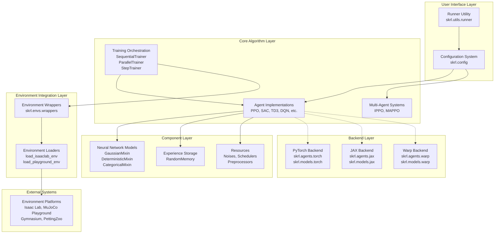
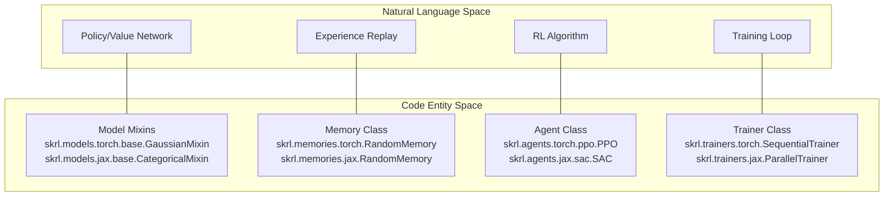

<!-- source: DeepWiki mcp.deepwiki.com · repo Toni-SM/skrl · page 1 Overview · fetched 2026-10-30 -->

# Overview

Relevant source files

The following files were used as context for generating this wiki page:

- [.github/ISSUE_TEMPLATE/bug_report.yaml](.github/ISSUE_TEMPLATE/bug_report.yaml)
- [.pre-commit-config.yaml](.pre-commit-config.yaml)
- [CHANGELOG.md](CHANGELOG.md)
- [README.md](README.md)
- [docs/source/_static/imgs/data_tensorboard.jpg](docs/source/_static/imgs/data_tensorboard.jpg)
- [docs/source/_static/imgs/example_parallel.jpg](docs/source/_static/imgs/example_parallel.jpg)
- [docs/source/api/config/frameworks.rst](docs/source/api/config/frameworks.rst)
- [docs/source/conf.py](docs/source/conf.py)
- [docs/source/index.rst](docs/source/index.rst)
- [docs/source/intro/data.rst](docs/source/intro/data.rst)
- [docs/source/intro/examples.rst](docs/source/intro/examples.rst)
- [docs/source/intro/getting_started.rst](docs/source/intro/getting_started.rst)
- [docs/source/intro/installation.rst](docs/source/intro/installation.rst)
- [docs/source/snippets/data.py](docs/source/snippets/data.py)
- [pyproject.toml](pyproject.toml)
- [skrl/__init__.py](skrl/__init__.py)
- [skrl/envs/wrappers/jax/gym_envs.py](skrl/envs/wrappers/jax/gym_envs.py)
- [skrl/envs/wrappers/jax/gymnasium_envs.py](skrl/envs/wrappers/jax/gymnasium_envs.py)
- [skrl/envs/wrappers/jax/pettingzoo_envs.py](skrl/envs/wrappers/jax/pettingzoo_envs.py)
- [skrl/envs/wrappers/torch/gym_envs.py](skrl/envs/wrappers/torch/gym_envs.py)
- [skrl/envs/wrappers/torch/gymnasium_envs.py](skrl/envs/wrappers/torch/gymnasium_envs.py)
- [skrl/envs/wrappers/torch/pettingzoo_envs.py](skrl/envs/wrappers/torch/pettingzoo_envs.py)
- [skrl/envs/wrappers/warp/gymnasium_envs.py](skrl/envs/wrappers/warp/gymnasium_envs.py)
- [skrl/utils/__init__.py](skrl/utils/__init__.py)

This document provides an overview of the **skrl** reinforcement learning library architecture, core components, and design principles. It covers the high-level system structure, multi-backend support (PyTorch, JAX, and NVIDIA Warp), and how the major components interact to enable modular RL algorithm implementation.

For specific implementation details of individual components, see their respective documentation pages: [Installation and Setup](#1.1), [Quick Start](#1.2), Agents, Models, Environments, Trainers, Memories, and Multi-Agent Systems.

## Library Purpose and Design Philosophy

**skrl** is an open-source modular library for Reinforcement Learning written in Python and implemented in **PyTorch**, **JAX**, and **NVIDIA Warp**. It is designed with a focus on modularity, readability, simplicity, and transparency of algorithm implementation. The library provides a unified interface for various RL algorithms while supporting multiple ML frameworks and environment interfaces, including NVIDIA Isaac Lab and MuJoCo Playground.

**Core Design Principles:**
- **Modularity**: Components (Agents, Models, Memories, Trainers) can be mixed and matched independently [docs/source/intro/getting_started.rst:96-98]().
- **Multi-Backend Support**: Full implementations in PyTorch, JAX, and Warp with consistent APIs [docs/source/index.rst:37-39]().
- **Environment Agnostic**: Unified wrappers for diverse simulation platforms like Gymnasium, ManiSkill, and Isaac Lab [docs/source/index.rst:40-48]().
- **Algorithm Transparency**: Clean, readable implementations that avoid "hidden" templates [docs/source/intro/getting_started.rst:126-130]().

Sources: [docs/source/index.rst:37-58](), [README.md:24-35](), [pyproject.toml:4](), [skrl/__init__.py:47-50]()

## High-Level System Architecture

The library follows a layered architecture with clear separation between core components, environment integration, and backend implementations.

Sources: [docs/source/index.rst:101-211](), [docs/source/intro/getting_started.rst:44-124](), [pyproject.toml:30-52]()

## Core Component Abstractions

The library is built around four primary abstractions that interact to form the RL loop.

### 1. Agents
The `Agent` is the central component implementing the RL algorithm (e.g., PPO, SAC). It handles the optimization loop, action selection, and data tracking. All agents inherit from a base class that defines a uniform interface: `act()`, `record_transition()`, and `update()`.
*   **Source:** [docs/source/index.rst:117-124]()

### 2. Models
Models represent the neural networks (policies and value functions). `skrl` uses a **Mixin** pattern (e.g., `GaussianMixin`, `CategoricalMixin`) to add specific probability distribution logic to user-defined network architectures.
*   **Source:** [docs/source/intro/getting_started.rst:120-132]()

### 3. Memories
Memories are storage components (rollout or replay buffers). The library provides `RandomMemory` which is backend-agnostic in its interface but optimized for the specific ML framework in its implementation.
*   **Source:** [docs/source/intro/getting_started.rst:102-116]()

### 4. Trainers
Trainers orchestrate the interaction between the Agent and the Environment.
*   `SequentialTrainer`: Standard single-process training.
*   `ParallelTrainer`: Multi-process training for vectorized environments.
*   `StepTrainer`: Manual control over the training steps.
*   **Source:** [docs/source/index.rst:196-202]()

## Multi-Backend Support

`skrl` differentiates itself by providing deep integration with three major backends. Configuration is managed globally via `skrl.config`.

| Feature | PyTorch | JAX | NVIDIA Warp |
| :--- | :--- | :--- | :--- |
| **Backend Path** | `skrl.agents.torch` | `skrl.agents.jax` | `skrl.agents.warp` |
| **Optimization** | Native Autograd | JIT Compilation (`@jax.jit`) | Kernel-based (Warp JIT) |
| **Distributed** | `torch.distributed` | `jax.distributed` | Supported via Runner |
| **Config Object** | `skrl.config.torch` | `skrl.config.jax` | `skrl.config.warp` |

Sources: [skrl/__init__.py:51-183](), [pyproject.toml:30-52](), [CHANGELOG.md:19-24]()

## System Entity Mapping

The following diagram maps high-level library concepts to their specific code entities and file locations.

Sources: [docs/source/index.rst:108-211](), [docs/source/intro/getting_started.rst:102-163]()

## Installation and Quick Start

For detailed instructions on setting up the library and running your first experiment, please refer to the child pages:

*   **[Installation and Setup](#1.1)**: Detailed guide on installing backend-specific dependencies (PyTorch, JAX, Warp) and configuring distributed training.
*   **[Quick Start](#1.2)**: Minimal examples using Gymnasium and MuJoCo Playground to get a training loop running in minutes.

Sources: [docs/source/intro/installation.rst:1-45](), [docs/source/intro/getting_started.rst:1-8]()

## Key Features Summary

*   **Multi-Agent RL**: Support for IPPO and MAPPO [docs/source/index.rst:139-149]().
*   **Environment Support**: Wrappers for Gymnasium, ManiSkill, MuJoCo Playground, and Isaac Lab [docs/source/index.rst:55-57]().
*   **Logging & Checkpointing**: Integrated TensorBoard and Weights & Biases support [docs/source/intro/data.rst:9-105]().
*   **Model Instantiators**: Utilities to programmatically create models from configuration [CHANGELOG.md:89-98]().
*   **Mixed Precision**: Support for Automatic Mixed Precision (AMP) in PyTorch [CHANGELOG.md:93]().

Sources: [CHANGELOG.md:16-34](), [pyproject.toml:1-29]()

---

