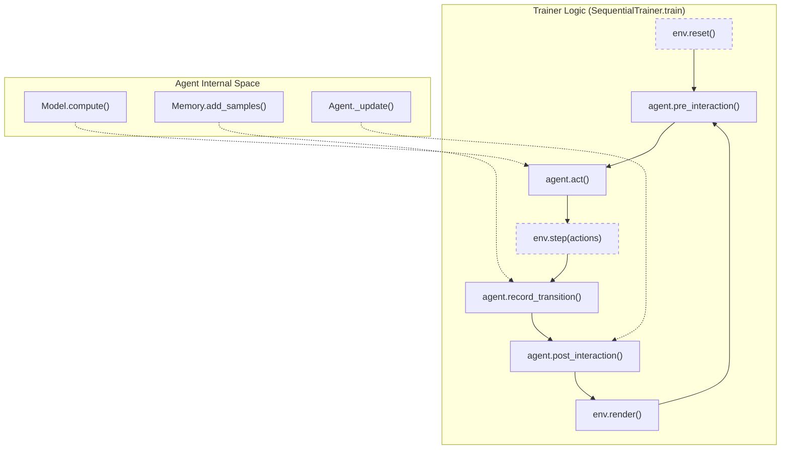
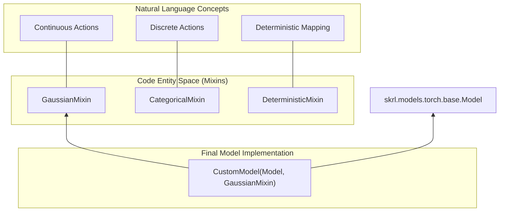

<!-- source: DeepWiki mcp.deepwiki.com · repo Toni-SM/skrl · page 10 Glossary · fetched 2026-10-30 -->

# Glossary

Relevant source files

The following files were used as context for generating this wiki page:

- [.github/ISSUE_TEMPLATE/bug_report.yaml](.github/ISSUE_TEMPLATE/bug_report.yaml)
- [.pre-commit-config.yaml](.pre-commit-config.yaml)
- [CHANGELOG.md](CHANGELOG.md)
- [README.md](README.md)
- [docs/source/_static/imgs/data_tensorboard.jpg](docs/source/_static/imgs/data_tensorboard.jpg)
- [docs/source/_static/imgs/example_parallel.jpg](docs/source/_static/imgs/example_parallel.jpg)
- [docs/source/conf.py](docs/source/conf.py)
- [docs/source/index.rst](docs/source/index.rst)
- [docs/source/intro/data.rst](docs/source/intro/data.rst)
- [docs/source/intro/examples.rst](docs/source/intro/examples.rst)
- [docs/source/intro/getting_started.rst](docs/source/intro/getting_started.rst)
- [docs/source/intro/installation.rst](docs/source/intro/installation.rst)
- [docs/source/snippets/data.py](docs/source/snippets/data.py)
- [pyproject.toml](pyproject.toml)
- [skrl/agents/jax/base.py](skrl/agents/jax/base.py)
- [skrl/agents/torch/a2c/a2c.py](skrl/agents/torch/a2c/a2c.py)
- [skrl/agents/torch/amp/amp.py](skrl/agents/torch/amp/amp.py)
- [skrl/agents/torch/base.py](skrl/agents/torch/base.py)
- [skrl/agents/torch/cem/cem.py](skrl/agents/torch/cem/cem.py)
- [skrl/agents/torch/ddpg/ddpg.py](skrl/agents/torch/ddpg/ddpg.py)
- [skrl/agents/torch/dqn/dqn.py](skrl/agents/torch/dqn/dqn.py)
- [skrl/agents/torch/ppo/ppo.py](skrl/agents/torch/ppo/ppo.py)
- [skrl/agents/torch/q_learning/q_learning.py](skrl/agents/torch/q_learning/q_learning.py)
- [skrl/agents/torch/sac/sac.py](skrl/agents/torch/sac/sac.py)
- [skrl/agents/torch/sarsa/sarsa.py](skrl/agents/torch/sarsa/sarsa.py)
- [skrl/agents/torch/td3/td3.py](skrl/agents/torch/td3/td3.py)
- [skrl/agents/torch/trpo/trpo.py](skrl/agents/torch/trpo/trpo.py)
- [skrl/agents/warp/base.py](skrl/agents/warp/base.py)
- [skrl/memories/jax/__init__.py](skrl/memories/jax/__init__.py)
- [skrl/memories/jax/base.py](skrl/memories/jax/base.py)
- [skrl/memories/jax/random.py](skrl/memories/jax/random.py)
- [skrl/memories/torch/base.py](skrl/memories/torch/base.py)
- [skrl/memories/torch/random.py](skrl/memories/torch/random.py)
- [skrl/memories/warp/random.py](skrl/memories/warp/random.py)
- [skrl/models/jax/__init__.py](skrl/models/jax/__init__.py)
- [skrl/models/jax/base.py](skrl/models/jax/base.py)
- [skrl/models/torch/base.py](skrl/models/torch/base.py)
- [skrl/models/torch/categorical.py](skrl/models/torch/categorical.py)
- [skrl/models/torch/deterministic.py](skrl/models/torch/deterministic.py)
- [skrl/models/torch/gaussian.py](skrl/models/torch/gaussian.py)
- [skrl/models/torch/multivariate_gaussian.py](skrl/models/torch/multivariate_gaussian.py)
- [skrl/multi_agents/jax/base.py](skrl/multi_agents/jax/base.py)
- [skrl/multi_agents/jax/ippo/ippo.py](skrl/multi_agents/jax/ippo/ippo.py)
- [skrl/multi_agents/jax/mappo/mappo.py](skrl/multi_agents/jax/mappo/mappo.py)
- [skrl/multi_agents/torch/base.py](skrl/multi_agents/torch/base.py)
- [skrl/multi_agents/torch/ippo/ippo.py](skrl/multi_agents/torch/ippo/ippo.py)
- [skrl/multi_agents/torch/mappo/mappo.py](skrl/multi_agents/torch/mappo/mappo.py)
- [skrl/trainers/jax/base.py](skrl/trainers/jax/base.py)
- [skrl/trainers/jax/sequential.py](skrl/trainers/jax/sequential.py)
- [skrl/trainers/jax/step.py](skrl/trainers/jax/step.py)
- [skrl/trainers/torch/base.py](skrl/trainers/torch/base.py)
- [skrl/trainers/torch/parallel.py](skrl/trainers/torch/parallel.py)
- [skrl/trainers/torch/sequential.py](skrl/trainers/torch/sequential.py)
- [skrl/trainers/torch/step.py](skrl/trainers/torch/step.py)
- [skrl/trainers/warp/base.py](skrl/trainers/warp/base.py)

This glossary defines technical terms, architectural components, and domain-specific jargon used throughout the **skrl** codebase. It serves as a reference for onboarding engineers to understand how reinforcement learning concepts are mapped to specific code entities across the supported backends (PyTorch, JAX, and Warp).

## Core Abstractions

### Agent
The high-level entity implementing a reinforcement learning algorithm. It manages models, memories, and the optimization logic.
*   **Base Class**: `skrl.agents.torch.base.Agent` [skrl/agents/torch/base.py:83-104]()
*   **Key Lifecycle Methods**:
    *   `act()`: Computes actions given observations [skrl/agents/torch/base.py:279-299]().
    *   `record_transition()`: Stores environment transitions in memory [skrl/agents/torch/base.py:328-356]().
    *   `pre_interaction()` / `post_interaction()`: Hooks for logic before/after environment steps [skrl/agents/torch/base.py:263-277](), [skrl/agents/torch/base.py:382-396]().

### Model
A neural network or tabular representation used by an agent (e.g., Policy, Value function). Models in **skrl** use a mixin-based architecture to handle different action distributions.
*   **Base Class**: `skrl.models.torch.base.Model` [skrl/models/torch/base.py:15-40]()
*   **Initialization**: Lazy modules are initialized via `init_state_dict()` [skrl/models/torch/base.py:42-74]().

### Memory
A storage system for experience transitions.
*   **Base Class**: `skrl.memories.torch.base.Memory` [skrl/memories/torch/base.py:12-14]() (implied by usage in agents).
*   **Random Memory**: Implements experience replay with circular buffers [skrl/memories/torch/random.py:13-15]().

### Trainer
Orchestrates the RL loop, managing interactions between agents and environments.
*   **Base Class**: `skrl.trainers.torch.base.Trainer` [skrl/trainers/torch/base.py:72-87]()
*   **Sequential Trainer**: Executes agent steps one after another [skrl/trainers/torch/sequential.py:22-39]().

---

## Domain Concepts & Jargon

### GAE (Generalized Advantage Estimator)
A method to compute advantages by balancing bias and variance, used extensively in on-policy agents like PPO.
*   **Implementation**: `compute_gae` function [skrl/agents/torch/ppo/ppo.py:23-64]().
*   **Parameters**: Uses `gae_lambda` (lambda coefficient) and `discount_factor` (gamma) [skrl/agents/torch/ppo/ppo.py:30-31]().

### Polyak Averaging (Soft Update)
A technique for updating target networks by slowly tracking the weights of the online networks.
*   **Method**: `Model.update_parameters(source_model, polyak)` [skrl/models/torch/base.py:246-261]().
*   **Usage**: Common in off-policy algorithms like TD3 [skrl/agents/torch/td3/td3.py:137-139]() and SAC [skrl/agents/torch/sac/sac.py:137-138]().

### Scopes
A mechanism to partition a vectorized environment so that different agents can operate on specific subsets of parallel environments simultaneously.
*   **Logic**: Handled in the `Trainer._setup_agents()` method [skrl/trainers/torch/base.py:131-171]().
*   **Generation**: `generate_equally_spaced_scopes` [skrl/trainers/torch/base.py:18-35]().

### Mixed Precision (AMP)
The use of both 16-bit and 32-bit floating-point types during training to speed up computation and reduce memory usage.
*   **Implementation**: Agents utilize `torch.amp.GradScaler` [skrl/agents/torch/ppo/ppo.py:121-125]().

---

## Technical Mapping Diagrams

### Training Loop Data Flow
The following diagram bridges the natural language "RL Loop" to specific method calls within the `Trainer` and `Agent` classes.

**Diagram: RL Loop to Code Entity Space**

**Sources**: [skrl/trainers/torch/sequential.py:55-152](), [skrl/agents/torch/base.py:279-396]()

### Model Architecture & Mixins
This diagram shows how RL policy concepts (like Gaussian or Categorical distributions) are mapped to the Mixin architecture in the codebase.

**Diagram: Policy Concepts to Mixin Classes**

**Sources**: [skrl/models/torch/base.py:15-40](), [skrl/models/torch/gaussian.py:14-16](), [skrl/models/torch/categorical.py:14-16](), [skrl/models/torch/deterministic.py:14-16]()

---

## Abbreviation Reference Table

| Abbreviation | Full Term | skrl Code Pointer |
| :--- | :--- | :--- |
| **PPO** | Proximal Policy Optimization | `skrl.agents.torch.ppo.ppo.PPO` [skrl/agents/torch/ppo/ppo.py:67]() |
| **SAC** | Soft Actor-Critic | `skrl.agents.torch.sac.sac.SAC` [skrl/agents/torch/sac/sac.py:23]() |
| **TD3** | Twin Delayed DDPG | `skrl.agents.torch.td3.td3.TD3` [skrl/agents/torch/td3/td3.py:23]() |
| **GAE** | Generalized Advantage Estimator | `compute_gae` [skrl/agents/torch/ppo/ppo.py:23]() |
| **AMP** | Adversarial Motion Priors | `skrl.agents.torch.amp.amp.AMP` [skrl/agents/torch/amp/amp.py:22]() |
| **IPPO** | Independent PPO | `skrl.multi_agents.torch.ippo.ippo.IPPO` [skrl/multi_agents/torch/ippo/ippo.py:22]() |
| **MAPPO** | Multi-Agent PPO | `skrl.multi_agents.torch.mappo.mappo.MAPPO` [skrl/multi_agents/torch/mappo/mappo.py:22]() |

---

## Configuration & Utilities

### ExperimentCfg
A dataclass defining how an experiment is logged and saved.
*   **Pointer**: `skrl.agents.torch.base.ExperimentCfg` [skrl/agents/torch/base.py:24-66]()
*   **Key Fields**: `write_interval`, `checkpoint_interval`, `wandb` [skrl/agents/torch/base.py:36-64]().

### ScopedTimer
A utility for measuring execution time of code blocks, often used for profiling inference and environment stepping.
*   **Pointer**: `skrl.utils.ScopedTimer` [skrl/utils/__init__.py]() (referenced in [skrl/trainers/torch/sequential.py:94]()).

### Space Utilities
Functions for manipulating Gymnasium spaces, such as computing sizes or limits.
*   **Pointer**: `compute_space_size` [skrl/utils/spaces/torch.py]() (referenced in [skrl/models/torch/base.py:38]()).
*   **Pointer**: `compute_space_limits` [skrl/utils/spaces/torch.py]() (referenced in [skrl/agents/torch/td3/td3.py:166]()).

**Sources**: [skrl/agents/torch/base.py:24-66](), [skrl/trainers/torch/sequential.py:94-112](), [skrl/models/torch/base.py:38-40]()