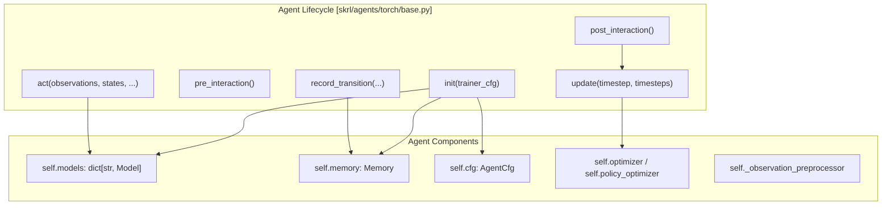
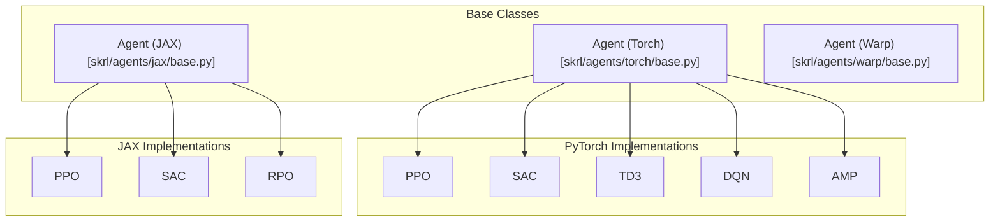

<!-- source: DeepWiki mcp.deepwiki.com · repo Toni-SM/skrl · page 2 Agents · fetched 2026-10-30 -->

# Agents

Relevant source files

The following files were used as context for generating this wiki page:

- [skrl/agents/jax/base.py](skrl/agents/jax/base.py)
- [skrl/agents/torch/a2c/a2c.py](skrl/agents/torch/a2c/a2c.py)
- [skrl/agents/torch/amp/amp.py](skrl/agents/torch/amp/amp.py)
- [skrl/agents/torch/base.py](skrl/agents/torch/base.py)
- [skrl/agents/torch/cem/cem.py](skrl/agents/torch/cem/cem.py)
- [skrl/agents/torch/ddpg/ddpg.py](skrl/agents/torch/ddpg/ddpg.py)
- [skrl/agents/torch/dqn/dqn.py](skrl/agents/torch/dqn/dqn.py)
- [skrl/agents/torch/ppo/ppo.py](skrl/agents/torch/ppo/ppo.py)
- [skrl/agents/torch/q_learning/q_learning.py](skrl/agents/torch/q_learning/q_learning.py)
- [skrl/agents/torch/sac/sac.py](skrl/agents/torch/sac/sac.py)
- [skrl/agents/torch/sarsa/sarsa.py](skrl/agents/torch/sarsa/sarsa.py)
- [skrl/agents/torch/td3/td3.py](skrl/agents/torch/td3/td3.py)
- [skrl/agents/torch/trpo/trpo.py](skrl/agents/torch/trpo/trpo.py)
- [skrl/agents/warp/base.py](skrl/agents/warp/base.py)
- [skrl/multi_agents/jax/base.py](skrl/multi_agents/jax/base.py)
- [skrl/multi_agents/torch/base.py](skrl/multi_agents/torch/base.py)

Agents are the core decision-making components in **skrl** that implement reinforcement learning algorithms. They encapsulate the policy learning logic, interact with environments, and manage the training process. Each agent implements a specific RL algorithm and provides a unified interface for training and evaluation across multiple backends.

For information about the models that agents use, see [Models](#3). For details about memory systems that store agent experiences, see [Memories](#6). For training orchestration, see [Trainers](#5).

## Agent Architecture

The agent system in **skrl** follows a modular design with support for **PyTorch**, **JAX**, and **Warp** backends. All agents inherit from a base class that defines the training lifecycle.

### Core Agent Lifecycle

Sources: [skrl/agents/torch/base.py:83-264](), [skrl/agents/torch/ppo/ppo.py:67-165](), [skrl/agents/torch/sac/sac.py:23-155]()

### Agent Hierarchy and Backends

The codebase organizes agents by backend and algorithm family.

Sources: [skrl/agents/torch/base.py:83](), [skrl/agents/jax/base.py:1](), [skrl/agents/warp/base.py:1]()

## Common Agent Interface

All agents implement a standardized interface that enables consistent interaction with trainers and environments.

### Core Methods

| Method | Purpose | Implementation Detail |
|--------|---------|-----------------------|
| `init()` | Initializes memory tensors and experiment directories. | [skrl/agents/torch/base.py:187-228]() |
| `act()` | Processes observations to produce actions. | [skrl/agents/torch/ppo/ppo.py:254-278]() |
| `record_transition()` | Stores transitions in the `Memory` buffer. | [skrl/agents/torch/base.py:245-264]() |
| `update()` | Triggers the optimization step (loss calculation and backprop). | [skrl/agents/torch/ppo/ppo.py:353-370]() |
| `post_interaction()` | Handles logging to TensorBoard/WandB and checkpointing. | [skrl/agents/torch/base.py:297-332]() |

### Action Generation Process

The `act()` method typically handles state preprocessing and exploration noise. For value-based agents like `DQN`, it also manages the epsilon-greedy schedule [skrl/agents/torch/dqn/dqn.py:144-184](). For actor-critic agents like `TD3`, it applies exploration noise to deterministic actions [skrl/agents/torch/td3/td3.py:248-262]().

## Configuration and Experiment Tracking

Each agent is configured using a specialized dataclass (e.g., `PPO_CFG`, `SAC_CFG`) which inherits from `AgentCfg`.

### Experiment Configuration
The `ExperimentCfg` class within the base agent defines how data is saved and logged:
- `directory`: Root path for experiment runs [skrl/agents/torch/base.py:27]().
- `write_interval`: Frequency of logging to TensorBoard [skrl/agents/torch/base.py:36]().
- `checkpoint_interval`: Frequency of saving model weights [skrl/agents/torch/base.py:43]().
- `wandb`: Toggle for Weights & Biases integration [skrl/agents/torch/base.py:57]().

Sources: [skrl/agents/torch/base.py:23-65](), [skrl/agents/torch/ppo/ppo_cfg.py:1-20]()

## Multi-Agent Systems

**skrl** supports Multi-Agent Reinforcement Learning (MARL) through the `MultiAgent` base class. Unlike single agents, multi-agents manage dictionaries of models and memories keyed by agent identifiers (`uid`).

- **IPPO / MAPPO**: Independent and Multi-Agent PPO implementations.
- **Shared Parameters**: Support for shared or independent networks across agents.
- **GAE for MARL**: Specialized advantage estimation for multi-agent trajectories.

For details, see [Multi-Agent Systems](#7).

Sources: [skrl/multi_agents/torch/base.py:95-135]()

## Backend-Specific Details

### PyTorch Agents
PyTorch agents implement standard optimization loops using `torch.optim`. They feature support for **Automatic Mixed Precision (AMP)** using `torch.amp.GradScaler` [skrl/agents/torch/ppo/ppo.py:122-125]() and **Distributed Data Parallel** synchronization via `broadcast_parameters()` [skrl/agents/torch/ppo/ppo.py:113-119]().

For details, see [PyTorch Agents](#2.1).

### JAX Agents
JAX agents utilize functional programming patterns and JIT compilation. They often rely on the `optax` library for optimization and handle state management through Flax-like state dictionaries.

For details, see [JAX Agents](#2.2).

### Warp Agents
Specialized agents optimized for NVIDIA Warp, allowing for high-performance simulations where the RL update step can be tightly integrated with the simulation kernels.

Sources: [skrl/agents/jax/base.py:1](), [skrl/agents/warp/base.py:1]()

---

