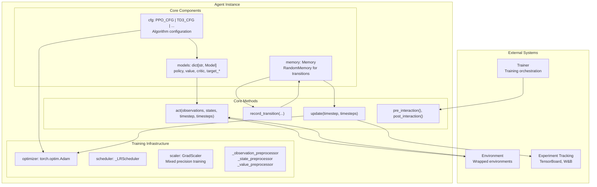
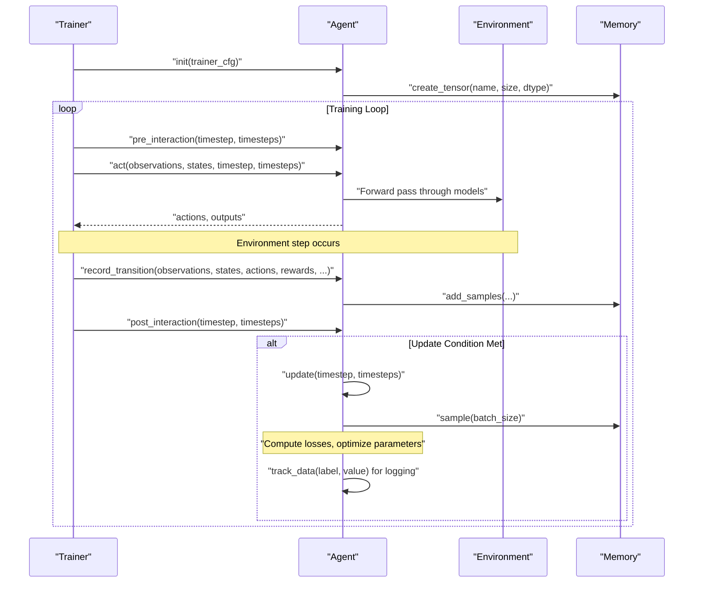

<!-- source: DeepWiki mcp.deepwiki.com · repo Toni-SM/skrl · page 2.1 PyTorch Agents · fetched 2026-10-30 -->

# PyTorch Agents

<details>
<summary>Relevant source files</summary>

The following files were used as context for generating this wiki page:

- [docs/source/api/agents/a2c.rst](docs/source/api/agents/a2c.rst)
- [docs/source/api/agents/amp.rst](docs/source/api/agents/amp.rst)
- [docs/source/api/agents/cem.rst](docs/source/api/agents/cem.rst)
- [docs/source/api/agents/ddpg.rst](docs/source/api/agents/ddpg.rst)
- [docs/source/api/agents/ddqn.rst](docs/source/api/agents/ddqn.rst)
- [docs/source/api/agents/dqn.rst](docs/source/api/agents/dqn.rst)
- [docs/source/api/agents/ppo.rst](docs/source/api/agents/ppo.rst)
- [docs/source/api/agents/q_learning.rst](docs/source/api/agents/q_learning.rst)
- [docs/source/api/agents/rpo.rst](docs/source/api/agents/rpo.rst)
- [docs/source/api/agents/sac.rst](docs/source/api/agents/sac.rst)
- [docs/source/api/agents/sarsa.rst](docs/source/api/agents/sarsa.rst)
- [docs/source/api/agents/td3.rst](docs/source/api/agents/td3.rst)
- [docs/source/api/agents/trpo.rst](docs/source/api/agents/trpo.rst)
- [docs/source/snippets/agents_basic_usage.py](docs/source/snippets/agents_basic_usage.py)
- [skrl/agents/jax/cem/cem.py](skrl/agents/jax/cem/cem.py)
- [skrl/agents/jax/ddpg/ddpg.py](skrl/agents/jax/ddpg/ddpg.py)
- [skrl/agents/jax/ddqn/__init__.py](skrl/agents/jax/ddqn/__init__.py)
- [skrl/agents/jax/ddqn/ddqn.py](skrl/agents/jax/ddqn/ddqn.py)
- [skrl/agents/jax/ddqn/ddqn_cfg.py](skrl/agents/jax/ddqn/ddqn_cfg.py)
- [skrl/agents/jax/dqn/__init__.py](skrl/agents/jax/dqn/__init__.py)
- [skrl/agents/jax/dqn/dqn.py](skrl/agents/jax/dqn/dqn.py)
- [skrl/agents/jax/sac/sac.py](skrl/agents/jax/sac/sac.py)
- [skrl/agents/jax/td3/td3.py](skrl/agents/jax/td3/td3.py)
- [skrl/agents/torch/a2c/a2c.py](skrl/agents/torch/a2c/a2c.py)
- [skrl/agents/torch/a2c/a2c_rnn.py](skrl/agents/torch/a2c/a2c_rnn.py)
- [skrl/agents/torch/amp/amp.py](skrl/agents/torch/amp/amp.py)
- [skrl/agents/torch/cem/cem.py](skrl/agents/torch/cem/cem.py)
- [skrl/agents/torch/ddpg/ddpg.py](skrl/agents/torch/ddpg/ddpg.py)
- [skrl/agents/torch/ddpg/ddpg_rnn.py](skrl/agents/torch/ddpg/ddpg_rnn.py)
- [skrl/agents/torch/ddqn/__init__.py](skrl/agents/torch/ddqn/__init__.py)
- [skrl/agents/torch/ddqn/ddqn.py](skrl/agents/torch/ddqn/ddqn.py)
- [skrl/agents/torch/ddqn/ddqn_cfg.py](skrl/agents/torch/ddqn/ddqn_cfg.py)
- [skrl/agents/torch/dqn/__init__.py](skrl/agents/torch/dqn/__init__.py)
- [skrl/agents/torch/dqn/dqn.py](skrl/agents/torch/dqn/dqn.py)
- [skrl/agents/torch/ppo/ppo.py](skrl/agents/torch/ppo/ppo.py)
- [skrl/agents/torch/ppo/ppo_rnn.py](skrl/agents/torch/ppo/ppo_rnn.py)
- [skrl/agents/torch/q_learning/q_learning.py](skrl/agents/torch/q_learning/q_learning.py)
- [skrl/agents/torch/rpo/rpo.py](skrl/agents/torch/rpo/rpo.py)
- [skrl/agents/torch/rpo/rpo_rnn.py](skrl/agents/torch/rpo/rpo_rnn.py)
- [skrl/agents/torch/sac/sac.py](skrl/agents/torch/sac/sac.py)
- [skrl/agents/torch/sac/sac_rnn.py](skrl/agents/torch/sac/sac_rnn.py)
- [skrl/agents/torch/sarsa/sarsa.py](skrl/agents/torch/sarsa/sarsa.py)
- [skrl/agents/torch/td3/td3.py](skrl/agents/torch/td3/td3.py)
- [skrl/agents/torch/td3/td3_rnn.py](skrl/agents/torch/td3/td3_rnn.py)
- [skrl/agents/torch/trpo/trpo.py](skrl/agents/torch/trpo/trpo.py)
- [skrl/agents/torch/trpo/trpo_rnn.py](skrl/agents/torch/trpo/trpo_rnn.py)

</details>


PyTorch Agents are the core decision-making components in the skrl reinforcement learning library that implement various RL algorithms using PyTorch as the backend. This page covers the architecture, lifecycle, and specific implementations of PyTorch-based agents, including configuration dataclasses, GAE computation, and optimization loops.

For JAX-based agent implementations, see [JAX Agents](#2.2). For the base model classes used by agents, see [Model Base Classes](#3.1). For training orchestration, see [Trainers](#5).

## Agent Architecture Overview

PyTorch agents in skrl follow a unified architecture where all concrete agent implementations inherit from a base `Agent` class and implement specific RL algorithms. Each agent manages models, memory, optimizers, and handles the full training lifecycle.

### Agent Class Hierarchy

```mermaid
graph TB
    subgraph "Base Infrastructure"
        Agent["Agent<br/>(skrl.agents.torch.Agent)"]
    end
    
    subgraph "Policy Gradient Agents"
        PPO["PPO<br/>(skrl.agents.torch.ppo.ppo.PPO)"]
        A2C["A2C<br/>(skrl.agents.torch.a2c.a2c.A2C)"]
        TRPO["TRPO<br/>(skrl.agents.torch.trpo.trpo.TRPO)"]
        AMP["AMP<br/>(skrl.agents.torch.amp.amp.AMP)"]
        RPO["RPO<br/>(skrl.agents.torch.rpo.rpo.RPO)"]
    end
    
    subgraph "Actor-Critic Agents"
        SAC["SAC<br/>(skrl.agents.torch.sac.sac.SAC)"]
        TD3["TD3<br/>(skrl.agents.torch.td3.td3.TD3)"]
        DDPG["DDPG<br/>(skrl.agents.torch.ddpg.ddpg.DDPG)"]
    end
    
    subgraph "Value-Based Agents"
        DQN["DQN<br/>(skrl.agents.torch.dqn.dqn.DQN)"]
        DDQN["DDQN<br/>(skrl.agents.torch.ddqn.ddqn.DDQN)"]
    end
    
    subgraph "Other Algorithms"
        CEM["CEM<br/>(skrl.agents.torch.cem.cem.CEM)"]
        SARSA["SARSA<br/>(skrl.agents.torch.sarsa.sarsa.SARSA)"]
        QLearning["Q_LEARNING<br/>(skrl.agents.torch.q_learning.q_learning.QLearning)"]
    end
    
    Agent --> PPO
    Agent --> A2C
    Agent --> TRPO
    Agent --> AMP
    Agent --> RPO
    Agent --> SAC
    Agent --> TD3
    Agent --> DDPG
    Agent --> DQN
    Agent --> DDQN
    Agent --> CEM
    Agent --> SARSA
    Agent --> QLearning
```



Sources: [skrl/agents/torch/ppo/ppo.py:67-78](), [skrl/agents/torch/td3/td3.py:23-34](), [skrl/agents/torch/sac/sac.py:23-34](), [skrl/agents/torch/ddpg/ddpg.py:22-33](), [skrl/agents/torch/trpo/trpo.py:186-197](), [skrl/agents/torch/a2c/a2c.py:67-78](), [skrl/agents/torch/dqn/dqn.py:20-31](), [skrl/agents/torch/cem/cem.py:20-31](), [skrl/agents/torch/amp/amp.py:68-83](), [skrl/agents/torch/sarsa/sarsa.py:17-28]()

### Agent Component Architecture



Sources: [skrl/agents/torch/ppo/ppo.py:104-164](), [skrl/agents/torch/td3/td3.py:60-156](), [skrl/agents/torch/sac/sac.py:60-155]()

## Base Agent Interface

All PyTorch agents inherit from the base `Agent` class and implement a common interface for environment interaction and training. The key methods define the agent lifecycle:

### Core Interface Methods

| Method | Purpose | Implementation |
|--------|---------|----------------|
| `init()` | Initialize agent and create memory tensors | [skrl/agents/torch/ppo/ppo.py:166-198]() |
| `act()` | Process states and return actions | [skrl/agents/torch/ppo/ppo.py:200-221]() |
| `record_transition()` | Store environment transitions in memory | [skrl/agents/torch/ppo/ppo.py:223-263]() |
| `pre_interaction()` | Called before environment step | [skrl/agents/torch/sarsa/sarsa.py:154-160]() |
| `post_interaction()` | Called after environment step; triggers `update()` | [skrl/agents/torch/ppo/ppo.py:280-302]() |
| `update()` | Main algorithm update step (optimization loop) | [skrl/agents/torch/ppo/ppo.py:304-444]() |

### Training Lifecycle Flow



Sources: [skrl/agents/torch/ppo/ppo.py:175-188](), [skrl/agents/torch/ppo/ppo.py:280-302](), [skrl/agents/torch/td3/td3.py:287-306]()

## Generalized Advantage Estimation (GAE)

Many policy gradient agents (PPO, A2C, TRPO, AMP, RPO) utilize the `compute_gae` helper function to calculate advantages and returns. This function implements the recursive advantage calculation based on rewards and value estimates.

```python
def compute_gae(
    *,
    rewards: torch.Tensor,
    terminated: torch.Tensor,
    truncated: torch.Tensor,
    values: torch.Tensor,
    last_values: torch.Tensor,
    discount_factor: float = 0.99,
    lambda_coefficient: float = 0.95,
    time_limit_bootstrap: bool = False,
) -> torch.Tensor:
    # ... computation logic ...
    return returns, advantages
```

Sources: [skrl/agents/torch/ppo/ppo.py:23-64](), [skrl/agents/torch/a2c/a2c.py:23-64](), [skrl/agents/torch/trpo/trpo.py:22-63]()

## Configuration and Mixed Precision

Each agent uses a specific configuration dataclass (e.g., `PPO_CFG`, `TD3_CFG`) to define hyperparameters. Mixed precision is supported via `torch.amp.GradScaler`.

| Feature | Description | Implementation |
|---------|-------------|----------------|
| **Mixed Precision** | Uses `GradScaler` and `autocast` for FP16 training. | [skrl/agents/torch/ppo/ppo.py:121-125]() |
| **Optimization** | Typically uses `torch.optim.Adam` with algorithm-specific parameters. | [skrl/agents/torch/sac/sac.py:113-118]() |
| **Schedulers** | Supports learning rate schedulers and specialized ones like `KLAdaptiveLR`. | [skrl/agents/torch/ppo/ppo.py:138-142]() |

Sources: [skrl/agents/torch/ppo/ppo.py:20-20](), [skrl/agents/torch/td3/td3.py:20-20](), [skrl/agents/torch/amp/amp.py:21-21]()

## Individual Agent Implementations

### Policy Gradient Agents

*   **PPO (Proximal Policy Optimization)**: Implements clipped surrogate objectives. Supports multiple epochs and mini-batches per update. [skrl/agents/torch/ppo/ppo.py:67-78]()
*   **A2C (Advantage Actor Critic)**: A synchronous, deterministic version of A3C using GAE for advantage estimation. [skrl/agents/torch/a2c/a2c.py:67-78]()
*   **TRPO (Trust Region Policy Optimization)**: Uses natural policy gradient with a KL-divergence constraint, implemented via conjugate gradient and line search. [skrl/agents/torch/trpo/trpo.py:186-197]()
*   **AMP (Adversarial Motion Priors)**: Combines PPO with a discriminator trained on reference motions to imitation movement patterns. [skrl/agents/torch/amp/amp.py:68-83]()
*   **RPO (Relaxed Proximal Policy Optimization)**: A variant of PPO that modifies the policy update to handle complex action distributions.

### Actor-Critic Agents

*   **SAC (Soft Actor-Critic)**: Off-policy algorithm that maximizes entropy for better exploration. Features automatic entropy coefficient tuning. [skrl/agents/torch/sac/sac.py:23-34]()
*   **TD3 (Twin Delayed DDPG)**: Improves DDPG by using twin critics, delayed policy updates, and target policy smoothing. [skrl/agents/torch/td3/td3.py:23-34]()
*   **DDPG (Deep Deterministic Policy Gradient)**: An off-policy algorithm for continuous action spaces using target networks and exploration noise. [skrl/agents/torch/ddpg/ddpg.py:22-33]()

### Value-Based and Tabular Agents

*   **DQN (Deep Q-Network)**: Standard off-policy Q-learning using neural networks and experience replay. [skrl/agents/torch/dqn/dqn.py:20-31]()
*   **DDQN (Double Deep Q-Network)**: Mitigates overestimation bias in DQN by decoupling action selection from action evaluation. [skrl/agents/torch/ddqn/ddqn.py:20-31]()
*   **CEM (Cross-Entropy Method)**: An evolutionary strategy that samples actions and updates the policy based on "elite" trajectories. [skrl/agents/torch/cem/cem.py:20-31]()
*   **SARSA**: A tabular on-policy algorithm that updates Q-values based on the action actually taken in the next state. [skrl/agents/torch/sarsa/sarsa.py:17-28]()
*   **Q-Learning**: A tabular off-policy algorithm that updates Q-values based on the maximum possible next-state value.

### RNN Variants

Most PyTorch agents have RNN variants (e.g., `PPO_RNN`, `SAC_RNN`, `TD3_RNN`) designed to handle sequences and maintain hidden states across environment steps. These variants typically include logic to handle sequence sampling and hidden state management in the `update()` loop.

Sources: [skrl/agents/torch/ppo/ppo_rnn.py](), [skrl/agents/torch/sac/sac_rnn.py](), [skrl/agents/torch/td3/td3_rnn.py]()

---

