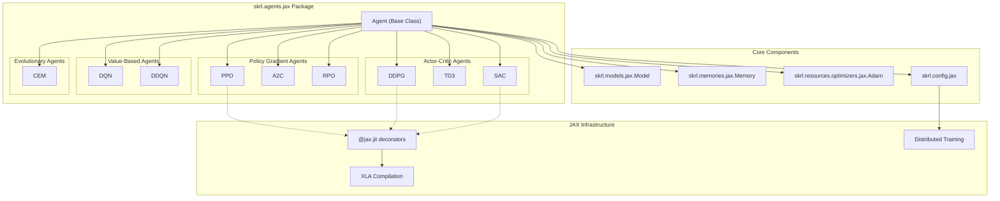
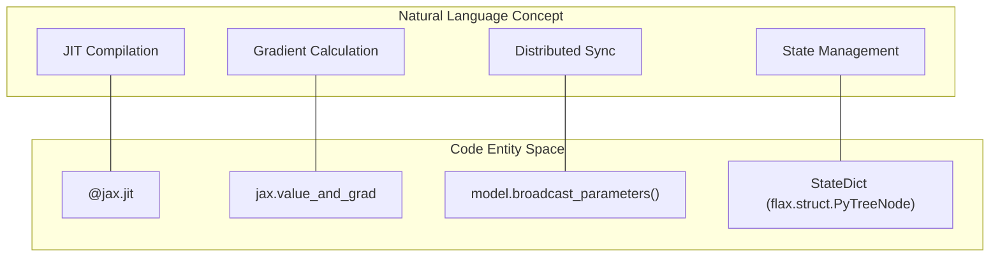
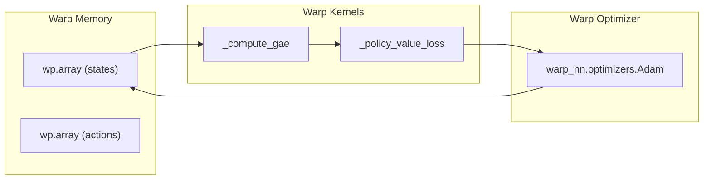

<!-- source: DeepWiki mcp.deepwiki.com · repo Toni-SM/skrl · page 2.2 JAX Agents · fetched 2026-10-30 -->

# JAX Agents

Relevant source files

The following files were used as context for generating this wiki page:

- [examples/gymnasium/warp_gymnasium_pendulum_ppo.py](examples/gymnasium/warp_gymnasium_pendulum_ppo.py)
- [examples/isaaclab/warp_cartpole_direct_box_box_ppo.py](examples/isaaclab/warp_cartpole_direct_box_box_ppo.py)
- [examples/mani_skill/jax_mani_skill_push_cube_ppo.py](examples/mani_skill/jax_mani_skill_push_cube_ppo.py)
- [examples/mani_skill/torch_mani_skill_push_cube_ppo.py](examples/mani_skill/torch_mani_skill_push_cube_ppo.py)
- [examples/mani_skill/warp_mani_skill_push_cube_ppo.py](examples/mani_skill/warp_mani_skill_push_cube_ppo.py)
- [skrl/agents/jax/a2c/a2c.py](skrl/agents/jax/a2c/a2c.py)
- [skrl/agents/jax/base.py](skrl/agents/jax/base.py)
- [skrl/agents/jax/cem/cem.py](skrl/agents/jax/cem/cem.py)
- [skrl/agents/jax/ddpg/ddpg.py](skrl/agents/jax/ddpg/ddpg.py)
- [skrl/agents/jax/dqn/dqn.py](skrl/agents/jax/dqn/dqn.py)
- [skrl/agents/jax/ppo/ppo.py](skrl/agents/jax/ppo/ppo.py)
- [skrl/agents/jax/rpo/rpo.py](skrl/agents/jax/rpo/rpo.py)
- [skrl/agents/jax/sac/sac.py](skrl/agents/jax/sac/sac.py)
- [skrl/agents/jax/td3/td3.py](skrl/agents/jax/td3/td3.py)
- [skrl/agents/torch/base.py](skrl/agents/torch/base.py)
- [skrl/agents/torch/ddpg/ddpg_rnn.py](skrl/agents/torch/ddpg/ddpg_rnn.py)
- [skrl/agents/torch/sac/sac_rnn.py](skrl/agents/torch/sac/sac_rnn.py)
- [skrl/agents/torch/td3/td3_rnn.py](skrl/agents/torch/td3/td3_rnn.py)
- [skrl/agents/warp/base.py](skrl/agents/warp/base.py)
- [skrl/agents/warp/ddpg/ddpg.py](skrl/agents/warp/ddpg/ddpg.py)
- [skrl/agents/warp/ppo/ppo.py](skrl/agents/warp/ppo/ppo.py)
- [skrl/agents/warp/sac/sac.py](skrl/agents/warp/sac/sac.py)
- [skrl/multi_agents/jax/base.py](skrl/multi_agents/jax/base.py)
- [skrl/multi_agents/torch/base.py](skrl/multi_agents/torch/base.py)
- [tests/agents/warp/test_ppo.py](tests/agents/warp/test_ppo.py)

This document covers the JAX backend implementation of reinforcement learning agents in the skrl library. JAX agents provide high-performance implementations of various RL algorithms with JIT compilation, XLA acceleration, and distributed training support.

For information about PyTorch-based agent implementations, see [PyTorch Agents](2.1). For details about the model system used by these agents, see [Model Base Classes](3.1).

## Architecture Overview

JAX agents form one of the three main backend implementations in skrl (PyTorch, JAX, Warp). They inherit from a common base class and implement the same interface while leveraging JAX's functional programming paradigm and XLA compilation for performance optimization.

### Agent Hierarchy and Structure

**Sources:** [skrl/agents/jax/base.py:84-95](), [skrl/agents/jax/ppo/ppo.py:118-129](), [skrl/agents/jax/ddpg/ddpg.py:71-82](), [skrl/agents/jax/sac/sac.py:96-107]()

## Base Agent Interface

All JAX agents inherit from the base `Agent` class `[skrl/agents/jax/base.py:84]()` and implement a common lifecycle interface for interaction with environments and training orchestration.

### Lifecycle Methods
- `init()`: Initializes the agent, TensorBoard writer, and distributed communication `[skrl/agents/jax/base.py:184-245]()`.
- `act()`: Returns actions for the given environment states `[skrl/agents/jax/base.py:314-332]()`.
- `record_transition()`: Stores transitions in the agent's memory `[skrl/agents/jax/base.py:334-353]()`.
- `pre_interaction()` and `post_interaction()`: Lifecycle hooks called before and after environment steps `[skrl/agents/jax/base.py:355-374]()`.
- `_update()`: Internal method implementing the algorithm-specific update logic `[skrl/agents/jax/base.py:431-440]()`.

### Code Entity Association

**Sources:** [skrl/agents/jax/ppo/ppo.py:24](), [skrl/agents/jax/ppo/ppo.py:88](), [skrl/agents/jax/ppo/ppo.py:167](), [skrl/agents/jax/sac/sac.py:171]()

## Functional Update Pipeline

Unlike PyTorch's imperative style, skrl's JAX agents use a functional pipeline for updates. The state of the models (parameters) is stored in a `StateDict` and passed to JIT-compiled helper functions.

### Gradient Computation
Agents use `jax.value_and_grad` to compute losses and gradients simultaneously. For example, in PPO, the `_update_policy` function returns both the gradient and auxiliary metrics like KL divergence:
`[skrl/agents/jax/ppo/ppo.py:88-92]()`.

### Parameter Synchronization
In distributed settings (`config.jax.is_distributed`), agents broadcast initial parameters from the rank 0 process to all other processes:
`[skrl/agents/jax/ppo/ppo.py:164-169]()`. During updates, gradients are reduced across devices before being applied by the optimizer.

## Available Algorithms

The JAX backend implements the following algorithms:

| Algorithm | Type | Implementation Features |
|-----------|------|-------------------------|
| `PPO` | Policy Gradient | GAE computation `[skrl/agents/jax/ppo/ppo.py:25-52]()`, clipped surrogate objective `[skrl/agents/jax/ppo/ppo.py:78-79]()`. |
| `RPO` | Policy Gradient | Robust Policy Optimization with perturbations `[skrl/agents/jax/rpo/rpo.py:130]()`. |
| `A2C` | Actor-Critic | Advantage Actor-Critic with entropy regularization `[skrl/agents/jax/a2c/a2c.py:103]()`. |
| `DDPG` | Actor-Critic | Deterministic policy updates `[skrl/agents/jax/ddpg/ddpg.py:71]()` and exploration noise `[skrl/agents/jax/ddpg/ddpg.py:25]()`. |
| `TD3` | Actor-Critic | Twin critics `[skrl/agents/jax/td3/td3.py:133-134]()` and smooth regularization noise `[skrl/agents/jax/td3/td3.py:33-41]()`. |
| `SAC` | Actor-Critic | Automatic entropy adjustment `[skrl/agents/jax/sac/sac.py:159-181]()` and twin Q-networks. |
| `DQN` | Value-Based | Deep Q-Learning with target network synchronization. |
| `DDQN` | Value-Based | Double DQN for reduced overestimation. |
| `CEM` | Evolutionary | Cross-Entropy Method for derivative-free optimization. |

**Sources:** [skrl/agents/jax/ppo/ppo.py:118]() , [skrl/agents/jax/ddpg/ddpg.py:71](), [skrl/agents/jax/sac/sac.py:96](), [skrl/agents/jax/td3/td3.py:92](), [skrl/agents/jax/rpo/rpo.py:118](), [skrl/agents/jax/a2c/a2c.py:103]()

## Warp-Backend Agents

Skrl includes specialized agents that use NVIDIA Warp as a compute backend, allowing RL updates to happen entirely on the GPU via Warp kernels.

### Warp Kernel Optimization
Warp agents like `PPO` `[skrl/agents/warp/ppo/ppo.py:172]()` use `@wp.kernel` to implement high-performance logic:
- `_compute_gae`: Parallel GAE calculation across environments `[skrl/agents/warp/ppo/ppo.py:45-82]()`.
- `_policy_value_loss`: Atomic additions for loss accumulation `[skrl/agents/warp/ppo/ppo.py:104-157]()`.

### Data Flow in Warp Agents

**Sources:** [skrl/agents/warp/ppo/ppo.py:9](), [skrl/agents/warp/ppo/ppo.py:45](), [skrl/agents/warp/ppo/ppo.py:104]()

## Distributed Training Optimization

JAX agents are optimized for multi-device execution using the `skrl.config.jax` settings.

- **Parameter Broadcasting:** At initialization, `model.broadcast_parameters()` ensures all workers start with identical weights `[skrl/agents/jax/ppo/ppo.py:167]()`.
- **Gradient Reduction:** During the update step, gradients are averaged across all participating devices before the optimizer step is taken.
- **Device Management:** Agents respect the `device` parameter, mapping it to a `jax.Device` for memory allocation `[skrl/agents/jax/base.py:114]()`.

**Sources:** [skrl/agents/jax/base.py:114](), [skrl/agents/jax/ppo/ppo.py:164-169](), [skrl/agents/jax/ddpg/ddpg.py:121-127]()

---

