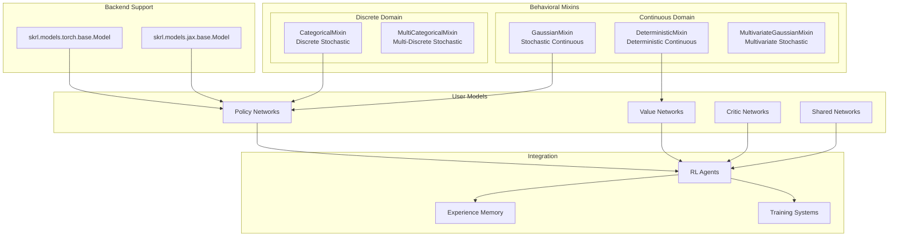
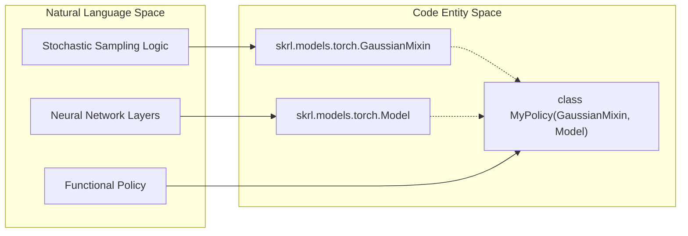
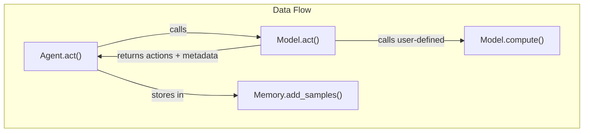

<!-- source: DeepWiki mcp.deepwiki.com · repo Toni-SM/skrl · page 3 Models · fetched 2026-10-30 -->

# Models

Relevant source files

The following files were used as context for generating this wiki page:

- [skrl/memories/jax/__init__.py](skrl/memories/jax/__init__.py)
- [skrl/memories/jax/base.py](skrl/memories/jax/base.py)
- [skrl/memories/jax/random.py](skrl/memories/jax/random.py)
- [skrl/memories/torch/base.py](skrl/memories/torch/base.py)
- [skrl/memories/torch/random.py](skrl/memories/torch/random.py)
- [skrl/memories/warp/random.py](skrl/memories/warp/random.py)
- [skrl/models/jax/__init__.py](skrl/models/jax/__init__.py)
- [skrl/models/jax/base.py](skrl/models/jax/base.py)
- [skrl/models/torch/base.py](skrl/models/torch/base.py)
- [skrl/models/torch/categorical.py](skrl/models/torch/categorical.py)
- [skrl/models/torch/deterministic.py](skrl/models/torch/deterministic.py)
- [skrl/models/torch/gaussian.py](skrl/models/torch/gaussian.py)
- [skrl/models/torch/multivariate_gaussian.py](skrl/models/torch/multivariate_gaussian.py)

Models in **skrl** are neural network-based function approximators that represent policies, value functions, and other decision-making components used by reinforcement learning agents. The model system provides a flexible architecture supporting **PyTorch**, **JAX**, and **Warp** backends, with a mixin-based design that allows users to combine different action space behaviors with custom network architectures.

For information about how models are used within RL agents, see [Agents](#2). For details about training these models, see [Trainers](#5).

## Architecture Overview

The model system is built around a dual-backend architecture with base classes and behavioral mixins that can be composed to create models for different action spaces and domains.

Sources: [skrl/models/torch/base.py:15-30](), [skrl/models/jax/base.py:40-64](), [skrl/models/torch/gaussian.py:15-26](), [skrl/models/torch/categorical.py:13-21]()

## Model Base Classes

The foundation of the model system consists of backend-specific base classes that provide common functionality for neural network operations, device management, and state handling.

### PyTorch Base Class
The PyTorch `Model` class extends `torch.nn.Module` and introduces high-level methods for RL workflows, such as `init_state_dict` for lazy modules [skrl/models/torch/base.py:42-58]() and `update_parameters` for Polyak averaging [skrl/models/torch/base.py:419](). It manages observation and action space metadata to ensure compatibility with environments [skrl/models/torch/base.py:35-40]().

For details, see [Model Base Classes](#3.1).

### JAX Base Class
The JAX `Model` class extends `flax.linen.Module` [skrl/models/jax/base.py:40](). Because JAX is functional, it uses a `StateDict` [skrl/models/jax/base.py:31-37]() to store `apply_fn` and `params`. It supports distributed operations like `reduce_parameters` [skrl/models/jax/base.py:419]() and `broadcast_parameters` [skrl/models/jax/base.py:419]().

For details, see [Model Base Classes](#3.1).

## Model Mixins System

Mixins provide standardized implementations for different action types. By inheriting from both a `Model` base class and a `Mixin`, users can define the network architecture in `compute()` while the mixin handles the RL-specific `act()` logic.

### Mixin Inheritance Pattern

Sources: [skrl/models/torch/gaussian.py:15-60](), [skrl/models/torch/base.py:15-30]()

### Available Mixins
*   **GaussianMixin**: For continuous actions using a Normal distribution [skrl/models/torch/gaussian.py:15-60]().
*   **DeterministicMixin**: For deterministic continuous actions, often used in DDPG/TD3 or Value functions [skrl/models/torch/deterministic.py:10-20]().
*   **CategoricalMixin**: For discrete actions using a Categorical distribution [skrl/models/torch/categorical.py:13-23]().
*   **MultivariateGaussianMixin**: For continuous actions with multivariate normal distributions [skrl/models/torch/multivariate_gaussian.py:15-46]().

For details, see [Model Mixins](#3.2).

## Model Instantiators

The instantiator system allows for the dynamic creation of models from configuration dictionaries or simple helper functions. This is particularly useful for standard architectures like MLPs or CNNs without writing boilerplate class definitions.

For details, see [Model Instantiators](#3.3).

## Integration with Agents and Memory

Models are the primary interface for agents to interact with the environment. Agents use the `act()` method provided by mixins to generate actions [skrl/models/torch/gaussian.py:62-111](). The results, including metadata like `log_prob` or `log_std`, are then stored in `Memory` objects [skrl/memories/torch/base.py:20-48]().

Sources: [skrl/models/torch/gaussian.py:62-111](), [skrl/memories/torch/base.py:121-171]()

---

