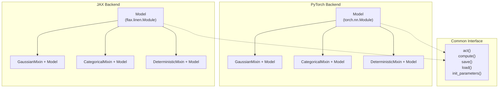
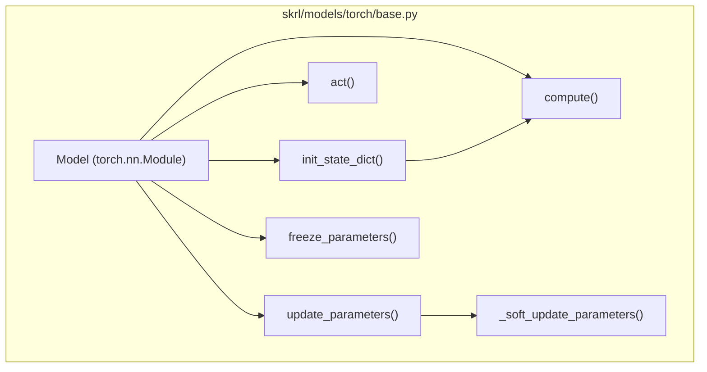
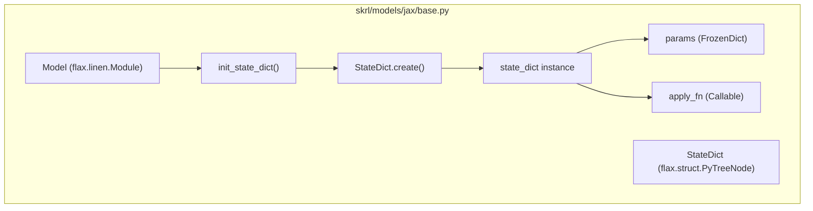
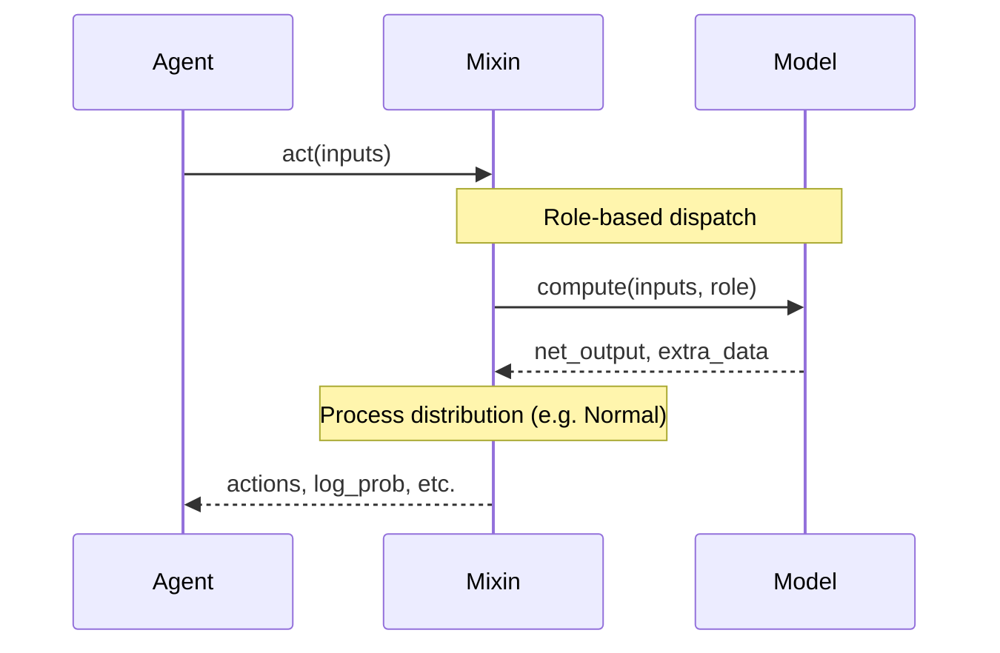

<!-- source: DeepWiki mcp.deepwiki.com · repo Toni-SM/skrl · page 3.1 Model Base Classes · fetched 2026-10-30 -->

# Model Base Classes

Relevant source files

The following files were used as context for generating this wiki page:

- [skrl/memories/__init__.py](skrl/memories/__init__.py)
- [skrl/memories/jax/__init__.py](skrl/memories/jax/__init__.py)
- [skrl/memories/jax/base.py](skrl/memories/jax/base.py)
- [skrl/memories/jax/random.py](skrl/memories/jax/random.py)
- [skrl/memories/torch/__init__.py](skrl/memories/torch/__init__.py)
- [skrl/memories/torch/base.py](skrl/memories/torch/base.py)
- [skrl/memories/torch/random.py](skrl/memories/torch/random.py)
- [skrl/memories/warp/random.py](skrl/memories/warp/random.py)
- [skrl/models/jax/__init__.py](skrl/models/jax/__init__.py)
- [skrl/models/jax/base.py](skrl/models/jax/base.py)
- [skrl/models/torch/__init__.py](skrl/models/torch/__init__.py)
- [skrl/models/torch/base.py](skrl/models/torch/base.py)
- [skrl/models/torch/categorical.py](skrl/models/torch/categorical.py)
- [skrl/models/torch/deterministic.py](skrl/models/torch/deterministic.py)
- [skrl/models/torch/gaussian.py](skrl/models/torch/gaussian.py)
- [skrl/models/torch/multivariate_gaussian.py](skrl/models/torch/multivariate_gaussian.py)
- [skrl/models/torch/tabular.py](skrl/models/torch/tabular.py)
- [skrl/models/warp/deterministic.py](skrl/models/warp/deterministic.py)
- [skrl/models/warp/gaussian.py](skrl/models/warp/gaussian.py)
- [skrl/utils/model_instantiators/warp/gaussian.py](skrl/utils/model_instantiators/warp/gaussian.py)
- [skrl/utils/model_instantiators/warp/shared.py](skrl/utils/model_instantiators/warp/shared.py)
- [tests/utils/model_instantiators/jax/test_models.py](tests/utils/model_instantiators/jax/test_models.py)
- [tests/utils/model_instantiators/torch/test_models.py](tests/utils/model_instantiators/torch/test_models.py)
- [tests/utils/model_instantiators/warp/test_models.py](tests/utils/model_instantiators/warp/test_models.py)

This page covers the foundational `Model` classes that serve as the base classes for all neural network models in skrl. These classes provide the common interface, properties, and core functionality that is inherited by all policy networks, value functions, and other neural network components across both PyTorch and JAX backends.

For information about the mixin system that extends these base classes with specific action distribution behaviors, see [Model Mixins](#3.2). For details about dynamic model creation from configuration, see [Model Instantiators](#3.3).

## Overview

The skrl library implements a dual backend architecture with separate but functionally equivalent `Model` base classes for PyTorch and JAX. Both classes provide the same core interface while leveraging the specific features and conventions of their respective machine learning frameworks.

**Model Base Class Architecture**

Sources: [skrl/models/torch/base.py:15-15]() [skrl/models/jax/base.py:40-40]()

## Common Model Interface

Both PyTorch and JAX `Model` classes provide a standardized interface with core properties and methods for reinforcement learning tasks.

### Core Properties

| Property | Type | Description |
|----------|------|-------------|
| `device` | `torch.device` or `jax.Device` | Computation device |
| `observation_space` | `gymnasium.Space` | Environment observation space |
| `state_space` | `gymnasium.Space` | Environment state space (for asymmetric actor-critic) |
| `action_space` | `gymnasium.Space` | Environment action space |
| `num_observations` | `int` | Flattened size of observation space |
| `num_actions` | `int` | Flattened size of action space |

Sources: [skrl/models/torch/base.py:33-40]() [skrl/models/jax/base.py:65-72]()

### Essential Methods

| Method | Purpose |
|--------|---------|
| `act()` | Generate actions from environment states (abstract) |
| `compute()` | Perform forward computation (abstract) |
| `random_act()` | Sample random actions from action space |
| `init_parameters()` | Initialize model parameters using backend initializers |
| `init_state_dict()` | Initialize lazy modules or internal state structures |
| `update_parameters()` | Perform hard or soft (Polyak) parameter updates |

Sources: [skrl/models/torch/base.py:42-100]() [skrl/models/jax/base.py:81-146]()

## PyTorch Model Class

The PyTorch `Model` class inherits from `torch.nn.Module` and provides the foundation for all PyTorch-based neural networks in skrl.

**PyTorch Model Class Method Overview**

### Lazy Module Initialization
skrl supports models with lazy modules (e.g., `torch.nn.LazyLinear`). The `init_state_dict` method facilitates this by performing a forward pass with dummy inputs sampled from the environment spaces to determine parameter shapes before training begins [skrl/models/torch/base.py:42-74]().

### Parameter Updates and Freezing
- **update_parameters**: Implements both hard updates (copying weights) and soft updates (Polyak averaging) using a `tau` coefficient [skrl/models/torch/base.py:419]().
- **freeze_parameters**: Disables gradient calculation for the entire model by setting `requires_grad = False` on all parameters [skrl/models/torch/base.py:419]().

### Distributed Support
The base class includes methods for distributed training, such as `reduce_parameters` to average gradients across processes and `broadcast_parameters` to synchronize weights [skrl/models/torch/base.py:419]().

Sources: [skrl/models/torch/base.py:15-15]() [skrl/models/torch/base.py:42-74]() [skrl/models/torch/base.py:419]()

## JAX Model Class

The JAX `Model` class inherits from `flax.linen.Module`. Because JAX is functional, state management is handled via an immutable `StateDict` structure.

**JAX Model Architecture and StateDict Pattern**

### StateDict Pattern
In skrl's JAX implementation, a model's weights and its apply function are encapsulated in a `StateDict` which is a `flax.struct.PyTreeNode` [skrl/models/jax/base.py:31-38](). This allows the model state to be passed through JIT-compiled functions easily.

### Functional act and compute
Unlike PyTorch, the `act` and `compute` methods in JAX take an optional `params` argument. If not provided, they use the internal `state_dict.params` [skrl/models/jax/base.py:179-183](). This design supports the functional update pipeline required by JAX.

### Distributed Utilities
JAX models utilize `jax.lax.psum` for parameter reduction across devices and `jax.experimental.multihost_utils.broadcast_one_to_all` for weight synchronization in multi-host setups [skrl/models/jax/base.py:419]().

Sources: [skrl/models/jax/base.py:31-40]() [skrl/models/jax/base.py:81-117]() [skrl/models/jax/base.py:419]()

## Key Implementation Details

### Action Generation Flow
The `act` method is the primary entry point for agents to interact with the model. While `act` is abstract in the base `Model`, it is typically implemented by Mixins (Gaussian, Categorical, etc.) which call the user-defined `compute` method.

**Action Generation Sequence**

Sources: [skrl/models/torch/gaussian.py:62-80]() [skrl/models/torch/categorical.py:25-42]() [skrl/models/torch/deterministic.py:22-36]()

### Random Action Sampling
The `random_act` method provides a backend-agnostic way to sample actions from the environment's action space. It uses `sample_space` utilities to ensure the sampled actions match the expected batch size and device [skrl/models/torch/base.py:75-98]() [skrl/models/jax/base.py:118-144]().

### Polyak Averaging (Soft Updates)
Both backends support soft updates, typically used for target networks in algorithms like SAC or TD3. The update follows the formula:
$$\theta_{target} = \tau \theta_{source} + (1 - \tau) \theta_{target}$$

Sources: [skrl/models/torch/base.py:419]() [skrl/models/jax/base.py:419]()

---

