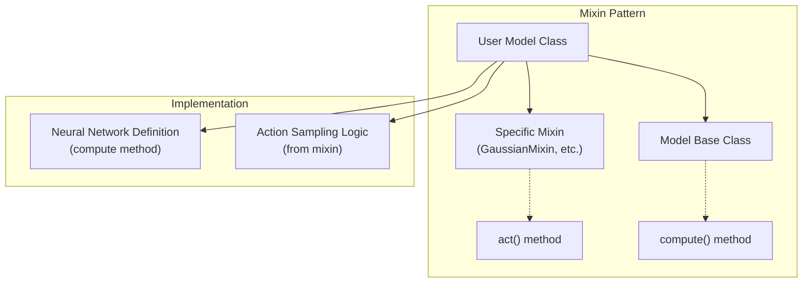
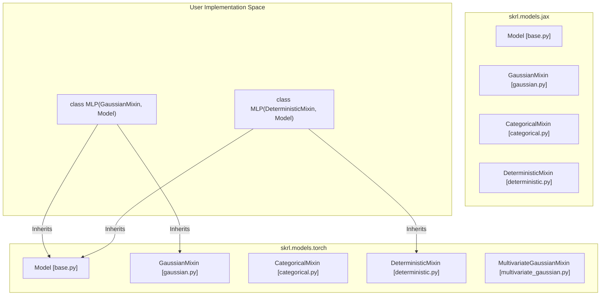
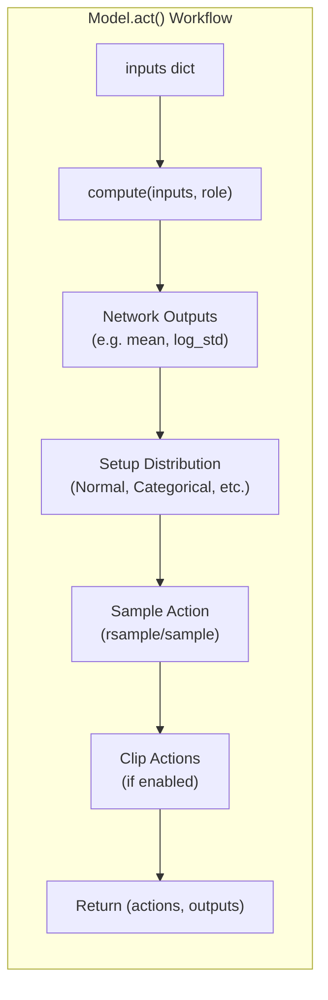

<!-- source: DeepWiki mcp.deepwiki.com · repo Toni-SM/skrl · page 3.2 Model Mixins · fetched 2026-10-30 -->

# Model Mixins

<details>
<summary>Relevant source files</summary>

The following files were used as context for generating this wiki page:

- [docs/source/api/models.rst](docs/source/api/models.rst)
- [docs/source/api/models/categorical.rst](docs/source/api/models/categorical.rst)
- [docs/source/api/models/deterministic.rst](docs/source/api/models/deterministic.rst)
- [docs/source/api/models/gaussian.rst](docs/source/api/models/gaussian.rst)
- [docs/source/api/models/multicategorical.rst](docs/source/api/models/multicategorical.rst)
- [docs/source/api/models/multivariate_gaussian.rst](docs/source/api/models/multivariate_gaussian.rst)
- [docs/source/api/models/shared_model.rst](docs/source/api/models/shared_model.rst)
- [docs/source/api/models/tabular.rst](docs/source/api/models/tabular.rst)
- [docs/source/snippets/categorical_model.py](docs/source/snippets/categorical_model.py)
- [docs/source/snippets/deterministic_model.py](docs/source/snippets/deterministic_model.py)
- [docs/source/snippets/gaussian_model.py](docs/source/snippets/gaussian_model.py)
- [docs/source/snippets/multicategorical_model.py](docs/source/snippets/multicategorical_model.py)
- [docs/source/snippets/multivariate_gaussian_model.py](docs/source/snippets/multivariate_gaussian_model.py)
- [docs/source/snippets/shared_model.py](docs/source/snippets/shared_model.py)
- [skrl/models/jax/categorical.py](skrl/models/jax/categorical.py)
- [skrl/models/jax/deterministic.py](skrl/models/jax/deterministic.py)
- [skrl/models/jax/gaussian.py](skrl/models/jax/gaussian.py)
- [skrl/models/jax/multicategorical.py](skrl/models/jax/multicategorical.py)
- [skrl/models/torch/base.py](skrl/models/torch/base.py)
- [skrl/models/torch/categorical.py](skrl/models/torch/categorical.py)
- [skrl/models/torch/deterministic.py](skrl/models/torch/deterministic.py)
- [skrl/models/torch/gaussian.py](skrl/models/torch/gaussian.py)
- [skrl/models/torch/multicategorical.py](skrl/models/torch/multicategorical.py)
- [skrl/models/torch/multivariate_gaussian.py](skrl/models/torch/multivariate_gaussian.py)

</details>


Model mixins provide a flexible architecture for defining neural network models with different action sampling behaviors in reinforcement learning. They implement the strategy pattern through Python multiple inheritance, allowing users to combine domain-specific action sampling logic with custom neural network architectures.

## Overview

The mixin system separates action sampling behavior from neural network architecture definition. Each mixin implements a specific type of policy behavior by providing an `act()` method that defines how actions are computed from neural network outputs. Users combine mixins with the base `Model` class to create complete model implementations.



Sources: [skrl/models/torch/base.py:15-41](), [docs/source/api/models.rst:17-19]()

## Available Mixins

The library provides mixins for different action space types and sampling strategies across PyTorch, JAX, and Warp backends.

| Mixin | Action Space | Sampling | PyTorch | JAX | Warp |
|-------|-------------|----------|---------|-----|------|
| `GaussianMixin` | Continuous | Stochastic | ✓ | ✓ | ✓ |
| `CategoricalMixin` | Discrete | Stochastic | ✓ | ✓ | ✗ |
| `DeterministicMixin` | Continuous | Deterministic | ✓ | ✓ | ✓ |
| `MultivariateGaussianMixin` | Continuous | Stochastic | ✓ | ✗ | ✗ |
| `MultiCategoricalMixin` | Multi-Discrete | Stochastic | ✓ | ✓ | ✗ |

Sources: [docs/source/api/models.rst:30-62](), [skrl/models/torch/gaussian.py:15](), [skrl/models/torch/categorical.py:13](), [skrl/models/torch/deterministic.py:10](), [skrl/models/torch/multivariate_gaussian.py:15]()

## Mixin Architecture

The following diagram bridges the natural language concept of "Mixins" to the specific code entities in the `skrl` repository.



Sources: [skrl/models/torch/gaussian.py:15](), [skrl/models/jax/gaussian.py:68](), [skrl/models/torch/base.py:15](), [docs/source/snippets/gaussian_model.py:81]()

## Mixin Implementation Pattern

### Inheritance Order

Mixins must be specified before the base `Model` class in the inheritance list. The mixin constructor must be called after the base `Model` constructor to ensure proper initialization of attributes like `device` and `action_space`.

```python
class GaussianModel(GaussianMixin, Model):
    def __init__(self, observation_space, state_space, action_space, device):
        # 1. Base class constructor
        Model.__init__(self, observation_space, state_space, action_space, device)
        # 2. Mixin constructor
        GaussianMixin.__init__(self, clip_actions=True)
```

Sources: [docs/source/snippets/gaussian_model.py:2-32](), [docs/source/api/models/gaussian.rst:12-18]()

### Core Data Flow

The `act()` method in a mixin orchestrates the flow from network output to sampled actions.



Sources: [skrl/models/torch/gaussian.py:62-111](), [skrl/models/torch/categorical.py:25-57](), [skrl/models/torch/deterministic.py:22-42]()

## Gaussian Mixin

The `GaussianMixin` implements continuous stochastic policies. It uses the **reparameterization trick** via `rsample()` in PyTorch to allow gradients to flow through the sampling process.

- **Reparameterization**: Samples are generated as `mean + std * epsilon` [skrl/models/jax/gaussian.py:46]().
- **Action Clipping**: Actions can be clipped to the action space limits defined by `_g_min_actions` and `_g_max_actions` [skrl/models/torch/gaussian.py:99-100]().
- **Log-Std Handling**: Log standard deviations are typically clipped to a range (default -20 to 2) to ensure numerical stability [skrl/models/torch/gaussian.py:22-23]().
- **Taken Actions**: If `taken_actions` is provided in the `inputs` dictionary, the mixin computes the log probability of those specific actions instead of the sampled ones, which is essential for off-policy updates [skrl/models/torch/gaussian.py:103]().

Sources: [skrl/models/torch/gaussian.py:15-60](), [skrl/models/torch/gaussian.py:62-111](), [skrl/models/jax/gaussian.py:23-60]()

## Categorical Mixin

The `CategoricalMixin` handles discrete action spaces.

- **Unnormalized Log Prob**: If `unnormalized_log_prob` is `True`, the model output is treated as logits [skrl/models/torch/categorical.py:45-46]().
- **Entropy**: Provides `get_entropy()` to return the Shannon entropy of the discrete distribution, often used as a regularizer in algorithms like PPO or A2C [skrl/models/torch/categorical.py:59-68]().

Sources: [skrl/models/torch/categorical.py:13-24](), [skrl/models/torch/categorical.py:25-57]()

## Deterministic Mixin

The `DeterministicMixin` is used for continuous policies that do not involve sampling (e.g., DDPG, TD3) or for value functions (Critics).

- **Direct Mapping**: The `act()` method directly returns the output of `compute()` after optional clipping [skrl/models/torch/deterministic.py:36-42]().
- **Clipping**: Uses `compute_space_limits` to determine bounds from the `action_space` [skrl/models/torch/deterministic.py:18-20]().

Sources: [skrl/models/torch/deterministic.py:10-20](), [skrl/models/torch/deterministic.py:22-42]()

## Multivariate Gaussian Mixin

Unlike the standard `GaussianMixin` which assumes a diagonal covariance matrix (independent actions), the `MultivariateGaussianMixin` can represent correlations between action dimensions.

- **Covariance**: It constructs a `MultivariateNormal` distribution. In the current implementation, it still uses a diagonal covariance derived from `log_std`, but through the `MultivariateNormal` API [skrl/models/torch/multivariate_gaussian.py:79-80]().

Sources: [skrl/models/torch/multivariate_gaussian.py:15-47](), [skrl/models/torch/multivariate_gaussian.py:49-96]()

## Backend Specifics: PyTorch vs. JAX

### PyTorch Mixins
PyTorch mixins (e.g., in `skrl/models/torch/gaussian.py`) rely on the `torch.distributions` module. They maintain an internal `_distribution` object after `act()` is called, which can be accessed via the `distribution()` method [skrl/models/torch/gaussian.py:124-131]().

### JAX Mixins
JAX mixins (e.g., in `skrl/models/jax/gaussian.py`) are designed for functional purity and JIT compatibility.
- **JIT Compilation**: They use `jax.jit` on helper functions like `_gaussian` to optimize the sampling and log-prob calculation [skrl/models/jax/gaussian.py:22-35]().
- **Random Keys**: They handle JAX's explicit PRNG state by folding in a counter `_g_i` to the base `config.jax.key` during every `act()` call [skrl/models/jax/gaussian.py:142-145]().

Sources: [skrl/models/torch/gaussian.py:93](), [skrl/models/jax/gaussian.py:22](), [skrl/models/jax/gaussian.py:117](), [skrl/models/jax/gaussian.py:143-145]()

---

