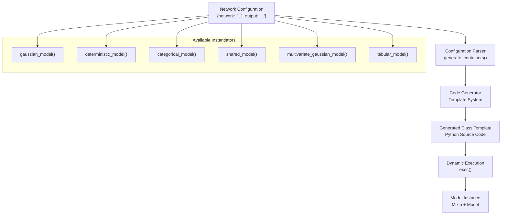
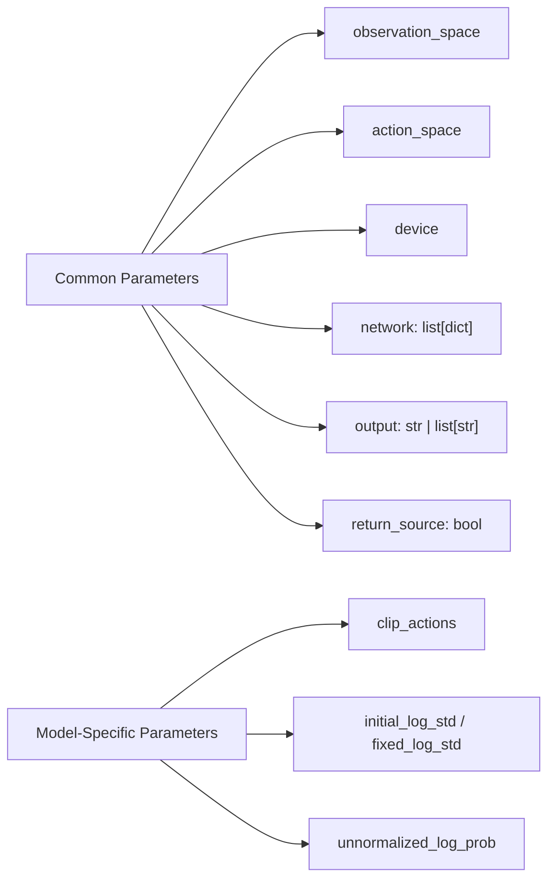
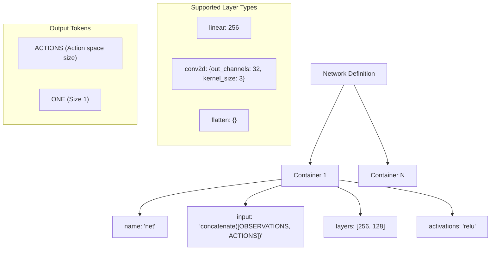
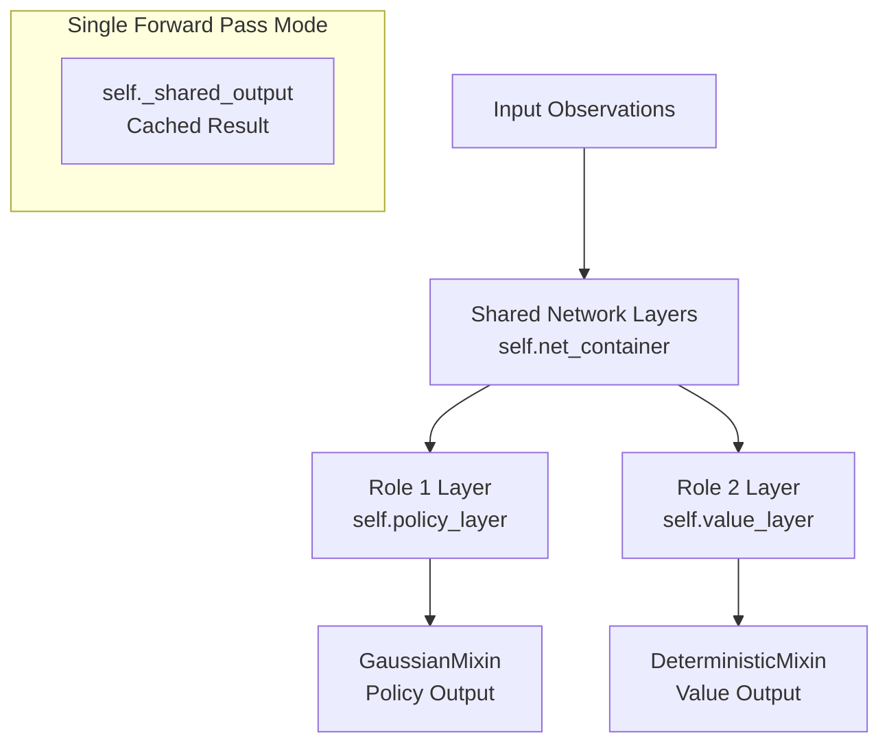

<!-- source: DeepWiki mcp.deepwiki.com · repo Toni-SM/skrl · page 3.3 Model Instantiators · fetched 2026-10-30 -->

# Model Instantiators

Relevant source files

The following files were used as context for generating this wiki page:

- [docs/source/api/utils/model_instantiators.rst](docs/source/api/utils/model_instantiators.rst)
- [docs/source/snippets/model_instantiators.txt](docs/source/snippets/model_instantiators.txt)
- [docs/source/snippets/tabular_model.py](docs/source/snippets/tabular_model.py)
- [examples/gym/torch_gym_frozen_lake_q_learning.py](examples/gym/torch_gym_frozen_lake_q_learning.py)
- [examples/gym/torch_gym_taxi_sarsa.py](examples/gym/torch_gym_taxi_sarsa.py)
- [examples/gymnasium/torch_gymnasium_frozen_lake_q_learning.py](examples/gymnasium/torch_gymnasium_frozen_lake_q_learning.py)
- [examples/gymnasium/torch_gymnasium_taxi_sarsa.py](examples/gymnasium/torch_gymnasium_taxi_sarsa.py)
- [skrl/utils/model_instantiators/__init__.py](skrl/utils/model_instantiators/__init__.py)
- [skrl/utils/model_instantiators/jax/__init__.py](skrl/utils/model_instantiators/jax/__init__.py)
- [skrl/utils/model_instantiators/jax/categorical.py](skrl/utils/model_instantiators/jax/categorical.py)
- [skrl/utils/model_instantiators/jax/common.py](skrl/utils/model_instantiators/jax/common.py)
- [skrl/utils/model_instantiators/jax/deterministic.py](skrl/utils/model_instantiators/jax/deterministic.py)
- [skrl/utils/model_instantiators/jax/gaussian.py](skrl/utils/model_instantiators/jax/gaussian.py)
- [skrl/utils/model_instantiators/jax/multicategorical.py](skrl/utils/model_instantiators/jax/multicategorical.py)
- [skrl/utils/model_instantiators/torch/__init__.py](skrl/utils/model_instantiators/torch/__init__.py)
- [skrl/utils/model_instantiators/torch/categorical.py](skrl/utils/model_instantiators/torch/categorical.py)
- [skrl/utils/model_instantiators/torch/common.py](skrl/utils/model_instantiators/torch/common.py)
- [skrl/utils/model_instantiators/torch/deterministic.py](skrl/utils/model_instantiators/torch/deterministic.py)
- [skrl/utils/model_instantiators/torch/gaussian.py](skrl/utils/model_instantiators/torch/gaussian.py)
- [skrl/utils/model_instantiators/torch/multicategorical.py](skrl/utils/model_instantiators/torch/multicategorical.py)
- [skrl/utils/model_instantiators/torch/multivariate_gaussian.py](skrl/utils/model_instantiators/torch/multivariate_gaussian.py)
- [skrl/utils/model_instantiators/torch/shared.py](skrl/utils/model_instantiators/torch/shared.py)
- [skrl/utils/model_instantiators/torch/tabular.py](skrl/utils/model_instantiators/torch/tabular.py)
- [tests/agents/torch/test_q_learning.py](tests/agents/torch/test_q_learning.py)

Model instantiators provide a dynamic model generation system that creates neural network models from configuration specifications. They enable programmatic creation of models with different action types (Gaussian, deterministic, categorical) and network architectures without requiring manual class definitions.

For information about the base model classes and mixins that instantiators generate, see [Model Base Classes](#3.1) and [Model Mixins](#3.2).

## System Overview

The model instantiator system transforms declarative network configurations into executable model classes through code generation. It supports PyTorch, JAX, and Warp backends with unified configuration schemas.

**Sources:** [skrl/utils/model_instantiators/torch/gaussian.py:62-135](), [skrl/utils/model_instantiators/torch/common.py:273-312](), [skrl/utils/model_instantiators/torch/__init__.py:1-7]()

## Core Instantiator Functions

Each instantiator function follows a consistent pattern, accepting configuration parameters and returning either a model instance or generated source code string.

| Function | Purpose | Backend Support |
|----------|---------|----------------|
| `gaussian_model()` | Continuous action models with Gaussian distributions | PyTorch, JAX, Warp |
| `deterministic_model()` | Deterministic action models | PyTorch, JAX, Warp |
| `categorical_model()` | Discrete action models with categorical distributions | PyTorch, JAX |
| `multicategorical_model()` | Discrete action models with multiple categorical distributions | PyTorch, JAX |
| `multivariate_gaussian_model()` | Multivariate Gaussian distributions | PyTorch |
| `shared_model()` | Multi-role models with shared network layers | PyTorch, Warp |
| `tabular_model()` | Models for discrete domains using look-up tables | PyTorch |

### Function Signature Pattern

The primary interface for creating models involves passing the observation and action spaces alongside the network architecture.

**Sources:** [skrl/utils/model_instantiators/torch/gaussian.py:18-35](), [skrl/utils/model_instantiators/jax/gaussian.py:19-36](), [skrl/utils/model_instantiators/torch/shared.py:24-35]()

## Network Definition System

The network definition system uses structured configurations to specify model architectures. Networks are defined as sequences of containers, each containing layers and activation functions.

### Inputs and Tokens
Inputs are specified using tokens that represent the data forwarded to the model during the RL loop.

| Token | Description |
|-------|-------------|
| `OBSERVATIONS` | Unflattened tensorized input `observations`. |
| `STATES` | Unflattened tensorized input `states`. |
| `ACTIONS` | Unflattened tensorized input `taken_actions`. |
| `OBSERVATION_SPACE` | Token indicating the `observation_space` of the model. |
| `ACTION_SPACE` | Token indicating the `action_space` of the model. |

**Sources:** [docs/source/api/utils/model_instantiators.rst:96-103](), [skrl/utils/model_instantiators/torch/common.py:89-95]()

### Network Configuration Structure

The system uses `ast.NodeTransformer` to parse input/output expressions, allowing for operations like `concatenate`, `permute`, and slicing within the configuration string.

**Sources:** [skrl/utils/model_instantiators/torch/common.py:73-83](), [skrl/utils/model_instantiators/torch/common.py:165-180](), [docs/source/api/utils/model_instantiators.rst:112-127]()

## Shared Models

The `shared_model()` instantiator creates models with multiple roles (e.g., policy and value) that share common network layers. This is implemented by generating a class that initializes multiple mixins.

### Shared Model Architecture

**Sources:** [skrl/utils/model_instantiators/torch/shared.py:135-153](), [skrl/utils/model_instantiators/torch/shared.py:225-246]()

### Role-Based Dispatch
In PyTorch, the generated `compute` method handles the role-based dispatching. If `single_forward_pass` is enabled, the shared containers are executed once and the result is stored in `self._shared_output` to be reused by subsequent role calls within the same step.

**Sources:** [skrl/utils/model_instantiators/torch/shared.py:225-252](), [skrl/utils/model_instantiators/torch/shared.py:193-207]()

## Backend-Specific Implementation

### PyTorch Implementation
PyTorch instantiators use `nn.Sequential` for containers and `nn.LazyLinear` for layers to avoid manual input feature calculation. Learnable parameters like `log_std` are wrapped in `nn.Parameter`.

**Sources:** [skrl/utils/model_instantiators/torch/gaussian.py:83-127](), [skrl/utils/model_instantiators/torch/common.py:128-133]()

### JAX Implementation
JAX instantiators generate `flax.linen.Module` classes. They use the `setup()` method to define submodules and `self.param()` for stateful parameters. The forward pass is defined in the `__call__()` method.

**Sources:** [skrl/utils/model_instantiators/jax/gaussian.py:88-133](), [skrl/utils/model_instantiators/jax/common.py:179-185]()

### Tabular Models
The `tabular_model()` (PyTorch only) creates a `TabularMixin`-based model typically used for discrete environments. It provides a simple base for Q-learning or SARSA where the model maps observations to actions via a look-up table.

**Sources:** [docs/source/snippets/tabular_model.py:2-12](), [skrl/utils/model_instantiators/torch/tabular.py:1-10]()

## Dynamic Code Execution

The core of the system is the use of Python's `exec()` function. The instantiator:
1.  Constructs a string containing the class definition (`template`).
2.  Populates the string with network architecture logic generated by `generate_containers()`.
3.  Executes the string in a local namespace.
4.  Returns the resulting class instance.

**Sources:** [skrl/utils/model_instantiators/torch/gaussian.py:133-146](), [skrl/utils/model_instantiators/jax/gaussian.py:139-152]()

---

