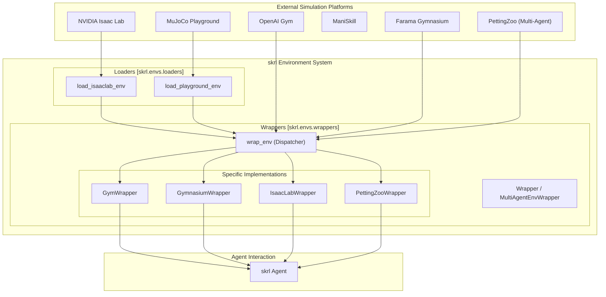
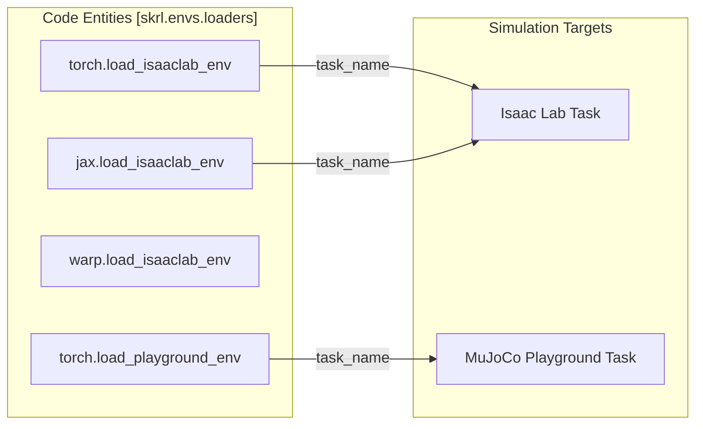

<!-- source: DeepWiki mcp.deepwiki.com · repo Toni-SM/skrl · page 4 Environments · fetched 2026-10-30 -->

# Environments

Relevant source files

The following files were used as context for generating this wiki page:

- [docs/source/api/config/frameworks.rst](docs/source/api/config/frameworks.rst)
- [docs/source/api/envs.rst](docs/source/api/envs.rst)
- [docs/source/api/envs/multi_agents_wrapping.rst](docs/source/api/envs/multi_agents_wrapping.rst)
- [docs/source/api/envs/wrapping.rst](docs/source/api/envs/wrapping.rst)
- [docs/source/api/multi_agents.rst](docs/source/api/multi_agents.rst)
- [docs/source/api/utils.rst](docs/source/api/utils.rst)
- [docs/source/snippets/loaders.py](docs/source/snippets/loaders.py)
- [docs/source/snippets/wrapping.py](docs/source/snippets/wrapping.py)
- [skrl/__init__.py](skrl/__init__.py)
- [skrl/envs/wrappers/jax/gym_envs.py](skrl/envs/wrappers/jax/gym_envs.py)
- [skrl/envs/wrappers/jax/gymnasium_envs.py](skrl/envs/wrappers/jax/gymnasium_envs.py)
- [skrl/envs/wrappers/jax/pettingzoo_envs.py](skrl/envs/wrappers/jax/pettingzoo_envs.py)
- [skrl/envs/wrappers/torch/gym_envs.py](skrl/envs/wrappers/torch/gym_envs.py)
- [skrl/envs/wrappers/torch/gymnasium_envs.py](skrl/envs/wrappers/torch/gymnasium_envs.py)
- [skrl/envs/wrappers/torch/pettingzoo_envs.py](skrl/envs/wrappers/torch/pettingzoo_envs.py)
- [skrl/envs/wrappers/warp/gymnasium_envs.py](skrl/envs/wrappers/warp/gymnasium_envs.py)
- [skrl/utils/__init__.py](skrl/utils/__init__.py)

The environment system provides a unified interface for integrating diverse reinforcement learning simulation platforms with the skrl library. This system handles environment loading, wrapping, and standardization across PyTorch, JAX, and Warp backends, enabling seamless interoperability between incompatible RL environment APIs.

For information about training orchestration, see [Trainers](#5). For multi-agent specific algorithms, see [Multi-Agent Systems](#7).

## Environment System Architecture

The environment system operates through two main components: **loaders** that instantiate specific environment types (like Isaac Lab or MuJoCo Playground) and **wrappers** that normalize diverse APIs (Gym, Gymnasium, PettingZoo) to a consistent interface.

**Environment Integration Flow**

Sources: [docs/source/api/envs.rst:12-37](), [docs/source/api/envs/wrapping.rst:8-17](), [docs/source/api/envs/multi_agents_wrapping.rst:8-14]()

## Environment Wrappers

The wrapping mechanism normalizes environment responses (observations, rewards, terminations) into the appropriate tensor format for the selected backend (PyTorch, JAX, or Warp). This allows agents to interact with any supported environment using a single `step()` and `reset()` API.

### Supported Platforms and Backends
skrl provides comprehensive support across different frameworks:

| Platform | PyTorch | JAX | Warp |
|----------|:-------:|:---:|:----:|
| **Gym** | ✅ | ✅ | ❌ |
| **Gymnasium** | ✅ | ✅ | ✅ |
| **Isaac Lab** | ✅ | ✅ | ✅ |
| **ManiSkill** | ✅ | ✅ | ✅ |
| **PettingZoo** | ✅ | ✅ | ❌ |
| **Playground** | ✅ | ✅ | ✅ |
| **Shimmy** | ✅ | ✅ | ✅ |

### Implementation Details
Wrappers like `GymnasiumWrapper` [skrl/envs/wrappers/torch/gymnasium_envs.py:19-127]() and `GymWrapper` [skrl/envs/wrappers/jax/gym_envs.py:32-161]() handle:
* **Observation/Action Space Normalization**: Converting between framework-specific spaces and Gymnasium-compatible spaces.
* **Tensorization**: Automatically moving data to the correct device and converting to `torch.Tensor` or `jax.Array`.
* **Vectorization**: Detecting and handling `VectorEnv` instances for parallel execution [skrl/envs/wrappers/jax/gymnasium_envs.py:29-41]().

For details, see [Environment Wrappers](#4.1).

Sources: [docs/source/api/envs.rst:20-73](), [skrl/envs/wrappers/jax/gymnasium_envs.py:20-127](), [skrl/envs/wrappers/torch/gymnasium_envs.py:19-127]()

## Isaac Lab and Playground Integration

skrl provides specialized loaders for high-performance simulation platforms. These loaders simplify the complex setup required for NVIDIA Isaac Lab and MuJoCo Playground.

**Loader-to-Simulation Mapping**

### Isaac Lab
Integration with Isaac Lab supports both single-agent and multi-agent robotics tasks. Loaders like `load_isaaclab_env` [docs/source/snippets/wrapping.py:4-7]() handle task registration and environment instantiation, which are then passed to `wrap_env` for API standardization.

### MuJoCo Playground
MuJoCo Playground environments are loaded via `load_playground_env` [docs/source/snippets/wrapping.py:116-119](), providing high-speed simulation for tasks like `CartpoleBalance`.

For details, see [Isaac Gym Integration](#4.2).

Sources: [docs/source/api/envs.rst:18-34](), [docs/source/snippets/wrapping.py:1-63](), [docs/source/snippets/wrapping.py:113-149]()

## Multi-Agent Wrapping

Multi-agent environments, such as those from PettingZoo or Isaac Lab Multi-Agent, require a different wrapping strategy to handle multiple observation and action streams.

The `MultiAgentEnvWrapper` base class [skrl/envs/wrappers/jax/pettingzoo_envs.py:20-103]() provides the necessary interface:
* **Agent UIDs**: Managing dictionaries of observations and actions keyed by agent ID.
* **Shared State**: Providing global environment state via the `state()` method [skrl/envs/wrappers/jax/pettingzoo_envs.py:65-75]().
* **Parallel API**: Supporting the PettingZoo Parallel API for simultaneous agent steps.

For details, see [Environment Wrappers](#4.1).

Sources: [docs/source/api/envs/multi_agents_wrapping.rst:1-179](), [skrl/envs/wrappers/jax/pettingzoo_envs.py:20-103]()

---

