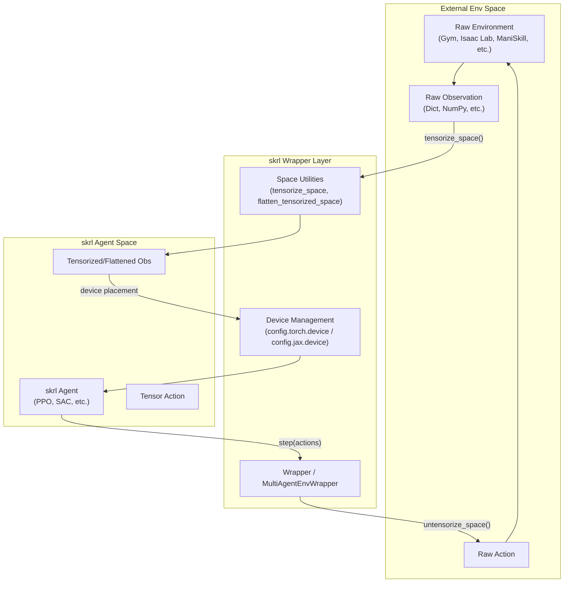
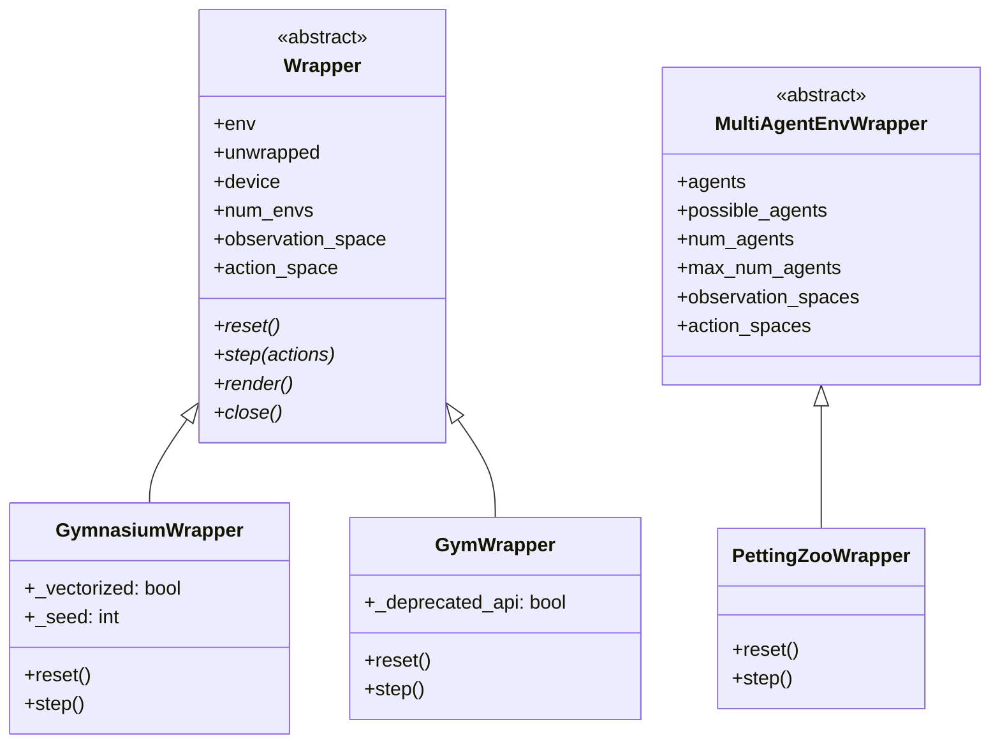

<!-- source: DeepWiki mcp.deepwiki.com · repo Toni-SM/skrl · page 4.1 Environment Wrappers · fetched 2026-10-30 -->

# Environment Wrappers

<details>
<summary>Relevant source files</summary>

The following files were used as context for generating this wiki page:

- [docs/source/api/config/frameworks.rst](docs/source/api/config/frameworks.rst)
- [docs/source/api/envs.rst](docs/source/api/envs.rst)
- [docs/source/api/envs/multi_agents_wrapping.rst](docs/source/api/envs/multi_agents_wrapping.rst)
- [docs/source/api/envs/wrapping.rst](docs/source/api/envs/wrapping.rst)
- [docs/source/api/multi_agents.rst](docs/source/api/multi_agents.rst)
- [docs/source/api/utils.rst](docs/source/api/utils.rst)
- [docs/source/snippets/loaders.py](docs/source/snippets/loaders.py)
- [docs/source/snippets/wrapping.py](docs/source/snippets/wrapping.py)
- [skrl/__init__.py](skrl/__init__.py)
- [skrl/envs/loaders/torch/isaaclab_envs.py](skrl/envs/loaders/torch/isaaclab_envs.py)
- [skrl/envs/wrappers/jax/__init__.py](skrl/envs/wrappers/jax/__init__.py)
- [skrl/envs/wrappers/jax/base.py](skrl/envs/wrappers/jax/base.py)
- [skrl/envs/wrappers/jax/gym_envs.py](skrl/envs/wrappers/jax/gym_envs.py)
- [skrl/envs/wrappers/jax/gymnasium_envs.py](skrl/envs/wrappers/jax/gymnasium_envs.py)
- [skrl/envs/wrappers/jax/pettingzoo_envs.py](skrl/envs/wrappers/jax/pettingzoo_envs.py)
- [skrl/envs/wrappers/torch/__init__.py](skrl/envs/wrappers/torch/__init__.py)
- [skrl/envs/wrappers/torch/base.py](skrl/envs/wrappers/torch/base.py)
- [skrl/envs/wrappers/torch/gym_envs.py](skrl/envs/wrappers/torch/gym_envs.py)
- [skrl/envs/wrappers/torch/gymnasium_envs.py](skrl/envs/wrappers/torch/gymnasium_envs.py)
- [skrl/envs/wrappers/torch/pettingzoo_envs.py](skrl/envs/wrappers/torch/pettingzoo_envs.py)
- [skrl/envs/wrappers/warp/__init__.py](skrl/envs/wrappers/warp/__init__.py)
- [skrl/envs/wrappers/warp/gymnasium_envs.py](skrl/envs/wrappers/warp/gymnasium_envs.py)
- [skrl/utils/__init__.py](skrl/utils/__init__.py)
- [tests/envs/wrappers/jax/test_pettingzoo_envs.py](tests/envs/wrappers/jax/test_pettingzoo_envs.py)
- [tests/envs/wrappers/torch/test_isaaclab_envs.py](tests/envs/wrappers/torch/test_isaaclab_envs.py)
- [tests/envs/wrappers/torch/test_pettingzoo_envs.py](tests/envs/wrappers/torch/test_pettingzoo_envs.py)
- [tests/utilities.py](tests/utilities.py)

</details>


Environment wrappers provide a unified interface for integrating diverse reinforcement learning environments with `skrl` agents. This system abstracts away the differences between various environment APIs (Isaac Lab, Gymnasium, ManiSkill, PettingZoo, MuJoCo Playground, etc.) and presents them through a common interface that works seamlessly across PyTorch, JAX, and Warp backends.

## Architecture Overview

The wrapper system acts as an adapter layer between external RL environments and `skrl`'s internal agent infrastructure. It automatically detects environment types and applies appropriate transformations to observations, actions, and episode lifecycle management.

### Data Flow and Normalization
The wrappers ensure that all environments, regardless of their native format (NumPy, PyTorch tensors, JAX arrays), return data in the format expected by the selected `skrl` backend.

Title: Environment Wrapping System Data Flow

Sources: [skrl/envs/wrappers/jax/gymnasium_envs.py:57-84](), [skrl/envs/wrappers/torch/gymnasium_envs.py:56-84](), [docs/source/api/envs/wrapping.rst:8-17]()

## Wrapper Class Hierarchy

The wrapper system is built around common base classes with specialized implementations for each environment type.

Title: Wrapper Class Entity Relationship

Sources: [skrl/envs/wrappers/jax/base.py:14-130](), [skrl/envs/wrappers/jax/base.py:132-250](), [skrl/envs/wrappers/jax/gymnasium_envs.py:20-127](), [skrl/envs/wrappers/jax/pettingzoo_envs.py:20-103]()

## Core Interface Standardization

All wrappers implement a consistent interface to handle the following:

### Observation and Action Handling
Wrappers use utility functions from `skrl.utils.spaces` to normalize data:
- **`tensorize_space`**: Converts environment output to the backend's tensor format [skrl/envs/wrappers/jax/gymnasium_envs.py:75]().
- **`flatten_tensorized_space`**: Flattens complex spaces (like Dict or Tuple) into a single vector for the agent [skrl/envs/wrappers/jax/gymnasium_envs.py:75]().
- **`untensorize_space`**: Converts agent actions back to the format expected by the environment [skrl/envs/wrappers/jax/gymnasium_envs.py:64-68]().

### Vectorized Environment Support
Wrappers automatically detect if an environment is vectorized (e.g., `gymnasium.vector.VectorEnv`) and adjust the `observation_space` and `action_space` to return the `single_` space versions [skrl/envs/wrappers/torch/gymnasium_envs.py:42-55]().

### Device Management
The `Wrapper` base class parses the environment's device or defaults to the framework's configured device using `config.torch.parse_device` or `config.jax.parse_device` [skrl/envs/wrappers/jax/base.py:27-30]().

## Usage Patterns

### Single and Vectorized Environments
The `wrap_env` function is the primary entry point. It automatically identifies the environment type and applies the correct wrapper.

```python
# PyTorch Example
from skrl.envs.wrappers.torch import wrap_env
import gymnasium as gym

# Single environment
env = gym.make("Pendulum-v1")
env = wrap_env(env) 

# Vectorized environment
env = gym.make_vec("Pendulum-v1", num_envs=10)
env = wrap_env(env)
```
Sources: [docs/source/snippets/wrapping.py:206-216](), [docs/source/snippets/wrapping.py:232-242]()

### Multi-Agent Environments
Multi-agent environments (like PettingZoo) return dictionaries mapping agent IDs to observations/rewards. The `PettingZooWrapper` standardizes this into the format required by `MultiAgent` agents.

```python
from skrl.envs.wrappers.jax import wrap_env
from pettingzoo.butterfly import pistonball_v6

env = pistonball_v6.parallel_env()
env = wrap_env(env) # Automatically uses PettingZooWrapper
```
Sources: [skrl/envs/wrappers/jax/pettingzoo_envs.py:20-32](), [docs/source/api/envs.rst:36-37]()

## Backend Support Matrix

| Environment Interface | PyTorch | JAX | Warp |
| :--- | :---: | :---: | :---: |
| **Gym** | ✓ | ✓ | - |
| **Gymnasium** | ✓ | ✓ | ✓ |
| **Isaac Lab** | ✓ | ✓ | ✓ |
| **ManiSkill** | ✓ | ✓ | ✓ |
| **PettingZoo** | ✓ | ✓ | - |
| **MuJoCo Playground** | ✓ | ✓ | ✓ |
| **Shimmy** | ✓ | ✓ | ✓ |

Sources: [docs/source/api/envs.rst:39-73]()

## Implementation Details

### Gymnasium Wrapper
The `GymnasiumWrapper` handles modern Gymnasium APIs, including the `terminated` and `truncated` signal separation [skrl/envs/wrappers/jax/gymnasium_envs.py:77-78](). It also manages auto-resetting logic for vectorized environments by storing the last observation and info when a reset is triggered internally by the environment [skrl/envs/wrappers/jax/gymnasium_envs.py:103-112]().

### Gym Wrapper (Legacy)
The `GymWrapper` provides backward compatibility for OpenAI Gym. It includes a "hack" to handle the `TimeLimit.truncated` info key from older Gym versions to maintain the `terminated`/`truncated` API expected by `skrl` [skrl/envs/wrappers/jax/gym_envs.py:84-95]().

### PettingZoo Wrapper
This wrapper supports the PettingZoo **Parallel API**. It converts dictionary-based multi-agent responses into tensorized dictionaries and handles the global `state()` view by duplicating it across all possible agents if necessary [skrl/envs/wrappers/jax/pettingzoo_envs.py:44-75]().

Sources: [skrl/envs/wrappers/jax/gymnasium_envs.py:1-127](), [skrl/envs/wrappers/jax/gym_envs.py:1-161](), [skrl/envs/wrappers/jax/pettingzoo_envs.py:1-103]()

---

