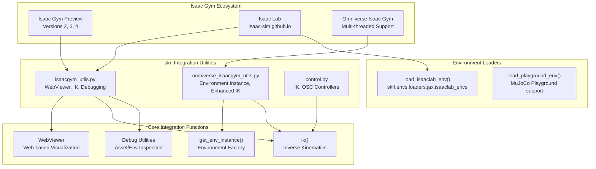
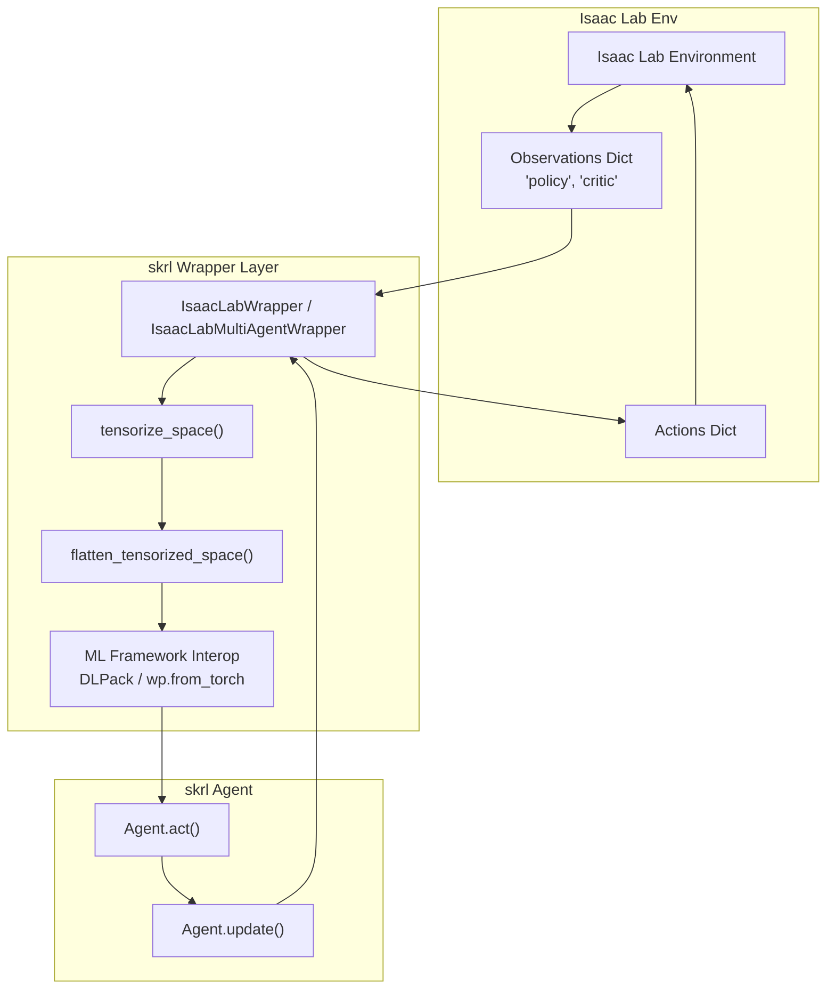

<!-- source: DeepWiki mcp.deepwiki.com · repo Toni-SM/skrl · page 4.2 Isaac Gym Integration · fetched 2026-10-30 -->

# Isaac Gym Integration

Relevant source files

The following files were used as context for generating this wiki page:

- [docs/source/api/envs/isaaclab.rst](docs/source/api/envs/isaaclab.rst)
- [skrl/envs/loaders/jax/__init__.py](skrl/envs/loaders/jax/__init__.py)
- [skrl/envs/loaders/jax/isaaclab_envs.py](skrl/envs/loaders/jax/isaaclab_envs.py)
- [skrl/envs/loaders/jax/playground_envs.py](skrl/envs/loaders/jax/playground_envs.py)
- [skrl/envs/loaders/torch/__init__.py](skrl/envs/loaders/torch/__init__.py)
- [skrl/envs/loaders/torch/playground_envs.py](skrl/envs/loaders/torch/playground_envs.py)
- [skrl/envs/loaders/warp/playground_envs.py](skrl/envs/loaders/warp/playground_envs.py)
- [skrl/envs/wrappers/jax/isaaclab_envs.py](skrl/envs/wrappers/jax/isaaclab_envs.py)
- [skrl/envs/wrappers/jax/mani_skill_envs.py](skrl/envs/wrappers/jax/mani_skill_envs.py)
- [skrl/envs/wrappers/torch/isaaclab_envs.py](skrl/envs/wrappers/torch/isaaclab_envs.py)
- [skrl/envs/wrappers/torch/mani_skill_envs.py](skrl/envs/wrappers/torch/mani_skill_envs.py)
- [skrl/envs/wrappers/warp/isaaclab_envs.py](skrl/envs/wrappers/warp/isaaclab_envs.py)
- [skrl/envs/wrappers/warp/mani_skill_envs.py](skrl/envs/wrappers/warp/mani_skill_envs.py)
- [tests/envs/wrappers/jax/test_isaaclab_envs.py](tests/envs/wrappers/jax/test_isaaclab_envs.py)
- [tests/envs/wrappers/jax/test_playground_envs.py](tests/envs/wrappers/jax/test_playground_envs.py)
- [tests/envs/wrappers/torch/test_playground_envs.py](tests/envs/wrappers/torch/test_playground_envs.py)
- [tests/envs/wrappers/warp/test_playground_envs.py](tests/envs/wrappers/warp/test_playground_envs.py)

The Isaac Gym integration system provides comprehensive support for NVIDIA's Isaac Gym physics simulation environments, including Isaac Gym Preview releases, Isaac Lab, and Omniverse Isaac Gym. This system includes specialized environment wrappers, loaders, and utilities for visualization, control, and debugging that enable seamless integration of Isaac Gym-based robotic simulations with **skrl**'s reinforcement learning framework across PyTorch, JAX, and Warp backends.

For information about environment wrappers that provide unified interfaces to Isaac Gym environments, see [Environment Wrappers](#4.1). For details about the broader environment integration system, see [Environments](#4).

## Supported Isaac Gym Variants

The integration system supports multiple variants of NVIDIA's Isaac Gym ecosystem through specialized utility modules and environment loaders.

Sources: [skrl/utils/isaacgym_utils.py:1-569](), [skrl/utils/omniverse_isaacgym_utils.py:1-362](), [skrl/utils/control.py:1-56](), [skrl/envs/loaders/jax/isaaclab_envs.py:1-47]()

## Isaac Lab Integration

Isaac Lab environments are integrated using specialized wrappers and loaders that handle the conversion between simulation tensors (typically PyTorch) and the agent's backend (PyTorch, JAX, or Warp).

### Isaac Lab Wrapper Implementation

The `IsaacLabWrapper` normalizes Isaac Lab's dictionary-based observation and action spaces into flattened tensors compatible with RL agents. It supports both single-agent and multi-agent configurations.

| Feature | PyTorch Wrapper | JAX Wrapper | Warp Wrapper |
|---------|-----------------|-------------|--------------|
| **Class** | `IsaacLabWrapper` [skrl/envs/wrappers/torch/isaaclab_envs.py:14]() | `IsaacLabWrapper` [skrl/envs/wrappers/jax/isaaclab_envs.py:38]() | `IsaacLabWrapper` [skrl/envs/wrappers/warp/isaaclab_envs.py:15]() |
| **Data Flow** | Direct PyTorch tensors | DLPack conversion (`_torch2jax`) | Warp-Torch interop (`wp.from_torch`) |
| **Space Handling** | `flatten_tensorized_space` | `flatten_tensorized_space` | `flatten_tensorized_space` |
| **Device Sync** | Same device | Cross-backend (GPU/CPU) | Shared GPU memory |

### Multi-Agent Support

The `IsaacLabMultiAgentWrapper` provides a dictionary-based interface for multi-agent environments, mapping agent UIDs to their respective observation and action tensors [skrl/envs/wrappers/torch/isaaclab_envs.py:105-179]().

Sources: [skrl/envs/wrappers/jax/isaaclab_envs.py:38-143](), [skrl/envs/wrappers/torch/isaaclab_envs.py:14-103](), [skrl/envs/wrappers/warp/isaaclab_envs.py:15-115]()

## MuJoCo Playground Integration

MuJoCo Playground environments are supported through a common loader that bridges JAX-based simulations to PyTorch or Warp backends.

### MuJoCo Playground Loader

The `load_playground_env` function provides a unified interface for loading tasks like `CartpoleBalance` or `LeapCubeReorient`. It handles command-line argument parsing for `num_envs`, `episode_length`, and `randomization` [skrl/envs/loaders/jax/playground_envs.py:8-150]().

| Backend | Loader Function | Implementation Detail |
|---------|-----------------|-----------------------|
| **JAX** | `load_playground_env` | Uses `mujoco_playground.registry` and `wrapper.wrap_for_brax_training` [skrl/envs/loaders/jax/playground_envs.py:65-132]() |
| **PyTorch** | `load_playground_env` | Imports and calls the JAX loader, then wraps with `PlaygroundWrapper` [skrl/envs/loaders/torch/playground_envs.py:61-73]() |
| **Warp** | `load_playground_env` | Bridges via JAX loader with Warp-compatible device management [skrl/envs/loaders/warp/playground_envs.py:61-73]() |

Sources: [skrl/envs/loaders/jax/playground_envs.py:8-150](), [skrl/envs/loaders/torch/playground_envs.py:4-73](), [skrl/envs/loaders/warp/playground_envs.py:4-73]()

## ManiSkill Integration

ManiSkill environments are supported across all backends, featuring automatic environment resets and tensorized space handling.

- **JAX Wrapper**: Uses DLPack for zero-copy tensor transfer between ManiSkill (PyTorch) and JAX [skrl/envs/wrappers/jax/mani_skill_envs.py:19-36]().
- **Warp Wrapper**: Uses `wp.to_torch` and `wp.from_torch` for efficient GPU memory sharing [skrl/envs/wrappers/warp/mani_skill_envs.py:64-74]().
- **Auto-Reset**: The wrappers automatically detect terminated/truncated environments and call `env.reset(options={"env_idx": ...})` to maintain parallel execution [skrl/envs/wrappers/jax/mani_skill_envs.py:94-98]().

Sources: [skrl/envs/wrappers/jax/mani_skill_envs.py:38-139](), [skrl/envs/wrappers/warp/mani_skill_envs.py:15-113]()

## Web-Based Visualization System

The `WebViewer` class provides real-time web-based visualization for Isaac Gym environments, enabling remote monitoring and interactive camera control through a browser interface.

### WebViewer Usage Pattern

| Component | Function | Parameters |
|-----------|----------|------------|
| Initialization | `WebViewer(host, port)` | Host address, port number |
| Setup | `setup(gym, sim, envs, cameras)` | Gym instance, simulation, environment/camera handles |
| Rendering | `render(fetch_results, step_graphics, render_all_camera_sensors)` | Control Isaac Gym API calls |

Sources: [skrl/utils/isaacgym_utils.py:28-386]()

## Inverse Kinematics Solutions

The integration provides multiple inverse kinematics implementations optimized for different Isaac Gym variants and use cases.

### Isaac Gym IK Implementation

The standard Isaac Gym IK solver uses damped least squares method for end-effector control, utilizing `quat_mul` and `quat_conjugate` for orientation error calculation [skrl/utils/isaacgym_utils.py:388-437]().

### Omniverse IK Enhancement

The Omniverse Isaac Gym version provides multiple IK methods with enhanced configurability:

| Method | Description | Configuration |
|--------|-------------|---------------|
| `"damped least-squares"` | Standard damped least squares | `{"damping": 0.05, "scale": 1}` |
| `"transpose"` | Jacobian transpose method | `{"scale": 1}` |
| `"pseudoinverse"` | Moore-Penrose pseudoinverse | `{"scale": 1}` |
| `"singular-vale decomposition"` | SVD-based solution | `{"min_singular_value": 1e-5, "scale": 1}` |

Sources: [skrl/utils/isaacgym_utils.py:388-437](), [skrl/utils/omniverse_isaacgym_utils.py:65-182](), [skrl/utils/control.py:6-24]()

## Environment Instance Creation

The `get_env_instance` function provides a factory pattern for creating Omniverse Isaac Gym environment instances with proper configuration, supporting both single-threaded (`_OmniIsaacGymVecEnv`) and multi-threaded (`_OmniIsaacGymVecEnvMT`) modes [skrl/utils/omniverse_isaacgym_utils.py:184-362]().

### Multi-threaded Environment Features

The multi-threaded variant (`_OmniIsaacGymVecEnvMT`) includes additional components for concurrent operation:

- **Action Queue**: `queue.Queue(1)` for action buffering.
- **Data Queue**: `queue.Queue(1)` for observation buffering.
- **Trainer Integration**: `_OmniIsaacGymTrainerMT` for training coordination.

Sources: [skrl/utils/omniverse_isaacgym_utils.py:184-362]()

## Debugging and Inspection Utilities

The Isaac Gym integration provides comprehensive debugging utilities for inspecting simulation components and configurations, such as `print_asset_options`, `print_links_and_dofs`, and `print_dof_properties` [skrl/utils/isaacgym_utils.py:440-569]().

| Function | Purpose | Key Metrics |
|----------|---------|-------------|
| `print_sim_components()` | Simulation overview | env_count, actor_count, rigid_body_count, dof_count |
| `print_env_components()` | Environment details | Per-environment component counts |
| `print_actor_components()` | Actor specifics | rigid_body_count, joint_count, actuator_count |
| `print_dof_properties()` | DOF configuration | limits, drive_mode, stiffness, damping |

Sources: [skrl/utils/isaacgym_utils.py:440-569]()

---

