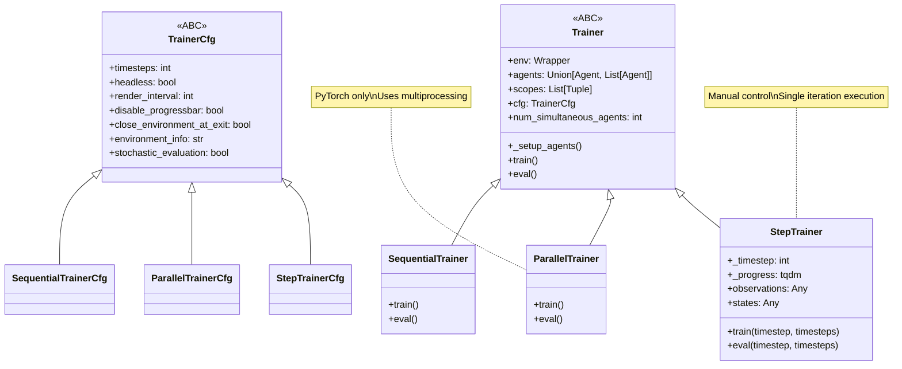
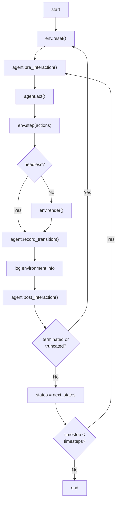
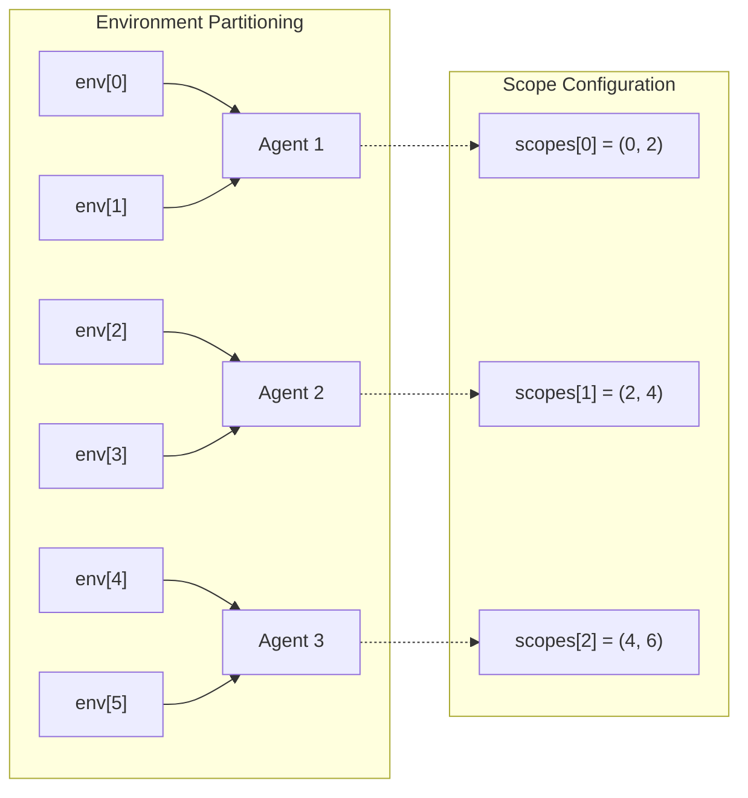
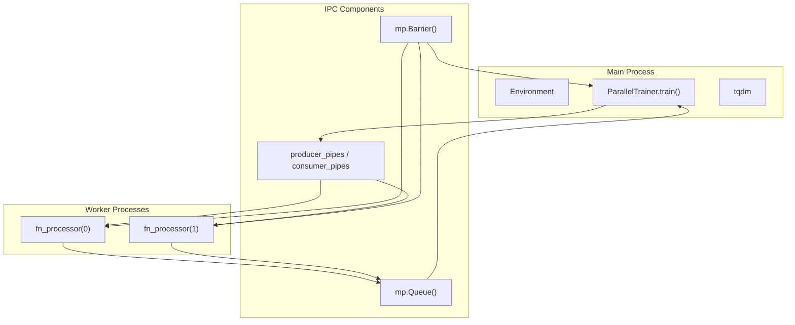
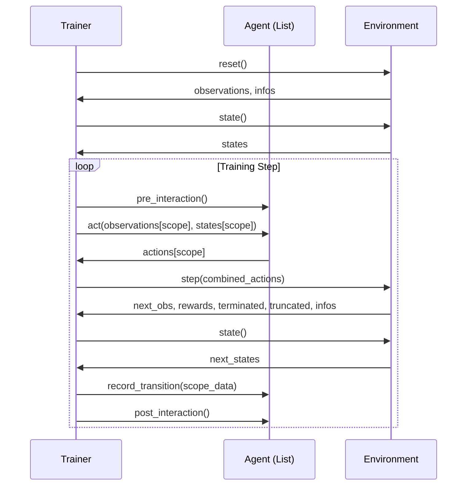

<!-- source: DeepWiki mcp.deepwiki.com · repo Toni-SM/skrl · page 5 Trainers · fetched 2026-10-30 -->

# Trainers

Relevant source files

The following files were used as context for generating this wiki page:

- [docs/source/api/trainers.rst](docs/source/api/trainers.rst)
- [docs/source/api/trainers/parallel.rst](docs/source/api/trainers/parallel.rst)
- [docs/source/api/trainers/sequential.rst](docs/source/api/trainers/sequential.rst)
- [docs/source/api/trainers/step.rst](docs/source/api/trainers/step.rst)
- [docs/source/api/utils/huggingface.rst](docs/source/api/utils/huggingface.rst)
- [docs/source/api/utils/postprocessing.rst](docs/source/api/utils/postprocessing.rst)
- [docs/source/snippets/trainer.py](docs/source/snippets/trainer.py)
- [skrl/trainers/jax/__init__.py](skrl/trainers/jax/__init__.py)
- [skrl/trainers/jax/base.py](skrl/trainers/jax/base.py)
- [skrl/trainers/jax/sequential.py](skrl/trainers/jax/sequential.py)
- [skrl/trainers/jax/step.py](skrl/trainers/jax/step.py)
- [skrl/trainers/torch/__init__.py](skrl/trainers/torch/__init__.py)
- [skrl/trainers/torch/base.py](skrl/trainers/torch/base.py)
- [skrl/trainers/torch/parallel.py](skrl/trainers/torch/parallel.py)
- [skrl/trainers/torch/sequential.py](skrl/trainers/torch/sequential.py)
- [skrl/trainers/torch/step.py](skrl/trainers/torch/step.py)
- [skrl/trainers/warp/base.py](skrl/trainers/warp/base.py)

Trainers are the orchestration components responsible for managing the complete reinforcement learning training and evaluation loops. They coordinate interactions between agents and environments, handle multi-agent scenarios, manage parallel execution, and provide different execution strategies (sequential, parallel, and step-by-step control).

For information about the agents that trainers orchestrate, see [Agents](#2). For environment integration details, see [Environments](#4).

## Architecture Overview

The trainer system is built around a base `Trainer` class with specialized implementations for different execution strategies. Each trainer type supports PyTorch, JAX, and Warp backends with consistent APIs.

### Trainer Class Hierarchy

Sources: [skrl/trainers/torch/base.py:38-130](), [skrl/trainers/torch/sequential.py:17-54](), [skrl/trainers/torch/parallel.py:135-167](), [skrl/trainers/torch/step.py:19-64]()

### Backend Support Matrix

| Trainer Type | PyTorch | JAX | Warp | Key Features |
|-------------|---------|-----|------|--------------|
| `SequentialTrainer` | ✓ | ✓ | ✓ | Standard training loop |
| `ParallelTrainer` | ✓ | ✗ | ✗ | Multi-process execution |
| `StepTrainer` | ✓ | ✓ | ✗ | Manual step control |

Sources: [skrl/trainers/torch/__init__.py:1-5](), [skrl/trainers/jax/__init__.py:1-4](), [docs/source/snippets/trainer.py:1-112]()

## Training Loop Orchestration

All trainers follow a consistent interaction pattern that coordinates agents and environments through standardized phases. The base `Trainer` class provides the default `train()` and `eval()` logic for single-agent scenarios, while subclasses override these for multi-agent or parallel execution.

### Core Training Flow

Sources: [skrl/trainers/torch/base.py:177-245](), [skrl/trainers/jax/base.py:176-241]()

### Agent Scope Management

Trainers support multiple simultaneous agents by partitioning environments using agent scopes. The `scopes` parameter defines the range of environment indices each agent operates on.

The `generate_equally_spaced_scopes()` function automatically distributes environments when scopes are not explicitly provided:

Sources: [skrl/trainers/torch/base.py:18-35](), [skrl/trainers/torch/base.py:131-171]()

## Trainer Types

### SequentialTrainer

The `SequentialTrainer` executes agents sequentially within each timestep, processing all agents before stepping the environment.

**Key characteristics:**
- Agents process states and generate actions one after another.
- Single environment step per timestep after all agents act [skrl/trainers/torch/sequential.py:108]().
- Supports both single-agent and multi-agent scenarios.
- Available in PyTorch, JAX, and Warp backends.

Sources: [skrl/trainers/torch/sequential.py:22-47](), [skrl/trainers/torch/sequential.py:55-152]()

### ParallelTrainer

The `ParallelTrainer` uses multiprocessing to execute multiple agents in parallel, providing performance improvements for CPU-bound computations.

**Key features:**
- Uses `torch.multiprocessing` with `spawn` method [skrl/trainers/torch/parallel.py:166]().
- Agents share memory for models and experience buffers via `share_memory_()` [skrl/trainers/torch/parallel.py:70]().
- Synchronization via barriers and message passing pipes [skrl/trainers/torch/parallel.py:36-132]().
- PyTorch backend only.

**Processor tasks (`fn_processor`):**
- `"init"`: Initialize agent in worker process [skrl/trainers/torch/parallel.py:44]().
- `"pre_interaction"`: Execute pre-interaction phase [skrl/trainers/torch/parallel.py:51]().
- `"act"`: Compute actions [skrl/trainers/torch/parallel.py:56]().
- `"record_transition"`: Store experience [skrl/trainers/torch/parallel.py:75]().
- `"post_interaction"`: Execute post-interaction phase [skrl/trainers/torch/parallel.py:102]().
- `"terminate"`: Shutdown worker process [skrl/trainers/torch/parallel.py:40]().

Sources: [skrl/trainers/torch/parallel.py:18-134](), [skrl/trainers/torch/parallel.py:140-431]()

### StepTrainer

The `StepTrainer` provides manual control over the training loop, executing single iterations on demand.

**Key characteristics:**
- Single-step execution via `train()` and `eval()` methods [skrl/trainers/torch/step.py:63-183]().
- Manual timestep management with internal `_timestep` counter [skrl/trainers/torch/step.py:57]().
- Returns environment transition data (observations, rewards, terminated, truncated, info) for external processing [skrl/trainers/torch/step.py:81]().
- Suitable for custom training logic and debugging.

Sources: [skrl/trainers/torch/step.py:24-61](), [skrl/trainers/jax/step.py:27-65]()

## Multi-Agent Support

Trainers automatically detect and handle multi-agent environments through specialized logic in the base `Trainer` class and specific overrides in subclasses.

### Multi-Agent Interaction Sequence

Sources: [skrl/trainers/torch/sequential.py:87-143](), [skrl/trainers/torch/base.py:313-363]()

## Configuration System

All trainers use the `TrainerCfg` dataclass for parameter management.

### Common Configuration Parameters

| Parameter | Type | Default | Description |
|-----------|------|---------|-------------|
| `timesteps` | int | 100000 | Total training/evaluation timesteps [skrl/trainers/torch/base.py:42](). |
| `headless` | bool | False | Whether to disable environment rendering [skrl/trainers/torch/base.py:45](). |
| `render_interval` | int | 1 | Timestep interval for rendering [skrl/trainers/torch/base.py:48](). |
| `disable_progressbar` | bool | False | Whether to hide the progress bar [skrl/trainers/torch/base.py:51](). |
| `environment_info` | str | "episode" | Key for logging environment info [skrl/trainers/torch/base.py:57](). |
| `stochastic_evaluation` | bool | False | Use stochastic actions during evaluation [skrl/trainers/torch/base.py:60](). |

Sources: [skrl/trainers/torch/base.py:38-70](), [skrl/trainers/jax/base.py:37-68]()

## Backend Differences

### PyTorch Implementation
- Uses `torch.no_grad()` for inference [skrl/trainers/torch/sequential.py:90]().
- Supports distributed training via `config.torch.is_distributed` [skrl/trainers/torch/base.py:109]().
- Includes `ParallelTrainer` using `torch.multiprocessing`.

### JAX Implementation
- Uses `contextlib.nullcontext()` instead of `torch.no_grad()` [skrl/trainers/jax/sequential.py:91]().
- Uses `jax.numpy` for array operations [skrl/trainers/jax/sequential.py:105]().
- Supports distributed training via `config.jax.is_distributed` [skrl/trainers/jax/base.py:108]().

### Warp Implementation
- Focused on `SequentialTrainer` for high-performance vectorized environments.
- API mirrors the PyTorch implementation for consistency.

Sources: [skrl/trainers/torch/base.py:109-111](), [skrl/trainers/jax/base.py:108-110](), [docs/source/snippets/trainer.py:37-52]()

---

