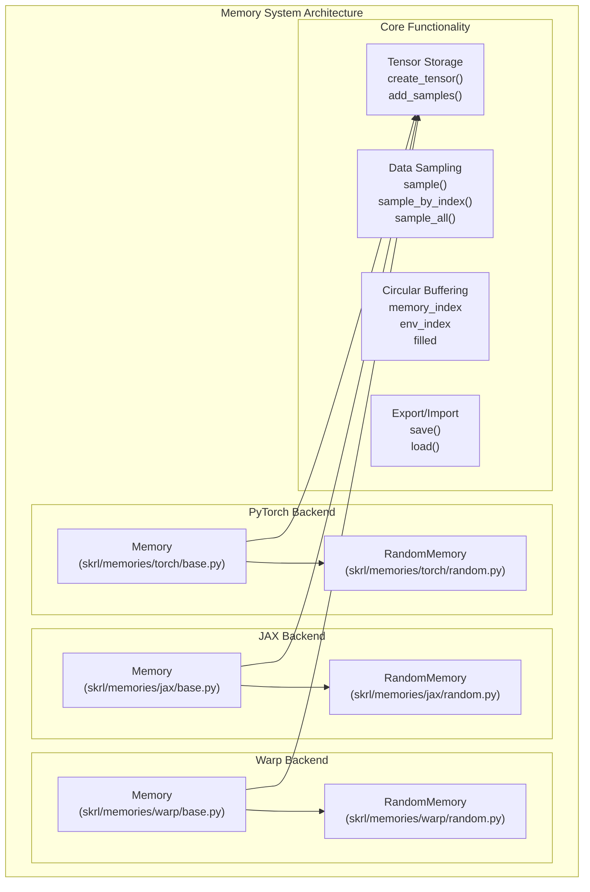
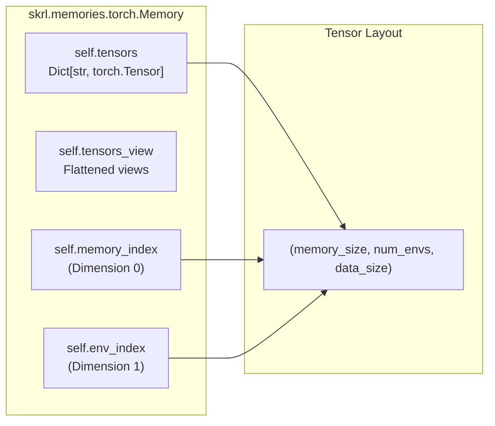
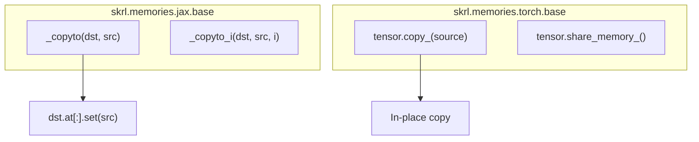

<!-- source: DeepWiki mcp.deepwiki.com · repo Toni-SM/skrl · page 6 Memories · fetched 2026-10-30 -->

# Memories

Relevant source files

The following files were used as context for generating this wiki page:

- [docs/source/api/agents.rst](docs/source/api/agents.rst)
- [docs/source/api/memories.rst](docs/source/api/memories.rst)
- [docs/source/api/memories/random.rst](docs/source/api/memories/random.rst)
- [docs/source/api/resources/noises.rst](docs/source/api/resources/noises.rst)
- [docs/source/snippets/memories.py](docs/source/snippets/memories.py)
- [docs/source/snippets/noises.py](docs/source/snippets/noises.py)
- [skrl/memories/__init__.py](skrl/memories/__init__.py)
- [skrl/memories/jax/__init__.py](skrl/memories/jax/__init__.py)
- [skrl/memories/jax/base.py](skrl/memories/jax/base.py)
- [skrl/memories/jax/random.py](skrl/memories/jax/random.py)
- [skrl/memories/torch/__init__.py](skrl/memories/torch/__init__.py)
- [skrl/memories/torch/base.py](skrl/memories/torch/base.py)
- [skrl/memories/torch/random.py](skrl/memories/torch/random.py)
- [skrl/memories/warp/random.py](skrl/memories/warp/random.py)
- [skrl/models/jax/__init__.py](skrl/models/jax/__init__.py)
- [skrl/models/jax/base.py](skrl/models/jax/base.py)
- [skrl/models/torch/__init__.py](skrl/models/torch/__init__.py)
- [skrl/models/torch/tabular.py](skrl/models/torch/tabular.py)

The Memories system provides experience replay functionality for reinforcement learning agents in skrl. This system stores and manages transitions (state, action, reward, next state, etc.) collected during environment interaction, enabling agents to learn from past experiences through batch sampling. The memory system supports PyTorch, JAX, and Warp backends with standardized APIs.

For information about agents that use these memories, see [Agents](#2). For details about models and neural networks, see [Models](#3).

## Architecture Overview

The memory system follows a multi-backend architecture with shared interfaces and backend-specific implementations. All memory classes inherit from a `Memory` base class that provides core functionality for tensor storage, circular buffering, and data sampling.

Sources: [skrl/memories/torch/base.py:20-30](), [skrl/memories/jax/base.py:38-48](), [skrl/memories/torch/random.py:10-21](), [skrl/memories/jax/random.py:11-22](), [skrl/memories/warp/random.py:11-22]()

## Base Memory Class

The `Memory` base class implements a circular buffer mechanism. Buffers are allocated as tensors with shape `(memory_size, num_envs, data_size)` [skrl/memories/torch/base.py:33-35]().

### Core Components

| Component | Purpose | Key Methods |
|-----------|---------|-------------|
| **Tensor Storage** | Dynamic tensor creation and management | `create_tensor()`, `get_tensor_by_name()`, `set_tensor_by_name()` |
| **Circular Buffering** | Efficient memory usage with fixed-size buffers | `add_samples()`, `reset()` |
| **Data Sampling** | Batch generation for training | `sample()`, `sample_by_index()`, `sample_all()` |
| **Export/Import** | Persistence and data sharing | `save()`, `load()` |

### Tensor Management

The `create_tensor` API allows agents to define the specific data fields they need to store (e.g., "states", "actions", "rewards"). It handles dimension flattening unless `keep_dimensions` is enabled [skrl/memories/torch/base.py:121-171]().

Sources: [skrl/memories/torch/base.py:59-65](), [skrl/memories/torch/base.py:162-166](), [skrl/memories/jax/base.py:77-85]()

## Data Addition and Circular Buffering

The `add_samples()` method supports multi-environment data collection. It automatically manages the transition between environments and memory slots. If the memory is full and `export=True`, it triggers an automatic export before overwriting data [skrl/memories/torch/base.py:40-41]().

Sources: [skrl/memories/torch/base.py:202-283](), [skrl/memories/jax/base.py:247-346]()

## RandomMemory Implementation

`RandomMemory` is the standard implementation for experience replay. It supports sampling with or without replacement [skrl/memories/torch/random.py:33-36]().

### Sampling Mechanisms

- **Random Sampling**: Generates random indexes using `torch.randperm` (PyTorch) or `np.random.permutation` (JAX/Warp) [skrl/memories/torch/random.py:75](), [skrl/memories/jax/random.py:74]().
- **Sequence Sampling**: If `sequence_length > 1`, the memory generates contiguous blocks of indexes to support Recurrent Neural Networks (RNNs) [skrl/memories/torch/random.py:77-79]().
- **Mini-batches**: The `sample` method can return data partitioned into `mini_batches` for optimization loops [skrl/memories/torch/random.py:58]().

Sources: [skrl/memories/torch/random.py:51-81](), [skrl/memories/jax/random.py:52-80](), [skrl/memories/warp/random.py:52-80]()

## Data Export and Import

Memories can be exported to several formats for offline RL or debugging. Supported formats include:
- **PyTorch (`.pt`)**: Saves the internal tensor dictionary using `torch.save` [skrl/memories/torch/base.py:28]().
- **NumPy (`.npz`)**: Exports as a compressed NumPy archive [skrl/memories/torch/base.py:28]().
- **CSV (`.csv`)**: A flattened comma-separated representation [skrl/memories/torch/base.py:28]().

Sources: [skrl/memories/torch/base.py:365-414](), [skrl/memories/jax/base.py:372]()

## Backend-Specific Implementations

### PyTorch Backend
Uses `torch.Tensor` and supports `share_memory()` for multiprocessing scenarios, allowing tensors to be shared across processes without duplication [skrl/memories/torch/base.py:86-90]().

### JAX Backend
Uses `jax.Array` and `jax.jit` for performance. Since JAX arrays are immutable, updates are performed using functional helpers like `_copyto` which utilize the `.at[:].set()` syntax [skrl/memories/jax/base.py:22-35]().

### Warp Backend
Implements memory using `wp.array`. Sampling logic follows the NumPy-based index generation similar to JAX but returns Warp arrays for GPU-accelerated agents [skrl/memories/warp/random.py:52-80]().

Sources: [skrl/memories/jax/base.py:22-35](), [skrl/memories/torch/base.py:86-90](), [skrl/memories/torch/base.py:118-119]()

---

